# Page: 3FS System Overview

# 3FS System Overview

<details>
<summary>Relevant source files</summary>

The following files were used as context for generating this wiki page:

- [.clang-tidy](.clang-tidy)
- [README.md](README.md)
- [dockerfile/dev.opencloudos9.dockerfile](dockerfile/dev.opencloudos9.dockerfile)
- [docs/README.md](docs/README.md)
- [docs/design_notes.md](docs/design_notes.md)
- [specs/README.md](specs/README.md)
- [src/lib/api/UsrbIo.md](src/lib/api/UsrbIo.md)
- [src/stubs/CMakeLists.txt](src/stubs/CMakeLists.txt)

</details>


## Purpose and Scope

This document provides a comprehensive overview of the Fire-Flyer File System (3FS), a high-performance distributed file system specifically designed for AI and machine learning workloads. It introduces the system's disaggregated architecture, key design principles, and performance characteristics.

For detailed technical explanations, refer to the following child pages:
- [System Architecture](#1.1) — Detailed explanation of 3FS's disaggregated architecture, CRAQ consistency model, storage layers, and supported workloads.
- [Third-Party Dependencies](#1.2) — Comprehensive overview of external dependencies like RocksDB, FoundationDB, and Folly.

## What is 3FS?

The Fire-Flyer File System (3FS) is a distributed file system designed to address the challenges of AI training and inference workloads [README.md:6-7](). It leverages modern SSDs and RDMA networks to provide a shared storage layer that simplifies the development of distributed applications [README.md:6-9]().

### High-Level System Architecture

3FS consists of four primary components: a cluster manager (`mgmtd`), a metadata service (`meta`), a storage service (`storage`), and a client [docs/design_notes.md:5]().

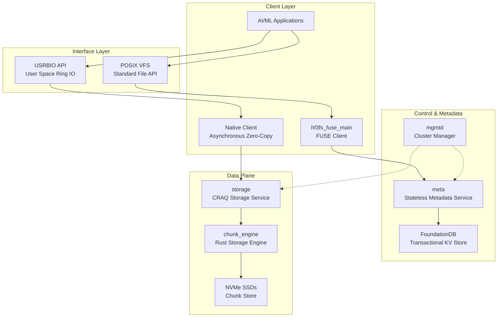
Sources: [docs/design_notes.md:3-14](), [src/lib/api/UsrbIo.md:3-12]()

### Key Design Principles

3FS is built around several core design principles that optimize for massive AI datasets:

| Principle | Implementation | Benefits |
|-----------|---------------|----------|
| **Disaggregated Architecture** | Combines throughput of thousands of SSDs and network bandwidth of hundreds of storage nodes [README.md:9](). | Locality-oblivious access; elastic scaling of compute and storage. |
| **Strong Consistency** | Chain Replication with Apportioned Queries (CRAQ) [README.md:10](). | Simplifies application logic; "write-all-read-any" approach [docs/design_notes.md:11](). |
| **Stateless Metadata** | Metadata services backed by FoundationDB [README.md:11](). | High availability and horizontal scalability of metadata operations. |
| **Zero-Copy I/O** | USRBIO API using shared memory rings (Ior/Iov) [src/lib/api/UsrbIo.md:3-12](). | Bypasses FUSE bottlenecks and memory copy overhead [docs/design_notes.md:29-32](). |

## Supported Workloads

3FS handles diverse AI/ML workload patterns through its flexible file interface and high-performance data path [README.md:13-17]().

### Workload Architecture

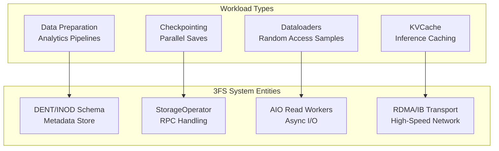
Sources: [README.md:14-17](), [docs/design_notes.md:11-13]()

### Workload Characteristics
- **Data Preparation**: Manages large volumes of intermediate outputs efficiently using hierarchical directory structures [README.md:14]().
- **Dataloaders**: Enables random access to training samples across compute nodes, eliminating the need for prefetching or shuffling [README.md:15]().
- **Checkpointing**: Supports high-throughput parallel checkpointing for large-scale training [README.md:16]().
- **KVCache for Inference**: Provides a cost-effective alternative to DRAM-based caching for LLMs, offering significantly larger capacity [README.md:17]().

## Performance Characteristics

3FS delivers exceptional performance by utilizing RDMA networks and NVMe SSDs.

### Performance Metrics
- **Peak Throughput**: Reached approximately 6.6 TiB/s aggregate read throughput on a 180-node cluster [README.md:30]().
- **GraySort**: Achieved 3.66 TiB/min average throughput when sorting 110.5 TiB of data [README.md:40]().
- **KVCache**: Peak read throughput reaching up to 40 GiB/s for inference clients [README.md:50]().

### Benchmarking Infrastructure
3FS includes specialized tools for performance validation:
- **fio engine for USRBIO**: An FIO plugin located at `benchmarks/fio_usrbio/` for standard benchmarking [README.md:34]().
- **Storage Bench**: A C++ framework for stress testing the storage layer.

## System Components and Technology Stack

3FS uses a polyglot approach, combining C++ for core services and networking with Rust for the storage engine and system utilities.

### Technology Mapping

| Category | Component / Library | Purpose |
|-----------|----------------------|---------|
| **Core Services** | C++17/20 | `mgmtd`, `meta`, `storage`, and `hf3fs_fuse` [docs/design_notes.md:5-13](). |
| **Storage Engine** | Rust (`chunk_engine`) | High-performance local SSD management [README.md:120](). |
| **Metadata Store** | FoundationDB | Transactional persistence for file metadata [README.md:98](). |
| **Networking** | RDMA / InfiniBand | Low-latency, high-bandwidth communication [docs/design_notes.md:5](). |
| **Client Interface** | libfuse 3.16.1+ | POSIX compatibility for standard applications [README.md:97](). |

## Getting Started

To begin working with 3FS, the repository must be cloned with submodules initialized and patches applied [README.md:57-66]().

```bash
git clone https://github.com/deepseek-ai/3fs
cd 3fs
git submodule update --init --recursive
./patches/apply.sh
```

### Build Requirements
- **Compiler**: Clang-14 is required for building the C++ components [README.md:108]().
- **Rust**: Version 1.75.0 (minimal) or 1.85.0 (recommended) [README.md:99]().
- **Build System**: CMake is used to orchestrate both C++ and Rust (via Cargo) builds [README.md:107-111]().

For detailed deployment instructions, see the [Setup Guide](deploy/README.md) [README.md:22]().

---

# Page: System Architecture

# System Architecture

<details>
<summary>Relevant source files</summary>

The following files were used as context for generating this wiki page:

- [.clang-tidy](.clang-tidy)
- [CMakeLists.txt](CMakeLists.txt)
- [README.md](README.md)
- [dockerfile/dev.opencloudos9.dockerfile](dockerfile/dev.opencloudos9.dockerfile)
- [docs/design_notes.md](docs/design_notes.md)
- [specs/README.md](specs/README.md)
- [src/common/utils/Shuffle.h](src/common/utils/Shuffle.h)
- [src/fbs/meta/Schema.cc](src/fbs/meta/Schema.cc)
- [src/lib/api/UsrbIo.md](src/lib/api/UsrbIo.md)
- [src/meta/components/ChainAllocator.h](src/meta/components/ChainAllocator.h)
- [src/stubs/CMakeLists.txt](src/stubs/CMakeLists.txt)
- [tests/common/utils/TestShuffle.cc](tests/common/utils/TestShuffle.cc)

</details>


## Purpose and Scope

This document provides a detailed explanation of the Fire-Flyer File System (3FS) system architecture, including its disaggregated design, consistency model, storage layers, and workload support. It describes how the major architectural components interact to deliver high-performance distributed storage for AI workloads.

3FS is designed to overcome the performance limitations of traditional FUSE-based systems by providing an asynchronous zero-copy API (USRBIO) and a stateless metadata layer backed by FoundationDB.

**Sources:** [README.md:1-18](), [docs/design_notes.md:1-13]()

## Disaggregated Architecture Overview

3FS implements a disaggregated storage architecture that separates compute, metadata, and storage into independent scaling tiers. This design combines the aggregate throughput of thousands of SSDs and the network bandwidth of hundreds of storage nodes, enabling applications to access storage resources in a locality-oblivious manner.

The architecture consists of four primary components:

1.  **Cluster Manager (mgmtd)**: Handles membership changes, lease-based primary election, and distributes cluster configuration.
2.  **Metadata Service (meta)**: Stateless service implementing file system semantics (open, create, rename) backed by FoundationDB.
3.  **Storage Service (storage)**: Manages local SSDs, provides a chunk store interface, and implements CRAQ for consistency.
4.  **Client**: Includes the FUSE daemon and a native client offering an asynchronous zero-copy API (USRBIO).

**Sources:** [README.md:6-11](), [docs/design_notes.md:5-13]()

## Layered Architecture

### Diagram: 3FS Component Layers

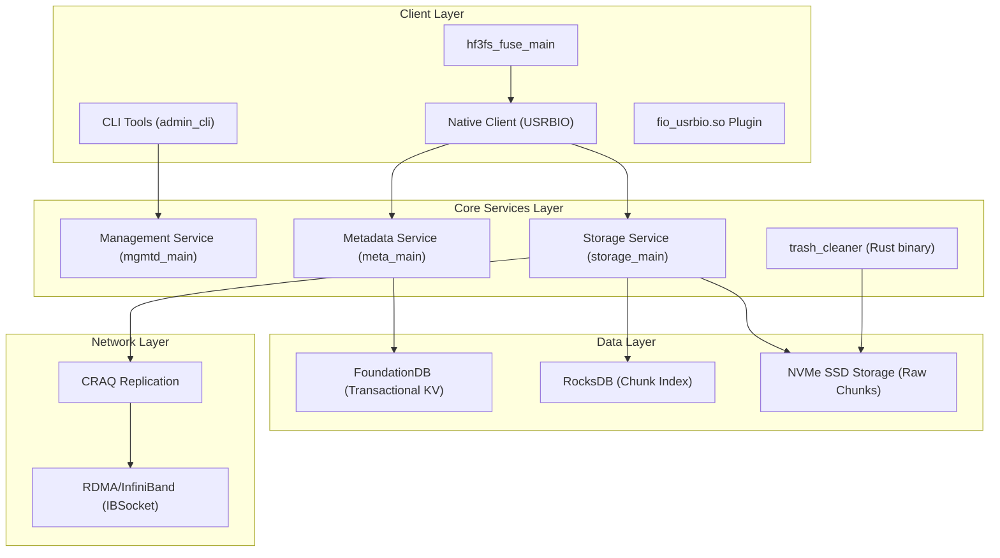

**Sources:** [docs/design_notes.md:5-14](), [src/lib/api/UsrbIo.md:1-12]()

### Client Layer and USRBIO

The client layer provides multiple interfaces, but performance-critical AI workloads primarily use the **USRBIO (User Space Ring Based IO)** API. This API is inspired by Linux `io_uring` and bypasses FUSE limitations like memory copy overhead and lock contention.

| Concept | Implementation | Description |
| :--- | :--- | :--- |
| **Iov** | `struct hf3fs_iov` | A large shared memory region for zero-copy read/write operations [src/lib/api/UsrbIo.md:71-78](). |
| **Ior** | `struct hf3fs_ior` | A shared ring buffer for communication between user processes and the FUSE daemon [src/lib/api/UsrbIo.md:21-30](). |
| **Registration** | `hf3fs_reg_fd` | Maps standard file descriptors to USRBIO-compatible handles [src/lib/api/UsrbIo.md:111-128](). |

**Sources:** [docs/design_notes.md:27-50](), [src/lib/api/UsrbIo.md:1-12]()

### Core Services Layer

#### Management Service (mgmtd)
The cluster manager handles heartbeats from metadata and storage services. It maintains the **RoutingInfo** and **ChainTable**, which define how data is distributed across the cluster. It typically stores configuration in FoundationDB to reduce dependencies.

**Sources:** [docs/design_notes.md:7-8](), [src/meta/components/ChainAllocator.h:130-135]()

#### Metadata Service
The metadata service is **stateless**. It handles operations like `open`, `create`, and `stat`. File metadata is stored in FoundationDB. When a file is created, the metadata service allocates a **Layout**, which defines how chunks are striped across replication chains.

**Sources:** [docs/design_notes.md:9](), [src/fbs/meta/Schema.cc:93-127](), [src/meta/components/ChainAllocator.h:49-65]()

#### Storage Service
The storage service manages physical SSDs. It uses **RocksDB** to index chunk IDs and stores raw data on NVMe drives. It implements the CRAQ protocol to ensure that writes are replicated across a chain before being acknowledged.

**Sources:** [docs/design_notes.md:11](), [README.md:107]()

## CRAQ Consistency Model

3FS implements **Chain Replication with Apportioned Queries (CRAQ)**. This model provides strong consistency (linearizability) while allowing any node in a replication chain to serve read requests, provided the data is "clean".

### Diagram: CRAQ Write and Read Flow

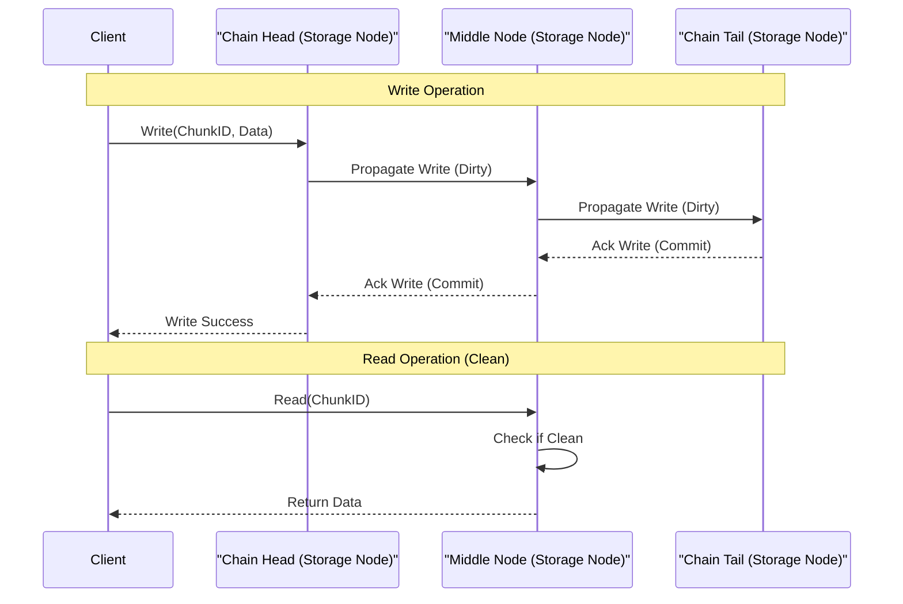

**Sources:** [docs/design_notes.md:11](), [specs/README.md:16]()

## Data Placement and Shuffling

To ensure uniform data distribution, 3FS uses a deterministic shuffling mechanism for chain selection. Because `std::shuffle` behavior can vary between GCC versions, 3FS implements explicit `gcc10_shuffle` and `gcc11_shuffle` algorithms to maintain compatibility across clusters.

- **ChainRange**: Defines a range of chains in a `ChainTable` that a file can use.
- **Shuffle Method**: Configured via the `SHUFFLE_METHOD` CMake option (`g++10`, `g++11`, or `stdshuffle`).
- **Safe Seeds**: The `find_safe_seed` function ensures that the chosen seed produces identical results across different compiler implementations.

**Sources:** [CMakeLists.txt:30-54](), [src/common/utils/Shuffle.h:26-34](), [src/common/utils/Shuffle.h:196-206](), [src/fbs/meta/Schema.cc:122-127]()

## Supported Workloads

### AI Workloads and 3FS Features

| Workload | 3FS Architectural Advantage |
| :--- | :--- |
| **Dataloaders** | Eliminates prefetching by enabling random access to samples across nodes via USRBIO [README.md:15](). |
| **Checkpointing** | Supports high-throughput parallel writes to disaggregated storage nodes [README.md:16](). |
| **KVCache** | Uses SSDs as a cost-effective, high-capacity alternative to DRAM for inference [README.md:17](). |
| **Data Preparation** | Atomic directory manipulations and hard links for snapshotting datasets [docs/design_notes.md:17-24](). |

**Sources:** [README.md:13-17](), [docs/design_notes.md:17-24]()

## Performance Characteristics

The 3FS architecture is optimized for high-bandwidth RDMA networks:

- **Peak Throughput**: Reached ~6.6 TiB/s on a 180-node cluster using 200Gbps InfiniBand.
- **GraySort**: Achieved 3.66 TiB/min using 25 storage nodes and 50 compute nodes.
- **KVCache**: Demonstrated peak read throughput of 40 GiB/s for LLM inference.

**Sources:** [README.md:28-51]()

---

# Page: Third-Party Dependencies

# Third-Party Dependencies

<details>
<summary>Relevant source files</summary>

The following files were used as context for generating this wiki page:

- [.clang-tidy](.clang-tidy)
- [README.md](README.md)
- [dockerfile/dev.opencloudos9.dockerfile](dockerfile/dev.opencloudos9.dockerfile)
- [patches/apply.sh](patches/apply.sh)
- [patches/rocksdb.patch.2](patches/rocksdb.patch.2)

</details>


## Purpose and Scope

This page documents the third-party dependencies used by 3FS, including libraries managed as Git submodules and external system dependencies. It covers the purpose of each dependency, version requirements, and how they are integrated into the build system. For information about how these dependencies are built and linked in the CMake configuration, see [C++ Build Configuration](2.3). For Rust crate dependencies managed through Cargo, see [Rust Components](2.2).

---

## Dependency Management Overview

3FS manages third-party dependencies through two primary mechanisms:

1.  **Git Submodules**: C++ libraries included as submodules in the `third_party/` directory.
2.  **External Dependencies**: System libraries and tools installed separately (FoundationDB, Boost, libfuse, etc.).

All submodule dependencies are initialized and updated via the `git submodule update --init --recursive` command [README.md:64]().

### Submodule Patching

Because 3FS requires specific modifications to some external libraries, it includes a patching mechanism. The script `patches/apply.sh` applies custom patches to submodules after they are checked out [README.md:65]().

For example, RocksDB requires symbol renaming for its object registration functions to avoid naming collisions or to fit 3FS's internal namespace requirements. The patch `patches/rocksdb.patch.2` renames `RegisterCassandraObjects` to `RocksDBRegisterCassandraObjects` and `RegisterTtlObjects` to `RocksDBRegisterTtlObjects` [patches/rocksdb.patch.2:9-10,66-67]().

**Sources**: [README.md:64-66](), [patches/apply.sh:1-24](), [patches/rocksdb.patch.2:1-108]()

---

## Git Submodule Dependencies

### Storage Engines

3FS utilizes specialized key-value stores for managing metadata and chunk indexing.

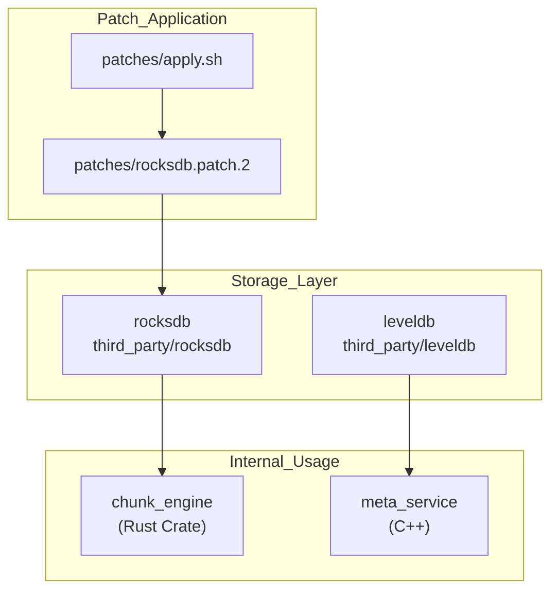

*   **RocksDB** (`third_party/rocksdb`): A high-performance embedded KV store. It is heavily utilized by the Rust-based `chunk_engine` [README.md:111](). 3FS applies specific patches to its internal object registry to prevent symbol conflicts [patches/rocksdb.patch.2:23-32]().
*   **LevelDB** (`third_party/leveldb`): Used for lightweight persistent storage where the advanced features of RocksDB are not required.

**Sources**: [README.md:64-66](), [patches/rocksdb.patch.2:1-108](), [patches/apply.sh:7-17]()

---

### Core C++ Libraries

3FS relies on several high-performance C++ libraries to provide concurrency, formatting, and data structures.

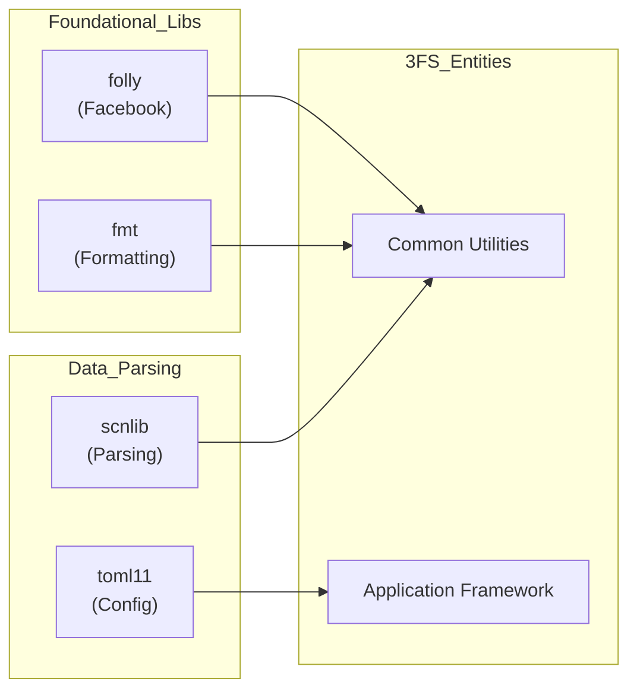

*   **Facebook Folly** (`third_party/folly`): Provides the backbone for 3FS's asynchronous programming model, including specialized executors and concurrent data structures. 3FS applies custom patches to Folly via `patches/folly.patch` [patches/apply.sh:19-23]().
*   **{fmt}** (`third_party/fmt`): Used for modern, type-safe string formatting throughout the C++ codebase.
*   **scnlib** (`third_party/scnlib`): A modern replacement for `scanf`, used for efficient and safe input parsing.
*   **toml11** (`third_party/toml11`): A C++11 header-only library for parsing TOML configurations, used for service configuration files like `mgmtd_main.toml` and `storage_main.toml`.

**Sources**: [README.md:64-66](), [patches/apply.sh:19-23]()

---

### Memory Allocators and I/O

To achieve peak throughput (up to 6.6 TiB/s [README.md:30]()), 3FS utilizes optimized memory management and asynchronous I/O.

*   **jemalloc** (`third_party/jemalloc`): The default high-performance memory allocator used to minimize fragmentation in long-running distributed services.
*   **mimalloc** (`third_party/mimalloc`): A compact, high-performance allocator from Microsoft provided as an alternative.
*   **liburing** (`third_party/liburing`): Provides the userspace interface for Linux `io_uring`, enabling high-performance asynchronous I/O for the storage service and FUSE client.

**Sources**: [README.md:6-17, 28-32]()

---

## External Dependencies (System-Level)

Certain dependencies are expected to be present on the host system or provided via the development Docker images.

| Dependency | Version | Purpose |
| :--- | :--- | :--- |
| **FoundationDB** | 7.1+ | Transactional KV store for the stateless metadata service [README.md:98](). |
| **libfuse** | 3.16.1+ | Interface for the FUSE client [README.md:97](). |
| **Boost** | 1.71+ | Used for filesystem, system utilities, and program options [README.md:76](). |
| **Rust** | 1.85.0+ | Required for building the `chunk_engine` and other Rust components [README.md:99](). |
| **Clang/LLVM** | 14 | Primary compiler toolchain, including `clang-format` and `clang-tidy` [README.md:75, 108](). |

### FoundationDB Integration
3FS uses FoundationDB (FDB) as the persistence layer for its metadata service. The development environment setup requires installing both `foundationdb-clients` and `foundationdb-server` [dockerfile/dev.opencloudos9.dockerfile:32-35]().

### FUSE Integration
The FUSE client requires `libfuse` 3.x. The build process often involves compiling `libfuse` from source to ensure the correct version (3.16.2) is available with both static and shared libraries [dockerfile/dev.opencloudos9.dockerfile:18-27]().

**Sources**: [README.md:73-99](), [dockerfile/dev.opencloudos9.dockerfile:16-37]()

---

## Development and Quality Tools

3FS enforces code quality through third-party static analysis and formatting tools.

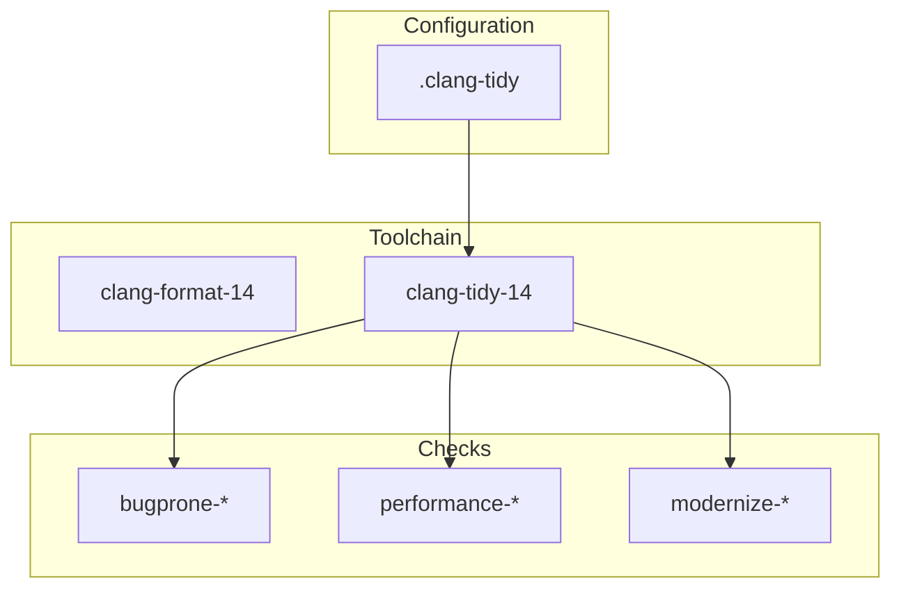

*   **Clang-Format**: Used to maintain consistent code style across the C++ codebase [README.md:75]().
*   **Clang-Tidy**: Performs static analysis. The `.clang-tidy` configuration file enables a wide range of checks, including `bugprone-infinite-loop`, `performance-move-const-arg`, and `modernize-use-nullptr` [.clang-tidy:13, 58, 70]().
*   **GoogleTest / GoogleMock**: The standard framework used for C++ unit testing and mocking [README.md:75]().

**Sources**: [README.md:74-81](), [.clang-tidy:1-113]()

---

# Page: Build System and Development

# Build System and Development

<details>
<summary>Relevant source files</summary>

The following files were used as context for generating this wiki page:

- [.github/workflows/build.yml](.github/workflows/build.yml)
- [CMakeLists.txt](CMakeLists.txt)
- [Cargo.lock](Cargo.lock)
- [Cargo.toml](Cargo.toml)
- [src/common/utils/Shuffle.h](src/common/utils/Shuffle.h)
- [src/fbs/meta/Schema.cc](src/fbs/meta/Schema.cc)
- [src/lib/api/CMakeLists.txt](src/lib/api/CMakeLists.txt)
- [src/lib/rs/hf3fs-usrbio-sys/lib/.dummy](src/lib/rs/hf3fs-usrbio-sys/lib/.dummy)
- [src/meta/components/ChainAllocator.h](src/meta/components/ChainAllocator.h)
- [tests/common/utils/TestShuffle.cc](tests/common/utils/TestShuffle.cc)

</details>


This document provides a comprehensive guide to building, developing, and contributing to the 3FS (Fire-Flyer File System) codebase. It covers the multi-language build system, development workflows, code quality tools, and environment setup procedures.

For information about specific Rust components, see [Rust Components](#2.2). For details about C++ build targets and configuration, see [C++ Build Configuration](#2.3). For CI/CD workflows and automation, see [CI/CD Pipeline](#2.5).

## Build System Architecture

The 3FS build system integrates both Rust and C++ components through a sophisticated CMake-based approach with Rust workspace management. The system supports multiple build configurations and cross-language interoperability.

### Multi-Language Build Integration

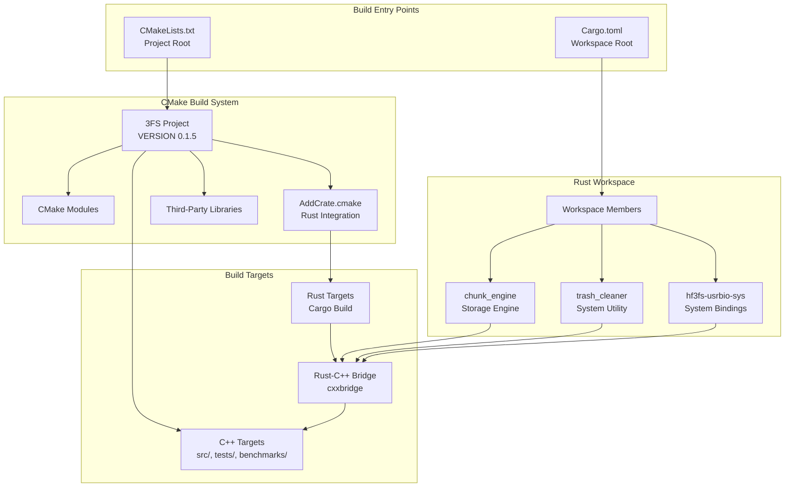

Sources: [CMakeLists.txt:1-183](), [Cargo.toml:1-23]()

## CMake Configuration

The primary build configuration is managed through CMake with extensive compiler and platform support. The build system supports multiple configurations and cross-platform development.

### Project Configuration

The CMake project is configured with the following key settings:

| Setting | Value | Purpose |
|---------|-------|---------|
| Project Name | `3FS` | Main project identifier |
| Version | `0.1.5` | Current project version |
| Languages | `C CXX` | Supported languages |
| C++ Standard | `20` | Modern C++ features |
| C Standard | `11` | Standard C compatibility |

The build system defines four primary build types configured in [CMakeLists.txt:4]():

- `RelWithDebInfo` (default): Optimized with debug information
- `Debug`: Unoptimized with full debugging support  
- `Release`: Fully optimized production build
- `MinSizeRel`: Size-optimized build

### Compiler Support and Flags

The system supports both Clang and GCC compilers with specific optimizations:

#### Compiler Support and Flag Configuration

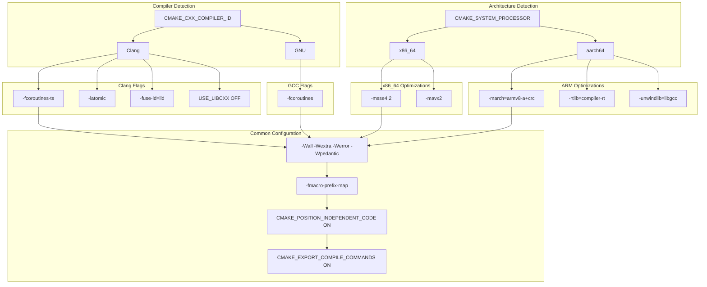

#### Compiler-Specific Configuration

**Clang Configuration** [CMakeLists.txt:83-88]():
- Coroutines support: `-fcoroutines-ts`
- Atomic operations linking: `-latomic` 
- Linker: `-fuse-ld=lld` (LLVM linker)
- FoundationDB compatibility: `USE_LIBCXX OFF` (do not use libc++)

**GCC Configuration** [CMakeLists.txt:89-91]():
- Coroutines support: `-fcoroutines`

#### Platform-Specific Optimizations

**x86_64 Architecture** [CMakeLists.txt:96-97]():
- SSE 4.2 instructions: `-msse4.2`
- AVX2 instructions: `-mavx2`

**ARM Architecture** [CMakeLists.txt:98-106]():
- ARM v8-A with CRC: `-march=armv8-a+crc`
- Compiler runtime library: `-rtlib=compiler-rt` (provides `__muloti4` symbol)
- Exception unwinding: `-unwindlib=libgcc`

#### Common Build Configuration

All builds include [CMakeLists.txt:74-81]():
- C++20 standard enforcement: `CMAKE_CXX_STANDARD 20`, `CMAKE_CXX_STANDARD_REQUIRED ON`
- C11 standard: `CMAKE_C_STANDARD 11`
- Position-independent code: `CMAKE_POSITION_INDEPENDENT_CODE ON`
- Compile commands export: `CMAKE_EXPORT_COMPILE_COMMANDS ON` (for IDE integration)
- Source path mapping: `-fmacro-prefix-map=${CMAKE_SOURCE_DIR}=.` (cleaner `__FILE__` output)

#### Warning Configuration

Strict warning flags [CMakeLists.txt:174]() applied after third-party dependencies:
- All warnings: `-Wall`
- Extra warnings: `-Wextra`
- Warnings as errors: `-Werror`
- Pedantic mode: `-Wpedantic`

Sources: [CMakeLists.txt:74-106](), [CMakeLists.txt:174]()

### Third-Party Dependencies

The build system integrates numerous third-party libraries through CMake subdirectories. All third-party libraries use `EXCLUDE_FROM_ALL` to prevent installation and use the `store_compile_flags()` / `restore_compile_flags()` pattern to isolate their build flags from 3FS strict warnings [CMakeLists.txt:112-172]().

| Library | Location | Purpose | Key Configuration |
|---------|----------|---------|-------------------|
| `fmt` | `third_party/fmt` | String formatting | Standard build |
| `zstd` | `third_party/zstd/build/cmake` | Compression | `ZSTD_BUILD_STATIC ON` |
| `googletest` | `third_party/googletest` | Testing framework | Standard build |
| `folly` | `third_party/folly` | Facebook utilities | `FOLLY_NO_EXCEPTION_TRACER ON` |
| `leveldb` | `third_party/leveldb` | Basic key-value storage | `LEVELDB_BUILD_TESTS OFF`, `LEVELDB_BUILD_BENCHMARKS OFF`, `LEVELDB_INSTALL OFF` |
| `rocksdb` | `third_party/rocksdb` | Advanced storage engine | `WITH_LZ4 ON`, `WITH_ZSTD ON`, `USE_RTTI ON`, tests/tools disabled, `ROCKSDB_NAMESPACE=rocksdb_internal` |
| `scnlib` | `third_party/scnlib` | Input scanning | All optional components disabled |
| `pybind11` | `third_party/pybind11` | Python bindings | Standard build |
| `toml11` | `third_party/toml11` | TOML parsing | Standard build |
| `mimalloc` | `third_party/mimalloc` | Memory allocator | `MI_OVERRIDE OFF` |
| `clickhouse-cpp` | `third_party/clickhouse-cpp` | ClickHouse client | Custom include directories for `clickhouse-cpp-lib` and `absl-lib` |
| `liburing` | `third_party/liburing-cmake` | Async I/O (io_uring) | Linux kernel interface |

#### Dependency Build Isolation

The `store_compile_flags()` and `restore_compile_flags()` macros (defined in [cmake/CompileFlags.cmake]()) are used before and after each third-party dependency to:
1. Save current compiler flags before building third-party code
2. Allow third-party libraries to build without 3FS's strict `-Werror` requirements
3. Restore strict flags for 3FS code

#### RocksDB Configuration

RocksDB receives special namespace isolation [CMakeLists.txt:107]():
```cmake
add_compile_definitions(ROCKSDB_NAMESPACE=rocksdb_internal)
```
This prevents symbol conflicts with other RocksDB installations on the system.

Sources: [CMakeLists.txt:107](), [CMakeLists.txt:112-172]()

## Rust Workspace Configuration

The Rust components are organized as a Cargo workspace with three primary crates and specific build profiles for CMake integration.

### Workspace Structure

The workspace is defined in [Cargo.toml:1-11]() with the following members:

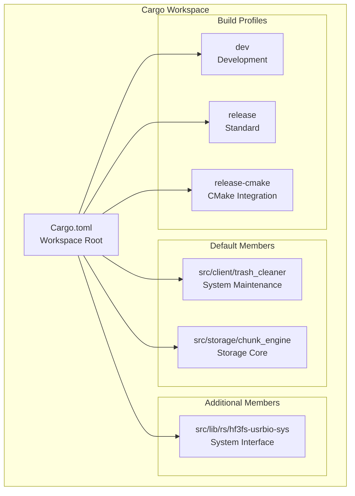

### Build Profile Configuration

The workspace defines a special `release-cmake` profile optimized for CMake integration:

| Setting | Value | Purpose |
|---------|-------|---------|
| `inherits` | `"release"` | Based on release configuration |
| `debug` | `true` | Include debug symbols |
| `lto` | `true` | Enable link-time optimization |

This profile ensures Rust components built through CMake maintain compatibility with C++ debug workflows while preserving optimization.

Sources: [Cargo.toml:13-23]()

## Multi-Language Integration

The integration between Rust and C++ components is facilitated through the `AddCrate.cmake` module and cxxbridge for type-safe interoperability.

### Development Workflow

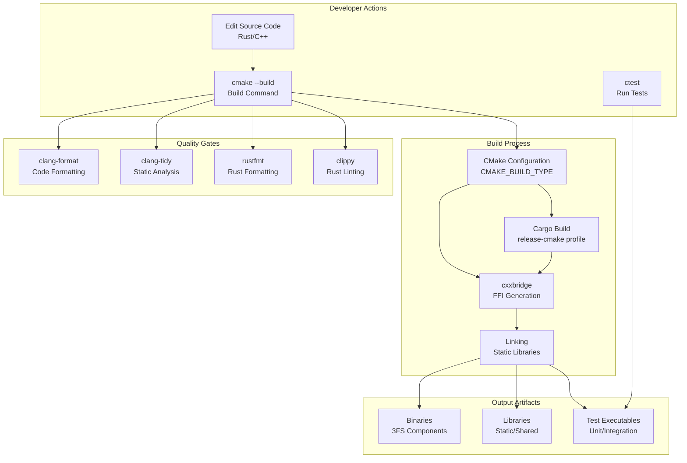

### Build Configuration Options

The build system provides several configuration options through CMake variables:

| Option | Type | Default | Description |
|--------|------|---------|-------------|
| `SHUFFLE_METHOD` | **Required** | None | Shuffle algorithm selection: `g++10`, `g++11`, or `stdshuffle` |
| `ENABLE_ASSERTIONS` | Optional | `ON` (Debug), `OFF` (others) | Enable runtime assertions with `_DEBUG` definition |
| `OVERRIDE_CXX_NEW_DELETE` | Optional | `OFF` | Override global new/delete operators (disabled with sanitizers) |
| `SAVE_ALLOCATE_SIZE` | Optional | `OFF` | Track allocation sizes (requires `OVERRIDE_CXX_NEW_DELETE`) |
| `ENABLE_FUSE_APPLICATION` | Optional | `ON` | Build FUSE integration components |

#### Required Configuration: SHUFFLE_METHOD

The `SHUFFLE_METHOD` parameter is mandatory and controls the shuffle algorithm used in sorting operations. The build will fail with an error if not specified:

```bash
# Valid build configuration
cmake -DSHUFFLE_METHOD=g++11 -DCMAKE_BUILD_TYPE=RelWithDebInfo ..

# Build fails without SHUFFLE_METHOD
cmake -DCMAKE_BUILD_TYPE=Debug ..
# Error: SHUFFLE_METHOD is not set!
```

The three available methods defined in [CMakeLists.txt:30]() are:
- `g++10`: Uses GCC 10 shuffle implementation with `USE_GCC10_SHUFFLE` definition
- `g++11`: Uses GCC 11 shuffle implementation with `USE_GCC11_SHUFFLE` definition  
- `stdshuffle`: Uses standard C++ `std::shuffle` with `USE_STD_SHUFFLE` definition

The choice of shuffle method is critical because different GCC versions (and `std::shuffle`) can produce different shuffle sequences for the same seed [src/common/utils/Shuffle.h:174-194](). The `safe_shuffle_seed` function [src/common/utils/Shuffle.h:174]() is used to verify that a given seed produces consistent results across `std::shuffle`, `gcc_shuffle<true>` (GCC 11), and `gcc_shuffle<false>` (GCC 10) implementations. This is particularly important for `Layout::ChainRange` [src/fbs/meta/Schema.h:122]() which uses `hf3fs_shuffle` [src/common/utils/Shuffle.h:162]() to determine chain distribution. The `find_safe_seed` function [src/common/utils/Shuffle.h:196]() attempts to find a seed that is safe across these implementations.

Sources: [CMakeLists.txt:30-72](), [src/common/utils/Shuffle.h:174-194](), [src/common/utils/Shuffle.h:174](), [src/common/utils/Shuffle.h:196](), [src/fbs/meta/Schema.h:122](), [src/common/utils/Shuffle.h:162]()

#### Memory Management Options

The `OVERRIDE_CXX_NEW_DELETE` option [CMakeLists.txt:56-71]() enables custom memory allocation tracking:
- Automatically disabled when `SANITIZER` is enabled to prevent conflicts
- When enabled with `SAVE_ALLOCATE_SIZE`, allocates additional memory to track allocation sizes
- Adds `OVERRIDE_CXX_NEW_DELETE` and optionally `SAVE_ALLOCATE_SIZE` preprocessor definitions

Sources: [CMakeLists.txt:30-72]()

## Build Targets and Subdirectories

The build system organizes code into three primary subdirectories, each serving distinct purposes:

| Directory | Purpose | Content |
|-----------|---------|---------|
| `src/` | Core implementation | Main 3FS components and libraries |
| `tests/` | Testing infrastructure | Unit tests and integration tests |
| `benchmarks/` | Performance measurement | Benchmarking tools and frameworks |

The modular CMake structure allows for selective building and testing of individual components while maintaining dependency resolution across the multi-language codebase.

Sources: [CMakeLists.txt:180-182]()

---

# Page: Multi-Language Build System

# Multi-Language Build System

<details>
<summary>Relevant source files</summary>

The following files were used as context for generating this wiki page:

- [.github/workflows/build.yml](.github/workflows/build.yml)
- [CMakeLists.txt](CMakeLists.txt)
- [Cargo.lock](Cargo.lock)
- [Cargo.toml](Cargo.toml)
- [src/common/utils/Shuffle.h](src/common/utils/Shuffle.h)
- [src/fbs/meta/Schema.cc](src/fbs/meta/Schema.cc)
- [src/lib/api/CMakeLists.txt](src/lib/api/CMakeLists.txt)
- [src/lib/rs/hf3fs-usrbio-sys/lib/.dummy](src/lib/rs/hf3fs-usrbio-sys/lib/.dummy)
- [src/meta/components/ChainAllocator.h](src/meta/components/ChainAllocator.h)
- [tests/common/utils/TestShuffle.cc](tests/common/utils/TestShuffle.cc)

</details>


## Purpose and Scope

This document describes the polyglot build system architecture for 3FS, which coordinates C++ and Rust compilation through CMake and Cargo. The build system integrates multiple language toolchains, manages third-party dependencies, and generates both native libraries and FFI bindings. For details on specific Rust components, see [Rust Components](#2.2). For C++ build configuration details, see [C++ Build Configuration](#2.3).

## Build System Architecture

3FS employs a hybrid build system where CMake serves as the primary orchestrator while delegating Rust compilation to Cargo. This architecture enables independent development in each language while maintaining build coherence.

### Build System Overview Diagram

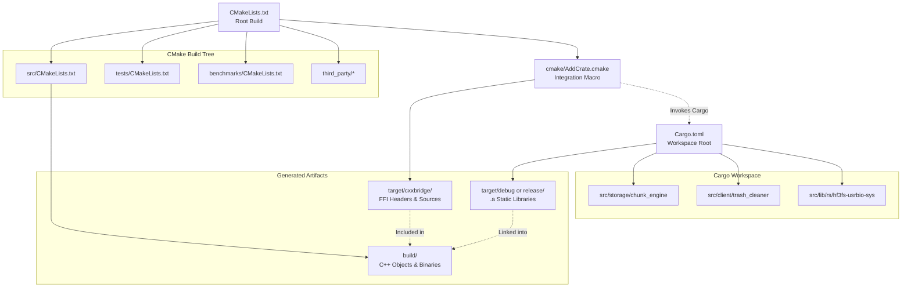

**Sources:** [CMakeLists.txt:1-209](), [Cargo.toml:1-23](), [cmake/AddCrate.cmake:1-34]()

## CMake Root Configuration

The root `CMakeLists.txt` establishes the build environment for the entire project. It defines project metadata, compiler requirements, and orchestrates all build components.

### Project Configuration

| Setting | Value | Description |
|---------|-------|-------------|
| CMake Version | 3.12+ | Minimum required version |
| Project Name | `3FS` | Project identifier |
| Version | 0.1.5 | Semantic version |
| Languages | C, CXX | C11 and C++20 |
| C++ Standard | C++20 | Required, no extensions |
| C Standard | C11 | Not required, extensions allowed |

**Sources:** [CMakeLists.txt:1-2](), [CMakeLists.txt:74-79]()

### Build Types and Configuration

The build system supports four configuration types defined at [CMakeLists.txt:4]():

```
RelWithDebInfo | Debug | Release | MinSizeRel
```

Default build type is `RelWithDebInfo` when not specified [CMakeLists.txt:5-8](). The system automatically handles assertion control based on build type [CMakeLists.txt:13-28]().

### Compiler-Specific Configuration

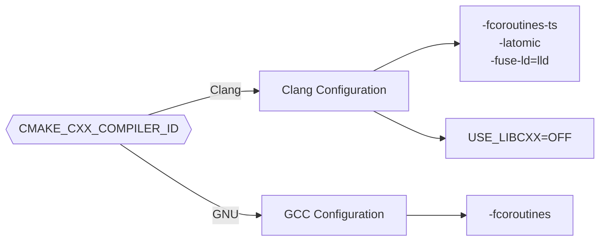

**Sources:** [CMakeLists.txt:83-91]()

The build system configures coroutine support differently based on compiler: Clang uses `-fcoroutines-ts` and links with the `lld` linker [CMakeLists.txt:84-86](), while GCC uses the standardized `-fcoroutines` flag [CMakeLists.txt:90-91]().

### Architecture-Specific Settings

| Architecture | Flags | Linker Configuration |
|--------------|-------|---------------------|
| x86_64 | `-msse4.2 -mavx2` | Default |
| aarch64 | `-march=armv8-a+crc` | `-rtlib=compiler-rt -unwindlib=libgcc` |

**Sources:** [CMakeLists.txt:96-106]()

The ARM configuration explicitly specifies `compiler-rt` to provide symbols like `__muloti4` and uses `libgcc` for exception unwinding compatibility [CMakeLists.txt:100-105]().

## Build Options and Customization

### Required Build Options: SHUFFLE_METHOD

The `SHUFFLE_METHOD` option is mandatory and must be specified at configuration time [CMakeLists.txt:31-35]():

```cmake
cmake -DSHUFFLE_METHOD=<value>
```

Valid values: `g++10`, `g++11`, `stdshuffle` [CMakeLists.txt:30](). This option controls data shuffling algorithms through compile-time definitions (`USE_STD_SHUFFLE`, `USE_GCC10_SHUFFLE`, `USE_GCC11_SHUFFLE`) [CMakeLists.txt:48-54](). This configuration is critical for consistent data placement across different compiler environments [src/common/utils/Shuffle.h:26-34]().

### Optional Build Flags

| Option | Default | Description |
|--------|---------|-------------|
| `OVERRIDE_CXX_NEW_DELETE` | OFF | Override global new/delete operators |
| `SAVE_ALLOCATE_SIZE` | OFF | Track allocation sizes (requires more memory) |
| `ENABLE_FUSE_APPLICATION` | ON | Build FUSE filesystem components |
| `ENABLE_ASSERTIONS` | ON (Debug)<br/>OFF (Release) | Enable runtime assertions |

**Sources:** [CMakeLists.txt:14-17](), [CMakeLists.txt:56-72]()

Note: `OVERRIDE_CXX_NEW_DELETE` is automatically disabled when sanitizers are enabled [CMakeLists.txt:61-63]().

## Third-Party Dependency Integration

The root CMakeLists orchestrates 13 third-party dependencies using `add_subdirectory()` with custom configuration. Each dependency is wrapped with compile flag management to prevent flag pollution [CMakeLists.txt:112-172]():

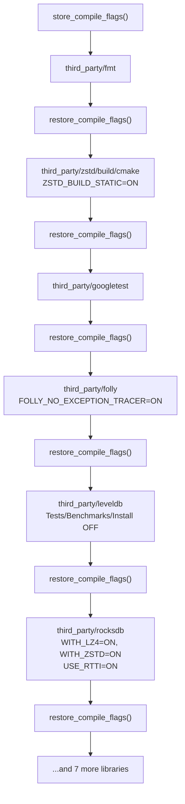

**Sources:** [CMakeLists.txt:112-172]()

### Key Dependency Configurations

**RocksDB** [CMakeLists.txt:134-143]():
- `WITH_LZ4=ON`, `WITH_ZSTD=ON`: Enable compression
- `USE_RTTI=ON`: Enable runtime type information
- `WITH_TESTS=OFF`, `WITH_BENCHMARK_TOOLS=OFF`: Disable unnecessary components
- Namespace redefined: `ROCKSDB_NAMESPACE=rocksdb_internal` [CMakeLists.txt:107]()

**Folly** [CMakeLists.txt:126-127]():
- `FOLLY_NO_EXCEPTION_TRACER=ON`: Disable exception tracing overhead

**ClickHouse C++** [CMakeLists.txt:160-169]():
- Custom include directory configuration for both static and shared libraries
- Includes `absl-lib` from contrib directory

## Cargo Workspace Structure

The Rust workspace is defined in `Cargo.toml` with three member crates [Cargo.toml:1-6]():

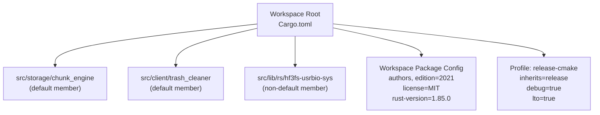

**Sources:** [Cargo.toml:1-23]()

### Workspace Configuration Details

**Members** [Cargo.toml:2-6]():
- `src/client/trash_cleaner`: Cleanup utility (default member)
- `src/storage/chunk_engine`: Core storage engine (default member)
- `src/lib/rs/hf3fs-usrbio-sys`: FFI bindings (non-default member, built only when needed)

**Package Metadata** [Cargo.toml:13-17]():
- **Edition**: 2021
- **MSRV**: Rust 1.85.0
- **License**: MIT
- **Resolver**: Version 2 (new feature resolver)

**Custom Build Profile** [Cargo.toml:19-22]():
The `release-cmake` profile is specifically designed for CMake integration, enabling full LTO and debug symbols for the final binary.

## Rust-C++ Integration via AddCrate.cmake

The `AddCrate.cmake` module provides the core integration mechanism between CMake and Cargo. It defines the `add_crate()` macro that wraps Rust crates as CMake targets.

### Build Command Selection

The build system chooses the Cargo profile based on the CMake build type [cmake/AddCrate.cmake:1-7]():

| CMake Build Type | Cargo Command | Target Directory |
|------------------|---------------|------------------|
| `Debug` | `cargo build` | `debug` |
| Other (Release, etc.) | `cargo build --release` | `release` |

**Sources:** [cmake/AddCrate.cmake:1-7]()

### add_crate() Macro Implementation

The `add_crate(NAME)` macro performs several critical operations to bridge the two languages [cmake/AddCrate.cmake:15-33]():

1. **Path Mapping**: Defines paths for the expected `.a` static library and the generated `cxxbridge` sources [cmake/AddCrate.cmake:16-20]().
2. **Custom Command**: Hooks into the build graph to invoke Cargo for specific crates, generating the `cxxbridge` FFI headers and implementation [cmake/AddCrate.cmake:22-26]().
3. **Library Creation**: Creates a CMake static library target that includes both the generated C++ FFI code and the Rust static library [cmake/AddCrate.cmake:28-29]().
4. **FFI Header Exposure**: Adds `target/cxxbridge` to the public include path so C++ code can include generated headers like `cxx.rs.h` [cmake/AddCrate.cmake:30]().
5. **Dependency Management**: Ensures all crates depend on a global `cargo_build_all` target to maintain correct build order [cmake/AddCrate.cmake:32]().

## Build Process Flow

### CI and Manual Build Execution

The standard build sequence is reflected in the CI workflow [build.yml:27-30]():
1. `cargo build --release`: Pre-builds Rust components.
2. `cmake -S . -B build ...`: Configures the C++ environment with the required `SHUFFLE_METHOD`.
3. `cmake --build build -j 32`: Compiles C++ code and links against Rust artifacts.

### USRBIO Shared Library Integration

For the `hf3fs-usrbio-sys` crate, a special integration exists where a C++ shared library `hf3fs_api_shared` is symlinked into the Rust crate's library directory post-build [src/lib/api/CMakeLists.txt:4-9](). This allows the Rust FFI bindings to find the necessary C++ symbols during its own build or runtime.

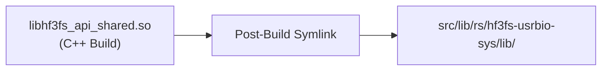

**Sources:** [src/lib/api/CMakeLists.txt:4-9]()

## Build System Extension Points

The build system includes several extension points for specialized functionality:

| Module | Purpose | Location |
|--------|---------|----------|
| `Sanitizers.cmake` | AddressSanitizer, UBSan configuration | [CMakeLists.txt:108]() |
| `CompileFlags.cmake` | Compiler flag management | [CMakeLists.txt:109]() |
| `CodeCoverage.cmake` | Code coverage instrumentation | [CMakeLists.txt:196]() |
| `CLangFormat.cmake` | Code formatting integration | [CMakeLists.txt:197]() |
| `CLangTidy.cmake` | Static analysis integration | [CMakeLists.txt:198]() |
| `Target.cmake` | Target utility functions | [CMakeLists.txt:199]() |
| `DumpConfig.cmake` | Configuration diagnostics | [CMakeLists.txt:200]() |
| `Jemalloc.cmake` | Memory allocator integration | [CMakeLists.txt:201]() |
| `ApacheArrow.cmake` | Arrow ExternalProject setup | [CMakeLists.txt:202]() |

**Sources:** [CMakeLists.txt:196-203]()

## Summary

The 3FS multi-language build system achieves seamless integration between CMake and Cargo through unified orchestration, automatic FFI generation via `cxxbridge`, and careful management of architecture-specific compiler flags. This ensures that the high-performance C++ core and the safety-critical Rust components (like the `chunk_engine`) can be built and linked into a single cohesive distributed file system.

---

# Page: Rust Components

# Rust Components

<details>
<summary>Relevant source files</summary>

The following files were used as context for generating this wiki page:

- [Cargo.lock](Cargo.lock)
- [Cargo.toml](Cargo.toml)
- [src/client/trash_cleaner/Cargo.toml](src/client/trash_cleaner/Cargo.toml)
- [src/client/trash_cleaner/src/main.rs](src/client/trash_cleaner/src/main.rs)
- [src/lib/api/hf3fs_usrbio.h](src/lib/api/hf3fs_usrbio.h)
- [src/lib/rs/hf3fs-usrbio-sys/Cargo.toml](src/lib/rs/hf3fs-usrbio-sys/Cargo.toml)
- [src/lib/rs/hf3fs-usrbio-sys/README](src/lib/rs/hf3fs-usrbio-sys/README)
- [src/lib/rs/hf3fs-usrbio-sys/build.rs](src/lib/rs/hf3fs-usrbio-sys/build.rs)
- [src/lib/rs/hf3fs-usrbio-sys/lib/.dummy](src/lib/rs/hf3fs-usrbio-sys/lib/.dummy)
- [src/lib/rs/hf3fs-usrbio-sys/src/lib.rs](src/lib/rs/hf3fs-usrbio-sys/src/lib.rs)
- [src/storage/chunk_engine/Cargo.toml](src/storage/chunk_engine/Cargo.toml)

</details>


The Rust components in 3FS provide core storage functionality, system utilities, and user interface bindings within a hybrid C++/Rust architecture. This document covers the Rust workspace structure, component implementations, dependencies, and integration mechanisms.

## Workspace Structure

The 3FS Rust ecosystem is organized as a workspace containing three main components: a storage engine, system utilities, and user interface bindings.

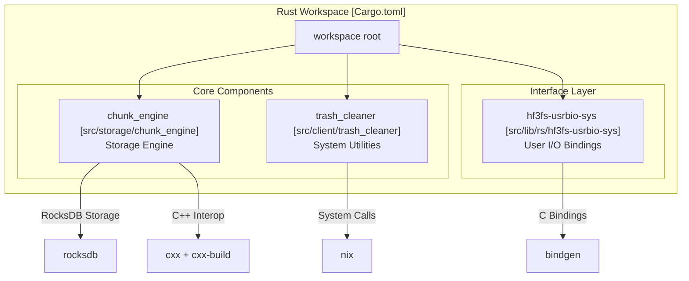

**Workspace Configuration Details**

| Field | Value | Purpose |
|-------|-------|---------|
| `members` | 3 components | All workspace crates [Cargo.toml:2-6]() |
| `default-members` | 2 components | Built by default [Cargo.toml:7-10]() |
| `edition` | `"2021"` | Rust edition [Cargo.toml:15]() |
| `rust-version` | `"1.85.0"` | Minimum supported Rust version [Cargo.toml:17]() |

The workspace is defined in [Cargo.toml:1-11]() with workspace-wide package metadata in [Cargo.toml:13-17](). The minimum supported Rust version (MSRV) is declared as `"1.85.0"` in [Cargo.toml:17]().

Sources: [Cargo.toml:1-23]()

## Storage Engine Component

The `chunk_engine` crate implements the core storage functionality for 3FS, providing data chunk management and persistence through RocksDB integration.

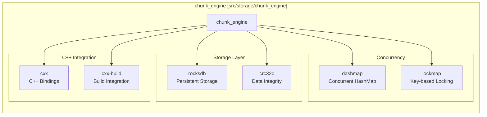

**Key Technical Features:**

- **Storage Backend**: Uses `rocksdb` for persistent key-value storage with `crc32c` for data integrity verification [src/storage/chunk_engine/Cargo.toml:14-22]().
- **Concurrency**: Implements `dashmap` for concurrent access and `lockmap` for fine-grained key-based locking [src/storage/chunk_engine/Cargo.toml:16-20]().
- **C++ Interoperability**: Uses `cxx` and `cxx-build` for seamless integration with the C++ storage layer [src/storage/chunk_engine/Cargo.toml:15-38]().
- **Serialization**: Utilizes `derse` with `tinyvec` features for high-performance serialization [src/storage/chunk_engine/Cargo.toml:17-26]().

Sources: [src/storage/chunk_engine/Cargo.toml:1-43]()

## System Utilities Component  

The `trash_cleaner` crate provides system-level utilities for maintenance and cleanup operations, specifically managing expired files in the 3FS trash directory.

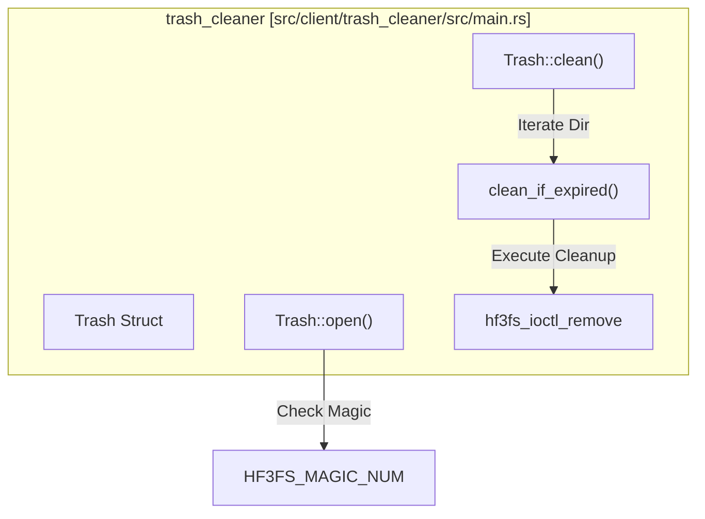

**Operational Capabilities:**

- **Trash Management**: The `Trash` struct handles opening and validating trash directories [src/client/trash_cleaner/src/main.rs:62-135]().
- **Safety Checks**: Validates the filesystem using `ioctl_get_magic` to ensure it is operating on a 3FS instance (`0x8f3f5fff`) [src/client/trash_cleaner/src/main.rs:15-111]().
- **Cleanup Logic**: Iterates through directory entries and removes expired items using a specialized `hf3fs_ioctl_remove` [src/client/trash_cleaner/src/main.rs:30-173]().
- **Time Parsing**: Supports custom datetime formats (e.g., `%Y%m%d_%H%M`) to determine expiration [src/client/trash_cleaner/src/main.rs:32-39]().

Sources: [src/client/trash_cleaner/src/main.rs:1-216](), [src/client/trash_cleaner/Cargo.toml:1-25]()

## User I/O Interface Component

The `hf3fs-usrbio-sys` crate provides low-level system bindings for high-performance user-space I/O operations via FFI to the C++ API.

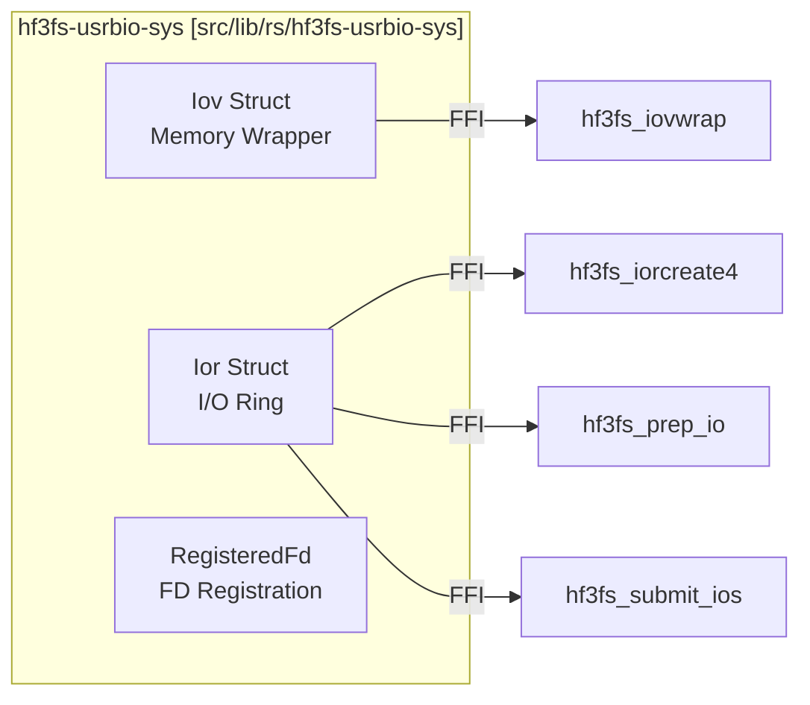

**Interface Implementation:**

- **Binding Generation**: Uses `bindgen` during build time to generate Rust types from `hf3fs_usrbio.h` [src/lib/rs/hf3fs-usrbio-sys/build.rs:9-14]().
- **I/O Ring (IOR)**: Encapsulates the `hf3fs_ior` structure, providing methods for creation, I/O preparation, and submission [src/lib/rs/hf3fs-usrbio-sys/src/lib.rs:70-152]().
- **Memory Mapping (IOV)**: The `Iov` struct wraps shared memory segments and creates symlinks in the 3FS virtual directory `/3fs-virt/iovs/` for FUSE visibility [src/lib/rs/hf3fs-usrbio-sys/src/lib.rs:31-67]().
- **FD Registration**: The `RegisteredFd` struct handles registering file descriptors with the 3FS driver to enable zero-copy I/O [src/lib/rs/hf3fs-usrbio-sys/src/lib.rs:210-230]().
- **Polling**: Supports asynchronous completion reaping via `hf3fs_wait_for_ios` with timeout handling [src/lib/rs/hf3fs-usrbio-sys/src/lib.rs:153-188]().

Sources: [src/lib/rs/hf3fs-usrbio-sys/src/lib.rs:1-236](), [src/lib/rs/hf3fs-usrbio-sys/build.rs:1-20](), [src/lib/api/hf3fs_usrbio.h:1-171]()

## Build System Integration

The Rust components integrate with the overall 3FS build system through Cargo profiles and CMake-linked libraries.

**Build Configuration:**

- **Custom Profile**: A `release-cmake` profile is defined with `lto = true` and `debug = true` to facilitate optimized builds that remain debuggable when linked into C++ binaries [Cargo.toml:19-23]().
- **Linkage**: `hf3fs-usrbio-sys` explicitly links against `hf3fs_api_shared`, which must be built by CMake prior to the Rust build [src/lib/rs/hf3fs-usrbio-sys/build.rs:7](), [src/lib/rs/hf3fs-usrbio-sys/README:1]().

Sources: [Cargo.toml:19-23](), [src/lib/rs/hf3fs-usrbio-sys/build.rs:1-8]()

---

# Page: C++ Build Configuration

# C++ Build Configuration

<details>
<summary>Relevant source files</summary>

The following files were used as context for generating this wiki page:

- [CMakeLists.txt](CMakeLists.txt)
- [cmake/ApacheArrow.cmake](cmake/ApacheArrow.cmake)
- [src/common/utils/Shuffle.h](src/common/utils/Shuffle.h)
- [src/fbs/meta/Schema.cc](src/fbs/meta/Schema.cc)
- [src/meta/components/ChainAllocator.h](src/meta/components/ChainAllocator.h)
- [tests/common/utils/TestShuffle.cc](tests/common/utils/TestShuffle.cc)

</details>


This document covers the CMake-based C++ build configuration for the 3FS project, including compiler settings, build types, language standards, and third-party dependency integration. For information about Rust component integration with the C++ build system, see [2.1 Multi-Language Build System]().

## Project Configuration and Build Types

The 3FS project uses CMake 3.12+ and defines itself as a C/C++ project with version 0.1.5 [CMakeLists.txt:1-2](). The build system supports four standard build configurations with `RelWithDebInfo` as the default [CMakeLists.txt:4-9]().

```mermaid
graph TB
    subgraph "Project Configuration"
        CMAKE_MIN["cmake_minimum_required(VERSION 3.12)"]
        PROJECT_DEF["project(3FS VERSION 0.1.5 LANGUAGES C CXX)"]
    end
    
    subgraph "Build Type Selection"
        BUILD_TYPES["CMAKE_CONFIGURATION_TYPES"]
        BUILD_TYPES --> RELWITHDEBINFO["RelWithDebInfo (default)"]
        BUILD_TYPES --> DEBUG["Debug"]
        BUILD_TYPES --> RELEASE["Release"]
        BUILD_TYPES --> MINSIZEREL["MinSizeRel"]
    end
    
    subgraph "Configuration Logic"
        BUILD_CHECK["CMAKE_BUILD_TYPE check"]
        BUILD_CHECK --> DEFAULT_SET["Set to RelWithDebInfo if unset"]
        BUILD_CHECK --> TOUPPER["Convert to uppercase"]
        TOUPPER --> ASSERT_CONFIG["Configure ENABLE_ASSERTIONS"]
    end
    
    CMAKE_MIN --> PROJECT_DEF
    PROJECT_DEF --> BUILD_TYPES
    BUILD_TYPES --> BUILD_CHECK
```

**Build Type Configuration Flow**

```mermaid
flowchart LR
    START["Build Start"] --> CHECK_TYPE{"CMAKE_BUILD_TYPE set?"}
    CHECK_TYPE -->|No| SET_DEFAULT["Set CMAKE_BUILD_TYPE=RelWithDebInfo"]
    CHECK_TYPE -->|Yes| CONVERT["Convert to uppercase"]
    SET_DEFAULT --> CONVERT
    CONVERT --> IS_DEBUG{"Debug build?"}
    IS_DEBUG -->|Yes| ENABLE_ASSERT["ENABLE_ASSERTIONS=ON"]
    IS_DEBUG -->|No| DISABLE_ASSERT["ENABLE_ASSERTIONS=OFF"]
    ENABLE_ASSERT --> ADD_DEBUG_DEF["Add -D_DEBUG"]
    DISABLE_ASSERT --> CHECK_UNDEBUG{"Non-Debug with assertions?"}
    CHECK_UNDEBUG -->|Yes| ADD_UNDEBUG["Add -UNDEBUG"]
    CHECK_UNDEBUG -->|No| CONTINUE["Continue"]
    ADD_DEBUG_DEF --> CONTINUE
    ADD_UNDEBUG --> CONTINUE
```

Sources: [CMakeLists.txt:1-28]()

## Compiler Configuration and Language Standards

The build system enforces the C++20 standard with specific compiler optimizations and platform-specific settings [CMakeLists.txt:74-79]().

| Configuration | Value | Description |
|---------------|-------|-------------|
| `CMAKE_C_STANDARD` | 11 | C11 standard [CMakeLists.txt:74]() |
| `CMAKE_CXX_STANDARD` | 20 | C++20 standard required [CMakeLists.txt:77]() |
| `CMAKE_CXX_STANDARD_REQUIRED` | ON | C++20 strictly enforced [CMakeLists.txt:78]() |
| `CMAKE_CXX_EXTENSIONS` | OFF | Disable compiler extensions [CMakeLists.txt:79]() |
| `CMAKE_POSITION_INDEPENDENT_CODE` | ON | Enable PIC for shared libraries [CMakeLists.txt:80]() |

```mermaid
graph TB
    subgraph "Language Standards"
        C_STD["CMAKE_C_STANDARD: 11"]
        CXX_STD["CMAKE_CXX_STANDARD: 20"]
        CXX_REQ["CMAKE_CXX_STANDARD_REQUIRED: ON"]
        CXX_EXT["CMAKE_CXX_EXTENSIONS: OFF"]
    end
    
    subgraph "Compiler Detection"
        CLANG_ID["CMAKE_CXX_COMPILER_ID == Clang"]
        GNU_ID["CMAKE_CXX_COMPILER_ID == GNU"]
    end
    
    subgraph "Clang Configuration"
        CLANG_CORO["-fcoroutines-ts"]
        CLANG_ATOMIC["-latomic"]
        CLANG_LLD["-fuse-ld=lld"]
        LIBCXX_OFF["USE_LIBCXX: OFF"]
    end
    
    subgraph "GCC Configuration"
        GNU_CORO["-fcoroutines"]
    end
    
    CLANG_ID --> CLANG_CORO
    CLANG_ID --> CLANG_ATOMIC
    CLANG_ID --> CLANG_LLD
    CLANG_ID --> LIBCXX_OFF
    GNU_ID --> GNU_CORO
```

Sources: [CMakeLists.txt:83-91]()

## Platform-Specific Optimizations

The build system includes architecture-specific optimizations for x86_64 and ARM64 platforms.

```mermaid
graph LR
    subgraph "Architecture Detection"
        ARCH_CHECK["CMAKE_SYSTEM_PROCESSOR"]
        ARCH_CHECK --> X86_64["x86_64"]
        ARCH_CHECK --> AARCH64["aarch64"]
    end
    
    subgraph "x86_64 Optimizations"
        X86_64 --> SSE42["-msse4.2"]
        X86_64 --> AVX2["-mavx2"]
    end
    
    subgraph "ARM64 Configuration"
        AARCH64 --> ARMV8["-march=armv8-a+crc"]
        AARCH64 --> COMPILER_RT["-rtlib=compiler-rt"]
        AARCH64 --> LIBGCC["-unwindlib=libgcc"]
    end
    
    subgraph "Common Settings"
        MACRO_PREFIX["-fmacro-prefix-map=${CMAKE_SOURCE_DIR}=."]
        ROCKSDB_NS["ROCKSDB_NAMESPACE=rocksdb_internal"]
    end
```

Sources: [CMakeLists.txt:93-107]()

## Custom Build Options

3FS introduces specific build options for shuffle consistency and memory management.

### Shuffle Method Selection
To ensure consistency across different GCC versions when generating file layouts, 3FS requires a specific `SHUFFLE_METHOD` [CMakeLists.txt:30-45](). This is critical for the `ChainAllocator` when picking chains for file layouts [src/meta/components/ChainAllocator.h:115-120]().

| Option | Implementation |
|--------|----------------|
| `stdshuffle` | Uses `std::shuffle` with `std::mt19937_64` [src/common/utils/Shuffle.h:156-159]() |
| `g++10` | Replicates GCC 10's `std::shuffle` behavior [src/common/utils/Shuffle.h:151-153]() |
| `g++11` | Replicates GCC 11's `std::shuffle` behavior [src/common/utils/Shuffle.h:146-148]() |

### Memory Management Options
| Option | Default | Purpose |
|--------|---------|---------|
| `OVERRIDE_CXX_NEW_DELETE` | OFF | Override C++ new/delete operators for custom allocation tracking [CMakeLists.txt:56]() |
| `SAVE_ALLOCATE_SIZE` | OFF | Use more memory to save allocation sizes [CMakeLists.txt:57]() |

Sources: [CMakeLists.txt:30-72](), [src/common/utils/Shuffle.h:145-172](), [src/meta/components/ChainAllocator.h:115-120]()

## Third-Party Dependencies Integration

3FS integrates a large number of dependencies. A common pattern used is `store_compile_flags()` and `restore_compile_flags()` to prevent project-wide flags (like `-Werror`) from breaking external code [CMakeLists.txt:112-114]().

### Core Libraries
- **folly**: Integrated with `FOLLY_NO_EXCEPTION_TRACER` enabled [CMakeLists.txt:126-127]().
- **rocksdb**: Built with LZ4 and ZSTD support [CMakeLists.txt:135-143]().
- **clickhouse-cpp**: Static linking with specific include directory overrides for bundled `absl` [CMakeLists.txt:160-170]().

### Apache Arrow Integration
Arrow is integrated as an `ExternalProject` because of its complex build requirements and dependencies [cmake/ApacheArrow.cmake:21]().

```mermaid
graph TD
    subgraph "Apache Arrow ExternalProject"
        ARROW_ADD["ExternalProject_Add(apache-arrow-cpp)"]
        GIT["GIT_TAG: b7d2f7f..."]
        CONFIG["CONFIGURE_COMMAND: download_dependencies.sh"]
        FLAGS["-DARROW_PARQUET=ON -DARROW_CSV=ON"]
    end
    
    subgraph "Imported Targets"
        STATIC_LIB["apache_arrow_static (INTERFACE)"]
        ARROW_S["arrow_static (IMPORTED)"]
        PARQUET_S["parquet_static (IMPORTED)"]
    end
    
    ARROW_ADD --> ARROW_S
    ARROW_ADD --> PARQUET_S
    ARROW_S --> STATIC_LIB
    PARQUET_S --> STATIC_LIB
```

Sources: [CMakeLists.txt:112-173](), [cmake/ApacheArrow.cmake:1-61]()

## Compiler Flags and Build Optimization

The build system applies comprehensive warning flags and build-type-specific optimizations [CMakeLists.txt:174-181]().

### Build Type Optimizations

| Build Type | Optimization | Flags |
|------------|--------------|-------|
| `RelWithDebInfo` | `-O3` | `${DEBUG_INFO_FLAGS} ${CMAKE_CXX_FLAGS_ADD}` [CMakeLists.txt:177]() |
| `Debug` | `-O0` | `-fno-inline ${DEBUG_INFO_FLAGS} ${CMAKE_CXX_FLAGS_ADD}` [CMakeLists.txt:178]() |

```mermaid
flowchart TD
    subgraph "Build Type Flag Configuration"
        BASE_FLAGS["Base CMAKE_CXX_FLAGS: -Wall -Wextra -Werror -Wpedantic"]
        RELWITHDEBINFO["RelWithDebInfo Build"]
        DEBUG["Debug Build"]
    end
    
    BASE_FLAGS --> RELWITHDEBINFO
    BASE_FLAGS --> DEBUG
    
    RELWITHDEBINFO --> REL_O3["-O3"]
    RELWITHDEBINFO --> REL_DEBUG["DEBUG_INFO_FLAGS"]
    
    DEBUG --> DEBUG_O0["-O0"]
    DEBUG --> DEBUG_NOINLINE["-fno-inline"]
```

Sources: [CMakeLists.txt:174-181]()

---

# Page: Development Tools and Code Quality

# Development Tools and Code Quality

<details>
<summary>Relevant source files</summary>

The following files were used as context for generating this wiki page:

- [.clang-tidy](.clang-tidy)
- [.github/workflows/build.yml](.github/workflows/build.yml)
- [README.md](README.md)
- [dockerfile/dev.opencloudos9.dockerfile](dockerfile/dev.opencloudos9.dockerfile)
- [src/lib/api/CMakeLists.txt](src/lib/api/CMakeLists.txt)

</details>


## Purpose and Scope

This page documents the code quality tools and development utilities integrated into the 3FS build system to maintain consistent code style, catch bugs early, and enhance developer productivity. The focus is on C++ tooling for the codebase's C++ components. For information about the overall build system architecture, see [Multi-Language Build System](#2.1). For CI/CD automation that enforces these quality checks, see [CI/CD Pipeline](#2.5).

The 3FS project uses three primary code quality tools:
- **clang-format-14** for automated code formatting
- **clang-tidy-14** for static analysis and bug detection  
- **clangd** for IDE language server support

All tools are configured to work with C++20 standards and integrate seamlessly with the CMake build system.

---

## Code Formatting with clang-format

### Configuration

The project uses `clang-format-14` with a customized Google-based style. The configuration enforces strict formatting rules to maintain consistency across the codebase.

**Key Configuration Settings:**

| Setting | Value | Purpose |
|---------|-------|---------|
| `BasedOnStyle` | Google | Foundation style guide |
| `Standard` | c++20 | Target language standard |
| `ColumnLimit` | 120 | Maximum line width |
| `IndentWidth` | 2 | Spaces per indentation level |
| `PointerAlignment` | Right | `Type *ptr` style |
| `AllowAllArgumentsOnNextLine` | false | Prevents argument cramming |
| `AllowAllParametersOfDeclarationOnNextLine` | false | Forces parameter splitting |
| `BinPackArguments` | false | One argument per line for clarity |
| `BinPackParameters` | false | One parameter per line for clarity |

**Template and Constructor Formatting:**

The configuration enforces specific rules for complex C++ constructs:
- `AlwaysBreakTemplateDeclarations: true` ensures template parameters are readable.
- `BreakConstructorInitializers: BeforeColon` places member initializers on new lines.
- `PackConstructorInitializers: Never` prevents packing of initializers.

**Include Ordering:**

Custom include categories prioritize generated headers, specifically those generated by FlatBuffers (`Flat_generated.h`) or internal fbs macros.

### Build System Integration

The build system integrates formatting into the development process by defining custom targets. The infrastructure expects `clang-format-14` to be installed at `/usr/bin/clang-format-14` [README.md:75-81]().

**Formatting Tooling Flow:**

```mermaid
graph TB
    subgraph "Configuration"
        CF[".clang-format"]
    end
    
    subgraph "CMake Integration"
        C_FLAGS["CMAKE_EXPORT_COMPILE_COMMANDS=ON"]
        BUILD_SCRIPT["build.yml workflow"]
    end
    
    subgraph "Execution Targets"
        FORMAT_TARGET["format target"]
        CHECK_TARGET["check-format target"]
    end

    CF --> FORMAT_TARGET
    CF --> CHECK_TARGET
    C_FLAGS --> CHECK_TARGET
    
    FORMAT_TARGET --> |"In-place edit"| SRC["C++ Source Files<br/>.cc, .cpp, .h"]
    CHECK_TARGET --> |"Validation"| CI_STATUS["CI Pipeline Status"]
    BUILD_SCRIPT --> CHECK_TARGET
```

**Sources:** README.md:75-81, .github/workflows/build.yml:19-29

#### Format Target

Developers use the `format` target to apply formatting to all source files. The process typically involves:
1. Searching `src/`, `tests/`, and `benchmarks/` directories.
2. Finding all `.cc`, `.cpp`, and `.h` files.
3. Excluding generated headers matching `*_generated.h` patterns.
4. Applying formatting in-place.

#### Check-Format Target

The `check-format` target validates formatting without modification. This is a critical component of the CI pipeline [ .github/workflows/build.yml:19-29]().

**Operation:**
- Uses dry-run modes to check without modifying files.
- Uses warning-as-error flags to exit with error code on formatting violations.
- Integrated into the GitHub Actions `build` job [ .github/workflows/build.yml:10-31]().

**Sources:** .github/workflows/build.yml:19-31

---

## Static Analysis with clang-tidy

### Configuration and Check Categories

The `.clang-tidy` configuration enables 80+ static analysis checks across multiple categories, focusing on bug prevention, performance, and modern C++ practices. The configuration uses an explicit opt-in approach, disabling all checks by default (`-*`) and selectively enabling specific ones [.clang-tidy:1-2]().

**Checks to Logic Mapping:**

```mermaid
graph TB
    TIDY_CFG[".clang-tidy Configuration"]
    
    subgraph "Check Groups"
        BUGPRONE["bugprone-*"]
        PERF["performance-*"]
        MODERN["modernize-*"]
        READ["readability-*"]
    end
    
    TIDY_CFG --> BUGPRONE
    TIDY_CFG --> PERF
    TIDY_CFG --> MODERN
    TIDY_CFG --> READ
    
    BUGPRONE --> |"Prevents"| BP_ENTITY["bugprone-use-after-move<br/>bugprone-infinite-loop<br/>bugprone-sizeof-expression"]
    PERF --> |"Optimizes"| PF_ENTITY["performance-unnecessary-copy-initialization<br/>performance-move-constructor-init"]
    MODERN --> |"Updates"| MD_ENTITY["modernize-use-nullptr<br/>modernize-use-override<br/>modernize-make-unique"]
    READ --> |"Clarifies"| RD_ENTITY["readability-container-size-empty<br/>readability-simplify-boolean-expr"]
```

**Sources:** .clang-tidy:1-117

### Bugprone Checks (39 Checks)

The `bugprone-*` category focuses on catching programming errors that may compile but produce incorrect behavior:

| Check Category | Examples | Description |
|----------------|----------|-------------|
| Memory Safety | `bugprone-dangling-handle`<br/>`bugprone-use-after-move` | Detects lifetime issues and unsafe memory access [.clang-tidy:8,43]() |
| Logic Errors | `bugprone-infinite-loop`<br/>`bugprone-terminating-continue` | Identifies control flow problems [.clang-tidy:13,36]() |
| Constructor Issues | `bugprone-undelegated-constructor`<br/>`bugprone-copy-constructor-init` | Validates constructor delegation and initialization [.clang-tidy:3,7]() |
| String Handling | `bugprone-string-constructor`<br/>`bugprone-string-literal-with-embedded-nul` | Catches string construction errors [.clang-tidy:27,29]() |

**Sources:** .clang-tidy:3-47

### Performance Checks (10 Checks)

The `performance-*` category identifies optimization opportunities:

| Check | Purpose | Line Reference |
|-------|---------|----------------|
| `performance-unnecessary-copy-initialization` | Eliminates redundant copies | [.clang-tidy:57]() |
| `performance-move-constructor-init` | Enforces move semantics in constructors | [.clang-tidy:54]() |
| `performance-for-range-copy` | Detects unnecessary copies in range loops | [.clang-tidy:50]() |
| `performance-inefficient-vector-operation` | Optimizes vector operations | [.clang-tidy:53]() |

**Custom Configuration:**
The project explicitly disables `CheckTriviallyCopyableMove` for `performance-move-const-arg` [.clang-tidy:116-117]().

**Sources:** .clang-tidy:49-58, 116-117

### Modernize Checks (14 Checks)

The `modernize-*` category encourages modern C++11/14/17/20 idioms:

| Modern Feature | Checks | Replacement |
|----------------|--------|-------------|
| Smart Pointers | `modernize-make-shared`<br/>`modernize-make-unique` | `std::make_shared/unique` over `new` [.clang-tidy:62-63]() |
| Null Pointers | `modernize-use-nullptr` | `nullptr` over `NULL` [.clang-tidy:70]() |
| Override Specifier | `modernize-use-override` | Explicit `override` keywords [.clang-tidy:72]() |
| Special Members | `modernize-use-equals-default` | Use `= default` [.clang-tidy:73]() |

**Sources:** .clang-tidy:60-75

---

## IDE Integration with clangd

### Language Server Configuration

The project supports the clangd language server protocol (LSP) implementation for C++ IDEs. This enables features like code completion and error highlighting.

**Compiler Flag Adjustments:**
To ensure correct indexing of the codebase, specific flags are adjusted:
- **Coroutines Support**: The technical specification flag for coroutines is often added to support 3FS's heavy use of asynchronous programming.
- **IntelliSense Compatibility**: Flags like `-DNO_INTELLISENSE` may be removed to ensure clangd correctly parses the source.

### Integration with Development Workflow

The clangd configuration works in conjunction with the compilation database generated by CMake. By running `cmake` with `-DCMAKE_EXPORT_COMPILE_COMMANDS=ON` [README.md:109](), a `compile_commands.json` file is produced in the build directory.

**IDE Data Flow:**

```mermaid
graph LR
    CMAKE["CMake (build dir)"] --> |"generates"| CDB["compile_commands.json"]
    CDB --> |"consumed by"| CLANGD["clangd LSP Server"]
    TIDY_CFG[".clang-tidy"] --> |"rules read by"| CLANGD
    CLANGD --> |"diagnostics"| VSCODE["VS Code / CLion / Vim"]
```

**Sources:** README.md:107-112

---

## Development Workflow Integration

### Local Development Phase

**Real-time IDE Feedback:**
1. Developer configures the build with `CMAKE_EXPORT_COMPILE_COMMANDS=ON` [README.md:109]().
2. clangd provides real-time diagnostics using `.clang-tidy` checks [.clang-tidy:1-117]().
3. The IDE applies formatting based on the `.clang-format` configuration.

**Pre-commit Workflow:**
Before pushing, developers are encouraged to run the formatting targets defined in the CMake environment to ensure compliance with the project's style standards.

### Continuous Integration Phase

**Automated Quality Gates:**

The `build.yml` workflow enforces quality checks on every pull request [.github/workflows/build.yml:6-7]().

1. **Environment Setup**: Installs `clang-format-14` and `clang-tidy-14` [.github/workflows/build.yml:19]().
2. **Build Execution**: Compiles the project using `clang-14` [.github/workflows/build.yml:29]().
3. **Quality Checks**: Validation of formatting and static analysis results.

**Sources:** .github/workflows/build.yml:1-31

### Tooling Installation

For consistent results, the project specifies specific versions of the LLVM toolchain. On Ubuntu systems, these are installed via `apt`:
```bash
sudo apt install clang-format-14 clang-14 clang-tidy-14 lld-14
```
[README.md:75, 79](), [.github/workflows/build.yml:19]()

For OpenCloudOS/TencentOS environments, the `dev.opencloudos9.dockerfile` provides a standardized setup by downloading and symlinking the LLVM 14.0.6 release [dockerfile/dev.opencloudos9.dockerfile:40-52]().

**Sources:** README.md:73-82, dockerfile/dev.opencloudos9.dockerfile:40-52, .github/workflows/build.yml:18-20

---

# Page: CI/CD Pipeline

# CI/CD Pipeline

<details>
<summary>Relevant source files</summary>

The following files were used as context for generating this wiki page:

- [.github/workflows/build-dev-docker-image.yml](.github/workflows/build-dev-docker-image.yml)
- [.github/workflows/build.yml](.github/workflows/build.yml)
- [dockerfile/dev.dockerfile](dockerfile/dev.dockerfile)
- [dockerfile/dev.ubuntu2004.dockerfile](dockerfile/dev.ubuntu2004.dockerfile)
- [src/lib/api/CMakeLists.txt](src/lib/api/CMakeLists.txt)

</details>


## Purpose and Scope

This document describes the GitHub Actions-based continuous integration and continuous deployment (CI/CD) infrastructure for 3FS. The pipeline automates builds for both C++ and Rust components, manages dependency installation, and publishes development Docker images to GitHub Container Registry.

The pipeline ensures that every change to the `main` branch is validated through a rigorous build process that includes complex multi-language linking and external system dependency setup.

---

## Workflow Architecture

3FS uses two primary GitHub Actions workflows that handle different aspects of the build and deployment process.

### Workflow Trigger Matrix

```mermaid
graph TB
    subgraph "Trigger Events"
        PUSH["Push to main<br/>branch"]
        PR["Pull Request to<br/>main branch"]
        MANUAL["Manual Dispatch<br/>(workflow_dispatch)"]
    end
    
    subgraph "GitHub Actions Workflows"
        BUILD["build.yml<br/>Main Build Workflow"]
        DOCKER["build-dev-docker-image.yml<br/>Docker Image Workflow"]
    end
    
    subgraph "Build Runners"
        SELFHOST["Self-Hosted Runner<br/>(or ubuntu-22.04)"]
        UBUNTU["ubuntu-latest"]
    end
    
    subgraph "Outputs"
        BINS["Compiled Binaries<br/>(C++ + Rust)"]
        IMGS["Docker Images<br/>(ghcr.io)"]
        ATTEST["Build Attestations"]
    end
    
    PUSH --> BUILD
    PR --> BUILD
    MANUAL --> DOCKER
    
    BUILD --> SELFHOST
    DOCKER --> UBUNTU
    
    SELFHOST --> BINS
    UBUNTU --> IMGS
    UBUNTU --> ATTEST
```

**Sources:** [.github/workflows/build.yml:3-7](), [.github/workflows/build-dev-docker-image.yml:3-4]()

---

## Main Build Workflow

The `build.yml` workflow executes on every push or pull request to the `main` branch and performs a complete build of both Rust and C++ components.

### Trigger Configuration

| Property | Value |
|----------|-------|
| Workflow Name | `Build` |
| Trigger Events | `push`, `pull_request` on branch `main` |
| Runner | `self-hosted` (fallback: `ubuntu-22.04`) |
| Parallelization | 32 build jobs |

**Sources:** [.github/workflows/build.yml:1-11]()

### Build Pipeline Stages

```mermaid
stateDiagram-v2
    [*] --> Checkout
    Checkout --> PrepareSystemDeps
    PrepareSystemDeps --> PrepareFoundationDB
    PrepareFoundationDB --> PrepareFuse
    PrepareFuse --> PrepareSubmodules
    PrepareSubmodules --> ApplyPatches
    ApplyPatches --> BuildRust
    BuildRust --> ConfigureCMake
    ConfigureCMake --> BuildCPP
    BuildCPP --> [*]
    
    note right of PrepareSystemDeps
        Install 20+ apt packages
        Including compilers, build tools,
        libraries (boost, gtest, etc.)
    end note
    
    note right of PrepareFoundationDB
        Download FDB 7.1.61
        Install client libraries
    end note
    
    note right of PrepareFuse
        Clone libfuse 3.16.2
        Build with meson/ninja
        Install system-wide
    end note
    
    note right of BuildRust
        cargo build --release
    end note
    
    note right of ConfigureCMake
        Clang-14 compiler
        RelWithDebInfo build type
        SHUFFLE_METHOD=g++11
    end note
```

**Sources:** [.github/workflows/build.yml:13-30]()

### Dependency Installation Process

The preparation step installs an extensive set of dependencies across multiple categories:

```mermaid
graph LR
    subgraph "Build Tools"
        CMAKE["cmake"]
        MESON["meson"]
        NINJA["ninja"]
    end
    
    subgraph "Compilers & Toolchains"
        CLANG14["clang-14<br/>clang++-14<br/>lld-14"]
        GCC12["gcc-12<br/>g++-12"]
        RUST["rustc<br/>cargo"]
        TOOLS["clang-format-14<br/>clang-tidy-14"]
    end
    
    subgraph "Core Libraries"
        BOOST["libboost-all-dev"]
        SSL["libssl-dev"]
        UV["libuv1-dev"]
        AIO["libaio-dev"]
    end
    
    subgraph "Compression & Encoding"
        LZ4["liblz4-dev"]
        LZMA["liblzma-dev"]
        DCONV["libdouble-conversion-dev"]
    end
    
    subgraph "Debugging & Profiling"
        DWARF["libdwarf-dev"]
        UNWIND["libunwind-dev"]
        GPERF["libgoogle-perftools-dev<br/>google-perftools"]
    end
    
    subgraph "Google Libraries"
        GFLAGS["libgflags-dev"]
        GLOG["libgoogle-glog-dev"]
        GTEST["libgtest-dev"]
        GMOCK["libgmock-dev"]
    end
    
    subgraph "External Projects"
        FDB["FoundationDB 7.1.61<br/>foundationdb-clients"]
        FUSE["libfuse 3.16.2<br/>Built from source"]
    end
    
    APT["apt install"] --> CMAKE
    APT --> CLANG14
    APT --> GCC12
    APT --> RUST
    APT --> TOOLS
    APT --> BOOST
    APT --> SSL
    APT --> UV
    APT --> AIO
    APT --> LZ4
    APT --> LZMA
    APT --> DCONV
    APT --> DWARF
    APT --> UNWIND
    APT --> GPERF
    APT --> GFLAGS
    APT --> GLOG
    APT --> GTEST
    APT --> GMOCK
    
    WGET["wget + dpkg"] --> FDB
    CLONE["git clone + meson"] --> FUSE
```

**Sources:** [.github/workflows/build.yml:16-22]()

#### Dependency Installation Commands

The prepare step executes the following sequence:

1. **System libraries** (line 18):
   ```bash
   sudo apt install -y cmake libuv1-dev liblz4-dev liblzma-dev \
     libdouble-conversion-dev libdwarf-dev libunwind-dev
   ```

2. **Build toolchain** (line 19):
   ```bash
   sudo apt install -y libaio-dev libgflags-dev libgoogle-glog-dev \
     libgtest-dev libgmock-dev clang-format-14 clang-14 \
     clang-tidy-14 lld-14
   ```

3. **Performance and compiler tools** (line 20):
   ```bash
   sudo apt install -y libgoogle-perftools-dev google-perftools \
     libssl-dev gcc-12 g++-12 libboost-all-dev meson rustc cargo
   ```

4. **FoundationDB client** (line 21):
   - Downloads version 7.1.61 from GitHub releases.
   - Installs via `dpkg`.

5. **libfuse from source** (line 22):
   - Clones `fuse-3.16.2` branch.
   - Builds with `meson` and `ninja`.
   - Installs system-wide.

6. **Git submodules** (line 23):
   ```bash
   git submodule update --init --recursive
   ```

7. **Apply patches** (line 24):
   ```bash
   ./patches/apply.sh
   ```

**Sources:** [.github/workflows/build.yml:16-24]()

### Build Execution

The build step compiles both Rust and C++ components in sequence:

#### Rust Component Build
```bash
cargo build --release
```
**Sources:** [.github/workflows/build.yml:28]()

#### C++ Component Build
```bash
cmake -S . -B build -DCMAKE_CXX_COMPILER=clang++-14 -DCMAKE_C_COMPILER=clang-14 -DCMAKE_BUILD_TYPE=RelWithDebInfo -DCMAKE_EXPORT_COMPILE_COMMANDS=ON -DSHUFFLE_METHOD=g++11
cmake --build build -j 32
```

| CMake Option | Value | Purpose |
|--------------|-------|---------|
| `CMAKE_CXX_COMPILER` | `clang++-14` | C++ compiler |
| `CMAKE_C_COMPILER` | `clang-14` | C compiler |
| `CMAKE_BUILD_TYPE` | `RelWithDebInfo` | Optimized with debug symbols |
| `CMAKE_EXPORT_COMPILE_COMMANDS` | `ON` | Generate compile_commands.json for tooling |
| `SHUFFLE_METHOD` | `g++11` | Shuffle implementation variant |
| Parallel Jobs | `32` | Build parallelization factor |

**Sources:** [.github/workflows/build.yml:29-30]()

---

## Docker Image Workflow

The `build-dev-docker-image.yml` workflow creates containerized development environments and publishes them to GitHub Container Registry (ghcr.io).

### Workflow Configuration

| Property | Value |
|----------|-------|
| Workflow Name | `Build development Docker image` |
| Trigger | `workflow_dispatch` (manual) |
| Runner | `ubuntu-latest` |
| Registry | `ghcr.io` |
| Image Name | `${{ github.repository }}-dev` |

**Sources:** [.github/workflows/build-dev-docker-image.yml:1-9]()

### Docker Build and Publish Pipeline

```mermaid
sequenceDiagram
    participant DEV as "Developer"
    participant GHA as "GitHub Actions"
    participant GHCR as "ghcr.io Registry"
    participant ATTEST as "Attestation Service"
    
    DEV->>GHA: "Trigger workflow_dispatch"
    Note over GHA: "Checkout Repository"
    GHA->>GHCR: "Login with GITHUB_TOKEN"
    Note over GHA: "Extract Metadata (tags/labels)"
    GHA->>GHA: "Build from dockerfile/dev.dockerfile"
    GHA->>GHCR: "Push image with tags"
    GHA->>ATTEST: "Generate build provenance"
    ATTEST->>GHCR: "Push attestation"
    GHA-->>DEV: "Workflow complete"
```

**Sources:** [.github/workflows/build-dev-docker-image.yml:21-52]()

---

## Dockerfile Implementation

3FS provides Dockerfiles for creating consistent development environments on Ubuntu 22.04 and 20.04.

### dev.dockerfile (Ubuntu 22.04)

The primary development image includes:
- **Compilers**: `clang-14`, `gcc-12`, `rustc`, `cargo`. [dockerfile/dev.dockerfile:7-8,50]()
- **FDB Client**: Version `7.3.63` (configurable via `ARG`). [dockerfile/dev.dockerfile:27-37]()
- **libfuse**: Version `3.16.2` built from source. [dockerfile/dev.dockerfile:39-47]()
- **Build Tools**: `cmake`, `meson`, `ninja`. [dockerfile/dev.dockerfile:8,46]()

### Architecture Support
The Dockerfiles dynamically detect the architecture (`amd64` vs `arm64`) to download the correct FoundationDB client package. [dockerfile/dev.dockerfile:28-34](), [dockerfile/dev.ubuntu2004.dockerfile:35-41]()

**Sources:** [dockerfile/dev.dockerfile:1-51](), [dockerfile/dev.ubuntu2004.dockerfile:1-58]()

---

## Integration Points

### Rust-C++ Shared Libraries
A critical post-build step in the CMake configuration involves creating symlinks for shared libraries to facilitate Rust FFI bindings.

```cmake
add_custom_command(
    TARGET hf3fs_api_shared
    POST_BUILD
    COMMAND ${CMAKE_COMMAND} -E create_symlink "${CMAKE_CURRENT_BINARY_DIR}/libhf3fs_api_shared.so" "${CMAKE_SOURCE_DIR}/src/lib/rs/hf3fs-usrbio-sys/lib/libhf3fs_api_shared.so"
    COMMENT "linking usrbio library to rust binding lib dir"
)
```
This ensures that the `hf3fs-usrbio-sys` crate can find the compiled C++ `hf3fs_api_shared` library during the build or test process.

**Sources:** [src/lib/api/CMakeLists.txt:4-9]()

### Build Attestation
The Docker workflow uses `actions/attest-build-provenance` to generate a cryptographically signed attestation of the build. This provides a secure chain of custody for the development images.

**Sources:** [.github/workflows/build-dev-docker-image.yml:47-52]()

---

# Page: Development Environment Setup

# Development Environment Setup

<details>
<summary>Relevant source files</summary>

The following files were used as context for generating this wiki page:

- [.clang-tidy](.clang-tidy)
- [.github/workflows/build-dev-docker-image.yml](.github/workflows/build-dev-docker-image.yml)
- [README.md](README.md)
- [dockerfile/dev.centos9.dockerfile](dockerfile/dev.centos9.dockerfile)
- [dockerfile/dev.dockerfile](dockerfile/dev.dockerfile)
- [dockerfile/dev.opencloudos9.dockerfile](dockerfile/dev.opencloudos9.dockerfile)
- [src/fuse/CMakeLists.txt](src/fuse/CMakeLists.txt)

</details>


This document provides step-by-step instructions for setting up a development environment for 3FS. It covers system requirements, dependency installation, repository initialization, build configuration, and environment optimization using `.gitignore` and `.dockerignore`.

For information about the CI/CD pipeline, see page 2.5. For build system internals, see pages 2.1 (Multi-Language Build System) and 2.3 (C++ Build Configuration). For code quality tools, see page 2.4.

## System Requirements

3FS development requires a Linux environment with specific compiler versions and system libraries. The following configurations are tested and supported:

| Platform | Compiler | CMake | Notes |
|----------|----------|-------|-------|
| Ubuntu 20.04 | `clang-14`, `gcc-10` | 3.20+ | Requires `libboost1.71-all-dev` [README.md:73-76]() |
| Ubuntu 22.04 | `clang-14`, `gcc-12` | 3.20+ | Requires `libboost-all-dev` [README.md:78-81]() |
| openEuler 2403sp1 | `clang`, `gcc` | 3.20+ | RPM-based dependencies [README.md:83-86]() |
| OpenCloudOS 9 | `gcc`, `clang` | 3.20+ | EPOL repository required [README.md:88-92]() |
| TencentOS 4 | `gcc`, `clang` | 3.20+ | EPOL repository required [README.md:88-92]() |

**Minimum Hardware**: 32GB RAM, 100GB disk space for build artifacts and dependencies.

**Sources:** [README.md:73-93](), [dockerfile/dev.dockerfile:1-25]()

## Dependency Installation

### Ubuntu 20.04 / 22.04

Install required system packages using `apt`:

```bash
# Ubuntu 22.04 example
apt install cmake libuv1-dev liblz4-dev liblzma-dev libdouble-conversion-dev \
  libdwarf-dev libunwind-dev libaio-dev libgflags-dev libgoogle-glog-dev \
  libgtest-dev libgmock-dev clang-format-14 clang-14 clang-tidy-14 lld-14 \
  libgoogle-perftools-dev google-perftools libssl-dev gcc-12 g++-12 \
  libboost-all-dev build-essential
```

**Sources:** [README.md:78-81](), [dockerfile/dev.dockerfile:4-25]()

### OpenCloudOS 9 / TencentOS 4

These distributions require the `epol-release` for extended packages:

```bash
dnf install epol-release wget git meson cmake perl lld gcc gcc-c++ autoconf \
    lz4 lz4-devel xz xz-devel double-conversion-devel libdwarf-devel \
    libunwind-devel libaio-devel gflags-devel glog-devel libuv-devel \
    gmock-devel gperftools gperftools-devel openssl-devel boost-static \
    boost-devel mono-devel libevent-devel libibverbs-devel numactl-devel \
    python3-devel
```

**Sources:** [README.md:88-92](), [dockerfile/dev.opencloudos9.dockerfile:2-8]()

### Additional Build Prerequisites

The following components must be installed manually or via specific repositories:

#### libfuse 3.16.1+
3FS requires a modern `libfuse` version for the FUSE client [src/fuse/CMakeLists.txt:7](). It is typically built from source using `meson` and `ninja`.

```bash
# Example from dev.dockerfile
wget https://github.com/libfuse/libfuse/releases/download/fuse-3.16.2/fuse-3.16.2.tar.gz
tar -xzvf fuse-3.16.2.tar.gz && cd fuse-3.16.2
mkdir build && cd build
meson setup .. && meson configure -D default_library=both
ninja && ninja install
```

**Sources:** [README.md:97](), [dockerfile/dev.dockerfile:39-47](), [dockerfile/dev.opencloudos9.dockerfile:16-29]()

#### FoundationDB 7.1+
Required for the metadata service persistence layer. Both client and server packages are recommended for development.

```bash
# Ubuntu example
wget https://github.com/apple/foundationdb/releases/download/7.3.63/foundationdb-clients_7.3.63-1_amd64.deb
dpkg -i foundationdb-clients_7.3.63-1_amd64.deb
```

**Sources:** [README.md:98](), [dockerfile/dev.dockerfile:27-37](), [dockerfile/dev.centos9.dockerfile:26-33]()

#### Rust Toolchain
Minimum version 1.75.0, recommended 1.85.0 or newer.

```bash
curl --proto '=https' --tlsv1.2 -sSf https://sh.rustup.rs | sh -s -- -y
```

**Sources:** [README.md:99](), [dockerfile/dev.dockerfile:49-51](), [dockerfile/dev.opencloudos9.dockerfile:12-14]()

## Repository Setup

### Cloning and Submodule Initialization

3FS relies heavily on third-party libraries managed as Git submodules. These must be initialized and patched before building.

```bash
git clone https://github.com/deepseek-ai/3fs
cd 3fs
git submodule update --init --recursive
./patches/apply.sh
```

**Sources:** [README.md:55-66]()

### Repository Structure and Entities

The following diagram maps high-level setup tasks to the specific entities and files involved in the environment configuration.

**Environment Setup Entity Mapping**
```mermaid
graph TD
    subgraph "System Dependencies"
        DEP_APT["Apt/Yum Packages"]
        DEP_FDB["FoundationDB Clients"]
        DEP_FUSE["libfuse 3.16.1+"]
    end

    subgraph "Codebase Initialization"
        CLONE["git clone"]
        SUBMOD["git submodule update"]
        PATCH["patches/apply.sh"]
    end

    subgraph "Build Tooling"
        CMAKE["CMakeLists.txt"]
        CARGO["Cargo.toml"]
        CLANG_TIDY[".clang-tidy"]
    end

    CLONE --> SUBMOD
    SUBMOD --> PATCH
    PATCH --> CMAKE
    PATCH --> CARGO
    DEP_APT --> CMAKE
    DEP_FDB --> CMAKE
    DEP_FUSE --> CMAKE
    
    style DEP_APT stroke-dasharray: 5 5
    style DEP_FDB stroke-dasharray: 5 5
    style DEP_FUSE stroke-dasharray: 5 5
```
**Sources:** [README.md:55-101](), [.clang-tidy:1-117]()

## Build Configuration

### CMake and SHUFFLE_METHOD
Due to historical usage of `std::shuffle`, binaries compiled with different compiler versions (e.g., `g++10` vs `g++11`) may be incompatible. The `-DSHUFFLE_METHOD` flag is mandatory.

```bash
cmake -S . -B build \
      -DCMAKE_CXX_COMPILER=clang++-14 -DCMAKE_C_COMPILER=clang-14 \
      -DCMAKE_BUILD_TYPE=RelWithDebInfo -DCMAKE_EXPORT_COMPILE_COMMANDS=ON \
      -DSHUFFLE_METHOD=g++11
cmake --build build -j 32
```

**Sources:** [README.md:103-117]()

### Static Analysis Configuration
The project includes a comprehensive `.clang-tidy` configuration to enforce code quality during development. It includes checks for `bugprone-*`, `performance-*`, `modernize-*`, and `google-*` coding standards.

**Sources:** [.clang-tidy:1-117]()

## Environment Optimization

### Git Ignore Patterns
The `.gitignore` file is configured to exclude various build artifacts, IDE settings, and language-specific caches to maintain a clean repository state.

| Category | Patterns |
|----------|----------|
| Build Directories | `build/`, `debug/`, `release/`, `clang/`, `clangdbg/`, `target/` |
| Compiled Objects | `*.o`, `*.a`, `*.so` |
| Generated Code | `*_generated.h` (cxxbridge outputs) |
| Tooling | `compile_commands.json`, `.cache/`, `__pycache__/` |

**Sources:** [.gitignore:1-18]()

### Dockerized Development
For a consistent environment, use the provided Dockerfiles. The `dev.dockerfile` (Ubuntu 22.04 based) installs all dependencies, including FDB clients and Rust.

**Build Workflow in Docker**
```mermaid
graph TB
    subgraph "Docker Environment"
        DOCKERFILE["dockerfile/dev.dockerfile"]
        FDB_ARG["ARG FDB_VERSION=7.3.63"]
        FUSE_ARG["ARG LIBFUSE_VERSION=3.16.2"]
    end

    subgraph "Host Context"
        DOCKERIGNORE[".dockerignore"]
        SRC["Source Code"]
    end

    DOCKERIGNORE -- "Excludes build/ & clang/" --> SRC
    SRC -- "COPY ." --> DOCKERFILE
    FDB_ARG --> DOCKERFILE
    FUSE_ARG --> DOCKERFILE
    DOCKERFILE -- "Builds" --> DEV_IMAGE["ghcr.io/deepseek-ai/3fs-dev"]

    style DEV_IMAGE stroke-width:4px
```
**Sources:** [dockerfile/dev.dockerfile:1-51](), [.dockerignore:1-4](), [.github/workflows/build-dev-docker-image.yml:7-8]()

### Docker Context Management
The `.dockerignore` file prevents large, unnecessary directories from being sent to the Docker daemon during the image build process:
* `clang/` and `build/`: Local build artifacts.
* `deploy/*/Dockerfile`: Recursive Dockerfile definitions.

**Sources:** [.dockerignore:1-4]()

## Development Workflow Verification

To verify the setup, ensure the following commands succeed in order:
1. `git submodule update --init --recursive` [README.md:64]()
2. `./patches/apply.sh` [README.md:65]()
3. `cmake -S . -B build -DSHUFFLE_METHOD=g++11` (or g++10) [README.md:107-110]()
4. `cmake --build build -j $(nproc)` [README.md:111]()

If building the FUSE client, verify that `hf3fs_fuse_main` is linked against `fuse3` [src/fuse/CMakeLists.txt:7-8]().

---

# Page: Core Components

# Core Components

<details>
<summary>Relevant source files</summary>

The following files were used as context for generating this wiki page:

- [src/client/trash_cleaner/Cargo.toml](src/client/trash_cleaner/Cargo.toml)
- [src/client/trash_cleaner/src/main.rs](src/client/trash_cleaner/src/main.rs)
- [src/storage/chunk_engine/Cargo.toml](src/storage/chunk_engine/Cargo.toml)
- [src/storage/chunk_engine/src/bin/bench.rs](src/storage/chunk_engine/src/bin/bench.rs)
- [src/storage/chunk_engine/src/core/engine.rs](src/storage/chunk_engine/src/core/engine.rs)
- [src/storage/chunk_engine/src/cxx.rs](src/storage/chunk_engine/src/cxx.rs)
- [src/storage/chunk_engine/src/meta/meta_store.rs](src/storage/chunk_engine/src/meta/meta_store.rs)

</details>


This document provides an overview of the primary Rust-based components that form the core functionality of 3FS. These components implement the storage engine, maintenance utilities, and user-space I/O interfaces. The 3FS Rust workspace consists of crates that handle chunk-based storage operations, cleanup tasks, and FFI bindings for interoperability with the C++ layer.

For detailed information about individual components, see:
- Chunk storage engine implementation: [Chunk Engine](#3.1)
- Cleanup utilities and maintenance: [System Utilities](#3.2)  
- User I/O FFI bindings: [User I/O Interface (USRBIO)](#3.3)

For information about how these components integrate with the C++ build system, see [Multi-Language Build System](#2.1) and [Rust-C++ Integration](#5.1).

## Workspace Architecture

The Rust components are organized as a Cargo workspace. The workspace contains member crates with distinct responsibilities within the 3FS architecture.

### Workspace Structure

```mermaid
graph TB
    subgraph "Cargo Workspace"
        WORKSPACE["Cargo Workspace"]
    end
    
    subgraph "Core Storage"
        CHUNK["chunk_engine<br/>src/storage/chunk_engine"]
    end
    
    subgraph "Maintenance"
        TRASH["trash_cleaner<br/>src/client/trash_cleaner"]
    end
    
    subgraph "FFI Layer"
        USRBIO["hf3fs-usrbio-sys<br/>src/lib/rs/hf3fs-usrbio-sys"]
    end
    
    WORKSPACE --> CHUNK
    WORKSPACE --> TRASH
    WORKSPACE --> USRBIO
    
    CHUNK -.->|"FFI via cxx"| CPP_LAYER["C++ Layer<br/>chunk operations"]
    USRBIO -.->|"FFI via bindgen"| CPP_LAYER
    TRASH -.->|"filesystem ops"| DISK["NVMe Storage<br/>chunk cleanup"]
```

**Sources**: [src/storage/chunk_engine/Cargo.toml:1-10](), [src/client/trash_cleaner/Cargo.toml:1-8]()

## Component Overview

The core Rust components provide complementary functionality for the 3FS storage system.

| Component | Path | Primary Purpose | Key Technologies |
|-----------|------|-----------------|------------------|
| `chunk_engine` | `src/storage/chunk_engine` | Chunk-based storage engine with RocksDB indexing | RocksDB, cxx, lockmap, derse |
| `trash_cleaner` | `src/client/trash_cleaner` | Time-based cleanup utility for removing stale data | chrono, nix, structopt |
| `hf3fs-usrbio-sys` | `src/lib/rs/hf3fs-usrbio-sys` | FFI bindings for user-space I/O operations | bindgen, shared_memory |

**Sources**: [src/storage/chunk_engine/Cargo.toml:2-15](), [src/client/trash_cleaner/Cargo.toml:2-21]()

## Key Code Entities

The following diagram bridges the natural language concepts to the specific Rust structures and functions used in the codebase.

```mermaid
classDiagram
    class Engine {
        +open(config: EngineConfig)
        +get(chunk_id: &[u8])
        +update_chunk(chunk_id, req)
        +commit_chunk(chunk, sync)
        +compact_groups(max_reserved)
    }
    class MetaStore {
        +get_chunk_meta(chunk_id)
        +add_chunk(chunk_id, meta)
        +query_chunks(begin, end)
    }
    class Trash {
        +open(user, user_name, path)
        +clean(clean_unknown)
        -clean_if_expired(entry)
    }
    class ChunkEngine_CXX {
        +create(path, create, prefix_len)
        +get_raw_chunk(engine, chunk_id)
        +update_raw_chunk(engine, chunk_id, req)
    }

    Engine --> MetaStore : uses
    ChunkEngine_CXX ..> Engine : wraps for C++
    Trash ..> Engine : interacts with via IOCTL
```

**Sources**: [src/storage/chunk_engine/src/core/engine.rs:19-30](), [src/storage/chunk_engine/src/meta/meta_store.rs:13-34](), [src/client/trash_cleaner/src/main.rs:62-135](), [src/storage/chunk_engine/src/cxx.rs:10-23]()

## Component Interaction Model

The storage engine (`chunk_engine`) serves as the primary data management layer, while `trash_cleaner` provides out-of-band maintenance.

### chunk_engine
The `Engine` struct is the central entry point for storage operations [src/storage/chunk_engine/src/core/engine.rs:19-28](). It manages a `MetaStore` backed by RocksDB [src/storage/chunk_engine/src/meta/meta_store.rs:13-16]() and coordinates chunk allocation across physical storage via `Allocators` [src/storage/chunk_engine/src/core/engine.rs:44-49](). It exposes a C++ interface via `cxx` to allow the main 3FS storage service to perform chunk operations [src/storage/chunk_engine/src/cxx.rs:88-108]().

For details, see [Chunk Engine](#3.1).

### trash_cleaner
This utility manages the lifecycle of deleted data. It uses `nix` to perform low-level filesystem operations and `ioctl` to communicate with the 3FS FUSE client [src/client/trash_cleaner/src/main.rs:15-30](). It identifies expired items based on timestamps in their filenames [src/client/trash_cleaner/src/main.rs:175-187]() and removes them to reclaim space.

For details, see [System Utilities](#3.2).

### hf3fs-usrbio-sys
This component provides the low-level FFI glue between the C++ user-space I/O implementation and Rust. It facilitates zero-copy data transfer and shared memory communication required for high-performance I/O paths.

For details, see [User I/O Interface (USRBIO)](#3.3).

## Data Flow and Persistence

The following diagram illustrates how data flows through the Rust components into the underlying storage.

```mermaid
flowchart LR
    subgraph "C++ Storage Service"
        RPC[Storage RPC Handler]
    end

    subgraph "chunk_engine (Rust)"
        CXX[cxx.rs FFI]
        CORE[engine.rs Core]
        META[meta_store.rs]
    end

    subgraph "Persistence Layer"
        RDB[(RocksDB Metadata)]
        DATA[(NVMe Chunk Data)]
    end

    RPC --> CXX
    CXX --> CORE
    CORE --> META
    META --> RDB
    CORE --> DATA
```

**Sources**: [src/storage/chunk_engine/src/cxx.rs:93-108](), [src/storage/chunk_engine/src/core/engine.rs:184-206](), [src/storage/chunk_engine/src/meta/meta_store.rs:36-47]()

## Build Integration

The Rust components are integrated into the CMake-based C++ build system. The `chunk_engine` crate is compiled as a static library [src/storage/chunk_engine/Cargo.toml:9]() and linked into the 3FS storage daemon. A specialized benchmark tool `bench.rs` is also provided for standalone performance validation of the engine [src/storage/chunk_engine/src/bin/bench.rs:18-39]().

**Sources**: [src/storage/chunk_engine/Cargo.toml:8-15](), [src/storage/chunk_engine/src/bin/bench.rs:1-16]()

---

# Page: Chunk Engine

# Chunk Engine

<details>
<summary>Relevant source files</summary>

The following files were used as context for generating this wiki page:

- [src/storage/chunk_engine/src/alloc/allocator.rs](src/storage/chunk_engine/src/alloc/allocator.rs)
- [src/storage/chunk_engine/src/alloc/allocators.rs](src/storage/chunk_engine/src/alloc/allocators.rs)
- [src/storage/chunk_engine/src/alloc/chunk.rs](src/storage/chunk_engine/src/alloc/chunk.rs)
- [src/storage/chunk_engine/src/bin/bench.rs](src/storage/chunk_engine/src/bin/bench.rs)
- [src/storage/chunk_engine/src/core/engine.rs](src/storage/chunk_engine/src/core/engine.rs)
- [src/storage/chunk_engine/src/cxx.rs](src/storage/chunk_engine/src/cxx.rs)
- [src/storage/chunk_engine/src/meta/meta_store.rs](src/storage/chunk_engine/src/meta/meta_store.rs)
- [src/storage/chunk_engine/src/meta/rocksdb.rs](src/storage/chunk_engine/src/meta/rocksdb.rs)

</details>


## Purpose and Scope

The `chunk_engine` crate is a high-performance Rust component responsible for managing the lifecycle of data chunks within the 3FS distributed file system. It implements the core storage logic, handling chunk persistence, indexing, space allocation, and data integrity verification. It serves as the bridge between the high-level C++ storage service (via `cxx`) and the physical storage media, utilizing RocksDB for metadata and a custom allocator for raw data blocks.

**Sources:** [src/storage/chunk_engine/src/core/engine.rs:19-28](), [src/storage/chunk_engine/src/cxx.rs:10-23]()

---

## Architecture and Data Flow

The `chunk_engine` follows a disaggregated storage model where metadata (chunk IDs, versions, positions) is stored in RocksDB, while the actual data resides in pre-allocated "clusters" on disk.

### System Architecture

```mermaid
graph TD
    subgraph "Public API (C++ / Rust)"
        ENGINE["Engine Struct"]
        CXX_BRIDGE["cxx.rs FFI Bridge"]
    end

    subgraph "Metadata Management"
        METASTORE["MetaStore (RocksDB)"]
        METACACHE["meta_cache (LockMap)"]
        WRITING_LIST["writing_list (Uncommitted Chunks)"]
    end

    subgraph "Storage Allocation"
        ALLOCATORS["Allocators Group"]
        AL_SMALL["Allocator (Small: 64KB)"]
        AL_NORMAL["Allocator (Normal: 1MB)"]
        AL_ULTRA["Allocator (Ultra: 16MB)"]
    end

    subgraph "Physical Storage"
        ROCKS_DB["RocksDB Files"]
        CLUSTERS["Data Clusters (Files)"]
    end

    ENGINE --> CXX_BRIDGE
    ENGINE --> METASTORE
    ENGINE --> METACACHE
    ENGINE --> ALLOCATORS
    
    METASTORE --> ROCKS_DB
    ALLOCATORS --> AL_SMALL
    ALLOCATORS --> AL_NORMAL
    ALLOCATORS --> AL_ULTRA
    
    AL_SMALL --> CLUSTERS
    AL_NORMAL --> CLUSTERS
    AL_ULTRA --> CLUSTERS
```

**Sources:** [src/storage/chunk_engine/src/core/engine.rs:19-28](), [src/storage/chunk_engine/src/alloc/allocators.rs:6-24](), [src/storage/chunk_engine/src/meta/meta_store.rs:13-16]()

### Write Data Flow

When a write request is initiated, the engine performs a "copy-on-write" (CoW) or a "safe-write" depending on the alignment and commit status.

1.  **Request:** `Engine::update_chunk` is called via the C++ `update_raw_chunk` wrapper [src/storage/chunk_engine/src/cxx.rs:143-170]().
2.  **Allocation:** The `Allocators` select an appropriate `Allocator` based on the requested size [src/storage/chunk_engine/src/alloc/allocators.rs:57-67]().
3.  **CoW:** If the chunk exists and is committed, `Chunk::copy_on_write` allocates a new position and copies existing data [src/storage/chunk_engine/src/alloc/chunk.rs:89-174]().
4.  **Checksum:** `crc32c` is used to verify or re-calculate data integrity [src/storage/chunk_engine/src/alloc/chunk.rs:157-158]().
5.  **Staging:** The new `WritingChunk` is added to the `writing_list` and tracked in the `MetaStore` as an uncommitted log [src/storage/chunk_engine/src/core/engine.rs:64-67]().
6.  **Commit:** `Engine::commit_chunk` persists the metadata to RocksDB and removes the uncommitted log [src/storage/chunk_engine/src/meta/meta_store.rs:188-190]().

**Sources:** [src/storage/chunk_engine/src/core/engine.rs:184-207](), [src/storage/chunk_engine/src/alloc/chunk.rs:89-174]()

---

## Key Components

### Engine
The central coordinator [src/storage/chunk_engine/src/core/engine.rs:19-28](). It manages the `MetaStore`, the `Allocators` for different chunk sizes, and a `LockMap`-based `meta_cache` for high-concurrency access to chunk metadata.

### MetaStore
An abstraction over RocksDB [src/storage/chunk_engine/src/meta/meta_store.rs:13-16](). It handles:
*   **Chunk Metadata:** Mapping `chunk_id` to `ChunkMeta` [src/storage/chunk_engine/src/meta/meta_store.rs:36-47]().
*   **Reverse Index:** Mapping physical `Position` back to `chunk_id` [src/storage/chunk_engine/src/meta/meta_store.rs:166-167]().
*   **Space Management:** Tracking `group_bits` to identify free/used slots within storage groups [src/storage/chunk_engine/src/meta/meta_store.rs:170-177]().

### Allocators
A collection of size-specific allocators [src/storage/chunk_engine/src/alloc/allocators.rs:6-9](). 3FS supports multiple chunk sizes ranging from `CHUNK_SIZE_SMALL` (64KB) to `CHUNK_SIZE_ULTRA` (16MB). Each size class has its own `Allocator` and set of physical `Clusters`.

### Chunk and WritingChunk
*   `Chunk`: Represents a persisted or allocated data block [src/storage/chunk_engine/src/alloc/chunk.rs:9-12]().
*   `WritingChunk`: A wrapper for a chunk that is currently being modified but not yet committed [src/storage/chunk_engine/src/cxx.rs:66-86]().

---

## Storage Allocation Strategy

The engine uses a tiered allocation system to handle different I/O patterns efficiently.

| Chunk Class | Size | Index in `Allocators` |
| :--- | :--- | :--- |
| Small | 64 KB | 0 |
| Normal | 1 MB | 4 |
| Ultra | 16 MB | 8 |

**Sources:** [src/storage/chunk_engine/src/alloc/allocators.rs:14-21](), [src/storage/chunk_engine/src/alloc/allocators.rs:57-67]()

### Background Workers
The engine spawns background workers to pre-allocate storage groups, ensuring that write requests do not block on disk allocation.
*   `start_allocate_workers(num)`: Spawns threads that call `allocators.allocate_groups` [src/storage/chunk_engine/src/core/engine.rs:140-158]().
*   `compact_groups(max_reserved)`: Identifies sparsely populated groups and moves chunks to compact storage [src/storage/chunk_engine/src/core/engine.rs:117-138]().

---

## Rust-C++ Interop (cxx)

The `chunk_engine` is exposed to the C++ Storage Service via the `cxx` crate. The file `src/cxx.rs` defines the FFI boundary.

### Mapping Code Entities

```mermaid
classDiagram
    class CxxBridge {
        <<FFI Boundary>>
        create(path, create, prefix_len)
        get_raw_chunk(chunk_id)
        update_raw_chunk(chunk_id, UpdateReq)
        commit_raw_chunk(WritingChunk)
    }
    class Engine {
        +open(EngineConfig)
        +get(chunk_id)
        +update_chunk(chunk_id, UpdateReq)
        +commit_chunk(WritingChunk)
    }
    class MetaStore {
        +get_chunk_meta(chunk_id)
        +add_chunk(chunk_id, ChunkMeta)
    }
    class Allocator {
        +allocate(size)
        +reference(meta)
    }

    CxxBridge ..> Engine : wraps
    Engine --> MetaStore : manages metadata
    Engine --> Allocator : manages space
```

**Sources:** [src/storage/chunk_engine/src/cxx.rs:10-23](), [src/storage/chunk_engine/src/cxx.rs:93-108](), [src/storage/chunk_engine/src/cxx.rs:143-170]()

---

## Performance Characteristics

*   **Fine-grained Locking:** Uses `LockMap<Bytes, ChunkArc>` for the `meta_cache`, allowing concurrent access to different chunks without global lock contention [src/storage/chunk_engine/src/core/engine.rs:45]().
*   **Zero-Copy Path:** Utilizes `AlignedBuffer` and `pread`/`pwrite` for direct I/O, minimizing memory copies [src/storage/chunk_engine/src/alloc/chunk.rs:77-84]().
*   **Batching:** Supports `batch_get` and `commit_chunks` to reduce the overhead of metadata operations [src/storage/chunk_engine/src/cxx.rs:110-129](), [src/storage/chunk_engine/src/cxx.rs:185-196]().
*   **Atomic Allocation:** Pre-allocation of groups avoids synchronous file system metadata updates during the critical write path [src/storage/chunk_engine/src/core/engine.rs:81-97]().

### Benchmarking
A dedicated benchmark tool `src/bin/bench.rs` is provided to measure throughput and latency. It simulates high-concurrency write workloads and reports throughput and allocation stats [src/storage/chunk_engine/src/bin/bench.rs:39-80]().

**Sources:** [src/storage/chunk_engine/src/bin/bench.rs:1-90](), [src/storage/chunk_engine/src/core/engine.rs:171-182]()

---

# Page: System Utilities

# System Utilities

<details>
<summary>Relevant source files</summary>

The following files were used as context for generating this wiki page:

- [hf3fs_utils/cli.py](hf3fs_utils/cli.py)
- [src/client/trash_cleaner/Cargo.toml](src/client/trash_cleaner/Cargo.toml)
- [src/client/trash_cleaner/src/main.rs](src/client/trash_cleaner/src/main.rs)
- [src/storage/chunk_engine/Cargo.toml](src/storage/chunk_engine/Cargo.toml)

</details>


## Purpose and Scope

The `trash_cleaner` utility is a specialized maintenance component of the Fire-Flyer File System (3FS) designed to manage the lifecycle of deleted data. It provides an automated mechanism for cleaning up the 3FS trash directory by identifying and removing expired items based on their deletion timestamps. This ensures efficient space reclamation while allowing a configurable window for data recovery.

The utility interacts directly with the 3FS FUSE interface via `ioctl` and provides a command-line interface (`hf3fs_cli`) for users to move directories to the trash with specific expiration policies.

---

## System Overview

The trash system consists of three main parts: the Python-based CLI for user interaction, the Rust-based `trash_cleaner` daemon for background cleanup, and the kernel/FUSE interface for physical deletion.

```mermaid
graph TB
    subgraph "User Space (Python CLI)"
        CLI["hf3fs_cli rmtree"]
        TrashCfg["TRASH_CONFIGS<br/>(1h, 1d, 7d, etc.)"]
    end
    
    subgraph "3FS Client (Rust)"
        TC["trash_cleaner daemon"]
        Ioctl["hf3fs_ioctl_remove<br/>(Recursive Delete)"]
    end
    
    subgraph "3FS File System"
        TrashDir["/hf3fs/{cluster}/trash/"]
        ExpiredItems["Expired Directories<br/>(YYYYMMDD_HHMM)"]
    end

    CLI -->|"Move & Rename"| TrashDir
    CLI -.->|"Uses"| TrashCfg
    TC -->|"Scan"| TrashDir
    TC -->|"Trigger Ioctl"| Ioctl
    Ioctl -->|"Physical Remove"| ExpiredItems
```

**Sources:** [hf3fs_utils/cli.py:104-125](), [src/client/trash_cleaner/src/main.rs:22-30](), [src/client/trash_cleaner/src/main.rs:62-68]()

---

## Command-Line Interface (`hf3fs_cli`)

Users interact with the trash system primarily through the `rmtree` command. Instead of immediate deletion, this command moves data to a hidden trash directory and appends a timestamp.

### Expiration Policies
The system supports predefined expiration windows defined in `TRASH_CONFIGS`. Users specify these via the `--expire` flag.

| Flag Value | Internal Mapping | Description |
|:---|:---|:---|
| `1h`, `1hour` | `1h` | Deleted after 1 hour |
| `1d`, `1day` | `1d` | Deleted after 1 day |
| `7d`, `7days` | `7d` | Deleted after 7 days |

**Sources:** [hf3fs_utils/cli.py:83-101](), [hf3fs_utils/cli.py:112-125]()

### Data Flow: Moving to Trash
When a user executes `hf3fs_cli rmtree <path> --expire 1d`:
1. The path is validated to ensure it resides on a 3FS mount [hf3fs_utils/cli.py:13-27]().
2. The utility calculates a target path within the cluster's `.trash` directory [hf3fs_utils/cli.py:132-134]().
3. The directory is renamed (moved) to the trash location, with the expiration timestamp encoded in the name [hf3fs_utils/cli.py:177]().

---

## Trash Cleaner Implementation

The `trash_cleaner` is a Rust utility that performs the actual reclamation. It is designed to run with specific user privileges to safely clean user-owned trash directories.

### Implementation Entities

```mermaid
classDiagram
    class Trash {
        +Uid user
        +String user_name
        +PathBuf path
        +Dir dir
        +open(uid, name, path) Trash
        +clean(clean_unknown) usize
        -clean_if_expired(entry) bool
        -remove_item(entry) Result
    }
    class Hf3fsIoctlRemove {
        +u64 parent
        +char[] name
        +bool recursive
    }
    class DirEntry {
        +u64 ino
        +u8 ftype
        +String name
    }
    Trash --> Hf3fsIoctlRemove : triggers via ioctl
    Trash --> DirEntry : iterates
```

**Sources:** [src/client/trash_cleaner/src/main.rs:22-27](), [src/client/trash_cleaner/src/main.rs:42-46](), [src/client/trash_cleaner/src/main.rs:62-68]()

### Key Functions and Logic

#### 1. Directory Validation
The `Trash::open` function ensures the utility is operating on a valid 3FS filesystem by checking the magic number `0x8f3f5fff` via `ioctl_get_magic` [src/client/trash_cleaner/src/main.rs:15-16](), [src/client/trash_cleaner/src/main.rs:105-120](). It also verifies that the process `euid` matches the owner of the trash directory [src/client/trash_cleaner/src/main.rs:93-103]().

#### 2. Time-Based Filtering
The cleaner parses directory names using the format `%Y%m%d_%H%M` [src/client/trash_cleaner/src/main.rs:32-39]().
- **Logic**: If the current system time is past the timestamp encoded in the directory name, the item is marked as expired.
- **Implementation**: `clean_if_expired` calls `check_item` to validate the format and then invokes the removal [src/client/trash_cleaner/src/main.rs:175-216]().

#### 3. Recursive Removal via Ioctl
To efficiently delete large directory trees, `trash_cleaner` does not perform standard recursive unlinking. Instead, it uses a custom 3FS `ioctl` called `hf3fs_ioctl_remove` [src/client/trash_cleaner/src/main.rs:30]().

```rust
// Defined in src/client/trash_cleaner/src/main.rs:22-27
#[repr(C)]
struct Hf3fsIoctlRemove {
    parent: u64,                     // Inode of the trash directory
    name: [libc::c_char; NAME_MAX + 1], // Name of the expired entry
    recursive: bool,                 // Always true for rmtree
}
```

This `ioctl` offloads the recursive deletion logic to the 3FS metadata and storage services, significantly reducing client-side I/O overhead.

---

## Safety and Interaction Mechanisms

### Permissions and Identity
The utility strictly enforces user isolation. It uses `nix::unistd::seteuid` and `setegid` to drop or switch privileges, ensuring it can only delete files the target user owns [src/client/trash_cleaner/src/main.rs:4]().

### 3FS Magic Number Verification
Before performing any deletions, the utility issues an `ioctl` to verify the filesystem type:
- **Magic Number**: `0x8f3f5fff` [src/client/trash_cleaner/src/main.rs:15]().
- **Action**: If the magic number does not match, the process calls `abort()` to prevent accidental data loss on non-3FS filesystems [src/client/trash_cleaner/src/main.rs:111-119]().

### Logging and Observability
The utility uses the `tracing` ecosystem for structured logging:
- **Trace**: Detailed scanning of trash entries [src/client/trash_cleaner/src/main.rs:155-160]().
- **Info**: Successful removal of expired items [src/client/trash_cleaner/src/main.rs:190-194]().
- **Error**: Failures in `ioctl` calls or permission issues [src/client/trash_cleaner/src/main.rs:197-201]().

**Sources:** [src/client/trash_cleaner/src/main.rs:12](), [src/client/trash_cleaner/Cargo.toml:12-14]()

---

## Dependencies

The `trash_cleaner` crate relies on several low-level Rust libraries for system interaction:

| Dependency | Purpose |
|:---|:---|
| `nix` | Safe wrappers for `ioctl`, `stat`, and directory operations [src/client/trash_cleaner/Cargo.toml:17]() |
| `chrono` | Time parsing for expiration logic [src/client/trash_cleaner/Cargo.toml:18]() |
| `structopt` | CLI argument parsing [src/client/trash_cleaner/Cargo.toml:21]() |
| `libc` | Raw C types for `ioctl` structures [src/client/trash_cleaner/Cargo.toml:15]() |

**Sources:** [src/client/trash_cleaner/Cargo.toml:11-21]()

---

# Page: User I/O Interface (USRBIO)

# User I/O Interface (USRBIO)

<details>
<summary>Relevant source files</summary>

The following files were used as context for generating this wiki page:

- [.github/workflows/build.yml](.github/workflows/build.yml)
- [src/lib/api/CMakeLists.txt](src/lib/api/CMakeLists.txt)
- [src/lib/api/UsrbIo.cc](src/lib/api/UsrbIo.cc)
- [src/lib/api/hf3fs_usrbio.h](src/lib/api/hf3fs_usrbio.h)
- [src/lib/rs/hf3fs-usrbio-sys/Cargo.toml](src/lib/rs/hf3fs-usrbio-sys/Cargo.toml)
- [src/lib/rs/hf3fs-usrbio-sys/README](src/lib/rs/hf3fs-usrbio-sys/README)
- [src/lib/rs/hf3fs-usrbio-sys/build.rs](src/lib/rs/hf3fs-usrbio-sys/build.rs)
- [src/lib/rs/hf3fs-usrbio-sys/src/lib.rs](src/lib/rs/hf3fs-usrbio-sys/src/lib.rs)

</details>


The User I/O Interface (USRBIO) provides FFI (Foreign Function Interface) bindings for user-space I/O operations in 3FS. Implemented as the `hf3fs-usrbio-sys` Rust crate, it serves as the primary interface layer between client applications and 3FS core services, enabling C-compatible access to distributed storage operations through shared memory communication.

This document covers the FFI binding architecture, shared memory IPC mechanisms, and UUID generation for resource identification. For information about client-side tooling that uses USRBIO, see the FIO USRBIO Plugin page. For details on the storage backend that USRBIO communicates with, see Chunk Engine.

**Sources:** [src/lib/rs/hf3fs-usrbio-sys/Cargo.toml:1-12](), [src/lib/rs/hf3fs-usrbio-sys/README:1-2]()

---

## Overview

### Purpose and Scope

The `hf3fs-usrbio-sys` crate provides low-level FFI bindings that enable C/C++ applications to perform I/O operations against 3FS storage. The crate uses `bindgen` to automatically generate Rust-to-C++ bindings from the `hf3fs_usrbio.h` header, implements shared memory for high-performance IPC, and provides UUID generation for resource identification.

Key responsibilities:
- Generate FFI bindings from C++ headers using `bindgen` [src/lib/rs/hf3fs-usrbio-sys/build.rs:9-14]()
- Manage shared memory regions (`hf3fs_iov`) for zero-copy data transfer [src/lib/api/UsrbIo.cc:109-137]()
- Register file descriptors for user-space I/O [src/lib/rs/hf3fs-usrbio-sys/src/lib.rs:212-222]()
- Expose a C-compatible API surface for client applications [src/lib/api/hf3fs_usrbio.h:1-174]()

**Sources:** [src/lib/rs/hf3fs-usrbio-sys/build.rs:1-20](), [src/lib/api/hf3fs_usrbio.h:1-174]()

### Position in System Architecture

```mermaid
graph TB
    subgraph "Client Applications"
        FUSE["hf3fs_fuse_main<br/>(FUSE Client)"]
        FIO["hf3fs_usrbio.so<br/>(FIO Plugin)"]
        TEST["test_io<br/>(Rust/C++ Tests)"]
    end
    
    subgraph "USRBIO Layer (hf3fs-usrbio-sys)"
        USRBIO_RS["lib.rs<br/>(Rust Wrappers)"]
        BINDINGS["bindings.rs<br/>(Generated FFI)"]
        SHM_BUF["hf3fs::lib::ShmBuf<br/>(Shared Memory)"]
    end
    
    subgraph "3FS Virtual Interface"
        VIRT_IOV["/3fs-virt/iovs/<br/>(Symlinks to /dev/shm)"]
    end
    
    subgraph "3FS Core"
        FUSE_OPS["FuseOps<br/>(FUSE Implementation)"]
    end
    
    FUSE --> USRBIO_RS
    FIO --> BINDINGS
    TEST --> USRBIO_RS
    
    USRBIO_RS --> BINDINGS
    BINDINGS -->|"calls"| SHM_BUF
    SHM_BUF -->|"creates"| VIRT_IOV
    VIRT_IOV -.->|"watched by"| FUSE_OPS
```

**Diagram: USRBIO Component Architecture**

The USRBIO layer sits between client applications and core 3FS services, providing a stable C-compatible interface while internally using Rust for memory safety and C++ for performance-critical shared memory management.

**Sources:** [src/lib/rs/hf3fs-usrbio-sys/src/lib.rs:1-208](), [src/lib/api/UsrbIo.cc:147-159](), [src/lib/api/hf3fs_usrbio.h:32-49]()

---

## Core Data Structures

### I/O Vector (hf3fs_iov)

The `hf3fs_iov` structure represents a memory region used for data transfer. It is backed by a shared memory segment created in `/dev/shm` and registered with the 3FS client via a symlink in the `3fs-virt/iovs` directory.

| Field | Type | Description |
|-------|------|-------------|
| `base` | `uint8_t*` | Virtual address of the buffer in the user process |
| `iovh` | `void*` | Internal handle to `hf3fs::lib::ShmBuf` |
| `id` | `char[16]` | 128-bit unique identifier for the buffer |
| `mount_point`| `char[256]`| Path to the 3FS mount point |

**Sources:** [src/lib/api/hf3fs_usrbio.h:18-27](), [src/lib/api/UsrbIo.cc:164-172]()

### I/O Ring (hf3fs_ior)

The `hf3fs_ior` structure manages a ring of I/O operations, similar to `io_uring`. It facilitates asynchronous submission and completion of I/O requests.

| Field | Type | Description |
|-------|------|-------------|
| `iov` | `hf3fs_iov` | The underlying buffer ring |
| `for_read` | `bool` | Direction of the ring (Read or Write) |
| `io_depth` | `int` | Batch size for the I/O worker |
| `flags` | `uint64_t` | Control flags (e.g., `HF3FS_IOR_FORBID_READ_HOLES`) |

**Sources:** [src/lib/api/hf3fs_usrbio.h:32-49](), [src/lib/rs/hf3fs-usrbio-sys/src/lib.rs:70-72]()

---

## FFI Binding Generation

### Bindgen Pipeline

The crate uses a `build.rs` script to invoke `bindgen` during the compilation phase. It parses `hf3fs_usrbio.h` and generates Rust equivalents for C structs and functions.

```mermaid
graph LR
    HEADER["hf3fs_usrbio.h"]
    BUILD_RS["build.rs"]
    LIB_SO["libhf3fs_api_shared.so"]
    BINDINGS["bindings.rs"]
    
    BUILD_RS -->|"reads"| HEADER
    BUILD_RS -->|"links"| LIB_SO
    BUILD_RS -->|"generates"| BINDINGS
```

**Diagram: FFI Binding Generation Pipeline**

**Sources:** [src/lib/rs/hf3fs-usrbio-sys/build.rs:4-20](), [src/lib/api/CMakeLists.txt:4-9]()

### Linking Requirements
The Rust crate requires the C++ shared library `hf3fs_api_shared`. The CMake build system creates a symlink from the build directory to the Rust crate's `lib` directory to satisfy this requirement.

**Sources:** [src/lib/api/CMakeLists.txt:4-9](), [src/lib/rs/hf3fs-usrbio-sys/README:1-2]()

---

## Shared Memory and Virtual Filesystem

The USRBIO interface communicates with the 3FS FUSE client through a "virtual" directory interface. When an I/O vector is created, it establishes a link between the process's shared memory and the 3FS filesystem.

### Registration Flow

1.  **UUID Generation**: A random UUID is generated for the buffer [src/lib/api/UsrbIo.cc:129]().
2.  **SHM Creation**: A shared memory segment is created at `/dev/shm/hf3fs-iov-<UUID>` [src/lib/api/UsrbIo.cc:129-133]().
3.  **Symlink Registration**: A symlink is created at `<mount_point>/3fs-virt/iovs/<UUID>.<params>` pointing to the SHM file [src/lib/api/UsrbIo.cc:147-155]().
4.  **FUSE Detection**: The 3FS FUSE client detects the new entry in its virtual directory and maps the shared memory to its own address space.

**Sources:** [src/lib/api/UsrbIo.cc:109-183](), [src/lib/rs/hf3fs-usrbio-sys/src/lib.rs:37-45]()

---

## I/O Operation Lifecycle

### Submission and Polling

The `Ior` (I/O Ring) implementation in Rust provides a high-level wrapper around the C API for preparing and reaping I/O.

```mermaid
sequenceDiagram
    participant App as "User Application"
    participant Ior as "Ior (Rust Wrapper)"
    participant C_API as "hf3fs_usrbio C API"
    participant FUSE as "3FS FUSE Client"

    App->>Ior: prepare(iov, range, fd, offset)
    Ior->>C_API: hf3fs_prep_io(...)
    App->>Ior: submit()
    Ior->>C_API: hf3fs_submit_ios(...)
    C_API->>FUSE: (Signal via Ring)
    FUSE-->>C_API: (Complete I/O)
    App->>Ior: poll(wanted_range, timeout)
    Ior->>C_API: hf3fs_wait_for_ios(...)
    C_API-->>Ior: Array of hf3fs_cqe
    Ior-->>App: Vec<PreparedIo<T>>
```

**Diagram: I/O Submission and Completion Flow**

**Sources:** [src/lib/rs/hf3fs-usrbio-sys/src/lib.rs:117-188](), [src/lib/api/hf3fs_usrbio.h:152-167]()

### Key Functions

| Function | Source | Description |
|----------|--------|-------------|
| `hf3fs_prep_io` | [src/lib/api/hf3fs_usrbio.h:152-159]() | Places an I/O request into the ring buffer. Not thread-safe. |
| `hf3fs_submit_ios` | [src/lib/api/hf3fs_usrbio.h:161]() | Hints to the storage worker to process prepared requests. |
| `hf3fs_wait_for_ios`| [src/lib/api/hf3fs_usrbio.h:163-167]()| Blocks until the specified number of completions are available. |
| `hf3fs_reg_fd` | [src/lib/api/hf3fs_usrbio.h:141]() | Registers a file descriptor for use with USRBIO. |

---

## Error Handling and Safety

The USRBIO interface uses standard POSIX error codes (returned as negative integers).

- **Thread Safety**: `hf3fs_prep_io` is explicitly documented as **NOT** thread-safe. Callers must synchronize access to a single `hf3fs_ior` across threads [src/lib/api/hf3fs_usrbio.h:148-151]().
- **Memory Safety**: The Rust wrapper `Iov` and `Ior` implement `Send` and `Sync` (where appropriate) and handle cleanup via the `Drop` trait, which calls `hf3fs_iordestroy` and `hf3fs_dereg_fd` [src/lib/rs/hf3fs-usrbio-sys/src/lib.rs:33-34](), [src/lib/rs/hf3fs-usrbio-sys/src/lib.rs:191-197](), [src/lib/rs/hf3fs-usrbio-sys/src/lib.rs:224-230]().

**Sources:** [src/lib/rs/hf3fs-usrbio-sys/src/lib.rs:1-240](), [src/lib/api/hf3fs_usrbio.h:148-151]()

---

# Page: Performance and Benchmarking

# Performance and Benchmarking

<details>
<summary>Relevant source files</summary>

The following files were used as context for generating this wiki page:

- [benchmarks/fio_usrbio/Makefile](benchmarks/fio_usrbio/Makefile)
- [benchmarks/fio_usrbio/README.md](benchmarks/fio_usrbio/README.md)
- [benchmarks/fio_usrbio/hf3fs_usrbio.cpp](benchmarks/fio_usrbio/hf3fs_usrbio.cpp)
- [benchmarks/storage_bench/StorageBench.h](benchmarks/storage_bench/StorageBench.h)
- [src/common/utils/FileUtils.cc](src/common/utils/FileUtils.cc)
- [tests/meta/TestCommon.cc](tests/meta/TestCommon.cc)
- [tests/meta/store/ops/TestResolve.cc](tests/meta/store/ops/TestResolve.cc)

</details>


## Purpose and Scope

This document provides an overview of the performance validation and benchmarking infrastructure for 3FS. It describes the available benchmarking tools, their architecture, and the monitoring systems used to measure and track performance metrics. For detailed documentation of specific components, see:

- [Storage Benchmarking Framework](#4.1) — `storage_bench` tool implementation and configuration
- [FIO USRBIO Plugin](#4.2) — Industry-standard FIO integration via custom engine
- [Benchmark Configuration](#4.3) — Running benchmarks and interpreting results

For information about unit testing infrastructure, see [Build System and Development](#2).

## Benchmarking Infrastructure Overview

3FS provides a multi-layered benchmarking infrastructure designed to validate performance at different levels of the system stack, from low-level storage operations to complete workload simulations.

### Architecture

The following diagram illustrates how benchmarking tools interact with the 3FS service stack and monitoring infrastructure.

**3FS Benchmarking Stack Architecture**
```mermaid
graph TB
    subgraph "Benchmark Tools"
        storage_bench["StorageBench<br/>(C++ Binary)"]
        fio["fio Tool<br/>(Industry Standard)"]
        system_bench["System Benchmarks<br/>(GraySort, KVCache)"]
    end
    
    subgraph "3FS Interface Layer"
        usrbio_engine["hf3fs_usrbio.so<br/>(FIO Engine Plugin)"]
        usrbio_api["hf3fs_usrbio.h<br/>(USRBIO API)"]
    end
    
    subgraph "Core Services"
        meta["meta::server::MetaStore<br/>(Metadata Service)"]
        storage["storage::StorageOperator<br/>(Storage Service)"]
        craq["CRAQ Chain Replication"]
    end
    
    subgraph "Monitoring and Metrics"
        monitor["hf3fs::monitor::Monitor<br/>(Metrics Collection)"]
        clickhouse["ClickHouse<br/>(Analytics Store)"]
    end
    
    storage_bench --> usrbio_api
    fio --> usrbio_engine
    usrbio_engine --> usrbio_api
    system_bench --> usrbio_api
    
    usrbio_api --> meta
    usrbio_api --> storage
    storage --> craq
    
    storage_bench --> monitor
    fio --> monitor
    
    monitor --> clickhouse
```
**Sources:** [benchmarks/fio_usrbio/hf3fs_usrbio.cpp:9-25](), [benchmarks/storage_bench/StorageBench.h:26-67](), [benchmarks/fio_usrbio/README.md:1-23]()

The benchmarking infrastructure consists of three primary tool categories:

1.  **StorageBench**: A specialized C++ class `hf3fs::storage::benchmark::StorageBench` [benchmarks/storage_bench/StorageBench.h:26-26]() for targeted testing of the storage client and network layers.
2.  **FIO Integration**: A custom shared library `hf3fs_usrbio.so` [benchmarks/fio_usrbio/Makefile:6-6]() that implements the FIO external engine interface.
3.  **System Benchmarks**: High-level workloads like GraySort and KVCache that stress the end-to-end file system.

### Build and Binary Relationships

The benchmarking tools are integrated into the main build system but maintained as distinct components.

**Benchmark Component Relationships**
```mermaid
graph LR
    subgraph "Build System"
        makefile["benchmarks/fio_usrbio/Makefile"]
        storage_h["StorageBench.h"]
    end
    
    subgraph "Binary Outputs"
        storage_bin["storage_bench<br/>(C++ Executable)"]
        fio_plugin["hf3fs_usrbio.so<br/>(Shared Object)"]
    end
    
    subgraph "Dependencies"
        lib_api["libhf3fs_api_shared.so"]
        fio_src["fio/config-host.h"]
    end
    
    storage_h --> storage_bin
    makefile --> fio_plugin
    
    lib_api --> fio_plugin
    fio_src --> fio_plugin
```
**Sources:** [benchmarks/fio_usrbio/Makefile:1-12](), [benchmarks/fio_usrbio/README.md:10-19]()

The `fio_usrbio` plugin specifically requires the `libhf3fs_api_shared.so` library [benchmarks/fio_usrbio/Makefile:12-12]() and FIO source headers [benchmarks/fio_usrbio/README.md:12-12]() to compile.

## Benchmark Categories

### 1. Storage Benchmarks

The `StorageBench` tool provides comprehensive testing of 3FS storage operations with extensive configuration options defined in the `StorageBench::Options` struct [benchmarks/storage_bench/StorageBench.h:28-67]():

*   **Network vs. Storage**: Can isolate testing to network only (`benchmarkNetwork`) or include the full storage stack (`benchmarkStorage`) [benchmarks/storage_bench/StorageBench.h:40-41]().
*   **Error Injection**: Supports injecting random server-side (`injectRandomServerError`) or client-side errors to test system resilience [benchmarks/storage_bench/StorageBench.h:43-44]().
*   **Data Integrity**: Options for verifying read data (`verifyReadData`) and checksums for both reads and writes [benchmarks/storage_bench/StorageBench.h:46-48]().
*   **Concurrency**: Uses a `folly::CPUThreadPoolExecutor` [benchmarks/storage_bench/StorageBench.h:81-81]() to manage multiple coroutines [benchmarks/storage_bench/StorageBench.h:36-36]() for high-concurrency testing.

### 2. FIO Integration

FIO (Flexible I/O Tester) is the industry-standard benchmarking tool. 3FS provides a custom FIO engine plugin `hf3fs_usrbio.so` [benchmarks/fio_usrbio/Makefile:6-6]() that enables FIO workloads to run directly against 3FS via the USRBIO interface.

Key implementation details include:
*   **Engine Options**: Custom FIO options like `mountpoint`, `ior_depth`, and `ior_timeout` [benchmarks/fio_usrbio/hf3fs_usrbio.cpp:27-61]().
*   **I/O Lifecycle**: Implements `hf3fs_usrbio_queue` [benchmarks/fio_usrbio/hf3fs_usrbio.cpp:122-122]() for queuing requests and `hf3fs_usrbio_commit` [benchmarks/fio_usrbio/hf3fs_usrbio.cpp:143-143]() for batch submission using `hf3fs_submit_ios` [benchmarks/fio_usrbio/hf3fs_usrbio.cpp:166-166]().
*   **Standard FIO Compatibility**: To use the plugin, the `ioengine` argument in FIO is set to `external:hf3fs_usrbio.so` [benchmarks/fio_usrbio/README.md:23-23]().

### 3. System Benchmarks

3FS has been validated against several high-scale real-world workloads:

*   **GraySort**: A sorting benchmark involving a partitioning phase and an in-partition sorting phase, achieving throughputs of approximately 3.66 TiB/min on 25 storage nodes.
*   **Read Stress Test**: Demonstrated aggregate read throughput of 6.6 TiB/s on a cluster of 180 storage nodes.
*   **KVCache Benchmark**: Evaluated performance for LLM inference workloads, reaching 40 GiB/s read throughput.

## Performance Monitoring System

The benchmarking infrastructure utilizes the internal monitoring system to record and analyze performance data.

### Metrics Collection
The system uses specialized recorders to capture data during benchmark runs:
*   **Latency Distribution**: `StorageBench` uses `folly::TDigest` [benchmarks/storage_bench/StorageBench.h:79-80]() to track write and read latency distributions across coroutines.
*   **Throughput Tracking**: Atomic counters `numWriteBytes_` and `numReadBytes_` [benchmarks/storage_bench/StorageBench.h:82-83]() track total data transferred.
*   **Statistics Output**: Results can be exported to a CSV file defined by `statsFilePath` [benchmarks/storage_bench/StorageBench.h:52-52]().

### Storage and Analysis
Metrics are typically persisted to a ClickHouse database for long-term analysis and visualization. This allows engineers to compare performance across different code versions and hardware configurations.

## Usage Summary

| Tool | Primary Use Case | Key Files |
| :--- | :--- | :--- |
| **StorageBench** | Low-level storage/network performance and error injection | `StorageBench.h` |
| **FIO Plugin** | Industry-standard block I/O benchmarking | `hf3fs_usrbio.cpp`, `Makefile` |
| **System Benchmarks** | End-to-end file system validation (GraySort, KVCache) | `README.md` |

For detailed instructions on running these benchmarks, refer to the child pages: [Storage Benchmarking Framework](#4.1), [FIO USRBIO Plugin](#4.2), and [Benchmark Configuration](#4.3).

---

# Page: Storage Benchmarking Framework

# Storage Benchmarking Framework

<details>
<summary>Relevant source files</summary>

The following files were used as context for generating this wiki page:

- [benchmarks/storage_bench/StorageBench.cc](benchmarks/storage_bench/StorageBench.cc)
- [benchmarks/storage_bench/StorageBench.h](benchmarks/storage_bench/StorageBench.h)
- [src/client/storage/UpdateChannelAllocator.cc](src/client/storage/UpdateChannelAllocator.cc)
- [src/common/utils/FileUtils.cc](src/common/utils/FileUtils.cc)
- [src/fuse/UserConfig.cc](src/fuse/UserConfig.cc)
- [tests/analytics/TestStructuredTraceLog.cc](tests/analytics/TestStructuredTraceLog.cc)
- [tests/lib/UnitTestFabric.cc](tests/lib/UnitTestFabric.cc)
- [tests/meta/TestCommon.cc](tests/meta/TestCommon.cc)
- [tests/meta/store/ops/TestResolve.cc](tests/meta/store/ops/TestResolve.cc)

</details>


This document covers the C++ benchmarking framework for testing 3FS storage performance, measuring throughput, latency, and I/O operations across different workload patterns. The framework provides comprehensive testing capabilities for both storage and network subsystems.

For information about FIO-based benchmarking with the USRBIO plugin, see [FIO USRBIO Plugin](#4.2). For general benchmark configuration and setup, see [Benchmark Configuration](#4.3).

## Overview and Architecture

The Storage Benchmarking Framework is built around the `StorageBench` class, which provides a comprehensive testing environment for evaluating 3FS storage performance. The framework supports multiple operation modes including standalone testing, client-server configurations, and cluster-wide benchmarking through mgmtd integration.

### System Architecture

```mermaid
graph TB
    subgraph "Benchmark Framework Core"
        SB["StorageBench [StorageBench.h]"]
        UTF["test::UnitTestFabric [UnitTestFabric.h]"]
        OPTIONS["StorageBench::Options [StorageBench.h]"]
        
        SB --> UTF
        SB --> OPTIONS
    end
    
    subgraph "Storage Client Integration"
        SC["StorageClient [StorageClient.h]"]
        WRITEIO["WriteIO [Common.h]"]
        READIO["ReadIO [Common.h]"]
        REMOVEOP["RemoveChunksOp [StorageClient.h]"]
        
        SB --> SC
        SC --> WRITEIO
        SC --> READIO
        SC --> REMOVEOP
    end
    
    subgraph "Cluster Integration"
        MGMTD["MgmtdClientForClient [MgmtdClientForClient.h]"]
        ROUTING["RoutingInfo [Common.h]"]
        CHAINTABLE["ChainTable [Common.h]"]
        
        SB --> MGMTD
        MGMTD --> ROUTING
        ROUTING --> CHAINTABLE
    end
    
    subgraph "Performance Monitoring"
        TDIGEST["folly::TDigest"]
        METRICS["Performance Metrics"]
        CSV["CSV Export"]
        
        SB --> TDIGEST
        TDIGEST --> METRICS
        METRICS --> CSV
    end
    
    subgraph "Network Layer"
        IBCONFIG["net::IBConfig [IBDevice.h]"]
        IBMANAGER["net::IBManager [IBDevice.h]"]
        NETCLIENT["net client"]
        
        SB --> IBCONFIG
        IBCONFIG --> IBMANAGER
        IBMANAGER --> NETCLIENT
    end
```

Sources: [benchmarks/storage_bench/StorageBench.h:26-106](), [benchmarks/storage_bench/StorageBench.cc:73-266](), [tests/lib/UnitTestFabric.cc:13-138]()

### Command-Line Configuration System

The framework provides extensive configuration through command-line flags, organized into several categories:

| Category | Key Flags | Purpose |
|----------|-----------|---------|
| **Operation Mode** | `benchmarkNetwork`, `benchmarkStorage`, `serverMode`, `clientMode`, `clusterMode` | Controls test execution mode |
| **Storage Config** | `chunkSizeKB`, `numChunks`, `numChains`, `numReplicas`, `metaStoreType` | Storage system parameters |
| **I/O Parameters** | `readSize`, `writeSize`, `batchSize`, `memoryAlignment`, `readOffAlignment` | I/O operation configuration |
| **Concurrency** | `numCoroutines`, `numTestThreads`, `numReadSecs`, `numWriteSecs` | Concurrency and duration control |
| **Error Handling** | `ignoreIOError`, `injectRandomServerError`, `retryPermanentError` | Error injection and handling |
| **Data Verification** | `verifyReadData`, `verifyReadChecksum`, `verifyWriteChecksum` | Data integrity validation |

Sources: [benchmarks/storage_bench/StorageBench.cc:8-71]()

## Core Components

### StorageBench Class Structure

```mermaid
classDiagram
    class StorageBench {
        -Options benchOptions_
        -vector~TDigest~ writeLatencyDigests_
        -vector~TDigest~ readLatencyDigests_
        -CPUThreadPoolExecutor testExecutor_
        -atomic_uint64_t numWriteBytes_
        -atomic_uint64_t numReadBytes_
        -vector~vector~ChunkInfo~~ chunkInfos_
        +setup() bool
        +connect() bool
        +run() bool
        +generateChunkIds()
        +batchWrite() CoTask~uint32_t~
        +batchRead() CoTask~uint32_t~
        +cleanup() uint32_t
        +truncate() uint32_t
    }
    
    class Options {
        +size_t numChunks
        +size_t readSize
        +size_t writeSize
        +size_t batchSize
        +uint64_t numReadSecs
        +uint64_t numWriteSecs
        +size_t numCoroutines
        +bool benchmarkNetwork
        +bool benchmarkStorage
        +bool verifyReadData
        +string statsFilePath
    }
    
    class ChunkInfo {
        +ChainId chainId
        +ChunkId chunkId
        +size_t size
    }
    
    StorageBench --> Options
    StorageBench --> ChunkInfo
```

Sources: [benchmarks/storage_bench/StorageBench.h:26-106]()

### Benchmark Execution Flow

```mermaid
sequenceDiagram
    participant Main as "main()"
    participant SB as "StorageBench [StorageBench.h]"
    participant SC as "StorageClient [StorageClient.h]"
    participant MGMTD as "MgmtdClientForClient [MgmtdClientForClient.h]"
    
    Main->>SB: Create with setupConfig & options
    
    alt Cluster Mode
        SB->>SB: setupIBSock()
        SB->>MGMTD: start()
        SB->>MGMTD: getRoutingInfo()
        SB->>SC: create StorageClient
    else Standalone Mode
        SB->>SB: setup()
        SB->>SB: setUpStorageSystem()
    end
    
    SB->>SB: generateChunkIds()
    
    opt Clean Before Bench
        SB->>SB: cleanup()
    end
    
    alt Server Mode
        SB->>SB: Wait indefinitely
    else Normal Mode
        SB->>SB: run()
        
        opt Write Benchmark
            SB->>SB: runWriteBench()
            loop numCoroutines
                SB->>SC: batchWrite()
            end
        end
        
        opt Generate Test Data
            SB->>SB: generateChunks()
        end
        
        opt Read Benchmark
            SB->>SB: runReadBench()
            loop numCoroutines
                SB->>SC: batchRead()
            end
        end
    end
    
    opt Truncate Chunks
        SB->>SB: truncate()
    end
    
    opt Clean After Bench
        SB->>SB: cleanup()
    end
    
    SB->>SB: teardown()
```

Sources: [benchmarks/storage_bench/StorageBench.cc:222-263](), [benchmarks/storage_bench/StorageBench.h:891-899](), [tests/lib/UnitTestFabric.cc:140-175]()

## Benchmark Operations

### Write Operations

The framework implements batched write operations through the `batchWrite` coroutine. It utilizes the `StorageClient` to issue `WriteIO` requests to the storage service.

```mermaid
graph TB
    subgraph "Write Operation Flow"
        START["batchWrite() [StorageBench.h]"]
        ALLOC["Allocate aligned memory"]
        REGISTER["Register IO buffer"]
        LOOP["Write loop"]
        CREATEIO["Create WriteIO batch [Common.h]"]
        EXECUTE["Execute batchWrite() [StorageClient.h]"]
        VERIFY["Verify results"]
        STATS["Update statistics"]
        
        START --> ALLOC
        ALLOC --> REGISTER
        REGISTER --> LOOP
        LOOP --> CREATEIO
        CREATEIO --> EXECUTE
        EXECUTE --> VERIFY
        VERIFY --> STATS
        STATS --> LOOP
    end
    
    subgraph "Write Configuration"
        WSIZE["writeSize"]
        BSIZE["writeBatchSize"]
        ALIGN["memoryAlignment"]
        CHECKSUM["verifyWriteChecksum"]
        
        CREATEIO --> WSIZE
        CREATEIO --> BSIZE
        ALLOC --> ALIGN
        EXECUTE --> CHECKSUM
    end
```

Key aspects of write operations:
- **Memory Alignment**: Control via `memoryAlignment` flag [benchmarks/storage_bench/StorageBench.h:61]().
- **Traffic Control**: Batch size optimization based on traffic control settings [benchmarks/storage_bench/StorageBench.h:480-495]().
- **Integrity**: Checksum verification when `verifyWriteChecksum` is enabled [benchmarks/storage_bench/StorageBench.h:48]().
- **Resilience**: Error injection capabilities via `injectRandomServerError` and `injectRandomClientError` [benchmarks/storage_bench/StorageBench.h:43-44]().

Sources: [benchmarks/storage_bench/StorageBench.h:454-561]()

### Read Operations

Read operations follow a similar batched approach with additional data verification using `ReadIO`.

```mermaid
graph TB
    subgraph "Read Operation Flow"
        RSTART["batchRead() [StorageBench.h]"]
        RALLOC["Allocate read buffers"]
        RREGISTER["Register IO buffer"]
        RLOOP["Read loop"]
        RCREATEIO["Create ReadIO batch [Common.h]"]
        REXECUTE["Execute batchRead() [StorageClient.h]"]
        RVERIFY["Verify data integrity"]
        RSTATS["Update read statistics"]
        
        RSTART --> RALLOC
        RALLOC --> RREGISTER
        RREGISTER --> RLOOP
        RLOOP --> RCREATEIO
        RCREATEIO --> REXECUTE
        REXECUTE --> RVERIFY
        RVERIFY --> RSTATS
        RSTATS --> RLOOP
    end
    
    subgraph "Read Configuration"
        RSIZE["readSize"]
        RBSIZE["readBatchSize"]
        OFFSET["readOffAlignment"]
        VERIFY_DATA["verifyReadData"]
        VERIFY_CHECKSUM["verifyReadChecksum"]
        
        RCREATEIO --> RSIZE
        RCREATEIO --> RBSIZE
        RCREATEIO --> OFFSET
        RVERIFY --> VERIFY_DATA
        RVERIFY --> VERIFY_CHECKSUM
    end
```

Read operations include:
- **Access Patterns**: Random chunk selection for realistic patterns [benchmarks/storage_bench/StorageBench.h:589-600]().
- **Alignment**: Configurable offset alignment via `readOffAlignment` [benchmarks/storage_bench/StorageBench.h:62]().
- **Validation**: Byte-level data verification when `verifyReadData` is enabled [benchmarks/storage_bench/StorageBench.h:46]().
- **Checksum**: Validation support for end-to-end integrity [benchmarks/storage_bench/StorageBench.h:47]().

Sources: [benchmarks/storage_bench/StorageBench.h:563-673]()

## Performance Monitoring and Metrics

### Latency Measurement

The framework uses `folly::TDigest` for accurate latency distribution tracking [benchmarks/storage_bench/StorageBench.h:79-80]().

```mermaid
graph LR
    subgraph "Latency Collection"
        COROUTINES["Multiple Coroutines"]
        TDIGESTS["Individual TDigests [folly::TDigest]"]
        MERGE["Merge TDigests"]
        PERCENTILES["Calculate Percentiles"]
        
        COROUTINES --> TDIGESTS
        TDIGESTS --> MERGE
        MERGE --> PERCENTILES
    end
    
    subgraph "Metrics Output"
        CONSOLE["Console Logging"]
        CSV["CSV Export"]
        STATS["Performance Stats"]
        
        PERCENTILES --> CONSOLE
        PERCENTILES --> CSV
        PERCENTILES --> STATS
    end
```

The system tracks:
- Per-coroutine latency distributions.
- Min, max, average latencies.
- Percentile distributions (10%, 20%, 50%, 90%, 95%, 99%) [benchmarks/storage_bench/StorageBench.h:425-442]().
- Throughput calculations (GiB/s, IOPS, QPS).

Sources: [benchmarks/storage_bench/StorageBench.h:381-452]()

### Statistics Export

Performance data is exported to CSV format defined by `statsFilePath` [benchmarks/storage_bench/StorageBench.h:52]().

| Metric | Description |
|--------|-------------|
| `QPS` | Queries per second (batch-level) |
| `IOPS` | I/O operations per second |
| `bandwidth (MB/s)` | Data transfer rate |
| `latency P50/P75/P90/P95/P99` | Latency percentiles in microseconds |
| `effective batch size` | Batch size normalized by replica count |

Sources: [benchmarks/storage_bench/StorageBench.h:407-451]()

## Network and Cluster Integration

### InfiniBand Configuration

The framework includes comprehensive InfiniBand networking support via `IBDevice` and `IBConfig`.

```mermaid
graph TB
    subgraph "IB Configuration"
        IBDEVICES["ibvDevices [StorageBench.h]"]
        IBZONES["ibnetZones [StorageBench.h]"]
        PKEY["defaultPKeyIndex [StorageBench.h]"]
        
        IBCONFIG["net::IBConfig [IBDevice.h]"]
        IBMANAGER["net::IBManager [IBDevice.h]"]
        
        IBDEVICES --> IBCONFIG
        IBZONES --> IBCONFIG
        PKEY --> IBCONFIG
        IBCONFIG --> IBMANAGER
    end
    
    subgraph "Network Setup"
        SUBNETS["Subnet Configuration"]
        ZONES["Network Zones"]
        FILTER["Device Filter"]
        
        IBCONFIG --> SUBNETS
        IBCONFIG --> ZONES
        IBCONFIG --> FILTER
    end
```

Key networking features:
- Multi-device InfiniBand support via `ibvDevices` flag [benchmarks/storage_bench/StorageBench.h:53]().
- Network zone configuration through `ibnetZones` [benchmarks/storage_bench/StorageBench.h:54]().
- Partition key management with `defaultPKeyIndex` [benchmarks/storage_bench/StorageBench.h:63]().
- Automatic device discovery and filtering in `setupIBSock()` [benchmarks/storage_bench/StorageBench.h:310-352]().

### Cluster Mode Integration

When operating in cluster mode, the framework integrates with `MgmtdClientForClient` to fetch `RoutingInfo` [benchmarks/storage_bench/StorageBench.h:167-169]().

```mermaid
sequenceDiagram
    participant SB as "StorageBench"
    participant MGMTD as "MgmtdClientForClient [MgmtdClientForClient.h]"
    participant ROUTING as "RoutingInfo [Common.h]"
    
    SB->>MGMTD: start() with clusterId
    SB->>MGMTD: setClientSessionPayload()
    
    loop Retry up to 15 times
        SB->>MGMTD: getRoutingInfo()
        MGMTD->>ROUTING: Fetch chain tables
        
        alt Chain table found
            ROUTING->>SB: Return chain information
            break
        else Empty routing info
            SB->>SB: Wait 1 second, retry
        end
    end
    
    SB->>SB: Filter chains by storageNodeIds/chainIds
    SB->>SB: Create StorageClient with routing
```

The cluster integration supports:
- Automatic routing table discovery via `chainTableId` and `chainTableVersion` [benchmarks/storage_bench/StorageBench.h:57-58]().
- Chain filtering by storage node IDs or specific chain IDs [benchmarks/storage_bench/StorageBench.h:59-60]().
- Retry logic for routing information retrieval [benchmarks/storage_bench/StorageBench.h:207-224]().
- Client session management with hostname identification [benchmarks/storage_bench/StorageBench.h:183-195]().

Sources: [benchmarks/storage_bench/StorageBench.h:142-308]()

## Build Integration

The framework is integrated into the 3FS build system through CMake.

```cmake
target_add_bin(storage_bench "StorageBench.cc" test-fabric-lib storage-client storage memory-common follybenchmark gmock fdb mgmtd)
```

Dependencies include:
- `test-fabric-lib`: Infrastructure for cluster simulation [tests/lib/UnitTestFabric.cc:1]().
- `storage-client`: Core client logic for I/O operations [benchmarks/storage_bench/StorageBench.h:24]().
- `fdb` and `mgmtd`: Required for metadata and cluster management integration.

Sources: [benchmarks/storage_bench/CMakeLists.txt:1-2]()

---

# Page: FIO USRBIO Plugin

# FIO USRBIO Plugin

<details>
<summary>Relevant source files</summary>

The following files were used as context for generating this wiki page:

- [benchmarks/fio_usrbio/Makefile](benchmarks/fio_usrbio/Makefile)
- [benchmarks/fio_usrbio/README.md](benchmarks/fio_usrbio/README.md)
- [benchmarks/fio_usrbio/hf3fs_usrbio.cpp](benchmarks/fio_usrbio/hf3fs_usrbio.cpp)

</details>


## Purpose and Scope

This document describes the `hf3fs_usrbio.so` FIO plugin, which enables benchmarking of 3FS using the industry-standard [FIO (Flexible I/O Tester)](https://github.com/axboe/fio) tool. The plugin implements a custom FIO I/O engine that interfaces with 3FS's USRBIO API, allowing FIO workloads to execute against 3FS storage with support for batched operations and asynchronous I/O.

For general storage benchmarking framework documentation, see [Storage Benchmarking Framework](#4.1). For benchmark configuration and results, see [Benchmark Configuration](#4.3). For details on the USRBIO API itself, see [User I/O Interface (USRBIO)](#3.3).

**Sources:** [benchmarks/fio_usrbio/README.md:1-40](), [benchmarks/fio_usrbio/hf3fs_usrbio.cpp:1-287]()

---

## Overview

The FIO USRBIO plugin is an external FIO I/O engine implemented in C++ that bridges FIO's benchmarking capabilities with 3FS's user-space I/O interface. The plugin enables users to run standard FIO test configurations (`.fio` files) against 3FS filesystems without modifying existing FIO workloads.

### Key Features

| Feature | Description |
|---------|-------------|
| **Asynchronous I/O** | Supports batched I/O operations with configurable queue depth |
| **Multiple Mount Points** | Can target specific 3FS instances via `mountpoint` parameter |
| **Shared Memory I/O** | Uses 3FS IOV (I/O vector) for zero-copy data transfers |
| **Separate Read/Write Queues** | Maintains independent I/O rings for read and write operations |
| **FIO-Native Integration** | Implements FIO's `ioengine_ops` interface for seamless integration |

**Sources:** [benchmarks/fio_usrbio/README.md:1-40](), [benchmarks/fio_usrbio/hf3fs_usrbio.cpp:263-284]()

---

## Build System

The plugin is built using a standalone Makefile that compiles a shared library loadable by FIO at runtime.

### Build Configuration

```mermaid
graph LR
    subgraph "Build Requirements"
        HF3FS_INC["hf3fs_usrbio.h<br/>(HF3FS_INCLUDE_DIR)"]
        HF3FS_LIB["libhf3fs_api_shared.so<br/>(HF3FS_LIB_DIR)"]
        FIO_CFG["config-host.h<br/>(FIO_SRC_DIR)"]
    end
    
    subgraph "Build Process"
        SRC["hf3fs_usrbio.cpp"]
        MAKE["Makefile"]
    end
    
    subgraph "Output"
        SO["hf3fs_usrbio.so<br/>(FIO Plugin)"]
    end
    
    HF3FS_INC --> MAKE
    HF3FS_LIB --> MAKE
    FIO_CFG --> MAKE
    SRC --> MAKE
    MAKE --> SO
```

### Build Variables

| Variable | Default | Purpose |
|----------|---------|---------|
| `HF3FS_INCLUDE_DIR` | `/usr/include` | Directory containing `hf3fs_usrbio.h` (typically `3FS/src/lib/api`) |
| `HF3FS_LIB_DIR` | `/usr/lib` | Directory containing `libhf3fs_api_shared.so` (typically `3FS/build/src/lib/api`) |
| `FIO_SRC_DIR` | `/usr/include` | FIO source directory with `config-host.h` (FIO build root) |

### Compiler Flags

[benchmarks/fio_usrbio/Makefile:11-12]() specifies the compilation flags:

```makefile
CXXFLAGS = -fPIC -fpermissive -O3 -D_GNU_SOURCE -shared -rdynamic -I${HF3FS_INCLUDE_DIR} -I${FIO_SRC_DIR} -include config-host.h
LDFLAGS = -L${HF3FS_LIB_DIR} -lhf3fs_api_shared -Wl,-rpath=${HF3FS_LIB_DIR}
```

- **`-fPIC`**: Position-independent code for shared library
- **`-shared`**: Build as shared object
- **`-rdynamic`**: Export symbols for dynamic loading
- **`-rpath`**: Embed runtime library search path

**Sources:** [benchmarks/fio_usrbio/Makefile:1-24](), [benchmarks/fio_usrbio/README.md:5-19]()

---

## Plugin Architecture

### Data Structures

The plugin defines two primary structures that manage per-thread I/O state:

#### Configuration Options: `hf3fs_usrbio_options`

[benchmarks/fio_usrbio/hf3fs_usrbio.cpp:20-25]() defines user-configurable parameters:

```cpp
struct hf3fs_usrbio_options {
    int dummy;
    char *mountpoint;      // 3FS mount point path
    int ior_depth;         // I/O ring depth
    int ior_timeout;       // Timeout in milliseconds
};
```

#### Runtime State: `hf3fs_usrbio_data`

[benchmarks/fio_usrbio/hf3fs_usrbio.cpp:65-73]() defines per-thread I/O context:

```cpp
struct hf3fs_usrbio_data {
    struct hf3fs_iov iov;              // Shared memory buffer
    struct hf3fs_ior ior_r;            // Read I/O ring
    struct hf3fs_ior ior_w;            // Write I/O ring
    std::vector<struct io_u *> io_us;  // Queued I/O units
    int queued;                        // Number of queued operations
    int events;                        // Number of completed events
    enum fio_ddir last_ddir;           // Last I/O direction (read/write)
};
```

**Key Design Elements:**
- **Separate I/O Rings**: `ior_r` and `ior_w` handle reads and writes independently to avoid cross-operation interference
- **Shared Memory**: `iov` provides zero-copy buffer space allocated from 3FS
- **Direction Tracking**: `last_ddir` enforces that batches contain only one I/O direction (read or write)

**Sources:** [benchmarks/fio_usrbio/hf3fs_usrbio.cpp:20-73]()

---

## FIO Engine Interface

The plugin implements FIO's `ioengine_ops` structure, defining callbacks for the I/O engine lifecycle.

### FIO Callback Mapping

```mermaid
graph TB
    subgraph "FIO Core"
        FIO_INIT["fio_init()"]
        FIO_QUEUE["fio_queue()"]
        FIO_COMMIT["fio_commit()"]
        FIO_GETEVENTS["fio_getevents()"]
        FIO_EVENT["fio_event()"]
        FIO_CLEANUP["fio_cleanup()"]
    end
    
    subgraph "Plugin Callbacks"
        INIT["hf3fs_usrbio_init<br/>(create IORs)"]
        QUEUE["hf3fs_usrbio_queue<br/>(buffer I/O units)"]
        COMMIT["hf3fs_usrbio_commit<br/>(submit & wait)"]
        GETEVENTS["hf3fs_usrbio_getevents<br/>(return count)"]
        EVENT["hf3fs_usrbio_event<br/>(return io_u)"]
        CLEANUP["hf3fs_usrbio_cleanup<br/>(free memory)"]
    end
    
    subgraph "File Operations"
        OPEN["hf3fs_usrbio_open<br/>(register fd)"]
        CLOSE["hf3fs_usrbio_close<br/>(deregister fd)"]
    end
    
    subgraph "Memory Management"
        ALLOC["hf3fs_usrbio_alloc<br/>(create IOV)"]
        FREE["hf3fs_usrbio_free<br/>(destroy IOV)"]
    end
    
    FIO_INIT --> INIT
    FIO_QUEUE --> QUEUE
    FIO_COMMIT --> COMMIT
    FIO_GETEVENTS --> GETEVENTS
    FIO_EVENT --> EVENT
    FIO_CLEANUP --> CLEANUP
    
    FIO_INIT -.->|per-file| OPEN
    FIO_CLEANUP -.->|per-file| CLOSE
    FIO_INIT -.->|memory setup| ALLOC
    FIO_CLEANUP -.->|memory teardown| FREE
```

### Engine Registration

[benchmarks/fio_usrbio/hf3fs_usrbio.cpp:261-284]() exports the `get_ioengine()` function that FIO calls to load the plugin:

```cpp
void get_ioengine(struct ioengine_ops **ioengine_ptr) {
    *ioengine_ptr = &ioengine;
    
    ioengine.name = "hf3fs_usrbio";
    ioengine.version = FIO_IOOPS_VERSION;
    ioengine.flags = FIO_NODISKUTIL;
    ioengine.init = hf3fs_usrbio_init;
    ioengine.queue = hf3fs_usrbio_queue;
    ioengine.commit = hf3fs_usrbio_commit;
    // ... (additional callbacks)
}
```

**Sources:** [benchmarks/fio_usrbio/hf3fs_usrbio.cpp:261-284]()

---

## I/O Operation Lifecycle

### Initialization Phase

```mermaid
sequenceDiagram
    participant FIO as "FIO Core"
    participant PLUGIN as "hf3fs_usrbio_init"
    participant API as "USRBIO API"
    participant FS as "3FS Instance"
    
    FIO->>PLUGIN: init(thread_data)
    
    Note over PLUGIN: Allocate hf3fs_usrbio_data
    
    PLUGIN->>API: hf3fs_iorcreate3(&ior_r, mountpoint, iodepth, true, ior_depth, 0, ior_timeout, -1)
    API->>FS: Create read I/O ring
    FS-->>API: IOR handle
    API-->>PLUGIN: 0 (success)
    
    PLUGIN->>API: hf3fs_iorcreate(&ior_w, mountpoint, iodepth, false, ior_depth, -1)
    API->>FS: Create write I/O ring
    FS-->>API: IOR handle
    API-->>PLUGIN: 0 (success)
    
    Note over PLUGIN: Resize io_us vector to iodepth<br/>Initialize queued=0, events=0
    
    PLUGIN-->>FIO: 0 (success)
```

[benchmarks/fio_usrbio/hf3fs_usrbio.cpp:75-97]() creates separate I/O rings for reads and writes:

- **Read IOR** ([line 80]()): Created with `hf3fs_iorcreate3()` enabling read operations
- **Write IOR** ([line 86]()): Created with `hf3fs_iorcreate()` for write operations
- **I/O Unit Buffer** ([line 92]()): Pre-allocates vector to hold queued I/O units

**Sources:** [benchmarks/fio_usrbio/hf3fs_usrbio.cpp:75-97]()

### I/O Submission Flow

```mermaid
sequenceDiagram
    participant FIO as "FIO Core"
    participant QUEUE as "hf3fs_usrbio_queue"
    participant COMMIT as "hf3fs_usrbio_commit"
    participant API as "USRBIO API"
    participant CQE as "Completion Queue"
    
    loop For each I/O
        FIO->>QUEUE: queue(io_u)
        
        alt Direction changed
            QUEUE-->>FIO: FIO_Q_BUSY
        else Queue full
            QUEUE-->>FIO: FIO_Q_BUSY
        else Accepted
            Note over QUEUE: Add io_u to vector<br/>queued++
            QUEUE-->>FIO: FIO_Q_QUEUED
        end
    end
    
    FIO->>COMMIT: commit()
    
    loop For each queued I/O
        COMMIT->>API: hf3fs_prep_io(&ior, &iov, read, buf, fd, offset, len, nullptr)
        API-->>COMMIT: 0 (prepared)
    end
    
    COMMIT->>API: hf3fs_submit_ios(&ior)
    API-->>COMMIT: 0 (submitted)
    
    COMMIT->>API: hf3fs_wait_for_ios(&ior, cqe, queued, queued, nullptr)
    API->>CQE: Wait for all completions
    CQE-->>API: Results
    API-->>COMMIT: queued (count)
    
    Note over COMMIT: Check all CQE results<br/>Set events=queued, queued=0
    
    COMMIT-->>FIO: 0 (success)
```

#### Queue Phase

[benchmarks/fio_usrbio/hf3fs_usrbio.cpp:122-141]() implements the queuing logic with two key constraints:

1. **Direction Consistency** ([lines 126-133]()): If the I/O direction changes (read→write or write→read) and the queue is non-empty, return `FIO_Q_BUSY` to force a commit
2. **Queue Depth Limit** ([lines 135-137]()): If the queue reaches `iodepth`, return `FIO_Q_BUSY`

This ensures each batch contains only operations of the same type, matching 3FS's IOR model.

#### Commit Phase

[benchmarks/fio_usrbio/hf3fs_usrbio.cpp:143-190]() performs the actual I/O submission:

1. **Preparation** ([lines 159-165]()): Call `hf3fs_prep_io()` for each queued operation
2. **Submission** ([line 166]()): Submit the entire batch with `hf3fs_submit_ios()`
3. **Synchronous Wait** ([line 173]()): Block until all I/Os complete via `hf3fs_wait_for_ios()`
4. **Error Checking** ([lines 179-184]()): Verify all completion queue entries (CQEs) succeeded

**Sources:** [benchmarks/fio_usrbio/hf3fs_usrbio.cpp:122-190]()

### Event Retrieval

```mermaid
graph LR
    subgraph "Event Handling"
        COMMIT["hf3fs_usrbio_commit<br/>(sets events = queued)"]
        GETEVENTS["hf3fs_usrbio_getevents<br/>(returns event count)"]
        EVENT["hf3fs_usrbio_event<br/>(returns io_us[index])"]
    end
    
    subgraph "FIO Core"
        LOOP["Event Loop"]
    end
    
    COMMIT --> GETEVENTS
    GETEVENTS --> LOOP
    LOOP -->|for each event| EVENT
    EVENT -->|next iteration| LOOP
```

[benchmarks/fio_usrbio/hf3fs_usrbio.cpp:192-206]() implements event retrieval:

- **`hf3fs_usrbio_getevents`** ([lines 192-201]()): Returns the count of completed events and resets the counter
- **`hf3fs_usrbio_event`** ([lines 203-206]()): Returns the `io_u` structure at the specified index

FIO calls `getevents()` to determine how many I/Os completed, then calls `event(i)` for each index to retrieve the individual `io_u` structures for statistics and verification.

**Sources:** [benchmarks/fio_usrbio/hf3fs_usrbio.cpp:192-206]()

---

## File Operations

### File Descriptor Management

The plugin integrates with 3FS's file descriptor registration system to enable USRBIO operations on files.

```mermaid
sequenceDiagram
    participant FIO as "FIO Core"
    participant OPEN as "hf3fs_usrbio_open"
    participant CLOSE as "hf3fs_usrbio_close"
    participant API as "USRBIO API"
    participant FD_REG as "FD Registry"
    
    FIO->>OPEN: open_file(fio_file)
    
    Note over OPEN: Determine flags<br/>(O_RDWR or O_RDONLY)
    
    OPEN->>OPEN: fd = open(file_name, flags)
    OPEN->>API: hf3fs_reg_fd(fd, 0)
    API->>FD_REG: Register fd for USRBIO
    FD_REG-->>API: Registered
    API-->>OPEN: Success
    
    Note over OPEN: Increment open_files counter
    
    OPEN-->>FIO: 0 (success)
    
    Note over FIO: ... I/O operations ...
    
    FIO->>CLOSE: close_file(fio_file)
    
    CLOSE->>API: hf3fs_dereg_fd(fd)
    API->>FD_REG: Deregister fd
    FD_REG-->>API: Deregistered
    API-->>CLOSE: Success
    
    CLOSE->>CLOSE: close(fd)
    
    CLOSE-->>FIO: 0 (success)
```

[benchmarks/fio_usrbio/hf3fs_usrbio.cpp:212-237]() implements file lifecycle:

- **Open** ([lines 212-230]()): Opens the file with standard POSIX `open()`, then registers the fd with `hf3fs_reg_fd()`
- **Close** ([lines 232-237]()): Deregisters with `hf3fs_dereg_fd()`, then closes the fd with standard `close()`

The registration/deregistration allows 3FS to associate the file descriptor with its internal chunk mapping and metadata.

**Sources:** [benchmarks/fio_usrbio/hf3fs_usrbio.cpp:212-237]()

---

## Memory Management

### Shared Memory Buffer Allocation

The plugin uses 3FS's IOV (I/O Vector) mechanism for zero-copy data transfers through shared memory.

```mermaid
graph TB
    subgraph "Initialization"
        ALLOC["hf3fs_usrbio_alloc"]
        API_IOV["hf3fs_iovcreate(&iov, mountpoint, total_mem, 0, -1)"]
    end
    
    subgraph "Runtime"
        IOV_BASE["iov.base<br/>(shared memory region)"]
        TD_BUFFER["td->orig_buffer<br/>(FIO buffer pointer)"]
    end
    
    subgraph "Cleanup"
        FREE["hf3fs_usrbio_free"]
        API_FREE["hf3fs_iovdestroy(&iov)"]
    end
    
    ALLOC --> API_IOV
    API_IOV --> IOV_BASE
    IOV_BASE --> TD_BUFFER
    
    TD_BUFFER -.->|on shutdown| FREE
    FREE --> API_FREE
```

[benchmarks/fio_usrbio/hf3fs_usrbio.cpp:239-255]() manages memory:

- **Allocation** ([lines 239-250]()): Calls `hf3fs_iovcreate()` with `total_mem` size, then assigns `iov.base` to FIO's `orig_buffer`
- **Deallocation** ([lines 252-255]()): Calls `hf3fs_iovdestroy()` to release shared memory

FIO allocates I/O buffers from `orig_buffer`, which points to 3FS-managed shared memory. This enables zero-copy I/O where data doesn't need to cross the kernel boundary.

**Sources:** [benchmarks/fio_usrbio/hf3fs_usrbio.cpp:239-255]()

---

## Configuration Parameters

### FIO Options

[benchmarks/fio_usrbio/hf3fs_usrbio.cpp:27-61]() defines three custom FIO options:

| Option | Type | Default | Description |
|--------|------|---------|-------------|
| `mountpoint` | String | `""` | Path to 3FS mount point (e.g., `/hf3fs/mount/point`) |
| `ior_depth` | Integer | `0` | I/O ring depth for advanced configuration |
| `ior_timeout` | Integer | `1` | I/O operation timeout in milliseconds |

### Batched I/O Configuration

[benchmarks/fio_usrbio/README.md:30-36]() specifies parameters for batched small I/O operations:

```ini
[job]
ioengine=external:hf3fs_usrbio.so
mountpoint=/hf3fs/mount/point

# Batched I/O settings
iodepth=1024
iodepth_batch_submit=1024
iodepth_batch_complete_min=1024
iodepth_batch_complete_max=1024
```

All four `iodepth` parameters must be set to the same `batch_size` value to ensure FIO queues, submits, and waits for the entire batch synchronously. This matches the plugin's synchronous commit model where all queued I/Os are submitted and waited for together.

**Sources:** [benchmarks/fio_usrbio/hf3fs_usrbio.cpp:27-61](), [benchmarks/fio_usrbio/README.md:22-40]()

---

## Usage

### Build Process

```bash
# Set paths to 3FS and FIO
export HF3FS_LIB_DIR=/path/to/3FS/build/src/lib/api
export HF3FS_INCLUDE_DIR=/path/to/3FS/src/lib/api
export FIO_SRC_DIR=/path/to/fio

# Build plugin
cd benchmarks/fio_usrbio
make HF3FS_LIB_DIR=${HF3FS_LIB_DIR} \
     HF3FS_INCLUDE_DIR=${HF3FS_INCLUDE_DIR} \
     FIO_SRC_DIR=${FIO_SRC_DIR}
```

This produces `hf3fs_usrbio.so` which can be loaded by FIO.

### Running Benchmarks

Create a `.fio` job file:

```ini
[global]
ioengine=external:/path/to/hf3fs_usrbio.so
mountpoint=/hf3fs/instance1
ior_depth=0
ior_timeout=1000

# Batched configuration
iodepth=256
iodepth_batch_submit=256
iodepth_batch_complete_min=256
iodepth_batch_complete_max=256

bs=4k
size=1G
numjobs=4
direct=1

[read-test]
rw=randread
filename=/hf3fs/instance1/testfile

[write-test]
rw=randwrite
filename=/hf3fs/instance1/testfile
```

Execute the benchmark:

```bash
fio benchmark.fio
```

FIO will load the plugin and execute the defined workloads against 3FS using the USRBIO interface.

**Sources:** [benchmarks/fio_usrbio/README.md:14-40]()

---

## Technical Considerations

### Synchronous Commit Model

The plugin uses a **synchronous commit model** where [benchmarks/fio_usrbio/hf3fs_usrbio.cpp:173]() blocks on `hf3fs_wait_for_ios()` until all queued I/Os complete. This differs from truly asynchronous I/O engines but provides:

- **Simplified Error Handling**: All errors are detected during commit
- **Batch Optimization**: Groups multiple small I/Os into a single USRBIO submission
- **Predictable Latency**: Each batch completes atomically

### Direction Segregation

The plugin enforces **direction segregation** at [benchmarks/fio_usrbio/hf3fs_usrbio.cpp:126-133](), requiring all operations in a batch to be either reads or writes. This matches 3FS's I/O ring design where:

- `ior_r` handles read operations
- `ior_w` handles write operations
- Mixing directions would require multiple submissions

When FIO attempts to queue an I/O with a different direction, the plugin returns `FIO_Q_BUSY`, forcing FIO to commit the current batch before starting a new one.

### Memory Buffer Management

The plugin allocates shared memory via `hf3fs_iovcreate()` at [benchmarks/fio_usrbio/hf3fs_usrbio.cpp:243](), then assigns it to FIO's `orig_buffer`. FIO's internal buffer allocation then uses this shared region, ensuring all I/O buffers referenced by `io_u->xfer_buf` point into the shared memory space accessible to 3FS without copying.

**Sources:** [benchmarks/fio_usrbio/hf3fs_usrbio.cpp:122-190](), [benchmarks/fio_usrbio/hf3fs_usrbio.cpp:239-255]()

---

# Page: Benchmark Configuration

# Benchmark Configuration

<details>
<summary>Relevant source files</summary>

The following files were used as context for generating this wiki page:

- [.clang-tidy](.clang-tidy)
- [README.md](README.md)
- [benchmarks/fio_usrbio/Makefile](benchmarks/fio_usrbio/Makefile)
- [benchmarks/fio_usrbio/README.md](benchmarks/fio_usrbio/README.md)
- [benchmarks/fio_usrbio/hf3fs_usrbio.cpp](benchmarks/fio_usrbio/hf3fs_usrbio.cpp)
- [benchmarks/storage_bench/StorageBench.h](benchmarks/storage_bench/StorageBench.h)
- [dockerfile/dev.opencloudos9.dockerfile](dockerfile/dev.opencloudos9.dockerfile)
- [src/common/utils/FileUtils.cc](src/common/utils/FileUtils.cc)
- [tests/meta/TestCommon.cc](tests/meta/TestCommon.cc)
- [tests/meta/store/ops/TestResolve.cc](tests/meta/store/ops/TestResolve.cc)

</details>


This page provides a comprehensive guide to configuring and running performance benchmarks for 3FS, including the `storage_bench` tool, FIO integration, and standard benchmark scenarios like GraySort, read stress tests, and KVCache benchmarks.

## Configuration Architecture

The 3FS benchmark infrastructure uses a hierarchical configuration system with options controlling network behavior, storage operations, error injection, and performance measurement. The `StorageBench` class inherits from `test::UnitTestFabric` [benchmarks/storage_bench/StorageBench.h:26]() and utilizes a nested `Options` struct [benchmarks/storage_bench/StorageBench.h:28-67]() to manage test parameters.

```mermaid
graph TB
    subgraph "Configuration Sources"
        CLI["Command Line Arguments"]
        CONFIG["SystemSetupConfig"]
        BENCH_OPTS["StorageBench::Options"]
    end
    
    subgraph "Option Categories"
        WORKLOAD["Workload Parameters<br/>numChunks, readSize, writeSize"]
        CONCURRENCY["Concurrency Settings<br/>numCoroutines, batchSize"]
        TIMING["Timing Control<br/>numReadSecs, numWriteSecs"]
        NETWORK["Network Config<br/>ibvDevices, ibnetZones"]
        TESTING["Testing Modes<br/>benchmarkNetwork, benchmarkStorage"]
        INJECTION["Error Injection<br/>injectRandomServerError"]
        VERIFY["Verification Options<br/>verifyReadData, verifyReadChecksum"]
    end
    
    subgraph "Runtime Configuration"
        READ_OPTS["ReadOptions"]
        WRITE_OPTS["WriteOptions"]
        CLIENT_CFG["clientConfig_"]
    end
    
    CLI --> BENCH_OPTS
    CONFIG --> BENCH_OPTS
    
    BENCH_OPTS --> WORKLOAD
    BENCH_OPTS --> CONCURRENCY
    BENCH_OPTS --> TIMING
    BENCH_OPTS --> NETWORK
    BENCH_OPTS --> TESTING
    BENCH_OPTS --> INJECTION
    BENCH_OPTS --> VERIFY
```

**Sources**: [benchmarks/storage_bench/StorageBench.h:26-67](), [benchmarks/storage_bench/StorageBench.h:91-105]()

## StorageBench Configuration Options

The `StorageBench::Options` structure defines all configurable parameters for the storage benchmark.

### Workload Parameters

| Option | Type | Description |
|--------|------|-------------|
| `numChunks` | `size_t` | Number of chunks to create per chain [benchmarks/storage_bench/StorageBench.h:29]() |
| `readSize` | `size_t` | Size of each read operation in bytes [benchmarks/storage_bench/StorageBench.h:30]() |
| `writeSize` | `size_t` | Size of each write operation in bytes [benchmarks/storage_bench/StorageBench.h:31]() |
| `batchSize` | `size_t` | Default batch size for operations [benchmarks/storage_bench/StorageBench.h:32]() |
| `readBatchSize` | `size_t` | Batch size for read operations [benchmarks/storage_bench/StorageBench.h:64]() |
| `writeBatchSize` | `size_t` | Batch size for write operations [benchmarks/storage_bench/StorageBench.h:65]() |
| `removeBatchSize` | `size_t` | Batch size for remove operations [benchmarks/storage_bench/StorageBench.h:66]() |

**Sources**: [benchmarks/storage_bench/StorageBench.h:29-32](), [benchmarks/storage_bench/StorageBench.h:64-66](), [benchmarks/storage_bench/StorageBench.h:102-104]()

### Concurrency and Timing

| Option | Type | Description |
|--------|------|-------------|
| `numCoroutines` | `size_t` | Number of concurrent coroutines [benchmarks/storage_bench/StorageBench.h:36]() |
| `numTestThreads` | `size_t` | Threads in the test executor pool [benchmarks/storage_bench/StorageBench.h:37]() |
| `numReadSecs` | `uint64_t` | Duration of read benchmark in seconds [benchmarks/storage_bench/StorageBench.h:33]() |
| `numWriteSecs` | `uint64_t` | Duration of write benchmark in seconds [benchmarks/storage_bench/StorageBench.h:34]() |
| `clientTimeoutMS` | `uint64_t` | Client-side timeout in milliseconds [benchmarks/storage_bench/StorageBench.h:35]() |

**Sources**: [benchmarks/storage_bench/StorageBench.h:33-37]()

### Testing and Debug Modes

| Option | Type | Default | Description |
|--------|------|---------|-------------|
| `benchmarkNetwork` | `bool` | `false` | Bypass disk I/O to test network [benchmarks/storage_bench/StorageBench.h:40]() |
| `benchmarkStorage` | `bool` | `false` | Bypass RDMA to test storage [benchmarks/storage_bench/StorageBench.h:41]() |
| `ignoreIOError` | `bool` | `false` | Continue on I/O errors [benchmarks/storage_bench/StorageBench.h:42]() |
| `injectRandomServerError` | `bool` | `false` | Inject server-side errors [benchmarks/storage_bench/StorageBench.h:43]() |
| `verifyReadData` | `bool` | `false` | Verify read data matches pattern [benchmarks/storage_bench/StorageBench.h:46]() |

**Sources**: [benchmarks/storage_bench/StorageBench.h:40-48]()

## FIO Configuration

The FIO USRBIO engine is an external plugin (`hf3fs_usrbio.so`) used for benchmarking 3FS USRBIO [benchmarks/fio_usrbio/README.md:1-3](). It is implemented in C++ and interacts with the 3FS API [benchmarks/fio_usrbio/hf3fs_usrbio.cpp:9]().

### Plugin Options
The engine defines custom FIO options in a `fio_option` array [benchmarks/fio_usrbio/hf3fs_usrbio.cpp:27-61]():

| Option | Type | Default | Description |
|--------|------|---------|-------------|
| `mountpoint` | `STR` | `""` | 3FS mount point (e.g., `/hf3fs/mount/point`) [benchmarks/fio_usrbio/hf3fs_usrbio.cpp:29-37]() |
| `ior_depth` | `INT` | `0` | I/O Ring depth [benchmarks/fio_usrbio/hf3fs_usrbio.cpp:39-47]() |
| `ior_timeout` | `INT` | `1` | I/O Ring timeout in ms [benchmarks/fio_usrbio/hf3fs_usrbio.cpp:49-57]() |

### Execution Flow in FIO
The engine implements standard FIO hooks:
- `hf3fs_usrbio_init`: Initializes `hf3fs_usrbio_data` and creates I/O rings (`hf3fs_iorcreate3`) [benchmarks/fio_usrbio/hf3fs_usrbio.cpp:75-97]().
- `hf3fs_usrbio_queue`: Queues I/O units into the engine's internal vector [benchmarks/fio_usrbio/hf3fs_usrbio.cpp:122-141]().
- `hf3fs_usrbio_commit`: Prepares and submits I/Os using `hf3fs_prep_io` and `hf3fs_submit_ios`, then waits for completion [benchmarks/fio_usrbio/hf3fs_usrbio.cpp:143-190]().
- `hf3fs_usrbio_open`: Opens files and registers file descriptors via `hf3fs_reg_fd` [benchmarks/fio_usrbio/hf3fs_usrbio.cpp:212-230]().

```mermaid
sequenceDiagram
    participant FIO as "FIO Core"
    participant Engine as "hf3fs_usrbio.so"
    participant API as "libhf3fs_api_shared.so"
    
    FIO->>Engine: "hf3fs_usrbio_init()"
    Engine->>API: "hf3fs_iorcreate3(ior_r)"
    Engine->>API: "hf3fs_iorcreate(ior_w)"
    
    FIO->>Engine: "hf3fs_usrbio_open(file)"
    Engine->>API: "hf3fs_reg_fd(fd)"
    
    FIO->>Engine: "hf3fs_usrbio_queue(io_u)"
    Note over Engine: "Add to sd->io_us"
    
    FIO->>Engine: "hf3fs_usrbio_commit()"
    loop for each io_u
        Engine->>API: "hf3fs_prep_io()"
    end
    Engine->>API: "hf3fs_submit_ios()"
    Engine->>API: "hf3fs_wait_for_ios()"
    
    FIO->>Engine: "hf3fs_usrbio_getevents()"
    Engine-->>FIO: "Return completion count"
```

**Sources**: [benchmarks/fio_usrbio/hf3fs_usrbio.cpp:75-230](), [benchmarks/fio_usrbio/README.md:21-36]()

## Performance Metrics and Results

### 1. Peak Throughput (Read Stress Test)
Measured on a cluster of 180 storage nodes (2x200Gbps IB NICs, 16x14TiB NVMe SSDs) using 500+ client nodes [README.md:30]().
- **Aggregate Throughput**: ~6.6 TiB/s [README.md:30-31]().

### 2. GraySort
Evaluated using the `smallpond` framework on 25 storage nodes and 50 compute nodes [README.md:40]().
- **Data Size**: 110.5 TiB across 8,192 partitions [README.md:40]().
- **Result**: Completed in 30m 14s, achieving **3.66 TiB/min** [README.md:40]().

### 3. KVCache
Optimizes LLM inference by caching key/value vectors in 3FS instead of DRAM [README.md:47-48]().
- **Peak Throughput**: Up to 40 GiB/s per client [README.md:48-50]().

**Sources**: [README.md:28-51]()

## Build Instructions

### Building the FIO Plugin
The plugin requires `HF3FS_LIB_DIR`, `HF3FS_INCLUDE_DIR`, and `FIO_SRC_DIR` to be set [benchmarks/fio_usrbio/README.md:9-12]().
```bash
make HF3FS_LIB_DIR=${HF3FS_LIB_DIR} \
     HF3FS_INCLUDE_DIR=${HF3FS_INCLUDE_DIR} \
     FIO_SRC_DIR=${FIO_SRC_DIR}
```
The resulting `hf3fs_usrbio.so` is loaded as an external engine [benchmarks/fio_usrbio/README.md:19-23]().

### Building StorageBench
Standard CMake build process applies:
```bash
cmake -S . -B build \
      -DCMAKE_CXX_COMPILER=clang++-14 -DCMAKE_C_COMPILER=clang-14 \
      -DCMAKE_BUILD_TYPE=RelWithDebInfo \
      -DSHUFFLE_METHOD=g++11
cmake --build build -j 32
```
**Sources**: [README.md:107-111](), [benchmarks/fio_usrbio/Makefile:1-12](), [benchmarks/fio_usrbio/README.md:14-17]()

---

# Page: Build System Utilities

# Build System Utilities

<details>
<summary>Relevant source files</summary>

The following files were used as context for generating this wiki page:

- [.github/workflows/build.yml](.github/workflows/build.yml)
- [cmake/ApacheArrow.cmake](cmake/ApacheArrow.cmake)
- [src/lib/api/CMakeLists.txt](src/lib/api/CMakeLists.txt)

</details>


## Purpose and Scope

This document covers the specialized CMake modules located in the `cmake/` directory that extend the base build system with custom functionality. These utilities handle polyglot integration (Rust-C++ interop), external project management (Apache Arrow), and development tooling (code formatting). This page provides an overview of all build system utilities; detailed documentation for individual utilities is available in child pages [Rust-C++ Integration](#5.1), [External Project Integration](#5.2), and [Development Utilities](#5.3).

For information about the core CMake build configuration and compiler settings, see [C++ Build Configuration](#2.3). For the overall multi-language build architecture, see [Multi-Language Build System](#2.1).

**Sources**: [cmake/ApacheArrow.cmake:1-62](), [.github/workflows/build.yml:26-31]()

## Overview

The build system utilizes specialized CMake modules to address distinct challenges in the 3FS polyglot environment:

| Module | Purpose | Integration Point |
|--------|---------|-------------------|
| `AddCrate.cmake` | Rust crate integration via `add_crate()` macro | Enables C++ targets to link against Rust libraries with cxxbridge FFI |
| `ApacheArrow.cmake` | External project configuration for Apache Arrow | Builds Arrow/Parquet static libraries via `ExternalProject_Add()` |
| `CLangFormat.cmake` | Code formatting automation | Provides `format` and `check-format` CMake targets |

These utilities are integrated into the main build workflow. For example, the CI pipeline invokes CMake with specific compilers and flags that these modules consume [ .github/workflows/build.yml:29-30]().

**Sources**: [cmake/ApacheArrow.cmake:1-62](), [.github/workflows/build.yml:26-31]()

## Build System Utilities Architecture

The following diagram shows how the CMake utilities integrate into the overall build pipeline:

```mermaid
graph TB
    subgraph "Root Build System"
        ROOT["CMakeLists.txt<br/>Root Configuration"]
    end
    
    subgraph "cmake/ Directory"
        ADDCRATE["AddCrate.cmake<br/>add_crate() macro"]
        ARROW["ApacheArrow.cmake<br/>ExternalProject_Add()"]
        CLANGFMT["CLangFormat.cmake<br/>format/check-format targets"]
    end
    
    subgraph "Build Artifacts"
        CARGO["cargo build<br/>Rust workspace"]
        CXXBRIDGE["target/cxxbridge/<br/>FFI bindings"]
        RUST_LIB["target/{debug,release}/<br/>lib*.a"]
        ARROW_LIB["apache-arrow-cpp/<br/>libarrow.a, libparquet.a"]
    end
    
    subgraph "Source Files"
        RUST_SRC["Rust crates<br/>chunk_engine, trash_cleaner"]
        CPP_SRC["C++ sources<br/>src/, tests/, benchmarks/"]
    end
    
    ROOT --> ADDCRATE
    ROOT --> ARROW
    ROOT --> CLANGFMT
    
    ADDCRATE --> CARGO
    CARGO --> RUST_SRC
    CARGO --> CXXBRIDGE
    CARGO --> RUST_LIB
    
    ARROW --> ARROW_LIB
    
    CLANGFMT --> CPP_SRC
    
    CXXBRIDGE --> CPP_SRC
    RUST_LIB --> CPP_SRC
```

**Diagram**: Build System Utilities Integration

The utilities form a dependency chain: `AddCrate.cmake` triggers Cargo builds, which generate cxxbridge bindings that C++ code consumes. `ApacheArrow.cmake` independently builds Arrow libraries. `CLangFormat.cmake` operates on source files without affecting the compilation pipeline.

**Sources**: [cmake/ApacheArrow.cmake:1-62](), [.github/workflows/build.yml:26-31]()

## Rust-C++ Integration (AddCrate.cmake)

The 3FS build system uses a custom macro to bridge the gap between Cargo and CMake. This integration allows C++ components to depend on Rust logic (such as the `chunk_engine`) by treating Rust crates as standard CMake static libraries.

For details, see [Rust-C++ Integration](#5.1).

**Key Features:**
- **Build Mode Synchronization**: Automatically maps `CMAKE_BUILD_TYPE` to Cargo's `--release` or debug flags.
- **FFI Generation**: Orchestrates `cxxbridge` to generate C++ headers and source files from Rust `cxx::bridge` definitions.
- **Library Wrapping**: Creates a `STATIC` CMake target that wraps the Rust `.a` archive and handles necessary linkage (e.g., `pthread`, `dl`).

**Sources**: [src/lib/api/CMakeLists.txt:4-9]()

## External Project Integration (Apache Arrow)

The `ApacheArrow.cmake` module manages the complex build process for Apache Arrow and Parquet, which are used for structured trace logging and analytics. It utilizes CMake's `ExternalProject` module to isolate the Arrow build from the main 3FS build.

For details, see [External Project Integration](#5.2).

```mermaid
graph TB
    subgraph "Configuration"
        POLICY["CMP0097 Policy<br/>Disable Git submodules"]
        PREFIX["PREFIX=CMAKE_CURRENT_BINARY_DIR"]
    end
    
    subgraph "ExternalProject_Add"
        GIT_CLONE["Git clone<br/>github.com/apache/arrow"]
        GIT_TAG["GIT_TAG=b7d2f7f<br/>GIT_SHALLOW=ON"]
        SOURCE_DIR["SOURCE_SUBDIR=cpp"]
    end
    
    subgraph "Build Process"
        DOWNLOAD_DEPS["thirdparty/<br/>download_dependencies.sh"]
        CMAKE_CONFIG["cmake -S . -B .<br/>-DARROW_BUILD_STATIC=ON<br/>-DARROW_JEMALLOC=ON<br/>-DARROW_PARQUET=ON"]
        CMAKE_BUILD["cmake --build .<br/>{-j8}"]
        CMAKE_INSTALL["cmake --install .<br/>--prefix PREFIX"]
    end
    
    subgraph "Import Targets"
        ARROW_STATIC["arrow_static<br/>IMPORTED STATIC"]
        PARQUET_STATIC["parquet_static<br/>IMPORTED STATIC"]
        ARROW_DEPS["arrow_dependencies<br/>IMPORTED STATIC"]
        APACHE_ARROW["apache_arrow_static<br/>INTERFACE library"]
    end
    
    POLICY --> PREFIX
    PREFIX --> GIT_CLONE
    GIT_CLONE --> GIT_TAG
    GIT_TAG --> SOURCE_DIR
    SOURCE_DIR --> DOWNLOAD_DEPS
    DOWNLOAD_DEPS --> CMAKE_CONFIG
    CMAKE_CONFIG --> CMAKE_BUILD
    CMAKE_BUILD --> CMAKE_INSTALL
    
    CMAKE_INSTALL --> ARROW_STATIC
    CMAKE_INSTALL --> PARQUET_STATIC
    CMAKE_INSTALL --> ARROW_DEPS
    
    ARROW_STATIC --> APACHE_ARROW
    PARQUET_STATIC --> APACHE_ARROW
    ARROW_DEPS --> APACHE_ARROW
```

**Diagram**: Apache Arrow External Project Build Pipeline

**Configuration Summary:**
- **Source Management**: Pins to a specific Git commit and uses `GIT_SHALLOW` to minimize overhead [cmake/ApacheArrow.cmake:24-26]().
- **Dependency Handling**: Uses Arrow's bundled dependency source and a custom download script [cmake/ApacheArrow.cmake:33-38]().
- **Target Export**: Defines `apache_arrow_static` as an `INTERFACE` library that aggregates `arrow_static`, `parquet_static`, and `arrow_dependencies` [cmake/ApacheArrow.cmake:60-61]().

**Sources**: [cmake/ApacheArrow.cmake:1-62]()

## Development Utilities (CLangFormat.cmake)

To maintain code quality across the large C++ codebase, the build system includes utilities for automated formatting and linting.

For details, see [Development Utilities](#5.3).

**Primary Utilities:**
- **Code Formatting**: Provides a `format` target to apply `clang-format-14` across `src/`, `tests/`, and `benchmarks/` directories.
- **Format Verification**: Provides a `check-format` target used in CI to ensure all submitted code adheres to the project's style guide.
- **Shared Library Symlinking**: Post-build commands in specific directories (e.g., `src/lib/api`) create symlinks for Rust bindings to find compiled C++ shared libraries [src/lib/api/CMakeLists.txt:4-9]().

**Sources**: [src/lib/api/CMakeLists.txt:4-9](), [.github/workflows/build.yml:19]()

---

# Page: Rust-C++ Integration

# Rust-C++ Integration

<details>
<summary>Relevant source files</summary>

The following files were used as context for generating this wiki page:

- [.github/workflows/build.yml](.github/workflows/build.yml)
- [Cargo.lock](Cargo.lock)
- [Cargo.toml](Cargo.toml)
- [src/lib/api/CMakeLists.txt](src/lib/api/CMakeLists.txt)
- [src/lib/rs/hf3fs-usrbio-sys/lib/.dummy](src/lib/rs/hf3fs-usrbio-sys/lib/.dummy)

</details>


This document covers the CMake macros and utilities that enable seamless integration of Rust crates with the C++ build system in 3FS. The integration leverages `cxxbridge` to generate C++ bindings for Rust code and provides a unified build process for the multi-language codebase.

For information about the broader multi-language build system architecture, see [Multi-Language Build System](2.1). For details about individual Rust components, see [Rust Components](2.2).

## Integration Architecture Overview

The Rust-C++ integration in 3FS creates a bridge between Rust crates and CMake targets, enabling C++ code to call Rust functions and vice versa through generated bindings. The system orchestrates `cargo` builds and `cxxbridge` code generation to produce artifacts that CMake can consume.

**Integration Architecture**
```mermaid
graph TB
    subgraph "CMake Build System"
        CMAKE["CMakeLists.txt"]
        ADDCRATE["AddCrate.cmake"]
        CPPTARGETS["C++ Targets"]
    end
    
    subgraph "Rust Workspace"
        CARGO["Cargo.toml"]
        CHUNK["chunk_engine"]
        TRASH["trash_cleaner"] 
        USRBIO["hf3fs-usrbio-sys"]
    end
    
    subgraph "Generated Artifacts"
        CXXH["target/cxxbridge/{crate}/src/cxx.rs.h"]
        CXXCC["target/cxxbridge/{crate}/src/cxx.rs.cc"]
        STATICLIB["target/{debug|release}/lib{crate}.a"]
    end
    
    subgraph "Build Process"
        CARGOBUILD["cargo build"]
        CXXBRIDGE["cxxbridge codegen"]
        CMAKEBUILD["CMake compilation"]
    end
    
    CMAKE --> ADDCRATE
    ADDCRATE --> CARGOBUILD
    CARGO --> CHUNK
    CARGO --> TRASH
    CARGO --> USRBIO
    
    CARGOBUILD --> CXXBRIDGE
    CXXBRIDGE --> CXXH
    CXXBRIDGE --> CXXCC
    CARGOBUILD --> STATICLIB
    
    CXXH --> CMAKEBUILD
    CXXCC --> CMAKEBUILD
    STATICLIB --> CMAKEBUILD
    CMAKEBUILD --> CPPTARGETS
```
Sources: [Cargo.toml:1-11](), [cmake/AddCrate.cmake:1-34]()

## The `add_crate` CMake Macro

The core integration functionality is provided by the `add_crate` macro defined in `AddCrate.cmake`. This macro creates CMake targets for Rust crates and handles the build dependencies. It translates Rust's build output into a form that the C++ linker and compiler understand.

**Macro Definition and Usage**
```mermaid
graph LR
    subgraph "add_crate Macro Parameters"
        NAME["NAME (crate name)"]
    end
    
    subgraph "Generated CMake Target"
        TARGET["${NAME} static library"]
        SOURCES["cxx.rs.h + cxx.rs.cc"]
        LIBRARY["lib${NAME}.a"]
    end
    
    subgraph "Build Dependencies"
        CARGOBUILDALL["cargo_build_all target"]
        PTHREAD["pthread"]
        DL["dl (dynamic linker)"]
    end
    
    subgraph "Include Directories"
        CXXBRIDGE_INC["target/cxxbridge"]
    end
    
    NAME --> TARGET
    TARGET --> SOURCES
    TARGET --> LIBRARY
    TARGET --> CARGOBUILDALL
    TARGET --> PTHREAD
    TARGET --> DL
    TARGET --> CXXBRIDGE_INC
```

The macro performs several key operations:

| Operation | Purpose | Implementation |
|-----------|---------|----------------|
| **Library Path Resolution** | Determines the target directory based on build type | `TARGET_DIR` set to "debug" or "release" [cmake/AddCrate.cmake:1-7]() |
| **Source Generation** | Defines paths for cxxbridge-generated C++ files | `SOURCES` variable with `.h` and `.cc` files [cmake/AddCrate.cmake:17-20]() |
| **Custom Command** | Triggers Rust compilation when needed | `add_custom_command` with `OUTPUT` dependencies [cmake/AddCrate.cmake:22-26]() |
| **Library Creation** | Creates CMake static library target | `add_library` with generated sources [cmake/AddCrate.cmake:28]() |
| **Dependency Linking** | Links required system libraries | `pthread` and `dl` libraries [cmake/AddCrate.cmake:29]() |

Sources: [cmake/AddCrate.cmake:1-33]()

## Build Process Flow

The integration follows a specific build sequence to ensure proper dependency resolution and artifact generation. This is critical for 3FS because crates like `chunk_engine` are used by the C++ storage service.

**Build Sequence Flow**
```mermaid
sequenceDiagram
    participant CMake
    participant cargo_build_all
    participant cxxbridge
    participant RustCrate as "Rust Crate"
    participant Generated as "Generated Files"
    
    CMake->>cargo_build_all: "Trigger ALL target"
    Note over cargo_build_all: "COMMAND ${CARGO_CMD}"
    cargo_build_all->>RustCrate: "cargo build [--release]"
    RustCrate->>cxxbridge: "Generate C++ bindings"
    cxxbridge->>Generated: "Create cxx.rs.h"
    cxxbridge->>Generated: "Create cxx.rs.cc" 
    RustCrate->>Generated: "Create lib{NAME}.a"
    Generated->>CMake: "Files available for compilation"
    CMake->>CMake: "Compile C++ targets with bindings"
```

### Build Configuration

The build system adapts to the CMake build type. For release builds, it uses the `release-cmake` profile defined in the workspace [Cargo.toml:19-23]().

| Build Type | Cargo Command | Target Directory | Purpose |
|------------|---------------|------------------|---------|
| **Debug** | `cargo build` | `target/debug/` | Development builds with debug symbols |
| **Release** | `cargo build --release` | `target/release/` | Optimized production builds |

The `CARGO_CMD` and `TARGET_DIR` variables are set based on `CMAKE_BUILD_TYPE` [cmake/AddCrate.cmake:1-7](). In CI environments, `cargo build --release` is explicitly called before CMake orchestration [build.yml:28-30]().

Sources: [cmake/AddCrate.cmake:1-7](), [cmake/AddCrate.cmake:22-26](), [Cargo.toml:19-23](), [build.yml:28-30]()

## Generated Artifacts

The integration process generates three types of artifacts for each Rust crate:

**Generated Artifact Structure**
```mermaid
graph TB
    subgraph "Per-Crate Artifacts"
        HEADER["target/cxxbridge/{NAME}/src/cxx.rs.h"]
        SOURCE["target/cxxbridge/{NAME}/src/cxx.rs.cc"]
        ARCHIVE["target/{TARGET_DIR}/lib{NAME}.a"]
    end
    
    subgraph "Artifact Purposes"
        CHEADER["C++ Header Declarations"]
        CSOURCE["C++ Implementation Stubs"]
        RUSTLIB["Compiled Rust Code"]
    end
    
    subgraph "CMake Integration"
        INCLUDES["target_include_directories"]
        LINKING["target_link_libraries"]
        COMPILATION["C++ Compilation Units"]
    end
    
    HEADER --> CHEADER
    SOURCE --> CSOURCE
    ARCHIVE --> RUSTLIB
    
    CHEADER --> INCLUDES
    CSOURCE --> COMPILATION
    RUSTLIB --> LINKING
```

### Artifact Details

- **Header File (`cxx.rs.h`)**: Contains C++ declarations for Rust functions and types exposed through `cxxbridge`.
- **Source File (`cxx.rs.cc`)**: Contains C++ implementation stubs that bridge to the Rust code.
- **Static Library (`lib{NAME}.a`)**: The compiled Rust crate as a static archive.

The macro ensures these files are properly included in the CMake target through:
- Include directories pointing to `target/cxxbridge` [cmake/AddCrate.cmake:30]()
- Source files added to the static library target [cmake/AddCrate.cmake:28]()
- Static archive linked to the target [cmake/AddCrate.cmake:29]()

Sources: [cmake/AddCrate.cmake:16-20](), [cmake/AddCrate.cmake:28-32]()

## Special Integration: USRBIO Binding

The `hf3fs-usrbio-sys` crate requires a specific integration where the C++ shared library `libhf3fs_api_shared.so` is linked back into the Rust binding directory. This is handled via a `POST_BUILD` custom command in the API's `CMakeLists.txt`.

**USRBIO Linking Logic**
```mermaid
graph LR
    subgraph "C++ Build"
        API["hf3fs_api_shared target"]
        SO["libhf3fs_api_shared.so"]
    end
    
    subgraph "Rust FFI"
        RS_DIR["src/lib/rs/hf3fs-usrbio-sys/lib/"]
        SYMLINK["libhf3fs_api_shared.so (symlink)"]
    end
    
    API --> SO
    SO -->|POST_BUILD create_symlink| SYMLINK
    SYMLINK --> RS_DIR
```

Sources: [src/lib/api/CMakeLists.txt:4-9]()

## Dependencies and Linking

The integration handles several categories of dependencies to ensure proper linking and runtime behavior.

### System Libraries

| Library | Purpose | Reason |
|---------|---------|---------|
| **pthread** | POSIX threads | Required by Rust's threading runtime |
| **dl** | Dynamic linker | Required for dynamic symbol resolution |

These are linked automatically by the `add_crate` macro [cmake/AddCrate.cmake:29]().

### Compiler Configuration

The macro applies specific compiler options to handle cxxbridge-generated code:
- **`-Wno-dollar-in-identifier-extension`**: Suppresses warnings about dollar signs in generated identifiers [cmake/AddCrate.cmake:31]().

### Build Dependencies

Each crate target depends on the `cargo_build_all` target to ensure:
1. All Rust crates are built before C++ compilation begins [cmake/AddCrate.cmake:32]().
2. Cargo workspace dependencies (defined in `Cargo.toml`) are properly resolved.
3. Generated bindings are available when needed.

The `cargo_build_all` target is defined as an `ALL` target, meaning it runs by default during the build process [cmake/AddCrate.cmake:9-13]().

Sources: [cmake/AddCrate.cmake:9-13](), [cmake/AddCrate.cmake:29-32](), [Cargo.toml:1-6]()

---

# Page: External Project Integration

# External Project Integration

<details>
<summary>Relevant source files</summary>

The following files were used as context for generating this wiki page:

- [cmake/ApacheArrow.cmake](cmake/ApacheArrow.cmake)

</details>


## Purpose and Scope

This document covers the integration of external projects into the 3FS build system using CMake's `ExternalProject` module. Specifically, this page documents how Apache Arrow is fetched, configured, and built as part of the 3FS compilation process. For documentation on integrating Rust crates into the CMake build, see [5.1 Rust-C++ Integration](). For general development utilities, see [5.3 Development Utilities]().

The external project integration mechanism allows 3FS to build complex third-party libraries with custom configuration options while maintaining isolation from the main build tree. This approach provides fine-grained control over dependency compilation and ensures consistent build artifacts across different environments.

**Sources**: [cmake/ApacheArrow.cmake:1-62]()

## Apache Arrow Integration Architecture

Apache Arrow is integrated as an external project to provide columnar data processing capabilities for 3FS. The integration creates three imported static library targets and manages the complete build lifecycle from source fetching to installation.

### Library Target Structure

```mermaid
graph TB
    subgraph "Imported Targets"
        apache_arrow_static["apache_arrow_static<br/>(INTERFACE)"]
        arrow_static["arrow_static<br/>(STATIC IMPORTED)"]
        parquet_static["parquet_static<br/>(STATIC IMPORTED)"]
        arrow_dependencies["arrow_dependencies<br/>(STATIC IMPORTED)"]
    end
    
    subgraph "External Project"
        apache_arrow_cpp["apache-arrow-cpp<br/>(ExternalProject)"]
    end
    
    subgraph "Build Artifacts"
        libarrow["libarrow.a"]
        libparquet["libparquet.a"]
        libarrow_bundled["libarrow_bundled_dependencies.a"]
    end
    
    subgraph "Source Location"
        github["https://github.com/apache/arrow.git<br/>commit: b7d2f7ffca66"]
    end
    
    github --> apache_arrow_cpp
    apache_arrow_cpp --> libarrow
    apache_arrow_cpp --> libparquet
    apache_arrow_cpp --> libarrow_bundled
    
    libarrow --> arrow_static
    libparquet --> parquet_static
    libarrow_bundled --> arrow_dependencies
    
    arrow_static --> apache_arrow_static
    parquet_static --> apache_arrow_static
    arrow_dependencies --> apache_arrow_static
    
    apache_arrow_cpp -.->|add_dependencies| arrow_static
    apache_arrow_cpp -.->|add_dependencies| parquet_static
    apache_arrow_cpp -.->|add_dependencies| arrow_dependencies
```

The integration creates four library targets:

| Target | Type | Purpose | Location |
|--------|------|---------|----------|
| `apache_arrow_static` | INTERFACE | Top-level target linking all Arrow components | N/A |
| `arrow_static` | STATIC IMPORTED | Core Arrow columnar library | `${ARROW_RELEASE_BUILD_DIR}/libarrow.a` |
| `parquet_static` | STATIC IMPORTED | Parquet file format support | `${ARROW_RELEASE_BUILD_DIR}/libparquet.a` |
| `arrow_dependencies` | STATIC IMPORTED | Bundled third-party dependencies | `${ARROW_RELEASE_BUILD_DIR}/libarrow_bundled_dependencies.a` |

**Sources**: [cmake/ApacheArrow.cmake:1-4](), [cmake/ApacheArrow.cmake:54-59]()

## ExternalProject Configuration

The Apache Arrow external project is configured using CMake's `ExternalProject_Add` command with a multi-stage build process. The project is fetched from the official Apache Arrow GitHub repository and built from a specific commit to ensure reproducibility.

### Source Configuration

```mermaid
graph LR
    subgraph "Git Configuration"
        repo["GIT_REPOSITORY<br/>apache/arrow.git"]
        tag["GIT_TAG<br/>b7d2f7ffca66c868bd2fce5b3749c6caa002a7f0"]
        shallow["GIT_SHALLOW ON"]
        submodules["GIT_SUBMODULES ''"]
    end
    
    subgraph "Build Location"
        prefix["PREFIX<br/>${CMAKE_CURRENT_BINARY_DIR}"]
        source_subdir["SOURCE_SUBDIR<br/>cpp"]
        build_in_source["BUILD_IN_SOURCE ON"]
    end
    
    subgraph "Build Directories"
        src_dir["src/apache-arrow-cpp/cpp/"]
        build_dir["build/release/"]
        install_dir["INSTALL_DIR<br/>${PREFIX}"]
    end
    
    repo --> tag
    tag --> shallow
    shallow --> submodules
    
    prefix --> source_subdir
    source_subdir --> build_in_source
    
    build_in_source --> src_dir
    src_dir --> build_dir
    build_dir --> install_dir
```

The source configuration includes:

- **Repository**: Fetches from `https://github.com/apache/arrow.git` [cmake/ApacheArrow.cmake:24]()
- **Version**: Pinned to commit `b7d2f7ffca66c868bd2fce5b3749c6caa002a7f0` [cmake/ApacheArrow.cmake:25]()
- **Shallow Clone**: Enabled for faster downloads [cmake/ApacheArrow.cmake:26]()
- **Submodules**: Explicitly disabled (empty string) per CMake policy `CMP0097` [cmake/ApacheArrow.cmake:28]()
- **Source Subdirectory**: Uses the `cpp` subdirectory of the Arrow repository [cmake/ApacheArrow.cmake:29]()

**Sources**: [cmake/ApacheArrow.cmake:21-29](), [cmake/ApacheArrow.cmake:9-12]()

## Build Process Flow

The Apache Arrow build process involves three custom commands: configure, build, and install. Each command is executed within a Bash shell with Arrow's third-party dependency environment properly sourced.

### Build Command Sequence

```mermaid
sequenceDiagram
    participant EP as ExternalProject_Add
    participant CONF as CONFIGURE_COMMAND
    participant DOWN as download_dependencies.sh
    participant CMAKE as CMake Configure
    participant BUILD as BUILD_COMMAND
    participant INSTALL as INSTALL_COMMAND
    participant BYPRODUCTS as BUILD_BYPRODUCTS
    
    EP->>CONF: Execute configure
    CONF->>DOWN: cd thirdparty && download_dependencies.sh
    DOWN->>DOWN: Generate export.sh
    CONF->>CMAKE: source export.sh && cmake -S . -B .
    Note over CMAKE: Configure with Release build type<br/>Static libraries, jemalloc enabled<br/>Parquet and CSV support
    
    EP->>BUILD: Execute build
    BUILD->>BUILD: source export.sh && cmake --build .
    Note over BUILD: Parallel build (job server aware)
    BUILD->>BYPRODUCTS: Generate libarrow.a
    BUILD->>BYPRODUCTS: Generate libparquet.a
    BUILD->>BYPRODUCTS: Generate libarrow_bundled_dependencies.a
    
    EP->>INSTALL: Execute install
    INSTALL->>INSTALL: cmake --install . --prefix ${PREFIX}
    Note over INSTALL: Install headers to ${PREFIX}/include<br/>Install libraries to ${PREFIX}/lib
```

**Sources**: [cmake/ApacheArrow.cmake:32-52]()

### Configure Command

The configure step is implemented as a Bash script that handles dependency management and CMake configuration [cmake/ApacheArrow.cmake:32-44]():

```bash
( cd thirdparty && [[ -f export.sh ]] || ./download_dependencies.sh | tee export.sh ) && \
source thirdparty/export.sh && cmake -S . -B . \
    -DCMAKE_BUILD_TYPE=Release \
    -DARROW_USE_CCACHE=OFF \
    -DARROW_USE_SCCACHE=OFF \
    -DARROW_DEPENDENCY_SOURCE=BUNDLED \
    -DARROW_BUILD_STATIC=ON \
    -DARROW_JEMALLOC=ON \
    -DARROW_SIMD_LEVEL=DEFAULT \
    -DARROW_BUILD_EXAMPLES=OFF \
    -DARROW_PARQUET=ON -DARROW_CSV=ON \
    -DARROW_WITH_ZSTD=ON -DARROW_WITH_LZ4=ON -DARROW_WITH_ZLIB=ON
```

Key configuration decisions:

1. **Dependency Management**: Downloads bundled dependencies via `download_dependencies.sh` and sources environment variables from `export.sh` [cmake/ApacheArrow.cmake:33-34]()
2. **Build Type**: Uses Release configuration for optimized performance [cmake/ApacheArrow.cmake:35]()
3. **Cache Disabled**: `ARROW_USE_CCACHE` and `ARROW_USE_SCCACHE` are explicitly disabled [cmake/ApacheArrow.cmake:36-37]()
4. **Static Linking**: Builds static libraries (`ARROW_BUILD_STATIC=ON`) [cmake/ApacheArrow.cmake:39]()
5. **Memory Allocator**: Enables jemalloc integration (`ARROW_JEMALLOC=ON`) [cmake/ApacheArrow.cmake:40]()
6. **SIMD Support**: Uses default SIMD level [cmake/ApacheArrow.cmake:41]()
7. **Feature Flags**: Enables Parquet, CSV, ZSTD, LZ4, and ZLIB support [cmake/ApacheArrow.cmake:43-44]()

### Build Command

The build step sources the dependency environment and invokes CMake's build command [cmake/ApacheArrow.cmake:45-46]():

```bash
source thirdparty/export.sh && cmake --build . ${ARROW_BUILD_PARALLEL}
```

The `ARROW_BUILD_PARALLEL` variable is conditionally set based on CMake version:
- CMake ≥ 3.28: Empty string (relies on `BUILD_JOB_SERVER_AWARE`) [cmake/ApacheArrow.cmake:15]()
- CMake < 3.28: Uses `-j8` for explicit parallelism [cmake/ApacheArrow.cmake:17]()

The `BUILD_JOB_SERVER_AWARE` property is set to `1` [cmake/ApacheArrow.cmake:46](), allowing the build to integrate with GNU Make's job server for coordinated parallel builds across multiple external projects.

**Sources**: [cmake/ApacheArrow.cmake:14-18](), [cmake/ApacheArrow.cmake:45-46]()

### Install Command

The install step copies headers and libraries to the prefix directory [cmake/ApacheArrow.cmake:47]():

```bash
cmake --install . --prefix "${PREFIX}"
```

Where `PREFIX` is set to `${CMAKE_CURRENT_BINARY_DIR}` [cmake/ApacheArrow.cmake:6]().

## Build Artifacts and Target Properties

The external project produces three static libraries that are declared as build byproducts. These byproducts inform CMake's dependency tracking system about files that will be generated by the external project.

### Build Byproducts

```mermaid
graph TB
    subgraph "Build Output Directory"
        ARROW_RELEASE_BUILD_DIR["ARROW_RELEASE_BUILD_DIR<br/>${CMAKE_CURRENT_BINARY_DIR}/<br/>src/apache-arrow-cpp/cpp/build/release"]
    end
    
    subgraph "Generated Artifacts"
        libarrow_a["libarrow.a"]
        libparquet_a["libparquet.a"]
        libarrow_bundled_a["libarrow_bundled_dependencies.a"]
    end
    
    subgraph "Imported Target Properties"
        arrow_static_loc["arrow_static<br/>IMPORTED_LOCATION"]
        parquet_static_loc["parquet_static<br/>IMPORTED_LOCATION"]
        arrow_deps_loc["arrow_dependencies<br/>IMPORTED_LOCATION"]
    end
    
    ARROW_RELEASE_BUILD_DIR --> libarrow_a
    ARROW_RELEASE_BUILD_DIR --> libparquet_a
    ARROW_RELEASE_BUILD_DIR --> libarrow_bundled_a
    
    libarrow_a -->|"set_target_properties"| arrow_static_loc
    libparquet_a -->|"set_target_properties"| parquet_static_loc
    libarrow_bundled_a -->|"set_target_properties"| arrow_deps_loc
```

The `BUILD_BYPRODUCTS` property lists the expected output files [cmake/ApacheArrow.cmake:48-52]():

| Artifact | Full Path | Target |
|----------|-----------|--------|
| `libarrow.a` | `${ARROW_RELEASE_BUILD_DIR}/libarrow.a` | `arrow_static` |
| `libparquet.a` | `${ARROW_RELEASE_BUILD_DIR}/libparquet.a` | `parquet_static` |
| `libarrow_bundled_dependencies.a` | `${ARROW_RELEASE_BUILD_DIR}/libarrow_bundled_dependencies.a` | `arrow_dependencies` |

Where `ARROW_RELEASE_BUILD_DIR` is defined as [cmake/ApacheArrow.cmake:7]():
```
${CMAKE_CURRENT_BINARY_DIR}/src/apache-arrow-cpp/cpp/build/release
```

**Sources**: [cmake/ApacheArrow.cmake:6-7](), [cmake/ApacheArrow.cmake:48-52]()

### Target Property Configuration

After declaring the external project, imported targets are configured with their locations and dependencies:

```mermaid
graph LR
    subgraph "Dependency Chain"
        apache_arrow_cpp_ep["apache-arrow-cpp<br/>(ExternalProject)"]
        arrow_static_t["arrow_static<br/>(target)"]
        parquet_static_t["parquet_static<br/>(target)"]
        arrow_dependencies_t["arrow_dependencies<br/>(target)"]
    end
    
    subgraph "Property Setters"
        set_props["set_target_properties<br/>IMPORTED_LOCATION"]
        add_deps["add_dependencies"]
    end
    
    subgraph "Final Interface"
        apache_arrow_static_t["apache_arrow_static<br/>(INTERFACE target)"]
        include_dirs["${PREFIX}/include<br/>(SYSTEM INTERFACE)"]
    end
    
    apache_arrow_cpp_ep -->|"add_dependencies"| arrow_static_t
    apache_arrow_cpp_ep -->|"add_dependencies"| parquet_static_t
    apache_arrow_cpp_ep -->|"add_dependencies"| arrow_dependencies_t
    
    set_props --> arrow_static_t
    set_props --> parquet_static_t
    set_props --> arrow_dependencies_t
    
    arrow_static_t -->|"target_link_libraries"| apache_arrow_static_t
    parquet_static_t -->|"target_link_libraries"| apache_arrow_static_t
    arrow_dependencies_t -->|"target_link_libraries"| apache_arrow_static_t
    
    include_dirs --> apache_arrow_static_t
```

The configuration establishes proper dependency relationships [cmake/ApacheArrow.cmake:54-61]():

1. **Build Dependencies**: Each imported target depends on the `apache-arrow-cpp` external project completing [cmake/ApacheArrow.cmake:54-56]()
   ```cmake
   add_dependencies(arrow_static apache-arrow-cpp)
   add_dependencies(parquet_static apache-arrow-cpp)
   add_dependencies(arrow_dependencies apache-arrow-cpp)
   ```

2. **Library Locations**: Sets the `IMPORTED_LOCATION` property for each target to its respective byproduct path [cmake/ApacheArrow.cmake:57-59]()
   ```cmake
   set_target_properties(arrow_static PROPERTIES IMPORTED_LOCATION "${ARROW_RELEASE_BUILD_DIR}/libarrow.a")
   set_target_properties(parquet_static PROPERTIES IMPORTED_LOCATION "${ARROW_RELEASE_BUILD_DIR}/libparquet.a")
   set_target_properties(arrow_dependencies PROPERTIES IMPORTED_LOCATION "${ARROW_RELEASE_BUILD_DIR}/libarrow_bundled_dependencies.a")
   ```

3. **Include Directories**: Adds Arrow's header directory as a system include for the interface target [cmake/ApacheArrow.cmake:60]()
   ```cmake
   target_include_directories(apache_arrow_static SYSTEM INTERFACE "${PREFIX}/include")
   ```

4. **Link Interface**: Aggregates all three static libraries into the `apache_arrow_static` interface target [cmake/ApacheArrow.cmake:61]()
   ```cmake
   target_link_libraries(apache_arrow_static INTERFACE parquet_static arrow_static arrow_dependencies)
   ```

**Sources**: [cmake/ApacheArrow.cmake:54-61]()

## Usage in Build System

Other CMake targets in the 3FS build system can consume Apache Arrow by linking against the `apache_arrow_static` interface target. This provides access to Arrow's columnar data structures, Parquet file I/O, and compression libraries (ZSTD, LZ4, ZLIB).

### Integration Example

```cmake
target_link_libraries(my_target PRIVATE apache_arrow_static)
```

This single link command transitively provides:
- Arrow core library (`libarrow.a`)
- Parquet format library (`libparquet.a`)
- Bundled dependencies (`libarrow_bundled_dependencies.a`)
- Include directories (`${PREFIX}/include`)

The interface target abstracts the complexity of the three-library structure, allowing consuming targets to treat Arrow as a single dependency.

**Sources**: [cmake/ApacheArrow.cmake:60-61]()

## CMake Policy Configuration

The integration sets CMake policy `CMP0097` to `NEW` [cmake/ApacheArrow.cmake:9-12]():

```cmake
# https://cmake.org/cmake/help/latest/policy/CMP0097.html
# Starting with CMake 3.16, explicitly setting GIT_SUBMODULES to an empty string
# means no submodules will be initialized or updated.
cmake_policy(SET CMP0097 NEW)
```

This policy change enables explicit control over Git submodule initialization. By setting `GIT_SUBMODULES ""` in the `ExternalProject_Add` call [cmake/ApacheArrow.cmake:28](), the build ensures that Arrow's submodules are not automatically cloned, as Arrow's dependency management is handled through its own `download_dependencies.sh` script instead [cmake/ApacheArrow.cmake:33]().

**Sources**: [cmake/ApacheArrow.cmake:9-12](), [cmake/ApacheArrow.cmake:28](), [cmake/ApacheArrow.cmake:33]()

---

# Page: Development Utilities

# Development Utilities

<details>
<summary>Relevant source files</summary>

The following files were used as context for generating this wiki page:

- [.clang-tidy](.clang-tidy)
- [.github/workflows/build.yml](.github/workflows/build.yml)
- [README.md](README.md)
- [dockerfile/dev.opencloudos9.dockerfile](dockerfile/dev.opencloudos9.dockerfile)
- [src/lib/api/CMakeLists.txt](src/lib/api/CMakeLists.txt)

</details>


This page documents the CMake development utilities that support code quality, analysis, and development workflow in the 3FS build system. These utilities provide targets and configurations for code formatting, static analysis, test coverage, and compile flag management.

For information about Rust-C++ build integration, see [5.1 Rust-C++ Integration](). For external project integration utilities, see [5.2 External Project Integration]().

## Code Formatting Utilities

The 3FS build system includes automated code formatting through `clang-format-14` to maintain consistent code style across the C++ codebase.

### CLangFormat Module

The `CLangFormat.cmake` module provides two main targets for code formatting:

```mermaid
graph TB
    subgraph "CLangFormat_Module"
        MODULE["CLangFormat.cmake"]
        CLANG_FORMAT_VAR["CLANG_FORMAT_PROGRAM"]
        SOURCE_DIRS_VAR["SOURCE_DIRS_LIST"]
        
        subgraph "Formatting_Targets"
            FORMAT_TARGET["format Target"]
            CHECK_FORMAT_TARGET["check-format Target"]
        end
        
        subgraph "Source_Directories"
            SRC_DIR["${CMAKE_SOURCE_DIR}/src"]
            TESTS_DIR["${CMAKE_SOURCE_DIR}/tests"]
            BENCH_DIR["${CMAKE_SOURCE_DIR}/benchmarks"]
        end
    end
    
    MODULE --> CLANG_FORMAT_VAR
    MODULE --> SOURCE_DIRS_VAR
    MODULE --> FORMAT_TARGET
    MODULE --> CHECK_FORMAT_TARGET
    
    SOURCE_DIRS_VAR --> SRC_DIR
    SOURCE_DIRS_VAR --> TESTS_DIR
    SOURCE_DIRS_VAR --> BENCH_DIR
    
    FORMAT_TARGET --> CLANG_FORMAT_VAR
    CHECK_FORMAT_TARGET --> CLANG_FORMAT_VAR
```

The build system requires `clang-format-14` as a prerequisite for Ubuntu and other supported distributions [README.md:75,80](). The `CLangFormat.cmake` module defines the formatting logic:

- **`format` target**: Applies formatting in-place to all C++ source files.
- **`check-format` target**: Validates formatting without modifying files, using `--Werror --dry-run` flags.

Both targets scan for `.cc`, `.cpp`, and `.h` files in the source directories while excluding auto-generated files with `_generated.h` suffix.

**Sources:** `README.md`, `dockerfile/dev.opencloudos9.dockerfile`

## Static Analysis Utilities

Static analysis is provided through `clang-tidy-14` with a comprehensive set of checks defined in the project root.

### CLangTidy Configuration

The project uses a `.clang-tidy` configuration file that enables a wide array of checks to ensure code robustness and performance [/.clang-tidy:1-113]().

| Check Category | Purpose |
|----------------|---------|
| `bugprone-*` | Detects code constructs that often lead to bugs (e.g., `infinite-loop`, `use-after-move`) [/.clang-tidy:3-44]() |
| `performance-*` | Identifies inefficient patterns (e.g., `unnecessary-copy-initialization`, `inefficient-vector-operation`) [/.clang-tidy:49-58]() |
| `modernize-*` | Encourages modern C++ practices (e.g., `use-nullptr`, `use-auto`, `make-unique`) [/.clang-tidy:60-75]() |
| `readability-*` | Enforces style and clarity (e.g., `container-size-empty`, `redundant-smartptr-get`) [/.clang-tidy:87-104]() |
| `google-*` | Enforces specific Google C++ style guide rules [/.clang-tidy:110-111]() |

### Workflow Integration

The build system integrates `clang-tidy` through CMake variables. Developers are encouraged to generate a compilation database by setting `-DCMAKE_EXPORT_COMPILE_COMMANDS=ON` during the CMake configuration phase [README.md:109](). This database allows `clang-tidy` and LSP servers like `clangd` to understand the include paths and compiler flags used for each file.

**Sources:** `.clang-tidy`, `README.md`, `.github/workflows/build.yml`

## Continuous Integration Quality Enforcement

The CI pipeline defined in `.github/workflows/build.yml` ensures that development utilities are utilized before code is merged.

```mermaid
graph TD
    subgraph "CI_Pipeline_Steps"
        CHECKOUT["actions/checkout@v4"]
        PREPARE["Install Dependencies"]
        SUBMODULES["git submodule update"]
        PATCHES["./patches/apply.sh"]
        BUILD_RUST["cargo build --release"]
        BUILD_CPP["cmake & make"]
    end

    subgraph "Tooling_Dependencies"
        CFMT["clang-format-14"]
        CTIDY["clang-tidy-14"]
        COMPILER["clang-14"]
    end

    PREPARE --> CFMT
    PREPARE --> CTIDY
    PREPARE --> COMPILER
    CFMT -.-> BUILD_CPP
    CTIDY -.-> BUILD_CPP
```

The CI environment installs the necessary toolchain [/.github/workflows/build.yml:18-20]():
- `clang-format-14`
- `clang-tidy-14`
- `clang-14` / `clang++-14`

The build command explicitly sets the compiler to `clang` to ensure consistency across environments [/.github/workflows/build.yml:29]().

**Sources:** `.github/workflows/build.yml`, `README.md`

## Development Environment Setup

To support these utilities, 3FS provides Dockerfiles for various distributions (Ubuntu, OpenCloudOS, TencentOS) that pre-configure the paths for `clang-format` and `clang-tidy`.

### OpenCloudOS 9 Dev Environment
The `dev.opencloudos9.dockerfile` performs the following setup for development utilities:
1. Downloads and installs LLVM 14.0.6 [dockerfile/dev.opencloudos9.dockerfile:40-42]().
2. Creates symlinks for versioned tools to match the expected names in the build scripts [dockerfile/dev.opencloudos9.dockerfile:43-46]():
   - `/usr/bin/clang-format-14` -> `/usr/local/clang-llvm-14/bin/clang-format`
   - `/usr/local/clang-llvm-14/bin/clang-tidy-14` -> `/usr/local/clang-llvm-14/bin/clang-tidy`

**Sources:** `dockerfile/dev.opencloudos9.dockerfile`

## Library Linking Utilities

While not a quality tool, the build system includes utilities for linking C++ libraries to Rust components. For example, `src/lib/api/CMakeLists.txt` uses a post-build command to create a symlink of the shared library `libhf3fs_api_shared.so` into the Rust crate's library directory [src/lib/api/CMakeLists.txt:4-9](). This ensures that the `hf3fs-usrbio-sys` Rust crate can find the required C++ symbols during its own build or test phases.

**Sources:** `src/lib/api/CMakeLists.txt`

---

# Page: Distributed Services

# Distributed Services

<details>
<summary>Relevant source files</summary>

The following files were used as context for generating this wiki page:

- [docs/design_notes.md](docs/design_notes.md)
- [specs/README.md](specs/README.md)
- [src/common/utils/SimpleRingBuffer.h](src/common/utils/SimpleRingBuffer.h)
- [src/lib/api/UsrbIo.md](src/lib/api/UsrbIo.md)
- [src/mgmtd/ops/SetChainTableOperation.cc](src/mgmtd/ops/SetChainTableOperation.cc)
- [src/storage/service/ReliableForwarding.cc](src/storage/service/ReliableForwarding.cc)
- [src/storage/service/StorageOperator.cc](src/storage/service/StorageOperator.cc)
- [src/stubs/CMakeLists.txt](src/stubs/CMakeLists.txt)
- [tests/mgmtd/TestMgmtdOperator.cc](tests/mgmtd/TestMgmtdOperator.cc)

</details>


The 3FS distributed file system is composed of four primary services that communicate over an RDMA-capable network (InfiniBand or RoCE) to provide a high-performance, POSIX-like file system. The architecture is disaggregated, separating cluster management, metadata persistence, and data storage.

## System Architecture Overview

The interaction between these services follows a control-plane and data-plane split. The **Management Service (mgmtd)** and **Metadata Service (meta)** handle the control plane (cluster state and file hierarchy), while the **Storage Service** and **FUSE Client** handle the data plane (high-throughput I/O).

### Service Interaction Diagram
This diagram maps the high-level service interactions to the specific RPC operations and classes found in the codebase.

```mermaid
graph TD
    subgraph "Control Plane"
        MGMTD["MgmtdOperator (mgmtd)"]
        META["MetaService (meta)"]
    end

    subgraph "Data Plane"
        CLIENT["hf3fs_fuse_main (FUSE Client)"]
        STORAGE["StorageOperator (storage)"]
    end

    FDB[("FoundationDB")]

    %% Interactions
    CLIENT -- "heartbeat()" --> MGMTD
    META -- "heartbeat()" --> MGMTD
    STORAGE -- "heartbeat()" --> MGMTD

    CLIENT -- "getRoutingInfo()" --> MGMTD
    META -- "open/create/stat" --> FDB
    CLIENT -- "Metadata RPCs" --> META
    
    CLIENT -- "batchRead/batchWrite" --> STORAGE
    STORAGE -- "ReliableForwarding (CRAQ)" --> STORAGE
    
    %% Code Entities
    style MGMTD stroke-dasharray: 5 5
    style META stroke-dasharray: 5 5
    style STORAGE stroke-dasharray: 5 5
```
**Sources:** [docs/design_notes.md:5-13](), [src/mgmtd/service/MgmtdOperator.h:1-100](), [src/storage/service/StorageOperator.cc:82-85]()

---

## 6.1 Management Service (mgmtd)

The Management Service (`mgmtd`) acts as the central coordinator for the 3FS cluster. It is responsible for maintaining the cluster's membership through heartbeats and distributing routing information (chain tables) to all other components.

- **Primary Election:** Uses a lease-based mechanism to elect a primary mgmtd node from a set of replicas [docs/design_notes.md:7-7]().
- **Heartbeats:** Collects `HeartbeatReq` from storage and metadata nodes to monitor health [tests/mgmtd/TestMgmtdOperator.cc:72-77]().
- **Routing Distribution:** Manages the `RoutingInfo`, which includes the mapping of `ChainId` to physical `StorageTarget` nodes [src/mgmtd/ops/SetChainTableOperation.cc:7-32]().

For details, see [Management Service (mgmtd)](#6.1).

**Sources:** [docs/design_notes.md:7-7](), [tests/mgmtd/TestMgmtdOperator.cc:140-165](), [src/mgmtd/ops/SetChainTableOperation.cc:35-87]()

---

## 6.2 Metadata Service (meta)

The Metadata Service provides the file system namespace and implements POSIX semantics (e.g., atomic renames, hard links). It is designed to be stateless, delegating persistence to FoundationDB.

- **Stateless Design:** Clients can connect to any metadata node, as all state is stored in the transactional KV store [docs/design_notes.md:9-9]().
- **Namespace Management:** Handles directory operations and inode management using a key schema optimized for FoundationDB [docs/design_notes.md:19-23]().
- **Chain Allocation:** Assigns storage chains to files during creation or expansion.

For details, see [Metadata Service (meta)](#6.2).

**Sources:** [docs/design_notes.md:9-11](), [src/stubs/CMakeLists.txt:2-2]()

---

## 6.3 Storage Service

The Storage Service manages local SSDs and provides a chunk-based interface for data I/O. It implements the **CRAQ (Chain Replication with Apportioned Queries)** protocol to ensure strong consistency while maximizing read throughput.

- **CRAQ Implementation:** Uses a "write-all-read-any" approach. Writes are forwarded along a chain via `ReliableForwarding`, while reads can be satisfied by any node in the chain if the data is committed [docs/design_notes.md:11-11](), [src/storage/service/ReliableForwarding.cc:33-58]().
- **High Performance I/O:** Utilizes `StorageOperator` to handle `batchRead` and `batchWrite` RPCs, leveraging RDMA for zero-copy data transfer [src/storage/service/StorageOperator.cc:82-95]().
- **Background Workers:** Includes `AllocateWorker` for disk space management and `CheckWorker` for data integrity.

For details, see [Storage Service](#6.3).

**Sources:** [docs/design_notes.md:11-11](), [src/storage/service/StorageOperator.cc:1-15](), [src/storage/service/ReliableForwarding.cc:113-136]()

---

## 6.4 FUSE Client

The FUSE Client (`hf3fs_fuse_main`) provides the primary interface for applications to access 3FS. While it supports standard POSIX access via the FUSE kernel module, it also includes a high-performance **USRBIO** interface.

- **USRBIO API:** A user-space ring-based I/O interface that bypasses FUSE kernel bottlenecks by using shared memory (`Iov`) and submission/completion queues (`Ior`) [src/lib/api/UsrbIo.md:3-11]().
- **Parallel I/O:** Supports `PioV` for parallelized I/O operations across multiple storage chains [docs/design_notes.md:49-50]().
- **Zero-Copy:** Integrated with RDMA to allow direct data transfer between application memory and the storage service [docs/design_notes.md:45-48]().

For details, see [FUSE Client](#6.4).

### USRBIO Code Entity Mapping
The following diagram shows how the USRBIO API structures relate to the internal communication rings.

```mermaid
classDiagram
    class hf3fs_ior {
        +int entries
        +int io_depth
        +bool for_read
    }
    class hf3fs_iov {
        +void* buffer
        +size_t size
    }
    class SimpleRingBuffer {
        +push(U &&v)
        +pop(T &v)
    }
    class StorageOperator {
        +batchRead()
    }

    hf3fs_ior --> SimpleRingBuffer : "implements queue via"
    hf3fs_ior ..> hf3fs_iov : "uses memory from"
    hf3fs_ior --* StorageOperator : "dispatched to"
```
**Sources:** [src/lib/api/UsrbIo.md:15-30](), [src/lib/api/UsrbIo.md:71-85](), [src/common/utils/SimpleRingBuffer.h:11-20]()

---

# Page: Management Service (mgmtd)

# Management Service (mgmtd)

<details>
<summary>Relevant source files</summary>

The following files were used as context for generating this wiki page:

- [CMakeLists.txt](CMakeLists.txt)
- [src/common/utils/Shuffle.h](src/common/utils/Shuffle.h)
- [src/common/utils/SimpleRingBuffer.h](src/common/utils/SimpleRingBuffer.h)
- [src/fbs/meta/Schema.cc](src/fbs/meta/Schema.cc)
- [src/meta/components/ChainAllocator.h](src/meta/components/ChainAllocator.h)
- [src/mgmtd/ops/SetChainTableOperation.cc](src/mgmtd/ops/SetChainTableOperation.cc)
- [src/mgmtd/ops/SetChainsOperation.cc](src/mgmtd/ops/SetChainsOperation.cc)
- [tests/common/utils/TestShuffle.cc](tests/common/utils/TestShuffle.cc)
- [tests/mgmtd/TestMgmtdOperator.cc](tests/mgmtd/TestMgmtdOperator.cc)

</details>


The Management Service (`mgmtd`) is the central control plane of a 3FS cluster. It is responsible for maintaining the global cluster state, including node membership, routing information (chain tables), and configuration management. It uses a lease-based primary election mechanism to ensure high availability and consistency of the cluster metadata.

## Service Architecture

The `mgmtd` service is built upon the `OnePhaseApplication` framework and consists of several key components:

*   **`MgmtdOperator`**: The primary RPC handler that implements the `MgmtdService` interface. It coordinates requests between the network layer and the internal state. [tests/mgmtd/TestMgmtdOperator.cc:7-7]()
*   **`MgmtdState`**: An in-memory representation of the cluster state, including the routing info and active node heartbeats. [src/mgmtd/ops/SetChainTableOperation.cc:35-35]()
*   **`MgmtdStore`**: The persistence layer that interacts with the underlying KV engine (e.g., FoundationDB or MemKV for testing) to store persistent cluster metadata. [tests/mgmtd/TestMgmtdOperator.cc:50-50]()
*   **Background Workers**: Periodically perform tasks such as lease extension, heartbeat cleanup, and routing info synchronization.

### Data Flow: Request Handling
The following diagram illustrates how a management request (e.g., `SetChainTable`) is processed by the service.

**Management Request Flow**
```mermaid
sequenceDiagram
    participant C as MgmtdClient
    participant O as MgmtdOperator
    participant S as MgmtdState
    participant KV as MgmtdStore (KV Engine)

    C->>O: SetChainTableReq
    O->>S: validateClusterId()
    O->>S: validateAdmin()
    O->>O: doAsPrimary(handler)
    Note over O: Ensures node holds valid lease
    O->>S: coScopedLock<"SetChainTable">()
    S->>KV: storeChainTable(txn, newTable)
    KV-->>S: Commit Success
    S->>S: updateMemoryRoutingInfo()
    O-->>C: SetChainTableRsp
```
**Sources:** [src/mgmtd/ops/SetChainTableOperation.cc:35-87](), [tests/mgmtd/TestMgmtdOperator.cc:108-113]()

---

## Primary Election and Leases

The `mgmtd` cluster operates with a primary-backup model. Only the primary node is allowed to perform write operations on the cluster state.

### Lease Mechanism
1.  **Lease Acquisition**: A node attempts to become primary by writing its `PersistentNodeInfo` to a specific key in the KV store with a lease expiration time. [tests/mgmtd/TestMgmtdOperator.cc:50-60]()
2.  **Lease Extension**: The current primary must periodically extend its lease. The interval is configurable via `extend_lease_interval`. [tests/mgmtd/TestMgmtdOperator.cc:25-27]()
3.  **Primary Validation**: Every operation that modifies state (like `SetChainTable` or `RegisterNode`) calls `doAsPrimary`, which checks if the local node still holds the valid lease according to the `MgmtdStore`. [src/mgmtd/ops/SetChainTableOperation.cc:86-86]()

---

## Routing Info and Chain Management

One of the most critical roles of `mgmtd` is managing the `RoutingInfo`. This structure maps `ChainId`s to specific storage targets and organizes them into `ChainTable`s.

### Chain Table Management
A `ChainTable` is a collection of chains used for data placement. When a client or the Metadata Service (`meta`) needs to allocate space for a file, it requests a layout from `mgmtd`.

*   **`SetChainTable`**: Defines a new version of a chain table. It validates that all provided `ChainId`s exist and have consistent target counts. [src/mgmtd/ops/SetChainTableOperation.cc:7-32]()
*   **`SetChains`**: Registers new chains or updates existing ones. It ensures that target IDs are not duplicated and that existing chains are not modified in an incompatible way. [src/mgmtd/ops/SetChainsOperation.cc:60-98]()

### Deterministic Shuffle
To ensure balanced data distribution, 3FS uses a deterministic shuffle algorithm when selecting chains from a table. Because different versions of `libstdc++` (GCC 10 vs GCC 11) produce different results for `std::shuffle`, 3FS implements `hf3fs_shuffle` to guarantee consistency across the cluster regardless of the compiler version used to build individual nodes. [src/common/utils/Shuffle.h:162-172]()

**Chain Allocation Entity Map**
```mermaid
graph TD
    subgraph "Natural Language Space"
        A["File Layout Request"]
        B["Chain Distribution"]
        C["Target Selection"]
    end

    subgraph "Code Entity Space"
        A --> D["ChainAllocator::allocateChainsForLayout"]
        D --> E["Layout::ChainRange"]
        E --> F["hf3fs_shuffle"]
        F --> G["gcc_uniform_int<GCC11>"]
        B --> H["RoutingInfo"]
        H --> I["flat::ChainTable"]
        C --> J["flat::ChainTargetInfo"]
    end
```
**Sources:** [src/meta/components/ChainAllocator.h:49-65](), [src/common/utils/Shuffle.h:63-96](), [src/fbs/meta/Schema.cc:160-178]()

---

## Node Management and Heartbeats

The `mgmtd` service tracks the liveness of all nodes in the cluster (Storage, Metadata, and Clients).

*   **Registration**: Nodes must call `registerNode` before they can participate in the cluster. [tests/mgmtd/TestMgmtdOperator.cc:87-92]()
*   **Heartbeats**: Nodes periodically send `heartbeat` requests to `mgmtd`. If a node fails to send a heartbeat within the `heartbeat_timestamp_valid_window`, it may be marked as offline. [tests/mgmtd/TestMgmtdOperator.cc:28-29](), [tests/mgmtd/TestMgmtdOperator.cc:72-77]()
*   **Routing Updates**: The `RoutingInfo` version is incremented whenever node states or chain configurations change. Clients use the version to determine if they need to fetch an updated routing table. [src/mgmtd/ops/SetChainTableOperation.cc:40-41]()

---

## Internal Components Reference

### Key Classes and Functions

| Class/Function | File Path | Description |
| :--- | :--- | :--- |
| `MgmtdOperator` | [mgmtd/service/MgmtdOperator.h]() | Main RPC service implementation. |
| `MgmtdStore` | [mgmtd/store/MgmtdStore.h]() | Persistence logic for cluster metadata. |
| `ChainAllocator` | [src/meta/components/ChainAllocator.h:23-23]() | Logic for selecting chains from `RoutingInfo` for new files. |
| `hf3fs_shuffle` | [src/common/utils/Shuffle.h:162-162]() | Cross-compiler compatible deterministic shuffle. |
| `checkChains` | [src/mgmtd/ops/SetChainTableOperation.cc:7-7]() | Validates chain integrity during table updates. |

### Configuration Parameters
The `MgmtdConfig` struct controls the behavior of the management service:
*   `lease_length`: Duration for which a primary lease is valid. [tests/mgmtd/TestMgmtdOperator.cc:25-25]()
*   `extend_lease_interval`: How often the primary attempts to renew its lease. [tests/mgmtd/TestMgmtdOperator.cc:26-26]()
*   `heartbeat_timestamp_valid_window`: Threshold for considering a node heartbeat as stale. [tests/mgmtd/TestMgmtdOperator.cc:28-28]()

**Sources:** [tests/mgmtd/TestMgmtdOperator.cc:25-30](), [src/mgmtd/ops/SetChainTableOperation.cc:1-89](), [src/common/utils/Shuffle.h:1-172]()

---

# Page: Metadata Service (meta)

# Metadata Service (meta)

<details>
<summary>Relevant source files</summary>

The following files were used as context for generating this wiki page:

- [CMakeLists.txt](CMakeLists.txt)
- [docs/design_notes.md](docs/design_notes.md)
- [specs/README.md](specs/README.md)
- [src/common/utils/Shuffle.h](src/common/utils/Shuffle.h)
- [src/fbs/meta/FileOperation.cc](src/fbs/meta/FileOperation.cc)
- [src/fbs/meta/Schema.cc](src/fbs/meta/Schema.cc)
- [src/lib/api/UsrbIo.md](src/lib/api/UsrbIo.md)
- [src/meta/components/ChainAllocator.h](src/meta/components/ChainAllocator.h)
- [src/meta/components/SessionManager.h](src/meta/components/SessionManager.h)
- [src/stubs/CMakeLists.txt](src/stubs/CMakeLists.txt)
- [tests/common/utils/TestShuffle.cc](tests/common/utils/TestShuffle.cc)
- [tests/meta/event/TestEventLogger.cc](tests/meta/event/TestEventLogger.cc)

</details>


The Metadata Service (meta) is a critical component of 3FS responsible for implementing file system semantics. It provides a stateless service layer that manages inodes, directory entries, and file sessions, using FoundationDB (FDB) as its transactional persistent back-end.

## 1. Overview and Architecture

The metadata service acts as the bridge between client FUSE/native requests and the persistent metadata stored in FoundationDB. Because all state is persisted in FDB, the metadata service itself is stateless, allowing clients to connect to any available metadata node.

### Key Responsibilities
*   **Inode Management**: Creation, deletion, and attribute updates for files and directories.
*   **Directory Operations**: Atomic directory manipulation (move, recursive delete) and directory entry (dentry) management.
*   **Session Management**: Tracking open file sessions and handling lease-based cleanups.
*   **Chain Allocation**: Determining which storage chains should host a file's data chunks based on layout policies.
*   **ACL Enforcement**: Validating user permissions (UID/GID) against stored Access Control Lists.

### Metadata Service Interaction
The following diagram illustrates how the `MetaService` interacts with other system components:

**Metadata Service Interaction Diagram**
```mermaid
graph TD
    subgraph "Client Space"
        FUSE["hf3fs_fuse_main"]
        Native["Native Client"]
    end

    subgraph "Metadata Service (meta)"
        MS["MetaService (RPC Stubs)"]
        CA["ChainAllocator"]
        SM["SessionManager"]
        FO["FileOperation"]
    end

    subgraph "Storage Layer"
        FDB[("FoundationDB (Metadata Store)")]
        SS["Storage Service (Data Chunks)"]
    end

    FUSE -- "RPC (Open/Create/Stat)" --> MS
    Native -- "RPC" --> MS
    MS -- "Transactions" --> FDB
    MS -- "Layout/Routing" --> CA
    FO -- "QueryLastChunk" --> SS
    SM -- "Scan/Prune" --> FDB
```
Sources: [docs/design_notes.md:9-11](), [src/meta/components/SessionManager.h:44-71](), [src/meta/components/ChainAllocator.h:23-26]()

---

## 2. Inode and File Management

3FS metadata is organized into Inodes. Files are split into equally sized chunks, which are striped across multiple replication chains.

### File Layout and Chaining
The `Layout` class defines how a file's data is distributed. It includes the `ChainTableId`, `chunkSize`, and `stripeSize` [src/fbs/meta/Schema.cc:93-127]().

*   **Chunk Identification**: The `getChunkId` function calculates the specific `ChunkId` for a given file offset [src/fbs/meta/Schema.cc:62-73]().
*   **Chain Mapping**: The `getChainId` function maps a file offset to a specific `ChainId` by consulting the `RoutingInfo` provided by the Management Service (mgmtd) [src/fbs/meta/Schema.cc:75-91]().

### Chain Allocation
The `ChainAllocator` is responsible for selecting storage chains for new files. It ensures that data placement follows the cluster's routing logic.

| Function | Description |
| :--- | :--- |
| `checkLayoutValid` | Validates that the requested layout (stripe/chunk size) is supported by the current routing table [src/meta/components/ChainAllocator.h:28-47](). |
| `allocateChainsForLayout` | Performs a round-robin allocation of chains for a new file to balance load across the storage cluster [src/meta/components/ChainAllocator.h:49-80](). |

Sources: [src/fbs/meta/Schema.cc:62-127](), [src/meta/components/ChainAllocator.h:23-127]()

---

## 3. File Operations and Storage Interaction

While the metadata service primarily talks to FDB, it occasionally interacts with the Storage Service to synchronize file states, specifically for determining the actual length of a file.

### Querying File Length
Because writes are handled directly between clients and storage nodes (CRAQ), the metadata service may not always have the most up-to-date file length. The `FileOperation::queryChunks` and `queryChunksByChain` functions are used to query storage nodes for the `lastChunkId` to calculate the current file size [src/fbs/meta/FileOperation.cc:45-79]().

**File Length Discovery Flow**
```mermaid
sequenceDiagram
    participant C as MetaService
    participant S as Storage Service
    participant F as FoundationDB

    C->>C: FileOperation::queryChunksByChain()
    C->>S: storage.queryLastChunk(queries)
    S-->>C: return lastChunkId & lastChunkLen
    C->>C: Calculate length = (lastChunk * chunkSize) + lastChunkLen
    C->>F: Update Inode attributes (if necessary)
```
Sources: [src/fbs/meta/FileOperation.cc:45-124](), [docs/design_notes.md:53-55]()

---

## 4. Session Management

The `SessionManager` tracks active file sessions to handle multi-client coordination and cleanup.

### Session Lifecycle
*   **Creation**: When a client opens a file, a session is created and persisted in FDB.
*   **Heartbeats**: Clients must maintain sessions; otherwise, they are considered stale.
*   **Pruning**: The `SessionManager` runs background `ScanTask` workers that identify timed-out sessions [src/meta/components/SessionManager.h:91-102]().
*   **Cleanup**: Stale sessions are processed by `CloseTask` workers, which perform necessary metadata cleanups and synchronization [src/meta/components/SessionManager.h:105-113]().

### Configuration
Session behavior is controlled via hot-updatable parameters:
*   `scan_interval`: Default 5 minutes [src/meta/components/SessionManager.h:48]().
*   `session_timeout`: Default 5 minutes [src/meta/components/SessionManager.h:51]().

Sources: [src/meta/components/SessionManager.h:44-60](), [src/meta/components/SessionManager.h:105-126]()

---

## 5. Security and ACL Enforcement

3FS implements POSIX-style permissions via the `Acl` class.

### Permission Logic
The `checkPermission` function validates a `UserInfo` object against the Inode's `uid`, `gid`, and `perm` bits:
1.  **Root**: UID 0 is always granted access [src/fbs/meta/Schema.cc:27-28]().
2.  **Owner**: If `user.uid == acl.uid`, owner bits are checked [src/fbs/meta/Schema.cc:29-30]().
3.  **Group**: If the user is in the Inode's group, group bits are checked [src/fbs/meta/Schema.cc:31-32]().
4.  **Other**: Otherwise, the "other" bits are used [src/fbs/meta/Schema.cc:33-34]().

### Recursive Operations
For operations like `rm -rf`, the `checkRecursiveRmPerm` function ensures the user has write/execute permissions on the directory and handles the "sticky bit" (S_ISVTX) correctly [src/fbs/meta/Schema.cc:48-60]().

Sources: [src/fbs/meta/Schema.cc:25-60]()

---

## 6. Implementation Details

### Shuffle Methods
To ensure uniform data distribution, 3FS uses various shuffle algorithms when selecting chains. The system supports `stdshuffle`, `g++10`, and `g++11` shuffle implementations to maintain compatibility across different compiler versions [CMakeLists.txt:30-32]().

The `hf3fs_shuffle` utility wraps these implementations, and the `find_safe_seed` function is used to find seeds that produce consistent results across different GCC versions [src/common/utils/Shuffle.h:162-206]().

### Performance Instrumentation
Metadata operations are heavily instrumented using recorders to track latency for:
*   `queryLastChunkLatency`
*   `queryTotalChunkLatency`
*   Failed operation counts [src/fbs/meta/FileOperation.cc:14-30]().

Sources: [CMakeLists.txt:30-54](), [src/common/utils/Shuffle.h:162-206](), [src/fbs/meta/FileOperation.cc:114-123]()

---

# Page: Storage Service

# Storage Service

<details>
<summary>Relevant source files</summary>

The following files were used as context for generating this wiki page:

- [src/common/net/ib/IBConnect.cc](src/common/net/ib/IBConnect.cc)
- [src/common/net/ib/IBSocket.cc](src/common/net/ib/IBSocket.cc)
- [src/common/net/ib/IBSocket.h](src/common/net/ib/IBSocket.h)
- [src/storage/service/ReliableForwarding.cc](src/storage/service/ReliableForwarding.cc)
- [src/storage/service/StorageOperator.cc](src/storage/service/StorageOperator.cc)
- [src/storage/service/TargetMap.cc](src/storage/service/TargetMap.cc)
- [src/storage/store/StorageTarget.cc](src/storage/store/StorageTarget.cc)
- [src/storage/store/StorageTargets.cc](src/storage/store/StorageTargets.cc)
- [src/storage/sync/ResyncWorker.cc](src/storage/sync/ResyncWorker.cc)
- [src/storage/worker/CheckWorker.cc](src/storage/worker/CheckWorker.cc)
- [src/storage/worker/DumpWorker.cc](src/storage/worker/DumpWorker.cc)

</details>


The Storage Service is a core component of 3FS responsible for the persistent storage of data chunks, replication management via the CRAQ (Chain Replication with Apportioned Queries) model, and high-performance I/O handling using RDMA and asynchronous I/O (AIO).

## Architecture Overview

The Storage Service operates as a distributed system where data is organized into "chains". Each chain consists of multiple storage targets (replicas) distributed across different physical nodes.

### Key Responsibilities
*   **Data Persistence**: Storing data chunks using the `ChunkEngine` or a file-based `ChunkStore`.
*   **CRAQ Replication**: Implementing the chain replication protocol where writes flow from the Head to the Tail, and reads can be serviced by any node in the chain (with version checks).
*   **High-Performance I/O**: Utilizing RDMA for zero-copy data transfer and AIO read workers for non-blocking disk access.
*   **Background Maintenance**: Continuous health checking, data resynchronization, and metadata dumping.

### Data Flow: Write Path (CRAQ)
The following diagram illustrates how a write request flows through the storage service using `ReliableForwarding` and `UpdateJob`.

```mermaid
sequenceDiagram
    participant C as StorageClient
    participant H as StorageServer (Head)
    participant S as StorageServer (Successor)
    participant T as StorageServer (Tail)

    C->>H: UpdateReq (Write)
    H->>H: UpdateWorker::handleUpdate()
    H->>H: StorageTarget::updateChunk()
    H->>S: ReliableForwarding::doForward()
    S->>S: UpdateWorker::handleUpdate()
    S->>T: ReliableForwarding::doForward()
    T->>T: StorageTarget::updateChunk()
    T-->>S: UpdateRsp (Committed)
    S-->>H: UpdateRsp (Committed)
    H-->>C: UpdateRsp (Success)
```
Sources: [src/storage/service/ReliableForwarding.cc:106-136](), [src/storage/service/StorageOperator.cc:36-53]()

---

## Core Components

### StorageOperator
The `StorageOperator` is the primary RPC handler for storage operations. It dispatches requests to specialized workers and manages the lifecycle of I/O operations.

*   **`batchRead`**: Handles multiple read requests by enqueuing them to AIO workers. It prepares RDMA buffers and validates target states [src/storage/service/StorageOperator.cc:82-150]().
*   **`update`**: Handles write, truncate, and remove operations. It utilizes `UpdateWorker` to manage concurrency and `ReliableForwarding` to propagate changes down the replication chain [src/storage/service/StorageOperator.cc:14-15]().

### ReliableForwarding
`ReliableForwarding` ensures that updates are correctly propagated through the chain. It includes retry logic with exponential backoff [src/storage/service/ReliableForwarding.cc:45-47]().

*   **`forwardWithRetry`**: The entry point for sending updates to the next node in the chain [src/storage/service/ReliableForwarding.cc:33-39]().
*   **`doForward`**: Performs the actual RPC call to the successor. If the successor is in a `SYNCING` state, it adjusts the request options to ensure consistency [src/storage/service/ReliableForwarding.cc:138-156]().

### Target Management
Targets represent the physical storage units on a node. They are managed via `StorageTargets` and `TargetMap`.

| Class | Description |
| :--- | :--- |
| `StorageTarget` | Represents a single replica of a chain on a specific disk [src/storage/store/StorageTarget.h:1-10](). |
| `TargetMap` | Maintains a snapshot of all local targets and their roles (Head/Tail) in the routing table [src/storage/service/TargetMap.h:1-10](). |
| `StorageTargets` | Handles the initialization of physical disks and the creation of `ChunkEngine` instances [src/storage/store/StorageTargets.cc:27-74](). |

Sources: [src/storage/store/StorageTarget.cc:60-77](), [src/storage/service/TargetMap.cc:124-161]()

---

## Networking and RDMA Integration

The storage service relies heavily on `IBSocket` for RDMA-based data transfers. This allows the service to read data directly from disk into RDMA-registered memory and then transfer it to the client without CPU intervention for the data payload.

### RDMA Data Path Entity Mapping
The diagram below bridges the networking abstractions to the storage logic.

```mermaid
graph TD
    subgraph "Networking Layer"
        IBS["IBSocket"]
        IBC["IBConnectService"]
    end

    subgraph "Storage Service"
        SO["StorageOperator"]
        RF["ReliableForwarding"]
        RM["TargetMap"]
    end

    SO -- "Uses RDMA for Data" --> IBS
    RF -- "Queries Successor Addr" --> RM
    RM -- "Endpoint Info" --> IBC
    IBS -- "rdmaRead / rdmaWrite" --> RemoteBuf["RDMARemoteBuf"]
```
Sources: [src/common/net/ib/IBSocket.h:81-125](), [src/storage/service/ReliableForwarding.cc:106-112](), [src/storage/service/TargetMap.cc:16-33]()

---

## Background Workers

The Storage Service runs several background threads to maintain system health and performance.

### CheckWorker
`CheckWorker` monitors physical disk health and capacity.
*   **Disk Monitoring**: Periodically calls `boost::filesystem::space` to check for low space or read-only filesystems [src/storage/worker/CheckWorker.cc:151-160]().
*   **Target Recovery**: Attempts to reload targets that have gone offline [src/storage/worker/CheckWorker.cc:126-145]().

### ResyncWorker
`ResyncWorker` is responsible for synchronizing data when a new node joins a chain or a node recovers from failure.
*   **`handleSync`**: Compares local chunk metadata with the successor's metadata and fetches missing or outdated chunks [src/storage/sync/ResyncWorker.cc:101-165]().
*   **Full Sync**: Supports different levels of synchronization (NONE, LIGHT, HEAVY) to balance recovery speed and system load [src/storage/sync/ResyncWorker.cc:102-105]().

### DumpWorker
`DumpWorker` provides observability and persistence for storage metadata.
*   **Metadata Dumping**: Periodically serializes all `ChunkMetadata` for all local targets to a specified root path [src/storage/worker/DumpWorker.cc:100-140]().
*   **CPU Profiling**: Automatically starts a gperftools profiler if CPU usage exceeds a configured threshold [src/storage/worker/DumpWorker.cc:63-74]().

---

## Implementation Details: StorageTarget Lifecycle

A `StorageTarget` undergoes a specific initialization and creation sequence.

1.  **Creation**: When a new target is requested, `StorageTarget::create` is called. It verifies if a `target.toml` sentinel file exists [src/storage/store/StorageTarget.cc:89-113]().
2.  **Engine Init**: It initializes the underlying `ChunkEngine` (Rust-based) or `ChunkStore` [src/storage/store/StorageTarget.cc:123-133]().
3.  **UUID Verification**: To prevent data corruption, it verifies the block device UUID against the one stored in the configuration [src/storage/store/StorageTarget.cc:135-142]().
4.  **Registration**: Once created, the target is added to the `TargetMap` for routing [src/storage/store/StorageTargets.cc:118-119]().

### Code Entity Relationship Diagram

```mermaid
classDiagram
    class StorageOperator {
        +batchRead()
        +update()
        -UpdateWorker updateWorker_
    }
    class UpdateWorker {
        +handleUpdate()
    }
    class ReliableForwarding {
        +forwardWithRetry()
        +doForward()
    }
    class StorageTarget {
        +updateChunk()
        +readChunk()
        -ChunkEngine engine_
    }
    class TargetMap {
        +updateRouting()
        +getByChainId()
    }

    StorageOperator --> UpdateWorker : dispatches
    UpdateWorker --> StorageTarget : local write
    UpdateWorker --> ReliableForwarding : remote propagation
    ReliableForwarding --> TargetMap : looks up successor
```
Sources: [src/storage/service/StorageOperator.cc:60-73](), [src/storage/service/ReliableForwarding.cc:51-55](), [src/storage/service/TargetMap.cc:55-77]()

---

# Page: FUSE Client

# FUSE Client

<details>
<summary>Relevant source files</summary>

The following files were used as context for generating this wiki page:

- [configs/hf3fs_fuse_main.toml](configs/hf3fs_fuse_main.toml)
- [src/fuse/FuseConfig.h](src/fuse/FuseConfig.h)
- [src/fuse/FuseOps.cc](src/fuse/FuseOps.cc)
- [src/fuse/IoRing.cc](src/fuse/IoRing.cc)
- [src/fuse/IoRing.h](src/fuse/IoRing.h)
- [tests/fuse/config/admin_cli.toml](tests/fuse/config/admin_cli.toml)
- [tests/fuse/config/hf3fs_fuse_main.toml](tests/fuse/config/hf3fs_fuse_main.toml)
- [tests/fuse/config/hf3fs_fuse_main_launcher.toml](tests/fuse/config/hf3fs_fuse_main_launcher.toml)
- [tests/fuse/config/meta_main.toml](tests/fuse/config/meta_main.toml)
- [tests/fuse/config/mgmtd_main.toml](tests/fuse/config/mgmtd_main.toml)
- [tests/fuse/config/mgmtd_main_launcher.toml](tests/fuse/config/mgmtd_main_launcher.toml)
- [tests/fuse/config/storage_main.toml](tests/fuse/config/storage_main.toml)
- [tests/fuse/run.sh](tests/fuse/run.sh)

</details>


The 3FS FUSE Client (`hf3fs_fuse_main`) is the primary user-space interface for accessing the distributed file system. It translates standard POSIX file operations into distributed RPC calls to the Metadata (Meta) and Storage services. Beyond standard FUSE operations, it implements a high-performance **USRBIO** (User-space I/O) interface that bypasses the kernel FUSE overhead using shared memory rings and parallel I/O engines.

## Architecture and Data Flow

The FUSE client acts as a bridge between the Linux kernel FUSE driver and the 3FS distributed services. It utilizes `libfuse3` for the low-level FUSE loop while providing a custom asynchronous implementation for I/O operations.

### Component Interaction Diagram
This diagram shows how the `hf3fs_fuse_main` process coordinates between kernel requests and the distributed backend.

```mermaid
graph TD
    subgraph "Kernel Space"
        VFS["VFS / FUSE Driver"]
    end

    subgraph "hf3fs_fuse_main (User Space)"
        FuseLoop["fuse_lowlevel_loop"]
        FuseOps["FuseOps (C++ Implementation)"]
        IoRingTable["IoRingTable / IoRing"]
        PioV["PioV (Parallel I/O Engine)"]
        
        subgraph "Clients"
            MetaClient["MetaClient"]
            StorageClient["StorageClient"]
            MgmtdClient["MgmtdClient"]
        end
    end

    VFS <-->|"/dev/fuse"| FuseLoop
    FuseLoop --> FuseOps
    FuseOps --> MetaClient
    FuseOps --> StorageClient
    
    UserApp["User Application"] -.->|USRBIO Shared Mem| IoRingTable
    IoRingTable --> PioV
    PioV --> StorageClient
    
    MetaClient --> MetaService["Meta Service (FDB)"]
    StorageClient --> StorageService["Storage Service (CRAQ)"]
    MgmtdClient --> MgmtdService["Mgmtd Service"]
```
**Sources:** [src/fuse/FuseOps.cc:54-61](), [src/fuse/IoRing.h:217-228](), [src/fuse/FuseConfig.h:39-42]()

---

## FUSE Operations (FuseOps)

The client implements the `fuse_lowlevel_ops` interface defined in `libfuse3`. These operations are mostly stateless, relying on the `MetaClient` to resolve inodes and `StorageClient` for data transfer.

### Key Mappings and Logic
*   **Inode Translation:** Internal 3FS `InodeId` values are mapped to FUSE `fuse_ino_t`. The root inode is mapped via `real_ino` and `linux_ino` functions [src/fuse/FuseOps.cc:175-193]().
*   **Stat Filling:** The `fillLinuxStat` function populates the `struct stat` structure, mapping 3FS metadata (ACLs, timestamps, file sizes) to POSIX-compliant fields [src/fuse/FuseOps.cc:201-223]().
*   **Request Context:** Every FUSE request is wrapped in a `RequestInfo` object to support cancellation and tracking [src/fuse/FuseOps.cc:64-83]().

**Sources:** [src/fuse/FuseOps.cc:1-223]()

---

## USRBIO: Shared Memory I/O Interface

To overcome the performance bottlenecks of the kernel FUSE driver (context switching and data copying), 3FS provides **USRBIO**. This interface allows applications to submit I/O requests directly to the FUSE client process via shared memory.

### IoRing and IovTable
The USRBIO system uses an `IoRing` structure, modeled after Linux's `io_uring`, to manage submission and completion queues in shared memory.

*   **IoRing:** Contains `IoArgs` (submission entries), `IoSqe` (submission queue entries), and `IoCqe` (completion queue entries) [src/fuse/IoRing.h:17-39]().
*   **Shared Memory:** Memory is allocated and managed using `lib::ShmBuf`. The ring is initialized with a marker size and specific entry counts based on the buffer size [src/fuse/IoRing.h:55-71]().
*   **Synchronization:** Uses a `sem_t` (semaphore) stored within the shared memory region to notify the client of new work [src/fuse/IoRing.h:115-119]().

### IoRing Data Structures
| Structure | Purpose |
| :--- | :--- |
| `IoArgs` | Contains `fileIid`, `fileOff`, `ioLen`, and `bufId` for the I/O operation [src/fuse/IoRing.h:17-27](). |
| `IoSqe` | A pointer to an index in the `ringSection` (IoArgs array) [src/fuse/IoRing.h:29-32](). |
| `IoCqe` | Stores the `result` (bytes read/written or error code) of the operation [src/fuse/IoRing.h:34-39](). |

**Sources:** [src/fuse/IoRing.h:1-130]()

---

## PioV: Parallel I/O Execution

When `IoRing` jobs are harvested by the FUSE client's background workers, they are processed using `PioV` (Parallel I/O Vector).

### Execution Flow
1.  **Job Harvesting:** `IoRing::jobsToProc` identifies available SQEs in the shared memory ring [src/fuse/IoRing.cc:15-65]().
2.  **Preparation:** The client looks up the internal `RcInode` and validates the shared memory buffers (`ShmBufForIO`) [src/fuse/IoRing.cc:105-118]().
3.  **Submission:** `PioV::addRead` or `PioV::addWrite` is called for each entry. These methods batch requests to the `StorageClient` [src/fuse/IoRing.cc:171-177]().
4.  **Completion:** Once the storage RPC returns, results are written back to the `IoCqe` section of the shared memory, and the application is notified via the semaphore [src/fuse/IoRing.cc:190-203]().

```mermaid
sequenceDiagram
    participant App as User Application
    participant SHM as Shared Memory (IoRing)
    participant FUSE as hf3fs_fuse_main
    participant Storage as Storage Service

    App->>SHM: Write IoArgs & IoSqe
    App->>SHM: Post Semaphore
    FUSE->>SHM: jobsToProc()
    FUSE->>FUSE: lookupFiles() & lookupBufs()
    FUSE->>Storage: PioV::execute (Storage RPC)
    Storage-->>FUSE: RPC Response
    FUSE->>SHM: Write IoCqe
    FUSE->>App: Signal Completion
```
**Sources:** [src/fuse/IoRing.cc:15-180](), [src/fuse/IoRing.h:43-53]()

---

## Configuration

The FUSE client is configured via a TOML file (usually `hf3fs_fuse_main.toml`). Key parameters control performance, caching, and connection behavior.

### Critical Parameters
*   **`max_threads`**: Maximum number of FUSE worker threads (default: 256) [src/fuse/FuseConfig.h:35]().
*   **`max_readahead`**: Kernel readahead limit (default: 16MB) [src/fuse/FuseConfig.h:36]().
*   **`enable_read_cache`**: Enables client-side caching of read data [src/fuse/FuseConfig.h:31]().
*   **`io_jobq_size`**: Size of the queue for USRBIO jobs [src/fuse/FuseConfig.h:45]().
*   **`periodic_sync`**: Configures background synchronization of dirty data [src/fuse/FuseConfig.h:83-90]().

**Sources:** [src/fuse/FuseConfig.h:11-91](), [configs/hf3fs_fuse_main.toml:1-32]()

## Deployment and Lifecycle

The FUSE client is typically launched via a launcher configuration that specifies the mountpoint and management service addresses.

### Mounting Process
In a test or CI environment, the FUSE client is started after the `mgmtd`, `meta`, and `storage` services are ready. The `hf3fs_fuse_main` binary is executed with `--launcher_config.mountpoint`.

```bash
# Example from CI test script
"${BINARY}/hf3fs_fuse_main" \
    --launcher_cfg "${CONFIG}/hf3fs_fuse_main_launcher.toml" \
    --launcher_config.mountpoint="${MOUNT}" &
```
**Sources:** [tests/fuse/run.sh:207-210](), [tests/fuse/config/hf3fs_fuse_main_launcher.toml:1-10]()

---

# Page: Networking Layer

# Networking Layer

<details>
<summary>Relevant source files</summary>

The following files were used as context for generating this wiki page:

- [configs/storage_main.toml](configs/storage_main.toml)
- [src/common/net/IOWorker.cc](src/common/net/IOWorker.cc)
- [src/common/net/Listener.cc](src/common/net/Listener.cc)
- [src/common/net/Listener.h](src/common/net/Listener.h)
- [src/common/net/ib/IBConnect.cc](src/common/net/ib/IBConnect.cc)
- [src/common/net/ib/IBSocket.cc](src/common/net/ib/IBSocket.cc)
- [src/common/net/ib/IBSocket.h](src/common/net/ib/IBSocket.h)
- [src/storage/store/StorageTargets.cc](src/storage/store/StorageTargets.cc)

</details>


The 3FS Networking Layer provides a high-performance, multi-protocol communication infrastructure designed specifically for distributed storage workloads. It leverages RDMA (Remote Direct Memory Access) via InfiniBand or RoCE for low-latency data transfers, while maintaining a robust TCP fallback for control plane operations and environments without RDMA hardware.

The layer is architected around an asynchronous event-driven model using `folly::coro` and a dedicated `IOWorker` pool to ensure high throughput and efficient CPU utilization.

### Architecture Overview

The networking stack is organized into several functional components that bridge high-level RPC requests to low-level hardware transports.

#### Code Entity Map
The following diagram maps high-level networking concepts to their primary C++ implementation classes.

**Networking Entity Mapping**
```mermaid
graph TD
    subgraph "High-Level Interface"
        A["ServiceGroup"] -- "manages" --> B["Listener"]
        A -- "manages" --> C["IOWorker"]
    end

    subgraph "Connection Management"
        B -- "accepts TCP" --> D["TcpSocket"]
        B -- "handshakes RDMA" --> E["IBConnectService"]
        E -- "creates" --> F["IBSocket"]
    end

    subgraph "Transport & Event Loop"
        C -- "polls" --> G["EventLoop (epoll)"]
        G -- "triggers" --> H["Transport"]
        H -- "wraps" --> D
        H -- "wraps" --> F
    end

    subgraph "Data Path"
        H -- "notifies" --> I["Processor"]
        I -- "executes" --> J["RPC Method"]
    end
```
**Sources:** [src/common/net/Listener.h:18-78](), [src/common/net/IOWorker.h:1-58](), [src/common/net/ib/IBSocket.h:81-152]()

---

### RDMA and InfiniBand Transport

3FS implements a custom RDMA transport layer optimized for storage. Unlike standard socket-based RDMA (RSockets), 3FS uses Verbs directly to implement a credit-based flow control system and zero-copy data transfers.

*   **IBSocket**: The core abstraction for an RDMA connection, managing Queue Pairs (QP), Completion Queues (CQ), and memory registration (MR) [src/common/net/ib/IBSocket.h:81-122]().
*   **RDMA Operations**: Supports standard `rdmaRead` and `rdmaWrite` operations, as well as `RDMAReqBatch` for combining multiple RDMA requests into a single hardware post to reduce CPU overhead [src/common/net/ib/IBSocket.h:155-200]().
*   **Connection Handshake**: RDMA connections are established via a TCP-based handshake managed by `IBConnectService`. This service exchanges GIDs, QPNs, and PSNs between peers before transitioning the RDMA QP to the Ready-to-Send (RTS) state [src/common/net/ib/IBConnect.cc:134-177]().

For details, see [RDMA and InfiniBand Transport](#7.1).

**Sources:** [src/common/net/ib/IBSocket.cc:169-190](), [src/common/net/ib/IBConnect.cc:95-132]()

---

### Network Listener and IOWorker

The lifecycle of network connections and the execution of I/O events are managed by the `Listener` and `IOWorker` classes.

*   **Listener**: Responsible for binding to local interfaces and accepting incoming connections. It automatically detects available NICs and can filter by prefix (e.g., `eth`, `ib`, `bond`) [src/common/net/Listener.cc:33-49](). It handles both standard TCP `ServerSocket` and the complex RDMA handshake initiation [src/common/net/Listener.cc:119-127]().
*   **IOWorker**: Acts as the engine for the networking layer. It maintains a pool of `Transport` objects and runs an `epoll`-based event loop [src/common/net/IOWorker.cc:28-44]().
*   **Event Loop**: I/O events (EPOLLIN/EPOLLOUT) trigger callbacks on the `Transport`. Depending on configuration, the actual read/write operations can be performed directly in the event thread or offloaded to a thread pool to prevent blocking the loop [src/common/net/IOWorker.cc:118-136]().

**Connection Flow**
```mermaid
sequenceDiagram
    participant L as Listener
    participant CS as IBConnectService
    participant IW as IOWorker
    participant T as Transport

    L->>L: setup() (bind sockets)
    L->>L: listen()
    Note over L: Incoming TCP Connection
    L->>IW: addTcpSocket(fd)
    IW->>T: create(TcpSocket)
    T->>IW: register with epoll
    Note over L,CS: If RDMA enabled
    CS->>CS: connect(IBConnectReq)
    CS->>IW: addIBSocket(IBSocket)
```
**Sources:** [src/common/net/Listener.cc:94-116](), [src/common/net/IOWorker.cc:46-58]()

For details, see [Network Listener and IOWorker](#7.2).

---

### RPC and Serialization Framework

The networking layer serves as the transport for the 3FS RPC framework. This framework uses a `serde`-based approach for efficient serialization of request and response objects.

*   **Service Definitions**: Services like `StorageSerde` or `MgmtdService` define their RPC interfaces, which are then bound to a `ServiceGroup` for dispatching [configs/storage_main.toml:106,165]().
*   **Protocol Support**: The RPC layer is transport-agnostic, allowing the same service logic to run over TCP (for control messages) or RDMA (for data-heavy operations).
*   **Serialization**: High-performance serialization is critical for 3FS. The framework supports compression for large responses and integrates with the `RDMABuf` pool for zero-copy data transmission in storage operations [configs/storage_main.toml:158-159, 219-223]().

For details, see [RPC and Serialization Framework](#7.3).

**Sources:** [src/common/net/ib/IBSocket.h:73-79](), [configs/storage_main.toml:102-110]()

---

# Page: RDMA and InfiniBand Transport

# RDMA and InfiniBand Transport

<details>
<summary>Relevant source files</summary>

The following files were used as context for generating this wiki page:

- [src/common/net/ib/IBConnect.cc](src/common/net/ib/IBConnect.cc)
- [src/common/net/ib/IBConnect.h](src/common/net/ib/IBConnect.h)
- [src/common/net/ib/IBDevice.cc](src/common/net/ib/IBDevice.cc)
- [src/common/net/ib/IBSocket.cc](src/common/net/ib/IBSocket.cc)
- [src/common/net/ib/IBSocket.h](src/common/net/ib/IBSocket.h)
- [src/common/utils/UtcTimeSerde.h](src/common/utils/UtcTimeSerde.h)
- [src/fbs/storage/Common.h](src/fbs/storage/Common.h)
- [src/storage/chunk_engine/src/utils/aligned.rs](src/storage/chunk_engine/src/utils/aligned.rs)
- [src/storage/store/StorageTargets.cc](src/storage/store/StorageTargets.cc)

</details>


This page documents the high-performance networking transport layer in 3FS, focusing on RDMA (Remote Direct Memory Access) over InfiniBand and RoCE (RDMA over Converged Ethernet). The transport layer provides zero-copy data transfer, credit-based flow control, and efficient connection management.

## Architecture Overview

The networking layer is built around `IBSocket`, which abstracts a Verbs-based Queue Pair (QP). Connection establishment is handled by `IBConnectService` via a side-channel (typically TCP), allowing nodes to exchange hardware capabilities and connection parameters before transitioning the QP to the Ready-to-Send (RTS) state.

### Core Transport Components

| Component | Description |
| :--- | :--- |
| `IBDevice` | Manages physical RDMA hardware, memory registration (MR), and port attributes. |
| `IBSocket` | A socket-like abstraction for an RDMA Queue Pair, managing Send/Recv and RDMA Read/Write. |
| `IBConnectService` | An RPC service used to exchange connection metadata (LID, GID, QP Number). |
| `RDMABuf` | Abstraction for memory regions registered with the HCA for RDMA operations. |

Sources: `[src/common/net/ib/IBSocket.h:77-81]()`, `[src/common/net/ib/IBConnect.h:94-96]()`, `[src/common/net/ib/IBDevice.h:1-2]()`

## Connection Lifecycle and Setup

Establishing an RDMA connection involves a handshake over a management transport (TCP) to exchange InfiniBand-specific identifiers.

### Connection Handshake Data Flow
The diagram below illustrates how `IBConnectService` and `IBConnectReq` facilitate the transition from a standard TCP connection to a functional RDMA Queue Pair.

```mermaid
sequenceDiagram
    participant Client
    participant IBConnectService
    participant HCA as "RDMA Hardware (HCA)"

    Client->>IBConnectService: IBQueryReq (via TCP)
    IBConnectService-->>Client: IBQueryRsp (Available Devs/Ports)
    Note over Client: Selects local/remote port match
    Client->>IBConnectService: IBConnectReq (Contains Client LID/GID/QPN)
    
    rect rgb(240, 240, 240)
    Note right of IBConnectService: accept() call
    IBConnectService->>HCA: ibv_create_qp
    IBConnectService->>HCA: Transition QP: RESET -> INIT -> RTR
    end

    IBConnectService-->>Client: IBConnectRsp (Contains Server LID/GID/QPN)
    
    rect rgb(240, 240, 240)
    Note left of Client: connect() call
    Client->>HCA: Transition QP: RTR -> RTS
    end
    
    Note over Client, IBConnectService: RDMA Transport Ready
```
Sources: `[src/common/net/ib/IBConnect.cc:95-132]()`, `[src/common/net/ib/IBConnect.cc:134-177]()`, `[src/common/net/ib/IBSocket.cc:413-460]()`

## IBSocket Implementation

`IBSocket` implements the `Socket` interface but uses InfiniBand Verbs for the data path. It maintains internal buffers for control messages and uses a credit-based system to prevent receiver buffer overflow.

### Credit-Based Flow Control
To avoid `RNR` (Receiver Not Ready) errors, `IBSocket` manages `send_buf_cnt` and `buf_ack_batch`.
- **Send Buffers**: Pre-allocated and registered memory for outgoing messages `[src/common/net/ib/IBSocket.h:109-111]()`.
- **Flow Control**: The sender tracks available credits on the remote side. Credits are replenished via immediate data or explicit ACK messages bundled with data transfers `[src/common/net/ib/IBConnect.h:101-106]()`.

### Key Functions
- `IBSocket::connect`: Initiates the RDMA handshake `[src/common/net/ib/IBSocket.cc:328-360]()`.
- `IBSocket::rdma`: The underlying implementation for `rdmaRead` and `rdmaWrite` using `ibv_post_send` `[src/common/net/ib/IBSocket.cc:837-880]()`.
- `IBSocket::poll`: Checks the Completion Queue (CQ) for work completions (`ibv_wc`) and handles flow control updates `[src/common/net/ib/IBSocket.cc:535-600]()`.

Sources: `[src/common/net/ib/IBSocket.h:122-168]()`, `[src/common/net/ib/IBSocket.cc:169-190]()`

## RDMA Operations and Batching

3FS optimizes high-throughput workloads by batching RDMA requests. This reduces the number of doorbells rung on the HCA.

### RDMA Batching Logic
The `RDMAReqBatch` class allows multiple RDMA Read or Write operations to be queued and sent in a single `ibv_post_send` call.

```mermaid
graph TD
    subgraph "Code Entity Space"
        B["RDMAReqBatch (Class)"]
        S["IBSocket::rdma (Method)"]
        W["ibv_send_wr (Verbs Struct)"]
    end

    subgraph "Data Flow"
        R1["RDMARemoteBuf 1"] --> B
        R2["RDMARemoteBuf 2"] --> B
        B -- "add()" --> L["localBufs_ (Vector)"]
        L --> S
        S -- "Chain WRs" --> W
        W -- "ibv_post_send()" --> HCA["InfiniBand HCA"]
    end
```
Sources: `[src/common/net/ib/IBSocket.h:186-210]()`, `[src/common/net/ib/IBSocket.cc:918-950]()`

## RoCE Support

3FS supports RoCE v2 (RDMA over Converged Ethernet) by identifying GID (Global Identifier) types in sysfs and configuring the transport for Layer 3 routing.

- **GID Selection**: `IBDevice` scans `/sys/class/infiniband` to find RoCE v2 GIDs (Type "RoCE v2") `[src/common/net/ib/IBDevice.cc:94-138]()`.
- **PCI Mapping**: To correlate IB devices with Ethernet interfaces, 3FS implements a custom `ibdev2netdev` logic that parses PCI bus IDs from `/sys/class/net` `[src/common/net/ib/IBDevice.cc:189-210]()`.
- **Configuration**: RoCE specific parameters like `traffic_class` and `roce_pkey_index` (usually 0) are managed in `IBSocket::Config` `[src/common/net/ib/IBSocket.h:83-93]()`.

Sources: `[src/common/net/ib/IBDevice.cc:71-74]()`, `[src/common/net/ib/IBConnect.h:116-122]()`

## Performance Monitoring

The RDMA transport layer integrates with the 3FS metrics system to track throughput and latency at the Verbs level.

| Metric | Code Entity | Description |
| :--- | :--- | :--- |
| `common.ib.rdma_read_bytes` | `rdmaReadBytes` | Total bytes read via RDMA Read `[src/common/net/ib/IBSocket.cc:134]()` |
| `common.ib.rdma_write_bytes` | `rdmaWriteBytes` | Total bytes written via RDMA Write `[src/common/net/ib/IBSocket.cc:135]()` |
| `common.ib.rdma_read_latency` | `rdmaReadLatency` | Latency of RDMA Read completions `[src/common/net/ib/IBSocket.cc:137]()` |
| `common.ib.poll_cq_failed` | `pollCqFailed` | Count of `ibv_poll_cq` errors `[src/common/net/ib/IBSocket.cc:131]()` |

Sources: `[src/common/net/ib/IBSocket.cc:117-140]()`

---

# Page: Network Listener and IOWorker

# Network Listener and IOWorker

<details>
<summary>Relevant source files</summary>

The following files were used as context for generating this wiki page:

- [configs/storage_main.toml](configs/storage_main.toml)
- [src/common/net/IOWorker.cc](src/common/net/IOWorker.cc)
- [src/common/net/IfAddrs.h](src/common/net/IfAddrs.h)
- [src/common/net/Listener.cc](src/common/net/Listener.cc)
- [src/common/net/Listener.h](src/common/net/Listener.h)
- [src/common/net/TransportPool.cc](src/common/net/TransportPool.cc)

</details>


The 3FS networking layer utilizes a high-performance, multi-protocol architecture designed to handle both RDMA (InfiniBand/RoCE) and TCP connections. The core of this system resides in the `Listener` class, which manages server-side connection acceptance, and the `IOWorker`, which drives the event loop for I/O operations and manages the lifecycle of `Transport` objects.

## Listener and Connection Management

The `Listener` class is responsible for monitoring network interfaces and accepting incoming connection requests across multiple protocols (TCP, RDMA, Unix Domain Sockets). It uses `folly::coro::ServerSocket` for asynchronous socket operations and integrates with `IBConnectService` to handle RDMA-specific handshaking over a TCP side-channel.

### Interface Selection Logic
During `setup()`, the `Listener` scans available Network Interface Cards (NICs) using `IfAddrs::load()` [src/common/net/Listener.cc:63-63](). It filters interfaces based on the configured `networkType_` and a `filter_list` [src/common/net/Listener.cc:69-72]().
*   **TCP/RDMA**: Accepts interfaces starting with "en", "eth", "bond", or "xgbe" [src/common/net/Listener.cc:38-41]().
*   **IPoIB**: Accepts interfaces starting with "ib" [src/common/net/Listener.cc:42-43]().
*   **LOCAL**: Accepts "lo" interfaces [src/common/net/Listener.cc:44-45]().

### Connection Handshake Flow
When a connection is accepted, the `Listener` hands the raw socket off to an `IOWorker` to create a `Transport`. For RDMA, the system first establishes a TCP connection to exchange InfiniBand Queue Pair (QP) information via `IBConnectService` before upgrading to an RDMA transport [src/common/net/Listener.cc:119-127]().

| Function | Description |
| :--- | :--- |
| `setup()` | Scans NICs, filters by type, and binds `ServerSocket` to addresses [src/common/net/Listener.cc:62-116](). |
| `start()` | Begins the asynchronous `listen` loop for each bound socket [src/common/net/Listener.cc:118-145](). |
| `listen()` | Continuous loop calling `socket.accept()` and dispatching to `acceptTCP` [src/common/net/Listener.cc:170-186](). |
| `acceptTCP()` | Converts a raw Folly transport into a 3FS `Transport` via `ioWorker_.addTcpSocket` [src/common/net/Listener.cc:188-195](). |
| `acceptRDMA()` | Wraps an `IBSocket` and registers it with the `IOWorker` [src/common/net/Listener.cc:197-205](). |

**Sources:** [src/common/net/Listener.h:18-78](), [src/common/net/Listener.cc:33-205](), [src/common/net/IfAddrs.h:20-109]()

## IOWorker Event Loop

The `IOWorker` acts as the engine for all network I/O. It manages an `EventLoopPool` (wrapping `epoll`) and a `TransportPool` for connection reuse.

### Data Flow and Task Scheduling
`IOWorker` supports two modes for processing I/O:
1.  **Event Thread Processing**: If `read_write_tcp_in_event_thread` is true, I/O is performed directly on the epoll thread [src/common/net/IOWorker.cc:119-121]().
2.  **Executor Processing**: Otherwise, I/O tasks are dispatched to a `CPUExecutorGroup` (`executor_`) to avoid blocking the event loop [src/common/net/IOWorker.cc:123-125]().

### Key Methods
*   **`addTcpSocket`/`addIBSocket`**: Initializes a `TcpSocket` or `IBSocket`, creates a `Transport`, and registers it with the epoll event loop (`EPOLLIN | EPOLLOUT | EPOLLET`) [src/common/net/IOWorker.cc:28-58]().
*   **`sendAsync`**: Retrieves a transport from the pool and initiates an asynchronous write [src/common/net/IOWorker.cc:60-69]().
*   **`startConnect`**: An asynchronous task that performs the physical connection (TCP connect or RDMA handshake) with concurrency limiting [src/common/net/IOWorker.cc:94-109]().

**Sources:** [src/common/net/IOWorker.cc:13-136](), [configs/storage_main.toml:109-116]()

## TransportPool and Connection Lifecycle

The `TransportPool` manages a collection of `Transport` objects, indexed by `Address`. It facilitates connection reuse to minimize the overhead of establishing new sockets.

### Transport Selection and Thread-Local Cache
To reduce lock contention, `TransportPool` implements a two-layer lookup:
1.  **TLS Cache**: Checks a thread-local `tlsCache_` for a recently used `Transport` [src/common/net/TransportPool.cc:123-129]().
2.  **Sharded Pool**: If not in cache, it accesses a sharded map (`shards_`) protected by locks. If no transport exists, it triggers a new connection via `IOWorker::startConnect` [src/common/net/TransportPool.cc:131-152]().

### Code Entity Relationship: Listener to Transport

The following diagram illustrates how server-side entities interact to transform a physical connection into a managed `Transport`.

```mermaid
graph TD
    subgraph "Server Startup"
        A["Listener::setup()"] --> B["IfAddrs::load()"]
        B --> C["checkNicType()"]
        C --> D["folly::coro::ServerSocket"]
    end

    subgraph "Connection Acceptance"
        D --> E["Listener::listen()"]
        E -- "TCP/Unix" --> F["Listener::acceptTCP()"]
        E -- "RDMA (via IBConnectService)" --> G["Listener::acceptRDMA()"]
    end

    subgraph "IOWorker Integration"
        F --> H["IOWorker::addTcpSocket()"]
        G --> I["IOWorker::addIBSocket()"]
        H --> J["Transport::create()"]
        I --> J
        J --> K["TransportPool::add()"]
        K --> L["EventLoopPool::add()"]
    end
```
**Sources:** [src/common/net/Listener.cc:62-116](), [src/common/net/Listener.cc:170-205](), [src/common/net/IOWorker.cc:28-58](), [src/common/net/TransportPool.cc:87-100]()

## Configuration and Tuning

Network behavior is heavily influenced by the `server.base.groups` configuration in `storage_main.toml`.

### Example Configuration Snippet
```toml
[server.base.groups.io_worker]
num_event_loop = 1
rdma_connect_timeout = '5s'
read_write_rdma_in_event_thread = false
tcp_connect_timeout = '1s'

[server.base.groups.listener]
listen_port = 8000
listen_queue_depth = 4096
rdma_accept_timeout = '15s'
```
**Sources:** [configs/storage_main.toml:109-153](), [src/common/net/Listener.h:20-32]()

### System Interaction Diagram

This diagram maps the high-level networking components to their implementation classes and their role in the I/O path.

```mermaid
sequenceDiagram
    participant App as "ServiceGroup/Application"
    participant L as "Listener"
    participant IW as "IOWorker"
    participant TP as "TransportPool"
    participant T as "Transport (TCP/RDMA)"
    participant EL as "EventLoopPool (epoll)"

    Note over L, EL: Server-Side Acceptance
    L->>IW: acceptTCP(folly::coro::Transport)
    IW->>T: Transport::create()
    IW->>TP: pool_.add(transport)
    IW->>EL: eventLoopPool_.add(transport)

    Note over App, EL: Client-Side Outbound
    App->>IW: sendAsync(Address, WriteList)
    IW->>TP: get(Address)
    TP-->>IW: TransportPtr
    IW->>T: transport->send(list)
    EL-->>IW: epoll event (EPOLLOUT)
    IW->>T: transport->doWrite()
```
**Sources:** [src/common/net/IOWorker.cc:28-69](), [src/common/net/TransportPool.cc:119-153](), [src/common/net/Listener.cc:188-195]()

---

# Page: RPC and Serialization Framework

# RPC and Serialization Framework

<details>
<summary>Relevant source files</summary>

The following files were used as context for generating this wiki page:

- [src/common/net/ib/IBConnect.h](src/common/net/ib/IBConnect.h)
- [src/common/serde/Serde.h](src/common/serde/Serde.h)
- [src/common/utils/Address.h](src/common/utils/Address.h)
- [src/common/utils/UtcTimeSerde.h](src/common/utils/UtcTimeSerde.h)
- [src/fbs/storage/Common.h](src/fbs/storage/Common.h)
- [src/storage/chunk_engine/src/utils/aligned.rs](src/storage/chunk_engine/src/utils/aligned.rs)
- [tests/common/utils/TestVarint32.cc](tests/common/utils/TestVarint32.cc)

</details>


The 3FS RPC and Serialization framework provides a high-performance, type-safe mechanism for communication between distributed services (mgmtd, meta, storage, and FUSE clients). It leverages a custom `serde` (serialization/deserialization) library designed for zero-copy efficiency and support for both binary and human-readable (JSON) formats.

## 1. Serde Framework Implementation

The core of the RPC system is the `serde` library. It uses C++ reflection helpers to automate the generation of serialization logic for complex structures.

### 1.1 Field Definitions and Reflection
Structures are made serializable using macros that register fields with the reflection system. This avoids the need for external IDL (Interface Definition Language) files like Protocol Buffers while providing similar benefits.

*   **`SERDE_STRUCT_FIELD`**: Defines a public field in a struct and registers it for serialization [src/common/serde/Serde.h:59-60]().
*   **`SERDE_CLASS_FIELD`**: Defines a private field with public accessors in a class [src/common/serde/Serde.h:56-57]().
*   **`SerdeMethod`**: A template trait that can be specialized to provide custom serialization logic for types that cannot use macros (e.g., third-party types or primitives) [src/common/serde/Serde.h:115-126]().

### 1.2 Integer Encoding (Varint)
To minimize network overhead, the framework supports variable-length integer encoding via `Varint32` and `Varint64`. This is particularly useful for small identifiers and lengths [src/common/utils/Varint32.h:5-5]().
*   Values $< 128$ occupy 1 byte [src/common/serde/Serde.h:150-151]().
*   Larger values use a continuation bit (MSB) to signal additional bytes [src/common/serde/Serde.h:153-158]().

### 1.3 Natural Language to Code Mapping: Serialization
| System Concept | Code Entity | File |
| :--- | :--- | :--- |
| **Field Registration** | `SERDE_STRUCT_FIELD` | [src/common/serde/Serde.h:59]() |
| **Reflection Helper** | `hf3fs::refl::Helper` | [src/common/serde/Serde.h:27]() |
| **Custom Trait** | `hf3fs::serde::SerdeMethod` | [src/common/serde/Serde.h:116]() |
| **Variable Integer** | `hf3fs::Varint32` | [src/common/utils/Varint32.h:5]() |

**Sources:** [src/common/serde/Serde.h:1-160](), [src/common/utils/Varint32.h:1-10]().

---

## 2. Service Definitions and Contexts

The RPC framework organizes communication into request/response pairs handled within specific contexts.

### 2.1 Message Schema (Common.h)
The storage layer defines common RPC types in `Common.h`, ensuring consistency between the Storage Server and the Storage Client.

*   **`ChunkId`**: A unique identifier for data chunks, supporting 128-bit IDs [src/fbs/storage/Common.h:82-110]().
*   **`ChecksumInfo`**: Encapsulates data integrity checks using CRC32 or CRC32C [src/fbs/storage/Common.h:113-116]().
*   **`UpdateType`**: Enum defining operations like `WRITE`, `REMOVE`, `TRUNCATE`, and `COMMIT` [src/fbs/storage/Common.h:51-58]().
*   **`IOResult`**: A standard response structure for I/O operations containing length, versioning, and checksums [src/fbs/storage/Common.h:221-226]().

### 2.2 Address and Transport Selection
The `Address` struct handles multi-protocol addressing, allowing the RPC layer to transparently switch between TCP, RDMA, and Unix Domain Sockets [src/common/utils/Address.h:18-23]().

**Address Resolution Flow:**
1.  **Parsing**: `Address::fromString` parses strings like `rdma://192.168.1.1:8000` [src/common/utils/Address.h:81-92]().
2.  **Conversion**: `toFollyAddress` converts the internal representation to `folly::SocketAddress` for network stack integration [src/common/utils/Address.h:62-67]().

**Sources:** [src/fbs/storage/Common.h:22-110](), [src/common/utils/Address.h:18-103]().

---

## 3. Storage RPC Data Flow

The following diagram illustrates how a storage request (e.g., a Write) is serialized and processed through the RPC framework.

**Storage RPC Processing Diagram**
```mermaid
sequenceDiagram
    participant C as StorageClient
    participant S as Serde Layer
    participant N as Network (RDMA/TCP)
    participant SRV as StorageServer

    Note over C: Prepare WriteReq
    C->>S: serialize(WriteReq)
    S->>S: Field iteration via refl::Helper
    S->>N: Binary Stream (Varints + Buffers)
    N->>SRV: Receive Packet
    SRV->>S: deserialize(WriteReq)
    S->>SRV: Dispatch to StorageOperator
    SRV->>S: serialize(IOResult)
    S->>N: Response Stream
    N->>C: Receive Response
```
**Sources:** [src/common/serde/Serde.h:109-113](), [src/fbs/storage/Common.h:221-226]().

---

## 4. Checksum and Integrity

The framework integrates checksumming directly into the serialization of storage messages to ensure end-to-end data integrity.

### 4.1 Checksum Computation
The `ChecksumInfo` class provides static methods to compute checksums over data buffers using `folly::crc32c` [src/fbs/storage/Common.h:158-160]().

### 4.2 Aligned I/O
For high-performance storage operations, the framework enforces alignment (typically 4096 bytes) for both memory buffers and file offsets [src/storage/chunk_engine/src/utils/aligned.rs:4-6]().
*   `is_aligned_io`: Validates that both the data pointer and the length meet alignment requirements [src/storage/chunk_engine/src/utils/aligned.rs:55-57]().

**Sources:** [src/fbs/storage/Common.h:113-201](), [src/storage/chunk_engine/src/utils/aligned.rs:1-58]().

---

## 5. RDMA Connection Handshake (IBConnect)

Before standard RPCs can be sent over RDMA, a handshake occurs using TCP to exchange InfiniBand Queue Pair (QP) information.

### 5.1 Connection Structures
*   **`IBConnectReq`**: Contains local hostname, device name, port, MTU, and QP number [src/common/net/ib/IBConnect.h:139-143]().
*   **`IBConnectConfig`**: Specifies RDMA parameters like `max_rdma_wr`, `buf_size`, and retry counts [src/common/net/ib/IBConnect.h:75-98]().
*   **`IBDeviceInfo`**: Describes available IB devices and ports on a node [src/common/net/ib/IBConnect.h:26-37]().

### 5.2 Natural Language to Code Mapping: RDMA Setup
| System Name | Code Entity | File |
| :--- | :--- | :--- |
| **Link Layer Info** | `IBConnectIBInfo` / `IBConnectRoCEInfo` | [src/common/net/ib/IBConnect.h:109-116]() |
| **Connection Request** | `hf3fs::net::IBConnectReq` | [src/common/net/ib/IBConnect.h:139]() |
| **Address Type** | `hf3fs::net::Address::Type::RDMA` | [src/common/utils/Address.h:21]() |
| **GID Representation** | `ibv_gid` SerdeMethod | [src/common/net/ib/IBConnect.h:173]() |

**Sources:** [src/common/net/ib/IBConnect.h:1-170](), [src/common/utils/Address.h:18-32]().

---

## 6. Summary of Key Components

| Component | Role | Key Classes/Macros |
| :--- | :--- | :--- |
| **Serialization** | Logic for converting C++ objects to bytes | `serde::serialize`, `SERDE_STRUCT_FIELD` |
| **Reflection** | Metadata extraction for types | `hf3fs::refl::Helper`, `FieldInfo` |
| **Addressing** | Multi-protocol endpoint identification | `hf3fs::net::Address` |
| **Storage Schema** | Definitions for storage-specific RPCs | `ChunkId`, `ChecksumInfo`, `IOResult` |
| **RDMA Handshake** | Setup for high-speed transport | `IBConnectReq`, `IBConnectRsp` |

**Sources:** [src/common/serde/Serde.h:1-142](), [src/fbs/storage/Common.h:1-226](), [src/common/utils/Address.h:1-103]().

---

# Page: Storage Client

# Storage Client

<details>
<summary>Relevant source files</summary>

The following files were used as context for generating this wiki page:

- [benchmarks/storage_bench/StorageBench.cc](benchmarks/storage_bench/StorageBench.cc)
- [src/client/storage/StorageClient.h](src/client/storage/StorageClient.h)
- [src/client/storage/StorageClientImpl.cc](src/client/storage/StorageClientImpl.cc)
- [src/client/storage/UpdateChannelAllocator.cc](src/client/storage/UpdateChannelAllocator.cc)
- [src/common/monitor/Recorder.cc](src/common/monitor/Recorder.cc)
- [src/fuse/UserConfig.cc](src/fuse/UserConfig.cc)
- [tests/analytics/TestStructuredTraceLog.cc](tests/analytics/TestStructuredTraceLog.cc)
- [tests/lib/UnitTestFabric.cc](tests/lib/UnitTestFabric.cc)

</details>


The Storage Client is the primary interface used by 3FS services (like the FUSE client and Metadata service) to perform data operations on storage nodes. It abstracts the complexities of the disaggregated architecture, including chain routing, RDMA data transfers, and the CRAQ consistency model.

### Overview of Client-Side Access

The storage client layer is responsible for translating high-level I/O requests into specific RPCs directed at the correct storage targets. It manages connection pooling, RDMA buffer registration, and sophisticated retry logic to handle transient network or server failures.

| Component | Role |
| :--- | :--- |
| `StorageClient` | Abstract interface defining supported operations (Read, Write, Query). [src/client/storage/StorageClient.h:253-253]() |
| `StorageClientImpl` | Concrete implementation handling RPC dispatch and retry logic. [src/client/storage/StorageClientImpl.cc:22-22]() |
| `UpdateChannelAllocator` | Manages sequence numbers and IDs for write operations to ensure consistency. [src/client/storage/UpdateChannelAllocator.cc:12-12]() |
| `TargetSelection` | Strategy for choosing which replica to read from (e.g., Head, Tail, or Local). [src/client/storage/TargetSelection.h:1-1]() |

### Core Data Entities

The following diagram illustrates the relationship between user-facing I/O structures and the internal routing entities used by the `StorageClient`.

**Diagram: I/O Structure to Code Entity Mapping**
```mermaid
graph TD
    subgraph "Natural Language Space"
        UserIO["User I/O Request"]
        Target["Storage Target"]
        Buffer["Memory Buffer"]
    end

    subgraph "Code Entity Space"
        IOBase["IOBase [src/client/storage/StorageClient.h:68]"]
        ReadIO["ReadIO [src/client/storage/StorageClient.h:112]"]
        WriteIO["WriteIO [src/client/storage/StorageClient.h:132]"]
        RoutingTarget["RoutingTarget [src/client/storage/StorageClient.h:21]"]
        IOBuffer["IOBuffer [src/client/storage/StorageClient.h:46]"]
        RDMABuf["net::RDMABuf [src/client/storage/StorageClient.h:60]"]
    end

    UserIO --> IOBase
    IOBase --> ReadIO
    IOBase --> WriteIO
    Target --> RoutingTarget
    Buffer --> IOBuffer
    IOBuffer --> RDMABuf
```
Sources: [src/client/storage/StorageClient.h:21-157]()

---

### StorageClient Interface

The `StorageClient` interface provides asynchronous, coroutine-based methods for batch operations. Key operations include `read`, `write`, `remove`, and `queryChunk`. 

For details, see [StorageClient Interface](#8.1).

*   **Batching:** Operations are typically performed in batches to saturate network bandwidth. [src/client/storage/StorageClient.h:357-360]()
*   **RDMA Integration:** Uses `IOBuffer` to wrap `net::RDMABuf`, enabling zero-copy data transfers directly between client memory and storage hardware. [src/client/storage/StorageClient.h:46-66]()
*   **Routing:** Every I/O contains a `RoutingTarget` which stores the `ChainId` and `ChainVer` necessary to locate the data in the distributed cluster. [src/client/storage/StorageClient.h:21-42]()

### Update Channel Allocation

To maintain consistency in the CRAQ (Chain Replication with Apportioned Queries) model, write operations must be sequenced. The `UpdateChannelAllocator` manages a pool of `UpdateChannel` objects.

*   **Allocation:** Before a write, a channel and a sequence of slots are allocated. [src/client/storage/UpdateChannelAllocator.cc:39-63]()
*   **Sequencing:** Each write is assigned a `ChannelSeqNum` to ensure storage nodes process updates in the correct order. [src/client/storage/UpdateChannelAllocator.cc:58-59]()

Sources: [src/client/storage/UpdateChannelAllocator.cc:7-81]()

### Server Selection and Retries

The client implements intelligent server selection via `TargetSelectionOptions`. For read operations, the client can prefer the "Tail" (for committed data) or the "Local" node (if the client is co-located with a storage target) to minimize network latency. [src/client/storage/StorageClient.h:191-191]()

The `ClientRequestContext` tracks failures per target and manages the `retryCount` to implement exponential backoff when a storage node is unreachable or returns a retryable error. [src/client/storage/StorageClientImpl.cc:69-131]()

**Diagram: Request Execution Flow**
```mermaid
sequenceDiagram
    participant U as User Code
    participant SC as StorageClientImpl
    participant UA as UpdateChannelAllocator
    participant SS as StorageServer

    U->>SC: write(WriteIO batch)
    SC->>UA: allocate(UpdateChannel)
    UA-->>SC: ChannelId + SeqNum
    SC->>SS: RPC: StorageOperator::write
    Note over SS: CRAQ Replication
    SS-->>SC: WriteResponse
    SC->>UA: release(UpdateChannel)
    SC-->>U: Result<Status>
```
Sources: [src/client/storage/StorageClientImpl.cc:69-131](), [src/client/storage/UpdateChannelAllocator.cc:39-79]()

---

### Admin CLI and Management Tools

Beyond programmatic access, 3FS provides the `admin_cli` for manual cluster management. This tool interacts with the Management Service (`mgmtd`) and the Storage Client layer to perform maintenance tasks like chain table uploads and node status monitoring.

For details, see [Admin CLI and Management Tools](#8.2).

### Python Client Utilities

The `hf3fs_utils` package provides Pythonic wrappers around the C++ client, enabling high-performance storage access for AI training scripts and automation. This includes `hf3fs_cli` and direct filesystem manipulation via `fs.py`.

For details, see [Python Client Utilities](#8.3).

---

# Page: StorageClient Interface

# StorageClient Interface

<details>
<summary>Relevant source files</summary>

The following files were used as context for generating this wiki page:

- [src/client/storage/StorageClient.h](src/client/storage/StorageClient.h)
- [src/client/storage/StorageClientImpl.cc](src/client/storage/StorageClientImpl.cc)
- [src/common/monitor/Recorder.cc](src/common/monitor/Recorder.cc)

</details>


The `StorageClient` is the primary interface for client-side interaction with the 3FS distributed storage layer. It abstracts the complexities of the CRAQ (Chain Replication with Apportioned Queries) consistency model, target selection, RDMA memory management, and error recovery, providing a simplified batch I/O API for metadata services and FUSE clients.

## Interface Overview

The interface is defined as an abstract base class `StorageClient` [src/client/storage/StorageClient.h:431-431](), with its primary implementation being `StorageClientImpl`. It supports high-throughput batch operations for reading and writing data chunks.

### Key Data Structures

| Class | Description |
| :--- | :--- |
| `IOBuffer` | A wrapper around `net::RDMABuf` providing registered memory for zero-copy RDMA transfers [src/client/storage/StorageClient.h:46-66](). |
| `ReadIO` | Represents a single chunk read request, containing the `ChainId`, `ChunkId`, and destination buffer [src/client/storage/StorageClient.h:112-130](). |
| `WriteIO` | Represents a single chunk write request, including local checksums for data integrity [src/client/storage/StorageClient.h:132-157](). |
| `RoutingTarget` | Contains dynamic routing information, including `UpdateChannel` for writes and `SlimTargetInfo` for server addressing [src/client/storage/StorageClient.h:21-42](). |

Sources: [src/client/storage/StorageClient.h:21-157]()

## StorageClientImpl Implementation

`StorageClientImpl` manages the lifecycle of I/O requests, including server selection via `TargetSelection` and channel allocation via `UpdateChannelAllocator`.

### I/O Flow and Execution
The client uses a coroutine-based execution model. For each batch of I/O operations, the client:
1.  **Resolves Routing**: Consults the `MgmtdClient` to obtain the latest `RoutingInfo` [src/client/storage/StorageClient.h:8-8]().
2.  **Groups Operations**: Aggregates `ReadIO` or `WriteIO` objects by their target storage server.
3.  **Executes RPCs**: Sends batched `StorageOperator` RPCs to the corresponding storage nodes.
4.  **Handles RDMA**: For writes, the storage server pulls data from the client's `IOBuffer` using RDMA Read. For reads, the server pushes data to the client using RDMA Write.

### Code Entity Mapping: I/O Request Path

The following diagram illustrates how high-level I/O requests map to internal code entities and networking primitives.

**Storage Client I/O Path**
```mermaid
graph TD
    subgraph "User Space"
        A["ReadIO / WriteIO"] --> B["StorageClientImpl::read() / write()"]
    end

    subgraph "Routing & Selection"
        B --> C["TargetSelection::selectRead() / selectWrite()"]
        C --> D["UpdateChannelAllocator::ask()"]
    end

    subgraph "Execution Layer"
        D --> E["ClientRequestContext"]
        E --> F["StorageOperator RPC"]
    end

    subgraph "Data Plane (RDMA)"
        F --> G["IOBuffer (net::RDMABuf)"]
        G -. "RDMA Read/Write" .-> H["Storage Server"]
    end

    style A fill:none
    style B fill:none
    style C fill:none
    style D fill:none
    style E fill:none
    style F fill:none
    style G fill:none
    style H fill:none
```
Sources: [src/client/storage/StorageClient.h:68-157](), [src/client/storage/StorageClientImpl.cc:69-131]()

## Batch Read/Write Operations

The client provides `read` and `write` methods that process spans of I/O descriptors. These methods are asynchronous and return `CoTryTask<void>` [src/client/storage/StorageClient.h:444-450]().

### Write Pattern (CRAQ)
For writes, the `StorageClient` must interact with the **Head** of a replication chain. 
1.  The client requests an `UpdateChannel` from the `UpdateChannelAllocator` [src/client/storage/StorageClient.h:41-41]().
2.  The write is issued to the primary node.
3.  The `StorageClientImpl` tracks the `requestId` to ensure idempotency and ordering [src/client/storage/StorageClient.h:155-155]().

### Read Pattern (Apportioned)
Reads can be directed to any node in the chain (Head, Mid, or Tail) to balance load, provided the node has a committed version of the data.
1.  `TargetSelection` chooses a target based on the `ReadOptions` (e.g., favoring local nodes or specific chain positions) [src/client/storage/StorageClient.h:188-205]().
2.  If `allowReadUncommitted` is false, the client ensures it only reads from nodes that have acknowledged the write [src/client/storage/StorageClient.h:193-193]().

Sources: [src/client/storage/StorageClient.h:431-460](), [src/client/storage/StorageClientImpl.cc:137-160]()

## Observability and Metrics

`StorageClientImpl` extensively uses `monitor::Recorder` types to track performance and error rates. These metrics are tagged by `MethodType` and `UserInfo` [src/client/storage/StorageClientImpl.cc:73-92]().

### Key Metrics
*   **Latency**: `overall_latency`, `network_latency`, and `server_latency` [src/client/storage/StorageClientImpl.cc:44-49]().
*   **Throughput**: `user_call_bw` and `request_bw` [src/client/storage/StorageClientImpl.cc:41-42]().
*   **Operations**: `num_processed_chunks` and `num_retried_ops` [src/client/storage/StorageClientImpl.cc:51-54]().

**Metric Collection Architecture**
```mermaid
graph LR
    subgraph "StorageClientImpl"
        CTX["ClientRequestContext"]
        OP["IO Operation"]
    end

    subgraph "Monitor System"
        REC["DistributionRecorder"]
        LAT["LatencyRecorder"]
        COUNT["CountRecorder"]
    end

    CTX -->|tracks| LAT
    OP -->|updates| COUNT
    LAT -->|sample| REC
    REC -->|collect| SAMPLES["std::vector<Sample>"]
    
    style CTX fill:none
    style OP fill:none
    style REC fill:none
    style LAT fill:none
    style COUNT fill:none
    style SAMPLES fill:none
```
Sources: [src/client/storage/StorageClientImpl.cc:26-63](), [src/common/monitor/Recorder.cc:31-45]()

## Error Handling and Retries

The client implements sophisticated retry logic defined in `RetryOptions` [src/client/storage/StorageClient.h:181-186]().

*   **Permanent Errors**: Errors like `kInvalidArg` or `kNoSpace` are not retried [src/client/storage/StorageClientImpl.cc:137-152]().
*   **Transient Errors**: Network timeouts or `kObjectLocked` trigger an exponential backoff retry mechanism [src/client/storage/StorageClientImpl.cc:15-19]().
*   **Routing Updates**: If a target returns `kNotPrimary` or `kVersionMismatch`, the client refreshes its `RoutingInfo` from the management service and retries the operation with the new chain configuration.

Sources: [src/client/storage/StorageClient.h:181-186](), [src/client/storage/StorageClientImpl.cc:137-160]()

---

# Page: Admin CLI and Management Tools

# Admin CLI and Management Tools

<details>
<summary>Relevant source files</summary>

The following files were used as context for generating this wiki page:

- [src/client/cli/admin/DumpChainTable.cc](src/client/cli/admin/DumpChainTable.cc)
- [src/client/cli/admin/DumpChains.cc](src/client/cli/admin/DumpChains.cc)
- [src/client/cli/admin/DumpChunkMeta.cc](src/client/cli/admin/DumpChunkMeta.cc)
- [src/client/cli/admin/DumpInodes.cc](src/client/cli/admin/DumpInodes.cc)
- [src/client/cli/admin/RenderConfig.cc](src/client/cli/admin/RenderConfig.cc)
- [src/client/cli/admin/SetPreferredTargetOrder.cc](src/client/cli/admin/SetPreferredTargetOrder.cc)

</details>


The `admin_cli` is a comprehensive command-line utility designed for the administration, configuration, and maintenance of a 3FS cluster. It interacts primarily with the Management Service (`mgmtd`) and Metadata Service (`meta`) to perform operations such as cluster initialization, node management, routing table updates, and diagnostic data dumping.

## Architecture and Execution Flow

The `admin_cli` is built upon a `Dispatcher` pattern that routes command-line arguments to specific handler functions. Each command is associated with an `argparse::ArgumentParser` for validation and an asynchronous handler that executes the logic within a coroutine environment.

### Command Dispatching Logic
The CLI uses an `AdminEnv` object to manage connections to various cluster services. When a command is executed, the `Dispatcher` invokes the corresponding handler, which typically uses a `MgmtdClient` or `StorageClient` to communicate with the cluster.

"Admin CLI Dispatch Flow"
```mermaid
graph TD
    subgraph "CLI Entry Point"
        A["main()"] --> B["Dispatcher::run()"]
    end

    subgraph "Command Handlers"
        B --> C["handleDumpInodes"]
        B --> D["handleDumpChunkMeta"]
        B --> E["handleSetPreferredTargetOrder"]
        B --> F["handleRenderConfig"]
    end

    subgraph "Service Clients"
        C --> G["meta::server::MetaScan"]
        D --> H["StorageClient::getAllChunkMetadata"]
        E --> I["MgmtdClient::setPreferredTargetOrder"]
        F --> J["CoreClient::renderConfig"]
    end

    G --> K[("FoundationDB")]
    H --> L[("Storage Nodes")]
    I --> M[("Mgmtd Service")]
    J --> N[("Target Service Groups")]
```
Sources: [src/client/cli/admin/DumpInodes.cc:41-72](), [src/client/cli/admin/DumpChunkMeta.cc:28-166](), [src/client/cli/admin/SetPreferredTargetOrder.cc:20-36](), [src/client/cli/admin/RenderConfig.cc:38-171]()

## Key Administrative Operations

### 1. Metadata Diagnostics (Dump Inodes)
The `dump-inodes` command allows administrators to extract inode information directly from the FoundationDB persistence layer. It utilizes the `MetaScan` utility to iterate through the metadata schema and can export data in either raw or Parquet formats.

*   **Implementation**: It uses `meta::server::MetaScan` to perform multi-threaded scanning of FDB [src/client/cli/admin/DumpInodes.cc:92-96]().
*   **Parallelism**: Supports a `--threads` argument to control the number of concurrent FDB scan tasks [src/client/cli/admin/DumpInodes.cc:53]().
*   **Batching**: Inodes are saved in batches defined by `--num-inodes-perfile` to prevent memory exhaustion [src/client/cli/admin/DumpInodes.cc:129-142]().

### 2. Storage Diagnostics (Dump Chunk Metadata)
The `dump-chunkmeta` command retrieves the state of data chunks directly from storage nodes. This is critical for verifying data distribution and consistency across replication chains.

*   **Logic**:
    1.  Refreshes routing info from `mgmtd` [src/client/cli/admin/DumpChunkMeta.cc:56-58]().
    2.  Identifies targets in the `SERVING` state [src/client/cli/admin/DumpChunkMeta.cc:135]().
    3.  Calls `StorageClient::getAllChunkMetadata` for each target [src/client/cli/admin/DumpChunkMeta.cc:75]().
    4.  Aggregates results into a `ChunkMetaTable` and writes to disk [src/client/cli/admin/DumpChunkMeta.cc:104-106]().

### 3. Chain and Routing Management
The CLI provides tools to manipulate the "Chain Table," which defines how data is replicated across targets.

| Command | Functionality | Key Code Entity |
| :--- | :--- | :--- |
| `dump-chain-table` | Exports a specific version of the chain table to CSV [src/client/cli/admin/DumpChainTable.cc:21-49](). | `flat::ChainTableId` |
| `dump-chains` | Dumps all chains grouped by replica count [src/client/cli/admin/DumpChains.cc:19-55](). | `routingInfo->raw()->chains` |
| `set-preferred-target-order` | Manually overrides the preference order of targets within a chain [src/client/cli/admin/SetPreferredTargetOrder.cc:20-36](). | `MgmtdClient::setPreferredTargetOrder` |

### 4. Configuration Rendering
The `render-config` command is used to generate or update service configurations using templates. It supports "mocking" local environment variables or querying live nodes for their current configuration state.

*   **Remote Rendering**: Sends a `core::RenderConfigReq` to a target address to see how a template would be interpreted by that specific node [src/client/cli/admin/RenderConfig.cc:158-160]().
*   **Hot Update**: If the `--hot` flag is provided, the command attempts to apply the rendered configuration to the running process without a restart [src/client/cli/admin/RenderConfig.cc:50]().

## Data Flow: Inode Dumping

"Inode Extraction Data Flow"
```mermaid
sequenceDiagram
    participant CLI as admin_cli (dumpInodes)
    participant Scan as meta::server::MetaScan
    participant FDB as FoundationDB
    participant Writer as SerdeObjectWriter

    CLI->>Scan: Initialize with fdb_cluster_file
    loop Every Batch
        Scan->>FDB: getInodes() (Range Scan)
        FDB-->>Scan: Raw KV Pairs
        Scan-->>CLI: std::vector<meta::Inode>
        CLI->>Writer: InodeTable::dumpToParquetFile()
        Writer->>CLI: .parquet file on disk
    end
```
Sources: [src/client/cli/admin/DumpInodes.cc:76-155]()

## Implementation Details

### Admin Environment (`AdminEnv`)
The `AdminEnv` class acts as the central context for all admin operations. It inherits from `IEnv` and provides getters for specialized clients:
*   `mgmtdClientGetter()`: Access to cluster management functions.
*   `storageClientGetter()`: Access to storage node metadata and data operations.
*   `coreClientGetter()`: Access to common service features like configuration rendering.

### Output Formatting
Most commands return a `Dispatcher::OutputTable`, which is a `std::vector<std::vector<std::string>>`. This table is rendered to the console after the command execution completes, providing a uniform UI for administrative feedback [src/client/cli/common/Dispatcher.h]().

Sources:
- `src/client/cli/admin/SetPreferredTargetOrder.cc`
- `src/client/cli/admin/DumpChainTable.cc`
- `src/client/cli/admin/DumpChains.cc`
- `src/client/cli/admin/DumpChunkMeta.cc`
- `src/client/cli/admin/DumpInodes.cc`
- `src/client/cli/admin/RenderConfig.cc`

---

# Page: Python Client Utilities

# Python Client Utilities

<details>
<summary>Relevant source files</summary>

The following files were used as context for generating this wiki page:

- [hf3fs_utils/cli.py](hf3fs_utils/cli.py)

</details>


The `hf3fs_utils` package provides a set of Python-based tools and bindings for interacting with the 3FS distributed file system. It includes high-level command-line interfaces for file management, specialized trash handling for safe deletions, and Python bindings for the FUSE client to enable scripting and automation.

## Package Architecture

The utilities are structured into three primary modules that interact with the 3FS mount point via standard system calls and specialized virtual files.

| Component | File | Purpose |
| :--- | :--- | :--- |
| **CLI** | `hf3fs_utils/cli.py` | Entry point for `hf3fs_cli`, providing `mv` and `rmtree` commands. |
| **FileSystem** | `hf3fs_utils/fs.py` | Low-level wrappers for 3FS-specific operations like cross-mount renames. |
| **Trash** | `hf3fs_utils/trash.py` | Logic for moving files to expiration-based trash directories. |

### Data Flow: CLI to FileSystem
The following diagram illustrates how a user command flows through the utility layers to the underlying 3FS filesystem.

**CLI Operation Flow**
```mermaid
graph TD
    User["User Command (hf3fs_cli)"] --> CLI["cli.py (mv/rmtree)"]
    CLI --> FS_Detect["get_filesystem()"]
    FS_Detect --> VIRT["Check for '3fs-virt'"]
    CLI --> Trash["trash.py (Trash class)"]
    Trash --> FS["fs.py (FileSystem class)"]
    FS --> System["os.rename() / os.remove()"]
    
    subgraph "hf3fs_utils Space"
        CLI
        Trash
        FS
    end
    
    subgraph "3FS Mount Space"
        VIRT
        System
    end
```
Sources: [hf3fs_utils/cli.py:13-27](), [hf3fs_utils/cli.py:46-56](), [hf3fs_utils/cli.py:104-112]()

---

## Command Line Interface (`hf3fs_cli`)

The `hf3fs_cli` tool provides enhanced file operations that are optimized for 3FS metadata handling.

### Filesystem Detection
The utility identifies a 3FS mount by searching for a special virtual directory named `3fs-virt` within the directory hierarchy. This is implemented in `get_filesystem` [hf3fs_utils/cli.py:13-27](). Users can override this detection by setting the `HF3FS_CLI_MOUNTPOINT` environment variable [hf3fs_utils/cli.py:10]().

### Operations
1.  **`mv`**: Supports moving files between different mount points within the same 3FS cluster. It uses `FileSystem.rename` which handles the logic of ensuring the move is valid across 3FS directory structures [hf3fs_utils/cli.py:53-81]().
2.  **`rmtree`**: A "safe delete" command. Instead of immediate unlinking, it moves directory trees into a hidden trash folder with a specified expiration time [hf3fs_utils/cli.py:104-125]().

Sources: [hf3fs_utils/cli.py:10-27](), [hf3fs_utils/cli.py:53-81](), [hf3fs_utils/cli.py:104-125]()

---

## Trash Management System

3FS implements a time-based trash system to prevent accidental data loss and to manage background deletion of large datasets.

### Trash Configurations
Expiration is managed via predefined intervals defined in `TRASH_CONFIGS`. Valid expiration windows include:
*   `1h`, `3h`, `8h` (Hours)
*   `1d`, `3d`, `7d` (Days)

These are validated by the `ExpireType` class in the CLI [hf3fs_utils/cli.py:83-101]().

### Implementation Logic
When `rmtree` is called, the `Trash` class calculates a target path within the 3FS trash directory (typically `/hf3fs/{cluster}/trash`). The path includes the expiration timestamp, allowing a background cleaner (like `trash_cleaner` in Rust) to identify expired data.

**Code Entity Association: Trash Workflow**
```mermaid
sequenceDiagram
    participant U as User
    participant C as cli.py:rmtree
    participant T as trash.py:Trash
    participant F as fs.py:FileSystem

    U->>C: --expire 3d
    C->>T: move_to_trash(path, cfg)
    T->>T: Generate timestamped path
    T->>F: rename(old, trash_path)
    F->>F: os.rename()
    Note over F: Atomic Move to Trash
```
Sources: [hf3fs_utils/cli.py:112-183](), [hf3fs_utils/cli.py:83-101]()

---

## FileSystem Wrapper (`fs.py`)

The `FileSystem` class provides a high-level abstraction over standard Python `os` and `shutil` modules, specifically tailored for 3FS behaviors.

### Key Functions
*   **`rename(old_path, new_path)`**: Performs a standard rename. On 3FS, this operation is atomic at the metadata level within the same cluster, even if the paths appear to be on different sub-mounts [hf3fs_utils/cli.py:75]().
*   **`remove(path, recursive)`**: Handles both file unlinking and recursive directory removal. If `recursive=True`, it typically uses `shutil.rmtree`. When used via the CLI on a path already inside the trash, it triggers immediate deletion to free up space [hf3fs_utils/cli.py:173-175]().

### Path Validation
The utilities include a helper `is_relative_to` to ensure operations do not escape the 3FS mount point or to check if a path is already residing within the trash hierarchy [hf3fs_utils/cli.py:134]().

Sources: [hf3fs_utils/cli.py:75-76](), [hf3fs_utils/cli.py:171-178](), [hf3fs_utils/cli.py:134]()

---

## Automation and Scripting

The `hf3fs_utils` package is designed to be imported into Python scripts for automation.

### Example: Programmatic Trash Move
```python
from hf3fs_utils.fs import FileSystem
from hf3fs_utils.trash import Trash, TRASH_CONFIGS

fs = FileSystem("/mnt/hf3fs")
trash = Trash(fs)

# Move a directory to trash with 1 day expiration
trash.move_to_trash("/mnt/hf3fs/old_data", TRASH_CONFIGS["1d"])
```

### Integration with FUSE Bindings
While `hf3fs_utils` provides high-level logic, it operates on top of the `hf3fs_fuse` Python bindings. These bindings expose the underlying C++ `FuseOps` to Python, allowing for:
1.  Direct metadata manipulation.
2.  Custom IO patterns via USRBIO (User-space Block I/O).
3.  Monitoring and cluster status checks through the `3fs-virt` interface.

Sources: [hf3fs_utils/cli.py:7-8](), [hf3fs_utils/cli.py:132-140]()

---

# Page: FoundationDB Integration

# FoundationDB Integration

<details>
<summary>Relevant source files</summary>

The following files were used as context for generating this wiki page:

- [docs/design_notes.md](docs/design_notes.md)
- [specs/README.md](specs/README.md)
- [src/common/kv/mem/MemTransaction.h](src/common/kv/mem/MemTransaction.h)
- [src/fdb/FDBTransaction.cc](src/fdb/FDBTransaction.cc)
- [src/lib/api/UsrbIo.md](src/lib/api/UsrbIo.md)
- [src/stubs/CMakeLists.txt](src/stubs/CMakeLists.txt)

</details>


3FS utilizes FoundationDB (FDB) as its primary transactional metadata store. By leveraging FDB's distributed ACID transactions and ordered key-value semantics, 3FS achieves high-performance metadata operations with strong consistency guarantees [docs/design_notes.md:9-11](). The system abstracts interaction with the persistence layer through a KV engine interface, allowing for transaction management, retry logic, and specialized key-value operations like versionstamping.

## Architectural Overview

The metadata service in 3FS is stateless; it acts as a translation layer between filesystem RPCs (e.g., `create`, `mkdir`, `rename`) and FoundationDB transactions [docs/design_notes.md:9-11](). This disaggregated architecture allows metadata services to scale horizontally while FoundationDB handles data durability and concurrency control.

### System Entity Mapping
The following diagram illustrates how high-level metadata concepts map to specific C++ classes and the underlying FDB storage.

**Metadata Persistence Mapping**
```mermaid
graph TD
    subgraph "Metadata Service (meta)"
        "MetaStore" -- "uses" --> "IKVEngine"
        "IKVEngine" -- "implements" --> "FDBKVEngine"
        "FDBKVEngine" -- "creates" --> "FDBTransaction"
    end

    subgraph "FoundationDB Cluster"
        "FDBTransaction" -- "RPC" --> "FDB_Server_Process"
        "FDB_Server_Process" -- "writes" --> "KV_Storage"
    end

    class "MetaStore" [MetaStore]
    class "IKVEngine" [hf3fs::kv::IKVEngine]
    class "FDBKVEngine" [hf3fs::kv::FDBKVEngine]
    class "FDBTransaction" [hf3fs::kv::FDBTransaction]
```
Sources: [src/fdb/FDBTransaction.cc:84-101](), [docs/design_notes.md:9-11]()

## Key-Value Engine Abstraction

3FS does not bind itself exclusively to FoundationDB's C API. Instead, it defines a set of interfaces to manage transactions and key-value operations. This abstraction facilitates testing (via in-memory implementations) and potential support for other backends.

*   **`IKVEngine`**: The base interface for the key-value storage engine.
*   **`ITransaction`**: An interface representing a single unit of work. It supports standard operations such as `get`, `set`, `clear`, and `getRange` [common/kv/mem/MemTransaction.h:59-75]().
*   **`IReadWriteTransaction`**: Extends `ITransaction` with mutation capabilities, including specialized `setVersionstampedKey` and `setVersionstampedValue` methods [common/kv/mem/MemTransaction.h:121-149]().

For a deep dive into these interfaces and the hybrid engine used for caching, see **[FDB Transaction Layer](#9.1)**.

## Transaction Management and Retries

Because FoundationDB uses optimistic concurrency control, transactions may fail due to conflicts or transient network issues. 3FS implements a robust retry mechanism within its transaction layer.

### Transaction Lifecycle
1.  **Creation**: A transaction is instantiated via the `FDBKVEngine`.
2.  **Execution**: The metadata service performs multiple reads and writes.
3.  **Conflict Tracking**: 3FS can manually add read/write conflict ranges using `addReadConflict` [src/fdb/FDBTransaction.cc:92-92]().
4.  **Commit**: The transaction attempts to commit. If a conflict is detected (e.g., `error_code_not_committed`), the transaction is retried [src/fdb/FDBTransaction.cc:37-42]().
5.  **Fault Injection**: For testing robustness, 3FS includes macros to inject random failures during commit or get operations [src/fdb/FDBTransaction.cc:54-70]().

**Transaction Execution Flow**
```mermaid
sequenceDiagram
    participant M as MetaStore
    participant T as FDBTransaction
    participant F as FoundationDB

    M->>T: get(key)
    T->>F: fdb_transaction_get
    F-->>T: value
    T-->>M: value
    
    M->>T: set(key, val)
    T->>F: fdb_transaction_set
    
    M->>T: commit()
    T->>F: fdb_transaction_commit
    alt Conflict Detected
        F-->>T: not_committed
        T-->>M: Error(kConflict)
        Note over M: Retry Logic Triggered
    else Success
        F-->>T: committed
        T-->>M: Success
    end
```
Sources: [src/fdb/FDBTransaction.cc:32-52](), [common/kv/mem/MemTransaction.h:151-155]()

## Metadata Schema

3FS maps the filesystem hierarchy into FDB's flat key-value space using specific prefixes. This includes:
*   **Inodes (INOD)**: Storing file/directory attributes.
*   **Directory Entries (DENT)**: Mapping filenames to Inode IDs.
*   **Versionstamping**: Utilizing FDB's versionstamp feature to provide strictly increasing transaction versions for metadata consistency [src/fdb/FDBTransaction.cc:96-97]().

For detailed information on the key structure and how filesystem operations are implemented, see **[Metadata Schema and Operations](#9.2)**.

## Child Pages
*   **[FDB Transaction Layer](#9.1)**: Detailed documentation of `FDBTransaction`, `FDBKVEngine`, `HybridKvEngine`, and retry strategies.
*   **[Metadata Schema and Operations](#9.2)**: Documentation of the FoundationDB key schema (INOD/DENT prefixes) and `MetaStore` operation implementations.

---

# Page: FDB Transaction Layer

# FDB Transaction Layer

<details>
<summary>Relevant source files</summary>

The following files were used as context for generating this wiki page:

- [src/common/kv/mem/MemTransaction.h](src/common/kv/mem/MemTransaction.h)
- [src/fdb/FDBTransaction.cc](src/fdb/FDBTransaction.cc)

</details>


The FoundationDB (FDB) Transaction Layer provides a robust, transactional Key-Value (KV) abstraction for the 3FS metadata service. It encapsulates FDB's C API into a C++ coroutine-friendly interface, implementing retry logic, fault injection, and performance monitoring. This layer ensures that high-level metadata operations (like file creation or directory renames) maintain ACID properties across distributed components.

### Core Abstractions

3FS defines a set of abstract interfaces to decouple the metadata logic from the underlying storage engine. This allows for both the production FDB implementation and a memory-based implementation for testing.

*   **`IKVEngine`**: The top-level interface for the KV store. It provides methods to create transactions and manage the engine lifecycle [src/common/kv/IKVEngine.h:20-40]().
*   **`ITransaction`**: The base interface for all transaction types, supporting snapshot reads and cancellation [src/common/kv/ITransaction.h:46-75]().
*   **`IReadWriteTransaction`**: Extends `ITransaction` to support write operations (`set`, `clear`) and conflict range management [src/common/kv/ITransaction.h:77-110]().

### Transaction Layer Architecture

The following diagram illustrates the relationship between the abstract interfaces and their concrete implementations in the FDB and Memory providers.

**KV Engine and Transaction Class Hierarchy**
```mermaid
classDiagram
    class IKVEngine {
        <<interface>>
        +createReadWriteTransaction()
        +createReadTransaction()
    }
    class ITransaction {
        <<interface>>
        +get()
        +getRange()
        +cancel()
    }
    class IReadWriteTransaction {
        <<interface>>
        +set()
        +clear()
        +commit()
    }

    IKVEngine <|-- FDBKVEngine
    IKVEngine <|-- MemKVEngine
    ITransaction <|-- IReadWriteTransaction
    IReadWriteTransaction <|-- FDBTransaction
    IReadWriteTransaction <|-- MemTransaction

    FDBKVEngine ..> FDBTransaction : creates
    MemKVEngine ..> MemTransaction : creates

    class FDBTransaction {
        -fdb_transaction_ptr tr_
        +commit()
        +get()
    }
    class MemTransaction {
        -MemKV& mem_
        +commit()
    }
```
Sources: [src/common/kv/IKVEngine.h:20-40](), [src/common/kv/ITransaction.h:46-110](), [src/fdb/FDBTransaction.h:35-100](), [src/common/kv/mem/MemTransaction.h:59-120]()

---

### FDB Implementation Details

#### FDBTransaction
`FDBTransaction` is the primary implementation used in production. It wraps an FDB `FDBTransaction *` and maps FDB's callback-based asynchronous model to C++ `CoTryTask` coroutines [src/fdb/FDBTransaction.h:35-40]().

Key behaviors include:
1.  **Read Operations**: Supports both standard and snapshot reads. Snapshot reads do not create read conflicts, allowing for higher concurrency at the cost of strict serializability [src/fdb/FDBTransaction.cc:103-108]().
2.  **Conflict Management**: Explicitly adds read/write conflict ranges via `fdb_transaction_add_conflict_range` to ensure transaction isolation [src/fdb/FDBTransaction.cc:440-460]().
3.  **Atomic Operations**: Implements versionstamped keys and values, which are critical for generating consistent timestamps in the metadata layer [src/fdb/FDBTransaction.cc:538-570]().

#### Retry Strategy
The layer implements a sophisticated retry mechanism to handle transient FDB errors (e.g., `transaction_too_old`, `conflict`). The `TransactionHelper::run` utility automates this process [src/common/kv/TransactionHelper.h:25-50]().

*   **Backoff**: Uses exponential backoff for retriable errors.
*   **Error Mapping**: FDB error codes are mapped to 3FS `StatusCode` values for consistent error handling across the system [src/fdb/FDBTransaction.cc:32-52]().
*   **Commit Unknown**: Handles the `commit_unknown_result` case where a transaction might have succeeded despite a network timeout [src/fdb/FDBTransaction.cc:58-70]().

### Data Flow: Executing a Transaction

The following diagram traces the flow of a `set` and `commit` operation through the `FDBTransaction` layer.

**FDB Transaction Execution Flow**
```mermaid
sequenceDiagram
    participant App as MetadataService
    participant FDBTr as FDBTransaction
    participant FDB_C as FDB C API
    participant Cluster as FDB Cluster

    App->>FDBTr: set(key, value)
    FDBTr->>FDB_C: fdb_transaction_set(tr, k, v)
    FDB_C-->>FDBTr: void
    App->>FDBTr: commit()
    FDBTr->>FDB_C: fdb_transaction_commit(tr)
    FDB_C->>Cluster: Commit Mutation
    Cluster-->>FDB_C: Success/Error
    FDB_C-->>FDBTr: FDBFuture
    FDBTr->>FDBTr: co_await future
    FDBTr-->>App: Result<Void>
```
Sources: [src/fdb/FDBTransaction.cc:513-536](), [src/fdb/FDBTransaction.cc:630-670]()

---

### Hybrid and Memory Engines

#### HybridKvEngine
In certain deployment scenarios, 3FS uses a `HybridKvEngine`. This engine routes requests to different underlying KV stores based on key prefixes. This is often used to separate transient metadata from persistent state or to migrate data between engines.

#### MemKVEngine
The `MemKVEngine` provides a thread-safe, in-memory implementation of the KV interface using `std::map` and versioning [src/common/kv/mem/MemKV.h:20-45]().
*   **Isolation**: Uses a `readVersion` assigned at the start of the transaction to provide Snapshot Isolation [src/common/kv/mem/MemTransaction.h:61-64]().
*   **Conflict Detection**: Maintains `readKeys` and `readRanges` sets. During `commit`, it checks if any keys in the conflict sets have been modified by a later version than the transaction's `readVersion` [src/common/kv/mem/MemTransaction.h:152-180]().

### Fault Injection
To ensure system resilience, the transaction layer includes macros for injecting artificial failures:
*   **`FAULT_INJECTION_ON_GET`**: Simulates latency or `transaction_too_old` errors during read operations [src/fdb/FDBTransaction.cc:72-82]().
*   **`FAULT_INJECTION_ON_COMMIT`**: Simulates `commit_unknown_result` or `not_committed` errors, forcing the higher-level logic to handle idempotency and retries [src/fdb/FDBTransaction.cc:54-70]().

### Monitoring and Metrics
Every transaction operation is instrumented using `OpRecorder`. This tracks:
*   **Total Count**: `fdb_total_count_<op>` [src/fdb/FDBTransaction.cc:110-116]().
*   **Failure Count**: `fdb_failed_count_<op>` [src/fdb/FDBTransaction.cc:118-125]().
*   **Latency**: `fdb_latency_<op>` using high-resolution timers [src/fdb/FDBTransaction.cc:127-135]().

Sources: [src/fdb/FDBTransaction.cc:1-140](), [src/fdb/FDBTransaction.h:1-100](), [src/common/kv/mem/MemTransaction.h:1-180](), [src/common/kv/ITransaction.h:1-110]().

---

# Page: Metadata Schema and Operations

# Metadata Schema and Operations

<details>
<summary>Relevant source files</summary>

The following files were used as context for generating this wiki page:

- [CMakeLists.txt](CMakeLists.txt)
- [docs/design_notes.md](docs/design_notes.md)
- [specs/README.md](specs/README.md)
- [src/common/utils/Shuffle.h](src/common/utils/Shuffle.h)
- [src/fbs/meta/FileOperation.cc](src/fbs/meta/FileOperation.cc)
- [src/fbs/meta/Schema.cc](src/fbs/meta/Schema.cc)
- [src/fbs/meta/Schema.h](src/fbs/meta/Schema.h)
- [src/lib/api/UsrbIo.md](src/lib/api/UsrbIo.md)
- [src/meta/components/ChainAllocator.h](src/meta/components/ChainAllocator.h)
- [src/stubs/CMakeLists.txt](src/stubs/CMakeLists.txt)
- [tests/common/utils/TestShuffle.cc](tests/common/utils/TestShuffle.cc)

</details>


The 3FS metadata layer provides POSIX-like file system semantics on top of a distributed transactional key-value store (FoundationDB). The Metadata Service (meta) is stateless, delegating persistence to FoundationDB while managing inode lifecycles, directory entries, and file layouts.

## Metadata Key Schema

3FS organizes metadata in FoundationDB using specific key prefixes to distinguish between Inodes and Directory Entries.

### Inode Prefix (INOD)
Inodes are identified by a unique `InodeId`. The key in FoundationDB is typically constructed using a prefix followed by the big-endian representation of the `InodeId`.
*   **Key Format**: `[INOD_PREFIX][InodeId]`
*   **Value**: A serialized `Inode` structure containing `Acl`, `InodeType`, and type-specific data (e.g., `File`, `Directory`, or `Symlink` details) [src/fbs/meta/Schema.h:171-176]().

### Directory Entry Prefix (DENT)
Directory entries map a parent `InodeId` and a filename to a child `InodeId`.
*   **Key Format**: `[DENT_PREFIX][ParentInodeId][FileName]`
*   **Value**: The `InodeId` of the child and the `InodeType` [docs/design_notes.md:51-53]().

### Chunk ID Mapping
File data is split into chunks. The `ChunkId` is designed to be ordered and searchable within the storage service [src/fbs/meta/Schema.h:177-186]().
*   **Format**: `[Tenant(1B)][Reserved(1B)][InodeId(8B)][TrackId(2B)][ChunkNum(4B)]` [src/fbs/meta/Schema.h:182-187]().

Sources: [src/fbs/meta/Schema.h:171-198](), [docs/design_notes.md:51-53]()

## Inode and Directory Lifecycle

The lifecycle of file system objects is managed through atomic transactions in the MetaStore.

### File Creation and Layout Allocation
When a file is created, the metadata service must determine which storage chains will host its data chunks. This is handled by the `ChainAllocator`.

1.  **Layout Selection**: Users can specify `chunkSize` and `stripeSize` per directory [docs/design_notes.md:54-55]().
2.  **Chain Allocation**: The `ChainAllocator` selects chains from the `RoutingInfo` provided by the `mgmtd` service [src/meta/components/ChainAllocator.h:49-65]().
3.  **Shuffle Mechanism**: To avoid hotspots, 3FS uses a "safe shuffle" algorithm to randomize chain selection within a `ChainTable` [src/meta/components/ChainAllocator.h:114-120]().

### Directory Operations
*   **Atomic Move**: Supported by FoundationDB's cross-key transactions, allowing files or directories to be moved by updating `DENT` entries atomically [docs/design_notes.md:19-21]().
*   **Recursive Delete**: 3FS implements recursive deletion, which is crucial for handling large datasets with many small files [docs/design_notes.md:21-22]().

### Metadata Code Entity Mapping
The following diagram bridges the natural language operations to the C++ classes and functions.

**Diagram: Metadata Operation Mapping**
```mermaid
graph TD
    subgraph "Natural Language Space"
        CREATE["Create File"]
        LOOKUP["Lookup Path"]
        ALLOC["Allocate Storage"]
    end

    subgraph "Code Entity Space"
        MetaService["hf3fs::meta::server::MetaService"]
        ChainAlloc["hf3fs::meta::server::ChainAllocator"]
        Layout["hf3fs::meta::Layout"]
        Inode["hf3fs::meta::Inode"]
    end

    CREATE --> MetaService
    LOOKUP --> Inode
    ALLOC --> ChainAlloc
    ChainAlloc --> Layout
```
Sources: [src/meta/components/ChainAllocator.h:23-47](), [src/fbs/meta/Schema.h:71-169](), [docs/design_notes.md:19-22]()

## File Operation Implementations

The `FileOperation` class handles the logic for querying file attributes and data locations.

### Querying Chunk Locations
To read or write a file, the client or metadata service must know where chunks are located on the storage nodes.
*   **`queryChunks`**: Aggregates chunk information across all stripes to determine total file length and the last chunk's details [src/fbs/meta/FileOperation.cc:45-76]().
*   **`queryChunksByChain`**: Sends `QueryLastChunkOp` RPCs to the storage service for each chain in the file's layout [src/fbs/meta/FileOperation.cc:78-124]().

### Layout Validation
Before any metadata operation involving storage, the layout is validated to ensure the `chunkSize` is a power of two and `stripeSize` is non-zero [src/fbs/meta/Schema.h:129-158]().

**Diagram: File Query Data Flow**
```mermaid
sequenceDiagram
    participant FO as FileOperation
    participant RA as RoutingInfo
    participant SC as StorageClient
    FO->>RA: getChainId(layout, offset)
    RA-->>FO: ChainId
    FO->>SC: queryLastChunk(queries)
    SC-->>FO: QueryResult (lastChunkId, lastChunkLen)
    FO->>FO: calculate length (lastChunk * chunkSize + lastChunkLen)
```
Sources: [src/fbs/meta/FileOperation.cc:45-124](), [src/fbs/meta/Schema.h:78-91]()

## Chain Allocation and Shuffling

3FS uses a deterministic yet randomized approach to distribute data across storage chains.

### Chain Selection Strategies
The `ChainAllocator` supports multiple allocation modes:
1.  **Round Robin**: Uses a counter to cycle through available chains in a `ChainTable` [src/meta/components/ChainAllocator.h:49-65]().
2.  **Chain Range**: Allocates a contiguous range of chains starting from a randomized base index [src/fbs/meta/Schema.h:85-112]().

### Safe Shuffling
Because 3FS may be compiled with different versions of `libstdc++`, and `std::shuffle` behavior can vary between GCC versions (e.g., GCC 10 vs GCC 11), 3FS implements a `safe_shuffle_seed` check. This ensures that the generated chain sequence is consistent across different metadata service instances regardless of the compiler used [src/common/utils/Shuffle.h:174-194]().

| Shuffle Method | Description |
| :--- | :--- |
| `STD_SHUFFLE` | Standard `std::shuffle` using `std::mt19937_64`. |
| `GCC10_SHUFFLE` | Emulated GCC 10 `std::shuffle` algorithm. |
| `GCC11_SHUFFLE` | Emulated GCC 11 `std::shuffle` algorithm (Lemire's algorithm). |

Sources: [src/common/utils/Shuffle.h:26-34](), [src/common/utils/Shuffle.h:174-194](), [src/meta/components/ChainAllocator.h:113-120]()

## USRBIO and Metadata Interaction

User Space Ring Based IO (USRBIO) bypasses the kernel for data path operations but relies on metadata for setup.

1.  **Registration**: Applications call `hf3fs_reg_fd` to register a file descriptor [src/lib/api/UsrbIo.md:111-128]().
2.  **Inode Mapping**: The FUSE daemon maps the Linux file descriptor to the internal `InodeId` managed in FoundationDB [src/lib/api/UsrbIo.md:11-12]().
3.  **Zero-Copy I/O**: Once registered, I/O requests are submitted via the `Ior` (shared ring buffer) and data is transferred via the `Iov` (shared memory region) [src/lib/api/UsrbIo.md:7-12]().

Sources: [src/lib/api/UsrbIo.md:4-12](), [src/lib/api/UsrbIo.md:111-128]()

---

# Page: Observability and Monitoring

# Observability and Monitoring

<details>
<summary>Relevant source files</summary>

The following files were used as context for generating this wiki page:

- [docs/metrics.md](docs/metrics.md)
- [src/client/storage/StorageClientImpl.cc](src/client/storage/StorageClientImpl.cc)
- [src/common/monitor/Recorder.cc](src/common/monitor/Recorder.cc)
- [src/common/monitor/Recorder.h](src/common/monitor/Recorder.h)

</details>


The 3FS monitoring infrastructure provides comprehensive visibility into the health and performance of the distributed file system. It is designed to handle high-frequency metrics collection and structured trace logging across distributed services (mgmtd, meta, storage, and FUSE clients), persisting data into ClickHouse for real-time and historical analysis.

### System Architecture Overview

The observability stack consists of three primary layers:
1.  **Collection Layer**: Embedded `Recorder` objects within services collect metrics (counters, latencies, distributions) and structured traces.
2.  **Aggregation Layer**: The `Monitor` class manages the lifecycle of recorders and periodically flushes samples to a `monitor_collector` service.
3.  **Storage Layer**: Metrics are stored in ClickHouse tables (`3fs.counters`, `3fs.distributions`), while trace logs are written in Parquet format for high-performance analytics.

```mermaid
graph TD
    subgraph "Service Instance (e.g., Storage Server)"
        A["Code Logic"] -- "addSample()" --> B["Recorders (Count/Latency/Value)"]
        B -- "collect()" --> C["MonitorInstance"]
        D["StructuredTraceLog"] -- "write()" --> E["SerdeObjectWriter"]
    end

    subgraph "Monitoring Infrastructure"
        C -- "RPC (Sample)" --> F["monitor_collector"]
        F -- "Insert" --> G[("ClickHouse DB")]
        E -- "Parquet Files" --> H[("Analytics Storage")]
    end

    style A fill:none,stroke-dasharray: 5 5
```
Sources: [docs/metrics.md:1-15](), [src/common/monitor/Recorder.h:27-94](), [src/common/monitor/Monitor.h:1-50]()

---

### Metrics System

3FS utilizes a multi-type metrics system to track system behavior. Metrics are defined using specialized `Recorder` classes that support thread-local storage (TLS) to minimize contention in high-concurrency scenarios.

| Type | Code Entity | Purpose |
| :--- | :--- | :--- |
| **Value** | `ValueRecorder` | Tracks instantaneous values (e.g., disk capacity, memory usage). |
| **Count** | `CountRecorder` | Tracks cumulative events or throughput (e.g., IOPS, error counts). |
| **Distribution** | `DistributionRecorder` | Calculates statistical quantiles (P50, P90, P99) using `folly::TDigest`. |
| **Latency** | `LatencyRecorder` | Specialized distribution for nanosecond-level timing. |

Recorders are typically defined as static or member variables and updated throughout the request lifecycle. For example, the `StorageClientImpl` uses these to track everything from network latency to bytes processed per user.

**Key Entities:**
- `Recorder`: The base class for all metric collection [src/common/monitor/Recorder.h:32-94]().
- `TagSet`: A map of key-value pairs (e.g., `uid`, `method`) used to partition metrics [src/common/monitor/Recorder.h:55-58]().
- `MonitorInstance`: Manages the registry of all active recorders [src/common/monitor/Monitor.h:20-40]().

For details, see [Metrics System](#10.1).

Sources: [docs/metrics.md:3-15](), [src/common/monitor/Recorder.h:96-204](), [src/client/storage/StorageClientImpl.cc:24-63]()

---

### Structured Trace Logging and Analytics

Beyond simple counters, 3FS implements a `StructuredTraceLog` system for deep operational insights. This system captures complex events—such as detailed RPC metadata or file session transitions—as structured objects.

- **Serde Integration**: Objects are serialized using the 3FS `serde` framework, ensuring consistency between code structures and logged data.
- **Parquet Output**: Data is written in Parquet format, which is optimized for the columnar queries required by large-scale performance debugging.
- **Analytics Module**: Provides a suite of tools for processing these traces to identify bottlenecks in the I/O path or metadata contention.

For details, see [Structured Trace Logging and Analytics](#10.2).

Sources: [src/common/monitor/Recorder.h:20-25](), [src/client/storage/StorageClientImpl.cc:69-131]()

---

### Code-to-System Mapping

The following diagram bridges the gap between high-level observability concepts and the specific C++ classes used in the implementation.

```mermaid
classDiagram
    class MonitorInstance {
        +registerRecorder(Recorder)
        +collect(samples)
    }
    class Recorder {
        <<Abstract>>
        #name_ string
        #tag_ TagSet
        +collect(samples)*
    }
    class CountRecorder {
        -sum_ atomic~int64~
        -tls_ ThreadLocal~TLS~
        +addSample(val)
    }
    class DistributionRecorder {
        -tdigest_ DigestBuilder
        +addSample(double)
    }
    class ClientRequestContext {
        +userCalls ScopedCounterWriter
        +overallLatency ScopedLatencyWriter
        +logWaitingTime()
    }

    MonitorInstance "1" o-- "*" Recorder : manages
    Recorder <|-- CountRecorder
    Recorder <|-- DistributionRecorder
    DistributionRecorder <|-- LatencyRecorder
    ClientRequestContext ..> CountRecorder : updates
    ClientRequestContext ..> LatencyRecorder : updates
```
Sources: [src/common/monitor/Recorder.h:32-204](), [src/client/storage/StorageClientImpl.cc:69-131](), [src/common/monitor/Monitor.h:20-40]()

### Operational Metrics Catalog

The system tracks hundreds of metrics across different layers. Notable categories include:
- **FUSE Client**: `fuse.write.latency`, `fuse.piov.bw`, `fuse.dirty_inodes` [docs/metrics.md:22-26]().
- **Metadata Service**: `meta_server.op_latency`, `meta_server.op_failed`, `meta_server.open_write` [docs/metrics.md:27-40]().
- **Storage Service**: `storage.chunk_engine.pwrite_times`, `storage.disk_info.available`, `storage.do_commit.succ_latency` [docs/metrics.md:41-80]().
- **Storage Client**: `storage_client.network_latency`, `storage_client.request_bw`, `storage_client.num_retried_ops` [src/client/storage/StorageClientImpl.cc:24-63]().

Sources: [docs/metrics.md:16-81](), [src/client/storage/StorageClientImpl.cc:24-63]()

---

# Page: Metrics System

# Metrics System

<details>
<summary>Relevant source files</summary>

The following files were used as context for generating this wiki page:

- [docs/metrics.md](docs/metrics.md)
- [src/common/monitor/Recorder.h](src/common/monitor/Recorder.h)

</details>


The 3FS metrics system provides high-performance observability across all distributed services. It is designed to handle high-frequency events (such as I/O operations and RPC calls) by using thread-local storage and efficient aggregation before reporting data to a centralized monitoring service and eventually to a ClickHouse database for long-term analytics.

## Core Architecture

The metrics system follows a hierarchical collection model. Each service (mgmtd, meta, storage, FUSE) maintains local `Recorder` instances that aggregate data. These are periodically collected by a `MonitorInstance` and sent to the `monitor_collector` service.

### Metrics Data Flow

The following diagram illustrates the path of a metric from a code-level event to the storage backend.

**Diagram: Metrics Data Flow from Code to ClickHouse**
```mermaid
graph TD
    subgraph "Service Process (e.g., Storage Service)"
        A["Code Entity (e.g., StorageOperator)"] -- "addSample()" --> B["Recorder (Value/Count/Dist)"]
        B -- "TLS Buffering" --> C["ThreadLocal Storage"]
        D["MonitorInstance"] -- "Periodic collect()" --> C
        D -- "RPC (MonitorCollector::report)" --> E["Monitor Collector Service"]
    end

    subgraph "Monitor Collector"
        E -- "Batching" --> F["ClickHouse Reporter"]
    end

    subgraph "Persistence"
        F -- "INSERT" --> G[("ClickHouse: 3fs.counters")]
        F -- "INSERT" --> H[("ClickHouse: 3fs.distributions")]
    end
```
Sources: [docs/metrics.md:3-14](), [src/common/monitor/Recorder.h:32-94](), [src/common/monitor/Recorder.h:136-154]()

## Recorder Types

3FS implements several specialized recorder types to balance performance and data fidelity. All recorders inherit from the base `Recorder` class [src/common/monitor/Recorder.h:32-43]().

### ValueRecorder
Used for instantaneous gauges or cumulative values that are set directly.
* **Behavior**: Set by code and stored directly.
* **Example**: Disk capacity, current memory usage.
* **Storage**: `3fs.counters` table.
Sources: [docs/metrics.md:11-11]()

### CountRecorder
Designed for high-frequency increment operations.
* **Implementation**: Uses `folly::ThreadLocal` to avoid atomic contention across CPU cores [src/common/monitor/Recorder.h:150-151]().
* **Behavior**: Can be configured to reset after each report (to calculate rates like IOPS) or maintain a running total (for in-flight operations) [src/common/monitor/Recorder.h:152-154]().
* **Key Function**: `addSample(int64_t val)` [src/common/monitor/Recorder.h:116-116]().
Sources: [docs/metrics.md:12-12](), [src/common/monitor/Recorder.h:97-154]()

### DistributionRecorder
Used for tracking the statistical distribution of values (e.g., I/O sizes).
* **Implementation**: Utilizes `folly::TDigest` for quantile estimation and `folly::DigestBuilder` for thread-safe buffering [src/common/monitor/Recorder.h:187-189]().
* **Calculations**: Provides P90, P99, and other percentiles between reporting intervals.
* **Storage**: `3fs.distributions` table.
Sources: [docs/metrics.md:13-13](), [src/common/monitor/Recorder.h:161-191]()

### LatencyRecorder
A specialized version of `DistributionRecorder` optimized for time durations.
* **Unit**: Always records in nanoseconds (ns) [docs/metrics.md:14-14]().
* **Key Function**: `addSample(std::chrono::nanoseconds duration)` [src/common/monitor/Recorder.h:202-202]().
Sources: [docs/metrics.md:14-14](), [src/common/monitor/Recorder.h:193-205]()

## Code Entity Mapping

This diagram maps specific system components to the metrics they generate, showing how high-level operations translate into `Recorder` updates.

**Diagram: Code Entity to Metrics Mapping**
| System Area | Code Entity (Class/File) | Metric Examples |
| :--- | :--- | :--- |
| **FUSE Client** | `FuseOps` | `fuse.op`, `fuse.write.latency` |
| **Metadata** | `MetaServer` | `meta_server.op_latency`, `meta_server.op_failed` |
| **Storage** | `StorageOperator` | `storage.do_commit.total`, `storage.do_update.succ_latency` |
| **Disk Engine** | `ChunkEngine` | `storage.chunk_engine.pwrite_times`, `storage.chunk_engine.allocate_times` |

```mermaid
graph LR
    subgraph "Natural Language Space"
        IO["I/O Latency"]
        CAP["Disk Capacity"]
        ERR["Error Rates"]
    end

    subgraph "Code Entity Space"
        S1["LatencyRecorder"]
        S2["ValueRecorder"]
        S3["CountRecorder"]
        
        C1["src/common/monitor/Recorder.h"]
        C2["src/storage/StorageOperator.cpp"]
        C3["src/meta/MetaServer.cpp"]
    end

    IO --> S1
    CAP --> S2
    ERR --> S3

    S1 -- "defined in" --> C1
    S2 -- "defined in" --> C1
    S3 -- "defined in" --> C1
    
    C2 -- "uses" --> S1
    C3 -- "uses" --> S3
```
Sources: [docs/metrics.md:20-81](), [src/common/monitor/Recorder.h:1-205]()

## Tagging System

Recorders support dynamic tagging using `TagSet`, allowing metrics to be broken down by dimensions such as `op_code`, `target_id`, or `error_type`.

* **Dynamic Tags**: Recorders can create sub-recorders for specific tags using `getRecorderWithTag(const TagSet &tag)` [src/common/monitor/Recorder.h:119-121]().
* **Storage**: Tags are serialized and stored as columns in ClickHouse, enabling complex filtering and grouping in Grafana or SQL queries.
Sources: [src/common/monitor/Recorder.h:55-74](), [src/common/monitor/Recorder.h:117-121]()

## Key Metrics Catalog

| Metric Name | Type | Description |
| :--- | :--- | :--- |
| `fuse.piov.bw` | Count | Throughput (bytes/sec) written by client via Parallel I/O. |
| `meta_server.op_latency` | Latency | Duration of metadata operations (e.g., stat, rename). |
| `storage.chunk_engine.pwrite_times` | Count | Number of physical write calls to the underlying block device. |
| `storage.disk_info.available` | Value | Remaining capacity on storage targets in bytes. |
| `storage.do_commit.succ_latency` | Latency | Latency of successful CRAQ replication commits. |

Sources: [docs/metrics.md:20-81]()

## Reporting and Collection

The `MonitorInstance` class is responsible for the lifecycle of metrics within a process:
1. **Registration**: Recorders register themselves with the global `MonitorInstance` upon creation [src/common/monitor/Recorder.h:81-81]().
2. **Collection**: The `Collector` iterates through all registered recorders, calling `collect()` to aggregate TLS data into a vector of `Sample` objects [src/common/monitor/Recorder.h:48-50]().
3. **Transmission**: Samples are periodically pushed to the `monitor_collector` service via RPC.
4. **Cleanup**: Inactive recorders (those not updated for a specific period) can be cleaned up to prevent memory leaks in long-running processes [src/common/monitor/Recorder.h:48-48]().

Sources: [src/common/monitor/Recorder.h:29-50](), [src/common/monitor/Recorder.h:81-94]()

---

# Page: Structured Trace Logging and Analytics

# Structured Trace Logging and Analytics

<details>
<summary>Relevant source files</summary>

The following files were used as context for generating this wiki page:

- [benchmarks/storage_bench/StorageBench.cc](benchmarks/storage_bench/StorageBench.cc)
- [src/client/storage/UpdateChannelAllocator.cc](src/client/storage/UpdateChannelAllocator.cc)
- [src/fuse/UserConfig.cc](src/fuse/UserConfig.cc)
- [tests/analytics/TestStructuredTraceLog.cc](tests/analytics/TestStructuredTraceLog.cc)
- [tests/lib/UnitTestFabric.cc](tests/lib/UnitTestFabric.cc)

</details>


The Structured Trace Logging system in 3FS provides a high-performance mechanism for recording fine-grained operational events (e.g., storage I/O requests, metadata operations) into a structured format suitable for offline analytics. Unlike standard text-based logs, these traces are serialized using a `SerdeObjectWriter` and typically persisted in Parquet-compatible formats to enable efficient querying and visualization of system behavior.

## System Architecture

The analytics infrastructure is designed to minimize the performance impact on the critical I/O path. It uses an asynchronous dumping mechanism where events are buffered in memory and periodically flushed to disk.

### Data Flow
1.  **Event Generation**: Services (Storage, Metadata) create event objects (e.g., `StorageEventTrace`).
2.  **Append**: Events are passed to `StructuredTraceLog::append`.
3.  **Buffering**: The `StructuredTraceLog` manages multiple internal writers to handle high concurrency.
4.  **Serialization**: Objects are serialized using the `serde` framework.
5.  **Flushing**: A background thread flushes buffers to persistent storage at configured intervals.

### Component Relationship
The following diagram illustrates the relationship between the trace logging entities and the core storage/metadata components.

**Trace Logging Entity Mapping**
```mermaid
graph TD
    subgraph "Natural Language Space"
        A["Storage Request Event"]
        B["Metadata Operation Event"]
        C["Background Flusher"]
    end

    subgraph "Code Entity Space"
        A --- D["storage::StorageEventTrace"]
        B --- E["meta::server::MetaEventTrace"]
        C --- F["StructuredTraceLog::dump_interval"]
        
        D --> G["StructuredTraceLog<T>"]
        E --> G
        G --- H["analytics/StructuredTraceLog.h"]
    end

    G --> I["SerdeObjectWriter"]
    I --- J["Parquet/Structured Output"]
```
Sources: [tests/analytics/TestStructuredTraceLog.cc:3-6](), [tests/analytics/TestStructuredTraceLog.cc:26-30](), [tests/analytics/TestStructuredTraceLog.cc:44-59]()

## StructuredTraceLog Implementation

The `StructuredTraceLog` class is the primary interface for recording events. It is templated on the event type `T`, allowing it to handle diverse data schemas such as storage I/O traces or metadata access patterns.

### Key Configuration Parameters
The system is highly configurable to balance between observability detail and resource consumption:
*   **enabled**: Global toggle for the trace log [tests/analytics/TestStructuredTraceLog.cc:13]().
*   **dump_interval**: Frequency at which buffered events are written to persistent storage [tests/analytics/TestStructuredTraceLog.cc:29]().
*   **max_num_writers**: Maximum number of concurrent writer threads allowed to prevent resource exhaustion [tests/analytics/TestStructuredTraceLog.cc:79]().

### Core Functions
| Function | Description |
| :--- | :--- |
| `open()` | Initializes the log file and background flushing threads [tests/analytics/TestStructuredTraceLog.cc:15](). |
| `append(T event)` | Adds a new event to the trace buffer [tests/analytics/TestStructuredTraceLog.cc:34](). |
| `newEntry(T event)` | Creates a trace entry and returns a handle for manual lifecycle management [tests/analytics/TestStructuredTraceLog.cc:113](). |
| `close()` | Flushes all remaining buffers and shuts down the logging system [tests/analytics/TestStructuredTraceLog.cc:23](). |

Sources: [tests/analytics/TestStructuredTraceLog.cc:11-42](), [tests/analytics/TestStructuredTraceLog.cc:75-96]()

## Event Schemas

Trace events are defined as structured objects, often mirroring the RPC request/response structures to ensure full visibility into the system state.

### Storage Event Trace
The `StorageEventTrace` captures the lifecycle of a storage request, including client identification and request tags.

```cpp
// Example construction of a StorageEventTrace
storage::StorageEventTrace{
    .updateReq = storage::UpdateReq{
        .tag = storage::MessageTag{
            ClientId::zero(),
            storage::RequestId{id},
            storage::UpdateChannel{
                .id = (storage::ChannelId)id,
                .seqnum = storage::ChannelSeqNum{id},
            },
        },
    },
};
```
Sources: [tests/analytics/TestStructuredTraceLog.cc:44-59]()

### Metadata Event Trace
The `MetaEventTrace` tracks operations on the metadata layer, including inode IDs and entry names.

```cpp
meta::server::MetaEventTrace{
    .inodeId = meta::InodeId{loop},
    .entryName = std::to_string(loop),
    .client = ClientId::zero(),
}
```
Sources: [tests/analytics/TestStructuredTraceLog.cc:34-38]()

## Operational Analytics and Metrics

The trace logging system works in tandem with the `monitor` module to provide a complete operational picture. While `StructuredTraceLog` provides granular per-event data, the `monitor` system provides aggregated statistics.

### Integration with Monitoring
Analytics performance is itself monitored using recorders:
*   **LatencyRecorder**: Used to measure the overhead of creating new trace entries [tests/analytics/TestStructuredTraceLog.cc:108]().
*   **CountRecorder**: Tracks the utilization of internal resources, such as update channels [src/client/storage/UpdateChannelAllocator.cc:9-10]().

**Analytics Data Flow**
```mermaid
sequenceDiagram
    participant S as Service (Storage/Meta)
    participant STL as StructuredTraceLog
    participant M as Monitor/Metrics
    participant D as Disk/ClickHouse

    S->>STL: append(Event)
    S->>M: addSample(Latency)
    STL->>STL: Buffer in Memory
    loop Every dump_interval
        STL->>D: Flush Parquet Data
    end
    M->>D: Report Aggregated Metrics
```
Sources: [tests/analytics/TestStructuredTraceLog.cc:110-121](), [src/client/storage/UpdateChannelAllocator.cc:60-77]()

## Performance Considerations

To maintain high throughput, the `StructuredTraceLog` employs several optimizations:
1.  **Thread Local Buffering**: Minimizes lock contention when multiple threads append events simultaneously [tests/analytics/TestStructuredTraceLog.cc:75-80]().
2.  **Zero-Copy Serialization**: Leverages the `serde` framework to minimize data movement.
3.  **Asynchronous I/O**: Offloads disk writes to background threads, ensuring that the calling thread (often a critical RPC worker) is not blocked by disk latency [tests/analytics/TestStructuredTraceLog.cc:29]().

Sources: [tests/analytics/TestStructuredTraceLog.cc:75-96](), [tests/analytics/TestStructuredTraceLog.cc:101-121]()

---

# Page: Deployment and Operations

# Deployment and Operations

<details>
<summary>Relevant source files</summary>

The following files were used as context for generating this wiki page:

- [.clang-tidy](.clang-tidy)
- [README.md](README.md)
- [deploy/README.md](deploy/README.md)
- [deploy/data_placement/README.md](deploy/data_placement/README.md)
- [dockerfile/dev.opencloudos9.dockerfile](dockerfile/dev.opencloudos9.dockerfile)

</details>


This section provides a high-level overview of the deployment process, hardware requirements, and operational procedures for the Fire-Flyer File System (3FS). 3FS is designed for high-performance AI workloads and utilizes a disaggregated architecture that separates metadata management from data storage.

## System Topology and Service Roles

A standard 3FS deployment consists of four primary service types and two external dependencies (FoundationDB and ClickHouse). The services are typically distributed across metadata nodes and storage nodes to maximize throughput and reliability.

### Service Architecture Diagram

The following diagram illustrates the relationship between the physical nodes and the software entities defined in the codebase.

```mermaid
graph TD
    subgraph "Control & Metadata Plane"
        [admin_cli] --> [MgmtdService]
        [MgmtdService] --> [FDB_Cluster]
        [MetaService] --> [FDB_Cluster]
    end

    subgraph "Data Plane"
        [StorageService] --> [ChunkEngine]
        [ChunkEngine] --> [RocksDB]
        [StorageService] --> [RDMA_Network]
    end

    subgraph "Client Side"
        [FUSE_Client] --> [MgmtdService]
        [FUSE_Client] --> [MetaService]
        [FUSE_Client] --> [StorageService]
    end

    style [MgmtdService] stroke-dasharray: 5 5
    style [MetaService] stroke-dasharray: 5 5
    style [StorageService] stroke-dasharray: 5 5
```
**Sources:** [deploy/README.md:41-53](), [README.md:9-11]()

### Service Definitions
| Service | Binary | Code Entity | Description |
| :--- | :--- | :--- | :--- |
| **Monitor** | `monitor_collector_main` | `MonitorCollector` | Collects metrics and reports to ClickHouse [deploy/README.md:47](). |
| **Mgmtd** | `mgmtd_main` | `MgmtdService` | Manages cluster state, node leases, and routing [deploy/README.md:49](). |
| **Meta** | `meta_main` | `MetaService` | Handles file system metadata via FoundationDB [deploy/README.md:50](). |
| **Storage** | `storage_main` | `StorageOperator` | Manages data chunks on NVMe SSDs using CRAQ [deploy/README.md:51](). |
| **Client** | `hf3fs_fuse_main` | `FuseOps` | Provides FUSE mount point for user applications [deploy/README.md:52](). |

## Hardware Requirements

3FS is optimized for modern hardware, specifically targeting NVMe SSDs and high-speed RDMA networking (InfiniBand or RoCE).

*   **Storage Nodes:** Typically equipped with multiple NVMe SSDs (e.g., 16 x 14TiB) and high-bandwidth NICs (200Gbps/400Gbps) [README.md:30](), [deploy/README.md:12-16]().
*   **Metadata Nodes:** Require high memory capacity (e.g., 128GB+) and low-latency access to the FoundationDB cluster [deploy/README.md:11]().
*   **Network:** RDMA connectivity is mandatory for performance. Connectivity should be verified using `ib_write_bw` [deploy/README.md:18-20]().

For details on specific hardware configurations and OS prerequisites, see [Cluster Setup Guide](#11.1).

## Data Placement and Fault Tolerance

3FS uses a sophisticated data placement strategy based on **Balanced Incomplete Block Design (BIBD)** to ensure uniform load distribution and fault tolerance.

### Data Placement Logic

The system utilizes a solver-based approach to generate "chain tables," which define how data chunks are replicated across storage targets. This process involves:
1.  Formulating the placement as an optimization problem using `Pyomo` [deploy/data_placement/README.md:11-12]().
2.  Solving for an optimal distribution using the `HiGHS` solver [deploy/data_placement/README.md:11-12]().
3.  Generating an incidence matrix that maps replication chains to specific storage nodes and disks [deploy/data_placement/README.md:63-64]().

```mermaid
graph LR
    [Input_Params] --> [Pyomo_Model]
    [Pyomo_Model] --> [HiGHS_Solver]
    [HiGHS_Solver] --> [Incidence_Matrix]
    [Incidence_Matrix] --> [gen_chain_table.py]
    [gen_chain_table.py] --> [generated_chain_table.csv]
```
**Sources:** [deploy/data_placement/README.md:23-24](), [deploy/data_placement/README.md:63-72]()

For details on generating these tables and optimizing for your specific node count, see [Data Placement and Chain Table Generation](#11.2).

## Operational Workflow

Operating a 3FS cluster involves several key stages:

1.  **Deployment:** Services are managed via `systemd`. Units like `mgmtd_main.service` and `storage_main.service` are used to control the lifecycle of the daemons [deploy/README.md:157-158]().
2.  **Configuration:** Cluster-wide settings are managed through `.toml` files and the `admin_cli` tool. 3FS supports hot-updating certain configurations via the management service [deploy/README.md:107-113]().
3.  **Initialization:** The `admin_cli` command `init-cluster` is used to bootstrap the management service with initial chunk sizes and striping configurations [deploy/README.md:146-154]().
4.  **Monitoring:** Metrics are exported to ClickHouse and can be visualized to monitor throughput, IOPS, and latency [deploy/README.md:74-85]().

For a full list of configuration parameters and their effects, see [Configuration Reference](#11.3).

## Child Pages

*   [Cluster Setup Guide](#11.1) — Step-by-step guide for deploying a 3FS cluster including hardware prerequisites, service installation order, and configuration management.
*   [Data Placement and Chain Table Generation](#11.2) — Documentation of the data placement optimization model, the `gen_chain_table.py` script, and balanced fault tolerance.
*   [Configuration Reference](#11.3) — Reference documentation for all service configuration files (`mgmtd_main.toml`, `meta_main.toml`, `storage_main.toml`, `hf3fs_fuse_main.toml`).

---

# Page: Cluster Setup Guide

# Cluster Setup Guide

<details>
<summary>Relevant source files</summary>

The following files were used as context for generating this wiki page:

- [configs/hf3fs_fuse_main.toml](configs/hf3fs_fuse_main.toml)
- [deploy/README.md](deploy/README.md)
- [deploy/data_placement/README.md](deploy/data_placement/README.md)
- [src/fuse/FuseConfig.h](src/fuse/FuseConfig.h)
- [tests/fuse/config/hf3fs_fuse_main_launcher.toml](tests/fuse/config/hf3fs_fuse_main_launcher.toml)
- [tests/fuse/config/storage_main.toml](tests/fuse/config/storage_main.toml)

</details>


This guide provides a technical step-by-step procedure for deploying a 3FS cluster. It covers hardware prerequisites, service installation order, and initial cluster configuration using the administration tools.

## 1. Prerequisites and Infrastructure

### 1.1 Hardware Specifications
A standard 3FS deployment requires dedicated nodes for metadata and storage. The following table outlines a recommended six-node configuration (1 meta, 5 storage) `[deploy/README.md:9-16]()`.

| Node | Role | OS | IP | Memory | SSD | RDMA |
| :--- | :--- | :--- | :--- | :--- | :--- | :--- |
| **meta** | mgmtd, meta, monitor | Ubuntu 22.04 | 192.168.1.1 | 128GB | - | RoCE |
| **storage[1-5]** | storage | Ubuntu 22.04 | 192.168.1.2-6 | 512GB | 14TB x 16 | RoCE |

### 1.2 External Dependencies
3FS relies on high-performance external databases for metadata persistence and observability `[deploy/README.md:26-34]()`:
*   **FoundationDB (FDB):** Used by `mgmtd` and `meta` for persistent metadata. The `fdb.cluster` file and `libfdb_c.so` must be present on all nodes running these services `[deploy/README.md:31-33]()`.
*   **ClickHouse:** Used for storing system metrics collected by `monitor_collector`.

### 1.3 Networking Requirement
RDMA connectivity (InfiniBand or RoCE) must be verified between all nodes using tools like `ib_write_bw` before proceeding `[deploy/README.md:18-20]()`.

---

## 2. Deployment Architecture and Service Order

The deployment follows a specific sequence to ensure dependencies are met:
1.  **Monitor:** Collects metrics from all subsequent services.
2.  **Mgmtd:** Management service for cluster state and routing.
3.  **Meta:** Metadata service for file system operations.
4.  **Storage:** Data nodes for chunk storage.
5.  **FUSE:** Client-side mount.

### Service Entity Mapping
The following diagram maps the logical services to their respective configuration classes and main entry points.

**Service-to-Code Mapping**
```mermaid
graph TD
    subgraph "Management & Monitoring"
        MON["monitor_collector_main"] --> |Config| MON_CFG["Monitor::Config"]
        MGMTD["mgmtd_main"] --> |Config| MGMTD_CFG["MgmtdClientForClient::Config"]
    end

    subgraph "Metadata & Storage"
        META["meta_main"] --> |Config| META_CFG["MetaClient::Config"]
        STORAGE["storage_main"] --> |Config| STORAGE_CFG["StorageClient::Config"]
    end

    subgraph "Client"
        FUSE["hf3fs_fuse_main"] --> |Config| FUSE_CFG["hf3fs::fuse::FuseConfig"]
    end

    FUSE_CFG --> |Contains| MGMTD_CFG
    FUSE_CFG --> |Contains| META_CFG
    FUSE_CFG --> |Contains| STORAGE_CFG
```
**Sources:** `[src/fuse/FuseConfig.h:11-42]()`, `[deploy/README.md:45-52]()`.

---

## 3. Step-by-Step Installation

### Step 1: Monitor Service
1.  Initialize ClickHouse tables using the provided SQL schema `[deploy/README.md:57-60]()`.
2.  Configure `monitor_collector_main.toml` with ClickHouse credentials `[deploy/README.md:74-85]()`.
3.  Start the `monitor_collector_main` service via systemd `[deploy/README.md:87-90]()`.

### Step 2: Mgmtd Service
1.  Install `admin_cli` on all nodes to manage cluster state `[deploy/README.md:98-106]()`.
2.  Configure `mgmtd_main_app.toml` with a unique `node_id` (e.g., `1`) `[deploy/README.md:131-131]()`.
3.  **Initialize Cluster:** Use `admin_cli` to set the global chunk size and strip size `[deploy/README.md:144-146]()`.
    ```bash
    admin_cli -cfg admin_cli.toml "init-cluster --mgmtd mgmtd_main.toml 1 1048576 16"
    ```

### Step 3: Meta Service
1.  Configure `meta_main_app.toml` with a unique `node_id` (e.g., `100`) `[deploy/README.md:175-175]()`.
2.  Start the `meta_main` service.

### Step 4: Storage Service
1.  **Data Placement:** Before starting storage nodes, generate the chain table. This uses a Pyomo-based solver to optimize replica distribution `[deploy/data_placement/README.md:11-16]()`.
    ```bash
    python src/model/data_placement.py --num_nodes 5 --replication_factor 3
    python src/setup/gen_chain_table.py --node_id_begin 10001 --node_id_end 10005
    ```
2.  **Target Initialization:** Create storage targets on SSDs as defined in `create_target_cmd.txt` `[deploy/data_placement/README.md:68-71]()`.
3.  **Register Chains:** Upload the generated chain table to `mgmtd` using `admin_cli` `[deploy/README.md:214-216]()`.
    ```bash
    admin_cli upload-chains --chain-table generated_chain_table.csv
    ```

### Step 5: FUSE Client
Mount the file system on client nodes using `hf3fs_fuse_main`. The configuration includes settings for RDMA, timeouts, and I/O worker threads `[src/fuse/FuseConfig.h:34-42]()`.

---

## 4. Configuration Management

3FS uses a hierarchical configuration system. The FUSE client configuration `FuseConfig` encapsulates configurations for all underlying clients (Mgmtd, Meta, Storage) `[src/fuse/FuseConfig.h:40-42]()`.

**Data Flow: Configuration to Client Components**
```mermaid
graph LR
    subgraph "Configuration Space"
        TOML["hf3fs_fuse_main.toml"] --> |Parses into| CFG_OBJ["hf3fs::fuse::FuseConfig"]
    end

    subgraph "Runtime Entity Space"
        CFG_OBJ --> |Inits| MC["hf3fs::meta::client::MetaClient"]
        CFG_OBJ --> |Inits| SC["hf3fs::storage::client::StorageClient"]
        CFG_OBJ --> |Inits| MG["hf3fs::client::MgmtdClientForClient"]
    end

    MC --> |Uses| RDMA["RDMA Transport"]
    SC --> |Uses| RDMA
    MG --> |Uses| RDMA
```
**Sources:** `[src/fuse/FuseConfig.h:10-42]()`, `[configs/hf3fs_fuse_main.toml:169-221]()`.

### Key Parameters in `hf3fs_fuse_main.toml`:
*   `max_threads`: Maximum number of FUSE threads `[src/fuse/FuseConfig.h:35-35]()`.
*   `iov_limit`: Maximum size of I/O vectors for batching `[src/fuse/FuseConfig.h:44-44]()`.
*   `rdma_buf_pool_size`: Size of the RDMA buffer pool for zero-copy transfers `[src/fuse/FuseConfig.h:47-47]()`.
*   `dynamic_stripe`: Enables flexible file striping based on metadata service hints `[configs/hf3fs_fuse_main.toml:171-171]()`.

**Sources:**
* `deploy/README.md`
* `src/fuse/FuseConfig.h`
* `configs/hf3fs_fuse_main.toml`
* `deploy/data_placement/README.md`
* `tests/fuse/config/storage_main.toml`

---

# Page: Data Placement and Chain Table Generation

# Data Placement and Chain Table Generation

<details>
<summary>Relevant source files</summary>

The following files were used as context for generating this wiki page:

- [CMakeLists.txt](CMakeLists.txt)
- [deploy/README.md](deploy/README.md)
- [deploy/data_placement/README.md](deploy/data_placement/README.md)
- [src/common/utils/Shuffle.h](src/common/utils/Shuffle.h)
- [src/fbs/meta/Schema.cc](src/fbs/meta/Schema.cc)
- [src/meta/components/ChainAllocator.h](src/meta/components/ChainAllocator.h)
- [tests/common/utils/TestShuffle.cc](tests/common/utils/TestShuffle.cc)

</details>


The 3FS system utilizes a sophisticated data placement strategy to ensure high availability, fault tolerance, and balanced load across a disaggregated storage cluster. This page documents the mathematical optimization model, the generation scripts, and the implementation details for distributing data chains across storage targets.

## Overview

3FS organizes storage into **Chains**, which are sequences of **Storage Targets** providing replicated storage for data chunks. The placement of these chains is a combinatorial optimization problem designed to:
1.  Distribute replicas across different failure domains (nodes/disks).
2.  Balance the "peer traffic" (reconstruction load) between nodes during failures.
3.  Maximize parallel I/O by spreading chains across all available physical SSDs.

### System Architecture to Code Mapping

The following diagram bridges the high-level data placement concepts to the specific code entities used in the generation and runtime phases.

**Data Placement Entity Map**
```mermaid
graph TD
    subgraph "Optimization Space (Python)"
        A["data_placement.py"] -->|formulates| B["Pyomo Model"]
        B -->|solves with| C["HiGHS Solver"]
        C -->|outputs| D["Incidence Matrix (Pickle)"]
    end

    subgraph "Configuration Space (CSV/CLI)"
        D --> E["gen_chain_table.py"]
        E -->|generates| F["generated_chain_table.csv"]
        E -->|generates| G["create_target_cmd.txt"]
    end

    subgraph "Runtime Space (C++)"
        F -->|uploaded via| H["admin_cli"]
        H -->|stored in| I["mgmtd (Management Service)"]
        I -->|serves| J["RoutingInfo"]
        J -->|consumed by| K["ChainAllocator"]
        K -->|determines| L["Layout (Schema.cc)"]
    end

    style A stroke-width:2px
    style E stroke-width:2px
    style K stroke-width:2px
```
Sources: `deploy/data_placement/README.md:11-24`(), `src/meta/components/ChainAllocator.h:23-26`(), `src/fbs/meta/Schema.cc:75-91`()

---

## Optimization Model

The data placement problem is formulated as a **Balanced Incomplete Block Design (BIBD)** problem [deploy/data_placement/README.md:11-16]().

### Mathematical Formulation
The model uses `Pyomo` to define constraints that ensure:
*   **Replication Factor**: Each chunk has exactly $k$ replicas (typically 3) [deploy/data_placement/README.md:4-5]().
*   **Target Distribution**: A minimum number of targets per disk are utilized to maximize SSD throughput [deploy/data_placement/README.md:24-25]().
*   **Fault Tolerance**: No two replicas of the same chain are placed on the same node.
*   **Load Balancing**: The intersection of chain placements between any two nodes is minimized and balanced, ensuring that if a node fails, its recovery traffic is distributed equally among all remaining peers [deploy/data_placement/README.md:33-54]().

### Incidence Matrix
The solver produces an **Incidence Matrix** where rows represent storage nodes and columns represent chains. A value of `1` at `(node_i, chain_j)` indicates that `node_i` hosts a replica for `chain_j` [deploy/data_placement/README.md:63-64]().

---

## Chain Table Generation Workflow

Once an optimal incidence matrix is found, the `gen_chain_table.py` script converts the abstract model into physical cluster configurations.

### 1. Model Solving
The script `data_placement.py` is invoked with cluster parameters:
*   `--num_nodes`: Total storage nodes.
*   `--replication_factor`: Replicas per chain.
*   `--min_targets_per_disk`: Number of storage targets per physical SSD.

### 2. Physical Mapping
The script `gen_chain_table.py` maps the logical chains to physical `node_id` ranges and disk layouts [deploy/data_placement/README.md:63-64]().

| Output File | Description |
| :--- | :--- |
| `generated_chain_table.csv` | The final mapping of Chain IDs to Target IDs. |
| `create_target_cmd.txt` | Shell commands for `admin_cli` to initialize targets on storage nodes. |
| `remove_target_cmd.txt` | Commands to decommission the specific targets. |

Sources: `deploy/data_placement/README.md:60-72`()

---

## Runtime Allocation and Layout

In the C++ core, the `ChainAllocator` and `Layout` classes handle the assignment of file chunks to the generated chains.

### Chain Allocation Logic
The `ChainAllocator` selects chains for new files using a round-robin strategy across the available chain table to ensure even wear and load [src/meta/components/ChainAllocator.h:49-65]().

**Allocation Flow**
```mermaid
sequenceDiagram
    participant C as ChainAllocator
    participant M as mgmtd (RoutingInfo)
    participant L as Layout (Schema.cc)

    C->>M: getRoutingInfo()
    M-->>C: Return ChainTable
    C->>C: Calculate chainBegin (Round Robin)
    C->>C: find_safe_seed(stripeSize)
    C->>L: Construct ChainRange(baseIndex, seed)
    L->>L: validate()
```
Sources: `src/meta/components/ChainAllocator.h:82-127`(), `src/fbs/meta/Schema.cc:129-158`()

### Deterministic Shuffling
To avoid hotspots within a single file's stripe, 3FS applies a shuffle to the allocated chain range. Because 3FS is built with various GCC versions, it implements a cross-version compatible shuffle logic to ensure that different clients (compiled with different compilers) calculate the same data placement for the same seed.

*   **Supported Methods**: `stdshuffle`, `g++10`, `g++11` [CMakeLists.txt:30-32]().
*   **Safe Seed Selection**: The system searches for a "safe seed" where different GCC shuffle implementations yield identical results for a given vector size [src/common/utils/Shuffle.h:196-206]().
*   **Implementation**: `hf3fs_shuffle` uses the method defined at compile time via `SHUFFLE_METHOD` [src/common/utils/Shuffle.h:162-172]().

### Code Entities in Shuffling
*   `fast_range`: Lemire's nearly divisionless algorithm for unbiased downscaling [src/common/utils/Shuffle.h:45-60]().
*   `gcc_uniform_int`: Implementation of GCC's internal distribution logic [src/common/utils/Shuffle.h:63-96]().
*   `safe_shuffle_seed`: Validates if a seed produces consistent results across `std`, `gcc10`, and `gcc11` algorithms [src/common/utils/Shuffle.h:174-194]().

Sources: `src/common/utils/Shuffle.h:26-34`(), `tests/common/utils/TestShuffle.cc:39-74`(), `src/fbs/meta/Schema.cc:115-126`()

---

## File Layout and Chain Resolution

The `Layout` class in `Schema.cc` defines how a file's offset maps to a specific `ChainId`.

1.  **Chunk ID Calculation**: The file offset is divided by `layout.chunkSize` [src/fbs/meta/Schema.cc:62-73]().
2.  **Chain Selection**:
    *   For `ChainRange` layouts, the `baseIndex` and `stripeSize` are used.
    *   The index is determined by: `(offset / chunkSize) % stripeSize`.
    *   A `TRACK_OFFSET_FOR_CHAIN` (default 7) is added for different tracks to further decorrelate placements [src/fbs/meta/Schema.cc:18-21](), [src/fbs/meta/Schema.cc:75-91]().
3.  **Routing**: The `RoutingInfo` (provided by `mgmtd`) translates the `ChainRef` (Table ID + Index) into a physical `ChainId` and its associated storage targets [src/fbs/meta/Schema.cc:83-89]().

Sources: `src/fbs/meta/Schema.cc:75-91`(), `src/meta/components/ChainAllocator.h:31-45`()

---

# Page: Configuration Reference

# Configuration Reference

<details>
<summary>Relevant source files</summary>

The following files were used as context for generating this wiki page:

- [configs/hf3fs_fuse_main.toml](configs/hf3fs_fuse_main.toml)
- [configs/storage_main.toml](configs/storage_main.toml)
- [src/common/net/Listener.cc](src/common/net/Listener.cc)
- [src/common/net/Listener.h](src/common/net/Listener.h)
- [src/fuse/FuseConfig.h](src/fuse/FuseConfig.h)
- [tests/fuse/config/admin_cli.toml](tests/fuse/config/admin_cli.toml)
- [tests/fuse/config/hf3fs_fuse_main.toml](tests/fuse/config/hf3fs_fuse_main.toml)
- [tests/fuse/config/hf3fs_fuse_main_launcher.toml](tests/fuse/config/hf3fs_fuse_main_launcher.toml)
- [tests/fuse/config/meta_main.toml](tests/fuse/config/meta_main.toml)
- [tests/fuse/config/storage_main.toml](tests/fuse/config/storage_main.toml)

</details>


This page provides a technical reference for the configuration parameters used by the 3FS distributed services: Management Service (`mgmtd`), Metadata Service (`meta`), Storage Service (`storage`), and the FUSE Client (`hf3fs_fuse`).

## Overview of Configuration System

3FS utilizes a TOML-based configuration system built on the `ConfigBase` class [common/utils/ConfigBase.h:12](). This framework supports:
1.  **Static Configuration**: Set at startup via `.toml` files.
2.  **Hot Updates**: Parameters marked with `CONFIG_HOT_UPDATED_ITEM` can be modified at runtime without restarting the service [src/common/net/Listener.h:31]().
3.  **Hierarchical Structs**: Nested sections defined using `CONFIG_OBJ` and `CONFIG_SECT` [src/fuse/FuseConfig.h:13-56]().

### Configuration Flow Diagram

The following diagram illustrates how configuration is loaded and distributed within a service, using the `Listener` as an example of a component that consumes configuration.

**Configuration Consumption Flow**
```mermaid
graph TD
    subgraph "Filesystem Space"
        TOML["storage_main.toml"]
    end

    subgraph "Code Entity Space"
        App["OnePhaseApplication"]
        CfgBase["ConfigBase<T>"]
        ListenerCfg["Listener::Config"]
        ListenerObj["hf3fs::net::Listener"]
        
        TOML -->|Loaded by| App
        App -->|Parses into| CfgBase
        CfgBase -->|Populates| ListenerCfg
        ListenerCfg -->|Passed to| ListenerObj
        
        subgraph "Listener Logic"
            ListenerObj -->|Uses| port["listen_port()"]
            ListenerObj -->|Uses| filter["filter_list()"]
        end
    end
```
Sources: [src/common/net/Listener.cc:51-60](), [src/common/net/Listener.h:20-32](), [src/fuse/FuseConfig.h:11-91]()

---

## 1. Common Service Configuration

All services share a common block for logging, monitoring, and memory profiling.

### 1.1 Logging (`common.log`)
Defined via `logging::LogConfig`, this section controls log rotation, levels, and output destinations.

| Parameter | Type | Description |
| :--- | :--- | :--- |
| `categories` | List | Log categories (e.g., `.` for root). |
| `level` | String | Log level: `INFO`, `DEBUG`, `WARN`, `ERR`, `FATAL`. |
| `handlers` | List | Named handlers like `normal` or `err`. |
| `file_path` | Path | Absolute path to the log file. |
| `max_file_size` | Size | Size before rotation (e.g., `100MB`). |
| `async` | Bool | Whether to use asynchronous logging to prevent I/O blocking. |

Sources: [configs/storage_main.toml:1-43](), [configs/hf3fs_fuse_main.toml:99-141]()

### 1.2 Monitoring (`common.monitor`)
Controls the metrics collection system.

| Parameter | Type | Description |
| :--- | :--- | :--- |
| `collect_period` | Duration | Frequency of metrics collection (e.g., `1s`). |
| `reporters` | List | List of sinks (e.g., `monitor_collector`). |
| `remote_ip` | String | IP of the `monitor_collector` service. |

Sources: [configs/storage_main.toml:48-57](), [configs/hf3fs_fuse_main.toml:146-155]()

---

## 2. Storage Service (`storage_main.toml`)

The Storage Service configuration focuses on RDMA performance, AIO engine tuning, and disk management.

### 2.1 Server Threading and Network
The `[server.base]` section defines how the service handles incoming requests.

| Parameter | Path | Description |
| :--- | :--- | :--- |
| `network_type` | `server.base.groups` | `RDMA`, `TCP`, or `IPoIB`. [src/common/net/Listener.cc:38-43]() |
| `listen_port` | `server.base.groups.listener` | Port for the specific service group (e.g., 8000 for StorageSerde). [src/common/net/Listener.h:21]() |
| `num_io_threads` | `server.base.thread_pool` | Number of threads for network I/O operations. [configs/storage_main.toml:98]() |
| `num_proc_threads` | `server.base.thread_pool` | Number of threads for processing storage RPCs. [configs/storage_main.toml:99]() |

### 2.2 AIO Read Worker (`server.aio_read_worker`)
Configures the backend storage I/O engine.

| Parameter | Type | Description |
| :--- | :--- | :--- |
| `ioengine` | String | `libaio` or `io_uring`. [configs/storage_main.toml:66]() |
| `num_threads` | Int | Number of background AIO threads. [configs/storage_main.toml:69]() |
| `queue_size` | Int | Depth of the AIO submission queue. [configs/storage_main.toml:70]() |
| `enable_io_uring` | Bool | Enable Linux io_uring for lower latency. [configs/storage_main.toml:64]() |

### 2.3 Storage Targets (`server.targets`)
Defines physical storage locations.

| Parameter | Description |
| :--- | :--- |
| `target_paths` | List of paths to mount points where chunks are stored. [tests/fuse/config/storage_main.toml:29]() |
| `allow_disk_without_uuid` | Allows usage of disks that haven't been initialized with a 3FS UUID. [tests/fuse/config/storage_main.toml:30]() |

Sources: [configs/storage_main.toml:58-218](), [tests/fuse/config/storage_main.toml:12-39]()

---

## 3. Metadata Service (`meta_main.toml`)

The Metadata Service relies heavily on FoundationDB (FDB) and Mgmtd interactions.

### 3.1 FoundationDB Integration (`server.fdb`)
| Parameter | Description |
| :--- | :--- |
| `clusterFile` | Path to the FDB cluster file (`fdb.cluster`). [tests/fuse/config/meta_main.toml:43]() |
| `externalClientPath` | Path to the FDB C client library (`libfdb_c.so`). [tests/fuse/config/meta_main.toml:44]() |

### 3.2 Metadata Logic (`server.meta`)
| Parameter | Description |
| :--- | :--- |
| `dynamic_stripe` | Enables dynamic striping for large directories to distribute load across FDB. [tests/fuse/config/meta_main.toml:29]() |
| `time_granularity` | Granularity for file timestamps (e.g., `1ms`). [tests/fuse/config/meta_main.toml:28]() |
| `gc_file_delay` | Delay before garbage collecting deleted files. [tests/fuse/config/meta_main.toml:39]() |

Sources: [tests/fuse/config/meta_main.toml:20-44]()

---

## 4. FUSE Client (`hf3fs_fuse_main.toml`)

The FUSE client configuration balances kernel-space FUSE performance with user-space RDMA I/O.

### 4.1 FUSE Kernel Tuning
| Parameter | Code Item | Description |
| :--- | :--- | :--- |
| `attr_timeout` | `attr_timeout` | Cache duration for file attributes in the kernel. [src/fuse/FuseConfig.h:25]() |
| `entry_timeout` | `entry_timeout` | Cache duration for directory entries. [src/fuse/FuseConfig.h:26]() |
| `max_threads` | `max_threads` | Max concurrent FUSE requests handled by the client. [src/fuse/FuseConfig.h:35]() |
| `max_readahead` | `max_readahead` | Kernel readahead size. [src/fuse/FuseConfig.h:36]() |

### 4.2 Client I/O Pipeline (`io_bufs` & `periodic_sync`)
The client uses an internal buffer pool and periodic sync mechanism for writeback.

| Parameter | Path | Description |
| :--- | :--- | :--- |
| `max_buf_size` | `io_bufs.max_buf_size` | Maximum size of a single I/O buffer. [src/fuse/FuseConfig.h:74]() |
| `interval` | `periodic_sync.interval` | How often to flush dirty buffers to storage. [src/fuse/FuseConfig.h:85]() |
| `coroutines_num` | `periodic_sync.worker` | Parallelism for the sync worker. [src/fuse/FuseConfig.h:88]() |

**Client Architecture to Configuration Mapping**
```mermaid
graph LR
    subgraph "FUSE Client Entity"
        F["hf3fs_fuse_main"]
        subgraph "Internal Components"
            MC["MetaClient"]
            SC["StorageClient"]
            MG["MgmtdClient"]
        end
    end

    subgraph "Configuration Mapping"
        F ---|"[meta]"| MC
        F ---|"[storage]"| SC
        F ---|"[mgmtd]"| MG
    end

    MC ---|Connects to| METAS["Meta Service"]
    SC ---|RDMA Write| STORS["Storage Service"]
    MG ---|Heartbeat| MGMTS["Mgmtd Service"]
```
Sources: [src/fuse/FuseConfig.h:39-42](), [configs/hf3fs_fuse_main.toml:169-298]()

---

## 5. Management Service (`mgmtd_main.toml`)

The Mgmtd service manages the cluster state and routing tables.

| Parameter | Description |
| :--- | :--- |
| `mgmtd_server_addresses` | List of Mgmtd node addresses (RDMA/TCP) for bootstrapping. [configs/hf3fs_fuse_main.toml:207]() |
| `auto_refresh_interval` | Frequency for clients/services to pull new routing info. [configs/hf3fs_fuse_main.toml:203]() |
| `auto_heartbeat_interval`| Frequency for nodes to send heartbeats to Mgmtd. [configs/hf3fs_fuse_main.toml:202]() |

Sources: [configs/hf3fs_fuse_main.toml:199-209]()

---

## 6. Network and RDMA (`ib_devices` & `ibsocket`)

Common across all services using RDMA.

| Parameter | Path | Description |
| :--- | :--- | :--- |
| `buf_size` | `ibsocket.buf_size` | Size of the RDMA message buffer (default 16KB). [configs/storage_main.toml:123]() |
| `max_rdma_wr` | `ibsocket.max_rdma_wr` | Maximum outstanding RDMA Work Requests. [configs/storage_main.toml:128]() |
| `retry_cnt` | `ibsocket.retry_cnt` | IB transport retry count (0-7). [configs/storage_main.toml:134]() |
| `sl` | `ibsocket.sl` | Service Level for InfiniBand QoS. [configs/storage_main.toml:137]() |
| `custom_tcp_nic_prefix`| `listener` | Prefix for TCP NICs if not standard (en/eth/bond). [src/common/net/Listener.cc:40-41]() |

Sources: [src/common/net/Listener.h:30](), [configs/storage_main.toml:120-140]()

---

# Page: Common Utilities and Infrastructure

# Common Utilities and Infrastructure

<details>
<summary>Relevant source files</summary>

The following files were used as context for generating this wiki page:

- [src/common/app/OnePhaseApplication.h](src/common/app/OnePhaseApplication.h)
- [src/common/utils/AtomicSharedPtrTable.h](src/common/utils/AtomicSharedPtrTable.h)
- [src/common/utils/Status.h](src/common/utils/Status.h)

</details>


The 3FS codebase relies on a shared C++ utility library that provides the foundational building blocks for high-performance distributed services. This infrastructure covers coroutine-based concurrency, a robust error-handling framework, and a standardized application lifecycle management system.

## Concurrency and Coroutine Primitives

3FS utilizes C++20 coroutines extensively to manage high-concurrency I/O operations without the overhead of traditional thread-per-connection models. The infrastructure provides specialized executors and synchronization primitives designed to work seamlessly within asynchronous contexts.

Key components include:
*   **Coroutines Management**: Utilities like `CoTryTask` and `DynamicCoroutinesPool` manage the execution and lifecycle of asynchronous tasks.
*   **Synchronization**: Custom primitives such as `FairSharedMutex`, `CoLockManager`, and `Semaphore` allow for safe resource sharing across coroutines.
*   **Thread Safety**: The `AtomicSharedPtrTable` provides a thread-safe way to manage shared objects using `folly::atomic_shared_ptr` [src/common/utils/AtomicSharedPtrTable.h:52-75]().

### Atomic Slot Management
The `AvailSlots` utility manages a fixed-capacity set of indices, allowing for efficient allocation and deallocation of slots in shared tables [src/common/utils/AtomicSharedPtrTable.h:10-49]().

For details, see [Concurrency and Coroutine Primitives](#12.1).

**Sources:** [src/common/utils/AtomicSharedPtrTable.h:10-75]()

## Error Handling and Status Codes

3FS implements a unified error-handling pattern using a `Status` class, similar to `abseil::Status`. This ensures that errors are propagated consistently across distributed service boundaries.

### Status and Result
*   **Status**: A container for a `StatusCode`, an optional string message, and an optional arbitrary payload [src/common/utils/Status.h:24-145]().
*   **StatusCode**: A 16-bit identifier representing the specific error type [src/common/utils/Status.h:111]().
*   **Error Propagation**: The system uses macros like `RETURN_ON_ERROR` and `CO_RETURN_ON_ERROR` to streamline error checking and returning [src/common/app/OnePhaseApplication.h:62-63]().

### Memory Optimization
The `Status` class uses a pointer-tagging technique to store the 16-bit status code within the high bits of the `StatusRep` pointer, minimizing the memory footprint of successful (OK) status returns [src/common/utils/Status.h:113-144]().

For details, see [Error Handling and Status Codes](#12.2).

**Sources:** [src/common/utils/Status.h:24-159](), [src/common/app/OnePhaseApplication.h:62-63]()

## Application Framework

All 3FS daemons (such as `mgmtd`, `meta`, and `storage`) are built upon a common application framework. This framework standardizes service initialization, configuration management, and lifecycle control.

### OnePhaseApplication
The `OnePhaseApplication` template class serves as the base for 3FS services. It handles:
*   **Flag Parsing**: Parsing command-line arguments and configuration file paths [src/common/app/OnePhaseApplication.h:58-65]().
*   **Component Initialization**: Starting core infrastructure like the `IBManager` for RDMA networking, logging, and monitoring [src/common/app/OnePhaseApplication.h:83-96]().
*   **Service Lifecycle**: Managing the transition from `setup()` to `start()` and finally `stop()` [src/common/app/OnePhaseApplication.h:99-131]().

### Configuration and Metadata
The framework automatically collects system metadata (hostname, PID, release version) into an `AppInfo` structure [src/common/app/OnePhaseApplication.h:103-118](). It also supports a hierarchical configuration system where common settings (logging, monitor, IB devices) are separated from service-specific logic [src/common/app/OnePhaseApplication.h:29-40]().

For details, see [Application Framework](#12.3).

**Sources:** [src/common/app/OnePhaseApplication.h:27-143]()

## Infrastructure Relationships

The following diagrams illustrate how the utility classes interact and how they map to the physical service structure.

### Service Infrastructure Mapping
This diagram shows how the `OnePhaseApplication` framework organizes the underlying utility components.

```mermaid
graph TD
    subgraph "Application Space"
        A["OnePhaseApplication<T>"] --> B["AppConfig"]
        A --> C["CommonConfig"]
        A --> D["net::Server (T)"]
    end

    subgraph "Infrastructure Space"
        C --> C1["logging::LogConfig"]
        C --> C2["monitor::Monitor::Config"]
        C --> C3["net::IBDevice::Config"]
        D --> E["flat::AppInfo"]
    end

    subgraph "Code Entities"
        A -- "defined in" --> F["OnePhaseApplication.h"]
        E -- "collects" --> G["SysResource::hostname()"]
        E -- "collects" --> H["SysResource::pid()"]
    end
```
**Sources:** [src/common/app/OnePhaseApplication.h:27-118]()

### Error Handling Flow
This diagram maps the `Status` and `StatusCode` logic to the error propagation mechanism.

```mermaid
graph LR
    subgraph "Natural Language Space"
        Err["Error Condition"]
        Prop["Propagation"]
        Log["Observability"]
    end

    subgraph "Code Entity Space"
        Err --> S["hf3fs::Status"]
        S --> SC["hf3fs::StatusCode"]
        S --> P["Payload (std::any)"]
        Prop --> M["RETURN_ON_ERROR()"]
        Log --> D["Status::describe()"]
    end

    S -- "packs code into" --> PTR["StatusPtr (Tagged Pointer)"]
```
**Sources:** [src/common/utils/Status.h:24-145](), [src/common/app/OnePhaseApplication.h:62-63]()

---

# Page: Concurrency and Coroutine Primitives

# Concurrency and Coroutine Primitives

<details>
<summary>Relevant source files</summary>

The following files were used as context for generating this wiki page:

- [src/common/utils/AtomicSharedPtrTable.h](src/common/utils/AtomicSharedPtrTable.h)
- [src/common/utils/DynamicCoroutinesPool.cc](src/common/utils/DynamicCoroutinesPool.cc)
- [src/common/utils/ExecutorStatsReporter.cc](src/common/utils/ExecutorStatsReporter.cc)

</details>


This page documents the core concurrency and coroutine utilities used throughout the 3FS codebase. These primitives provide the foundation for high-performance, non-blocking operations, ranging from specialized thread pool management to sophisticated coroutine-aware synchronization.

## Coroutine Execution Framework

3FS leverages `folly::coro` extensively to handle asynchronous operations without the complexity of manual state machines.

### DynamicCoroutinesPool
The `DynamicCoroutinesPool` provides a managed environment for executing coroutines with a configurable degree of parallelism. Unlike a standard thread pool, it manages a fixed or dynamic number of persistent coroutine "workers" that pull tasks from a shared queue.

*   **Task Queueing**: Tasks are enqueued into a `CoroQueue` (an asynchronous producer-consumer queue) [src/common/utils/DynamicCoroutinesPool.h:55-55]().
*   **Worker Lifecycle**: The `run()` method defines the lifecycle of a worker coroutine. It continuously de-queues tasks and executes them until a `nullptr` is received, signaling shutdown [src/common/utils/DynamicCoroutinesPool.cc:67-82]().
*   **Dynamic Scaling**: The number of active coroutines can be adjusted at runtime via `setCoroutinesNum`. If the number increases, new `run()` coroutines are scheduled on the underlying `executor_`. If it decreases, `nullptr` tokens are enqueued to gracefully terminate workers [src/common/utils/DynamicCoroutinesPool.cc:38-65]().
*   **Monitoring**: It tracks the current number of running coroutines using `ValueRecorder` [src/common/utils/DynamicCoroutinesPool.cc:11-11]().

### CPUExecutorGroup
While 3FS uses standard Folly executors, it often wraps them in a `CPUExecutorGroup` to manage multiple thread pools as a single logical unit, allowing for better isolation of different workload types (e.g., metadata ops vs. data I/O).

### Executor Statistics Reporting
The `ExecutorStatsReporter` template class provides standardized metrics collection for various executor types, including `CPUExecutorGroup`, `folly::CPUThreadPoolExecutor`, and `folly::IOThreadPoolExecutor` [src/common/utils/ExecutorStatsReporter.cc:38-40]().

**Metrics Captured:**
| Metric Name | Description |
| :--- | :--- |
| `thread_count` | Total threads in the pool. |
| `idle_thread_count` | Threads currently waiting for work. |
| `active_thread_count` | Threads currently executing tasks. |
| `pending_task_count` | Tasks in the queue waiting for a thread. |

**Sources:** [src/common/utils/DynamicCoroutinesPool.h:1-70](), [src/common/utils/DynamicCoroutinesPool.cc:1-94](), [src/common/utils/ExecutorStatsReporter.cc:1-43]()

---

## Synchronization Primitives

### AtomicSharedPtrTable
The `AtomicSharedPtrTable` is a specialized concurrent data structure designed for high-frequency allocation and retrieval of shared objects (like session handles or connection contexts) using integer indices.

*   **Slot Management**: It uses an `AvailSlots` helper to manage a bitset-like pool of available indices [src/common/utils/AtomicSharedPtrTable.h:10-49]().
*   **Atomic Access**: The table itself is a `std::vector` of `folly::atomic_shared_ptr<T>`, ensuring that updates to specific slots are thread-safe and lock-free for readers [src/common/utils/AtomicSharedPtrTable.h:74-74]().
*   **Memory Efficiency**: It allows for O(1) access via index while maintaining the safety of `std::shared_ptr`.

### Coroutine-Aware Locking
3FS utilizes several primitives that are "coroutine-safe," meaning they suspend the calling coroutine rather than blocking the underlying OS thread when a lock is unavailable.

*   **CoLockManager**: (Referenced in system architecture) Manages distributed or local locks specifically for coroutine environments, preventing deadlocks on executor threads.
*   **FairSharedMutex**: A shared-exclusive lock implementation that ensures fairness between readers and writers, preventing writer starvation which is critical in metadata-heavy workloads.

**Sources:** [src/common/utils/AtomicSharedPtrTable.h:1-77]()

---

## Data Flow: Task Execution

The following diagram illustrates how a task moves from submission to execution within the `DynamicCoroutinesPool`.

**Coroutine Task Lifecycle**
```mermaid
graph TD
    subgraph "Producer Space"
        A["Caller"] -- "enqueue(CoTask)" --> B["CoroQueue&lt;CoTask&gt;"]
    end

    subgraph "DynamicCoroutinesPool"
        B -- "co_dequeue()" --> C["Worker Coroutine (run)"]
        C -- "co_await" --> D["Task Execution"]
        D -- "Success/Exception" --> E["Exception Handling"]
        E -- "Loop" --> B
    end

    subgraph "Executor Layer"
        C -- "scheduleOn" --> F["CPUThreadPoolExecutor"]
        F -- "runs on" --> G["OS Threads"]
    end
```
**Sources:** [src/common/utils/DynamicCoroutinesPool.cc:67-82](), [src/common/utils/DynamicCoroutinesPool.h:55-65]()

---

## Entity Mapping: Concurrency Utilities

This diagram maps high-level concurrency concepts to the specific C++ classes and files implemented in the 3FS codebase.

**Concurrency Entity Mapping**
```mermaid
graph LR
    subgraph "Natural Language Concepts"
        Pool["Thread/Coroutine Pool"]
        Sync["Thread Synchronization"]
        Metrics["Performance Monitoring"]
        Atomic["Atomic Object Table"]
    end

    subgraph "Code Entity Space"
        Pool --- DCP["DynamicCoroutinesPool [DynamicCoroutinesPool.h]"]
        Pool --- CEG["CPUExecutorGroup [CPUExecutorGroup.h]"]
        
        Sync --- ASPT["AtomicSharedPtrTable [AtomicSharedPtrTable.h]"]
        Sync --- AS["AvailSlots [AtomicSharedPtrTable.h]"]
        
        Metrics --- ESR["ExecutorStatsReporter [ExecutorStatsReporter.cc]"]
        Metrics --- VR["ValueRecorder [Recorder.h]"]
    end

    DCP -- "uses" --> CEG
    ESR -- "monitors" --> CEG
    ASPT -- "manages" --> AS
```

**Sources:** [src/common/utils/DynamicCoroutinesPool.h:15-21](), [src/common/utils/AtomicSharedPtrTable.h:52-75](), [src/common/utils/ExecutorStatsReporter.cc:18-26]()

## Summary of Key Classes

| Class | File | Purpose |
| :--- | :--- | :--- |
| `DynamicCoroutinesPool` | `DynamicCoroutinesPool.h` | Manages a pool of worker coroutines with dynamic resizing capabilities. |
| `AtomicSharedPtrTable<T>` | `AtomicSharedPtrTable.h` | A fixed-capacity table of atomic shared pointers for fast, indexed access. |
| `AvailSlots` | `AtomicSharedPtrTable.h` | Thread-safe allocator for integer indices within a range. |
| `ExecutorStatsReporter<T>` | `ExecutorStatsReporter.cc` | Periodically samples and reports stats (active threads, pending tasks) for executors. |

**Sources:** [src/common/utils/AtomicSharedPtrTable.h:10-10](), [src/common/utils/AtomicSharedPtrTable.h:52-52](), [src/common/utils/DynamicCoroutinesPool.h:35-35](), [src/common/utils/ExecutorStatsReporter.cc:19-19]()

---

# Page: Error Handling and Status Codes

# Error Handling and Status Codes

<details>
<summary>Relevant source files</summary>

The following files were used as context for generating this wiki page:

- [src/common/net/ib/IBConnect.h](src/common/net/ib/IBConnect.h)
- [src/common/utils/Result.h](src/common/utils/Result.h)
- [src/common/utils/Status.h](src/common/utils/Status.h)
- [src/common/utils/UtcTimeSerde.h](src/common/utils/UtcTimeSerde.h)
- [src/fbs/storage/Common.h](src/fbs/storage/Common.h)
- [src/storage/chunk_engine/src/utils/aligned.rs](src/storage/chunk_engine/src/utils/aligned.rs)

</details>


The 3FS codebase employs a robust, unified error handling pattern centered around the `Result<T>` and `Status` types. This system provides type-safe error propagation, hierarchical status codes, and rich diagnostic information (including messages and payloads) while maintaining high performance across both synchronous and asynchronous (coroutine) contexts.

### Core Error Handling Types

The error handling infrastructure is built upon three primary entities: `StatusCode`, `Status`, and `Result<T>`.

#### 1. StatusCode
Status codes are 16-bit unsigned integers represented by the `status_code_t` type [src/common/utils/Status.h:111-111](). These codes are organized into a hierarchy (e.g., `StorageCode`, `MetaCode`) to categorize errors across different services. The value `0` is reserved for `StatusCode::kOK` [src/common/utils/Status.h:110-110]().

#### 2. Status
The `Status` class is a space-optimized container for an error code and optional metadata. It is designed to be small (64 bits when no message is present) by using pointer tagging:
*   **Data Layout**: The `data_` pointer uses the lower 48 bits for a pointer to a `StatusRep` (containing the message and payload) and the upper 16 bits for the `status_code_t` [src/common/utils/Status.h:144-144]().
*   **Payloads**: A `Status` can carry an optional `std::any` payload to provide additional context to callers [src/common/utils/Status.h:118-118]().
*   **Immutability**: While it imitates `abseil::Status`, it is specifically optimized for the 64-bit architecture of 3FS [src/common/utils/Status.h:15-24]().

#### 3. Result<T>
`Result<T>` is a template alias for `folly::Expected<T, Status>` [src/common/utils/Result.h:117-118](). it represents either a successful value of type `T` or a `Status` object describing a failure.

### Error Propagation and Macros

To reduce boilerplate and ensure consistent error handling in coroutines and standard functions, 3FS provides a suite of macros in `src/common/utils/Result.h`.

| Macro | Context | Description |
| :--- | :--- | :--- |
| `RETURN_ON_ERROR(res)` | Synchronous | Checks `res.hasError()`; if true, returns the error immediately [src/common/utils/Result.h:55-61](). |
| `CO_RETURN_ON_ERROR(res)` | Coroutine | Asynchronous version of the above using `co_return` [src/common/utils/Result.h:89-95](). |
| `CHECK_RESULT(name, expr)` | Synchronous | Evaluates `expr`, returns on error, or unwraps the value into `name` [src/common/utils/Result.h:72-77](). |
| `MAKE_ERROR_F(code, ...)` | Any | Creates a `Status` with a formatted message using `fmt::format` [src/common/utils/Result.h:11-11](). |
| `CO_RETURN_ON_ERROR_WRAP` | Coroutine | Wraps an existing error with additional context/messages [src/common/utils/Result.h:13-19](). |

### Status Data Flow and Logic
The following diagram illustrates how a `Result<T>` is generated, propagated through service layers, and eventually handled or converted.

**Status and Result Data Flow**
```mermaid
graph TD
    subgraph "Error Generation"
        A["Low-level Op (e.g., Disk I/O)"] -->|Returns| B["makeError(StorageCode::kIOError)"]
    end

    subgraph "Propagation Layer"
        B --> C{"RETURN_ON_ERROR"}
        C -->|Has Error| D["Propagate Result&lt;T&gt; Upwards"]
        C -->|Success| E["Unwrap Value T"]
    end

    subgraph "Application Logic"
        D --> F{"Status::code()"}
        F -->|kChecksumMismatch| G["Trigger Recovery/Retry"]
        F -->|kOK| H["Process Data"]
    end

    subgraph "Diagnostics"
        D --> I["Status::describe()"]
        I --> J["XLOGF(ERR, ...)"]
    end
```
Sources: [src/common/utils/Result.h:55-110](), [src/common/utils/Status.h:76-83](), [src/fbs/storage/Common.h:181-182]()

### Fault Injection

3FS includes a fault injection mechanism primarily used for testing error handling paths in the storage layer. The `FAULT_INJECTION_POINT` macro allows developers to simulate failures conditionally.

*   **Implementation**: In non-debug builds, the macro is a no-op [src/fbs/storage/Common.h:46-46]().
*   **Behavior**: When enabled, if `injectError` is true, it logs the injected error and returns `injectedRes` instead of executing the actual function logic [src/fbs/storage/Common.h:43-44]().

### Specialized Status Handling in Storage

The storage layer defines specific results like `IOResult`, which embeds a `Result<uint32_t>` for length information alongside metadata like `ChunkVer` and `ChecksumInfo` [src/fbs/storage/Common.h:221-226]().

**Storage Error Handling Entities**
```mermaid
classDiagram
    class Status {
        +status_code_t code()
        +string_view message()
        +bool isOK()
        +describe() String
    }
    class Result~T~ {
        +bool hasValue()
        +bool hasError()
        +T value()
        +Status error()
    }
    class IOResult {
        +Result~uint32_t~ lengthInfo
        +ChunkVer updateVer
        +ChecksumInfo checksum
    }
    class StatusCode {
        <<enumeration>>
        kOK
        kInvalidArg
        kIOError
        kChecksumMismatch
    }

    Result ..> Status : contains
    IOResult ..> Result : uses for length
    Status ..> StatusCode : identifies by
```
Sources: [src/common/utils/Status.h:24-145](), [src/common/utils/Result.h:117-126](), [src/fbs/storage/Common.h:221-226]()

### Alignment and Data Validation
Errors related to data integrity and alignment are handled via utility functions that return booleans or results. For example, `is_aligned_io` ensures that memory buffers and offsets comply with the `kAIOAlignSize` (4096 bytes) required for direct I/O [src/fbs/storage/Common.h:80-80](), [src/storage/chunk_engine/src/utils/aligned.rs:55-57]().

If an alignment check fails or a checksum mismatch is detected during a `combine` operation, the system returns a `StorageCode::kChecksumMismatch` error [src/fbs/storage/Common.h:181-182]().

Sources:
* `src/common/utils/Status.h`
* `src/common/utils/Result.h`
* `src/fbs/storage/Common.h`
* `src/storage/chunk_engine/src/utils/aligned.rs`

---

# Page: Application Framework

# Application Framework

<details>
<summary>Relevant source files</summary>

The following files were used as context for generating this wiki page:

- [src/common/app/AppInfo.h](src/common/app/AppInfo.h)
- [src/common/app/ClientId.h](src/common/app/ClientId.h)
- [src/common/app/OnePhaseApplication.h](src/common/app/OnePhaseApplication.h)

</details>


The 3FS Application Framework provides a standardized lifecycle management system for all distributed daemons (mgmtd, meta, storage, and FUSE client). It centers around the `OnePhaseApplication` template, which orchestrates configuration loading, hardware abstraction (InfiniBand), logging, monitoring, and RPC server initialization.

## Core Application Lifecycle

The lifecycle of a 3FS daemon is managed by the `OnePhaseApplication` class. It ensures that services are initialized in a deterministic order and provides a unified mechanism for handling command-line flags and configuration files.

### OnePhaseApplication Class
The `OnePhaseApplication` template requires a server class `T` that defines its own `Config` and a static `kName`. It inherits from `ApplicationBase` and implements the primary entry point for daemon logic.

| Phase | Action | Description |
| :--- | :--- | :--- |
| **Flag Parsing** | `parseFlags` | Processes `--app_config.*` and `--config.*` flags to override file-based settings [src/common/app/OnePhaseApplication.h:58-65](). |
| **Config Init** | `initApplication` | Loads TOML configuration files for the application and the specific service [src/common/app/OnePhaseApplication.h:67-75](). |
| **Hardware Init** | `IBManager::start` | Initializes InfiniBand devices and memory pools based on `ib_devices` config [src/common/app/OnePhaseApplication.h:83-84](). |
| **Observability** | `initOrDie` / `Monitor::start` | Sets up the logging backend and metrics collection system [src/common/app/OnePhaseApplication.h:88-96](). |
| **Server Setup** | `server_->setup()` | Instantiates the service-specific logic (e.g., `StorageServer`) [src/common/app/OnePhaseApplication.h:99-101](). |
| **Identity** | `AppInfo` Assembly | Gathers hostname, podname, PID, and versioning info to identify the node [src/common/app/OnePhaseApplication.h:103-114](). |
| **Execution** | `server_->start(info_)` | Starts the RPC listeners and background workers [src/common/app/OnePhaseApplication.h:121-122](). |

**Sources:** [src/common/app/OnePhaseApplication.h:22-143]()

### Application Bootstrapping Diagram
This diagram illustrates the transition from the `main()` function to the operational state of a 3FS daemon.

```mermaid
graph TD
    subgraph "Natural Language Space"
        START["Process Start"]
        CFG["Load Configuration"]
        HW["Initialize Hardware"]
        SRV["Start Services"]
    end

    subgraph "Code Entity Space"
        main["main()"]
        OPA["OnePhaseApplication::instance()"]
        parse["parseFlags()"]
        initApp["initApplication()"]
        IBMan["net::IBManager::start()"]
        SrvSetup["T::setup()"]
        SrvStart["net::Server::start()"]
    end

    main --> OPA
    OPA --> parse
    parse --> initApp
    initApp --> IBMan
    initApp --> SrvSetup
    SrvSetup --> SrvStart

    START -.-> main
    CFG -.-> parse
    HW -.-> IBMan
    SRV -.-> SrvStart
```
**Sources:** [src/common/app/OnePhaseApplication.h:58-125]()

---

## Identity and Metadata

The framework defines several structures to uniquely identify nodes and clients within the distributed system.

### AppInfo
`AppInfo` contains the full identity of a running daemon, used by the Management Service (`mgmtd`) to track cluster membership.

*   **NodeId**: A unique numeric identifier for the node [src/common/app/AppInfo.h:110]().
*   **ServiceGroups**: A list of services (e.g., "StorageService", "MgmtService") and their associated network endpoints [src/common/app/AppInfo.h:15-23]().
*   **ReleaseVersion**: Encapsulates build information, including commit hash, pipeline ID, and build time [src/common/app/AppInfo.h:36-53]().
*   **Tags**: Key-value pairs used for traffic zoning (e.g., `TrafficZone`) or administrative status (e.g., `Disable`) [src/common/app/AppInfo.h:122-130]().

### ClientId
`ClientId` is used primarily by clients (like the FUSE client or Python utilities) to identify themselves to the metadata and storage services. It consists of a random UUID and the local hostname [src/common/app/ClientId.h:10-13]().

**Sources:** [src/common/app/AppInfo.h:107-123](), [src/common/app/ClientId.h:10-38]()

---

## Configuration Mechanism

The framework supports a hierarchical configuration model defined using the `ConfigBase` template.

### Configuration Hierarchy
Every application has two primary configuration objects:
1.  **AppConfig**: Internal application settings like `node_id` and whether empty IDs are allowed [src/common/app/OnePhaseApplication.h:42-45]().
2.  **Config**: The main service configuration, which includes:
    *   **CommonConfig**: Shared settings for `cluster_id`, `log` levels, `monitor` (metrics), and `ib_devices` [src/common/app/OnePhaseApplication.h:29-34]().
    *   **ServerConfig**: Service-specific settings (e.g., RocksDB paths for storage nodes) [src/common/app/OnePhaseApplication.h:39]().

### Hot-Update Mechanism
The framework provides an interface for dynamic configuration updates without restarting the daemon.
*   **`getConfig()`**: Returns a pointer to the `IConfig` interface [src/common/app/OnePhaseApplication.h:127]().
*   **`app_detail::initConfigFromFile`**: This utility is used during initialization to merge file-based TOML configurations with command-line overrides [src/common/app/OnePhaseApplication.h:69-74]().

### Configuration Data Flow
```mermaid
graph LR
    subgraph "Input Sources"
        TOML["TOML File (--cfg)"]
        CLI["CLI Flags (--config.xxx)"]
    end

    subgraph "Application Entities"
        OPA["OnePhaseApplication"]
        CCFG["CommonConfig"]
        SCFG["ServerConfig (T::Config)"]
        IB["net::IBDevice::Config"]
    end

    TOML --> OPA
    CLI --> OPA
    OPA --> CCFG
    OPA --> SCFG
    CCFG --> IB
    
    subgraph "Components"
        LOG["logging::LogConfig"]
        MON["monitor::Monitor::Config"]
    end
    
    CCFG --> LOG
    CCFG --> MON
```
**Sources:** [src/common/app/OnePhaseApplication.h:29-45](), [src/common/app/OnePhaseApplication.h:67-75]()

---

## Service Management

The `OnePhaseApplication` manages a `std::unique_ptr<net::Server>`, which represents the actual network-facing service.

### Server Lifecycle Functions
*   **`setup()`**: Called before the server starts. Used for resource allocation and preparing internal state [src/common/app/OnePhaseApplication.h:100]().
*   **`start(AppInfo)`**: Transitions the server to an active state, accepting RPC connections [src/common/app/OnePhaseApplication.h:121]().
*   **`stop()`**: Triggers a graceful shutdown by calling `stopAndJoin` on the server instance [src/common/app/OnePhaseApplication.h:131]().

### System Resource Integration
The framework integrates with `SysResource` to automatically detect environment details:
*   **Hostname**: Fetches the physical machine name or pod name in containerized environments [src/common/app/OnePhaseApplication.h:103-107]().
*   **PID**: Captures the process ID for telemetry [src/common/app/OnePhaseApplication.h:113]().

**Sources:** [src/common/app/OnePhaseApplication.h:99-131](), [src/common/app/AppInfo.h:110-116]()

---

# Page: Glossary

# Glossary

<details>
<summary>Relevant source files</summary>

The following files were used as context for generating this wiki page:

- [.clang-tidy](.clang-tidy)
- [CMakeLists.txt](CMakeLists.txt)
- [README.md](README.md)
- [dockerfile/dev.opencloudos9.dockerfile](dockerfile/dev.opencloudos9.dockerfile)
- [docs/design_notes.md](docs/design_notes.md)
- [specs/README.md](specs/README.md)
- [src/common/net/ib/IBConnect.cc](src/common/net/ib/IBConnect.cc)
- [src/common/net/ib/IBConnect.h](src/common/net/ib/IBConnect.h)
- [src/common/net/ib/IBSocket.cc](src/common/net/ib/IBSocket.cc)
- [src/common/net/ib/IBSocket.h](src/common/net/ib/IBSocket.h)
- [src/common/utils/Shuffle.h](src/common/utils/Shuffle.h)
- [src/common/utils/SimpleRingBuffer.h](src/common/utils/SimpleRingBuffer.h)
- [src/common/utils/UtcTimeSerde.h](src/common/utils/UtcTimeSerde.h)
- [src/fbs/meta/Schema.cc](src/fbs/meta/Schema.cc)
- [src/fbs/storage/Common.h](src/fbs/storage/Common.h)
- [src/lib/api/UsrbIo.md](src/lib/api/UsrbIo.md)
- [src/meta/components/ChainAllocator.h](src/meta/components/ChainAllocator.h)
- [src/mgmtd/ops/SetChainTableOperation.cc](src/mgmtd/ops/SetChainTableOperation.cc)
- [src/storage/chunk_engine/src/bin/bench.rs](src/storage/chunk_engine/src/bin/bench.rs)
- [src/storage/chunk_engine/src/core/engine.rs](src/storage/chunk_engine/src/core/engine.rs)
- [src/storage/chunk_engine/src/cxx.rs](src/storage/chunk_engine/src/cxx.rs)
- [src/storage/chunk_engine/src/meta/meta_store.rs](src/storage/chunk_engine/src/meta/meta_store.rs)
- [src/storage/chunk_engine/src/utils/aligned.rs](src/storage/chunk_engine/src/utils/aligned.rs)
- [src/storage/store/StorageTargets.cc](src/storage/store/StorageTargets.cc)
- [src/stubs/CMakeLists.txt](src/stubs/CMakeLists.txt)
- [tests/common/utils/TestShuffle.cc](tests/common/utils/TestShuffle.cc)
- [tests/mgmtd/TestMgmtdOperator.cc](tests/mgmtd/TestMgmtdOperator.cc)

</details>


This page provides definitions and technical context for 3FS-specific terminology, jargon, and architectural concepts.

## Core Architectural Terms

### Disaggregated Architecture
A design where compute and storage resources are scaled independently. In 3FS, this allows thousands of SSDs and hundreds of storage nodes to be accessed by applications as a single, shared pool of storage [README.md:9-9]().

### CRAQ (Chain Replication with Apportioned Queries)
A consistency model used by the 3FS storage service to ensure strong consistency while maximizing read throughput. It utilizes a "write-all-read-any" approach across a replication chain [README.md:10-11]().
*   **Code Pointer**: `hf3fs::storage::StorageOperator` implements the RPC handling for these replication chains.

### Replication Chain
A sequence of storage targets (usually across different nodes) that store replicas of the same data chunks.
*   **ChainId**: A unique identifier for a replication chain, defined in [src/fbs/storage/Common.h:23-23]().
*   **ChainVer**: A versioning mechanism to handle membership changes within a chain [src/fbs/storage/Common.h:24-24]().

### Chunk
The fundamental unit of data storage in 3FS. Files are split into equally sized chunks (typically 1MB or 4MB) and distributed across replication chains [docs/design_notes.md:11-12]().
*   **ChunkId**: A unique identifier for a data chunk, often represented as a 128-bit ID [src/fbs/storage/Common.h:82-110]().
*   **ChunkEngine**: The underlying storage engine (implemented in Rust) responsible for managing chunks on local SSDs [src/storage/chunk_engine/src/core/engine.rs:19-28]().

---

## Networking and I/O Concepts

### USRBIO (User Space Ring Based I/O)
A high-performance, asynchronous zero-copy I/O interface that allows applications to bypass the Linux kernel's VFS/FUSE overhead [src/lib/api/UsrbIo.md:3-4]().

### Iov (I/O Vector)
A large shared memory region used for zero-copy data transfer between the application process and the 3FS client. It is registered with the RDMA NIC (InfiniBand/RoCE) [src/lib/api/UsrbIo.md:7-7]().

### Ior (I/O Ring)
A shared-memory ring buffer used for request submission and completion between the user process and the 3FS client, similar to Linux `io_uring` [src/lib/api/UsrbIo.md:9-9]().

### RDMA (Remote Direct Memory Access)
The primary transport mechanism for 3FS, supporting both InfiniBand and RoCE.
*   **IBSocket**: The core class managing RDMA Queue Pairs (QP) and data transmission [src/common/net/ib/IBSocket.h:81-81]().
*   **Memory Registration (MR)**: The process of pinning memory and providing the NIC with a translation table for RDMA operations [src/common/net/ib/IBSocket.cc:183-183]().

---

## Storage Engine Jargon

### Target
A logical storage unit managed by a storage service, usually corresponding to a specific directory on an NVMe SSD [src/storage/store/StorageTargets.cc:108-110]().

### MetaStore
A RocksDB-backed metadata store within the `chunk_engine` that tracks the physical location and state of chunks on a local disk [src/storage/chunk_engine/src/core/engine.rs:32-41]().

### WritingList
An in-memory structure in the `chunk_engine` that tracks chunks currently being written or updated before they are committed [src/storage/chunk_engine/src/core/engine.rs:27-28]().

---

## System Mapping: Natural Language to Code Entities

The following diagrams map conceptual system operations to specific code classes and functions.

### Data Path: Application to SSD
This diagram shows how a write request flows from the USRBIO interface down to the physical storage.

```mermaid
graph TD
    subgraph "Application Space"
        A["hf3fs_prep_io()"] -->|"Submit to Ring"| B["Ior (Ring Buffer)"]
    end

    subgraph "FUSE / Client Space"
        B -->|"Fetch Request"| C["hf3fs::client::StorageClient"]
        C -->|"RPC: write"| D["hf3fs::storage::StorageOperator"]
    end

    subgraph "Storage Service (Rust Core)"
        D -->|"FFI: update_raw_chunk"| E["chunk_engine::Engine::update_chunk"]
        E -->|"Allocates"| F["chunk_engine::Allocators"]
        F -->|"Write to Disk"| G[("NVMe SSD / RocksDB Meta")]
    end

    style A stroke-width:2px
    style E stroke-width:2px
    style G stroke-width:2px
```
**Sources**: [src/lib/api/UsrbIo.md:150-165](), [src/storage/chunk_engine/src/cxx.rs:143-148](), [src/storage/chunk_engine/src/core/engine.rs:41-44]()

### Control Path: Management and Routing
This diagram shows how the Management Service (`mgmtd`) coordinates cluster state.

```mermaid
graph LR
    subgraph "Management (mgmtd)"
        M["MgmtdOperator"] -->|"Heartbeat Check"| S["MgmtdStore"]
        S -->|"Primary Election"| L["extendLease()"]
    end

    subgraph "Metadata Service (meta)"
        MS["MetaStore"] -->|"Fetch Chain"| CA["ChainAllocator"]
    end

    subgraph "Client"
        C["StorageClient"] -->|"Get Routing"| M
    end

    L -->|"Lease Status"| C
    CA -->|"Allocate Chains"| M
```
**Sources**: [tests/mgmtd/TestMgmtdOperator.cc:49-60](), [docs/design_notes.md:7-9](), [src/fbs/storage/Common.h:11-21]()

---

## Technical Terms Table

| Term | Definition | Code Entity |
| :--- | :--- | :--- |
| **ETag** | A version tag for a chunk to prevent stale writes. | `Chunk::raw_etag` [src/storage/chunk_engine/src/cxx.rs:57-59]() |
| **ChainTable** | A table mapping file stripes to specific replication chains. | `flat::ChainTableId` [tests/mgmtd/TestMgmtdOperator.cc:108-112]() |
| **Shuffle Method** | A build-time configuration to ensure deterministic `std::shuffle` behavior across different GCC versions. | `SHUFFLE_METHOD` [CMakeLists.txt:30-32]() |
| **ChecksumInfo** | Metadata used to verify data integrity using CRC32C or CRC32. | `hf3fs::storage::ChecksumInfo` [src/fbs/storage/Common.h:113-115]() |
| **NodeId** | A unique identifier for any service node (storage, meta, mgmtd) in the cluster. | `hf3fs::flat::NodeId` [src/fbs/storage/Common.h:26-26]() |

**Sources**: [src/storage/chunk_engine/src/cxx.rs](), [tests/mgmtd/TestMgmtdOperator.cc](), [CMakeLists.txt](), [src/fbs/storage/Common.h]()