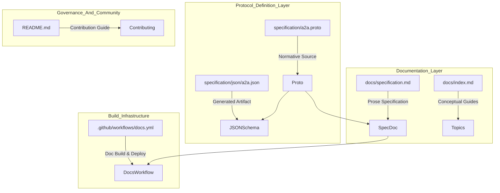
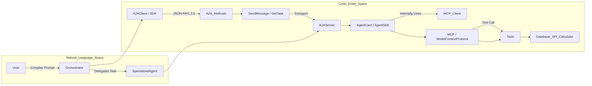

<!-- source: DeepWiki mcp.deepwiki.com · repo a2aproject/A2A · page 1 Overview · fetched 2026-10-21 -->

# Overview

Relevant source files

The following files were used as context for generating this wiki page:

- [README.md](README.md)
- [docs/index.md](docs/index.md)

This document introduces the A2A Protocol repository at [README.md:1](), which serves as the **canonical specification and reference implementation** for the Agent2Agent (A2A) communication protocol. Originally developed by Google and now hosted under an open standard framework, A2A provides an open standard for seamless communication between AI agents built on diverse frameworks [docs/index.md:29-37]().

The repository contains the normative Protocol Buffer definition, comprehensive documentation, build infrastructure, and community governance materials. This overview is designed to orient different user types—protocol implementers, SDK developers, documentation consumers, and contributors—by mapping the repository's structure to their specific needs and workflows. With the release of v1.0, the protocol is production-ready and guided by an active open-source community [README.md:48-51]().

For detailed technical specifications, see [What is the A2A Protocol](#1.1). For repository organization, see [Repository Structure](#1.2). For onboarding, see [Getting Started](#1.3).

Sources: [README.md:1-51](), [docs/index.md:29-37]()

## Repository Purpose and Scope

The A2A repository serves three primary functions:

1.  **Normative Specification Source**: Maintains the authoritative definition of all protocol data objects and operations, primarily through `specification/a2a.proto` [README.md:93]().
2.  **Documentation Hub**: Provides comprehensive protocol documentation, tutorials, and conceptual guides through the MkDocs-based site deployed to [a2a-protocol.org](https://a2a-protocol.org) [README.md:92](), [docs/index.md:75-84]().
3.  **Ecosystem Coordination**: Coordinates governance and collaboration across a wide partner ecosystem including enterprise, tech platforms, and framework providers [README.md:103-107]().

The repository does **not** contain the primary SDK source code (those are hosted in separate repositories like `a2aproject/a2a-python`) or sample code (located in `a2aproject/a2a-samples`) [README.md:94-101](), [docs/index.md:87-105]().

Sources: [README.md:90-107](), [docs/index.md:75-105]()

## Repository Architecture

### Core Components and File Structure

The following diagram maps high-level protocol concepts to specific code entities and files within the repository.

**Repository Architecture: Concept to Code Mapping**

Sources: [README.md:90-107](), [docs/index.md:63-115]()

## User Personas and Entry Points

The A2A ecosystem serves multiple technical audiences with distinct needs:

### Protocol Implementers
Those building new A2A-compliant servers or clients from scratch.
*   **Primary Entry Point**: `specification/a2a.proto` for the canonical definitions [README.md:93]().
*   **Key Resource**: `docs/index.md` for the detailed technical definition and overview of the protocol [docs/index.md:75-80]().

### SDK Users / Agent Builders
Developers using existing SDKs to make their agents A2A-compliant.
*   **Primary Entry Point**: Quickstart documentation and SDK installation guides [README.md:94-100]().
*   **Key Resource**: Official SDKs for Python, JS, Java, .NET, Go, and Rust [README.md:94-100](), [docs/index.md:93-105]().

### Contributors
Engineers looking to improve the protocol specification or documentation.
*   **Primary Entry Point**: `README.md` contribution guidelines [README.md:103-107]().
*   **Key Resource**: CI/CD workflows and documentation source files.

Sources: [README.md:90-107](), [docs/index.md:63-105]()

## Protocol Interoperability

A2A is designed to bridge the gap between diverse agent frameworks and vendors, focusing on agent-to-agent communication as a peer-to-peer standard [README.md:48-51](). It complements the Model Context Protocol (MCP), which focuses on agent-to-tool communication [docs/index.md:117-125]().

**Bridging Natural Language to Code Entities**

Sources: [README.md:48-51](), [docs/index.md:117-145]()

## Child Pages

For more detailed information, please refer to the following child pages:

*   [What is the A2A Protocol](#1.1): Explains the protocol's purpose, design principles (opacity, standardization, enterprise-readiness), and how it enables diverse AI agents to discover, communicate, and collaborate without exposing internal state [README.md:48-58](), [docs/index.md:29-33](), [docs/index.md:53-55]().
*   [Repository Structure](#1.2): Documents the organization of the codebase, including specification and documentation directories [README.md:90-101]().
*   [Getting Started](#1.3): Provides quick-start guidance, including installation commands for the official Python, JS, Go, Java, .NET, and Rust SDKs [README.md:94-100](), [docs/index.md:63-115]().

Sources: [README.md:48-100](), [docs/index.md:29-115]()

---

