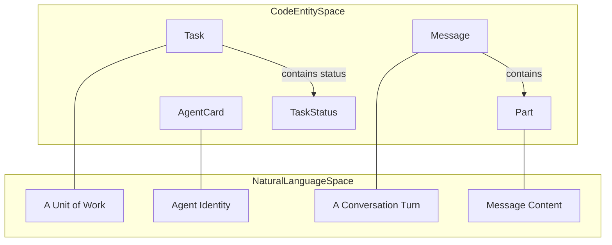
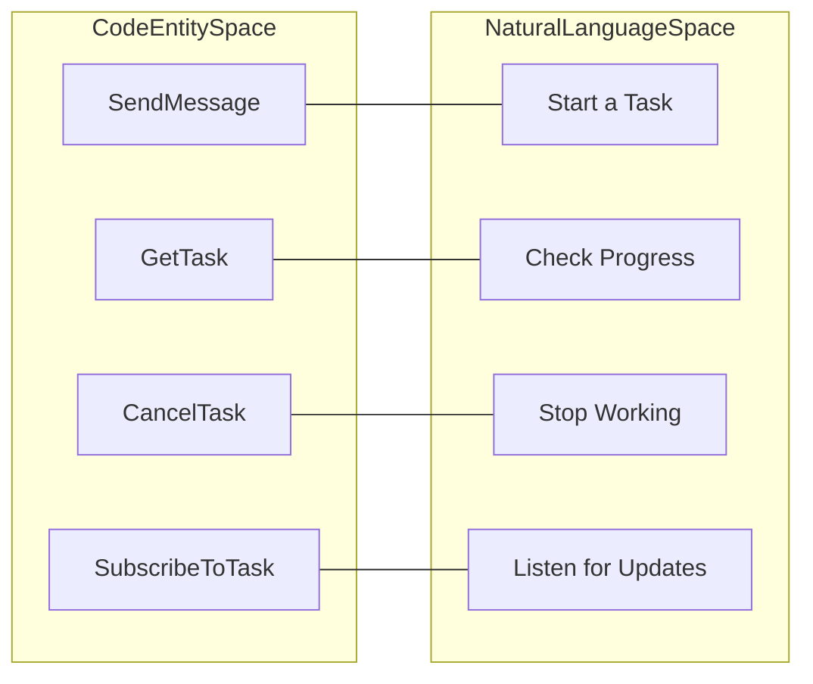

<!-- source: DeepWiki mcp.deepwiki.com · repo a2aproject/A2A · page 1.1 What is the A2A Protocol · fetched 2026-10-21 -->

# What is the A2A Protocol

Relevant source files

The following files were used as context for generating this wiki page:

- [.github/linters/.markdownlint.json](.github/linters/.markdownlint.json)
- [README.md](README.md)
- [docs/topics/a2a-and-mcp.md](docs/topics/a2a-and-mcp.md)
- [docs/topics/enterprise-ready.md](docs/topics/enterprise-ready.md)
- [docs/topics/what-is-a2a.md](docs/topics/what-is-a2a.md)

## Purpose and Scope

This document explains the fundamental mission, architecture, and design principles of the Agent2Agent (A2A) Protocol. It introduces the core technical concepts that enable independent AI agent systems to communicate, collaborate, and interoperate across different frameworks, vendors, and deployment environments.

The A2A protocol addresses a critical challenge in the AI landscape: enabling generative AI agents, built on diverse frameworks by different companies running on separate servers, to communicate and collaborate effectively as agents, not just as tools [README.md:48-51](), [docs/topics/what-is-a2a.md:3-9](). A2A provides a common language for agent interoperability, fostering a more interconnected and innovative AI ecosystem [docs/topics/what-is-a2a.md:3-9]().

Sources: [README.md:48-51](), [docs/topics/what-is-a2a.md:3-9]()

---

## Protocol Mission

The A2A Protocol defines a standard communication interface for independent AI agent systems. Agents built with different frameworks (such as Google ADK, LangGraph, or BeeAI) communicate through a canonical data model and standardized protocol bindings [README.md:67-70](), [docs/topics/what-is-a2a.md:85-91]().

The protocol addresses interoperability between autonomous agent systems through:

- **Standardized message exchange** using a common data format [README.md:84-87]().
- **Task lifecycle management** supporting long-running operations (LRO) [docs/topics/what-is-a2a.md:110-111](), [docs/topics/what-is-a2a.md:124-126]().
- **Agent capability advertisement** through "Agent Cards" detailing skills and connection info [README.md:85-85]().
- **Opaque execution model** where agents collaborate without exposing internal state, memory, or proprietary tool implementations [README.md:57-57](), [README.md:80-80](), [docs/topics/enterprise-ready.md:10-13]().

### Protocol Capabilities

| Capability | Implementation |
|------------|----------------|
| **Discovery** | `AgentCard` detailing capabilities, skills, and connection info [README.md:85-85](). |
| **Task Management** | Stateful unit of work with defined lifecycle and terminal states [README.md:56-56](). |
| **Message Exchange** | Handles text, files, and structured JSON data [README.md:87-87](). |
| **Streaming** | Server-Sent Events (SSE) for real-time, incremental results [README.md:86-86](), [docs/topics/what-is-a2a.md:107-108]() |
| **Push Notifications** | Asynchronous updates via webhooks for disconnected scenarios [README.md:86-86](), [docs/topics/what-is-a2a.md:121-123]() |
| **Security** | Enterprise-grade authentication (OAuth 2.0, API Keys) and TLS [docs/topics/enterprise-ready.md:16-48]() |
| **Opacity** | Collaboration without sharing internal memory or proprietary logic [README.md:80-80](), [docs/topics/enterprise-ready.md:10-13]() |

Sources: [README.md:56-88](), [docs/topics/what-is-a2a.md:107-111](), [docs/topics/what-is-a2a.md:121-126](), [docs/topics/enterprise-ready.md:10-48]()

---

## Three-Layer Architecture

A2A employs a layered architecture that separates protocol semantics from transport implementation, ensuring core concepts remain consistent across different bindings.

### Layer 1: Canonical Data Model

The A2A protocol relies on a structured data model to define all protocol types. This model serves as the normative source for all generated SDKs and schemas.

Title: "Data Model Mapping"

Sources: [README.md:84-88](), [docs/topics/what-is-a2a.md:85-91]()

**Key Definitions:**
- `Task`: Stateful work unit with lifecycle tracking [README.md:56-56]().
- `Message`: Communication turn between client and agent [README.md:55-57]().
- `Part`: Content unit (text, bytes, URL, or structured data) [README.md:87-87]().
- `AgentCard`: Agent capability declaration and discovery metadata [README.md:85-85]().

Sources: [README.md:55-87](), [docs/topics/what-is-a2a.md:85-91]()

### Layer 2: Abstract Operations

The protocol defines operations as abstract methods that govern how agents interact, regardless of the transport layer.

Title: "Operations Mapping"

Sources: [docs/topics/what-is-a2a.md:121-126]()

### Layer 3: Protocol Bindings

The specification maps abstract operations to concrete transport mechanisms.

| Binding | Transport | Content-Type |
|---------|-----------|--------------|
| **JSON-RPC 2.0** | HTTP(S) | `application/json` [README.md:84-84]() |
| **Streaming (SSE)** | HTTP(S) | `text/event-stream` [README.md:86-86]() |
| **Push Notifications** | HTTP(S) | Webhooks [README.md:86-86]() |

Sources: [README.md:84-86](), [docs/topics/what-is-a2a.md:107-123]()

---

## Core Design Principles

### Opacity and Security
Agents are **opaque** because they do not share internal memory, tools, or direct resource access with each other [README.md:80-80](), [docs/topics/enterprise-ready.md:10-11](). This preserves intellectual property and enhances security by treating remote agents as standard HTTP-based enterprise applications [docs/topics/enterprise-ready.md:12-13](). Collaboration relies on declared capabilities and exchanged context rather than shared internal state [README.md:57-57](), [docs/topics/what-is-a2a.md:126-129]().

Sources: [README.md:57-80](), [docs/topics/what-is-a2a.md:126-129](), [docs/topics/enterprise-ready.md:10-13]()

### Enterprise Readiness
A2A is designed for professional deployment environments:
- **Standard Technologies**: Leverages existing standards like HTTP, JSON-RPC, and SSE to avoid reinventing core technologies [docs/topics/what-is-a2a.md:115-117]().
- **Security**: Aligns with standard web practices for authentication (OAuth 2.0, API Keys), TLS identity verification, and authorization [docs/topics/enterprise-ready.md:16-83]().
- **Observability**: Supports distributed tracing (OpenTelemetry) and standard HTTP logging [docs/topics/enterprise-ready.md:107-114]().
- **Scalability**: Natively handles long-running tasks and asynchronous execution [docs/topics/what-is-a2a.md:121-123]().

Sources: [docs/topics/what-is-a2a.md:115-123](), [docs/topics/enterprise-ready.md:16-114]()

### Modality Independence
The protocol allows agents to communicate using a wide variety of content types. This enables rich and flexible interactions beyond plain text, including files and structured data exchange via content fields [README.md:87-87](), [docs/topics/what-is-a2a.md:124-125]().

Sources: [README.md:87-87](), [docs/topics/what-is-a2a.md:124-125]()

---

## A2A and MCP: Complementary Protocols

While A2A handles **agent-to-agent** communication, the Model Context Protocol (MCP) handles **agent-to-tool** communication [docs/topics/a2a-and-mcp.md:3-6](). They address distinct but highly complementary needs in the agentic stack [docs/topics/a2a-and-mcp.md:5-6](), [docs/topics/what-is-a2a.md:133-140]().

| Feature | A2A Protocol | Model Context Protocol (MCP) |
|---------|--------------|------------------------------|
| **Primary Focus** | Peer-to-peer collaboration [docs/topics/a2a-and-mcp.md:45-52]() | Tool and resource usage [docs/topics/a2a-and-mcp.md:31-38]() |
| **Relationship** | Standardizes agent-to-agent [docs/topics/what-is-a2a.md:135-135]() | Standardizes agent-to-tool [docs/topics/what-is-a2a.md:136-136]() |
| **Interaction** | Multi-turn, stateful dialogue [docs/topics/a2a-and-mcp.md:71-77]() | Stateless, structured function calls [docs/topics/a2a-and-mcp.md:64-68]() |

**Integrated Agent Stack:**
1. **Models**: Fundamental reasoning (LLMs) [docs/topics/what-is-a2a.md:138-138]().
2. **Frameworks**: Toolkits for building agents (e.g., ADK, LangGraph, BeeAI) [docs/topics/what-is-a2a.md:137-137]().
3. **MCP**: Connects the agent to its specific tools and resources [docs/topics/what-is-a2a.md:136-136]().
4. **A2A**: Connects independent agents across different organizations and ecosystems [docs/topics/what-is-a2a.md:135-135]().

Sources: [README.md:71-71](), [docs/topics/what-is-a2a.md:133-140](), [docs/topics/a2a-and-mcp.md:3-77]()

---

