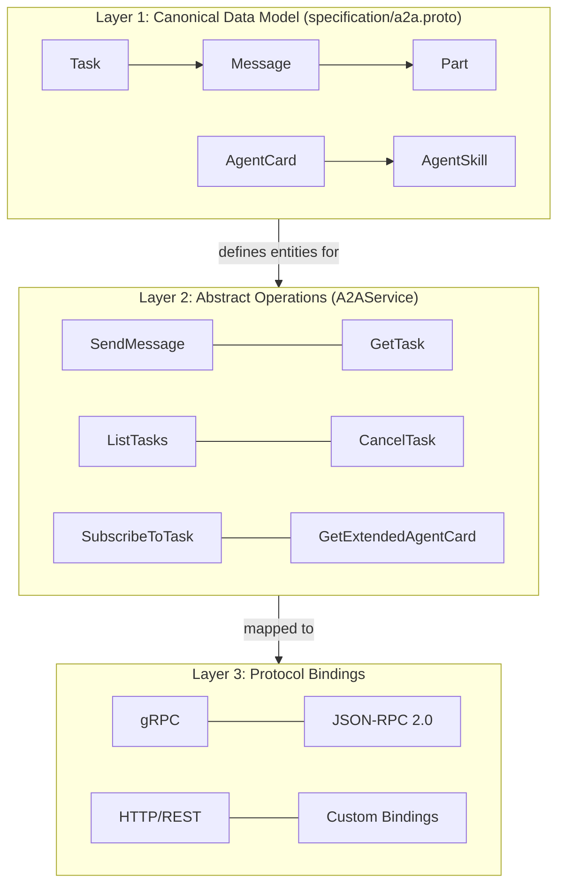
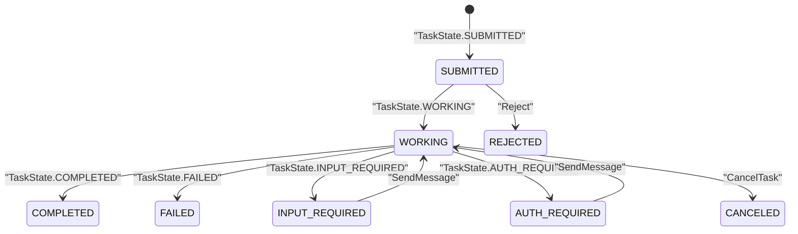

<!-- source: DeepWiki mcp.deepwiki.com · repo a2aproject/A2A · page 2 Protocol Specification · fetched 2026-10-21 -->

# Protocol Specification

Relevant source files

The following files were used as context for generating this wiki page:

- [docs/specification.md](docs/specification.md)
- [docs/topics/multi-tenancy.md](docs/topics/multi-tenancy.md)
- [docs/topics/streaming-and-async.md](docs/topics/streaming-and-async.md)
- [docs/whats-new-v1.md](docs/whats-new-v1.md)
- [specification/.api-linter.yaml](specification/.api-linter.yaml)
- [specification/a2a.proto](specification/a2a.proto)
- [specification/buf.yaml](specification/buf.yaml)

This document serves as the comprehensive reference for the A2A (Agent2Agent) Protocol's technical design. It covers the architectural layers, core data structures, and the communication patterns that enable independent AI agent systems to discover, collaborate, and manage tasks securely without exposing internal state.

For implementation guidance using SDKs, see [SDK & Implementation Guide](#3). For governance details, see [Community & Governance](#5).

Sources: [docs/specification.md:1-43](), [docs/specification.md:125-133]()

---

## 2.1. Three-Layer Architecture

The A2A Protocol is organized into three distinct layers to ensure that core semantics remain consistent across different transport mechanisms. This design allows the protocol to evolve its data model independently of how messages are physically transmitted.

### Protocol Layering and Code Entity Mapping

Sources: [docs/specification.md:45-104](), [specification/a2a.proto:1-140]()

*   **Layer 1: Canonical Data Model**: Defines core data structures (`Task`, `Message`, `AgentCard`) using Protocol Buffers in `specification/a2a.proto` [specification/a2a.proto:163-459]().
*   **Layer 2: Abstract Operations**: Describes fundamental behaviors defined in the `A2AService` interface [specification/a2a.proto:19-140]() independently of transport.
*   **Layer 3: Protocol Bindings**: Provides concrete mappings to gRPC, JSON-RPC, and HTTP/REST, including specific endpoint patterns like `/{tenant}/tasks/{id}` [specification/a2a.proto:46-51]().

For details, see [Three-Layer Architecture](#2.1).

Sources: [docs/specification.md:45-104](), [specification/a2a.proto:1-140]()

---

## 2.2. Core Data Types

The protocol revolves around several fundamental objects defined in the `lf.a2a.v1` package inside `specification/a2a.proto`.

| Entity | Description | Code Reference |
| :--- | :--- | :--- |
| **Task** | The core unit of action; tracks state, history, and results. | `message Task` [specification/a2a.proto:167-182]() |
| **Message** | A single turn in a conversation, containing one or more `Part`s. | `message Message` [specification/a2a.proto:252-274]() |
| **Part** | Polymorphic content (text, raw bytes, data, or URL). | `message Part` [specification/a2a.proto:354-386]() |
| **Artifact** | A tangible output produced by a task. | `message Artifact` [specification/a2a.proto:276-287]() |
| **AgentCard** | A manifest describing agent identity, skills, and security. | `message AgentCard` [specification/a2a.proto:388-413]() |

For details, see [Core Data Types](#2.2).

Sources: [specification/a2a.proto:163-459](), [docs/specification.md:131-133]()

---

## 2.3. RPC Operations & Protocol Bindings

The `A2AService` defines the functional interface for the protocol. These operations map across different bindings (gRPC, JSON-RPC, REST) using standard conventions. Multi-tenancy is natively supported via the `tenant` field in requests and URL paths, allowing a single endpoint to serve multiple agents [specification/a2a.proto:21-140]().

| Operation | Purpose | HTTP Mapping |
| :--- | :--- | :--- |
| `SendMessage` | Initiates or continues a task. | `POST /message:send` [specification/a2a.proto:21-30]() |
| `SendStreamingMessage` | Sends a message and returns an SSE/gRPC stream. | `POST /message:stream` [specification/a2a.proto:33-42]() |
| `GetTask` | Retrieves the current state of a specific task. | `GET /tasks/{id}` [specification/a2a.proto:45-53]() |
| `ListTasks` | Queries tasks with filtering and pagination. | `GET /tasks` [specification/a2a.proto:55-62]() |
| `SubscribeToTask` | Subscribes to real-time updates for a task. | `GET /tasks/{id}:subscribe` [specification/a2a.proto:76-83]() |
| `GetExtendedAgentCard` | Fetches detailed metadata after authentication. | `GET /extendedAgentCard` [specification/a2a.proto:122-129]() |

For details, see [RPC Operations & Protocol Bindings](#2.3).

Sources: [specification/a2a.proto:19-140](), [docs/whats-new-v1.md:48-175](), [docs/topics/multi-tenancy.md:73-108]()

---

## 2.4. Agent Discovery via AgentCard

Discovery is performed by fetching the `AgentCard` from a well-known URI: `/.well-known/agent-card.json`. This document declares the agent's `AgentSkill` set, supported `AgentInterface` (URL, protocol, and version), and `SecurityScheme` [specification/a2a.proto:332-459](). Version 1.0 introduced JWS signatures for AgentCard verification to ensure integrity in enterprise environments [docs/whats-new-v1.md:115-130]().

For details, see [Agent Discovery via AgentCard](#2.4).

Sources: [specification/a2a.proto:332-459](), [docs/whats-new-v1.md:115-130]()

---

## 2.5. Task Lifecycle & State Management

Tasks follow a strict state machine defined by the `TaskState` enum. Transitions are managed by the agent, and clients track progress via `TaskStatus` [specification/a2a.proto:184-217](). Terminal states include `COMPLETED`, `FAILED`, `CANCELED`, and `REJECTED`. Interrupted states like `INPUT_REQUIRED` and `AUTH_REQUIRED` pause execution until client action is taken [docs/whats-new-v1.md:109-114]().

### Task State Machine Code Mapping

Sources: [specification/a2a.proto:184-217](), [docs/whats-new-v1.md:109-114]()

For details, see [Task Lifecycle & State Management](#2.5).

Sources: [specification/a2a.proto:184-217](), [docs/whats-new-v1.md:31](), [docs/whats-new-v1.md:109-114]()

---

## 2.6. Streaming & Asynchronous Operations

A2A handles long-running tasks through three delivery mechanisms:
1.  **Polling**: Repeatedly calling `GetTask` [specification/a2a.proto:45-53]().
2.  **Streaming**: Real-time events via Server-Sent Events (SSE) using `SendStreamingMessage` or `SubscribeToTask`. These return a `StreamResponse` which can contain a `TaskStatusUpdateEvent` or `TaskArtifactUpdateEvent` [specification/a2a.proto:294-310]().
3.  **Push Notifications**: Webhooks for disconnected scenarios, configured via `CreateTaskPushNotificationConfig`. Payloads use the standard `StreamResponse` format [specification/a2a.proto:89-100]().

For details, see [Streaming & Asynchronous Operations](#2.6).

Sources: [specification/a2a.proto:33-42](), [specification/a2a.proto:76-83](), [specification/a2a.proto:89-139](), [docs/whats-new-v1.md:60-74](), [docs/topics/streaming-and-async.md:1-85]()

---

## 2.7. Extensions System

The protocol can be extended without breaking core compatibility. Extensions are activated by the client using the `A2A-Extensions` header and must be declared in the `AgentCard` capabilities [specification/a2a.proto:403-413](). The `Task`, `Message`, and `Artifact` objects include an `extensions` field to carry supplemental data [specification/a2a.proto:181-182]().

*   **Data-only**: Adds custom fields to existing objects.
*   **Method**: Introduces new RPC operations.
*   **State Machine**: Adds new task states for specialized workflows.

For details, see [Extensions System](#2.7).

Sources: [docs/whats-new-v1.md:29-30](), [specification/a2a.proto:403-413]()

---

## 2.8. Security & Authentication

Security is modeled after OpenAPI 3.2. Agents declare `SecurityScheme`s in their `AgentCard` [specification/a2a.proto:486-512](). 

*   **Supported Schemes**: OAuth 2.0 (Authorization Code with PKCE, Device Code), mTLS, API Keys, OIDC, and HTTP Auth [specification/a2a.proto:486-637]().
*   **Integrity**: JWS and JSON Canonicalization (RFC 8785) are used for signing AgentCards to prevent tampering [docs/whats-new-v1.md:37-38]().
*   **Privacy**: Servers MUST only return tasks and data visible to the authenticated caller [docs/whats-new-v1.md:89-90]().

For details, see [Security & Authentication](#2.8).

Sources: [docs/whats-new-v1.md:36-42](), [specification/a2a.proto:486-637]()

---

## 2.9. Multi-Tenancy & Tenant Routing

The A2A protocol supports multi-tenancy, allowing a single endpoint to serve multiple agents or tenants. This is achieved through several mechanisms:

1.  **URL-Based Routing (Sub-Path)**: Agents advertise distinct URL prefixes in their `AgentCard`'s `supportedInterfaces` [docs/topics/multi-tenancy.md:19-51]().
2.  **Authentication Header-Based Routing**: Gateways use authentication credentials (e.g., bearer tokens, API keys) to route requests to the appropriate agent [docs/topics/multi-tenancy.md:58-72]().
3.  **Body-Based Routing Using the `tenant` Field**: Every A2A request message includes an optional `tenant` field. This opaque string, defined by the server operator, is advertised in the `AgentInterface` and echoed by the client in every request [specification/a2a.proto:26-27](), [docs/topics/multi-tenancy.md:73-108]().

For details, see [Multi-Tenancy & Tenant Routing](#2.9).

Sources: [docs/topics/multi-tenancy.md:1-123](), [docs/whats-new-v1.md:161-169](), [specification/a2a.proto:26-27]()

---

