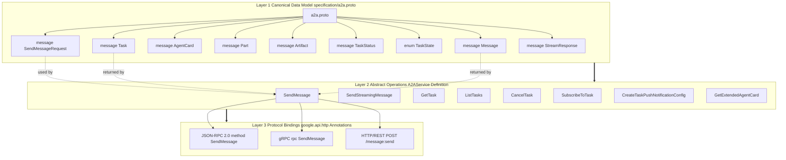
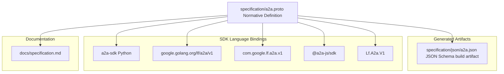
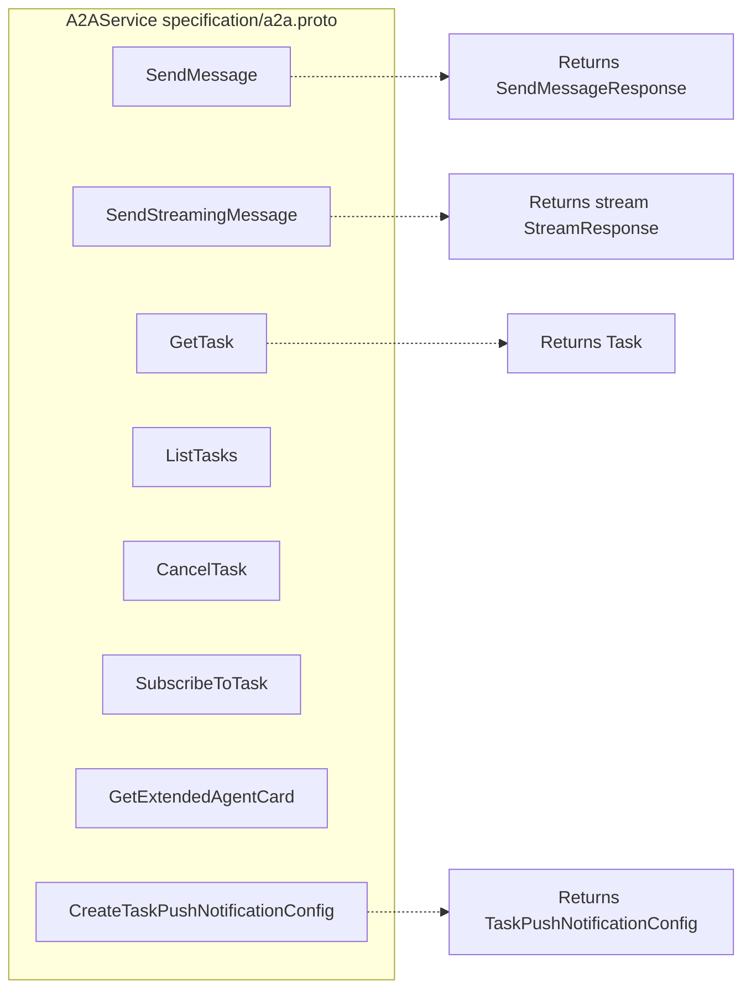

<!-- source: DeepWiki mcp.deepwiki.com · repo a2aproject/A2A · page 2.1 Three-Layer Architecture · fetched 2026-10-21 -->

# Three-Layer Architecture

Relevant source files

The following files were used as context for generating this wiki page:

- [docs/specification.md](docs/specification.md)
- [docs/topics/multi-tenancy.md](docs/topics/multi-tenancy.md)
- [docs/topics/streaming-and-async.md](docs/topics/streaming-and-async.md)
- [docs/whats-new-v1.md](docs/whats-new-v1.md)
- [specification/.api-linter.yaml](specification/.api-linter.yaml)
- [specification/a2a.proto](specification/a2a.proto)
- [specification/buf.yaml](specification/buf.yaml)

## Purpose and Scope

This document explains the A2A Protocol's three-layer architectural design, which separates the canonical data model (Layer 1), abstract operations (Layer 2), and protocol bindings (Layer 3) [docs/specification.md:45-104](). This separation enables protocol neutrality, extensibility, and interoperability across diverse transport mechanisms while maintaining consistent core semantics [docs/specification.md:98-104]().

Sources: [docs/specification.md:45-104]()

---

## Architectural Overview

The A2A Protocol is structured as three distinct layers. Each layer maintains clear boundaries with the others, ensuring that core semantics remain consistent across all transport bindings [docs/specification.md:45-104]().

### Three-Layer Structure and Code Mappings

Title: Three-Layer Architecture with Proto Message Mappings

Sources: [docs/specification.md:46-106](), [specification/a2a.proto:19-140]()

### Layer Responsibilities

| Layer | Responsibility | Format | Normative Status |
|-------|---------------|--------|------------------|
| **Layer 1** | Define core data structures and message formats | Protocol Buffers (`a2a.proto`) | Normative [docs/specification.md:107-108]() |
| **Layer 2** | Describe fundamental capabilities and behaviors | Abstract operations (`A2AService`) | Normative [docs/specification.md:94-95]() |
| **Layer 3** | Map operations to specific transport protocols | JSON-RPC, gRPC, HTTP/REST | Normative per binding [docs/specification.md:96-97]() |

Sources: [docs/specification.md:92-119]()

---

## Layer 1: Canonical Data Model

Layer 1 defines the core data structures that all A2A implementations must understand. These are protocol-agnostic definitions expressed as Protocol Buffer messages [docs/specification.md:92-93]().

### The Normative Proto File

The file `specification/a2a.proto` is the single authoritative normative definition of all protocol data objects and request/response messages [docs/specification.md:107-108]().

Title: Canonical Data Model and Code Entity Generation

Key principles for the normative proto:
- SDK language bindings **MUST** be regenerated from the proto rather than edited manually [docs/specification.md:107-108]().
- The JSON schema `specification/json/a2a.json` is a non-normative build artifact [docs/specification.md:107-108]().
- Namespace options in `specification/a2a.proto` define the structure for various languages (e.g., `option csharp_namespace = "Lf.A2a.V1"`, `option java_package = "com.google.lf.a2a.v1"`) [specification/a2a.proto:12-16]().

Sources: [docs/specification.md:107-126](), [specification/a2a.proto:1-17]()

### Core Data Objects

Layer 1 defines the fundamental data structures used throughout the protocol.

| Message / Class | Description | Key Fields |
|-----------------|-------------|------------|
| `Task` | Core unit of action for A2A [specification/a2a.proto:163-167]() | `id`, `context_id`, `status`, `artifacts`, `history` [specification/a2a.proto:170-180]() |
| `Message` | Interaction turn [specification/a2a.proto:222-223]() | `role`, `parts`, `message_id`, `task_id` [specification/a2a.proto:225-235]() |
| `AgentCard` | Discovery metadata [specification/a2a.proto:441-442]() | `name`, `description`, `supported_interfaces`, `capabilities` [specification/a2a.proto:444-454]() |
| `Part` | Content container [specification/a2a.proto:274-275]() | `text`, `raw`, `url`, `data` (oneof) [specification/a2a.proto:277-285]() |
| `Artifact` | Output from a task [specification/a2a.proto:347-348]() | `id`, `name`, `parts`, `metadata` [specification/a2a.proto:350-357]() |

Sources: [specification/a2a.proto:163-454]()

---

## Layer 2: Abstract Operations

Layer 2 describes the behaviors that A2A agents must support, independent of transport [docs/specification.md:94-95]().

### Core Operations and Service Methods

Title: Abstract Operations and Code Entities

Operation Summary:
- `SendMessage`: Initiates or continues a task [specification/a2a.proto:21-30]().
- `SendStreamingMessage`: Streaming version of `SendMessage` for real-time updates [specification/a2a.proto:33-42]().
- `GetTask`: Retrieves the latest state of a task [specification/a2a.proto:45-53]().
- `ListTasks`: Filters and paginates existing tasks [specification/a2a.proto:55-62]().
- `CancelTask`: Requests cancellation of a task in progress [specification/a2a.proto:64-73]().
- `SubscribeToTask`: Monitors updates for a non-terminal task [specification/a2a.proto:76-83]().
- `GetExtendedAgentCard`: Fetches detailed metadata after authentication [specification/a2a.proto:122-129]().

Sources: [specification/a2a.proto:19-140]()

---

## Layer 3: Protocol Bindings

Layer 3 provides concrete mappings of the abstract operations to specific protocol bindings [docs/specification.md:96-97]().

### Method Mapping Across Bindings

The `specification/a2a.proto` file uses Google API annotations (`google.api.http`) to define the REST/HTTP mapping for each operation [specification/a2a.proto:22-137]().

| Operation | REST Endpoint | gRPC RPC |
|-----------|---------------|----------|
| `SendMessage` | `POST /message:send` [specification/a2a.proto:23]() | `SendMessage` |
| `SendStreamingMessage` | `POST /message:stream` [specification/a2a.proto:35]() | `SendStreamingMessage` |
| `GetTask` | `GET /tasks/{id}` [specification/a2a.proto:47]() | `GetTask` |
| `ListTasks` | `GET /tasks` [specification/a2a.proto:57]() | `ListTasks` |
| `CancelTask` | `POST /tasks/{id}:cancel` [specification/a2a.proto:66]() | `CancelTask` |
| `SubscribeToTask` | `GET /tasks/{id}:subscribe` [specification/a2a.proto:78]() | `SubscribeToTask` |
| `GetExtendedAgentCard` | `GET /extendedAgentCard` [specification/a2a.proto:124]() | `GetExtendedAgentCard` |

### JSON-RPC, HTTP/REST, and Multi-Tenancy Equivalence

The v1.0 release ensures formal specification of all three protocol bindings with equivalence guarantees [docs/whats-new-v1.md:38-39]().
- **JSON Mapping**: The protocol leverages standard ProtoJSON mapping for JSON serialization [docs/whats-new-v1.md:20-21]().
- **Enum Casing**: Enum values use `SCREAMING_SNAKE_CASE` (e.g., `SUBMITTED`, `WORKING`) in JSON for compliance with the ProtoJSON specification [docs/whats-new-v1.md:20-21]().
- **Multi-tenancy**: All bindings support native tenant scoping via the `{tenant}` path parameter in URL paths or the `tenant` field in request bodies [specification/a2a.proto:26, 38, 49, 59, 69, 80](), [docs/topics/multi-tenancy.md:73-82]().
- **Streaming**: Bindings typically use Server-Sent Events (SSE) or protocol-specific stream closure mechanisms for `SendStreamingMessage` and `SubscribeToTask` [docs/topics/streaming-and-async.md:5-17](), [docs/whats-new-v1.md:72-74]().

Sources: [specification/a2a.proto:22-137](), [docs/whats-new-v1.md:20-175](), [docs/topics/multi-tenancy.md:1-104](), [docs/topics/streaming-and-async.md:5-26]()

---

## Benefits of Layered Architecture

1. **Protocol Neutrality**: Core semantics remain consistent whether using gRPC for high performance or JSON-RPC/REST for web compatibility [docs/specification.md:100-104]().
2. **Deterministic Evolution**: Centering `specification/a2a.proto` as the normative source reduces specification drift and ensures consistent versioning [docs/specification.md:123-125](), [docs/whats-new-v1.md:11-16]().
3. **Enterprise Readiness**: Standardized mappings for error codes, authentication, and multi-tenancy are defined once and applied across all bindings [docs/whats-new-v1.md:35-42]().
4. **Opaque Execution**: Agents collaborate based on the shared Layer 1 data model without needing to share internal logic or framework-specific state [docs/specification.md:39]().

Sources: [docs/specification.md:39-125](), [docs/whats-new-v1.md:11-42]()

---

