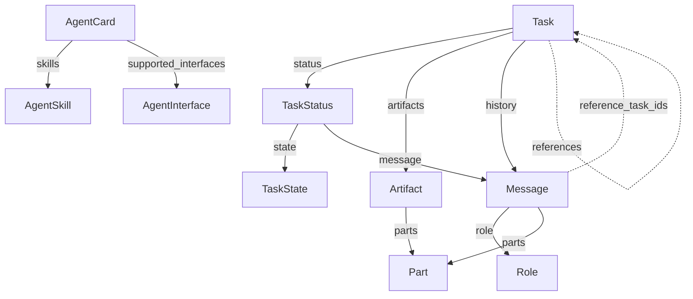
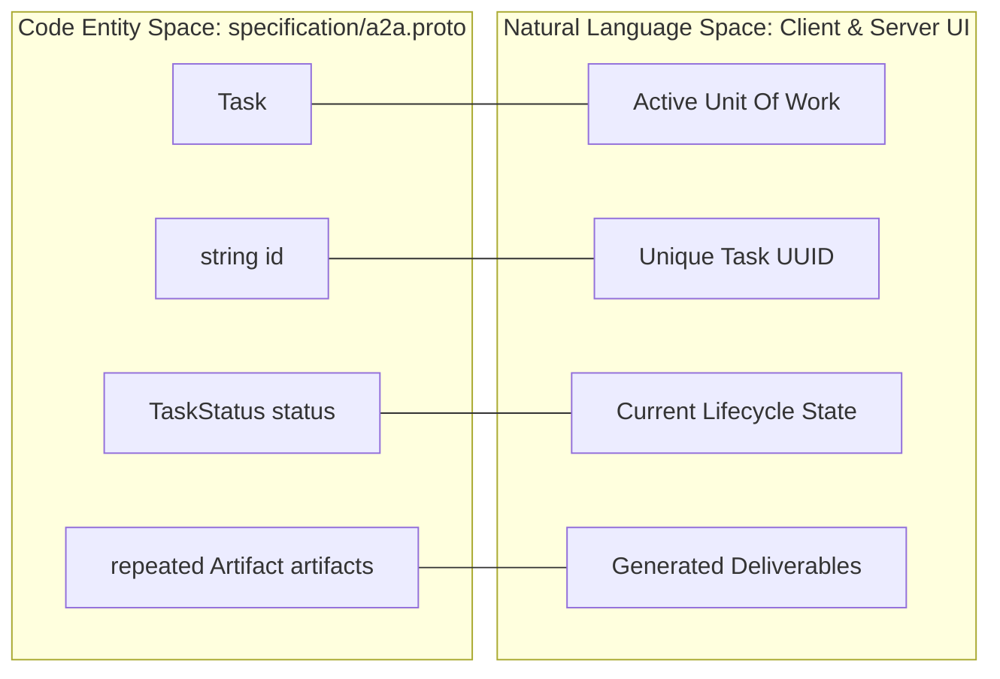
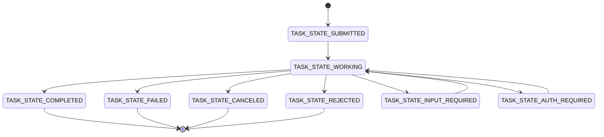
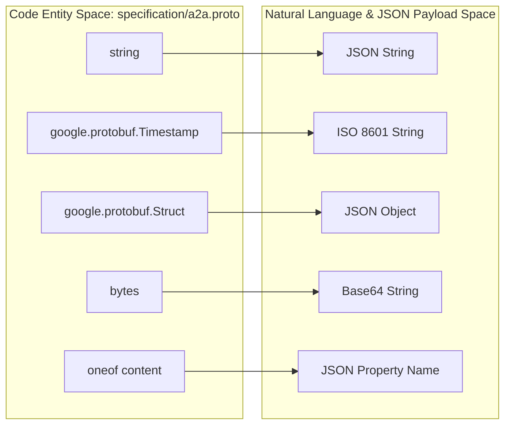

<!-- source: DeepWiki mcp.deepwiki.com · repo a2aproject/A2A · page 2.2 Core Data Types · fetched 2026-10-21 -->

# Core Data Types

Relevant source files

The following files were used as context for generating this wiki page:

- [docs/topics/agent-discovery.md](docs/topics/agent-discovery.md)
- [docs/topics/key-concepts.md](docs/topics/key-concepts.md)
- [docs/topics/life-of-a-task.md](docs/topics/life-of-a-task.md)
- [docs/topics/multi-tenancy.md](docs/topics/multi-tenancy.md)
- [docs/whats-new-v1.md](docs/whats-new-v1.md)
- [specification/.api-linter.yaml](specification/.api-linter.yaml)
- [specification/a2a.proto](specification/a2a.proto)
- [specification/buf.yaml](specification/buf.yaml)

This page documents the fundamental data structures that form the canonical data model of the A2A Protocol. These types are defined normatively in `specification/a2a.proto` [specification/a2a.proto:1-812]() and represent the core building blocks for all A2A operations and interactions.

Sources: [specification/a2a.proto:1-812](), [docs/specification.md:92-97]()

## Overview of Type Relationships

The A2A data model centers around stateful task execution and message exchange between agents. The following diagram illustrates how the core types relate to each other.

**Diagram: A2A Core Entity Relationships**

Sources: [specification/a2a.proto:163-393](), [docs/topics/key-concepts.md:26-32]()

## Task

The `Task` message is the fundamental unit of action in the A2A protocol. It represents a stateful execution that progresses through a defined lifecycle and accumulates artifacts as outputs [specification/a2a.proto:163-166]().

**Diagram: Task Message Structure Bridging Code and Natural Language**

Sources: [specification/a2a.proto:167-184](), [docs/topics/key-concepts.md:29]()

### Task Fields

| Field | Type | Required | Description |
|-------|------|----------|-------------|
| `id` | string | Yes | Unique identifier (UUID) generated by the server for a new task [specification/a2a.proto:170](). |
| `context_id` | string | No | Identifier for the contextual collection of interactions (tasks and messages) [specification/a2a.proto:173](). |
| `status` | `TaskStatus` | Yes | Current status including state and optional message [specification/a2a.proto:175](). |
| `artifacts` | `Artifact[]` | No | Set of output artifacts produced by the task [specification/a2a.proto:177](). |
| `history` | `Message[]` | No | History of message interactions for this task [specification/a2a.proto:180](). |
| `metadata` | `google.protobuf.Struct` | No | Custom structured data stored with the task [specification/a2a.proto:183](). |

Sources: [specification/a2a.proto:163-184](), [docs/topics/key-concepts.md:29](), [docs/topics/life-of-a-task.md:18-20](), [docs/topics/life-of-a-task.md:81-97]()

## TaskStatus and TaskState

The `TaskStatus` message encapsulates the current state of a task, including when that state was recorded and an optional explanatory message [specification/a2a.proto:211-219]().

### TaskStatus Fields

| Field | Type | Required | Description |
|-------|------|----------|-------------|
| `state` | `TaskState` | Yes | Current lifecycle state [specification/a2a.proto:213](). |
| `message` | `Message` | No | Optional message associated with the status [specification/a2a.proto:215](). |
| `timestamp` | `Timestamp` | No | Time when the status was recorded [specification/a2a.proto:217](). |

Sources: [specification/a2a.proto:211-219]()

### TaskState Enum

The `TaskState` enum defines the possible lifecycle states. Enums use `SCREAMING_SNAKE_CASE` for compliance with ProtoJSON specifications [docs/whats-new-v1.md:20]().

| State | Description |
|-------|-------------|
| `TASK_STATE_SUBMITTED` | Task successfully submitted [specification/a2a.proto:191](). |
| `TASK_STATE_WORKING` | Task is actively being processed [specification/a2a.proto:193](). |
| `TASK_STATE_COMPLETED` | Task finished successfully (terminal) [specification/a2a.proto:195](). |
| `TASK_STATE_FAILED` | Task finished with an error (terminal) [specification/a2a.proto:197](). |
| `TASK_STATE_CANCELED` | Task was canceled (terminal) [specification/a2a.proto:199](). |
| `TASK_STATE_INPUT_REQUIRED` | Agent requires user input (interrupted) [specification/a2a.proto:201](). |
| `TASK_STATE_AUTH_REQUIRED` | Authentication required (interrupted) [specification/a2a.proto:203](). |
| `TASK_STATE_REJECTED` | Agent decided not to perform the task (terminal) [specification/a2a.proto:205](). |

Sources: [specification/a2a.proto:186-209](), [docs/whats-new-v1.md:20]()

**Diagram: Task State Machine**

Sources: [specification/a2a.proto:186-219](), [docs/topics/life-of-a-task.md:10-14]()

## Message

The `Message` type represents a single unit of communication between client and server. It is the building block for conversational history and immediate responses [specification/a2a.proto:260-277]().

### Message Fields

| Field | Type | Required | Description |
|-------|------|----------|-------------|
| `message_id` | string | Yes | Unique identifier for the message [specification/a2a.proto:263](). |
| `context_id` | string | No | Context ID of the message [specification/a2a.proto:265](). |
| `task_id` | string | No | Task ID if associated with a task [specification/a2a.proto:267](). |
| `role` | `Role` | Yes | Identifies sender (`ROLE_USER` or `ROLE_AGENT`) [specification/a2a.proto:269](). |
| `parts` | `Part[]` | Yes | Content of the message [specification/a2a.proto:271](). |
| `metadata` | `Struct` | No | Additional metadata [specification/a2a.proto:273](). |
| `reference_task_ids` | `string[]` | No | Task IDs referenced for context [specification/a2a.proto:277](). |

Sources: [specification/a2a.proto:244-277](), [docs/topics/key-concepts.md:30]()

## Part

The `Part` message is the smallest unit of content, allowing A2A to be modality agnostic. It uses a `oneof` field to represent different content types [specification/a2a.proto:222]().

| Field | Type | Required | Description |
|-------|------|----------|-------------|
| `text` | string | OneOf | Plain text content [specification/a2a.proto:223](). |
| `raw` | bytes | OneOf | Inline binary data [specification/a2a.proto:225](). |
| `url` | string | OneOf | Reference to external content [specification/a2a.proto:227](). |
| `data` | `Value` | OneOf | Structured JSON data [specification/a2a.proto:229](). |
| `media_type` | string | No | MIME type (e.g., `"image/png"`) [specification/a2a.proto:233](). |
| `filename` | string | No | Optional filename [specification/a2a.proto:235](). |

Sources: [specification/a2a.proto:221-242](), [docs/topics/key-concepts.md:31](), [docs/topics/key-concepts.md:70-82]()

## Artifact

The `Artifact` message represents a tangible output or a concrete result generated by a remote agent during task processing [specification/a2a.proto:279-293]().

### Artifact Fields

| Field | Type | Required | Description |
|-------|------|----------|-------------|
| `artifact_id` | string | Yes | Unique identifier within the task [specification/a2a.proto:281](). |
| `name` | string | No | Human-readable name [specification/a2a.proto:283](). |
| `description` | string | No | Human-readable description [specification/a2a.proto:285](). |
| `parts` | `Part[]` | Yes | Content of the artifact [specification/a2a.proto:287](). |
| `metadata` | `Struct` | No | Additional metadata [specification/a2a.proto:289](). |

Sources: [specification/a2a.proto:279-293](), [docs/topics/key-concepts.md:32](), [docs/topics/key-concepts.md:83-89]()

## AgentCard

The `AgentCard` is the discovery mechanism for an agent, describing its identity, capabilities, and skills [specification/a2a.proto:352-393]().

### AgentCard Fields

| Field | Type | Required | Description |
|-------|------|----------|-------------|
| `name` | string | Yes | Name of the agent [specification/a2a.proto:358](). |
| `supported_interfaces` | `AgentInterface[]` | Yes | Contact endpoints and protocol bindings [specification/a2a.proto:364](). |
| `capabilities` | `AgentCapabilities` | Yes | Supported features like streaming or push [specification/a2a.proto:371](). |
| `skills` | `AgentSkill[]` | Yes | List of agent abilities and examples [specification/a2a.proto:386](). |

Sources: [specification/a2a.proto:352-393](), [docs/topics/key-concepts.md:28](), [docs/topics/agent-discovery.md:7-15](), [docs/whats-new-v1.md:122-130]()

## Type System Mapping

The following diagram maps Protobuf types to their expected representations in JSON-RPC or REST bindings, bridging the gap between code entities and runtime payloads.

**Diagram: Protobuf to JSON Mapping Bridging Code Entity Space and Natural Language Space**

Sources: [docs/whats-new-v1.md:19-24](), [specification/a2a.proto:1-10]()

---

