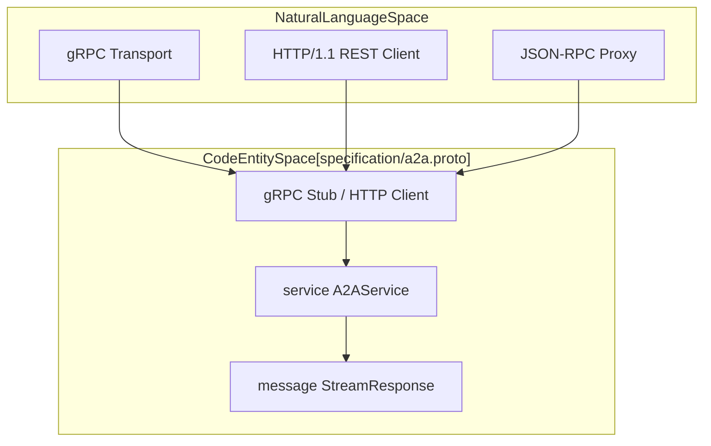

<!-- source: DeepWiki mcp.deepwiki.com · repo a2aproject/A2A · page 2.3 RPC Operations & Protocol Bindings · fetched 2026-10-21 -->

# RPC Operations & Protocol Bindings

Relevant source files

The following files were used as context for generating this wiki page:

- [docs/specification.md](docs/specification.md)
- [docs/topics/multi-tenancy.md](docs/topics/multi-tenancy.md)
- [docs/topics/streaming-and-async.md](docs/topics/streaming-and-async.md)
- [docs/whats-new-v1.md](docs/whats-new-v1.md)
- [specification/.api-linter.yaml](specification/.api-linter.yaml)
- [specification/a2a.proto](specification/a2a.proto)
- [specification/buf.yaml](specification/buf.yaml)

## Purpose and Scope

This document provides a comprehensive reference for all A2A protocol operations and their concrete implementations across supported protocol bindings. It details the core RPC methods that form the operational layer of the A2A protocol and explains how each operation maps to gRPC, JSON-RPC 2.0, and HTTP/REST protocol bindings.

The A2A protocol is designed with a three-layer architecture [docs/specification.md:46-90]() where Layer 1 defines the canonical data model in Protobuf, Layer 2 describes abstract operations, and Layer 3 provides concrete protocol bindings. This ensures that core semantics remain consistent regardless of whether an agent communicates via gRPC, REST, or JSON-RPC [docs/specification.md:98-103]().

Sources: [docs/specification.md:1-103](), [specification/a2a.proto:18-140]()

---

## Overview of A2A Operations

The A2A protocol defines core operations within the `A2AService` [specification/a2a.proto:19-140](). These operations enable discovery, task initiation, lifecycle management, and asynchronous notifications. The v1.0 release standardized these method names to follow `UpperCamelCase` across all bindings [docs/whats-new-v1.md:19-20]().

**Diagram: Natural Language to Code Entity Mapping for A2A Operations**

```mermaid
graph TB
    subgraph "CodeEntitySpace[specification/a2a.proto]"
        direction TB
        AS["service A2AService"]
        SM["rpc SendMessage"]
        SSM["rpc SendStreamingMessage"]
        GT["rpc GetTask"]
        LT["rpc ListTasks"]
        CT["rpc CancelTask"]
        ST["rpc SubscribeToTask"]
        EAC["rpc GetExtendedAgentCard"]
        
        subgraph PushNotificationConfigs
            CPN["rpc CreateTaskPushNotificationConfig"]
            GPN["rpc GetTaskPushNotificationConfig"]
            LPN["rpc ListTaskPushNotificationConfigs"]
            DPN["rpc DeleteTaskPushNotificationConfig"]
        end

        AS --> SM
        AS --> SSM
        AS --> GT
        AS --> LT
        AS --> CT
        AS --> ST
        AS --> EAC
        AS --> CPN
        AS --> GPN
        AS --> LPN
        AS --> DPN
    end
    
    subgraph NaturalLanguageSpace
        NL_DISC["Agent Discovery"]
        NL_MSG["Agent Messaging"]
        NL_TASK["Task Management"]
        NL_WEB["Webhooks & Notifications"]
    end
    
    NL_DISC --- EAC
    NL_MSG --- SM
    NL_MSG --- SSM
    NL_TASK --- GT
    NL_TASK --- LT
    NL_TASK --- CT
    NL_TASK --- ST
    NL_WEB --- CPN
    NL_WEB --- GPN
    NL_WEB --- LPN
    NL_WEB --- DPN
```

Sources: [specification/a2a.proto:19-140](), [docs/specification.md:54-62](), [docs/whats-new-v1.md:48-161]()

---

## Core RPC Operations Reference

### 1. SendMessage
Initiates or continues an interaction. It can return a direct `Message` for stateless turns or a `Task` for long-running work [specification/a2a.proto:21-30]().

*   **Input:** `SendMessageRequest` [specification/a2a.proto:642-652]()
*   **Output:** `SendMessageResponse` [specification/a2a.proto:716-724]()
*   **Behavior:** Controlled by `SendMessageConfiguration` [specification/a2a.proto:143-161](). If `return_immediately` is true, the server returns as soon as the task is created [specification/a2a.proto:160]().

### 2. SendStreamingMessage
The streaming version of `SendMessage` [specification/a2a.proto:33](). It allows for real-time interaction and status updates via a server-to-client stream.

*   **Output:** `stream StreamResponse` [specification/a2a.proto:33]().
*   **Events:** Stream events no longer use a `kind` discriminator; they are identified by the presence of specific fields like `task`, `message`, `status_update`, or `artifact_update` [docs/whats-new-v1.md:70-72]().

### 3. GetTask
Retrieves the current state of a specific `Task` [specification/a2a.proto:45-53]().

*   **Input:** `GetTaskRequest` [specification/a2a.proto:654-664]().
*   **Key Field:** `history_length` allows the caller to limit how many previous messages are returned in the task history [specification/a2a.proto:661-663]().

### 4. ListTasks
Lists tasks matching a filter, supporting cursor-based pagination [specification/a2a.proto:55-62]().

*   **Filters:** Supports filtering by `context_id`, `status` (`TaskState`), and `status_timestamp_after` [specification/a2a.proto:667-691]().
*   **Pagination:** Uses `page_size` and `page_token` for scalable retrieval [specification/a2a.proto:680-683]().

### 5. CancelTask
Requests the cancellation of a task in progress [specification/a2a.proto:64-73]().

### 6. SubscribeToTask
Subscribes to updates for an existing task that is not yet in a terminal state [specification/a2a.proto:76-83](). This replaces the legacy `resubscribe` operation [docs/whats-new-v1.md:141]().

### 7. Push Notification Operations
A set of methods to manage webhooks for task updates:
*   `CreateTaskPushNotificationConfig`: Creates a new configuration [specification/a2a.proto:90-100]().
*   `GetTaskPushNotificationConfig`: Retrieves a specific config [specification/a2a.proto:102-110]().
*   `ListTaskPushNotificationConfigs`: Lists all configs for a task [specification/a2a.proto:112-120]().
*   `DeleteTaskPushNotificationConfig`: Removes a config [specification/a2a.proto:131-139]().

### 8. GetExtendedAgentCard
Fetches detailed agent metadata, typically requiring authentication. This is distinct from the public `/.well-known/agent-card.json` [specification/a2a.proto:122-129]().

Sources: [specification/a2a.proto:19-140](), [docs/whats-new-v1.md:48-161]()

---

## Protocol Bindings & Mappings

The A2A protocol maps abstract operations to concrete transports using `google.api.http` annotations in the Protobuf definition [specification/a2a.proto:22-137]().

**Diagram: Protocol Binding Data Flow from Transport to `A2AService`**

Sources: [specification/a2a.proto:19-140](), [docs/whats-new-v1.md:162-175]()

### HTTP/REST Mapping Table

The following table summarizes the RESTful mapping for core operations. All paths support an optional `{tenant}` prefix for multi-tenancy [specification/a2a.proto:26, 38, 49, 59, 69, 80, 95, 106, 116, 126, 135]().

| Operation | HTTP Verb | Path Pattern | Body |
| :--- | :--- | :--- | :--- |
| `SendMessage` | `POST` | `/message:send` | `*` (Full Request) |
| `SendStreamingMessage` | `POST` | `/message:stream` | `*` (Full Request) |
| `GetTask` | `GET` | `/tasks/{id=*}` | N/A |
| `ListTasks` | `GET` | `/tasks` | N/A |
| `CancelTask` | `POST` | `/tasks/{id=*}:cancel` | `*` |
| `SubscribeToTask` | `GET` | `/tasks/{id=*}:subscribe` | N/A |
| `GetExtendedAgentCard` | `GET` | `/extendedAgentCard` | N/A |

Sources: [specification/a2a.proto:21-139]()

### JSON-RPC 2.0 Binding
JSON-RPC 2.0 bindings follow the method naming convention defined in the abstract operations.
*   **Request:** Uses standard JSON-RPC 2.0 envelope with parameters mapped from the Protobuf message.
*   **Streaming:** Maps `SendStreamingMessage` and `SubscribeToTask` to Server-Sent Events (SSE) where each event is a JSON-serialized `StreamResponse` [docs/whats-new-v1.md:159]().

Sources: [docs/whats-new-v1.md:159]()

### gRPC Binding
The gRPC binding is the native implementation of the `A2AService` [specification/a2a.proto:19](). It uses HTTP/2 server-side streaming for all methods returning `stream StreamResponse` [specification/a2a.proto:33, 76](). Multi-tenancy is supported via the `tenant` field in the request messages [docs/whats-new-v1.md:171]().

Sources: [specification/a2a.proto:19-83](), [docs/whats-new-v1.md:162-175](), [docs/topics/multi-tenancy.md:73-83]()

---

## Multi-Tenancy Routing

A2A supports native multi-tenancy through the `tenant` field present in all request messages [docs/topics/multi-tenancy.md:73-76](). This allows a single endpoint to route traffic to multiple agents.

*   **Discovery:** The `tenant` value is advertised in the `AgentInterface` entry of the Agent Card [docs/topics/multi-tenancy.md:81-85]().
*   **Client Requirement:** Clients **MUST** echo the `tenant` value from the selected `AgentInterface` back in every request [docs/topics/multi-tenancy.md:98-101]().
*   **Binding Mappings:** In HTTP/REST, the `tenant` is typically represented as a path prefix (e.g., `/{tenant}/tasks`) [specification/a2a.proto:49]().

Sources: [docs/topics/multi-tenancy.md:1-103](), [specification/a2a.proto:26-136]()

---

## Custom Protocol Bindings

Implementers may expose A2A operations over transports not covered by standard bindings (e.g., WebSockets, MQTT). 

*   **Declaration:** Custom bindings are listed in the `supportedInterfaces` of an `AgentCard` using a unique URI in the `protocolBinding` field.
*   **Requirements:** Must support all core operations, preserve the Protobuf data model, and maintain consistent behavior with standard bindings.
*   **Governance:** Official custom bindings use the `https://a2a-protocol.org/bindings/` URI prefix.

Sources: [docs/specification.md:1-103]()

---

## Push Notification Configurations

Push notifications allow an agent to notify a client of task updates via webhooks, reducing the need for polling.

**Key Data Structure:** `TaskPushNotificationConfig` [specification/a2a.proto:464-478]()
*   `url`: The webhook destination [specification/a2a.proto:472]().
*   `token`: An optional security token for simple verification [specification/a2a.proto:474]().
*   `authentication`: Full `AuthenticationInfo` for complex security schemes [specification/a2a.proto:476]().

**Workflow:**
1.  **Registration:** Client calls `CreateTaskPushNotificationConfig` with a target `url` [specification/a2a.proto:90]().
2.  **Trigger:** When the `Task` status changes or an artifact is produced, the Agent initiates an HTTP POST to the registered `url`.
3.  **Payload:** The payload of the push notification is a `StreamResponse` object, ensuring consistency with streaming bindings [docs/whats-new-v1.md:159]().

Sources: [specification/a2a.proto:90-120](), [specification/a2a.proto:464-478](), [docs/whats-new-v1.md:146-161]()

---

