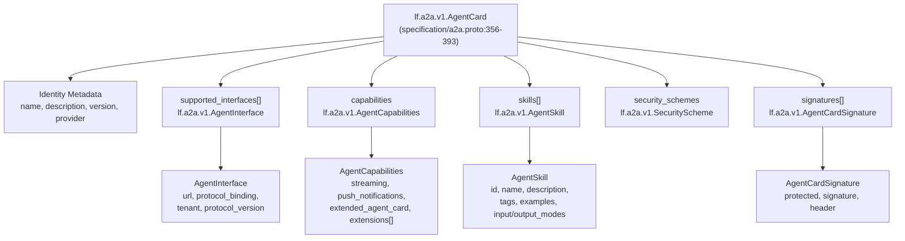
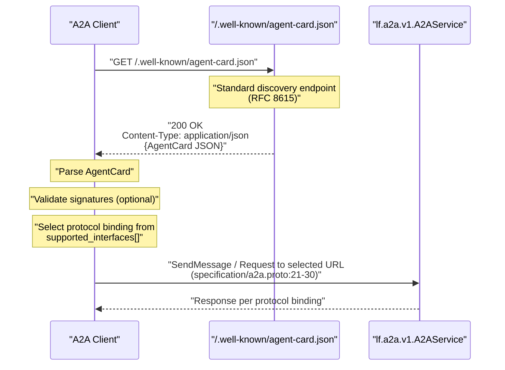
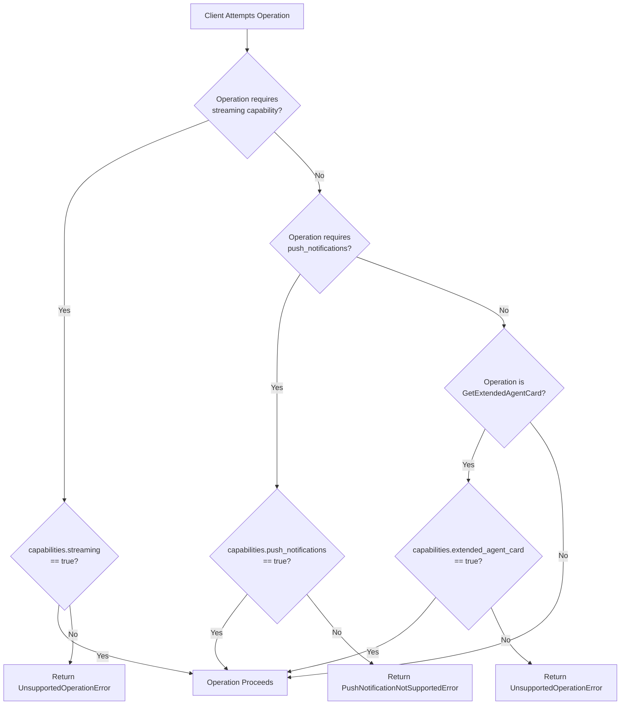
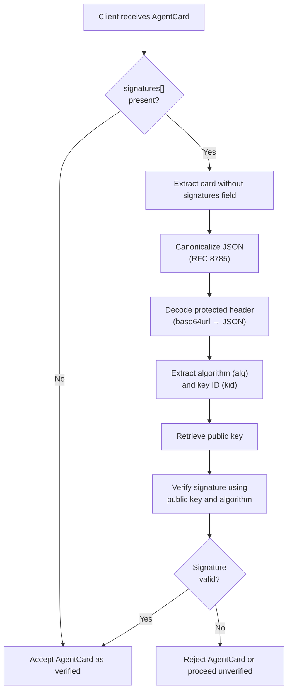
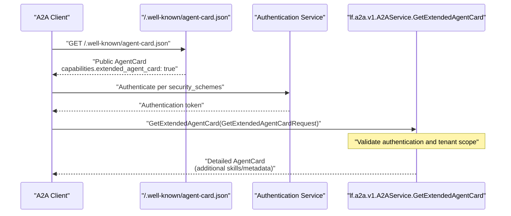

<!-- source: DeepWiki mcp.deepwiki.com · repo a2aproject/A2A · page 2.4 Agent Discovery via AgentCard · fetched 2026-10-21 -->

# Agent Discovery via AgentCard

<details>
<summary>Relevant source files</summary>

The following files were used as context for generating this wiki page:

- [docs/topics/agent-discovery.md](docs/topics/agent-discovery.md)
- [docs/topics/key-concepts.md](docs/topics/key-concepts.md)
- [docs/topics/life-of-a-task.md](docs/topics/life-of-a-task.md)
- [docs/topics/multi-tenancy.md](docs/topics/multi-tenancy.md)
- [docs/whats-new-v1.md](docs/whats-new-v1.md)
- [specification/.api-linter.yaml](specification/.api-linter.yaml)
- [specification/a2a.proto](specification/a2a.proto)
- [specification/buf.yaml](specification/buf.yaml)

</details>


## Purpose and Scope

This page documents the **AgentCard** mechanism for agent discovery in the A2A protocol. It covers the canonical data structure defined in the protocol specification (`specification/a2a.proto`), the standardized well-known URI discovery pattern, capability and skill declarations, interface specifications, and cryptographic signature verification for secure agent discovery.

For broader discussion of discovery strategies (registries, direct configuration) and deployment patterns, see [docs/topics/agent-discovery.md](). For authentication and authorization details referenced in AgentCards, see [docs/whats-new-v1.md](). For the complete data model definitions, see [specification/a2a.proto]().

Sources: [specification/a2a.proto](), [docs/topics/agent-discovery.md]()

## AgentCard Structure Overview

The `AgentCard` is a JSON metadata document that serves as a digital "business card" for an A2A-compliant agent. It provides essential information about the agent's identity, supported interfaces, capabilities, skills, and security requirements [docs/topics/agent-discovery.md:5-15]().

### Core Components

The AgentCard data structure consists of primary component groups that define the agent's profile and technical requirements.

**Diagram: AgentCard Component Architecture to Code Entities**

Sources: [specification/a2a.proto:356-393](), [docs/topics/agent-discovery.md:7-13]()

### Normative Definition

The canonical definition of `AgentCard` is provided in Protocol Buffers [specification/a2a.proto:356-393]():

| Field | Type | Required | Description |
|-------|------|----------|-------------|
| `name` | string | Yes | Human-readable agent name [specification/a2a.proto:358-358]() |
| `description` | string | Yes | Description of agent's purpose [specification/a2a.proto:360-360]() |
| `supported_interfaces` | array of `AgentInterface` | Yes | Ordered list of protocol bindings [specification/a2a.proto:363-363]() |
| `provider` | `AgentProvider` | No | Service provider information [specification/a2a.proto:365-365]() |
| `version` | string | Yes | Agent version (e.g., "1.0.0") [specification/a2a.proto:367-367]() |
| `documentation_url` | string | No | URL to additional documentation [specification/a2a.proto:369-369]() |
| `capabilities` | `AgentCapabilities` | Yes | Supported A2A features [specification/a2a.proto:372-372]() |
| `security_schemes` | map of string to `SecurityScheme` | No | Available authentication methods [specification/a2a.proto:375-375]() |
| `security_requirements` | array of `SecurityRequirement` | No | Required authentication for agent access [specification/a2a.proto:378-378]() |
| `default_input_modes` | array of string | Yes | Supported input MIME types (e.g., "text/plain") [specification/a2a.proto:381-381]() |
| `default_output_modes` | array of string | Yes | Supported output MIME types [specification/a2a.proto:384-384]() |
| `skills` | array of `AgentSkill` | Yes | Agent capabilities and functions [specification/a2a.proto:387-387]() |
| `signatures` | array of `AgentCardSignature` | No | JWS signatures for verification [specification/a2a.proto:392-392]() |

Sources: [specification/a2a.proto:356-393](), [docs/topics/agent-discovery.md:7-13]()

## Well-Known URI Discovery Pattern

The A2A protocol standardizes agent discovery through the **well-known URI** pattern defined in [RFC 8615](https://datatracker.ietf.org/doc/html/rfc8615) [docs/topics/agent-discovery.md:25-26]().

### Discovery Endpoint

Agents make their Agent Card discoverable by hosting it at a standardized path [docs/topics/agent-discovery.md:25-26]():

```
https://{agent-server-domain}/.well-known/agent-card.json
```

Sources: [docs/topics/agent-discovery.md:21-31]()

### Discovery Flow

**Diagram: Agent Discovery Sequence Bridging to A2AService**

Sources: [docs/topics/agent-discovery.md:21-40](), [specification/a2a.proto:19-30](), [specification/a2a.proto:356-393]()

### HTTP Caching Semantics

Servers hosting Agent Card endpoints should include HTTP caching headers to reduce unnecessary network requests [docs/topics/agent-discovery.md:94-97]():

- **`Cache-Control`**: Includes a `max-age` directive [docs/topics/agent-discovery.md:100-100]().
- **`ETag`**: Derived from the card's `version` field or a content hash for conditional requests [docs/topics/agent-discovery.md:100-101]().

Clients should honor standard HTTP caching semantics and use conditional requests like `If-None-Match` [docs/topics/agent-discovery.md:103-105]().

Sources: [docs/topics/agent-discovery.md:94-108]()

## AgentInterface Declarations

The `supported_interfaces` array declares the protocol bindings and endpoints where the agent can be accessed [specification/a2a.proto:363-363](). This structure supports multi-tenancy through an optional `tenant` field [docs/topics/multi-tenancy.md:81-93]().

| Field | Type | Required | Description |
|-------|------|----------|-------------|
| `url` | string | Yes | HTTPS endpoint for this interface [specification/a2a.proto:340-340]() |
| `protocol_binding` | string | Yes | Protocol binding type (e.g., JSONRPC, GRPC) [specification/a2a.proto:343-343]() |
| `tenant` | string | No | Opaque string for multi-tenant routing [specification/a2a.proto:346-346]() |
| `protocol_version` | string | Yes | A2A protocol version for this interface [specification/a2a.proto:349-349]() |

Sources: [specification/a2a.proto:336-350](), [docs/whats-new-v1.md:129-130](), [docs/topics/multi-tenancy.md:81-93]()

## Capabilities Declaration

The `AgentCapabilities` message declares optional A2A features supported by the agent [specification/a2a.proto:406-415]().

| Field | Type | Required | Description |
|-------|------|----------|-------------|
| `streaming` | boolean | No | Supports `SendStreamingMessage` and `SubscribeToTask` [docs/topics/streaming-and-async.md:11-11]() |
| `push_notifications` | boolean | No | Supports asynchronous push notifications [docs/topics/streaming-and-async.md:49-49]() |
| `extensions` | array of string | No | List of supported protocol extensions [specification/a2a.proto:412-412]() |
| `extended_agent_card` | boolean | No | Supports the `GetExtendedAgentCard` operation [docs/whats-new-v1.md:126-126]() |

Sources: [specification/a2a.proto:406-415](), [docs/topics/streaming-and-async.md:11-49]()

### Capability Validation Logic

The protocol requires agents to declare support for specific features before clients attempt to use them.

**Diagram: Capability Validation Logic**

Sources: [specification/a2a.proto:406-415](), [docs/topics/streaming-and-async.md:11-49]()

## AgentSkill Definitions

Skills represent the distinct capabilities or functions an agent can perform, helping clients determine suitability for a task [docs/topics/agent-discovery.md:13-13]().

| Field | Type | Required | Description |
|-------|------|----------|-------------|
| `id` | string | Yes | Unique identifier for the skill [specification/a2a.proto:432-432]() |
| `name` | string | Yes | Human-readable skill name [specification/a2a.proto:434-434]() |
| `description` | string | Yes | Detailed description of functionality [specification/a2a.proto:436-436]() |
| `tags` | array of string | Yes | Keywords for discovery [specification/a2a.proto:438-438]() |
| `examples` | array of string | No | Example prompts or scenarios [specification/a2a.proto:440-440]() |
| `input_modes` | array of string | No | Supported input MIME types [specification/a2a.proto:442-442]() |
| `output_modes` | array of string | No | Supported output MIME types [specification/a2a.proto:444-444]() |

Sources: [specification/a2a.proto:430-447](), [docs/topics/agent-discovery.md:13-13]()

## Signature Verification

AgentCards may include signatures to verify authenticity and integrity. This process utilizes standard cryptographic practices (JWS and JSON Canonicalization per RFC 8785) to sign the metadata [docs/whats-new-v1.md:37-37]().

### Signature Verification Process

**Diagram: JWS Verification Flow**

Sources: [specification/a2a.proto:451-461](), [docs/whats-new-v1.md:37-37](), [docs/whats-new-v1.md:127-127]()

## Extended Agent Cards

The `GetExtendedAgentCard` operation allows authenticated clients to retrieve a more detailed version of the AgentCard, potentially containing sensitive skills or metadata [docs/topics/agent-discovery.md:84-85](). Support for this is indicated by the `capabilities.extended_agent_card` flag [docs/whats-new-v1.md:126-126]().

### Extended Card Flow

**Diagram: Extended Discovery Sequence with GetExtendedAgentCard**

Sources: [docs/topics/agent-discovery.md:84-85](), [specification/a2a.proto:122-129](), [docs/whats-new-v1.md:125-126]()

---

