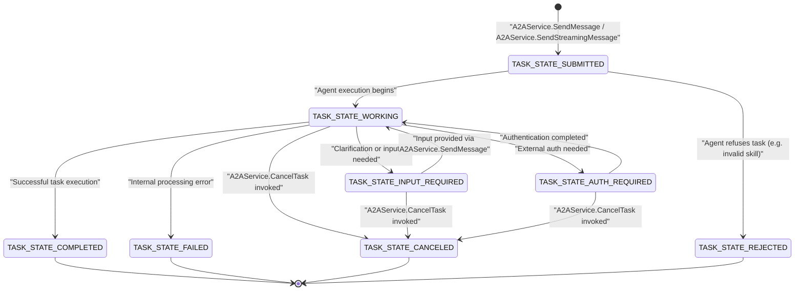
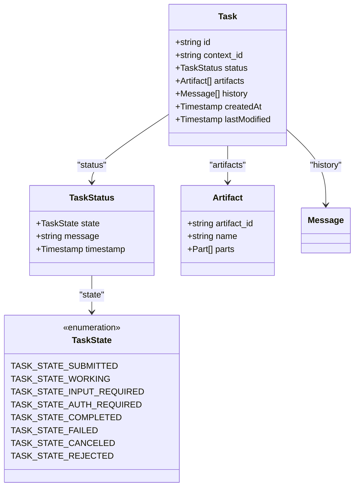
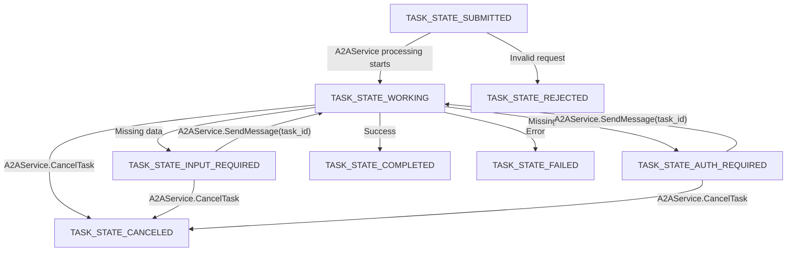
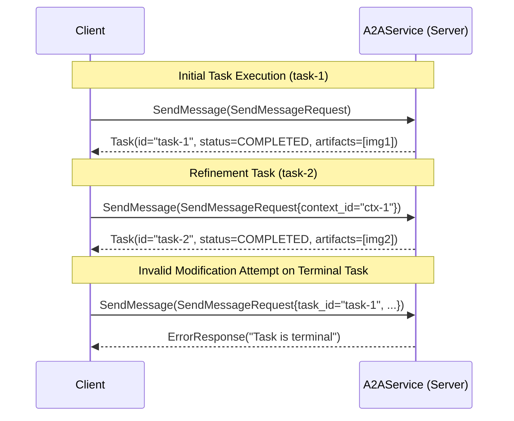

<!-- source: DeepWiki mcp.deepwiki.com · repo a2aproject/A2A · page 2.5 Task Lifecycle & State Management · fetched 2026-10-21 -->

# Task Lifecycle & State Management

Relevant source files

The following files were used as context for generating this wiki page:

- [docs/topics/agent-discovery.md](docs/topics/agent-discovery.md)
- [docs/topics/key-concepts.md](docs/topics/key-concepts.md)
- [docs/topics/life-of-a-task.md](docs/topics/life-of-a-task.md)
- [docs/topics/multi-tenancy.md](docs/topics/multi-tenancy.md)
- [docs/whats-new-v1.md](docs/whats-new-v1.md)
- [specification/.api-linter.yaml](specification/.api-linter.yaml)
- [specification/a2a.proto](specification/a2a.proto)
- [specification/buf.yaml](specification/buf.yaml)

This page documents the state machine, lifecycle rules, and immutability guarantees of the `Task` object in the A2A Protocol as defined in `specification/a2a.proto`. Tasks are the fundamental stateful unit of work that agents use to track long-running operations, manage multi-turn conversations, and coordinate asynchronous processing.

For information about how agents choose between returning `Task` vs. `Message` responses, see [docs/topics/life-of-a-task.md](). For details on how task updates are delivered via streaming or push notifications, see [docs/topics/key-concepts.md](). For the complete `Task` data structure definition, see [specification/a2a.proto]().

---

## Task State Machine

The A2A Protocol defines a deterministic state machine governed by the `TaskState` enum in `specification/a2a.proto`. Tasks begin in `TASK_STATE_SUBMITTED` state and transition through working states via RPC operations exposed by `A2AService` (`specification/a2a.proto`) until reaching either a terminal state or an interrupted state requiring external action.

**Task State Machine Diagram (Natural Language to Code Entity Mapping)**

Sources: [docs/topics/life-of-a-task.md:10-14](), [specification/a2a.proto:19-42](), [specification/a2a.proto:163-181]()

---

## Task States Reference

The `TaskState` enum defines eight distinct states across three categories: active, interrupted, and terminal. In v1.0, these are represented in `SCREAMING_SNAKE_CASE` [docs/whats-new-v1.md:20-20]().

| State | Category | Description | Can Accept Messages? | Can Subscribe? |
|:------|:---------|:------------|:--------------------|:---------------|
| `TASK_STATE_SUBMITTED` | Active | Task created and queued, not yet processed. | Yes | Yes |
| `TASK_STATE_WORKING` | Active | Agent is actively processing the task. | Yes | Yes |
| `TASK_STATE_INPUT_REQUIRED` | Interrupted | Processing paused; waiting for user input. | Yes | No |
| `TASK_STATE_AUTH_REQUIRED` | Interrupted | Processing paused; waiting for authentication. | Yes | No |
| `TASK_STATE_COMPLETED` | Terminal | Task finished successfully. | No | No |
| `TASK_STATE_FAILED` | Terminal | Task failed due to an error. | No | No |
| `TASK_STATE_CANCELED` | Terminal | Task was explicitly canceled. | No | No |
| `TASK_STATE_REJECTED` | Terminal | Agent refused to start the task. | No | No |

**Active States**: Tasks in `SUBMITTED` or `WORKING` state are considered in-flight. Clients can send additional messages to provide context or instructions and can subscribe for real-time updates.

**Interrupted States**: Tasks in `INPUT_REQUIRED` or `AUTH_REQUIRED` have paused. The server typically closes the stream when entering an interrupted state [docs/topics/key-concepts.md:44-50](). Once the client provides the missing information via a follow-up `SendMessage` or `SendStreamingMessage`, the task transitions back to `WORKING` [docs/topics/life-of-a-task.md:110-116]().

**Terminal States**: Once a task reaches `COMPLETED`, `FAILED`, `CANCELED`, or `REJECTED`, it is final. Any attempt to restart it is prohibited by the immutability principle [docs/topics/life-of-a-task.md:79-86]().

Sources: [docs/topics/life-of-a-task.md:9-13](), [docs/topics/key-concepts.md:30-32](), [docs/whats-new-v1.md:20-20](), [specification/a2a.proto:163-181]()

---

## Task Object Structure

The `Task` message object is the core unit of action in the A2A protocol, encapsulating identification, status, artifacts, and history as defined in `specification/a2a.proto`.

**Task Entity Structure Diagram**

**Key Fields:**
- **`id`**: Unique identifier (UUID) generated by the server for a new task [specification/a2a.proto:170-170](), [docs/whats-new-v1.md:31-31]().
- **`context_id`**: Identifier for the contextual collection of interactions (tasks and messages) [specification/a2a.proto:173-173]().
- **`status`**: Current `TaskStatus` containing the `state`, a human-readable `message`, and a `timestamp` [specification/a2a.proto:174-176]().
- **`artifacts`**: Tangible outputs produced during the task execution [specification/a2a.proto:163-166]().
- **`history`**: Sequence of `Message` objects associated with task turns [specification/a2a.proto:163-166]().

Sources: [docs/topics/key-concepts.md:30-33](), [docs/whats-new-v1.md:31-31](), [specification/a2a.proto:163-181]()

---

## State Transition Rules

### Initial State Assignment

When an agent creates a new `Task` via `A2AService.SendMessage`, it must assign an initial state. While `TASK_STATE_SUBMITTED` is the standard starting point, agents may skip directly to `TASK_STATE_WORKING` if processing begins immediately [docs/topics/life-of-a-task.md:41-44]().

### Valid Transitions Flow

Sources: [docs/topics/life-of-a-task.md:9-12](), [docs/topics/life-of-a-task.md:77-82](), [specification/a2a.proto:19-73]()

---

## Task Immutability Principle

Tasks in A2A follow a strict immutability principle. Once a task reaches a terminal state, the mapping of inputs to outputs is fixed and the task cannot be restarted [docs/topics/life-of-a-task.md:77-82]().

**Refinement Pattern**: If a client needs to refine the output of a completed task, they must initiate a **new** task within the same `context_id`. The client references the original task ID using reference mechanisms in the message request [docs/topics/life-of-a-task.md:70-75]().

**Refinement Interaction Sequence (Code Entity Bridge)**

Sources: [docs/topics/life-of-a-task.md:70-93](), [specification/a2a.proto:21-30]()

---

## Multi-Turn Conversations & Context Management

The A2A Protocol uses two distinct identifiers to manage conversation continuity across turns and tasks:

### Context Identifier (`context_id`)
- Groups multiple tasks and independent messages into a logical session [docs/topics/life-of-a-task.md:16-18]().
- Enables agents to maintain internal conversational state or LLM context across discrete tasks [docs/topics/life-of-a-task.md:27-30]().

### Task Identifier (`task_id`)
- Identifies a specific execution instance [specification/a2a.proto:170-170]().
- Used when a task enters `TASK_STATE_INPUT_REQUIRED` or `TASK_STATE_AUTH_REQUIRED` so the client can route replies to that exact instance [specification/a2a.proto:147-150]().

Sources: [docs/topics/life-of-a-task.md:16-30](), [specification/a2a.proto:170-173]()

---

## State Update Events

Updates are delivered via `StreamResponse` objects in streaming (`A2AService.SendStreamingMessage`, `A2AService.SubscribeToTask`) or push notification workflows [specification/a2a.proto:33-83]().

- **`TaskStatusUpdateEvent`**: Communicates changes in the task's lifecycle state and provides intermediate messages [docs/whats-new-v1.md:70-71]().
- **`TaskArtifactUpdateEvent`**: Delivers new or updated `Artifact` objects in incremental chunks [docs/whats-new-v1.md:70-71]().

Sources: [docs/whats-new-v1.md:70-74](), [specification/a2a.proto:33-83]()

---

## Implementation & Interaction

The `A2AService` interface defines the operations used for task state management:

| RPC Method | Role in State Management |
| :--- | :--- |
| `GetTask` | Retrieves current `Task` state, status, and artifacts [specification/a2a.proto:45-53](). |
| `CancelTask` | Explicitly transitions a task to `TASK_STATE_CANCELED` [specification/a2a.proto:64-73](). |
| `SubscribeToTask` | Opens a stream for real-time state updates on active tasks [specification/a2a.proto:76-83](). |
| `SendMessage` | Resumes interrupted tasks from `INPUT_REQUIRED` or `AUTH_REQUIRED` back to `WORKING` [specification/a2a.proto:21-30](). |
| `ListTasks` | Queries existing tasks with filtering [specification/a2a.proto:55-62](). |

Sources: [docs/whats-new-v1.md:140-144](), [specification/a2a.proto:19-83]()

---

