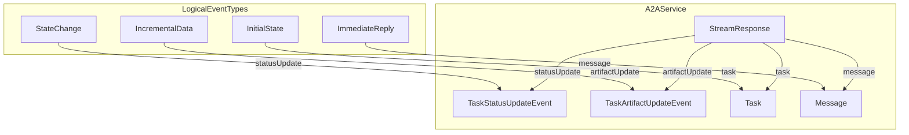
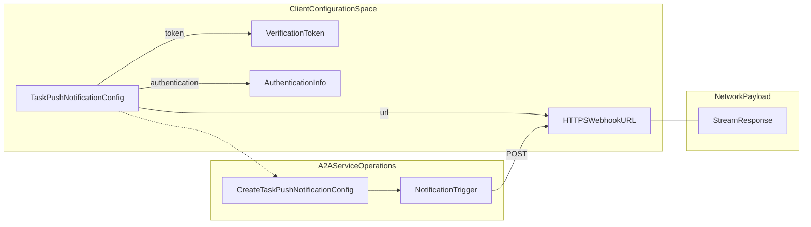

<!-- source: DeepWiki mcp.deepwiki.com · repo a2aproject/A2A · page 2.6 Streaming & Asynchronous Operations · fetched 2026-10-21 -->

# Streaming & Asynchronous Operations

Relevant source files

The following files were used as context for generating this wiki page:

- [docs/specification.md](docs/specification.md)
- [docs/topics/streaming-and-async.md](docs/topics/streaming-and-async.md)

This document covers the three update delivery mechanisms supported by the A2A protocol: polling via request/response (`GetTask`), real-time streaming via Server-Sent Events (`SendStreamingMessage`, `SubscribeToTask`), and asynchronous push notifications via webhooks. These mechanisms enable clients to monitor long-running tasks, receive incremental results efficiently, and handle intermittent connectivity [docs/topics/streaming-and-async.md:1-4]().

Sources: [docs/topics/streaming-and-async.md:1-4]()

## Overview of Update Delivery Mechanisms

The A2A protocol provides three complementary mechanisms for clients to receive task updates, each tailored to specific operational requirements and connection topologies [docs/topics/streaming-and-async.md:1-4]().

### Comparison of Delivery Mechanisms

| Mechanism | Use Case | Connection Type | Capability Required | Latency |
| :--- | :--- | :--- | :--- | :--- |
| **Polling** (`GetTask`) | Simple clients, intermittent connectivity | Request/Response | None | Depends on poll interval |
| **Streaming** (SSE) | Real-time monitoring, progressive results | Long-lived HTTP connection | `capabilities.streaming: true` | Low (immediate) [docs/topics/streaming-and-async.md:11]() |
| **Push Notifications** | Very long tasks, disconnected clients | Server-initiated webhook | `capabilities.pushNotifications: true` | Low (event-driven) [docs/topics/streaming-and-async.md:49]() |

Sources: [docs/topics/streaming-and-async.md:1-58]()

## Polling via `GetTask`

For lightweight clients or network topologies where maintaining a persistent HTTP connection is impractical, polling via the `GetTask` RPC method serves as the fallback mechanism [docs/topics/streaming-and-async.md:43-46](). 

Clients periodically invoke `GetTask` providing the target `taskId` to inspect the current state of execution. While higher in latency compared to streaming or push notifications, polling requires no special server-side connection management infrastructure and operates entirely over standard request/response HTTP/REST, JSON-RPC, or gRPC bindings.

Sources: [docs/topics/streaming-and-async.md:43-46]()

## Streaming with Server-Sent Events (SSE)

Streaming enables real-time delivery of task updates over a persistent connection. A2A supports SSE for JSON-RPC/HTTP bindings and native streaming for gRPC [docs/topics/streaming-and-async.md:5-7](). This approach is ideal when the client can maintain an active HTTP connection with the A2A Server [docs/topics/streaming-and-async.md:7-8]().

### Streaming RPC Operations

The protocol defines specific operations for streaming within the `A2AService` [specification/a2a.proto:19-83]():

*   **`SendStreamingMessage`**: Initiates or continues a task while simultaneously subscribing to updates. The server responds with `Content-Type: text/event-stream` for HTTP bindings [docs/topics/streaming-and-async.md:13-15]().
*   **`SubscribeToTask`**: Allows a client to reconnect to a stream for an existing active task if a connection breaks. It returns an error if the task is already terminal [docs/topics/streaming-and-async.md:25-26]().

Sources: [specification/a2a.proto:19-83](), [docs/topics/streaming-and-async.md:13-26]()

### Stream Response Structure

The server sends events over the SSE stream. Each event's `data` field contains a JSON-RPC 2.0 Response object, typically a `SendStreamingMessageResponse` [docs/topics/streaming-and-async.md:17-18](). The `result` field of the response contains the actual update [docs/topics/streaming-and-async.md:18-19]().

#### Data Flow: Natural Language to Code Entities
The following diagram maps high-level streaming concepts to the specific Protobuf messages defined in the protocol specification [specification/a2a.proto:33-42]().

**Streaming Event Mapping**

Sources: [specification/a2a.proto:33-42](), [docs/topics/streaming-and-async.md:17-22]()

### Key Streaming Events

| Event Type | Code Entity | Purpose |
| :--- | :--- | :--- |
| **Task State** | `Task` | Represents the current state of the work [docs/topics/streaming-and-async.md:19](). |
| **Status Update** | `TaskStatusUpdateEvent` | Communicates changes in the task's lifecycle state (e.g., from `working` to `input-required` or `completed`) and provides intermediate messages from the agent [docs/topics/streaming-and-async.md:20](). |
| **Artifact Update** | `TaskArtifactUpdateEvent` | Delivers new or updated `Artifact` objects. This is used to stream large files or data structures in chunks, with fields like `append` and `lastChunk` to help reassemble [docs/topics/streaming-and-async.md:21-22](). |

Sources: [docs/topics/streaming-and-async.md:17-22]()

## Push Notifications (Webhooks)

For tasks lasting minutes, hours, or days, or for clients like mobile apps or serverless functions that cannot maintain persistent connections, A2A uses server-initiated webhooks [docs/topics/streaming-and-async.md:43-48](). This allows the A2A Server to actively notify a client-provided webhook when a significant task update occurs [docs/topics/streaming-and-async.md:46-47]().

### Configuration and Lifecycle

Clients provide a `TaskPushNotificationConfig` either within the initial `SendMessage` or `SendStreamingMessage` request, or separately using the `CreateTaskPushNotificationConfig` RPC method for an existing task [docs/topics/streaming-and-async.md:50-53](). The configuration includes a `url` (the HTTPS webhook URL), an optional `token` (for client-side validation), and optional `authentication` details (for the A2A Server to authenticate to the webhook) [docs/topics/streaming-and-async.md:53-54]().

The A2A Server decides when to send a push notification, typically when a task reaches a significant state change (e.g., terminal state, `input-required`, or `auth-required`) [docs/topics/streaming-and-async.md:54-55](). The notification payload is a `StreamResponse` object, matching the format used in streaming operations [docs/topics/streaming-and-async.md:55-56]().

#### Push Notification Code Mapping
This diagram shows how the notification system is represented in code entities.

**Webhook Configuration and Trigger**

Sources: [docs/topics/streaming-and-async.md:50-56]()

### Security Considerations for Push Notifications

Security is paramount because push notifications involve outbound requests from the A2A Server to external URLs provided by the client [docs/topics/streaming-and-async.md:77-80](). Both the A2A Server (sending the notification) and the client's webhook receiver have critical responsibilities [docs/topics/streaming-and-async.md:80-81]().

*   **Webhook URL Validation**: Servers SHOULD NOT blindly trust and send POST requests to any URL provided by a client. Malicious clients could provide URLs pointing to internal services or unrelated third-party systems, leading to Server-Side Request Forgery (SSRF) attacks or acting as Distributed Denial of Service (DDoS) amplifiers [docs/topics/streaming-and-async.md:81-84]().
*   **Server Authentication**: The A2A Server MUST authenticate to the client's webhook using the scheme defined in the `TaskPushNotificationConfig` [docs/topics/streaming-and-async.md:53-54]().
*   **Client Verification**: The client's webhook service is responsible for receiving the HTTP POST notification, authenticating the incoming notification, validating its relevance, and relaying the notification or its content to the appropriate client application logic or system [docs/topics/streaming-and-async.md:73-75]().

Sources: [docs/topics/streaming-and-async.md:73-86]()

## Implementation Details

### Server Capabilities
An agent must explicitly declare support for streaming and push notifications in its `AgentCard` to inform the client of available interaction modes [docs/topics/streaming-and-async.md:11,49]():
*   `capabilities.streaming: true` [docs/topics/streaming-and-async.md:11]()
*   `capabilities.pushNotifications: true` [docs/topics/streaming-and-async.md:49]()

Sources: [docs/topics/streaming-and-async.md:11,49]()

### Termination Logic
Streams and notification cycles typically terminate when a task reaches a terminal or interrupted state: `COMPLETED`, `FAILED`, `CANCELED`, `REJECTED`, or `INPUT_REQUIRED` [docs/topics/streaming-and-async.md:23-24](). Once a terminal state is reached, the server closes the connection and sends no further updates [docs/topics/streaming-and-async.md:23]().

Sources: [docs/topics/streaming-and-async.md:23-24]()

---

