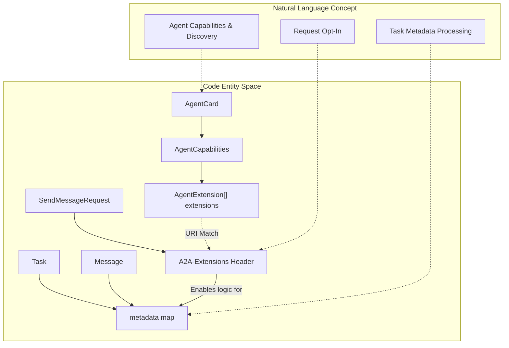
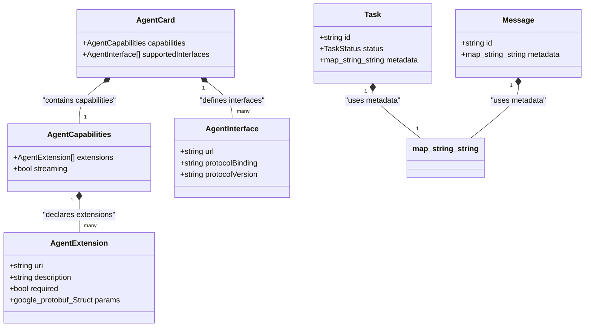

<!-- source: DeepWiki mcp.deepwiki.com · repo a2aproject/A2A · page 2.7 Extensions System · fetched 2026-10-21 -->

# Extensions System

Relevant source files

The following files were used as context for generating this wiki page:

- [docs/topics/custom-protocol-bindings.md](docs/topics/custom-protocol-bindings.md)
- [docs/topics/extension-and-binding-governance.md](docs/topics/extension-and-binding-governance.md)
- [docs/topics/extensions.md](docs/topics/extensions.md)

## Purpose and Scope

The Extensions System in the A2A Protocol provides a standardized mechanism for extending protocol capabilities without fragmenting the core specification [docs/topics/extensions.md:3-16](). It allows for the addition of new data structures, requirements, RPC methods, and state machines [docs/topics/extensions.md:3-13]().

Agents declare their support for specific extensions in their `AgentCard`, and clients can opt in to the behaviors offered by an extension as part of their requests [docs/topics/extensions.md:9-13](). This mechanism fosters innovation and domain-specific optimizations while maintaining a stable core standard [docs/topics/extensions.md:15-16]().

Sources: [docs/topics/extensions.md:3-16]()

---

## Extension Architecture & Activation

The extension architecture uses a declarative model where extensions are identified by a unique URI and defined by their own specifications [docs/topics/extensions.md:12-13]().

### Core Design Principles

- **Preserve Core Integrity**: Extensions layer new capabilities onto the base protocol without modifying fundamental `a2a.proto` definitions [docs/topics/extensions.md:6-7](). They MUST NOT change core data structure definitions (adding/removing fields) or add values to existing Enum types [docs/topics/extensions.md:78-87]().
- **Opt-In Activation**: Behavior is typically triggered via the `A2A-Extensions` header in RPC requests [docs/topics/extensions.md:11-12](). If an agent marks an extension as `required: true`, the client MUST support and activate it, or the agent will reject the request [docs/topics/extensions.md:134-140]().
- **Type Safety via Metadata**: Custom attributes must be placed in the `metadata` map (type `map<string, string>`) present on core data structures [docs/topics/extensions.md:81-84]().

**Natural Language to Code Entity Space: Extension Discovery and Activation Flow**

Title: "Extension Flow Architecture"

Sources: [docs/topics/extensions.md:9-13](), [docs/topics/extensions.md:90-118](), [docs/topics/extensions.md:134-141]()

---

## Extension Types

Extensions are categorized by the scope of the protocol they modify:

| Extension Type | Description | Example Use Case |
| :--- | :--- | :--- |
| **Data-Only** | Exposes structured info in the `AgentCard` without impacting request-response flow [docs/topics/extensions.md:24-25](). | Declaring GDPR compliance status [docs/topics/extensions.md:26](). |
| **Profile** | Overlaying additional structure and state change requirements on core messages [docs/topics/extensions.md:27-31](). | Requiring all messages to use `DataParts` adhering to a specific schema, or adding a substate like `generating-image` [docs/topics/extensions.md:29-34](). |
| **Method (Extended Skills)** | Adding entirely new RPC methods beyond the core set defined by the protocol [docs/topics/extensions.md:35-36](). | A `tasks/search` method to retrieve task history [docs/topics/extensions.md:38-41](). |
| **State Machine** | Adding new states or transitions to the task state machine [docs/topics/extensions.md:42-43](). | Custom task state machine transitions [docs/topics/extensions.md:42-43](). |

Sources: [docs/topics/extensions.md:18-43]()

---

## Technical Implementation & Data Structures

Extensions are integrated into the canonical data model primarily through the `AgentExtension` message and `metadata` maps.

### AgentExtension Structure

| Field | Type | Description |
| :--- | :--- | :--- |
| `uri` | `string` | Unique identifier for the extension (e.g., `https://a2a-protocol.org/extensions/name/v1`) [docs/topics/extensions.md:65-69](). |
| `description` | `string` | Human-readable explanation of the extension [docs/topics/extensions.md:108](). |
| `required` | `bool` | If true, the client MUST support/activate this to use the agent [docs/topics/extensions.md:134-138](). |
| `params` | `google.protobuf.Struct` | Extension-specific configuration parameters [docs/topics/extensions.md:110-115](). |

**Code Entity Space: Extension Data Structures**

Title: "Extension-Related Protobuf and JSON Entities"

Sources: [docs/topics/extensions.md:81-118](), [docs/topics/custom-protocol-bindings.md:17-33](), [docs/topics/extensions.md:93-94]()

---

## Required Extensions and Limitations

When an `AgentCard` declares an extension as `required: true`, it signals that clients must abide by it [docs/topics/extensions.md:134-137](). Agents should not mark data-only extensions as required [docs/topics/extensions.md:138](). If a client fails to activate a required extension, the agent should reject the request [docs/topics/extensions.md:138-140]().

To prevent breaking core type validations, extensions prohibit:
- **Changing Core Data Structures**: Adding or removing required fields in core protocol data structures (use `metadata` instead) [docs/topics/extensions.md:81-84]().
- **Adding Enum Values**: Adding new values to enum types (annotate semantic meaning in `metadata` instead) [docs/topics/extensions.md:85-86]().

Sources: [docs/topics/extensions.md:76-140]()

---

## Extension Tiers and Governance

Extensions and custom protocol bindings hosted within the `a2aproject` organization follow a formal governance framework [docs/topics/extension-and-binding-governance.md:3-6]().

### Tiers and Naming
| Tier | Extensions Prefix (Repo / URI) | Custom Bindings Prefix (Repo / URI) |
| :--- | :--- | :--- |
| **Official** | `ext-{name}` / `https://a2a-protocol.org/extensions/` [docs/topics/extension-and-binding-governance.md:19-21]() | `cpb-{name}` / `https://a2a-protocol.org/bindings/` [docs/topics/extension-and-binding-governance.md:19-21]() |
| **Experimental** | `experimental-ext-{name}` [docs/topics/extension-and-binding-governance.md:20]() | `experimental-cpb-{name}` [docs/topics/extension-and-binding-governance.md:20]() |

### Lifecycle and Promotion
1. **Proposal Phase**: Open an issue in `a2aproject/A2A` with an abstract, motivation, and technical approach [docs/topics/extension-and-binding-governance.md:76-82]().
2. **Maintainer Sponsorship**: Secure a sponsor who creates the `experimental-ext-*` or `experimental-cpb-*` repository under `a2aproject` [docs/topics/extension-and-binding-governance.md:88-92]().
3. **Graduation to Official**: Requires production-quality reference implementation, documentation, and a majority vote from the TSC with at least 50% quorum [docs/topics/extension-and-binding-governance.md:110-125]().

Sources: [docs/topics/extension-and-binding-governance.md:12-125]()

---

## Custom Protocol Bindings

Custom protocol bindings change the *transport layer* itself (e.g., WebSockets for low-latency bidirectional communication or MQTT for IoT), remaining distinct from extensions which modify protocol behavior over an existing transport [docs/topics/custom-protocol-bindings.md:8-13](). They are declared in `supportedInterfaces` using a `protocolBinding` URI [docs/topics/custom-protocol-bindings.md:17-21]().

Sources: [docs/topics/custom-protocol-bindings.md:1-144]()

---

## Example Extensions

| Extension | Description |
| :--- | :--- |
| **Secure Passport Extension** | Adds a trusted, contextual layer for immediate personalization and reduced overhead (v1) [docs/topics/extensions.md:49](). |
| **Timestamp Extension** | Demonstrates augmenting base A2A types by adding timestamps to `metadata` of `Message` and `Artifact` (v1) [docs/topics/extensions.md:50](). |
| **Traceability Extension** | Python implementation and basic usage of the Traceability Extension (v1) [docs/topics/extensions.md:51](). |
| **Agent Gateway Protocol (AGP)** | Introduces Autonomous Squads (ASq) and routes Intent payloads based on capabilities (v1) [docs/topics/extensions.md:52](). |

Sources: [docs/topics/extensions.md:45-53]()

---

