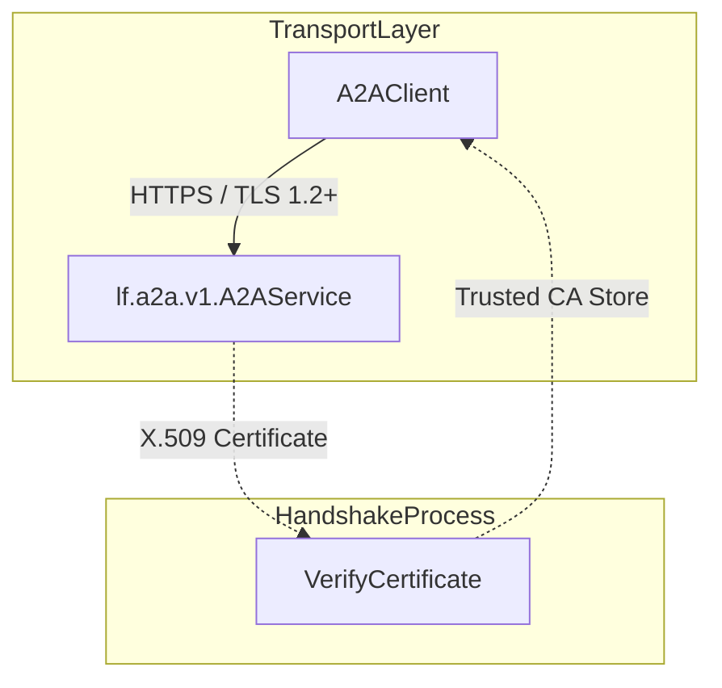
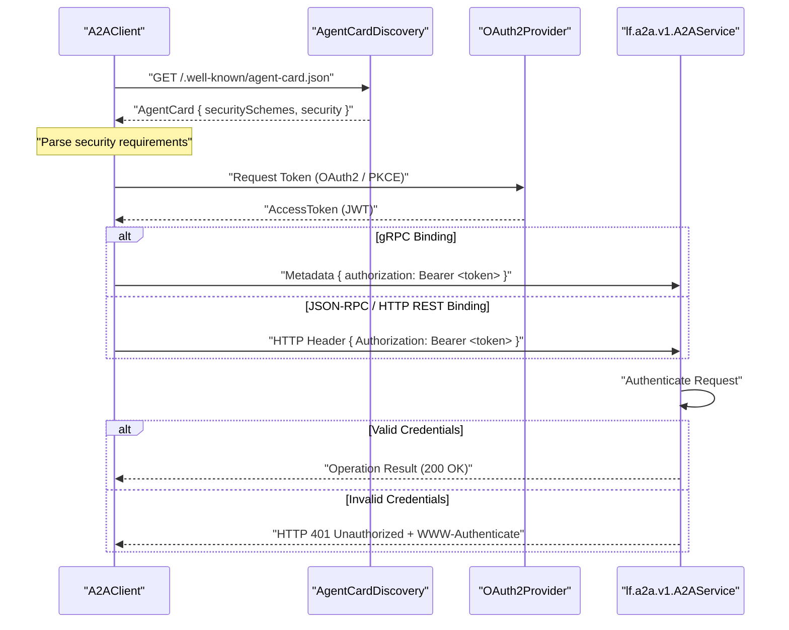
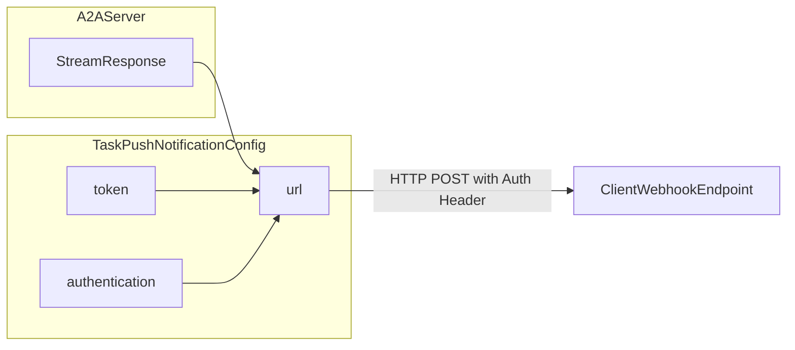

<!-- source: DeepWiki mcp.deepwiki.com · repo a2aproject/A2A · page 2.8 Security & Authentication · fetched 2026-10-21 -->

# Security & Authentication

Relevant source files

The following files were used as context for generating this wiki page:

- [.github/linters/.markdownlint.json](.github/linters/.markdownlint.json)
- [SECURITY.md](SECURITY.md)
- [docs/topics/a2a-and-mcp.md](docs/topics/a2a-and-mcp.md)
- [docs/topics/enterprise-ready.md](docs/topics/enterprise-ready.md)
- [docs/topics/multi-tenancy.md](docs/topics/multi-tenancy.md)
- [docs/topics/what-is-a2a.md](docs/topics/what-is-a2a.md)
- [docs/whats-new-v1.md](docs/whats-new-v1.md)
- [specification/.api-linter.yaml](specification/.api-linter.yaml)
- [specification/a2a.proto](specification/a2a.proto)
- [specification/buf.yaml](specification/buf.yaml)

This document details the security architecture, authentication schemes, authorization models, and reporting policies of the A2A Protocol. It covers transport-level security, multi-binding authentication flows (gRPC, JSON-RPC, REST), OAuth 2.0 enhancements (PKCE, Device Code), AgentCard cryptographic signature verification, push notification security, and vulnerability reporting procedures.

## Purpose and Scope

A2A security is built entirely on standard web security frameworks rather than proprietary mechanisms `[docs/topics/enterprise-ready.md:1-139]()`. The protocol mandates HTTPS for transport-level confidentiality and integrity, and delegates authentication to standard HTTP headers and protocols (OAuth 2.0, OpenID Connect, API keys, mTLS, HTTP Auth). Security requirements are declared declaratively via the `AgentCard` data structure using OpenAPI-compatible security scheme definitions `[docs/topics/enterprise-ready.md:39-41]`.

Sources: `[docs/topics/enterprise-ready.md:1-139]()`

## Transport Security & mTLS

**Diagram: TLS Transport Security and mTLS Handshake**

All production A2A communications **MUST** occur over HTTPS using modern TLS versions (TLS 1.2 or higher) with strong cipher suites `[docs/topics/enterprise-ready.md:20-24]()`. Clients **SHOULD** validate server identity against trusted certificate authorities during the handshake `[docs/topics/enterprise-ready.md:25-28]()`. For high-assurance enterprise environments, mutual TLS (`mTLS`) can be enforced where both client and server present X.509 certificates.

Sources: `[docs/topics/enterprise-ready.md:20-28]()`

## Authentication Architecture Across Bindings

**Diagram: Authentication Flow Across Protocol Bindings**

Authentication in A2A follows a discovery-first architecture `[docs/topics/enterprise-ready.md:30-46]()`. Clients query the `AgentCard` to inspect supported security schemes, acquire tokens out-of-band, and inject credentials into transport-specific headers (`Authorization`, `API-Key`, or gRPC metadata) before invoking `lf.a2a.v1.A2AService` operations `[specification/a2a.proto:19-140]()`.

Sources: `[specification/a2a.proto:19-140]()`, `[docs/topics/enterprise-ready.md:30-46]()`

## Security Scheme Types & Modernized Flows

The A2A Protocol supports five primary authentication mechanisms declared within the `AgentCard` security definitions `[docs/whats-new-v1.md:35-43]()`:

- **API Key**: Token-based authentication transmitted via configurable headers, query parameters, or cookies.
- **HTTP Auth**: Standard HTTP authentication schemes including `Bearer` (JWT), `Basic`, and `Digest`.
- **OAuth 2.0**: Modernized OAuth 2.0 flows `[docs/whats-new-v1.md:40-41]()`. Implicit and Resource Owner Password Credentials flows are deprecated and removed. Supported flows include Authorization Code with **PKCE** (`pkce_required`), Client Credentials, and **Device Code** (RFC 8628) for constrained or headless environments.
- **OpenID Connect**: Discovery URLs for federated identity verification.
- **mTLS**: Client certificate authentication handled at the transport termination layer.

Sources: `[docs/whats-new-v1.md:35-43]()`, `[docs/topics/enterprise-ready.md:30-46]()`

## Agent Card Signature Verification

To prevent man-in-the-middle tampering and agent identity spoofing, A2A supports cryptographic signature verification on `AgentCard` instances `[docs/whats-new-v1.md:35-43]()`.

- **Standard**: Verification utilizes JSON Web Signature (JWS) and JSON Web Keys (JWK).
- **Canonicalization**: Payloads **MUST** be canonicalized strictly in accordance with RFC 8785 (JSON Canonicalization Scheme) prior to signing or validation to ensure deterministic hashing across implementations `[docs/whats-new-v1.md:126-126]()`.

Sources: `[docs/whats-new-v1.md:35-43]`, `[docs/whats-new-v1.md:126-126]()`

## Authorization and Access Control

Authorization is executed post-authentication by the `lf.a2a.v1.A2AService` implementation, enforcing permissions based on the authenticated principal `[docs/topics/enterprise-ready.md:64-72]()`.

- **Skill-Based Access Control**: Scopes declared in the `AgentCard` map directly to method and skill execution permissions (e.g., restricting specific OAuth scopes to individual agent capabilities) `[docs/topics/enterprise-ready.md:74-77]()`.
- **Task Scoping**: Methods like `ListTasks` enforce multi-tenant isolation and tenancy boundaries, returning only tasks visible to the caller `[specification/a2a.proto:55-62]()`.
- **Multi-Tenancy Routing**: Agents support opaque routing keys (`tenant` field) in request messages and interface definitions, permitting reverse proxies to multiplex multiple agent partitions behind a single endpoint `[docs/topics/multi-tenancy.md:73-108]()`.

Sources: `[specification/a2a.proto:55-62]()`, `[docs/topics/enterprise-ready.md:64-77]()`, `[docs/topics/multi-tenancy.md:73-108]()`

## Push Notification & Webhook Security

**Diagram: Push Notification Security Architecture**

Asynchronous push notifications involve outbound HTTP POST requests from the A2A Server to client-supplied webhook URLs configured via `CreateTaskPushNotificationConfig` `[specification/a2a.proto:90-100]()`.

- **SSRF Protection**: A2A Servers **SHOULD NOT** blindly dispatch webhooks to client-provided URLs without validation, preventing Server-Side Request Forgery (SSRF) and Denial of Service amplifiers.
- **Authentication**: `TaskPushNotificationConfig` allows servers to authenticate against client webhook endpoints using embedded token or authentication metadata.

Sources: `[specification/a2a.proto:90-100]()`, `[docs/topics/enterprise-ready.md:1-139]()`

## Security Vulnerability Reporting Policy

The repository maintains a strict vulnerability disclosure and reporting policy managed through GitHub Security Advisories `[SECURITY.md:1-6]()`.

- **Private Intake**: Security vulnerabilities must not be reported via public GitHub issues. Instead, contributors and users must utilize the private intake flow at [Security Advisories · a2aproject/A2A](https://github.com/a2aproject/A2A/security/advisories) `[SECURITY.md:3-6]()`.
- **Coordination**: The repository maintainers use private advisories for coordination, patch verification, and coordinated disclosure `[SECURITY.md:6-6]()`.

Sources: `[SECURITY.md:1-6]()`

## Implementation Reference

| Code Entity / Construct | Role / Purpose |
|-------------------------|----------------|
| `AgentCard.securitySchemes` | Declares supported authentication mechanisms and OpenAPI-compatible security definitions `[docs/topics/enterprise-ready.md:39-41]()` |
| `lf.a2a.v1.A2AService` | Core protocol service implementation enforcing transport/header authentication `[specification/a2a.proto:19-140]()` |
| `TaskPushNotificationConfig` | Configures webhook target URLs, client validation tokens, and outbound auth headers `[specification/a2a.proto:90-100]()` |
| `AUTH_REQUIRED` | Task state pausing execution pending secondary credential provisioning `[specification/a2a.proto:158-159]()` |
| `GetExtendedAgentCard` | Authenticated RPC method retrieving detailed agent metadata and restricted capabilities `[specification/a2a.proto:121-129]()` |

Sources: `[specification/a2a.proto:19-140]()`, `[SECURITY.md:1-6]()`, `[docs/topics/enterprise-ready.md:39-41]()`

---

