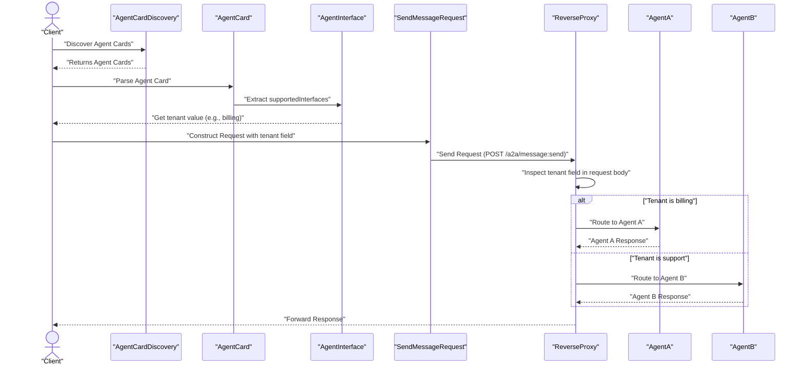
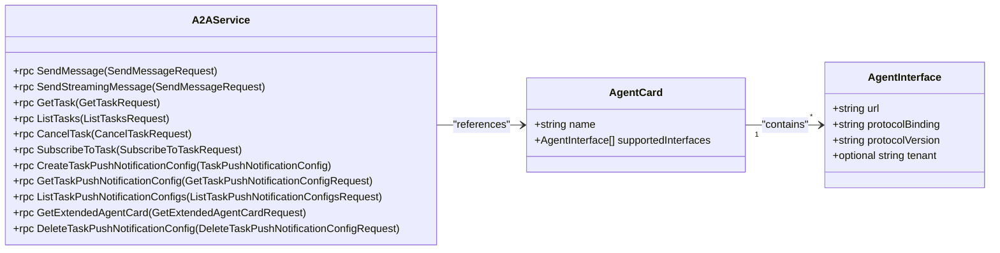

<!-- source: DeepWiki mcp.deepwiki.com · repo a2aproject/A2A · page 2.9 Multi-Tenancy & Tenant Routing · fetched 2026-10-21 -->

# Multi-Tenancy & Tenant Routing

<details>
<summary>Relevant source files</summary>

The following files were used as context for generating this wiki page:

- [docs/topics/multi-tenancy.md](docs/topics/multi-tenancy.md)
- [docs/whats-new-v1.md](docs/whats-new-v1.md)
- [specification/.api-linter.yaml](specification/.api-linter.yaml)
- [specification/a2a.proto](specification/a2a.proto)
- [specification/buf.yaml](specification/buf.yaml)

</details>


This page explains how the A2A Protocol supports multi-tenancy and agent routing. It details the opaque `tenant` routing key within the `AgentInterface`, how clients are expected to echo this key in their requests, and how reverse proxies can leverage it to route requests to multiple agents operating behind a single endpoint.

Sources: [docs/topics/multi-tenancy.md:1-8]()

## Overview

A common deployment pattern for A2A agents involves placing several agents behind a single host or reverse proxy. This means that from an external perspective, all agents are accessible via the same domain. However, each individual agent needs to be uniquely identified so that incoming requests are correctly delivered to the intended backend agent. The A2A protocol offers flexible mechanisms to achieve this, allowing operators to choose the routing strategy that best suits their infrastructure.

Sources: [docs/topics/multi-tenancy.md:9-15]()

### Routing Mechanisms

The A2A Protocol supports three complementary approaches for multi-agent routing:

1. **URL-Based Routing (Sub-Path):** Each agent is assigned a distinct URL prefix. The `AgentCard` for each agent advertises its specific `url` within its `supportedInterfaces`. Clients automatically use this URL to send requests to the correct path. This is the simplest method and requires no special client awareness beyond reading the `AgentCard`.
2. **Authentication Header-Based Routing:** When multiple agents share the same base URL, a gateway can utilize the authentication credentials present in the request to determine the target agent. Authentication requirements are declared in the `AgentCard`'s `securitySchemes` and `security` fields, making this approach discoverable by clients. Examples include bearer tokens with claims identifying the agent or API keys mapped to specific agents. The gateway inspects the credential and forwards the request without modifying the A2A protocol messages.
3. **Body-Based Routing Using the `tenant` Field:** Every A2A request message includes an optional `tenant` field. This field is an opaque string whose value and semantics are entirely defined by the server operator. A gateway or agent implementation can inspect this field to route the request to the appropriate backend.

Sources: 
[docs/topics/multi-tenancy.md:18-79](),
[specification/a2a.proto:20-140]()

### Combining Approaches

These routing approaches are not mutually exclusive and can be combined. For instance, a deployment might use URL-based routing to differentiate between major product lines, and then use the `tenant` field to distinguish individual customers or sub-agents within each product line. The optimal combination depends on the operator's architectural choices and the capabilities of their gateway infrastructure.

Sources: [docs/topics/multi-tenancy.md:109-115]()

### Discovering Multiple Agents

When multiple agents are deployed behind a shared domain, each agent **SHOULD** publish its own `AgentCard` at an appropriate location. Clients retrieve each agent's card independently and use the information within `supportedInterfaces`—including any `tenant` value—to communicate with the correct agent.

Sources: [docs/topics/multi-tenancy.md:118-123]()

## The Opaque `tenant` Field

The `tenant` field is a crucial component for body-based routing. It is an opaque string, meaning the A2A protocol does not impose any specific format or semantics on its value. Server operators have full discretion to define its meaning, whether it represents agent identifiers, workspace slugs, organization IDs, or any other discriminator.

Sources: [docs/topics/multi-tenancy.md:73-76]()

### Advertising the `tenant` Key

The `tenant` value that a client should use for a particular agent is advertised within the `AgentInterface` entry inside the `supportedInterfaces` array of an `AgentCard`.

```json
{
  "name": "Billing Agent",
  "supportedInterfaces": [
    {
      "url": "https://agents.example.com/a2a",
      "protocolBinding": "HTTP+JSON",
      "protocolVersion": "1.0",
      "tenant": "billing"
    }
  ]
}
```

Sources: [docs/topics/multi-tenancy.md:81-96]()

### Client Requirement for `tenant`

Clients are required to echo the `tenant` value from the selected `AgentInterface` entry back in every request message. If an `AgentInterface` does not specify a `tenant` field, the client **MUST** omit the field from the request. This ensures that the routing information is consistently passed from the client to the server.

Sources: [docs/topics/multi-tenancy.md:98-103]()

### `tenant` Field in Protocol Buffers

In the `specification/a2a.proto` definition, gRPC service methods define explicit `additional_bindings` using `/{tenant}/` path segments to support HTTP REST bindings alongside gRPC calls.

Sources: [specification/a2a.proto:20-140]()

## Tenant Routing Data Flow

Diagram: Tenant Routing Data Flow


Sources: 
[docs/topics/multi-tenancy.md:81-103](),
[specification/a2a.proto:20-140]()

## Code Entity Relationship

Diagram: Multi-Tenancy Code Entities


Sources: [specification/a2a.proto:19-140]()

## Evolution of Multi-Tenancy Support

The `tenant` field and native multi-tenancy support were introduced in A2A Protocol v1.0. In v0.3.0, there was no native protocol-level support for multi-tenancy, and tenants were typically handled implicitly via authentication mechanisms or URL paths. The v1.0 update explicitly added the `tenant` field to all request messages and interface specifications.

Sources: [docs/whats-new-v1.md:161-169]()

---

