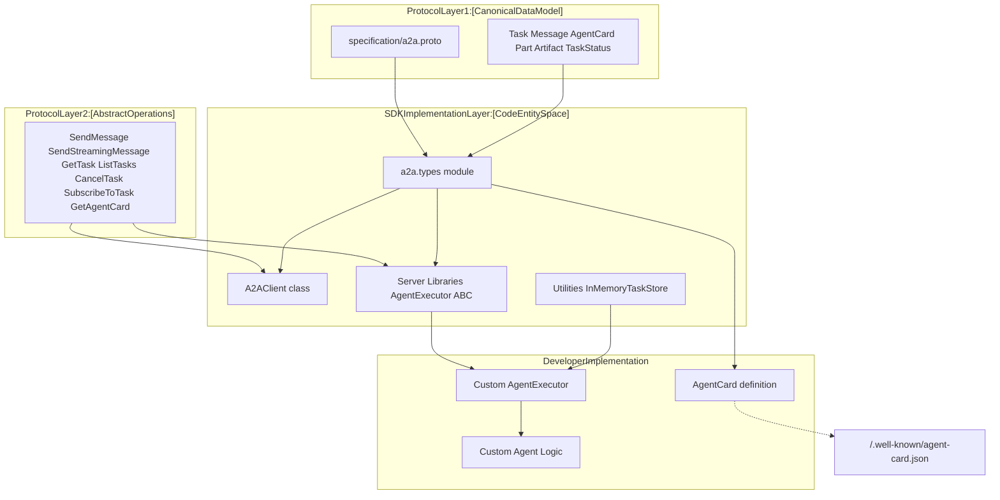
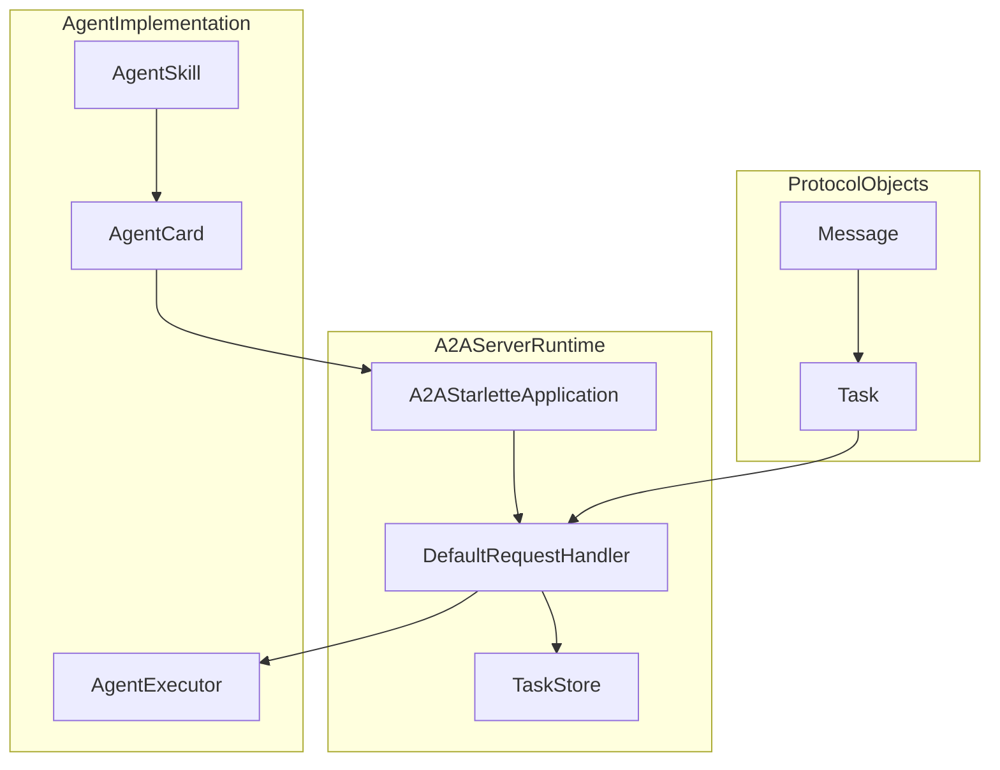
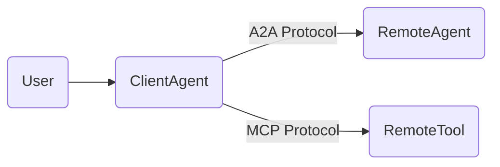

<!-- source: DeepWiki mcp.deepwiki.com · repo a2aproject/A2A · page 3 SDK & Implementation Guide · fetched 2026-10-21 -->

# SDK & Implementation Guide

Relevant source files

The following files were used as context for generating this wiki page:

- [README.md](README.md)
- [docs/roadmap.md](docs/roadmap.md)
- [docs/sdk/index.md](docs/sdk/index.md)
- [docs/tutorials/index.md](docs/tutorials/index.md)

This guide provides high-level guidance for building A2A-compliant agents using the official SDKs and integrating with existing frameworks. It covers the SDK ecosystem, core implementation abstractions, and how to bridge the gap between the protocol specification and concrete code entities.

This is a parent page providing a high-level overview. For detailed multi-language documentation, see [Multi-Language SDK Ecosystem](#3.1). For specific Python workflows, see [Python SDK Tutorial](#3.2). For integration patterns with frameworks, see [Framework Integrations](#3.4). For protocol distinctions, see [A2A and MCP: Complementary Protocols](#3.5).

Sources: [docs/sdk/index.md:1-14](), [docs/roadmap.md:26-27]()

## Official SDK Ecosystem

The A2A protocol is supported by six official SDKs maintained under the `a2aproject` organization. These SDKs enable developers to build compliant agents in their preferred language while ensuring interoperability across diverse runtime environments [docs/roadmap.md:26-27]().

| Language | Repository | Installation |
|----------|------------|--------------|
| Python | [`a2a-python`](https://github.com/a2aproject/a2a-python) | `pip install a2a-sdk` [README.md:95]() |
| Go | [`a2a-go`](https://github.com/a2aproject/a2a-go) | `go get github.com/a2aproject/a2a-go` [README.md:96]() |
| JavaScript | [`a2a-js`](https://github.com/a2aproject/a2a-js) | `npm install @a2a-js/sdk` [README.md:97]() |
| Java | [`a2a-java`](https://github.com/a2aproject/a2a-java) | Maven dependency [README.md:98]() |
| C#/.NET | [`a2a-dotnet`](https://github.com/a2aproject/a2a-dotnet) | `dotnet add package A2A` [README.md:99]() |
| Rust | [`a2a-rs`](https://github.com/a2aproject/a2a-rs) | `cargo add a2a-lf` [README.md:100]() |

For details on installation and specific language capabilities, see [Multi-Language SDK Ecosystem](#3.1).

Sources: [docs/sdk/index.md:5-12](), [docs/roadmap.md:26-27](), [README.md:95-100]()

## SDK Architecture: Protocol to Implementation

The following diagram illustrates how the SDKs bridge the protocol specification layers (defined in Protobuf) to concrete code entities and implementation components, mapping natural language specifications to code entities.

Title: "Bridging Protocol to Code Entity Space"

Sources: [docs/sdk/index.md:1-14](), [docs/tutorials/index.md:7-13]()

## Core Implementation Abstractions

### SDK Component Relationships

The SDKs provide standard abstractions to handle the complexities of the A2A protocol, such as task persistence and event-driven streaming.

Title: "SDK Component Interaction Map"

### Key Implementation Concepts

| Concept | Description |
|-------|---------|
| `AgentExecutor` | The primary interface developers implement to provide agent logic. It receives requests and produces task updates [docs/tutorials/index.md:7-7](). |
| `AgentCard` | A standardized metadata file detailing capabilities and connection info for discovery. |
| `AgentSkill` | Definitions of specific capabilities an agent can perform, included within the `AgentCard`. |
| `A2AStarletteApplication` | A reference implementation for serving A2A agents using the Starlette/FastAPI ecosystem [docs/tutorials/index.md:7-7](). |
| **Discovery** | The mechanism by which agents find each other via "Agent Cards" typically served at well-known URIs. |

For a step-by-step guide on implementing these in Python, see [Python SDK Tutorial](#3.2).

Sources: [docs/tutorials/index.md:7-13]()

## Framework Integrations

The A2A project prioritizes integration with the existing AI agent ecosystem, allowing developers to "A2A-enable" their existing agents with minimal code changes.

A wide range of frameworks and deployment patterns are supported:
- **LangGraph**: Support for stateful, multi-turn agent graphs.
- **Google ADK**: Simplified agent development using the Agent Development Kit [docs/tutorials/index.md:8-9]().
- **AG2 / AutoGen**: Support for multi-agent systems and collaborative patterns.
- **Pydantic AI**: Integration for type-safe agent communication.
- **BeeAI**: Open framework for building and deploying agents.
- **Semantic Kernel**: Microsoft's framework for integrating LLMs into apps.
- **Cloud Deployment**: Integration with Google Cloud Run for scalable, serverless agent services [docs/tutorials/index.md:9-9]().

For detailed information on these integrations, see [Framework Integrations](#3.4).

Sources: [docs/tutorials/index.md:5-23](), [docs/sdk/index.md:14-14]()

## Relationship to MCP and Other Standards

A2A focuses on **agent-to-agent communication** for high-level collaboration and delegation. It is designed to be complementary to the Model Context Protocol (MCP), which standardizes **agent-to-tool communication**.

Title: "A2A vs MCP Scope"

- **A2A**: Used to let specialized agents securely collaborate across different frameworks and organizations.
- **MCP**: Used to equip an individual agent with specific tools like database or repository access [docs/tutorials/index.md:19-19]().

For details, see [A2A and MCP: Complementary Protocols](#3.5).

Sources: [docs/tutorials/index.md:19-19]()

## Getting Started Resources

| Resource | Purpose |
|----------|---------|
| [Python Quickstart](./tutorials/python/1-introduction.md) | Learn to build a simple Python-based "echo" A2A server and client [docs/tutorials/index.md:7-7](). |
| [A2A Samples Repo](https://github.com/a2aproject/a2a-samples) | Canonical examples in Python, Java, and JS [docs/sdk/index.md:14-14](). |
| [A2A TCK](https://github.com/a2aproject/a2a-tck) | Technology Compatibility Kit for validating protocol compliance [docs/roadmap.md:22-22](). |
| [A2A Inspector](https://github.com/a2aproject/a2a-inspector) | Tooling for debugging and inspecting A2A traffic [docs/roadmap.md:22-22](). |
| [Cloud Run Deployment](https://github.com/a2aproject/a2a-samples/tree/main/samples/python/agents/adk_cloud_run) | Guide for deploying agents as serverless services [docs/tutorials/index.md:9-9](). |

Sources: [docs/tutorials/index.md:1-35](), [docs/roadmap.md:22-23](), [docs/sdk/index.md:14-14]()

---

