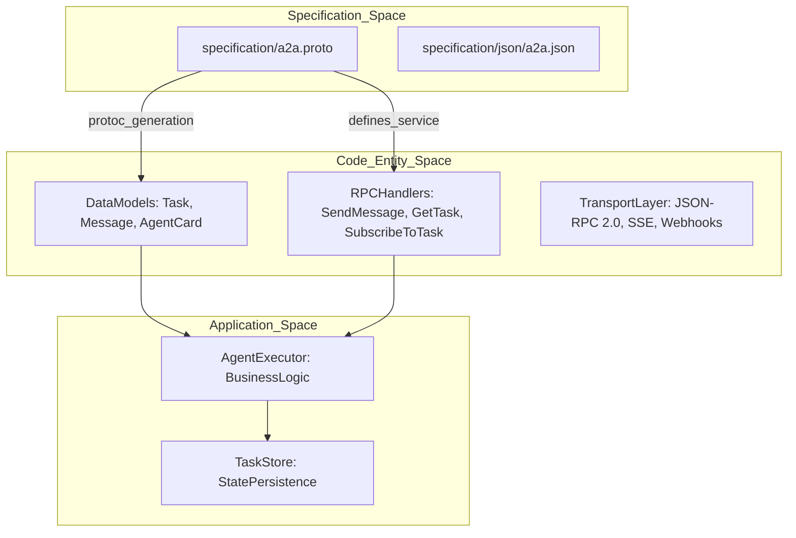
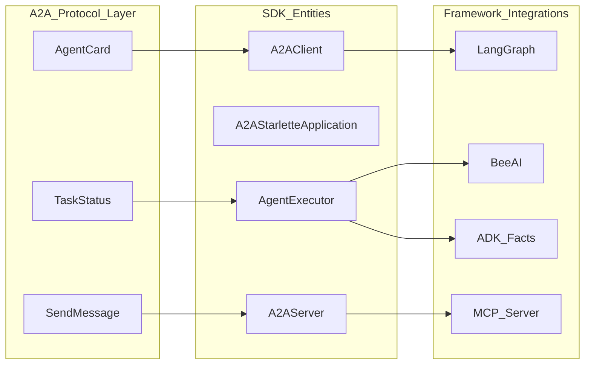

<!-- source: DeepWiki mcp.deepwiki.com · repo a2aproject/A2A · page 3.1 Multi-Language SDK Ecosystem · fetched 2026-10-21 -->

# Multi-Language SDK Ecosystem

Relevant source files

The following files were used as context for generating this wiki page:

- [.mkdocs/overrides/partials/header.html](.mkdocs/overrides/partials/header.html)
- [.mkdocs/overrides/partials/sdk_repos.html](.mkdocs/overrides/partials/sdk_repos.html)
- [docs/roadmap.md](docs/roadmap.md)
- [docs/sdk/index.md](docs/sdk/index.md)
- [docs/sdk/python/conf.py](docs/sdk/python/conf.py)
- [docs/sdk/python/index.rst](docs/sdk/python/index.rst)
- [docs/tutorials/index.md](docs/tutorials/index.md)

## Purpose and Scope

This document provides a technical overview of the six official SDKs that implement the A2A Protocol specification (`a2a-python`, `a2a-go`, `a2a-java`, `a2a-js`, `a2a-dotnet`, and `a2a-rs`). These SDKs serve as the primary interface for developers to build A2A-compliant agents, providing standardized data models, RPC operation handlers, and transport bindings.

The SDKs are designed to ensure interoperability across different programming environments while adhering to the canonical definitions in `specification/a2a.proto`. The ecosystem supports diverse AI agents built on separate frameworks, allowing them to collaborate as autonomous agents rather than raw tools [docs/sdk/index.md:1-12]().

Sources: [docs/sdk/index.md:1-12]()

---

## Official SDK Repositories and Stability

The A2A Project hosts SDKs across six languages. These SDKs are the primary vehicle for implementing key protocol features, including standardized communication and agent discovery via `AgentCard` [docs/sdk/index.md:1-12]().

### SDK Distribution Overview

| Language | Support Status | Repository | Package Manager / Installation |
| :--- | :--- | :--- | :--- |
| **Python** | Stable | [`a2a-python`](https://github.com/a2aproject/a2a-python) | `pip install a2a-sdk` [docs/sdk/python/index.rst:4-8]() |
| **Go** | Stable | [`a2a-go`](https://github.com/a2aproject/a2a-go) | `go get github.com/a2aproject/a2a-go` [docs/sdk/index.md:8]() |
| **Java** | Stable | [`a2a-java`](https://github.com/a2aproject/a2a-java) | Maven [`a2a-java`](https://github.com/a2aproject/a2a-java) [docs/sdk/index.md:9]() |
| **JavaScript** | Stable | [`a2a-js`](https://github.com/a2aproject/a2a-js) | `npm install @a2a-js/sdk` [docs/sdk/index.md:10]() |
| **C#/.NET** | Stable | [`a2a-dotnet`](https://github.com/a2aproject/a2a-dotnet) | `dotnet add package A2A` [docs/sdk/index.md:11]() |
| **Rust** | Stable | [`a2a-rs`](https://github.com/a2aproject/a2a-rs) | `cargo add a2a-lf` [docs/sdk/index.md:12]() |

Sources: [docs/sdk/index.md:1-12](), [docs/sdk/python/index.rst:4-8](), [.mkdocs/overrides/partials/sdk_repos.html:8-35]()

---

## SDK Architecture and Protocol Implementation

The SDK ecosystem bridges the gap between high-level agent intentions and concrete protocol code entities. All SDKs derive their core logic from the protocol specification artifacts and leverage language-specific documentation tools, such as Sphinx with `autodoc`, `autosummary`, and `napoleon` extensions in Python [`docs/sdk/python/conf.py:9-14`]().

### Implementation Data Flow

**Diagram: Specification to Code Entity Mapping**

Sources: [docs/sdk/python/conf.py:9-14]()

### Core Capabilities
Every official SDK implements the following mandatory protocol features:
1. **Data Modeling**: Native language objects corresponding to `Task`, `Message`, `Part`, and `AgentCard`.
2. **Discovery**: Implementation of the well-known `AgentCard` mechanism for detailing capabilities and connection endpoints.
3. **Task Lifecycle**: Management of the `TaskStatus` state machine for tracking long-running operations.
4. **Streaming**: Support for Server-Sent Events (SSE) via `SubscribeToTask` or `SendStreamingMessage`.

Sources: [docs/sdk/index.md:1-14]()

---

## Language-Specific Implementation Details

### Python SDK
The Python SDK is a reference implementation used for quickstart tutorials and complex multi-agent orchestration. It is installed via `pip install a2a-sdk` [docs/sdk/python/index.rst:4-8]() and configured with Sphinx [docs/sdk/python/conf.py:9-14]().

* **Key Integration**: Integrates natively with the **Agent Development Kit (ADK)** for building facts-based or cloud-ready agents [docs/tutorials/index.md:7-13]().
* **Deployment**: Includes patterns for deploying agents to Google Cloud Run [docs/tutorials/index.md:9]().
* **Multi-Agent Collaboration**: Provides templates for orchestrator host agents routing requests among specialized agents [docs/tutorials/index.md:10-11]().

Sources: [docs/sdk/python/conf.py:9-14](), [docs/sdk/python/index.rst:4-8](), [docs/tutorials/index.md:7-13]()

### Java SDK
The Java SDK focuses on enterprise integration and provides samples for tool-calling via MCP (Model Context Protocol) and secure deployments [docs/tutorials/index.md:19-23]().

* **Key Sample**: `Weather Agent` utilizing `weather_mcp` [docs/tutorials/index.md:19]().
* **Key Sample**: `Dice Agent` demonstrating multi-transport capabilities [docs/tutorials/index.md:22]().
* **Security**: Includes samples securing servers with Keycloak using bearer token authentication [docs/tutorials/index.md:23]().

Sources: [docs/tutorials/index.md:19-23]()

### JavaScript/Node.js SDK
Optimized for Node.js environments and web-based agent interactions [docs/tutorials/index.md:27-29]().

* **Key Sample**: `Movie research agent` demonstrating integration with the TMDB API [docs/tutorials/index.md:29]().

Sources: [docs/tutorials/index.md:27-29]()

### .NET SDK
Provides foundational support for C# developers to build A2A clients and servers [docs/tutorials/index.md:31-35]().

* **Key Sample**: `Echo Agent` serving as the baseline reference in `a2a-dotnet` [docs/tutorials/index.md:35]().

Sources: [docs/tutorials/index.md:31-35]()

### Rust SDK
Supports high-performance agent implementations, distributed under the `a2a-lf` crate [docs/sdk/index.md:12]().

Sources: [docs/sdk/index.md:12]()

---

## Bridging Protocol and Code

**Diagram: Framework Integration and Code Entities**

Sources: [docs/sdk/index.md:1-14]()

---

## SDK Feature Support Matrix

| Feature | Python | Java | JS | .NET | Go | Rust |
| :--- | :---: | :---: | :---: | :---: | :---: | :---: |
| **AgentCard Discovery** | ✓ | ✓ | ✓ | ✓ | ✓ | ✓ |
| **SSE Streaming** | ✓ | ✓ | ✓ | ✓ | ✓ | ✓ |
| **MCP Integration** | ✓ | ✓ | - | - | - | - |
| **Multi-Transport** | - | ✓ | - | - | - | ✓ |
| **Security (Bearer/OAuth)** | ✓ | ✓ | ✓ | ✓ | ✓ | ✓ |

Sources: [docs/sdk/index.md:1-12]()

---

## Integration with Agent Frameworks

The SDKs act as integration layers for third-party agent frameworks, allowing developers to maintain compatibility across diverse systems [docs/sdk/index.md:14]().

Supported frameworks and integration patterns include:
* **Agent Development Kit (ADK)**: Used for facts agents and Cloud Run deployments [docs/tutorials/index.md:8-9]().
* **Model Context Protocol (MCP)**: Complementary protocol; Java samples demonstrate building agents that use MCP servers for tool access [docs/tutorials/index.md:19]().
* **Multi-Agent Orchestration**: Host agents routing requests among specialized A2A-compatible agents [docs/tutorials/index.md:10-11]().

Sources: [docs/sdk/index.md:14](), [docs/tutorials/index.md:8-19]()

---

