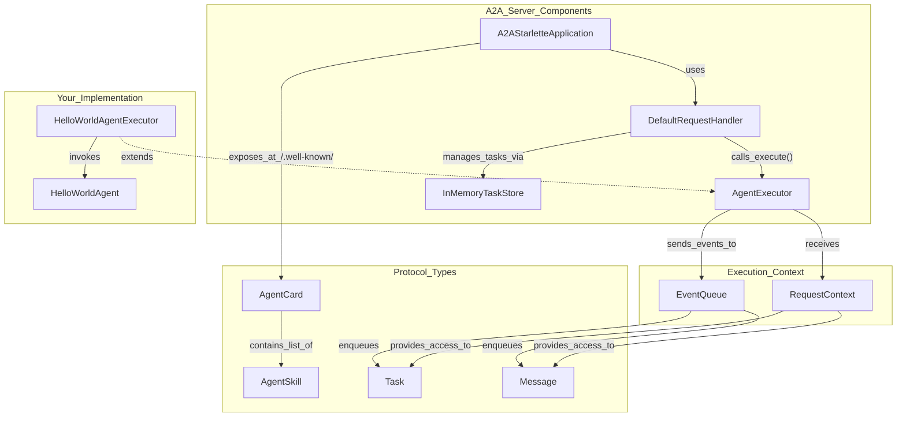
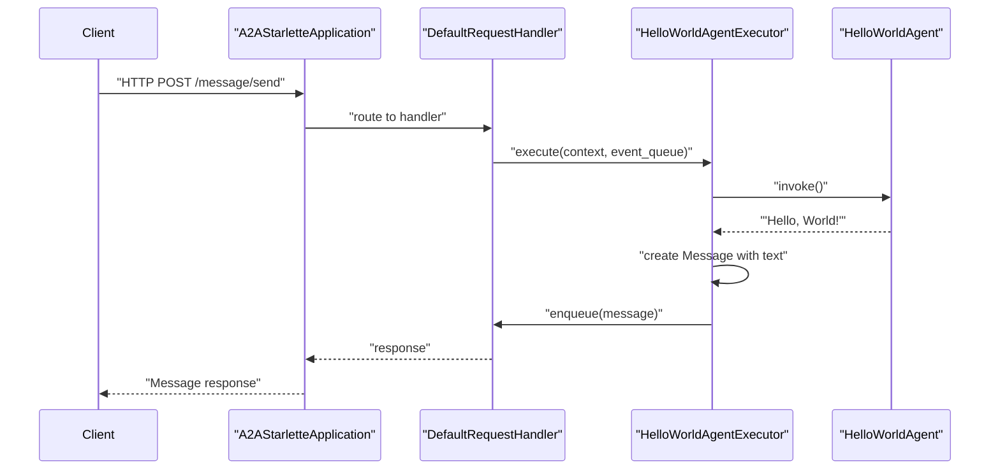
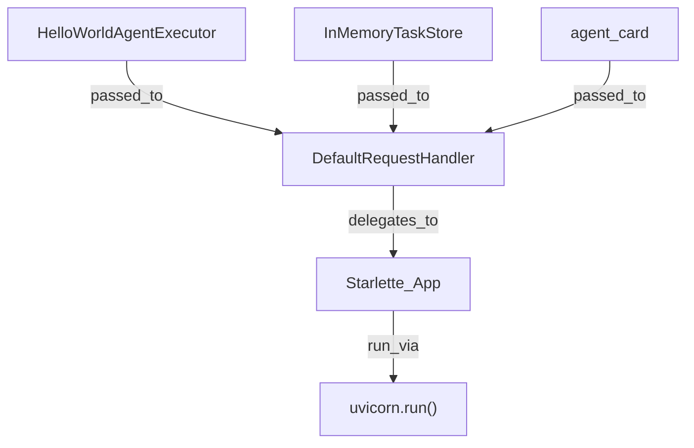
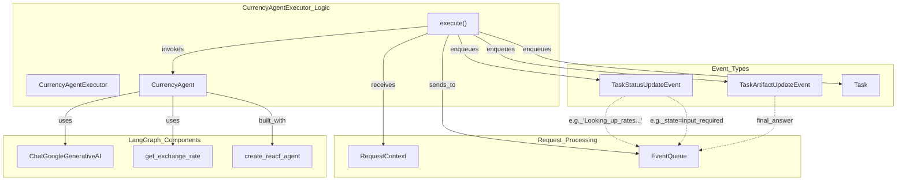

<!-- source: DeepWiki mcp.deepwiki.com · repo a2aproject/A2A · page 3.2 Python SDK Tutorial · fetched 2026-10-21 -->

# Python SDK Tutorial

<details>
<summary>Relevant source files</summary>

The following files were used as context for generating this wiki page:

- [docs/tutorials/python/1-introduction.md](docs/tutorials/python/1-introduction.md)
- [docs/tutorials/python/2-setup.md](docs/tutorials/python/2-setup.md)
- [docs/tutorials/python/3-agent-skills-and-card.md](docs/tutorials/python/3-agent-skills-and-card.md)
- [docs/tutorials/python/4-agent-executor.md](docs/tutorials/python/4-agent-executor.md)
- [docs/tutorials/python/5-start-server.md](docs/tutorials/python/5-start-server.md)
- [docs/tutorials/python/6-interact-with-server.md](docs/tutorials/python/6-interact-with-server.md)
- [docs/tutorials/python/7-streaming-and-multiturn.md](docs/tutorials/python/7-streaming-and-multiturn.md)
- [docs/tutorials/python/8-next-steps.md](docs/tutorials/python/8-next-steps.md)

</details>


This tutorial provides a step-by-step guide to building A2A-compliant agents using the official Python SDK. It covers installation, core concepts, and walks through practical examples: a simple HelloWorld agent and an advanced LangGraph-based agent with streaming and multi-turn conversations. [docs/tutorials/python/1-introduction.md:1-16](), [docs/tutorials/python/7-streaming-and-multiturn.md:1-6]()

Sources: [docs/tutorials/python/1-introduction.md:1-16](), [docs/tutorials/python/7-streaming-and-multiturn.md:1-6]()

## Prerequisites and Installation

### System Requirements

The Python SDK requires Python 3.10 or higher. You will also need Git for cloning the sample repository and a code editor like Visual Studio Code. [docs/tutorials/python/2-setup.md:3-9]()

Sources: [docs/tutorials/python/2-setup.md:3-9]()

### Environment Setup

The tutorial examples are located in the `a2a-samples` repository. Clone it first: [docs/tutorials/python/2-setup.md:10-17]()

```bash
git clone https://github.com/a2aproject/a2a-samples.git -b main --depth 1
cd a2a-samples
```

Create and activate a virtual environment: [docs/tutorials/python/2-setup.md:23-39]()

```bash
# Mac/Linux
python -m venv .venv
source .venv/bin/activate

# Windows
python -m venv .venv
.venv\Scripts\activate
```

Install the SDK and dependencies: [docs/tutorials/python/2-setup.md:41-44]()

```bash
pip install -r samples/python/requirements.txt
```

Verify the installation: [docs/tutorials/python/2-setup.md:47-55]()

```bash
python -c "import a2a; print('A2A SDK imported successfully')"
```

Sources: [docs/tutorials/python/2-setup.md:10-55]()

## Core SDK Concepts

### SDK Component Relationships

The following diagram illustrates the core components of the Python SDK and how they map code entities to system architecture:

**SDK Component Relationships**


Sources: [docs/tutorials/python/4-agent-executor.md:3-12](), [docs/tutorials/python/5-start-server.md:16-26]()

### AgentCard and AgentSkill

An `AgentCard` is the agent's metadata document, exposed at `/.well-known/agent-card.json`. It describes the agent's identity, capabilities, and skills. An `AgentSkill` defines a specific capability the agent can perform. [docs/tutorials/python/3-agent-skills-and-card.md:1-31]()

Key `AgentCard` attributes:
- `name`, `description`, `version`: Identity information [docs/tutorials/python/3-agent-skills-and-card.md:35-35]()
- `supported_interfaces`: Ordered list of endpoints and protocols where the A2A service can be reached [docs/tutorials/python/3-agent-skills-and-card.md:36-36]()
- `capabilities`: Supported A2A features like `streaming` or `extended_agent_card` [docs/tutorials/python/3-agent-skills-and-card.md:37-37]()
- `skills`: A list of `AgentSkill` objects that the agent offers [docs/tutorials/python/3-agent-skills-and-card.md:39-39]()

Key `AgentSkill` attributes:
- `id`: Unique identifier for the skill [docs/tutorials/python/3-agent-skills-and-card.md:13-13]()
- `name`, `description`: Human-readable information [docs/tutorials/python/3-agent-skills-and-card.md:14-15]()
- `tags`: Keywords for categorization and discovery [docs/tutorials/python/3-agent-skills-and-card.md:16-16]()
- `input_modes`, `output_modes`: Supported Media Types for input and output [docs/tutorials/python/3-agent-skills-and-card.md:18-18]()

Sources: [docs/tutorials/python/3-agent-skills-and-card.md:1-47]()

### AgentExecutor

The `AgentExecutor` class is the core logic of how an A2A agent processes requests. The SDK provides an abstract base class `a2a.server.agent_execution.AgentExecutor` that you implement. [docs/tutorials/python/4-agent-executor.md:3-4]()

The `AgentExecutor` interface defines two primary methods:

| Method | Purpose |
|--------|---------|
| `async def execute(self, context: RequestContext, event_queue: EventQueue)` | Handles incoming requests and generates responses or streams [docs/tutorials/python/4-agent-executor.md:9-9]() |
| `async def cancel(self, context: RequestContext, event_queue: EventQueue)` | Handles requests to cancel an ongoing task [docs/tutorials/python/4-agent-executor.md:10-10]() |

The `RequestContext` provides information about the incoming request (user message, task state). The `EventQueue` is used by the executor to send events back to the client. [docs/tutorials/python/4-agent-executor.md:11-12]()

Sources: [docs/tutorials/python/4-agent-executor.md:1-12]()

### DefaultRequestHandler and TaskStore

The `DefaultRequestHandler` routes incoming A2A RPC calls to your `AgentExecutor` and manages task lifecycle. It requires:
- An `AgentExecutor` implementation [docs/tutorials/python/5-start-server.md:19-21]()
- A `TaskStore` (such as `InMemoryTaskStore`) for managing task state [docs/tutorials/python/5-start-server.md:19-21]()

The `TaskStore` is used to manage the lifecycle of tasks, especially for stateful interactions, streaming, and resubscription. [docs/tutorials/python/5-start-server.md:23-23]()

Sources: [docs/tutorials/python/5-start-server.md:16-26]()

## Building the HelloWorld Agent

The HelloWorld example demonstrates the minimal components needed for an A2A agent. It is located at `samples/python/agents/helloworld/`. [docs/tutorials/python/3-agent-skills-and-card.md:5-5]()

### Request Processing Flow

**HelloWorld Sequence**


Sources: [docs/tutorials/python/4-agent-executor.md:38-55](), [docs/tutorials/python/5-start-server.md:16-28]()

### Step 1: Define Agent Skills and Card

The HelloWorld agent defines a simple skill and card in `samples/python/agents/helloworld/__main__.py`. [docs/tutorials/python/3-agent-skills-and-card.md:21-25]()

The skill definition specifies an `id` of `"hello_world"`, the name `"Returns hello world"`, and supported modes `["text/plain"]`. [docs/tutorials/python/3-agent-skills-and-card.md:24-24]()

The `AgentCard` definition includes the name `"Hello World Agent"`, an endpoint at `http://127.0.0.1:9999/`, and the `hello_world` skill. [docs/tutorials/python/3-agent-skills-and-card.md:44-45]()

Sources: [docs/tutorials/python/3-agent-skills-and-card.md:21-47]()

### Step 2: Implement the Agent Logic

In `samples/python/agents/helloworld/agent_executor.py`, a simple `HelloWorldAgent` class encapsulates the business logic with an `invoke` method that returns "Hello, World!". [docs/tutorials/python/4-agent-executor.md:18-25]()

Sources: [docs/tutorials/python/4-agent-executor.md:18-25]()

### Step 3: Implement the AgentExecutor

The `HelloWorldAgentExecutor` implements the `execute` method: [docs/tutorials/python/4-agent-executor.md:27-30]()

1. **Task Retrieval:** The server retrieves the current task from context or creates a new one and adds it to the `EventQueue`. [docs/tutorials/python/4-agent-executor.md:46-47]()
2. **Status Update:** Enqueues a `TaskStatusUpdateEvent` with state `TASK_STATE_WORKING`. [docs/tutorials/python/4-agent-executor.md:48-48]()
3. **Logic Invocation:** Calls `self.agent.invoke()` to execute the business logic. [docs/tutorials/python/4-agent-executor.md:50-50]()
4. **Artifact Update:** Enqueues a `TaskArtifactUpdateEvent` containing the result text. [docs/tutorials/python/4-agent-executor.md:52-52]()
5. **Completion:** Enqueues a final `TaskStatusUpdateEvent` with state `TASK_STATE_COMPLETED`. [docs/tutorials/python/4-agent-executor.md:54-54]()

Sources: [docs/tutorials/python/4-agent-executor.md:27-56]()

### Step 4: Start the Server

The server setup uses Starlette and Uvicorn. [docs/tutorials/python/5-start-server.md:7-15]()

**Server Construction**


The server is started with a `DefaultRequestHandler` initialized with the executor, task store, and agent cards. [docs/tutorials/python/5-start-server.md:19-26]() `create_agent_card_routes` and `create_jsonrpc_routes` are used to build Starlette routes, and `uvicorn.run()` serves the app on `127.0.0.1:9999`. [docs/tutorials/python/5-start-server.md:27-36]()

Sources: [docs/tutorials/python/5-start-server.md:7-36]()

### Step 5: Run and Test

Start the server from the `a2a-samples` directory: [docs/tutorials/python/5-start-server.md:38-47]()

```bash
python samples/python/agents/helloworld/__main__.py
```

Use `test_client.py` to interact with it. [docs/tutorials/python/6-interact-with-server.md:1-34]()

Sources: [docs/tutorials/python/5-start-server.md:38-47](), [docs/tutorials/python/6-interact-with-server.md:1-34]()

## Advanced Features: LangGraph Example

The LangGraph example at `samples/python/agents/langgraph/` demonstrates features like streaming, task state management, and multi-turn conversations powered by an LLM (Gemini). [docs/tutorials/python/7-streaming-and-multiturn.md:1-6]()

Sources: [docs/tutorials/python/7-streaming-and-multiturn.md:1-6]()

### LangGraph Agent Architecture

**LangGraph Execution Model**


Sources: [docs/tutorials/python/7-streaming-and-multiturn.md:50-96]()

### Streaming and Multi-Turn

The `CurrencyAgentExecutor` enqueues different types of events onto the `EventQueue`, including `TaskStatusUpdateEvent` for intermediate updates and `TaskArtifactUpdateEvent` for final answers. [docs/tutorials/python/7-streaming-and-multiturn.md:70-78]()

The agent can ask for clarification by enqueuing a `TaskStatusUpdateEvent` with `status.state = TaskState.input_required`. [docs/tutorials/python/7-streaming-and-multiturn.md:79-82]() The client then sends a second message including the `taskId` and `contextId` from the first turn's response to continue the same task. [docs/tutorials/python/7-streaming-and-multiturn.md:83-87]()

Sources: [docs/tutorials/python/7-streaming-and-multiturn.md:70-87]()

### Testing Agents

The `test_client.py` script demonstrates how to:
1. **Fetch the Agent Card**: Uses `A2ACardResolver` to fetch from `/.well-known/agent-card.json`. [docs/tutorials/python/6-interact-with-server.md:40-46]()
2. **Initialize the Client**: Uses `create_client` with a `ClientConfig`. [docs/tutorials/python/6-interact-with-server.md:54-54]()
3. **Send Messages**: `send_message` returns an async iterator yielding a final `Task` or `Message`. [docs/tutorials/python/6-interact-with-server.md:55-56]() For streaming, the client is initialized with `streaming=True`. [docs/tutorials/python/6-interact-with-server.md:64-65]()

Sources: [docs/tutorials/python/6-interact-with-server.md:5-67]()

## Key Files Reference

| File Path | Purpose |
|-----------|---------|
| `samples/python/agents/helloworld/__main__.py` | Server setup, AgentCard, AgentSkill definitions [docs/tutorials/python/3-agent-skills-and-card.md:21-45]() |
| `samples/python/agents/helloworld/agent_executor.py` | `HelloWorldAgentExecutor` implementation [docs/tutorials/python/4-agent-executor.md:16-17]() |
| `samples/python/agents/langgraph/app/__main__.py` | Advanced server with `DefaultRequestHandler` [docs/tutorials/python/7-streaming-and-multiturn.md:92-92]() |
| `samples/python/agents/langgraph/app/agent.py` | `CurrencyAgent` logic using LangGraph [docs/tutorials/python/7-streaming-and-multiturn.md:93-93]() |
| `samples/python/agents/langgraph/app/agent_executor.py` | `CurrencyAgentExecutor` with event queueing [docs/tutorials/python/7-streaming-and-multiturn.md:94-94]() |
| `samples/python/agents/langgraph/app/test_client.py` | Client demonstrating multi-turn patterns [docs/tutorials/python/7-streaming-and-multiturn.md:95-95]() |

Sources: [docs/tutorials/python/7-streaming-and-multiturn.md:88-96]()

---

