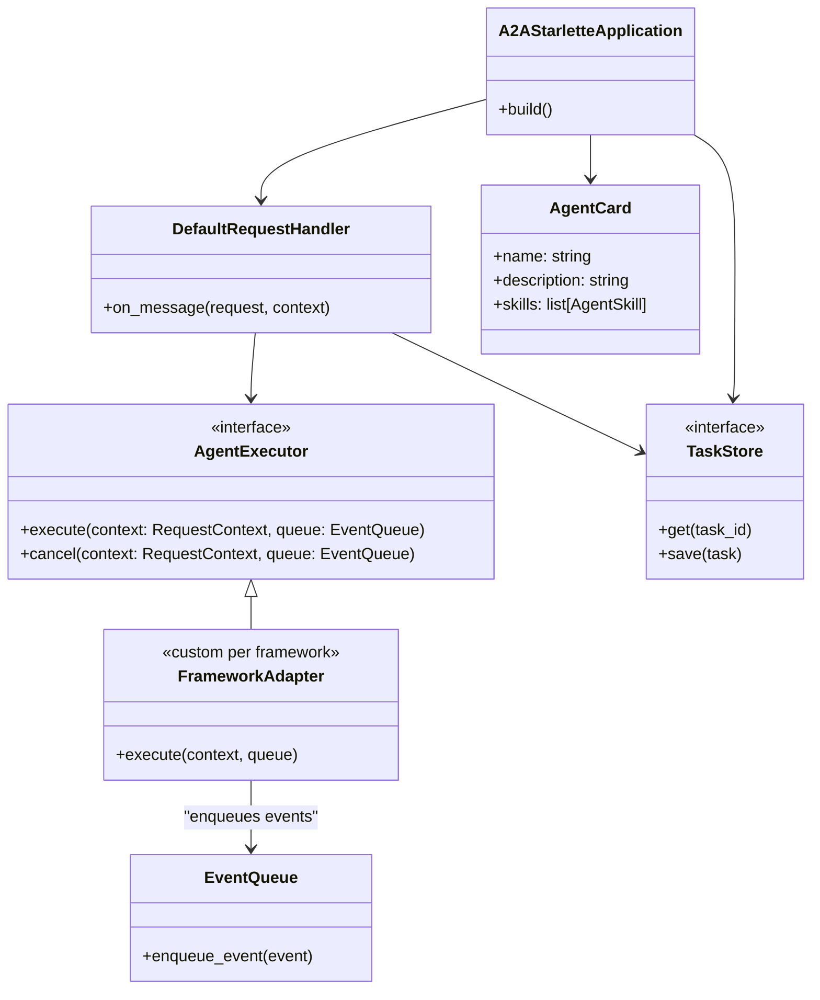
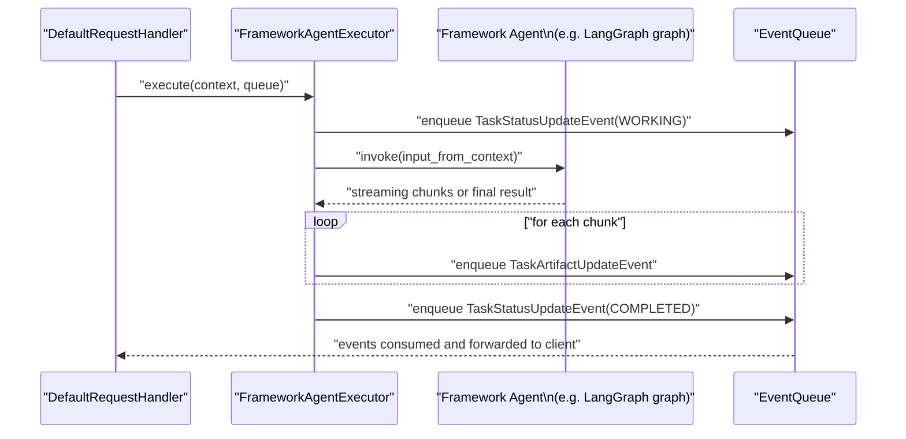

<!-- source: DeepWiki mcp.deepwiki.com · repo a2aproject/A2A · page 3.4 Framework Integrations · fetched 2026-10-21 -->

# Framework Integrations

<details>
<summary>Relevant source files</summary>

The following files were used as context for generating this wiki page:

- [.github/actions/spelling/allow.txt](.github/actions/spelling/allow.txt)
- [docs/tutorials/python/8-next-steps.md](docs/tutorials/python/8-next-steps.md)
- [mkdocs.yml](mkdocs.yml)

</details>


This page documents how third-party agentic frameworks are integrated as A2A-compliant servers by wrapping their agent logic behind the `AgentExecutor` interface. It covers the general integration pattern, data flows, core components, and surveys specific supported frameworks.

For the Python SDK setup steps that precede framework integration, see [Python SDK Tutorial](3.2). For the broader partner ecosystem, see [Partner Ecosystem & Industry Adoption](5.1).

Sources: [mkdocs.yml:21-63](), [docs/tutorials/python/8-next-steps.md:1-12]()

---

## The Integration Pattern

Every framework integration follows a standard structural contract: the framework's agent runtime is wrapped inside a class implementing the `AgentExecutor` interface. The A2A server infrastructure manages protocol concerns (JSON-RPC dispatch, task lifecycle, streaming transport), while the `AgentExecutor` implementation bridges A2A protocol events with the framework's invocation API.

**Diagram: Framework Agent wrapped behind AgentExecutor**

```mermaid
flowchart TD
    subgraph "A2A Protocol Space"
    [Client] -->|"JSON-RPC over HTTP"| [A2AStarletteApplication]
    [A2AStarletteApplication] --> [DefaultRequestHandler]
    [DefaultRequestHandler] --> [TaskStore]
    [DefaultRequestHandler] --> [AgentExecutor]
    end
    
    subgraph "Code Entity Space"
    [AgentExecutor] --> [FrameworkAgent]
    [AgentExecutor] --> [EventQueue]
    end
    
    [EventQueue] --> [DefaultRequestHandler]

    %% Labels
    [Client]["A2A Client"]
    [A2AStarletteApplication]["A2AStarletteApplication"]
    [DefaultRequestHandler]["DefaultRequestHandler"]
    [TaskStore]["TaskStore"]
    [AgentExecutor]["AgentExecutor (interface)"]
    [FrameworkAgent]["Framework Agent Logic\n(LangGraph / CrewAI / ADK / etc.)"]
    [EventQueue]["EventQueue"]
```

Sources: [docs/tutorials/python/8-next-steps.md:27-30](), [.github/actions/spelling/allow.txt:278]()

The three core responsibilities of any `AgentExecutor` implementation are:

| Responsibility | Description |
|---|---|
| **Translate input** | Convert the incoming A2A `Message` (containing its `Part` list) into the framework's native input format (prompt string, message dictionary, etc.) |
| **Invoke the framework** | Execute the framework's agent synchronously or asynchronously using the translated input |
| **Emit events** | Publish `TaskStatusUpdateEvent` and `TaskArtifactUpdateEvent` objects to the `EventQueue` as the agent generates output |

Sources: [docs/tutorials/python/8-next-steps.md:27-30]()

---

## Frameworks With A2A Integration

The A2A protocol is supported by a variety of industry frameworks and agentic platforms, enabling developers to expose agents built with popular libraries as standard A2A endpoints.

### Supported Frameworks

| Framework / Platform | Integration Context | Source Reference |
|---|---|---|
| **Google ADK** | Primary reference implementation and native support | [.github/actions/spelling/allow.txt:9]() |
| **LangGraph** | Integration for task state management and tool use | [.github/actions/spelling/allow.txt:278](), [docs/tutorials/python/8-next-steps.md:9]() |
| **BeeAI Framework** | IBM Research / BeeAI integration | [.github/actions/spelling/allow.txt:183]() |
| **AG2 (AutoGen)** | Native A2A interface support with multi-agent orchestration | [.github/actions/spelling/allow.txt:25-26](), [.github/actions/spelling/allow.txt:177]() |
| **CrewAI** | Multi-agent delegation and task execution support | [.github/actions/spelling/allow.txt:201](), [docs/tutorials/python/8-next-steps.md:28]() |
| **LlamaIndex** | Official A2A integration support for data-driven agents | [.github/actions/spelling/allow.txt:286]() |
| **Pydantic AI** | Type-safe structured agent integration | [.github/actions/spelling/allow.txt:328]() |
| **Semantic Kernel** | Microsoft Cloud agent integration | [.github/actions/spelling/allow.txt:278]() |
| **MindsDB** | Database-to-agent integration patterns | [.github/actions/spelling/allow.txt:296]() |
| **Marvin** | Task-focused natural language agent integration | [.github/actions/spelling/allow.txt:291]() |

Sources: [.github/actions/spelling/allow.txt:1-397](), [docs/tutorials/python/8-next-steps.md:28-29]()

---

## Core Components Used by Every Integration

**Diagram: Code entities involved in a framework integration**



Sources: [docs/tutorials/python/8-next-steps.md:27-30]()

---

## Data Flow through the Integration Layer

The `execute` method of an `AgentExecutor` receives two critical parameters connecting the protocol server layer to framework execution logic:

1.  **`context: RequestContext`**: Encapsulates the incoming `Message` object and request metadata.
2.  **`queue: EventQueue`**: The communication channel through which the executor publishes progress updates by calling `queue.enqueue_event(...)`.

**Diagram: Data flow through an AgentExecutor implementation**



Sources: [docs/tutorials/python/8-next-steps.md:9]()

---

## Framework-Specific Implementation Notes

### Google ADK (Agent Development Kit)
Google ADK serves as a primary reference implementation for A2A integration, supporting robust task handling and seamless cloud deployments [.github/actions/spelling/allow.txt:9]().

### A2A and Model Context Protocol (MCP)
A2A complements MCP by handling agent-to-agent communication, whereas MCP addresses agent-to-tool integration [mkdocs.yml:25](). An agent built within any framework can utilize an MCP server for local tool access while exposing itself externally via A2A to an orchestrator.

### Multi-Agent Orchestration (CrewAI, AG2, LangGraph)
These frameworks specialize in multi-agent workflows. When integrated with A2A, an orchestrator agent can route and manage tasks among multiple specialized A2A-compliant endpoints [docs/tutorials/python/8-next-steps.md:9,28]().

Sources: [mkdocs.yml:21-25](), [docs/tutorials/python/8-next-steps.md:9,28]()

---

## Multi-Framework Composition

Because A2A standardizes communication across all agents, diverse framework agents can be composed into unified multi-agent workflows. An orchestrator agent built in one framework can communicate with specialist agents built in others via standard A2A `SendMessage` requests.

**Diagram: Multi-framework agent workflow over A2A**

```mermaid
flowchart LR
    [User] --> [Orchestrator]
    [Orchestrator] -->|"A2A SendMessage"| [LangGraphAgent]
    [Orchestrator] -->|"A2A SendMessage"| [CrewAIAgent]
    [Orchestrator] -->|"A2A SendMessage"| [CustomAgent]
    [LangGraphAgent] --> [LG]
    [CrewAIAgent] --> [CA]
    [CustomAgent] --> [Py]

    %% Labels
    [User]["User"]
    [Orchestrator]["Orchestrator Agent\n(e.g. ADK Host)"]
    [LangGraphAgent]["A2A Server\n(LangGraph executor)"]
    [CrewAIAgent]["A2A Server\n(CrewAI executor)"]
    [CustomAgent]["A2A Server\n(Custom executor)"]
    [LG]["LangGraph\nCompiledGraph"]
    [CA]["CrewAI\nCrew"]
    [Py]["Custom Python\nLogic"]
```

Sources: [docs/tutorials/python/8-next-steps.md:9,28]()

This interoperability relies upon standard `AgentCard` and `AgentSkill` definitions, allowing agents to advertise capabilities and discover peers independently of their underlying runtime framework.

Sources: [docs/tutorials/python/8-next-steps.md:27-30](), [.github/actions/spelling/allow.txt:1-397]()

---

