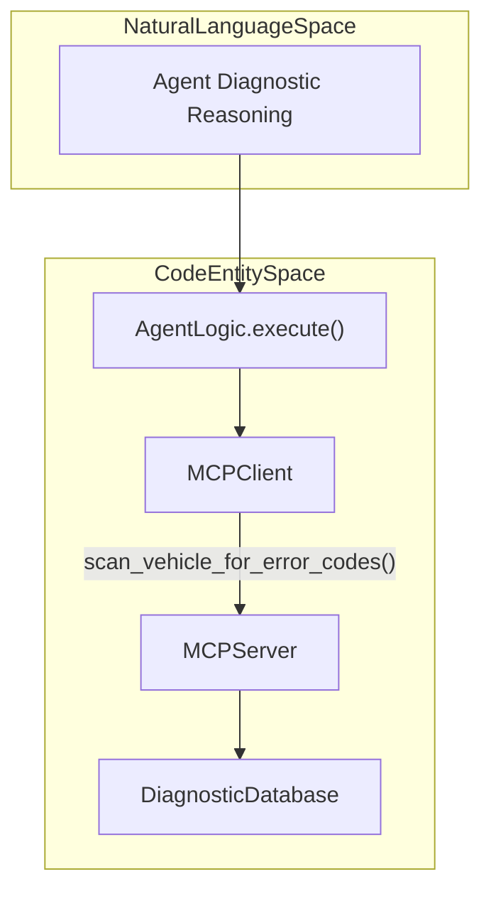
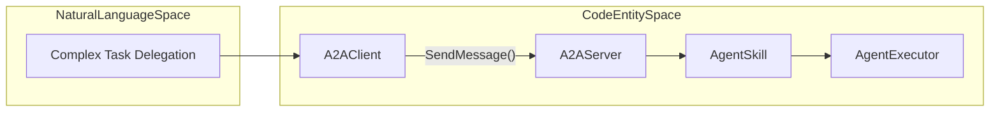
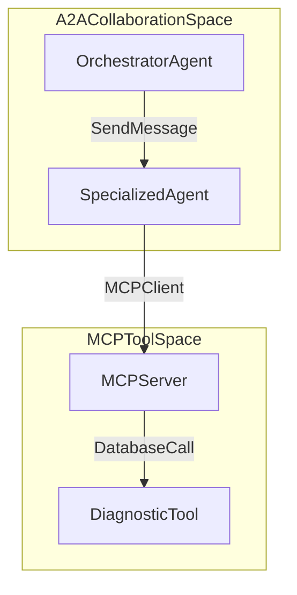

<!-- source: DeepWiki mcp.deepwiki.com · repo a2aproject/A2A · page 3.5 A2A and MCP: Complementary Protocols · fetched 2026-10-21 -->

# A2A and MCP: Complementary Protocols

Relevant source files

The following files were used as context for generating this wiki page:

- [.github/linters/.markdownlint.json](.github/linters/.markdownlint.json)
- [docs/assets/a2a-actors.png](docs/assets/a2a-actors.png)
- [docs/assets/a2a-mcp-readme.png](docs/assets/a2a-mcp-readme.png)
- [docs/assets/a2a-mcp.png](docs/assets/a2a-mcp.png)
- [docs/assets/agentic-stack.png](docs/assets/agentic-stack.png)
- [docs/topics/a2a-and-mcp.md](docs/topics/a2a-and-mcp.md)
- [docs/topics/enterprise-ready.md](docs/topics/enterprise-ready.md)
- [docs/topics/what-is-a2a.md](docs/topics/what-is-a2a.md)

## Purpose and Scope

This page clarifies the relationship between the **Agent2Agent (A2A) protocol** and the **Model Context Protocol (MCP)**, explaining how they serve complementary and non-overlapping roles in building complete multi-agent systems [docs/topics/what-is-a2a.md:131-142](). A2A governs horizontal communication and negotiation between autonomous agents, whereas MCP governs vertical communication between agents and their local tools, resources, and data sources [docs/topics/a2a-and-mcp.md:8-28]().

Sources: [docs/topics/a2a-and-mcp.md:1-28](), [docs/topics/what-is-a2a.md:131-142]()

---

## Protocol Comparison

| Aspect | A2A (Agent2Agent) | MCP (Model Context Protocol) |
|--------|-------------------|------------------------------|
| **Communication Type** | Agent-to-Agent [docs/topics/what-is-a2a.md:135-136]() | Agent-to-Tool [docs/topics/what-is-a2a.md:136-137]() |
| **Purpose** | Enable independent agents to collaborate as peers [docs/topics/a2a-and-mcp.md:45-52]() | Connect models to data and external resources [docs/topics/a2a-and-mcp.md:31-38]() |
| **Scope** | Opaque interactions, multi-turn dialogues [docs/topics/a2a-and-mcp.md:50-58]() | Structured inputs/outputs for discrete functions [docs/topics/a2a-and-mcp.md:39-44]() |
| **State Management** | Stateful, long-running tasks [docs/topics/what-is-a2a.md:107-109]() | Typically stateless functions [docs/topics/a2a-and-mcp.md:65-68]() |
| **Discovery** | `AgentCard` discovery mechanism [docs/topics/enterprise-ready.md:34-39]() | Tool capability descriptions [docs/topics/a2a-and-mcp.md:39-40]() |

Sources: [docs/topics/a2a-and-mcp.md:31-78](), [docs/topics/what-is-a2a.md:131-142]()

---

## MCP: Agent-to-Tool Communication

The Model Context Protocol (MCP) defines how an AI agent interacts with and utilizes individual tools, APIs, and data sources [docs/topics/a2a-and-mcp.md:31-38](). MCP operations are vertical and designed to deepen a single agent's capabilities [docs/topics/a2a-and-mcp.md:8-15]().

### MCP Data Flow to Code Entities

Title: MCP Client-Server Execution Flow

Sources: [docs/topics/a2a-and-mcp.md:31-44](), [docs/topics/a2a-and-mcp.md:110-122]()

---

## A2A: Agent-to-Agent Communication

The Agent2Agent (A2A) protocol enables independent, heterogeneous agents to discover each other, negotiate, exchange conversational context, and manage shared tasks as peers [docs/topics/a2a-and-mcp.md:45-58]().

### A2A Request Handling to Code Entities

Title: A2A Request Routing and Execution Flow

Sources: [docs/topics/a2a-and-mcp.md:45-58](), [docs/topics/what-is-a2a.md:96-108]()

---

## Complementary Architecture

In a complete multi-agent system, A2A and MCP operate orthogonally:
- **Horizontal Reach (A2A)**: Connects agents across organizational or framework boundaries [docs/topics/a2a-and-mcp.md:16-21]().
- **Vertical Depth (MCP)**: Empowers each agent internally with specialized tools and resources [docs/topics/a2a-and-mcp.md:12-15]().

Title: Complete Agentic Stack Architecture

Sources: [docs/topics/a2a-and-mcp.md:79-90](), [docs/topics/enterprise-ready.md:1-139]()

---

## Practical Use Case: The Auto Repair Shop

Consider an auto repair shop staffed by autonomous AI agents [docs/topics/a2a-and-mcp.md:92-98]():

1. **Customer Interaction (A2A)**: A customer communicates with the `ShopManager` agent using A2A [docs/topics/a2a-and-mcp.md:100-104]().
2. **Diagnostic Conversation (A2A)**: The `ShopManager` coordinates with the `MechanicAgent` via A2A message exchanges [docs/topics/a2a-and-mcp.md:105-109]().
3. **Internal Tool Usage (MCP)**: The `MechanicAgent` invokes tools via MCP, such as `scan_vehicle_for_error_codes(vehicle_id='XYZ123')` or `get_repair_procedure(error_code='P0300')` [docs/topics/a2a-and-mcp.md:110-122]().
4. **Supplier Interaction (A2A)**: The `MechanicAgent` queries external parts suppliers using A2A [docs/topics/a2a-and-mcp.md:123-131]().

Sources: [docs/topics/a2a-and-mcp.md:92-139]()

---

## Representing A2A Agents as MCP Resources

An A2A Server (remote agent) can expose certain skills as MCP-compatible resources when interactions are well-defined, stateless, and tool-like [docs/topics/a2a-and-mcp.md:140-143](). This bridge allows MCP-based tool architectures to discover and invoke A2A capabilities transparently [docs/topics/a2a-and-mcp.md:140-143]().

Sources: [docs/topics/a2a-and-mcp.md:140-143]()

---

