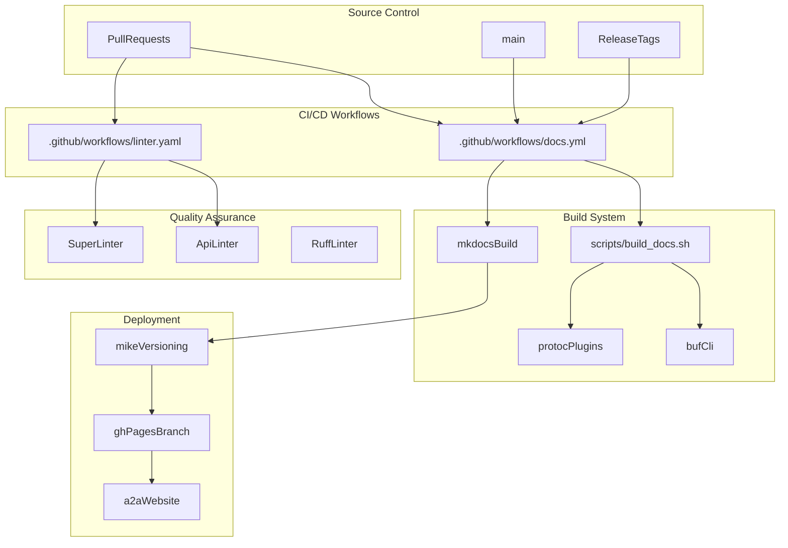
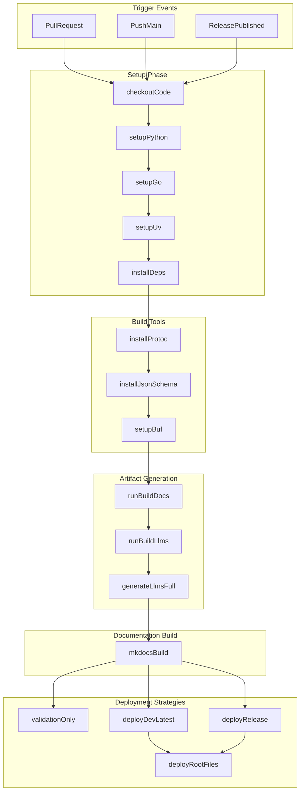

<!-- source: DeepWiki mcp.deepwiki.com · repo a2aproject/A2A · page 4 Development Infrastructure · fetched 2026-10-21 -->

# Development Infrastructure

Relevant source files

The following files were used as context for generating this wiki page:

- [.github/workflows/docs.yml](.github/workflows/docs.yml)
- [.github/workflows/linter.yaml](.github/workflows/linter.yaml)
- [.ruff.toml](.ruff.toml)

This document provides a high-level overview of the development infrastructure maintained in the A2A Protocol repository. It covers how the repository ensures code quality, generates and deploys documentation, and automates cross-repository coordination. This infrastructure includes CI/CD pipelines, linters, build tools, and deployment workflows that together maintain the health, accuracy, and usability of the protocol specification and related artifacts.

For detailed information on the individual infrastructure areas, the following child pages provide in-depth explanations: 

- [Documentation Build System](#4.1) — covers the `docs.yml` workflow, MkDocs configuration, SDK documentation generation with Sphinx, consolidation of `llms-full.txt`, GitHub Pages deployment, and reproducible local builds via devcontainer. For details, see [.github/workflows/docs.yml:1-37](), [requirements-docs.txt:1-10]().
- [Schema Generation Pipeline](#4.2) — details the generation of JSON schema (`a2a.json`) from protobuf (`a2a.proto`) using `protoc` plugins, buf CLI, and JSON bundling via `jq`. For details, see [.github/workflows/docs.yml:83-104]().
- [Code Quality & CI Checks](#4.3) — explains the layered validation with Super Linter, API Linter for protobuf, extensive spell checking, link validation, commit message checks, and developer workflows. For details, see [.github/workflows/linter.yaml:1-63](), [.ruff.toml:1-125]().
- [Cross-Repository Automation](#4.4) — describes review routing via `CODEOWNERS`, automated notifications to downstream SDK repositories, issue tracking metrics, stale issue management, Dependabot, and release management automation. For details, see [.github/workflows/dispatch-a2a-update.yml:1-27]().
- [Documentation Versioning & Deployment](#4.5) — documents the use of `mike` for documentation versioning, alias strategies (e.g., `dev`, `latest`), deployment triggers, and management of root website files and redirects. For details, see [.github/workflows/docs.yml:112-148]().

---

## Infrastructure Architecture

The development infrastructure consists of integrated systems operating across source control, build and validation, CI workflows, artifact generation, and deployment. These systems synchronize to automate quality assurance while delivering accurate, versioned documentation and specification artifacts.

### System Integration Map

This map illustrates relationships among repository triggers (pull requests, main branch pushes, releases), CI workflows, build tools, linters, and deployment targets.

Sources: [.github/workflows/docs.yml:1-148](), [.github/workflows/linter.yaml:1-63]()

---

## Build and Deployment Pipeline

A key automation pillar is the documentation build and deployment pipeline implemented in the `docs.yml` GitHub Actions workflow [.github/workflows/docs.yml:1-148](). It compiles source files, protobuf definitions, and SDK docs into a live website hosted on GitHub Pages, supporting multiple versions.

### Pipeline Execution Flow

The workflow runs on defined triggers and sets up an environment with Python 3.13 [.github/workflows/docs.yml:59-63](), Go 1.25 [.github/workflows/docs.yml:78-82](), and `uv` package manager [.github/workflows/docs.yml:64-68](). It installs documentation dependencies [requirements-docs.txt:1-10](), then installs tooling for protobuf compilation and JSON schema generation [.github/workflows/docs.yml:83-104](). Next, build scripts generate artifacts including `llms-full.txt` [.github/workflows/docs.yml:102-107](). Finally, MkDocs compiles the site content.

Sources: [.github/workflows/docs.yml:39-148](), [requirements-docs.txt:1-10]()

### Deployment Strategies

| Trigger Event                  | Deployment Action                                         | Versioning Command                            | Aliases Updated                      |
|-------------------------------|-----------------------------------------------------------|----------------------------------------------|-------------------------------------|
| Pull Request (`pull_request`)  | Build MkDocs site as validation only                      | `mkdocs build`                               | None (validation, no deploy)        |
| Push to `main` branch          | Deploy development version with `dev` and `latest` aliases | `mike deploy --push --update-aliases dev latest` `mike set-default --push latest` | `dev`, `latest`                    |
| Release Publish event          | Deploy specific release version and set as `latest`       | `mike deploy --push --update-aliases $TAG latest` `mike set-default --push latest` | Release tag (e.g., `v1.0.0`), `latest` |

Each deployment stage finishes by deploying root files such as `404.html` and `robots.txt` via `scripts/deploy_root_files.sh` with repository and token parameters, ensuring site completeness [.github/workflows/docs.yml:121-148]().

Sources: [.github/workflows/docs.yml:108-148]()

---

## Quality Assurance & CI Checks

Multiple validation layers establish code and specification quality:

- **GitHub Super Linter:** Comprehensive linting of the codebase with environment variables configured in `.github/super-linter.env` [.github/workflows/linter.yaml:22-30]().
- **API Linter:** Specialized linter validating the protobuf definitions in `specification/a2a.proto` against Google’s API style guide, using the `api-linter` tool [.github/workflows/linter.yaml:31-63]().
- **Ruff:** Python-specific linting configured by `.ruff.toml` enforces style rules aligned with the Google Python Style Guide [.ruff.toml:1-125]().
- **Buf CLI:** Manages protobuf linting, dependency updates, and code generation [.github/workflows/docs.yml:72-77]().

Sources: [.github/workflows/linter.yaml:1-63](), [.ruff.toml:1-125](), [.github/workflows/docs.yml:72-77]()

---

## Configuration Files Reference

| File                            | Purpose                                                                                               |
|--------------------------------|-----------------------------------------------------------------------------------------------------|
| `requirements-docs.txt`         | Python dependencies for documentation tooling including MkDocs, Sphinx, Mike, and proto-schema-parser. [requirements-docs.txt:1-10]() |
| `.github/workflows/docs.yml`   | Main GitHub Actions workflow controlling docs build, artifact generation, and deployment. [.github/workflows/docs.yml:1-148]() |
| `.github/workflows/linter.yaml`| CI workflow for codebase linting with Super Linter and API Linter. [.github/workflows/linter.yaml:1-63]() |
| `.ruff.toml`                   | Configuration for the Ruff linter enforcing Python style guidelines per Google style. [.ruff.toml:1-125]() |

Sources: [.github/workflows/docs.yml:1-148](), [.github/workflows/linter.yaml:1-63](), [requirements-docs.txt:1-10](), [.ruff.toml:1-125]()

---

This high-level overview describes how the A2A repository uses modern CI/CD pipelines and tooling to ensure consistent code quality, generate and publish synchronized protocol documentation, and coordinate changes across partner repositories. For a deeper dive, refer to the child pages dedicated to each infrastructure component.

---

