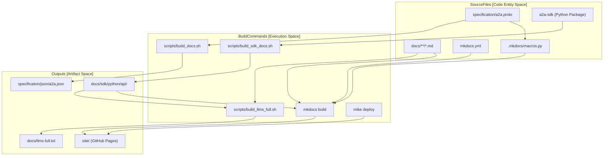
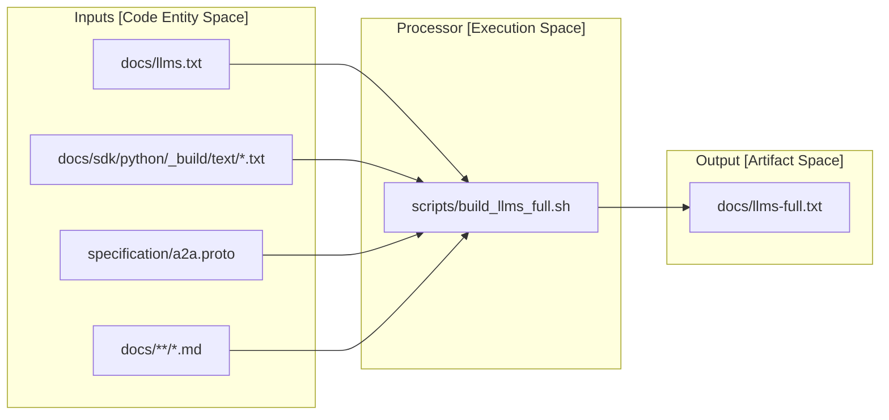

<!-- source: DeepWiki mcp.deepwiki.com · repo a2aproject/A2A · page 4.1 Documentation Build System · fetched 2026-10-21 -->

# Documentation Build System

Relevant source files

The following files were used as context for generating this wiki page:

- [.devcontainer/README.md](.devcontainer/README.md)
- [.devcontainer/devcontainer.json](.devcontainer/devcontainer.json)
- [.devcontainer/setup.sh](.devcontainer/setup.sh)
- [.gitattributes](.gitattributes)
- [.github/actions/spelling/allow.txt](.github/actions/spelling/allow.txt)
- [.github/actions/spelling/expect.txt](.github/actions/spelling/expect.txt)
- [.github/linters/.protolint.yaml](.github/linters/.protolint.yaml)
- [.mkdocs/macros.py](.mkdocs/macros.py)
- [.mkdocs/overrides/main.html](.mkdocs/overrides/main.html)
- [docs/javascripts/hero-tagline-carousel.js](docs/javascripts/hero-tagline-carousel.js)
- [docs/llms.txt](docs/llms.txt)
- [docs/stylesheets/custom.css](docs/stylesheets/custom.css)
- [mkdocs.yml](mkdocs.yml)
- [scripts/build_llms_full.sh](scripts/build_llms_full.sh)
- [scripts/build_sdk_docs.sh](scripts/build_sdk_docs.sh)
- [scripts/deploy_root_files.sh](scripts/deploy_root_files.sh)
- [scripts/format.sh](scripts/format.sh)
- [scripts/sort_spelling.sh](scripts/sort_spelling.sh)

The A2A Protocol documentation build system is a multi-stage automated pipeline designed to integrate normative protocol specifications, source code API references, and conceptual user guides into a unified, versioned documentation site hosted at `a2a-protocol.org`.

## Overview

The documentation system leverages MkDocs with the Material theme as its primary site generator, utilizing `mike` for multi-version documentation management. It dynamically processes Markdown documentation, compiles Python SDK API references via Sphinx, extracts protocol definitions using custom macros, and aggregates content into an LLM-optimized consumption file.

The core components of the build architecture include:
- **MkDocs Material**: Primary static site renderer configured via `mkdocs.yml` [mkdocs.yml:1-82]().
- **mike**: Version management utility handling `dev`, `latest`, and release-tagged documentation branches [mkdocs.yml:127-128]().
- **Sphinx (`sphinx-build`)**: Generates Python SDK documentation from package docstrings [scripts/build_sdk_docs.sh:44-49]().
- **MkDocs Macros**: A custom Python implementation in `.mkdocs/macros.py` that parses `specification/a2a.proto` to generate live specification tables [,.mkdocs/macros.py:1-63]().

Sources: [mkdocs.yml:1-129](), [.mkdocs/macros.py:1-63](), [scripts/build_sdk_docs.sh:41-49]()

## Build System Architecture

The documentation pipeline adopts a hybrid build strategy where `mkdocs build` orchestrates the final site generation, driven by supporting execution scripts that prepare protocol schemas, SDK references, and consolidated artifacts.

*Figure 1: Documentation Build System Architecture mapping source entities and scripts to generated outputs.*

Sources: [scripts/build_sdk_docs.sh:51-58](), [scripts/build_llms_full.sh:16-22](), [.mkdocs/macros.py:51-64](), [mkdocs.yml:1-205]()

## MkDocs Configuration and Theme Overrides

The `mkdocs.yml` file configures the entire site layout, navigation menus, Markdown extensions, and third-party plugins [mkdocs.yml:1-191]().

### Configuration Parameters
- **Metadata**: Defines `site_name` ("A2A Protocol"), `site_url`, and `site_description` [mkdocs.yml:2-6]().
- **Navigation (`nav`)**: Explicitly controls the site hierarchy, pointing to conceptual guides, extension governance, specifications, and tutorials [mkdocs.yml:21-63]().
- **Theme Settings**: Utilizes the `material` theme with custom font families ("Google Sans" for text, "Roboto Mono" for code) and an indigo palette scheme [mkdocs.yml:81-108]().
- **Markdown Extensions**: Enables advanced processing via `pymdownx.superfences` (for Mermaid diagrams), `pymdownx.snippets`, `pymdownx.tabbed`, and `attr_list` [mkdocs.yml:131-162]().
- **Plugins**: Integrates the `blog` plugin, `search`, `redirects` (mapping deprecated paths to current locations), and `macros` [mkdocs.yml:164-191]().

### Theme Overrides & Custom Macros
- **Announcement Banner**: `.mkdocs/overrides/main.html` extends the base Material theme to insert custom banner notifications [.mkdocs/overrides/main.html:1-15]().
- **Specification Macros**: `.mkdocs/macros.py` defines functions such as `proto_to_table`, `proto_enum_to_table`, and `proto_service_to_table` which parse `specification/a2a.proto` at build time into Markdown tables [.mkdocs/macros.py:61-187]().

Sources: [mkdocs.yml:1-191](), [.mkdocs/overrides/main.html:1-15](), [.mkdocs/macros.py:61-187]()

## SDK Documentation Generation

Python SDK documentation is built via `scripts/build_sdk_docs.sh`, which extracts API references from docstrings [scripts/build_sdk_docs.sh:1-68]().

### Execution Flow
1. **Virtual Environment**: Creates and activates an isolated environment using `uv` [scripts/build_sdk_docs.sh:14-18]().
2. **Dependency Installation**: Installs requirements from `requirements-docs.txt` and the `a2a-sdk` package from PyPI [scripts/build_sdk_docs.sh:20-26]().
3. **API Discovery (`sphinx-apidoc`)**: Scans the installed package path to generate `.rst` source files under `docs/sdk/python` [scripts/build_sdk_docs.sh:31-39]().
4. **Documentation Compilation (`sphinx-build`)**: Compiles target files into both HTML and plain text formats [scripts/build_sdk_docs.sh:41-49]().
5. **Integration**: Moves compiled HTML output to `docs/sdk/python/api/` for inclusion in the MkDocs site [scripts/build_sdk_docs.sh:51-58]().

Sources: [scripts/build_sdk_docs.sh:1-68]()

## LLM Consolidation (`llms-full.txt`)

To support AI agent workflows and large language model consumption, `scripts/build_llms_full.sh` consolidates documentation and specifications into a single file [scripts/build_llms_full.sh:1-118]().

*Figure 2: LLM Consolidation Pipeline aggregating markdown files, SDK text documentation, and protocol definitions.*

### Consolidation Steps
- Prepends `docs/llms.txt` as a high-level project summary [scripts/build_llms_full.sh:34-44]().
- Recursively gathers all Markdown and reStructuredText documentation from `docs/` (excluding temporary build paths) [scripts/build_llms_full.sh:72-79]().
- Appends Sphinx-generated text documentation and the normative `specification/a2a.proto` file [scripts/build_llms_full.sh:81-91]().
- Wraps individual file contents inside XML-style `<file path="...">` tags [scripts/build_llms_full.sh:47-61]().

Sources: [scripts/build_llms_full.sh:1-118](), [docs/llms.txt:1-21]()

## Deployment and Versioning

Documentation deployment is managed via GitHub Actions and versioning tools.

- **mike Version Management**: Maintains multiple versions on the `gh-pages` branch, providing an alias structure (`dev`, `latest`, and release tags like `v1.0.0`) [mkdocs.yml:127-128]()
- **Root File Deployment**: `scripts/deploy_root_files.sh` handles publishing root-level static files (`404.html`, `robots.txt`, `llms-full.txt`, and redirect directories) directly to the root of the `gh-pages` branch [scripts/deploy_root_files.sh:16-20](), [scripts/deploy_root_files.sh:58-69]().

Sources: [scripts/deploy_root_files.sh:1-88](), [mkdocs.yml:127-128]()

## Reproducible Local Builds

Local builds are standardized through the repository devcontainer configuration `.devcontainer/devcontainer.json`, ensuring developers work within an environment containing Python 3.13, Go 1.25, `uv`, `protoc`, and `buf` CLI tools matching the CI verification workflows.

Sources: [.devcontainer/devcontainer.json:1-33]()

---

