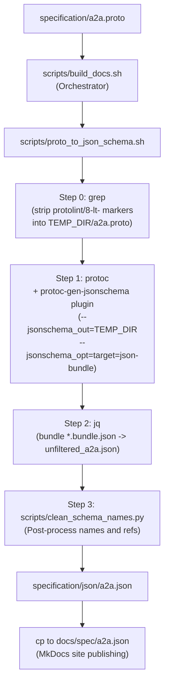
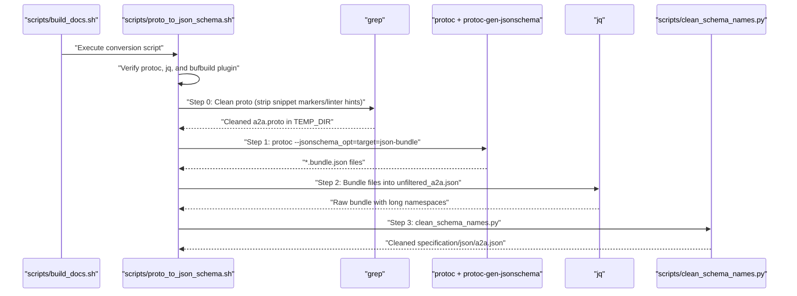

<!-- source: DeepWiki mcp.deepwiki.com · repo a2aproject/A2A · page 4.2 Schema Generation Pipeline · fetched 2026-10-21 -->

# Schema Generation Pipeline

Relevant source files

The following files were used as context for generating this wiki page:

- [.gitignore](.gitignore)
- [docs/sdk/python.md](docs/sdk/python.md)
- [scripts/build_docs.sh](scripts/build_docs.sh)
- [scripts/clean_schema_names.py](scripts/clean_schema_names.py)
- [scripts/proto_to_json_schema.sh](scripts/proto_to_json_schema.sh)
- [specification/buf.gen.yaml](specification/buf.gen.yaml)
- [specification/json/README.md](specification/json/README.md)

This page covers the automated pipeline that converts `specification/a2a.proto` into a non-normative JSON Schema artifact (`a2a.json`). It describes the tools involved, the step-by-step transformation, why the artifact is excluded from version control, and how to reproduce it locally.

For the documentation build system that *uses* this artifact (MkDocs, macros, mike), see [4.1 Documentation Build System](). For the proto specification itself and its normative status, see [6.1 Specification Artifacts]().

---

## Overview

The A2A protocol's canonical type definitions live in `specification/a2a.proto` [specification/json/README.md:3](). To make these definitions consumable by JSON-oriented tooling, a **non-normative JSON Schema 2020-12 bundle** is generated as a build artifact [specification/json/README.md:1-10](). This artifact is intentionally not committed to source control; it is regenerated on demand during documentation builds to ensure it never goes out of sync with the source of truth [specification/json/README.md:3-10]().

| Property | Value |
|---|---|
| Source | `specification/a2a.proto` [specification/json/README.md:3]() |
| Output | `specification/json/a2a.json` (intermediate) [specification/json/README.md:9]() |
| Published path | `docs/spec/a2a.json` (site only) [scripts/build_docs.sh:12]() |
| Schema dialect | JSON Schema 2020-12 bundle [specification/json/README.md:8]() |
| Normative status | **Non-normative** — `a2a.proto` is the source of truth [specification/json/README.md:3]() |
| Committed to git | No — explicitly excluded via `.gitignore` [specification/json/README.md:9-10]() |

Sources: [specification/json/README.md:1-10](), [scripts/build_docs.sh:12](), [.gitignore:9-10]()

---

## Pipeline Architecture

The pipeline is orchestrated by build scripts that ensure the JSON representation remains synchronized with the Protobuf source. The generation is integrated into the documentation workflow, triggered by changes to the protocol definition [specification/json/README.md:12-14]().

**Schema Generation Pipeline — Files and Tools**

Sources: [scripts/proto_to_json_schema.sh:71-126](), [specification/json/README.md:5-15]()

---

## Tool Dependencies

The pipeline requires several external tools. The `scripts/proto_to_json_schema.sh` script validates these before proceeding via the `check_command` helper [scripts/proto_to_json_schema.sh:17-27]().

| Tool | Role | Source |
|---|---|---|
| `protoc` | Protocol Buffer compiler | [protobuf.dev](https://protobuf.dev) |
| `protoc-gen-jsonschema` | `protoc` plugin that emits JSON Schema | `github.com/bufbuild/protoschema-plugins` — **must be the bufbuild implementation** [scripts/proto_to_json_schema.sh:32-40]() |
| `jq` | JSON processor used for bundling | `jqlang/jq` — used to reduce individual schemas into a bundle [scripts/proto_to_json_schema.sh:108-118]() |
| `buf` | CLI for managing proto dependencies | `buf.build` — used for setup and dependency management [specification/buf.gen.yaml:1-4]() |
| `python3` | Post-processing engine | Used to execute `clean_schema_names.py` [scripts/proto_to_json_schema.sh:122]() |

The pipeline also requires `google/api/annotations.proto` from the `googleapis` repository to be available on the include path [scripts/proto_to_json_schema.sh:56-69](). This is resolved via the `GOOGLEAPIS_DIR` environment variable, local `third_party` directories, or system include paths [scripts/proto_to_json_schema.sh:48-54]().

Sources: [scripts/proto_to_json_schema.sh:17-69](), [specification/json/README.md:41-70](), [specification/buf.gen.yaml:1-4]()

---

## Step-by-Step Transformation

**Detailed Script Execution Flow**

Sources: [scripts/proto_to_json_schema.sh:71-126](), [specification/json/README.md:5-9]()

### Step 0: Pre-processing
The script uses `grep` to strip documentation-only snippet markers (`// --8<--`) and `protolint` instructions from the `.proto` file before generation [scripts/proto_to_json_schema.sh:71-80](). This ensures the resulting JSON schema is clean and free of documentation-specific metadata.

### Step 1: protoc Invocation
The script runs the compiler with the `protoc-gen-jsonschema` plugin. The `target=json-bundle` option is used to generate individual schema bundles for the messages [scripts/proto_to_json_schema.sh:88-91](). The plugin is verified to be the `bufbuild` version, which outputs a version string starting with `v` (e.g., `v0.5.2`) [scripts/proto_to_json_schema.sh:32-40]().

### Step 2: jq Bundling
The individual `.bundle.json` files are merged into a single `unfiltered_a2a.json` file using a `jq` reduction [scripts/proto_to_json_schema.sh:108-118](). This step consolidates all `$defs` from the generated files into one object and sets the top-level schema metadata [scripts/proto_to_json_schema.sh:110-117]().

### Step 3: Name Cleaning
The raw bundle contains fully-qualified Protobuf names (e.g., `lf.a2a.v1.Task`). The `scripts/clean_schema_names.py` script performs three critical tasks:
1.  **Namespace Stripping**: It removes prefixes like `lf.a2a.v1.` and `google.protobuf.` from definition names via the `clean_name` function [scripts/clean_schema_names.py:5-15]().
2.  **Reference Updating**: The `replace_refs` function recursively updates all `$ref` strings within the schema to match the new shortened names [scripts/clean_schema_names.py:17-36]().
3.  **Draft 2020-12 Compliance**: It strips `$schema` keywords from child definitions in `new_defs` to comply with modern JSON Schema standards [scripts/clean_schema_names.py:58-61]().

Sources: [scripts/proto_to_json_schema.sh:71-126](), [scripts/clean_schema_names.py:5-65]()

---

## Source Control Exclusion

Generated artifacts are excluded from git to prevent stale files from entering the repository and to maintain the "build artifact" status of the JSON schema [specification/json/README.md:3-4](). The `.gitignore` file explicitly lists `specification/json/a2a.json` and `specification/json/*.json` to ensure these files are never committed [.gitignore:9-10]().

Only the source (`specification/a2a.proto`), the generation scripts, and the `specification/json/README.md` documentation file are committed [specification/json/README.md:10]().

Sources: [specification/json/README.md:1-18](), [.gitignore:9-10]()

---

## Local Build Prerequisites Summary

To build the `a2a.json` artifact locally, the following environment setup is required as documented in the artifact's README [specification/json/README.md:20-22]():

| Prerequisite | macOS | Linux (Debian/Ubuntu) | Windows (PowerShell) |
|---|---|---|---|
| `protoc` | `brew install protobuf` [specification/json/README.md:45]() | `apt-get install protobuf-compiler` [specification/json/README.md:51]() | `winget install Google.Protobuf` [specification/json/README.md:113]() |
| `go` | `brew install go` [specification/json/README.md:45]() | `apt-get install golang` [specification/json/README.md:51]() | `winget install GoLang.Go` [specification/json/README.md:123]() |
| `jq` | `brew install jq` [specification/json/README.md:45]() | `apt-get install jq` [specification/json/README.md:51]() | `winget install jqlang.jq` [specification/json/README.md:144]() |
| `googleapis` | `git clone ...` [specification/json/README.md:65]() | `git clone ...` [specification/json/README.md:65]() | `git clone ...` [specification/json/README.md:154]() |

After installing prerequisites, the build is triggered via `./scripts/build_docs.sh` (Unix) or `.\scripts\build_docs.ps1` (Windows) [specification/json/README.md:89-179](). The `scripts/build_docs.sh` script checks if regeneration is needed by comparing modification times of `a2a.proto` and `a2a.json` [scripts/build_docs.sh:16-29]().

Sources: [specification/json/README.md:25-183](), [scripts/build_docs.sh:16-29]()

---

