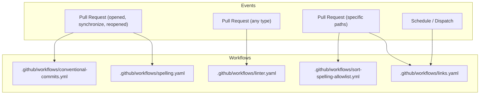
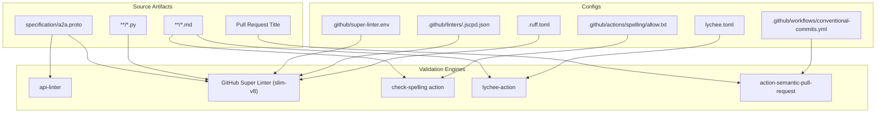

<!-- source: DeepWiki mcp.deepwiki.com · repo a2aproject/A2A · page 4.3 Code Quality & CI Checks · fetched 2026-10-21 -->

# Code Quality & CI Checks

<details>
<summary>Relevant source files</summary>

The following files were used as context for generating this wiki page:

- [.github/linters/.eslintrc.js](.github/linters/.eslintrc.js)
- [.github/linters/.jscpd.json](.github/linters/.jscpd.json)
- [.github/linters/.stylelintrc.json](.github/linters/.stylelintrc.json)
- [.github/super-linter.env](.github/super-linter.env)
- [.github/workflows/docs.yml](.github/workflows/docs.yml)
- [.github/workflows/links.yaml](.github/workflows/links.yaml)
- [.github/workflows/linter.yaml](.github/workflows/linter.yaml)
- [.github/workflows/sort-spelling-allowlist.yml](.github/workflows/sort-spelling-allowlist.yml)
- [.github/workflows/spelling.yaml](.github/workflows/spelling.yaml)
- [.prettierrc](.prettierrc)
- [.ruff.toml](.ruff.toml)
- [docs/partners.md](docs/partners.md)
- [lychee.toml](lychee.toml)
- [scripts/lint.sh](scripts/lint.sh)

</details>


This page documents the multi-layered validation system in the `a2aproject/A2A` repository. The system ensures that the protocol specification, documentation, and supporting scripts maintain high standards through automated linting, API compliance checks, spell checking, and link validation.

For information on the documentation build pipeline, see [4.1](). For the schema generation process, see [4.2](). For cross-repository automation, see [4.4]().

---

## Workflow Architecture

The repository employs several GitHub Actions workflows to enforce quality gates on every pull request and through scheduled scans.

| Workflow File | Purpose | Key Tools |
| :--- | :--- | :--- |
| `.github/workflows/linter.yaml` | General code linting & Protobuf validation | Super Linter, API Linter, `buf` |
| `.github/workflows/spelling.yaml` | Multi-dictionary spell checking | `check-spelling` |
| `.github/workflows/links.yaml` | Validates internal and external links | `lychee` |
| `.github/workflows/conventional-commits.yml` | Validates PR titles against Conventional Commits | `amannn/action-semantic-pull-request` |
| `.github/workflows/sort-spelling-allowlist.yml` | Auto-sorts and commits `allow.txt` | `bash scripts/sort_spelling.sh` |

### Trigger Logic

Title: CI Workflow Triggering Logic


Sources: [.github/workflows/linter.yaml:3-5](), [.github/workflows/spelling.yaml:3-10](), [.github/workflows/links.yaml:3-9](), [.github/workflows/sort-spelling-allowlist.yml:3-10]()

---

## Super Linter Integration

The primary linting engine is the **Super Linter** (slim version), which orchestrates multiple language-specific linters [.github/workflows/linter.yaml:27-30](). Its behavior is controlled via `.github/super-linter.env` [.github/workflows/linter.yaml:22-24]().

### Enabled Linters & Configurations

The following linters are active within the Super Linter environment:

*   **Python**: Validated by `RUFF`. The configuration in `.ruff.toml` follows the Google Python Style Guide, enforcing 80-column lines and 4-space indents [.ruff.toml:8-9](). It selects rules including `E` (pycodestyle), `F` (Pyflakes), `I` (isort), and `D` (pydocstyle) [.ruff.toml:35-39]().
*   **Protobuf**: Validated by `PROTOLINT` [.github/super-linter.env:14]().
*   **Markdown**: Validated by `MARKDOWNLINT` [.github/super-linter.env:13]().
*   **TypeScript/JS**: Validated by `TYPESCRIPT_ES` [.github/super-linter.env:18]().
*   **Security**: `GITLEAKS` is enabled to prevent secret exposure [.github/super-linter.env:10]().
*   **Duplication**: Detected by `JSCPD`, configured via `.github/linters/.jscpd.json` with a duplication threshold of 3% [.github/linters/.jscpd.json:11]().
*   **General Formatting**: `Prettier` configuration in `.prettierrc` defines 2-space tabs for general files and 4-space tabs for Markdown [.prettierrc:1-15]().

### Local Development Workflow
Developers can mirror the CI environment locally using `scripts/lint.sh`. This script executes the same Super Linter Docker image used in GitHub Actions, mounting the local repository root to `/tmp/lint` [.scripts/lint.sh:15-25]().

Sources: [.github/workflows/linter.yaml:22-30](), [.github/linters/.jscpd.json:1-13](), [.ruff.toml:1-58](), [.prettierrc:1-16](), [.github/super-linter.env:1-22](), [.scripts/lint.sh:1-25]()

---

## Protobuf & API Validation

The `api-linter` job in `linter.yaml` provides deep inspection of the protocol definition [.github/workflows/linter.yaml:31-63]().

### API Linter (Google AIP Compliance)
The system uses `api-linter` (v1.67.6) to ensure the protocol adheres to Google API Improvement Proposals (AIPs) [.github/workflows/linter.yaml:53-58]().
*   **Dependencies**: The workflow uses `buf export` to fetch `googleapis` protos into `.googleapis/`, ensuring the linter can resolve standard Google types [.github/workflows/linter.yaml:47-52]().
*   **Execution**: It runs against `specification/a2a.proto` with `--set-exit-status` to fail the CI build if linting errors are found [.github/workflows/linter.yaml:60-63]().

### Structural Validation (buf)
The `buf` CLI is used to manage dependencies and perform structural checks. It updates dependencies (via `buf dep update`) before the linting phase [.github/workflows/linter.yaml:41-50]().

Sources: [.github/workflows/linter.yaml:31-63]()

---

## Link Validation (Lychee)

The `links.yaml` workflow uses `lychee` to ensure all documentation links remain valid [.github/workflows/links.yaml:1-55]().

*   **Configuration**: The `lychee.toml` file specifies `max_concurrency`, `timeout`, accepted HTTP status codes, and a comprehensive list of `exclude` patterns for URLs and paths that should not be checked [.lychee.toml:1-97](). This includes local development URLs, well-known endpoints, self-referential documentation URLs, and sites that frequently timeout or block GitHub Actions IPs (e.g., `w3.org`, `medium.com`, `x.com`, `linkedin.com`, `youtube.com`) [.lychee.toml:14-69](). Specific documentation files like `docs/partners.md` are excluded from path checks due to their dynamic nature or external link volume [.lychee.toml:81]().
*   **Pull Requests**: Lychee runs only on changed files (detected via `tj-actions/changed-files`) to provide fast feedback [.github/workflows/links.yaml:21-58]().
*   **Scheduled Scans**: A full repository scan runs daily at 06:00 UTC [.github/workflows/links.yaml:6-7](). This involves a full documentation build via `scripts/build_docs.sh` before checking the generated `site` directory [.github/workflows/links.yaml:112-123]().
*   **Reporting**: On scheduled failures, the workflow automatically creates or updates a GitHub Issue titled "Link Checker Report" [.github/workflows/links.yaml:128-135](). It also automatically closes the issue if a subsequent daily check passes [.github/workflows/links.yaml:137-152]().

Sources: [.github/workflows/links.yaml:1-152](), [.lychee.toml:1-119]()

---

## Spell Checking System

A2A utilizes a sophisticated spell-checking system that combines standard dictionaries with 40+ specialized technical dictionaries [.github/workflows/spelling.yaml:41-76]().

### Multi-Dictionary Support
The `spelling` job loads dictionaries via `cspell` for various technologies, including:
*   **Cloud & Infrastructure**: `aws`, `k8s`, `terraform` [.github/workflows/spelling.yaml:43,61,75]().
*   **Languages**: `python`, `golang`, `java`, `typescript`, `bash`, `sql`, `node` [.github/workflows/spelling.yaml:44,57,60,64,67,73,76]().
*   **AI/ML Terms**: `data-science-models`, `data-science-tools`, `data-science` [.github/workflows/spelling.yaml:47-49]().
*   **Custom Allow List**: Project-specific terms are maintained in `.github/actions/spelling/allow.txt`. This `allow.txt` file is automatically sorted and committed by the `sort-spelling-allowlist.yml` workflow to maintain consistency [.github/workflows/sort-spelling-allowlist.yml:1-54]().

Sources: [.github/workflows/spelling.yaml:1-79](), [.github/workflows/sort-spelling-allowlist.yml:1-54]()

---

## Conventional Commit Checks

The `conventional-commits.yml` workflow enforces a structured commit message format for Pull Request titles, aligning with the Conventional Commits specification. This ensures clarity in the commit history and facilitates automated changelog generation.

*   **Conditional Validation**: The workflow uses `dorny/paths-filter` to apply different validation rules based on the changed files.
    *   If `docs/specification.md` is modified (and `specification/a2a.proto` is not), the PR title must start with `docs(spec):`.
    *   If `specification/a2a.proto` is modified, the PR title must start with `feat:`, `fix:`, `chore:`, or `refactor:` and explicitly disallow the `spec` scope.
    *   For all other changes (e.g., CI, scripts, general documentation), a broader set of types is allowed, also disallowing the `spec` scope.
*   **Tooling**: The `amannn/action-semantic-pull-request` action is used to perform the validation, checking the PR title against the defined types and scopes.
*   **Guidance**: The Pull Request template explicitly reminds contributors to follow these rules, linking to `CONTRIBUTING.md` for details.

Sources: []()

---

## Data Flow: Code to Validation

This diagram illustrates how code entities and configuration files feed into the validation engines.

Title: Validation Data Flow


Sources: [.github/workflows/linter.yaml:63](), [.github/workflows/spelling.yaml:28-35](), [.github/workflows/links.yaml:55](), [.github/linters/.jscpd.json:1-13](), [.ruff.toml:1-58](), [.lychee.toml:1-119]()

## Code Entity to Validator Mapping

The following diagram bridges the natural language concepts of "Code Quality" to the specific configuration entities and scripts used in the codebase.

Title: Code Entity to Validator Mapping
```mermaid
classDiagram
    class "SuperLinterEnv" {
        VALIDATE_PYTHON_RUFF: true
        VALIDATE_PROTOBUF: true
        VALIDATE_JSCPD: true
        .github/super-linter.env
    }
    class "WorkflowDefinitions" {
        .github/workflows/linter.yaml
        .github/workflows/spelling.yaml
        .github/workflows/links.yaml
        .github/workflows/conventional-commits.yml
        .github/workflows/sort-spelling-allowlist.yml
    }
    class "LocalScripts" {
        scripts/lint.sh
        scripts/build_docs.sh
        scripts/sort_spelling.sh
    }
    class "SpellingConfig" {
        .github/actions/spelling/allow.txt
    }
    class "FormattingTools" {
        .prettierrc
        .ruff.toml
    }
    class "LinkCheckerConfig" {
        lychee.toml
    }
    class "ConventionalCommitConfig" {
        .github/workflows/conventional-commits.yml
    }

    WorkflowDefinitions --> "SuperLinterEnv" : "loads variables"
    WorkflowDefinitions --> "SpellingConfig" : "uses dictionaries"
    FormattingTools --> "FormattingTools" : "references rules"
    WorkflowDefinitions --> "LinkCheckerConfig" : "uses configuration"
    WorkflowDefinitions --> "ConventionalCommitConfig" : "defines rules"
```

Sources: [.github/workflows/linter.yaml:22-24](), [.github/workflows/spelling.yaml:31-41](), [.prettierrc:1-16](), [.ruff.toml:1-58](), [.lychee.toml:1-119]()

---

