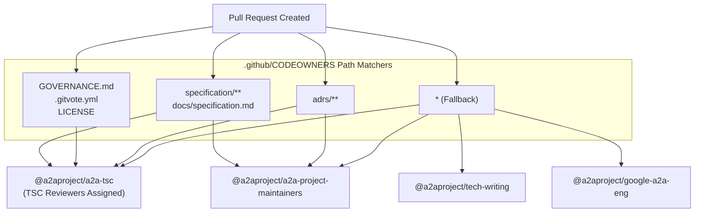
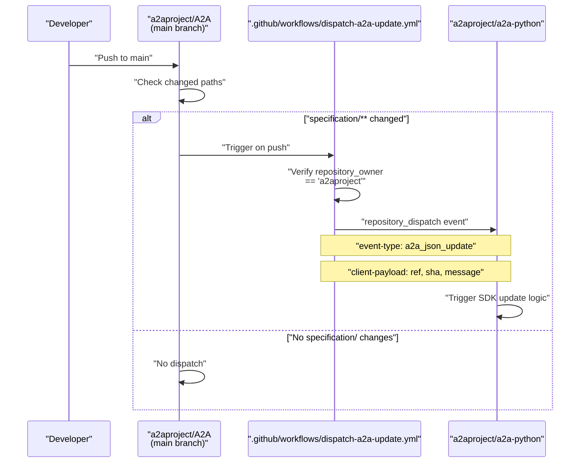
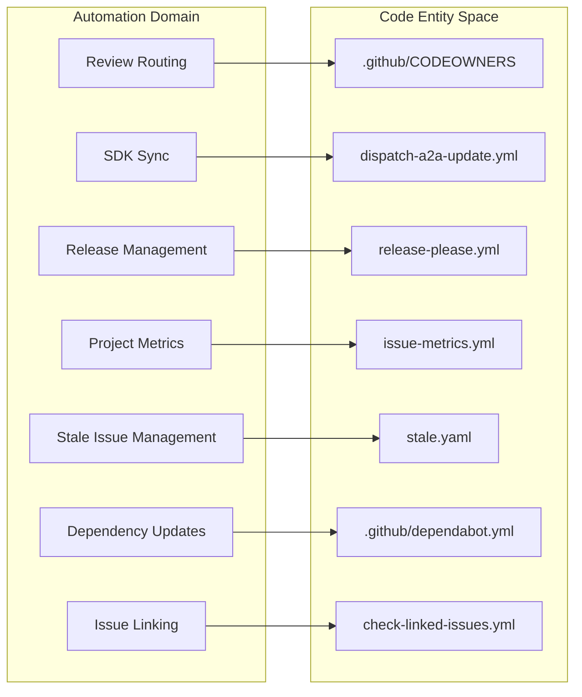

<!-- source: DeepWiki mcp.deepwiki.com · repo a2aproject/A2A · page 4.4 Cross-Repository Automation · fetched 2026-10-21 -->

# Cross-Repository Automation

<details>
<summary>Relevant source files</summary>

The following files were used as context for generating this wiki page:

- [.github/CODEOWNERS](.github/CODEOWNERS)
- [.github/ISSUE_TEMPLATE/bug-report.yml](.github/ISSUE_TEMPLATE/bug-report.yml)
- [.github/ISSUE_TEMPLATE/feature-request.yml](.github/ISSUE_TEMPLATE/feature-request.yml)
- [.github/actions/spelling/advice.md](.github/actions/spelling/advice.md)
- [.github/actions/spelling/excludes.txt](.github/actions/spelling/excludes.txt)
- [.github/actions/spelling/line_forbidden.patterns](.github/actions/spelling/line_forbidden.patterns)
- [.github/dependabot.yml](.github/dependabot.yml)
- [.github/workflows/check-linked-issues.yml](.github/workflows/check-linked-issues.yml)
- [.github/workflows/dispatch-a2a-update.yml](.github/workflows/dispatch-a2a-update.yml)
- [.github/workflows/issue-metrics.yml](.github/workflows/issue-metrics.yml)
- [.github/workflows/release-please.yml](.github/workflows/release-please.yml)
- [.github/workflows/stale.yaml](.github/workflows/stale.yaml)
- [CHANGELOG.md](CHANGELOG.md)

</details>


This page documents the automated systems that maintain code quality, route code reviews, synchronize changes across repositories, manage community health, and automate releases. These systems ensure that specification changes propagate to downstream SDKs, pull requests receive appropriate reviews, and the project maintains a consistent release cadence.

For information about code quality checks (linters, spell checking), see [Code Quality & CI Checks](#4.3). For documentation deployment automation, see [Documentation Build System](#4.1) and [Documentation Versioning & Deployment](#4.5).

Sources: [.github/CODEOWNERS:1-19](), [.github/workflows/dispatch-a2a-update.yml:1-27]()

---

## CODEOWNERS Review Routing

The `CODEOWNERS` system automatically assigns reviewers to pull requests based on file paths. This ensures that changes to critical components, such as the protocol specification or governance documents, receive review from the appropriate leadership.

### Review Assignments

In the A2A repository, the Technical Steering Committee (TSC) maintains oversight over all functional areas.

| Team | Scope | File Paths |
|------|-------|------------|
| `@a2aproject/a2a-tsc` | Global Fallback | `*` [[.github/CODEOWNERS:8]]() |
| `@a2aproject/a2a-tsc` | Core Specification | `specification/`, `docs/specification.md` [[.github/CODEOWNERS:12-13]]() |
| `@a2aproject/a2a-tsc` | ADRs | `adrs/` [[.github/CODEOWNERS:11]]() |
| `@a2aproject/a2a-tsc` | Governance & License | `GOVERNANCE.md`, `.gitvote.yml`, `LICENSE` [[.github/CODEOWNERS:16-18]]() |
| `@a2aproject/a2a-tsc` | Project Configs | `.github/CODEOWNERS` [[.github/CODEOWNERS:19]]() |
| `@a2aproject/tech-writing` | Fallback | `*` [[.github/CODEOWNERS:8]]() |
| `@a2aproject/google-a2a-eng` | Fallback | `*` [[.github/CODEOWNERS:8]]() |
| `@a2aproject/a2a-project-maintainers` | Fallback & Spec | `*`, `specification/`, `adrs/` [[.github/CODEOWNERS:8,11-12]]() |

Sources: [.github/CODEOWNERS:1-19]()

### Review Routing Flow

The following diagram bridges the natural language concepts of review ownership to the code entities defined in `.github/CODEOWNERS`.

Title: "CODEOWNERS Review Assignment Logic"


Sources: [.github/CODEOWNERS:1-19]()

---

## Repository Dispatch System

When specification changes are pushed to the `main` branch, the `dispatch-a2a-update.yml` workflow automatically notifies downstream SDK repositories. This event-driven architecture ensures SDK implementations can detect and respond to protocol updates immediately.

### Dispatch Workflow

Title: "Cross-Repository Specification Update Dispatch"


Sources: [.github/workflows/dispatch-a2a-update.yml:1-27]()

### Trigger Conditions and Payload

The workflow activates when:
1. **Event**: Push to `main` branch [[.github/workflows/dispatch-a2a-update.yml:3-6]]().
2. **Path Filter**: Changes occur within `specification/**/*` [[.github/workflows/dispatch-a2a-update.yml:7-8]]().
3. **Repository Check**: `github.repository_owner == 'a2aproject'` (prevents forks from triggering downstream updates) [[.github/workflows/dispatch-a2a-update.yml:13]]().

The `repository_dispatch` event targets `a2aproject/a2a-python` using a GitHub Personal Access Token (`A2A_BOT_PAT`) with the event type `a2a_json_update` [[.github/workflows/dispatch-a2a-update.yml:17-21]](). It includes a `client-payload` containing the Git `ref`, `sha`, and a commit message [[.github/workflows/dispatch-a2a-update.yml:22-27]]().

Sources: [.github/workflows/dispatch-a2a-update.yml:1-27]()

---

## Release Automation

The project uses `release-please` to automate the generation of `CHANGELOG.md` and the creation of GitHub releases based on Conventional Commits.

### Release Please Workflow

The `release-please.yml` workflow runs on every push to the `main` branch [[.github/workflows/release-please.yml:1-4]](). It uses the `googleapis/release-please-action@v5` with the `release-type: simple` configuration [[.github/workflows/release-please.yml:18-21]]().

1. **Pull Request Creation**: When changes are merged to `main`, the action creates or updates a "Release PR" that aggregates changes into a `CHANGELOG.md` and increments the version [[.github/workflows/release-please.yml:1-22]]().
2. **Release Execution**: Once the Release PR is merged, the action automatically creates a GitHub Release and tags the commit [[.github/workflows/release-please.yml:1-22]]().

Sources: [.github/workflows/release-please.yml:1-21]()

---

## Issue and PR Management

### Monthly Issue Metrics
The `issue-metrics.yml` workflow generates reports on project health. It runs on a schedule (1st of every month at 02:03 UTC) or via manual workflow dispatch [[.github/workflows/issue-metrics.yml:1-5]]().

1. **Date Calculation**: It calculates the range for the previous month using bash [[.github/workflows/issue-metrics.yml:18-29]]().
2. **Search Query**: It queries issues in `a2aproject/A2A` that were created in that range and not closed as "not planned" [[.github/workflows/issue-metrics.yml:31-35]]().
3. **Issue Creation**: It uses `peter-evans/create-issue-from-file@v6` to post the metrics report as a new issue titled "Monthly issue metrics report" [[.github/workflows/issue-metrics.yml:37-43]]().

Sources: [.github/workflows/issue-metrics.yml:1-42]()

### Stale Issue Management
The `stale.yaml` workflow automatically marks and closes issues and pull requests that have been inactive for a specified period [[.github/workflows/stale.yaml:1-7]]().

- **Schedule**: Runs daily at 22:30 UTC [[.github/workflows/stale.yaml:9-11]]().
- **Issue Stale/Close**: Issues are marked stale after 14 days of inactivity with the `status:stale` label and closed after an additional 13 days (total 27 days) [[.github/workflows/stale.yaml:27-32]](). Issues with `status:awaiting response` or `status:more data needed` are targeted [[.github/workflows/stale.yaml:30]]().
- **PR Stale/Close**: Pull requests follow the same 14-day stale and 13-day close schedule [[.github/workflows/stale.yaml:37-45]]().
- **Exemptions**: Issues and PRs with the `override-stale` label are exempt from this process [[.github/workflows/stale.yaml:47-49]]().

Sources: [.github/workflows/stale.yaml:1-49]()

### Linked Issue Enforcement
The `check-linked-issues.yml` workflow ensures that every pull request (excluding releases, dependabot, and release-please branches) is associated with a tracking issue using `nearform-actions/github-action-check-linked-issues@v1` [[.github/workflows/check-linked-issues.yml:1-20]](). The PR template also prompts contributors to link an issue using standard keywords.

Sources: [.github/workflows/check-linked-issues.yml:1-23]()

---

## Dependency Management with Dependabot

Dependabot is configured to automatically check for and update dependencies across different package ecosystems. This helps keep the project secure and up-to-date with the latest versions of its dependencies.

### Dependabot Configuration

The `.github/dependabot.yml` file defines the update schedules and target directories for various ecosystems:

- **npm**: Checks for updates in the `/types` directory monthly [[.github/dependabot.yml:3-10]]().
- **GitHub Actions**: Checks for updates to GitHub Actions used in workflows monthly [[.github/dependabot.yml:11-18]]().
- **pip**: Checks for Python package updates in the root directory monthly [[.github/dependabot.yml:19-26]]().

All updates are grouped to reduce PR noise.

Sources: [.github/dependabot.yml:1-26]()

### Dependabot Workflow

Title: "Dependabot Dependency Update Flow"
```mermaid
graph TD
    A[".github/dependabot.yml"] --> B{Package Ecosystem};
    B -- "npm" --> C[Directory: /types];
    B -- "github-actions" --> D[Directory: /];
    B -- "pip" --> E[Directory: /];

    C --> F[Schedule: Monthly];
    D --> F;
    E --> F;

    F --> G[Dependabot Scans for Updates];
    G --> H{New Versions Found?};
    H -- "Yes" --> I[Create Pull Request(s)];
    H -- "No" --> J[No Action];

    I --> K[Grouped PRs for Review];
```

Sources: [.github/dependabot.yml:1-26]()

---

## Summary of Cross-Repo Components

The following diagram bridges the automation concepts to the specific YAML workflow entities and configuration files that implement them.

Title: "Mapping Automation Concepts to Code Entities"


| Component | Code Entity | Purpose |
|-----------|-------------|---------|
| **Review Routing** | `.github/CODEOWNERS` | Routes PRs to TSC members based on file paths [[.github/CODEOWNERS:1-20]](). |
| **SDK Sync** | `dispatch-a2a-update.yml` | Notifies `a2aproject/a2a-python` of spec changes [[.github/workflows/dispatch-a2a-update.yml:1-28]](). |
| **Release Management** | `release-please.yml` | Automates versioning and CHANGELOG updates [[.github/workflows/release-please.yml:1-22]](). |
| **Metrics** | `issue-metrics.yml` | Generates monthly project health reports [[.github/workflows/issue-metrics.yml:1-43]](). |
| **Stale Issue Management** | `stale.yaml` | Automatically marks and closes inactive issues and PRs [[.github/workflows/stale.yaml:1-50]](). |
| **Dependency Updates** | `.github/dependabot.yml` | Manages automated dependency updates across ecosystems [[.github/dependabot.yml:1-27]](). |
| **Issue Linking** | `check-linked-issues.yml` | Ensures PRs are tied to tracked work [[.github/workflows/check-linked-issues.yml:1-24]](). |

Sources: [.github/CODEOWNERS:1-19](), [.github/workflows/dispatch-a2a-update.yml:1-27](), [.github/workflows/release-please.yml:1-21](), [.github/workflows/issue-metrics.yml:1-42](), [.github/workflows/stale.yaml:1-49](), [.github/dependabot.yml:1-26](), [.github/workflows/check-linked-issues.yml:1-23]()

---

