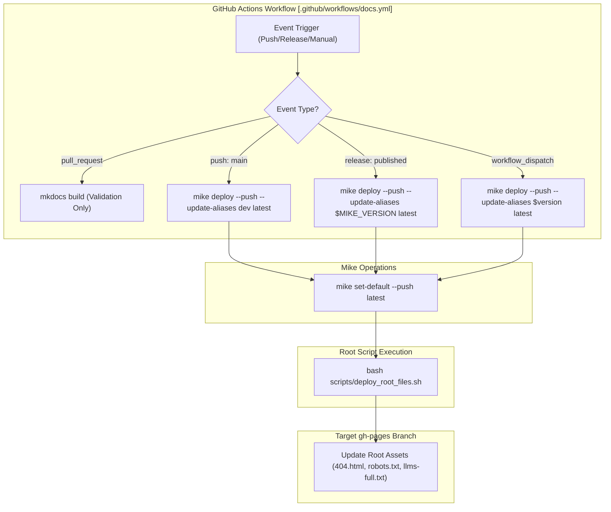
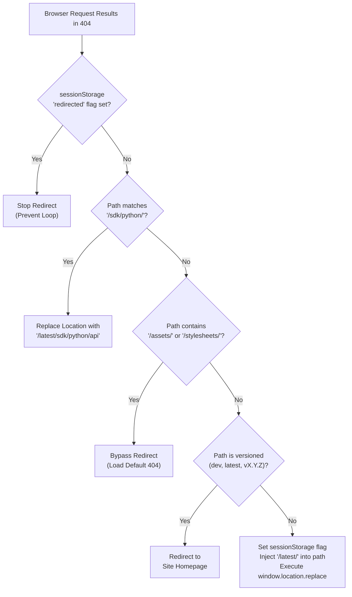

<!-- source: DeepWiki mcp.deepwiki.com · repo a2aproject/A2A · page 4.5 Documentation Versioning & Deployment · fetched 2026-10-21 -->

# Documentation Versioning & Deployment

Relevant source files

The following files were used as context for generating this wiki page:

- [.mkdocs/macros.py](.mkdocs/macros.py)
- [docs/404.html](docs/404.html)
- [docs/README.md](docs/README.md)
- [docs/robots.txt](docs/robots.txt)
- [docs/root-redirects/bindings/index.html](docs/root-redirects/bindings/index.html)
- [docs/root-redirects/extensions/index.html](docs/root-redirects/extensions/index.html)
- [requirements-docs.txt](requirements-docs.txt)
- [scripts/deploy_root_files.sh](scripts/deploy_root_files.sh)

This page documents how the A2A Protocol documentation repository manages versioning, continuous integration, and deployments to GitHub Pages. It covers the `mike` versioning engine, the alias strategy for `dev` and `latest` releases, GitHub Actions event triggers in `.github/workflows/docs.yml`, root file deployment via `scripts/deploy_root_files.sh`, client-side redirect logic in `docs/404.html`, and root redirects for topics like extensions and protocol bindings.

---

## 1. Versioning Model & Mike Configuration

The documentation site uses [mike](https://github.com/jimporter/mike) to publish multiple named versions of the site concurrently to the `gh-pages` branch. Each documentation version is isolated within its own directory path (e.g., `/dev/`, `/latest/`, `/v1.0.0/`).

The `mike` package is specified in the documentation dependencies [requirements-docs.txt:4]() and invoked directly within the GitHub Actions workflow `[.github/workflows/docs.yml:115]()`:

| Alias / Version | Trigger / Event | Description |
|---|---|---|
| `dev` | Every push to `main` branch | Tracks unreleased documentation and staging updates `[.github/workflows/docs.yml:115-115]()`. |
| `latest` | Push to `main`, release publication, or manual dispatch | Points to the stable reference version of the specification `[.github/workflows/docs.yml:115-145]()`. |
| `vX.Y.Z` | GitHub `release` event (`published`) | Immutable documentation snapshot corresponding to a tagged release `[.github/workflows/docs.yml:127-129]()`. |

Sources: `[.github/workflows/docs.yml:112-148]()`, `[requirements-docs.txt:4]()`

---

## 2. GitHub Actions Deployment Workflow

The end-to-end documentation build and deployment pipeline is orchestrated by `.github/workflows/docs.yml`. It guards against unauthorized deployments by enforcing a repository check: `if: github.repository == 'a2aproject/A2A'` `[.github/workflows/docs.yml:45-45]()`.

### Workflow Event Triggers

*   **`push`**: Triggers on pushes to `main` affecting workflow configurations, documentation source files (`docs/**`), `mkdocs.yml`, or `specification/a2a.proto` `[.github/workflows/docs.yml:4-15]()`.
*   **`pull_request`**: Validates the MkDocs build without pushing updates to `gh-pages` `[.github/workflows/docs.yml:16-27]()`.
*   **`release`**: Triggers when a GitHub release is published (`published`), deploying the exact release tag `[.github/workflows/docs.yml:28-30]()`.
*   **`workflow_dispatch`**: Allows manual trigger deployment specifying an input version string `[.github/workflows/docs.yml:31-37]()`.

### Deployment Pipeline Data Flow

The following diagram bridges the workflow system to its internal code entities and scripts:

Title: Documentation Deployment Pipeline

Sources: `[.github/workflows/docs.yml:1-148]()`

---

## 3. Root Files and Redirect Directories Deployment

Because `mike` manages version subdirectories on `gh-pages`, site-wide files (such as the custom 404 handler, crawler rules, and LLM text files) and root redirects must be explicitly synced to the repository root. This is performed by `scripts/deploy_root_files.sh`.

### Managed Root Artifacts

The deployment script copies specific files and directories from the `docs/` source directory to the root of the `gh-pages` branch:

| Asset Type | Source Path | Target Location on `gh-pages` | Purpose |
|---|---|---|---|
| File | `docs/404.html` | `/404.html` | Client-side version redirection and loop detection `[docs/404.html:1-52]()`. |
| File | `docs/robots.txt` | `/robots.txt` | Search engine and AI crawler rules `[docs/robots.txt:1-39]()`. |
| File | `docs/llms.txt` | `/llms.txt` | High-level summary for LLM ingestion `[scripts/deploy_root_files.sh:16-16]()`. |
| File | `docs/llms-full.txt` | `/llms-full.txt` | Consolidated full text documentation `[scripts/deploy_root_files.sh:16-16]()`. |
| Directory | `docs/root-redirects/extensions` | `/extensions/` | Redirects legacy root extension links to `/latest/topics/extensions/` `[docs/root-redirects/extensions/index.html:1-12]()`. |
| Directory | `docs/root-redirects/bindings` | `/bindings/` | Redirects legacy root binding links to `/latest/topics/custom-protocol-bindings/` `[docs/root-redirects/bindings/index.html:1-12]()`. |

### Execution Mechanism

The script clones a shallow copy of the `gh-pages` branch using a provided `GITHUB_TOKEN`, copies the tracked assets, strips the `root-redirects/` prefix to place folders at the root level, commits modifications if changes are detected, and pushes them back `[scripts/deploy_root_files.sh:37-82]()`.

Sources: `[scripts/deploy_root_files.sh:1-88]()`, `[docs/root-redirects/extensions/index.html:1-12]()`, `[docs/root-redirects/bindings/index.html:1-12]()`

---

## 4. Client-Side 404 Redirect Strategy & Loop Prevention

When users hit missing paths on the documentation domain, `docs/404.html` executes a client-side JavaScript routine to recover valid URLs rather than failing immediately.

### Redirection Logic

1.  **Loop Detection**: Checks `sessionStorage.getItem('redirected')`. If a redirect was already attempted for the current session, it halts to prevent infinite browser redirection loops `[docs/404.html:13-19]()`.
2.  **Sphinx API Mapping**: Intercepts old Python SDK paths (`/sdk/python/`) and re-routes them to the Sphinx API entrypoint `https://a2a-protocol.org/latest/sdk/python/api` `[docs/404.html:21-23]()`.
3.  **Unversioned Path Rewriting**: If a path does not contain a version slug or assets directory, it inserts the `latest` version slug immediately after the base path (`/A2A/specification.md` $\rightarrow$ `/A2A/latest/specification.md`) `[docs/404.html:26-38]()`.

### Redirect Decision Flow

Title: 404 Redirect Decision Flow

Sources: `[docs/404.html:1-52]()`

---

## 5. LLM Crawlers & Content Optimization

To assist generative AI tooling and agent framework developers, the repository provides pre-compiled documentation models at the site root (`llms.txt`, `llms-full.txt`) `[scripts/deploy_root_files.sh:16-16]()`.

The crawler configuration in `docs/robots.txt` explicitly allows access to all paths for major LLM agents and web crawlers (including GPTBot, ClaudeBot, PerplexityBot, and Google-Extended) while pointing automated systems to the versioned sitemap `[docs/robots.txt:1-39]()`.

Sources: `[docs/robots.txt:1-39]()`, `[scripts/deploy_root_files.sh:1-88]()`

---

