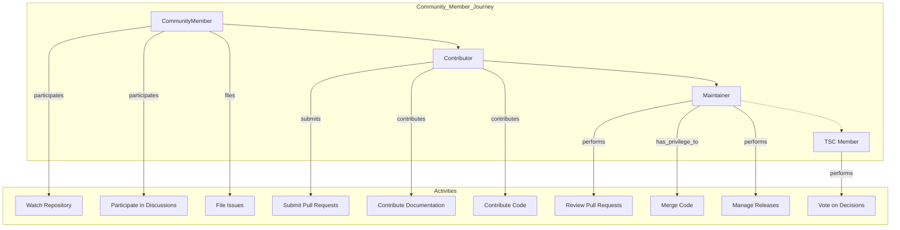
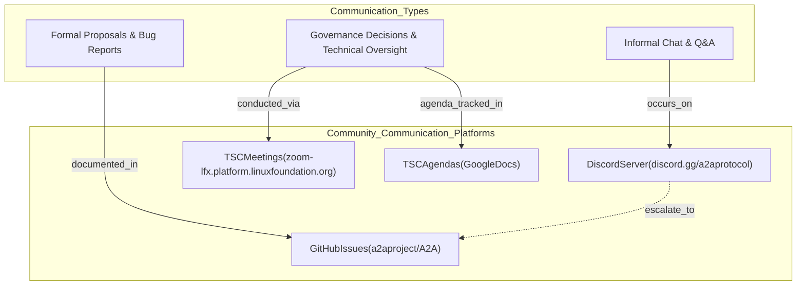
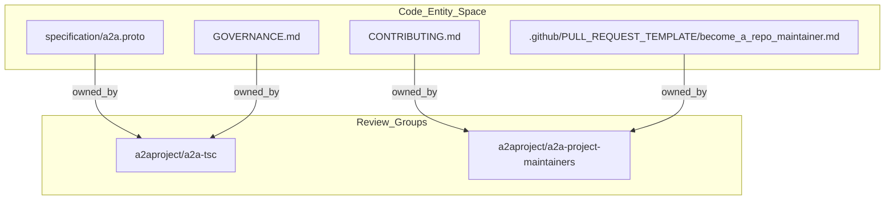

<!-- source: DeepWiki mcp.deepwiki.com · repo a2aproject/A2A · page 5 Community & Governance · fetched 2026-10-21 -->

# Community & Governance

Relevant source files

The following files were used as context for generating this wiki page:

- [.github/PULL_REQUEST_TEMPLATE/become_a_repo_maintainer.md](.github/PULL_REQUEST_TEMPLATE/become_a_repo_maintainer.md)
- [CONTRIBUTING.md](CONTRIBUTING.md)
- [GOVERNANCE.md](GOVERNANCE.md)
- [docs/community.md](docs/community.md)

**Purpose**: This document describes the organizational structure, governance model, and community processes that maintain the A2A Protocol as an open-source project. It covers the Technical Steering Committee (TSC) composition, decision-making procedures, code review workflows, partner ecosystem, and community engagement channels.

**Scope**: This page provides a high-level overview of governance and community structures. For detailed information, see the child pages:
- [Partner Ecosystem & Industry Adoption](#5.1) — Detail the 170+ partners across enterprise, tech platforms, framework providers, and infrastructure vendors as listed in `docs/partners.md`.
- [Governance Structure & TSC](#5.2) — Explain the Technical Steering Committee composition, decision-making processes (consensus/voting with quorum), meeting structure, and the gitvote-based async voting mechanism [GOVERNANCE.md:3-76]().
- [Contributing to A2A](#5.3) — Guide contributors through the workflow: becoming a Contributor, promotion to Maintainer via TSC vote, using GitHub as source of truth, issue/PR templates, and the Code of Conduct [CONTRIBUTING.md:1-117](), [.github/PULL_REQUEST_TEMPLATE/become_a_repo_maintainer.md:1-28]().
- [Community Resources & Support](#5.4) — List community channels (Discord, GitHub Discussions, courses), sample repositories, blog posts, social media presence, and the protocol roadmap [docs/community.md:1-128]().

---

## Community Structure Overview

The A2A project follows a hierarchical community model that balances corporate stewardship with open-source participation. The structure progresses from general community members through contributors to maintainers, with strategic oversight provided by the Technical Steering Committee.

### Community Roles

The project defines three primary community roles in its charter:

| Role | Definition | Responsibilities | How to Attain |
|------|------------|------------------|---------------|
| **Contributors** | Anyone in the technical community that contributes code, documentation, or other technical artifacts | Submit PRs, file issues, participate in discussions | Open to anyone who abides by the terms of this Charter [GOVERNANCE.md:43-49]() |
| **Maintainers** | Contributors who have earned the ability to modify ("commit") source code, documentation or other technical artifacts in a project's repository | Review and merge PRs, manage releases, triage issues | A Contributor may become a Maintainer by a vote of the TSC [GOVERNANCE.md:45-47]() |
| **TSC Members** | Voting members representing founding organizations | Strategic direction, technical oversight, approve maintainers | Appointed by founding companies [GOVERNANCE.md:33-35]() |

Sources: [GOVERNANCE.md:41-49]()

### Community Progression Flow

**Diagram: Community Member Progression**

This progression model ensures quality control while maintaining openness. Any community member can become a Contributor by submitting acceptable contributions, but Maintainer status requires a formal request and TSC approval [GOVERNANCE.md:45-47](), [.github/PULL_REQUEST_TEMPLATE/become_a_repo_maintainer.md:9-13]().

Sources: [GOVERNANCE.md:41-49](), [.github/PULL_REQUEST_TEMPLATE/become_a_repo_maintainer.md:1-28]()

---

## Technical Steering Committee Composition

The TSC comprises eight seats, each held by a representative from a founding company. This multi-company leadership prevents single-vendor control and ensures diverse perspectives in protocol evolution.

### TSC Member Table

The current TSC composition is defined in [GOVERNANCE.md:3-14]():

| Company | Representative | GitHub Handle | Title |
|---------|---------------|---------------|--------|
| **Google** | Todd Segal | [@ToddSegal](https://github.com/ToddSegal) | Distinguished Engineer |
| **Microsoft** | Darrel Miller | [@darrelmiller](https://github.com/darrelmiller) | Partner API Architect |
| **Cisco** | Luca Muscariello | [@muscariello](https://github.com/muscariello) | Distinguished Engineer |
| **Amazon Web Services** | Abhimanyu Siwach | [@siwachabhi](https://github.com/siwachabhi) | Senior Software Engineer |
| **Salesforce** | Stephen Petschulat | [@spetschulatSFDC](https://github.com/spetschulatSFDC) | Principal Architect |
| **ServiceNow** | Sugandh Rakha | [@sugandhrakha](https://github.com/sugandhrakha) | Head of Product (MCP & A2A) |
| **SAP** | Sivakumar N. | [@SivaNSAP](https://github.com/SivaNSAP) | Vice President |
| **IBM** | Stefano Maestri | [@maeste](https://github.com/maeste) | Principal Software Engineer |

Sources: [GOVERNANCE.md:5-14]()

### TSC Responsibilities & Voting

The TSC has broad oversight authority as defined in [GOVERNANCE.md:55-64]():

1. **Technical Direction**: Coordinating the technical direction of the Project [GOVERNANCE.md:56-56]().
2. **Project Approval**: Approving project or system proposals (including, but not limited to, incubation, deprecation, and changes to a subproject's scope) [GOVERNANCE.md:57-57]().
3. **Maintainer Promotion**: Setting requirements for the promotion of Contributors to Maintainer status, as applicable [GOVERNANCE.md:52-52]().
4. **Community Norms**: Establishing community norms, workflows, issuing releases, and security issue reporting policies [GOVERNANCE.md:61-61]().

**Voting Procedures**:
- **Consensus**: The Project aims to operate as a consensus-based community [GOVERNANCE.md:68-68]().
- **Quorum**: Requires at least fifty percent of all voting members of the TSC to be present for meetings [GOVERNANCE.md:70-70]().
- **Decisions**: Decisions by vote at a meeting require a majority vote of those in attendance, provided quorum is met. Decisions made by electronic vote without a meeting require a majority vote of all voting members of the TSC [GOVERNANCE.md:70-72]().

Sources: [GOVERNANCE.md:50-64](), [GOVERNANCE.md:66-72]()

---

## Communication Channels and Decision-Making

The A2A project employs a multi-channel communication strategy that distinguishes between ephemeral discussions and authoritative decisions.

### Communication Channel Architecture

**Diagram: Communication Platform Mapping**

### Communication Guidelines

The governance document establishes clear principles [GOVERNANCE.md:78-82]():

1. **Discord for Chat**: Used for chat conversations. Discussion is encouraged, but chat is considered ephemeral [GOVERNANCE.md:80-80]().
2. **GitHub as Source of Truth**: Significant decisions regarding feature proposals or architecture must be held in GitHub [GOVERNANCE.md:82-82]().
3. **TSC Meetings**: Held on the Linux Foundation's meeting platform; recordings and agendas are public [GOVERNANCE.md:74-76]().

Sources: [GOVERNANCE.md:74-82](), [docs/community.md:5-7]()

---

## Partner Ecosystem & Integrations

The A2A Protocol is supported by a robust ecosystem of enterprise partners and framework integrations.

### Integrated Frameworks
Several major agentic frameworks have built-in A2A integration [docs/community.md:55-71]():
- **Microsoft Semantic Kernel**: Asha Sharma, Head of AI Platform Product at Microsoft, announced on LinkedIn that "Semantic Kernel now speaks A2A," enabling instant, secure interoperability [docs/community.md:48-48]().
- **LangGraph, AG2, BeeAI, CrewAI, Pydantic AI**: Native support for agent-to-agent delegation and communication [docs/community.md:61-69]().

### Community SDKs
Beyond official SDKs, the community maintains implementations in various languages [docs/community.md:73-106]():
- **Rust**: `a2a-rust` ([tomtom215/a2a-rust](https://github.com/tomtom215/a2a-rust)) and `a2a-rs` ([EmilLindfors/a2a-rs](https://github.com/EmilLindfors/a2a-rs)) [docs/community.md:77-87]().
- **Swift**: `A2AClient` ([tolgaki/a2a-client-swift](https://github.com/tolgaki/a2a-client-swift)) [docs/community.md:89-93]().
- **Elixir**: `a2a` ([actioncard/a2a-elixir](https://github.com/actioncard/a2a-elixir)) native OTP implementation [docs/community.md:95-99]().
- **C++**: `a2a-cpp` ([MisterVVP/a2a-cpp](https://github.com/MisterVVP/a2a-cpp)) with TCK conformance [docs/community.md:101-105]().

Sources: [docs/community.md:44-105]()

---

## Repository Maintenance & Quality

The A2A project implements extensive automation to maintain repository health and ensure professional standards.

### Automated Repository Health
- **Linting & Formatting**: Use of `Super Linter` via `scripts/lint.sh` for code quality and `markdownlint` via `scripts/format.sh` for documentation consistency [CONTRIBUTING.md:62-76]().
- **Build System**: A dedicated script `./scripts/build_docs.sh` regenerates JSON schemas from protocol definitions and builds SDK docs [CONTRIBUTING.md:43-48]().
- **Code Ownership**: Precise review routing via `CODEOWNERS` ensures the TSC and maintainers review critical specification and governance changes.

### Code Ownership Structure

**Diagram: Code Ownership and Review Authority**

Sources: [GOVERNANCE.md:30-31](), [CONTRIBUTING.md:41-78](), [.github/PULL_REQUEST_TEMPLATE/become_a_repo_maintainer.md:1-28]()

---

## Summary

The A2A Protocol's community and governance structure balances corporate stewardship with open participation. The multi-company TSC ensures strategic neutrality, while automated workflows and clear conduct standards maintain repository health.

For details on specific governance topics, see:
- [Partner Ecosystem & Industry Adoption](#5.1)
- [Governance Structure & TSC](#5.2)
- [Contributing to A2A](#5.3)
- [Community Resources & Support](#5.4)

---

