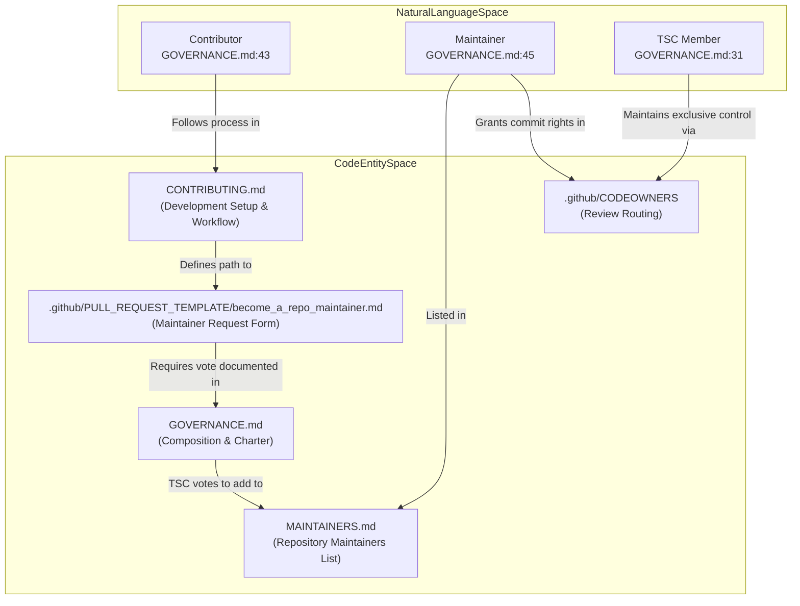
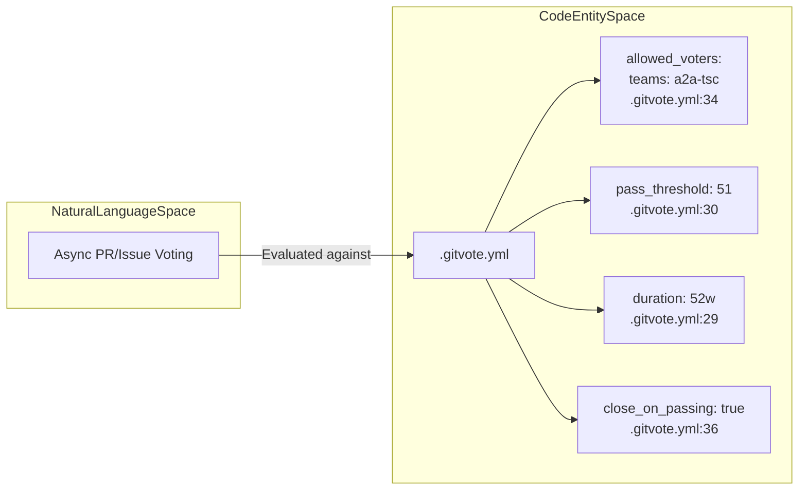

<!-- source: DeepWiki mcp.deepwiki.com · repo a2aproject/A2A · page 5.2 Governance Structure & TSC · fetched 2026-10-21 -->

# Governance Structure & TSC

Relevant source files

The following files were used as context for generating this wiki page:

- [.github/PULL_REQUEST_TEMPLATE/PULL_REQUEST_TEMPLATE.md](.github/PULL_REQUEST_TEMPLATE/PULL_REQUEST_TEMPLATE.md)
- [.github/PULL_REQUEST_TEMPLATE/become_a_repo_maintainer.md](.github/PULL_REQUEST_TEMPLATE/become_a_repo_maintainer.md)
- [.github/workflows/conventional-commits.yml](.github/workflows/conventional-commits.yml)
- [.gitvote.yml](.gitvote.yml)
- [CONTRIBUTING.md](CONTRIBUTING.md)
- [GOVERNANCE.md](GOVERNANCE.md)
- [MAINTAINERS.md](MAINTAINERS.md)

This page describes the formal governance model for the Agent2Agent (A2A) project, including the Technical Steering Committee (TSC) composition, contributor roles, voting procedures, meeting cadence, and how decisions are recorded and enforced through repository code and configuration artifacts.

---

## Project Foundation

The A2A project is governed under the Linux Foundation. The canonical governance document is `GOVERNANCE.md`, which defines the mission and scope of the project.

**Project mission (from [GOVERNANCE.md:18-25]()):**
> The mission of the Project is to help AI agents across different ecosystems communicate with each other.

This mission is pursued through three primary components:
1. The Agent2Agent Protocol (the "Protocol") [[GOVERNANCE.md:20]()].
2. An SDK for designing implementations of the Protocol and related software components [[GOVERNANCE.md:22]()].
3. Documentation and other artifacts related to the Project [[GOVERNANCE.md:24]()].

Sources: [GOVERNANCE.md:1-26]()

---

## TSC Composition

The TSC has **eight seats**, each held by one company. During the "Startup Phase," each organization listed in the governance file has the right to appoint one employee as a voting member [[GOVERNANCE.md:33]()]. The TSC will determine a "Steady State" composition within 18 months of project inception [[GOVERNANCE.md:37]()].

| Company | Representative | Title | GitHub |
|:--- |:--- |:--- |:--- |
| **Google** | Todd Segal | Distinguished Engineer | [@ToddSegal](https://github.com/ToddSegal) |
| **Microsoft** | Darrel Miller | Partner API Architect | [@darrelmiller](https://github.com/darrelmiller) |
| **Cisco** | Luca Muscariello | Distinguished Engineer | [@muscariello](https://github.com/muscariello) |
| **Amazon Web Services** | Abhimanyu Siwach | Senior Software Engineer | [@siwachabhi](https://github.com/siwachabhi) |
| **Salesforce** | Stephen Petschulat | Principal Architect | [@spetschulatSFDC](https://github.com/spetschulatSFDC) |
| **ServiceNow** | Sugandh Rakha | Head of Product (MCP & A2A) | [@sugandhrakha](https://github.com/sugandhrakha) |
| **SAP** | Sivakumar N. | Vice President | [@SivaNSAP](https://github.com/SivaNSAP) |
| **IBM** | Stefano Maestri | Principal Software Engineer | [@maeste](https://github.com/maeste) |

Sources: [GOVERNANCE.md:3-14](), [GOVERNANCE.md:31-39]()

---

## Contributor Roles & Promotion

The project defines primary roles for community participation (`Contributor`, `Maintainer`, and `TSC Voting Member`). The TSC has the authority to adjust these roles or create new ones as needed [[GOVERNANCE.md:53]()]. Promotion to Maintainer status requires a formal TSC vote and submission via `.github/PULL_REQUEST_TEMPLATE/become_a_repo_maintainer.md` [[GOVERNANCE.md:47](), [.github/PULL_REQUEST_TEMPLATE/become_a_repo_maintainer.md:9-11]()].

**Diagram: Role Hierarchy and Code Entity Mapping**

Sources: [GOVERNANCE.md:31-53](), [CONTRIBUTING.md:89-112](), [.github/PULL_REQUEST_TEMPLATE/become_a_repo_maintainer.md:1-28](), [MAINTAINERS.md:1-100]()

---

## Decision-Making & Voting

While the project aims for consensus, formal votes may be called to move the project forward [[GOVERNANCE.md:68]()].

### Voting Thresholds
*   **Quorum:** At least 50% of all voting members must be present for a meeting to make decisions [[GOVERNANCE.md:70]()].
*   **Meeting Vote:** Requires a majority vote of those in attendance (if quorum is met) [[GOVERNANCE.md:70]()].
*   **Electronic Vote:** Requires a majority vote of **all** voting members of the TSC [[GOVERNANCE.md:70]()].
*   **Inactivity:** Members who have not attended a meeting within the last six weeks (tracked via LFX) are deemed inactive and excluded from quorum counts [[GOVERNANCE.md:72]()].

### Async Voting via GitVote
The project utilizes `GitVote` for asynchronous voting on GitHub Pull Requests and Issues. The configuration is defined in `.gitvote.yml` and restricts voting to the `a2a-tsc` team [[.gitvote.yml:34]()].

**Diagram: GitVote Configuration and Automation Data Flow**

Sources: [GOVERNANCE.md:66-73](), [.gitvote.yml:1-39]()

---

## Technical Oversight & Responsibilities

The TSC maintains exclusive ownership over core architectural and governance files as enforced by `.github/CODEOWNERS`. The TSC is responsible for coordinating technical direction, approving project proposals, and organizing subprojects [[GOVERNANCE.md:56-58](), [.github/CODEOWNERS:15-19]()].

**Key Responsibilities of the TSC:**
*   Coordinating technical direction and seeking consensus [[GOVERNANCE.md:56, 63]()].
*   Approving project or system proposals (incubation, deprecation) [[GOVERNANCE.md:57]()].
*   Appointing Maintainers via vote [[GOVERNANCE.md:47]()].
*   Establishing community norms, release policies, and security reporting [[GOVERNANCE.md:61]()].
*   Coordinating marketing and communications [[GOVERNANCE.md:64]()].

Sources: [GOVERNANCE.md:30, 55-64]()

---

## TSC Meetings & Communications

*   **Meeting Platform:** Held on the Linux Foundation's Zoom-LFX platform [[GOVERNANCE.md:75]()].
*   **Agenda:** Maintained in a [public Google Doc](https://docs.google.com/document/d/1Dx6qYfCjSChHKRMwLJcvtDjq6igYTAKFW9Vg1IMPCUk/view) [[GOVERNANCE.md:76]()].
*   **Chat:** Discord is used for community conversations and informal discussion [[CONTRIBUTING.md:115]()].
*   **Public Access:** Meetings are intended to be open to the public and can be conducted electronically [[GOVERNANCE.md:39]()].

Sources: [GOVERNANCE.md:39, 74-81](), [CONTRIBUTING.md:113-117]()

---

