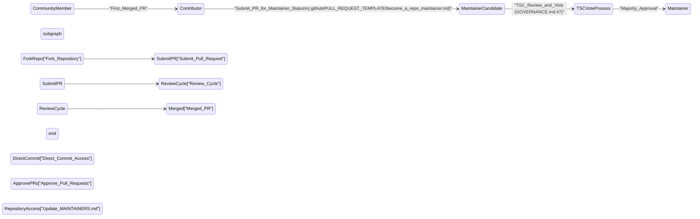
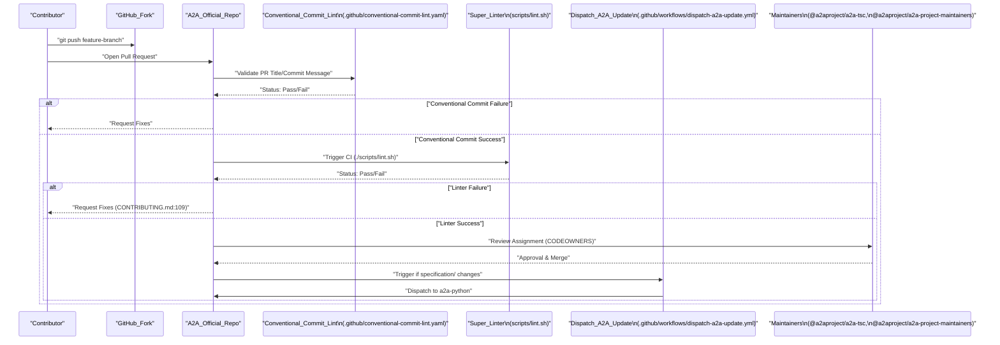

<!-- source: DeepWiki mcp.deepwiki.com · repo a2aproject/A2A · page 5.3 Contributing to A2A · fetched 2026-10-21 -->

# Contributing to A2A

Relevant source files

The following files were used as context for generating this wiki page:

- [.github/CODEOWNERS](.github/CODEOWNERS)
- [.github/ISSUE_TEMPLATE/bug-report.yml](.github/ISSUE_TEMPLATE/bug-report.yml)
- [.github/ISSUE_TEMPLATE/feature-request.yml](.github/ISSUE_TEMPLATE/feature-request.yml)
- [.github/PULL_REQUEST_TEMPLATE/become_a_repo_maintainer.md](.github/PULL_REQUEST_TEMPLATE/become_a_repo_maintainer.md)
- [.github/conventional-commit-lint.yaml](.github/conventional-commit-lint.yaml)
- [.github/workflows/dispatch-a2a-update.yml](.github/workflows/dispatch-a2a-update.yml)
- [CODE_OF_CONDUCT.md](CODE_OF_CONDUCT.md)
- [CONTRIBUTING.md](CONTRIBUTING.md)
- [GOVERNANCE.md](GOVERNANCE.md)

This page guides contributors through the complete workflow of participating in the A2A project, covering the contributor lifecycle, promotion to Maintainer via Technical Steering Committee (TSC) votes, code review workflows using GitHub as the canonical source of truth, automated validation pipelines, issue and PR templates, and adherence to project governance and Code of Conduct policies.

---

## Contributor Roles and Responsibilities

The A2A project establishes distinct participant roles to maintain protocol integrity and code quality. Governance oversight is managed by the TSC [GOVERNANCE.md:28-31]().

### Contributors
**Contributors** comprise anyone in the community contributing code, documentation, or technical artifacts [GOVERNANCE.md:43-44](). Participation is open to all individuals who abide by project standards and charter terms [GOVERNANCE.md:49](). Primary contribution vectors include:
- **Protocol Specification**: Modifying canonical definitions in `specification/a2a.proto` [CONTRIBUTING.md:84-85]().
- **SDK Ecosystem**: Contributing to language-specific repositories (`a2a-python`, `a2a-go`, `a2a-js`, `a2a-java`, `a2a-dotnet`, `a2a-rs`) (Note: The provided `MAINTAINERS.md` does not contain this information, but it is a common pattern for SDKs).
- **Documentation**: Updating guides and architectural references built with MkDocs [CONTRIBUTING.md:18-19]().

### Maintainers
**Maintainers** are contributors granted write access ("commit" permissions) to repository artifacts [GOVERNANCE.md:45]().

**Promotion Path**:
1. **Prerequisites**: Candidates must have at least one merged Pull Request, review `CONTRIBUTING.md`, enable 2FA on GitHub, and join the A2A Discord [.github/PULL_REQUEST_TEMPLATE/become_a_repo_maintainer.md:23-28]().
2. **Request Submission**: Submit a PR utilizing the `.github/PULL_REQUEST_TEMPLATE/become_a_repo_maintainer.md` template to append user credentials and company affiliation to `MAINTAINERS.md` [.github/PULL_REQUEST_TEMPLATE/become_a_repo_maintainer.md:9-21](). (Note: `MAINTAINERS.md` was not provided, but the template implies its existence).
3. **TSC Approval**: Promotion requires formal approval via a majority vote of the TSC [GOVERNANCE.md:47]().

**Diagram 1: Contributor to Maintainer Promotion Path (`GOVERNANCE.md`, `MAINTAINERS.md`)**

Sources: [GOVERNANCE.md:41-53](), [.github/PULL_REQUEST_TEMPLATE/become_a_repo_maintainer.md:1-28](), [CONTRIBUTING.md:93-105]()

---

## Contribution Workflow

### 1. GitHub as Source of Truth
GitHub serves as the canonical platform for code management and technical decision tracking [CONTRIBUTING.md:91-97](). All modifications, including those by core project members, require review via Pull Requests [CONTRIBUTING.md:93-94]().

### 2. Pull Request Lifecycle
Contributors must adhere to the standard development process [CONTRIBUTING.md:98-111]():
1. **Fork and Sync**: Fork the repository and sync local branches with `main` [CONTRIBUTING.md:102-103]().
2. **Environment Setup**: Initialize a virtual environment via `uv venv .doc-venv` and install dependencies [CONTRIBUTING.md:22-39]().
3. **Feature Implementation**: Implement changes on a dedicated branch using conventional commit conventions [CONTRIBUTING.md:78-85]().
4. **Validation**: Run `./scripts/lint.sh` and `./scripts/format.sh` to pass local validation [CONTRIBUTING.md:67](), [CONTRIBUTING.md:75]().
5. **PR Submission**: Open a PR. The project uses various templates, but a general one would be implied for most changes. The `become_a_repo_maintainer.md` template is specific for maintainer requests [.github/PULL_REQUEST_TEMPLATE/become_a_repo_maintainer.md:1-9]().

**Diagram 2: Contribution and CI Validation Pipeline (`conventional-commit-lint.yaml`, `dispatch-a2a-update.yml`)**

Sources: [CONTRIBUTING.md:60-111](), [.github/conventional-commit-lint.yaml:1-2](), [.github/CODEOWNERS:8-19](), [.github/workflows/dispatch-a2a-update.yml:1-27]()

---

## Technical Standards and Automated Checks

### Validation and Linter System
The repository employs strict automated validation rules enforced by GitHub Actions and local script wrappers:
* **Super Linter**: Executes code quality checks across multiple languages via Docker [CONTRIBUTING.md:62-68]().
* **Markdown Formatting**: Managed via `markdownlint` and formatting scripts [CONTRIBUTING.md:72-75]().
* **Semantic Pull Requests**: Validated by `conventional-commit-lint` based on `.github/conventional-commit-lint.yaml` [CONTRIBUTING.md:78-85](), [.github/conventional-commit-lint.yaml:1-2]().

| File Modification Target | Required PR Title Prefix | Enforcement Rule |
| :--- | :--- | :--- |
| `specification/a2a.proto` | `feat:`, `fix:`, `chore:`, `refactor:` | Reserved for protocol definition changes [CONTRIBUTING.md:84-85]() |
| `docs/specification.md` | `docs(spec):` | Specific scope for core specification documentation [CONTRIBUTING.md:81-82]() |
| Other `docs/` files / general | `docs:`, `chore:`, `ci:`, etc. | General documentation or other changes [CONTRIBUTING.md:83]() |

### Documentation Build Pipeline
Documentation rendering and JSON schema generation are automated through build scripts [CONTRIBUTING.md:44-48](). Developers can test documentation locally using `mkdocs serve` [CONTRIBUTING.md:50-54]().
- **Build Script**: `./scripts/build_docs.sh` regenerates schema components and compiles MkDocs targets [CONTRIBUTING.md:44-48]().

Sources: [CONTRIBUTING.md:41-88](), [.github/conventional-commit-lint.yaml:1-2]()

---

## Security and Governance Policies

### Security Vulnerability Reporting
Security issues should be reported in accordance with project guidelines via GitHub Security Advisories or private disclosure channels. Changes affecting specifications require TSC oversight [GOVERNANCE.md:55-64]().

### Code of Conduct and Issue Templates
All participants must abide by the project's [Code of Conduct](CODE_OF_CONDUCT.md) [CODE_OF_CONDUCT.md:1-90](). Bug reports (`.github/ISSUE_TEMPLATE/bug-report.yml`) and feature requests (`.github/ISSUE_TEMPLATE/feature-request.yml`) require explicit agreement to the Code of Conduct [CODE_OF_CONDUCT.md:1-90](), [.github/ISSUE_TEMPLATE/bug-report.yml:26-33](), [.github/ISSUE_TEMPLATE/feature-request.yml:34-41]().
* **Conflict Resolution**: Unresolved disputes or Code of Conduct violations must be reported to the Project Stewards at `a2a-coc@googlegroups.com` [CODE_OF_CONDUCT.md:72]().
* **Enforcement**: Maintainers hold the responsibility and authority to edit, reject, or remove contributions and revoke access for behavior violating project standards [CODE_OF_CONDUCT.md:34-44]().

Sources: [CODE_OF_CONDUCT.md:1-90](), [.github/ISSUE_TEMPLATE/bug-report.yml:1-33](), [.github/ISSUE_TEMPLATE/feature-request.yml:1-41]()

---

