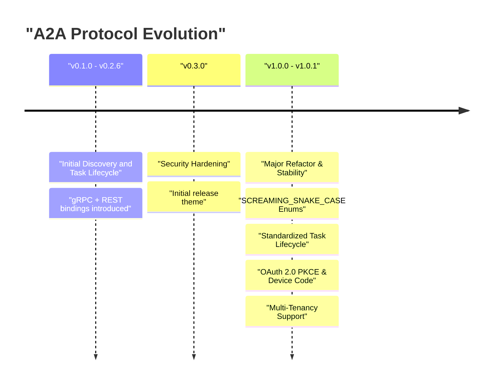

<!-- source: DeepWiki mcp.deepwiki.com · repo a2aproject/A2A · page 6 Technical Reference · fetched 2026-10-21 -->

# Technical Reference

<details>
<summary>Relevant source files</summary>

The following files were used as context for generating this wiki page:

- [docs/topics/multi-tenancy.md](docs/topics/multi-tenancy.md)
- [docs/whats-new-v1.md](docs/whats-new-v1.md)
- [specification/.api-linter.yaml](specification/.api-linter.yaml)
- [specification/a2a.proto](specification/a2a.proto)
- [specification/buf.yaml](specification/buf.yaml)

</details>


This page provides quick-reference documentation for the A2A Protocol's specification artifacts, configuration files, architectural decisions, and version history. It serves as a technical index for developers implementing or extending the protocol.

For protocol semantics and API operations, see [Protocol Specification](#2). For SDK implementation guidance, see [SDK & Implementation Guide](#3). For build system details, see [Development Infrastructure](#4).

---

## Specification Artifacts

The A2A Protocol maintains a three-artifact specification system with a single canonical source of truth and multiple generated artifacts for different consumption contexts. The `specification/a2a.proto` file is the single authoritative normative definition.

### Artifact Generation Pipeline

The following diagram bridges the **Natural Language Space** (Layers of the protocol) to the **Code Entity Space** (Protobuf files and generated artifacts).

```mermaid
graph TB
    subgraph "NaturalLanguageSpace" ["Natural Language Space (Conceptual)"]
        direction TB
        "L1"["Layer 1: Canonical Data Model"]
        "L2"["Layer 2: Abstract Operations"]
        "L3"["Layer 3: Protocol Bindings"]
    end

    subgraph "CodeEntitySpace" ["Code Entity Space (Implementation)"]
        direction TB
        "A2A_PROTO"["specification/a2a.proto<br/>(Normative Source)"]
        "A2A_JSON"["specification/json/a2a.json<br/>(JSON Schema)"]
        
        subgraph "ProtobufEntities" ["Protobuf Entities"]
            "MSG_TASK"["message Task"]
            "MSG_MSG"["message SendMessageConfiguration"]
            "SVC_A2A"["service A2AService"]
        end
    end
    
    "L1" -.-> "MSG_TASK"
    "L1" -.-> "MSG_MSG"
    "L2" -.-> "SVC_A2A"
    
    "A2A_PROTO" -- "protoc / buf" --> "A2A_JSON"
    "A2A_PROTO" -- "defines" --> "ProtobufEntities"
```

**Sources:** [specification/a2a.proto:19-174](), [docs/whats-new-v1.md:9-16]()

### Artifact Registry

| Artifact | Type | Format | Purpose | Generation |
|----------|------|--------|---------|------------|
| `specification/a2a.proto` | Canonical | Protocol Buffers 3 | Authoritative normative definition of all protocol data objects and RPC messages. | Hand-authored [specification/a2a.proto:2-3]() |
| `specification/json/a2a.json` | Generated | JSON Schema | Non-normative build artifact for convenience to tooling and the website. | Generated via `protoc-gen-jsonschema` |
| `docs/definitions.md` | Rendered | Markdown | Human-readable documentation of the protocol types and services. | Rendered via documentation pipeline |

For details, see [Specification Artifacts](#6.1).

**Sources:** [specification/a2a.proto:1-174](), [docs/whats-new-v1.md:9-11]()

---

## Configuration Files Reference

The repository uses multiple configuration files to enforce code quality, protocol compliance, and consistent documentation rendering.

### Protocol & API Validation

- **`buf.yaml`**: Configures the `buf` CLI for linting using `STANDARD` and `COMMENTS` rulesets, and breaking change detection at the `FILE` level [specification/buf.yaml:5-20]().
- **`.api-linter.yaml`**: Configures Google's `api-linter` with specific rule overrides to ensure Protocol Buffer quality, including disabling specific requirements for method signatures and resource annotations to maintain backward compatibility [specification/.api-linter.yaml:4-58]().
- **`.ruff.toml`**: Configures the Ruff linter for Python SDK and script quality.

### Documentation & Tooling

- **`mkdocs.yml`**: The primary configuration for the documentation site, defining the navigation structure and theme.
- **`.devcontainer/devcontainer.json`**: Defines the standardized development environment for contributors.
- **`.vscode/settings.json`**: Standardizes editor behavior for contributors.

For details, see [Configuration Files Reference](#6.2).

**Sources:** [specification/buf.yaml:1-20](), [specification/.api-linter.yaml:1-58](), [specification/a2a.proto:85-88]()

---

## Protocol Version History

The A2A Protocol has evolved from initial drafts to the mature v1.0.0 release and subsequent bug-fix releases, focusing on standardization and enterprise readiness [docs/whats-new-v1.md:1-15](), [CHANGELOG.md:3-10]().

### Evolution Timeline



**Key Changes in v1.0.0+:**
- **Breaking Changes**: Standardized JSON serialization via ProtoJSON and renamed operations for clarity (e.g., `message/send` → `SendMessage`) [docs/whats-new-v1.md:48-57]().
- **Enum Format**: Aligned with ADR-001 using `SCREAMING_SNAKE_CASE` for all enum values in JSON representations [docs/whats-new-v1.md:19-21]().
- **Multi-Tenancy**: Native `tenant` support added to all request messages and `AgentInterface` to specify routing [docs/whats-new-v1.md:169-171](). Clients must echo the `tenant` value in requests [docs/topics/multi-tenancy.md:98-103]().
- **ID Simplification**: Removed complex compound IDs (e.g., `tasks/{id}`) in favor of simple UUIDs [docs/whats-new-v1.md:31-31]().

For details, see [Protocol Version History](#6.3).

**Sources:** [docs/whats-new-v1.md:1-175](), [CHANGELOG.md:1-11](), [specification/a2a.proto:26-28](), [docs/topics/multi-tenancy.md:73-103]()

---

## Architectural Decision Records (ADR)

ADRs capture the "why" behind significant technical choices. They follow a standardized template and are overseen by the Technical Steering Committee (TSC).

### Key Decisions

- **ADR-001: ProtoJSON Serialization**: The TSC decided to use the ProtoJSON specification as the normative approach for JSON serialization. This ensures consistent behavior across HTTP/REST and JSON-RPC bindings but introduced breaking changes to enum casing (switching to `SCREAMING_SNAKE_CASE`).

### Bridge: Decision to Implementation

The following diagram bridges the **Architectural Decisions** to the concrete **Code Entities** affected in the Protobuf specification.

```mermaid
graph LR
    subgraph "DecisionSpace" ["Architectural Decisions"]
        "ADR_001"["ADR-001: ProtoJSON"]
    end

    subgraph "CodeEntitySpace" ["Code Entity Space"]
        "ENUM_VAL"["SCREAMING_SNAKE_CASE Enums"]
        "RPC_DEF"["rpc SendMessage(SendMessageRequest)<br/>returns (SendMessageResponse)"]
    end

    "ADR_001" -- "Enforces naming on" --> "ENUM_VAL"
    "ADR_001" -- "Defines JSON Mapping for" --> "RPC_DEF"
```

For details, see [Architectural Decision Records](#6.4).

**Sources:** [specification/a2a.proto:19-174](), [docs/whats-new-v1.md:19-21]()

---

