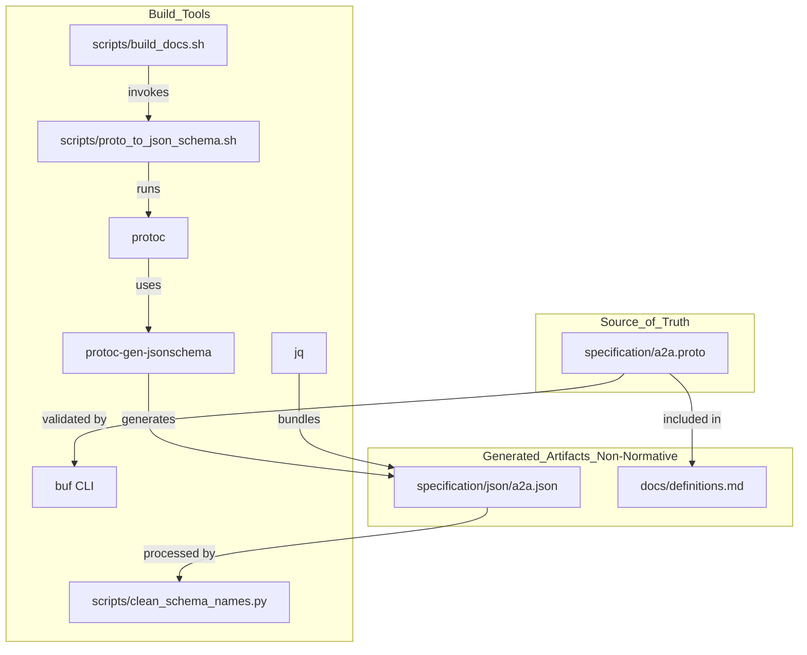
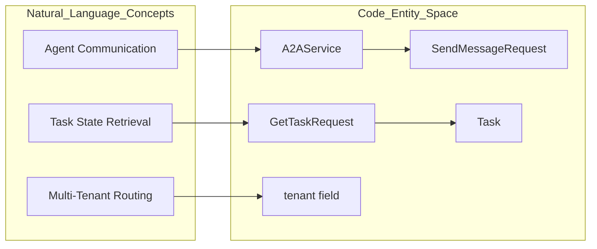

<!-- source: DeepWiki mcp.deepwiki.com · repo a2aproject/A2A · page 6.1 Specification Artifacts · fetched 2026-10-21 -->

# Specification Artifacts

Relevant source files

The following files were used as context for generating this wiki page:

- [docs/definitions.md](docs/definitions.md)
- [docs/topics/multi-tenancy.md](docs/topics/multi-tenancy.md)
- [docs/whats-new-v1.md](docs/whats-new-v1.md)
- [specification/.api-linter.yaml](specification/.api-linter.yaml)
- [specification/a2a.proto](specification/a2a.proto)
- [specification/buf.lock](specification/buf.lock)
- [specification/buf.yaml](specification/buf.yaml)

This page documents the canonical A2A Protocol specification files and their generated artifacts, including their relationships, build dependencies, and normative status. The repository follows a "Source of Truth" pattern where all technical definitions originate from a single Protocol Buffer file.

---

## Artifact Architecture & Pipeline

The A2A Protocol maintains a strict hierarchy where a single canonical Protocol Buffer definition (`specification/a2a.proto`) serves as the source of truth, from which language-specific bindings, JSON schemas, and rendered documentation are generated.

Title: "A2A Specification Artifact Flow"

Sources: [specification/a2a.proto:1-17](), [scripts/proto_to_json_schema.sh:1-40]()

---

## Canonical Source of Truth (`specification/a2a.proto`)

The Protocol Buffer definition at [specification/a2a.proto:1-17]() is the single authoritative normative definition of all protocol data objects and request/response messages. The v1.0 release elevated this file to be the universal source of truth across gRPC, JSON-RPC, and REST bindings [docs/whats-new-v1.md:9-11]().

The file defines the `A2AService` interface containing RPC methods like `SendMessage`, `GetTask`, `ListTasks`, `CancelTask`, and `SubscribeToTask`, along with core data models like `Task`, `Message`, and `SendMessageConfiguration` [specification/a2a.proto:19-174](). Multi-tenancy routing is natively supported via the `tenant` field present in request messages [docs/whats-new-v1.md:168-169](), [docs/topics/multi-tenancy.md:73-83]().

Title: "Protocol Service and Data Model Mapping"

Sources: [specification/a2a.proto:19-53](), [specification/a2a.proto:167-174](), [docs/topics/multi-tenancy.md:73-83]()

---

## Generated JSON Schema Artifact (`specification/json/a2a.json`)

The JSON Schema file `specification/json/a2a.json` is a non-normative, ephemeral build artifact derived from the canonical proto definition. It is generated during builds and is intentionally excluded from version control.

### Generation and Post-Processing Pipeline

The generation is orchestrated by `scripts/proto_to_json_schema.sh`, which performs the following steps:
1. **Dependency Checks:** Verifies the presence of `protoc`, `jq`, and the `protoc-gen-jsonschema` plugin from `github.com/bufbuild/protoschema-plugins` [scripts/proto_to_json_schema.sh:25-40]().
2. **Comment Pre-processing:** Strips internal linting directives and build tags from `specification/a2a.proto` [scripts/proto_to_json_schema.sh:71-80]().
3. **Schema Compilation:** Invokes `protoc` with `--jsonschema_out` to target a JSON schema bundle [scripts/proto_to_json_schema.sh:86-94]().
4. **Bundling:** Uses `jq` to aggregate schemas into a single Draft 2020-12 bundle [scripts/proto_to_json_schema.sh:106-118](), [docs/definitions.md:20-20]().
5. **Name Refinement:** Executes `scripts/clean_schema_names.py` to strip namespace prefixes (`lf.a2a.v1.` and `google.protobuf.`) and update internal `$ref` pointers [scripts/clean_schema_names.py:5-36]().

Sources: [scripts/proto_to_json_schema.sh:1-126](), [docs/definitions.md:18-31]()

---

## Rendered Protocol Definition (`docs/definitions.md`)

The file `docs/definitions.md` acts as the rendered protocol definition page within the documentation site [docs/definitions.md:1-2](). It uses MkDocs snippet syntax (`--8<--`) to embed both the normative `a2a.proto` source and the generated `a2a.json` schema directly into tabbed interface views [docs/definitions.md:3-31]().

Sources: [docs/definitions.md:1-31]()

---

## Build Dependencies and Configuration

Maintaining consistency across specification artifacts relies on several configuration files and environment prerequisites:
- **`specification/buf.yaml`:** Defines Buf registry dependencies (such as `buf.build/googleapis/googleapis`) and enables standard linting rules [specification/buf.yaml:1-10]().
- **`specification/.api-linter.yaml`:** Configures API linter rule exemptions for AIP compliance [specification/.api-linter.yaml:1-22]().
- **`GOOGLEAPIS_DIR`:** An environment variable pointing to the `googleapis` package required by `protoc` to resolve Google API annotations (`google/api/annotations.proto`) [scripts/proto_to_json_schema.sh:15-16]().

Sources: [specification/buf.yaml:1-20](), [specification/.api-linter.yaml:1-22](), [scripts/proto_to_json_schema.sh:15-69]()

---

