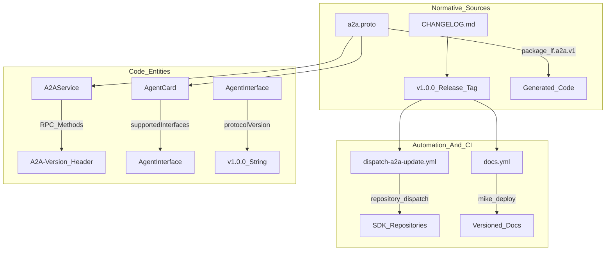
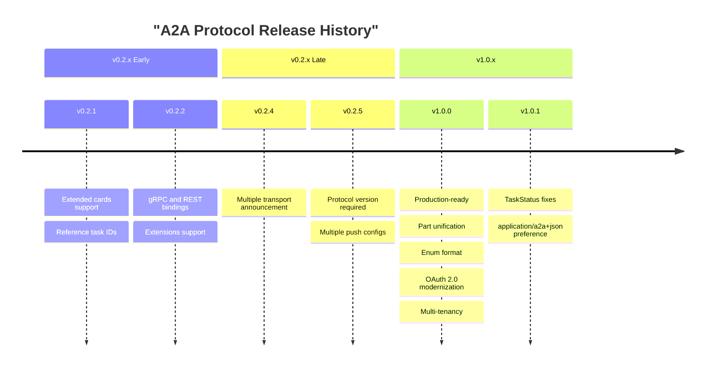
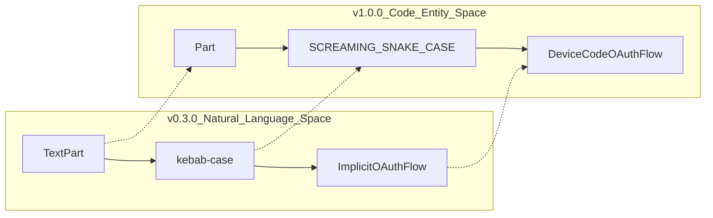
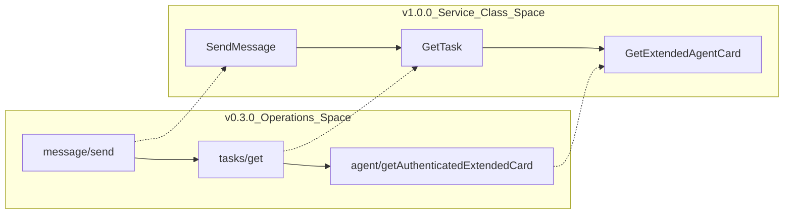

<!-- source: DeepWiki mcp.deepwiki.com · repo a2aproject/A2A · page 6.3 Protocol Version History · fetched 2026-10-21 -->

# Protocol Version History

Relevant source files

The following files were used as context for generating this wiki page:

- [.git-blame-ignore-revs](.git-blame-ignore-revs)
- [.github/actions/spelling/advice.md](.github/actions/spelling/advice.md)
- [.github/actions/spelling/excludes.txt](.github/actions/spelling/excludes.txt)
- [.github/actions/spelling/line_forbidden.patterns](.github/actions/spelling/line_forbidden.patterns)
- [.github/workflows/stale.yaml](.github/workflows/stale.yaml)
- [CHANGELOG.md](CHANGELOG.md)
- [docs/topics/multi-tenancy.md](docs/topics/multi-tenancy.md)
- [docs/whats-new-v1.md](docs/whats-new-v1.md)
- [specification/.api-linter.yaml](specification/.api-linter.yaml)
- [specification/a2a.proto](specification/a2a.proto)
- [specification/buf.yaml](specification/buf.yaml)

This page documents the evolution of the A2A Protocol from v0.2.1 through the production-ready v1.0.1 release. It tracks the transformation of the protocol from an early-stage specification into a stable, enterprise-ready standard governed by a Technical Steering Committee (TSC) representing eight major technology companies: Google, Microsoft, Cisco, AWS, Salesforce, ServiceNow, SAP, and IBM [docs/whats-new-v1.md:7-16]().

The canonical source of version information is maintained in [CHANGELOG.md:1-59]().

Sources: [CHANGELOG.md:1-59](), [docs/whats-new-v1.md:7-16]()

## Version Management System

The A2A project utilizes a multi-layered versioning strategy where `specification/a2a.proto` serves as the universal, normative source of truth [docs/whats-new-v1.md:11-12](). Versioning is managed through the `package` definition and explicit fields within the discovery mechanism [CHANGELOG.md:20](), [docs/whats-new-v1.md:32-33]().

### Version Information Flow

The following diagram illustrates how versioning information propagates from the core specification to downstream artifacts and documentation.

**Title: Protocol Version Propagation**

Sources: [CHANGELOG.md:3-11](), [CHANGELOG.md:20](), [docs/whats-new-v1.md:128-129](), [specification/a2a.proto:3-3]()

## Release Timeline

The protocol evolved through rapid iterations in the v0.2.x and v0.3.x series before stabilizing at v1.0.0 to meet enterprise requirements for trust and scale [docs/whats-new-v1.md:7-16]().

Sources: [CHANGELOG.md:1-59](), [docs/whats-new-v1.md:1-42]()

## Version Details

### Version 1.0.1 (2026-05-26)

**Status:** Current Maintenance Release

*   **HTTP Binding:** The specification now explicitly prefers `application/a2a+json` for communication in the HTTP binding [CHANGELOG.md:8]().
*   **Specification Refinements:** Addressed `TaskStatus` values in the specification and integrated recent transcoding-related error changes [CHANGELOG.md:9-10]().

Sources: [CHANGELOG.md:3-11]()

### Version 1.0.0 (2026-03-12)

**Status:** Production-Ready Stable Release

Version 1.0.0 represents a significant maturation of the protocol, focusing on standardization, type safety, and enterprise features like multi-tenancy and signed discovery [docs/whats-new-v1.md:1-42]().

#### Breaking Changes

*   **Part Type Unification:** `TextPart`, `FilePart`, and `DataPart` were flattened into a single `Part` message to simplify implementation and reduce complexity [CHANGELOG.md:58]().
*   **Enum Formatting:** Enum values were aligned with the ADR-001 ProtoJSON specification for consistent serialization (e.g., `SCREAMING_SNAKE_CASE`), ensuring uniform behavior across bindings [CHANGELOG.md:23](), [docs/whats-new-v1.md:20]().
*   **Package Naming:** Added the `lf.` (Linux Foundation) prefix to the protocol package: `package lf.a2a.v1` [CHANGELOG.md:20](), [specification/a2a.proto:3-3]().
*   **AgentCard Restructuring:**
    *   `protocolVersion` moved from `AgentCard` to individual `AgentInterface` objects to support version negotiation [docs/whats-new-v1.md:127-129]().
    *   `supportsAuthenticatedExtendedCard` renamed to `supportsExtendedAgentCard` [CHANGELOG.md:30]().
    *   `extendedAgentCard` field moved to `AgentCapabilities` [CHANGELOG.md:25]().
*   **OAuth 2.0 Modernization:** Removed insecure implicit and password flows; added native support for `DeviceCodeOAuthFlow` and PKCE to align with current security best practices [CHANGELOG.md:27](), [docs/whats-new-v1.md:40-41]().
*   **ID Simplification:** Switched to non-complex IDs in request messages, moving away from URI-style IDs like `tasks/{id}` to improve interoperability [CHANGELOG.md:21](), [docs/whats-new-v1.md:31]().
*   **Binding Cleanup:** Removed `v1` prefixes from A2A URL HTTP bindings to simplify the URL structure [CHANGELOG.md:31](), [CHANGELOG.md:40]().
*   **Push Notification Config:** Combined `TaskPushNotificationConfig` and `PushNotificationConfig` into a unified structure [CHANGELOG.md:17]().
*   **Spelling Standardization:** Standardized spelling of "canceled" to use American spelling throughout the specification and code [CHANGELOG.md:22]().

#### New Capabilities

*   **ListTasks Method:** Added native support for `ListTasks` with filtering, cursor-based pagination, and `last_updated_after` field support [CHANGELOG.md:26](), [CHANGELOG.md:36](), [specification/a2a.proto:55-62]().
*   **Multi-Tenancy:** Natively supported through an additional `tenant` field on request messages and `AgentInterface`, allowing single endpoints to host multiple agents securely [CHANGELOG.md:38](), [docs/whats-new-v1.md:167-173](), [docs/topics/multi-tenancy.md:73-82]().
*   **Signed Agent Cards:** Introduced cryptographic verification of agent identity and metadata using JWS and JSON Canonicalization (RFC 8785) [docs/whats-new-v1.md:37-38]().
*   **Backward Compatibility:** Explicit provision for SDKs to maintain compatibility across protocol versions during the migration period [CHANGELOG.md:39]().

Sources: [CHANGELOG.md:12-59](), [docs/whats-new-v1.md:1-185](), [specification/a2a.proto:3-140](), [docs/topics/multi-tenancy.md:1-104]()

---

### Version 0.3.0 (2025-07-30)

**Status:** Deprecated

#### Key Changes
*   **mTLS Support:** Added mutual TLS as a security scheme option for high-trust environments [docs/whats-new-v1.md:39]().
*   **Version Negotiation:** AgentCard evolved to allow agents to advertise support for both v0.3 and v1.0 simultaneously [docs/whats-new-v1.md:127-129]().

Sources: [CHANGELOG.md:12](), [docs/whats-new-v1.md:39](), [docs/whats-new-v1.md:127-129]()

---

### Version 0.2.x Series (2025-05-27 to 2025-06-30)

**Status:** Legacy

*   **v0.2.5:** Made `protocolVersion` a required field in the Agent Card and introduced support for multiple push notification configurations.
*   **v0.2.4:** Added the ability for agents to announce support for multiple transports (gRPC, JSON-RPC, REST).
*   **v0.2.2:** Major protocol expansion adding gRPC service definitions and HTTP/REST mappings.
*   **v0.2.1:** Earliest documented release; introduced initial conversation continuity mechanisms and basic `AgentCard` support.

Sources: [CHANGELOG.md:1-59]()

## Protocol Evolution Patterns

The transition to v1.0.0 represents a structural shift from informal naming concepts to strict type definitions and gRPC service definitions in code entities.

**Title: Natural Language to Code Entity Mapping (Types and Serialization)**

Sources: [CHANGELOG.md:14-27](), [CHANGELOG.md:58](), [docs/whats-new-v1.md:17-23]()

**Title: Operation and Discovery Mapping (Natural Language to Code Entity)**

Sources: [CHANGELOG.md:25](), [CHANGELOG.md:30](), [docs/whats-new-v1.md:48-125](), [specification/a2a.proto:21-45]()

## Breaking Changes Summary Table

| Change Category | v0.3.0 (Deprecated) | v1.0.0 (Normative) | Change Reference |
| :--- | :--- | :--- | :--- |
| **Package Name** | `a2a` | `lf.a2a.v1` | [CHANGELOG.md:20]() |
| **Enum Values** | `kebab-case` | `SCREAMING_SNAKE_CASE` | [docs/whats-new-v1.md:20]() |
| **Message Parts** | `TextPart`, `FilePart` | Unified `Part` | [CHANGELOG.md:58]() |
| **Auth Flows** | Implicit, Password | Device Code, PKCE | [docs/whats-new-v1.md:40-41]() |
| **Agent Card** | Root `protocolVersion` | `AgentInterface.protocolVersion` | [docs/whats-new-v1.md:127-129]() |
| **HTTP Paths** | `/v1/tasks` | `/tasks` (no v1 prefix) | [CHANGELOG.md:31]() |
| **Spelling** | "cancelled" | "canceled" (American) | [CHANGELOG.md:22]() |
| **ID Format** | `tasks/{id}` | Simple UUID | [docs/whats-new-v1.md:31]() |

Sources: [CHANGELOG.md:12-59](), [docs/whats-new-v1.md:1-185](), [specification/a2a.proto:1-174]()

---

