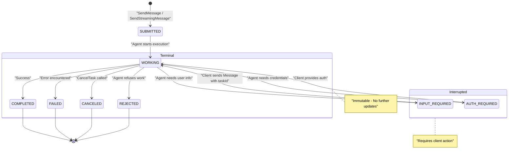
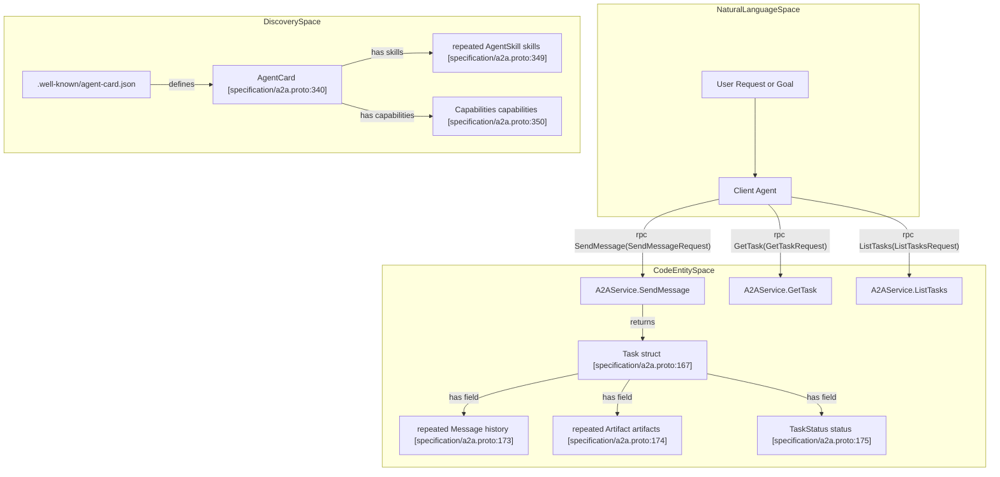
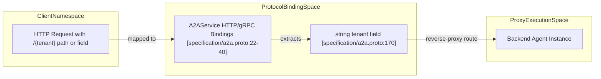

<!-- source: DeepWiki mcp.deepwiki.com · repo a2aproject/A2A · page 7 Glossary · fetched 2026-10-21 -->

# Glossary

Relevant source files

The following files were used as context for generating this wiki page:

- [docs/specification.md](docs/specification.md)
- [docs/topics/agent-discovery.md](docs/topics/agent-discovery.md)
- [docs/topics/key-concepts.md](docs/topics/key-concepts.md)
- [docs/topics/life-of-a-task.md](docs/topics/life-of-a-task.md)
- [docs/topics/multi-tenancy.md](docs/topics/multi-tenancy.md)
- [docs/topics/streaming-and-async.md](docs/topics/streaming-and-async.md)
- [docs/whats-new-v1.md](docs/whats-new-v1.md)
- [specification/.api-linter.yaml](specification/.api-linter.yaml)
- [specification/a2a.proto](specification/a2a.proto)
- [specification/buf.yaml](specification/buf.yaml)

This page defines the core terminology, technical jargon, and domain-specific concepts used within the Agent2Agent (A2A) Protocol codebase. It serves as a reference for onboarding engineers to bridge the gap between high-level agentic concepts and their concrete implementation in the protocol buffers and SDKs.

## 1. Core Data Entities

The A2A Protocol is built upon a Layer 1 Canonical Data Model defined in `specification/a2a.proto`. These entities represent the fundamental objects exchanged between agents.

| Term | Definition | Code Pointer |
| :--- | :--- | :--- |
| **Task** | The core unit of action and stateful work. It has a current status, results stored in artifacts, and multi-turn history. | [specification/a2a.proto:167-174]() |
| **Message** | A single turn of communication between a client and an agent, containing content and a role ("user" or "agent"). | [specification/a2a.proto:218-233]() |
| **Part** | The fundamental content container used within Messages and Artifacts. A Part holds text, raw bytes, a URL, or structured data via a `oneof` field. | [specification/a2a.proto:241-260]() |
| **Artifact** | A tangible output or concrete result generated by an agent during a task (e.g., a document or image). | [specification/a2a.proto:209-216]() |
| **AgentCard** | A discovery document describing an agent's identity, capabilities, and security requirements. | [specification/a2a.proto:340-366]() |
| **AgentSkill** | A specific capability or function declared within an `AgentCard` that an agent can perform, including descriptions and examples. | [specification/a2a.proto:368-379]() |
| **Extension** | A mechanism for layering new data, RPC methods, or state machine behaviors onto the base protocol. | [docs/specification.md:45-90]() |

Sources: [specification/a2a.proto:167-379](), [docs/specification.md:45-90]()

## 2. Task Lifecycle & States

Tasks transition through a formal state machine defined by the `TaskState` enum [specification/a2a.proto:187-207](). Understanding these states is critical for implementing agent logic and managing asynchronous workflows.

### Task State Machine Diagram
The following diagram maps the `TaskState` enum values to the logical flow of execution, distinguishing between active, interrupted, and terminal states.

Sources: [specification/a2a.proto:187-207]()

### State Definitions
*   **Interrupted States**: `INPUT_REQUIRED` and `AUTH_REQUIRED`. These states pause the task and require a client response to move back to `WORKING` [docs/topics/life-of-a-task.md:9-12]().
*   **Terminal States**: `COMPLETED`, `FAILED`, `CANCELED`, and `REJECTED`. Once a task reaches these states, it is **Immutable** and cannot be restarted. Any follow-up work requires a new Task ID within the same context [docs/topics/life-of-a-task.md:77-93]().

Sources: [specification/a2a.proto:187-207](), [docs/topics/life-of-a-task.md:9-12](), [docs/topics/life-of-a-task.md:77-93]()

## 3. Communication Concepts

### Context vs. Task
A common point of confusion is the relationship between `context_id` and `id` (Task ID).

*   **`context_id`**: A server-generated identifier that logically groups multiple `Task` and `Message` objects, providing continuity across a series of interactions [specification/a2a.proto:171-173]().
*   **`id` (Task ID)**: A unique identifier (typically a UUID) for a specific unit of work. One `context_id` can contain many Task IDs, enabling parallel or sequential sub-tasks [specification/a2a.proto:168-170](), [docs/whats-new-v1.md:31]().

### Delivery Mechanisms
A2A supports three primary ways to receive updates, depending on the client's connection stability:

1.  **Polling**: Repeatedly calling the `GetTask` RPC method to check the current state [specification/a2a.proto:45-53]().
2.  **Streaming**: Using `SendStreamingMessage` or `SubscribeToTask` via Server-Sent Events (SSE) for real-time updates [specification/a2a.proto:33-42](), [specification/a2a.proto:76-83]().
3.  **Push Notifications**: Configuring a webhook via `CreateTaskPushNotificationConfig` so the server can notify the client when a state change occurs [specification/a2a.proto:89-100]().

Sources: [specification/a2a.proto:33-100](), [specification/a2a.proto:168-173](), [docs/topics/streaming-and-async.md:5-55]()

## 4. System Architecture Mapping

This diagram bridges natural language space and code entity space by associating high-level protocol operations and client interactions with the exact RPC methods and data structures defined in `specification/a2a.proto`.

Sources: [specification/a2a.proto:19-140](), [specification/a2a.proto:167-175](), [specification/a2a.proto:340-350]()

### Multi-Tenant Routing Code Mapping

Another critical bridge between conceptual routing and code entities involves tenant-scoped requests.

Sources: [specification/a2a.proto:22-40](), [specification/a2a.proto:170](), [docs/topics/multi-tenancy.md:73-107]()

## 5. Technical Abbreviations

| Abbreviation | Full Term | Context |
| :--- | :--- | :--- |
| **ADK** | Agent Development Kit | Framework for building agents that often serve as A2A servers [docs/topics/key-concepts.md:101](). |
| **SSE** | Server-Sent Events | The underlying transport for `SendStreamingMessage` and `SubscribeToTask` [docs/topics/streaming-and-async.md:5-55](). |
| **TSC** | Technical Steering Committee | The governing body responsible for technical oversight of the project [docs/specification.md:125](). |
| **ADR** | Architectural Decision Record | Documents capturing important design decisions (e.g., ADR-001 for ProtoJSON) [docs/whats-new-v1.md:23](). |
| **MCP** | Model Context Protocol | A complementary protocol for agent-to-tool communication [docs/whats-new-v1.0.md:43](). |
| **L1/L2/L3** | Layer 1, 2, 3 | The three-layer architecture: Canonical Data Model (L1), Abstract Operations (L2), and Protocol Bindings (L3) [docs/specification.md:45-97](). |
| **JWS** | JSON Web Signature | Used for Agent Card signature verification [docs/whats-new-v1.md:37](). |
| **PKCE** | Proof Key for Code Exchange | Security enhancement for OAuth 2.0 Authorization Code flows [docs/whats-new-v1.md:41](). |
| **ProtoJSON** | Protocol Buffer JSON Mapping | A standard for mapping Protocol Buffer messages to JSON, used for A2A's JSON-RPC and HTTP/REST bindings [docs/whats-new-v1.md:20](). |
| **Buf** | Buf CLI | A tool for managing and linting Protocol Buffer definitions, used in the A2A project for schema generation and validation [specification/buf.yaml:1-20](). |
| **API Linter** | API Linter | A tool for enforcing API design guidelines on Protocol Buffer definitions, configured via `specification/.api-linter.yaml` [specification/.api-linter.yaml:1-58](). |

Sources: [docs/specification.md:45-97](), [docs/whats-new-v1.md:1-43](), [docs/topics/streaming-and-async.md:5-55](), [specification/buf.yaml:1-20](), [specification/.api-linter.yaml:1-58](), [docs/topics/key-concepts.md:101]()