# Page: Overview

# Overview

<details>
<summary>Relevant source files</summary>

The following files were used as context for generating this wiki page:

- [README.md](README.md)
- [docs/index.md](docs/index.md)

</details>


This document introduces the A2A Protocol repository at [README.md:1](), which serves as the **canonical specification and reference implementation** for the Agent2Agent (A2A) communication protocol. Originally developed by Google and now hosted under an open standard framework, A2A provides an open standard for seamless communication between AI agents built on diverse frameworks [docs/index.md:29-37]().

The repository contains the normative Protocol Buffer definition, comprehensive documentation, build infrastructure, and community governance materials. This overview is designed to orient different user types—protocol implementers, SDK developers, documentation consumers, and contributors—by mapping the repository's structure to their specific needs and workflows. With the release of v1.0, the protocol is production-ready and guided by an active open-source community [README.md:48-51]().

For detailed technical specifications, see [What is the A2A Protocol](#1.1). For repository organization, see [Repository Structure](#1.2). For onboarding, see [Getting Started](#1.3).

Sources: [README.md:1-51](), [docs/index.md:29-37]()

## Repository Purpose and Scope

The A2A repository serves three primary functions:

1.  **Normative Specification Source**: Maintains the authoritative definition of all protocol data objects and operations, primarily through `specification/a2a.proto` [README.md:93]().
2.  **Documentation Hub**: Provides comprehensive protocol documentation, tutorials, and conceptual guides through the MkDocs-based site deployed to [a2a-protocol.org](https://a2a-protocol.org) [README.md:92](), [docs/index.md:75-84]().
3.  **Ecosystem Coordination**: Coordinates governance and collaboration across a wide partner ecosystem including enterprise, tech platforms, and framework providers [README.md:103-107]().

The repository does **not** contain the primary SDK source code (those are hosted in separate repositories like `a2aproject/a2a-python`) or sample code (located in `a2aproject/a2a-samples`) [README.md:94-101](), [docs/index.md:87-105]().

Sources: [README.md:90-107](), [docs/index.md:75-105]()

## Repository Architecture

### Core Components and File Structure

The following diagram maps high-level protocol concepts to specific code entities and files within the repository.

**Repository Architecture: Concept to Code Mapping**
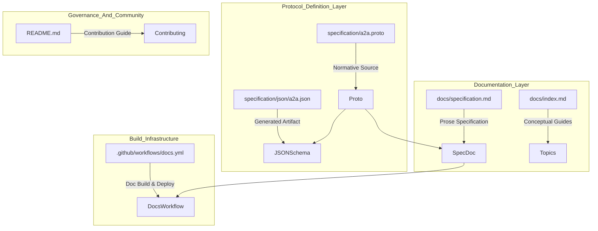

Sources: [README.md:90-107](), [docs/index.md:63-115]()

## User Personas and Entry Points

The A2A ecosystem serves multiple technical audiences with distinct needs:

### Protocol Implementers
Those building new A2A-compliant servers or clients from scratch.
*   **Primary Entry Point**: `specification/a2a.proto` for the canonical definitions [README.md:93]().
*   **Key Resource**: `docs/index.md` for the detailed technical definition and overview of the protocol [docs/index.md:75-80]().

### SDK Users / Agent Builders
Developers using existing SDKs to make their agents A2A-compliant.
*   **Primary Entry Point**: Quickstart documentation and SDK installation guides [README.md:94-100]().
*   **Key Resource**: Official SDKs for Python, JS, Java, .NET, Go, and Rust [README.md:94-100](), [docs/index.md:93-105]().

### Contributors
Engineers looking to improve the protocol specification or documentation.
*   **Primary Entry Point**: `README.md` contribution guidelines [README.md:103-107]().
*   **Key Resource**: CI/CD workflows and documentation source files.

Sources: [README.md:90-107](), [docs/index.md:63-105]()

## Protocol Interoperability

A2A is designed to bridge the gap between diverse agent frameworks and vendors, focusing on agent-to-agent communication as a peer-to-peer standard [README.md:48-51](). It complements the Model Context Protocol (MCP), which focuses on agent-to-tool communication [docs/index.md:117-125]().

**Bridging Natural Language to Code Entities**
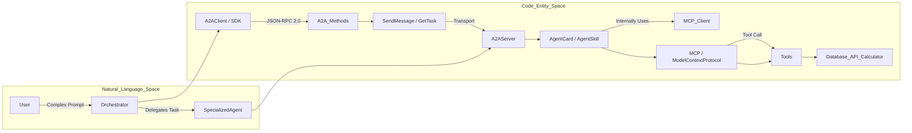

Sources: [README.md:48-51](), [docs/index.md:117-145]()

## Child Pages

For more detailed information, please refer to the following child pages:

*   [What is the A2A Protocol](#1.1): Explains the protocol's purpose, design principles (opacity, standardization, enterprise-readiness), and how it enables diverse AI agents to discover, communicate, and collaborate without exposing internal state [README.md:48-58](), [docs/index.md:29-33](), [docs/index.md:53-55]().
*   [Repository Structure](#1.2): Documents the organization of the codebase, including specification and documentation directories [README.md:90-101]().
*   [Getting Started](#1.3): Provides quick-start guidance, including installation commands for the official Python, JS, Go, Java, .NET, and Rust SDKs [README.md:94-100](), [docs/index.md:63-115]().

Sources: [README.md:48-100](), [docs/index.md:29-115]()

---

# Page: What is the A2A Protocol

# What is the A2A Protocol

<details>
<summary>Relevant source files</summary>

The following files were used as context for generating this wiki page:

- [.github/linters/.markdownlint.json](.github/linters/.markdownlint.json)
- [README.md](README.md)
- [docs/topics/a2a-and-mcp.md](docs/topics/a2a-and-mcp.md)
- [docs/topics/enterprise-ready.md](docs/topics/enterprise-ready.md)
- [docs/topics/what-is-a2a.md](docs/topics/what-is-a2a.md)

</details>


## Purpose and Scope

This document explains the fundamental mission, architecture, and design principles of the Agent2Agent (A2A) Protocol. It introduces the core technical concepts that enable independent AI agent systems to communicate, collaborate, and interoperate across different frameworks, vendors, and deployment environments.

The A2A protocol addresses a critical challenge in the AI landscape: enabling generative AI agents, built on diverse frameworks by different companies running on separate servers, to communicate and collaborate effectively as agents, not just as tools [README.md:48-51](), [docs/topics/what-is-a2a.md:3-9](). A2A provides a common language for agent interoperability, fostering a more interconnected and innovative AI ecosystem [docs/topics/what-is-a2a.md:3-9]().

Sources: [README.md:48-51](), [docs/topics/what-is-a2a.md:3-9]()

---

## Protocol Mission

The A2A Protocol defines a standard communication interface for independent AI agent systems. Agents built with different frameworks (such as Google ADK, LangGraph, or BeeAI) communicate through a canonical data model and standardized protocol bindings [README.md:67-70](), [docs/topics/what-is-a2a.md:85-91]().

The protocol addresses interoperability between autonomous agent systems through:

- **Standardized message exchange** using a common data format [README.md:84-87]().
- **Task lifecycle management** supporting long-running operations (LRO) [docs/topics/what-is-a2a.md:110-111](), [docs/topics/what-is-a2a.md:124-126]().
- **Agent capability advertisement** through "Agent Cards" detailing skills and connection info [README.md:85-85]().
- **Opaque execution model** where agents collaborate without exposing internal state, memory, or proprietary tool implementations [README.md:57-57](), [README.md:80-80](), [docs/topics/enterprise-ready.md:10-13]().

### Protocol Capabilities

| Capability | Implementation |
|------------|----------------|
| **Discovery** | `AgentCard` detailing capabilities, skills, and connection info [README.md:85-85](). |
| **Task Management** | Stateful unit of work with defined lifecycle and terminal states [README.md:56-56](). |
| **Message Exchange** | Handles text, files, and structured JSON data [README.md:87-87](). |
| **Streaming** | Server-Sent Events (SSE) for real-time, incremental results [README.md:86-86](), [docs/topics/what-is-a2a.md:107-108]() |
| **Push Notifications** | Asynchronous updates via webhooks for disconnected scenarios [README.md:86-86](), [docs/topics/what-is-a2a.md:121-123]() |
| **Security** | Enterprise-grade authentication (OAuth 2.0, API Keys) and TLS [docs/topics/enterprise-ready.md:16-48]() |
| **Opacity** | Collaboration without sharing internal memory or proprietary logic [README.md:80-80](), [docs/topics/enterprise-ready.md:10-13]() |

Sources: [README.md:56-88](), [docs/topics/what-is-a2a.md:107-111](), [docs/topics/what-is-a2a.md:121-126](), [docs/topics/enterprise-ready.md:10-48]()

---

## Three-Layer Architecture

A2A employs a layered architecture that separates protocol semantics from transport implementation, ensuring core concepts remain consistent across different bindings.

### Layer 1: Canonical Data Model

The A2A protocol relies on a structured data model to define all protocol types. This model serves as the normative source for all generated SDKs and schemas.

Title: "Data Model Mapping"
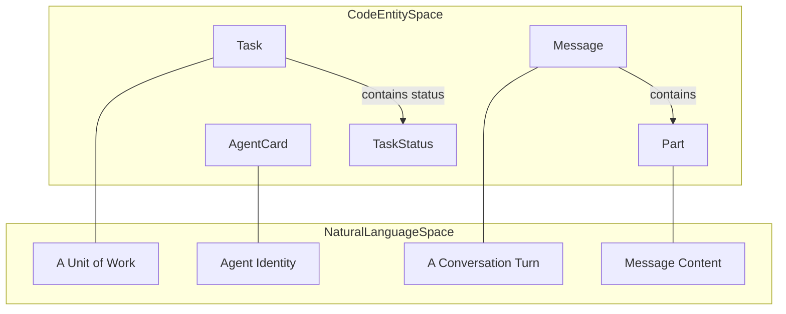
Sources: [README.md:84-88](), [docs/topics/what-is-a2a.md:85-91]()

**Key Definitions:**
- `Task`: Stateful work unit with lifecycle tracking [README.md:56-56]().
- `Message`: Communication turn between client and agent [README.md:55-57]().
- `Part`: Content unit (text, bytes, URL, or structured data) [README.md:87-87]().
- `AgentCard`: Agent capability declaration and discovery metadata [README.md:85-85]().

Sources: [README.md:55-87](), [docs/topics/what-is-a2a.md:85-91]()

### Layer 2: Abstract Operations

The protocol defines operations as abstract methods that govern how agents interact, regardless of the transport layer.

Title: "Operations Mapping"
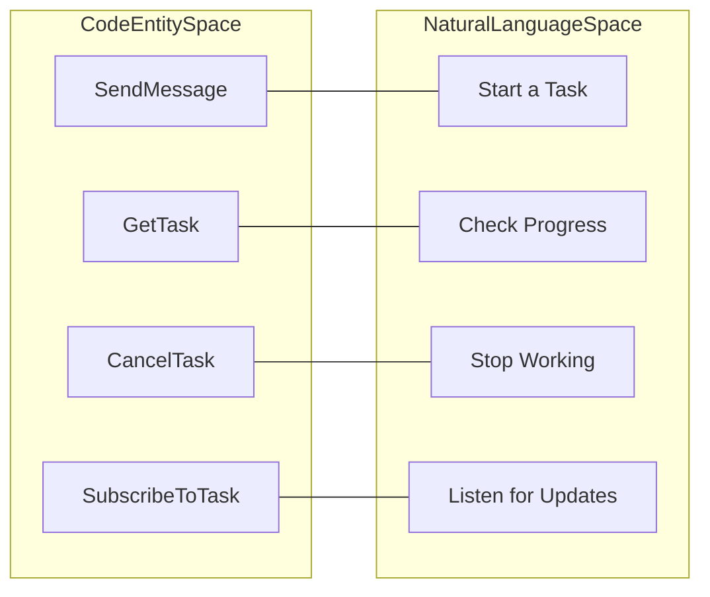
Sources: [docs/topics/what-is-a2a.md:121-126]()

### Layer 3: Protocol Bindings

The specification maps abstract operations to concrete transport mechanisms.

| Binding | Transport | Content-Type |
|---------|-----------|--------------|
| **JSON-RPC 2.0** | HTTP(S) | `application/json` [README.md:84-84]() |
| **Streaming (SSE)** | HTTP(S) | `text/event-stream` [README.md:86-86]() |
| **Push Notifications** | HTTP(S) | Webhooks [README.md:86-86]() |

Sources: [README.md:84-86](), [docs/topics/what-is-a2a.md:107-123]()

---

## Core Design Principles

### Opacity and Security
Agents are **opaque** because they do not share internal memory, tools, or direct resource access with each other [README.md:80-80](), [docs/topics/enterprise-ready.md:10-11](). This preserves intellectual property and enhances security by treating remote agents as standard HTTP-based enterprise applications [docs/topics/enterprise-ready.md:12-13](). Collaboration relies on declared capabilities and exchanged context rather than shared internal state [README.md:57-57](), [docs/topics/what-is-a2a.md:126-129]().

Sources: [README.md:57-80](), [docs/topics/what-is-a2a.md:126-129](), [docs/topics/enterprise-ready.md:10-13]()

### Enterprise Readiness
A2A is designed for professional deployment environments:
- **Standard Technologies**: Leverages existing standards like HTTP, JSON-RPC, and SSE to avoid reinventing core technologies [docs/topics/what-is-a2a.md:115-117]().
- **Security**: Aligns with standard web practices for authentication (OAuth 2.0, API Keys), TLS identity verification, and authorization [docs/topics/enterprise-ready.md:16-83]().
- **Observability**: Supports distributed tracing (OpenTelemetry) and standard HTTP logging [docs/topics/enterprise-ready.md:107-114]().
- **Scalability**: Natively handles long-running tasks and asynchronous execution [docs/topics/what-is-a2a.md:121-123]().

Sources: [docs/topics/what-is-a2a.md:115-123](), [docs/topics/enterprise-ready.md:16-114]()

### Modality Independence
The protocol allows agents to communicate using a wide variety of content types. This enables rich and flexible interactions beyond plain text, including files and structured data exchange via content fields [README.md:87-87](), [docs/topics/what-is-a2a.md:124-125]().

Sources: [README.md:87-87](), [docs/topics/what-is-a2a.md:124-125]()

---

## A2A and MCP: Complementary Protocols

While A2A handles **agent-to-agent** communication, the Model Context Protocol (MCP) handles **agent-to-tool** communication [docs/topics/a2a-and-mcp.md:3-6](). They address distinct but highly complementary needs in the agentic stack [docs/topics/a2a-and-mcp.md:5-6](), [docs/topics/what-is-a2a.md:133-140]().

| Feature | A2A Protocol | Model Context Protocol (MCP) |
|---------|--------------|------------------------------|
| **Primary Focus** | Peer-to-peer collaboration [docs/topics/a2a-and-mcp.md:45-52]() | Tool and resource usage [docs/topics/a2a-and-mcp.md:31-38]() |
| **Relationship** | Standardizes agent-to-agent [docs/topics/what-is-a2a.md:135-135]() | Standardizes agent-to-tool [docs/topics/what-is-a2a.md:136-136]() |
| **Interaction** | Multi-turn, stateful dialogue [docs/topics/a2a-and-mcp.md:71-77]() | Stateless, structured function calls [docs/topics/a2a-and-mcp.md:64-68]() |

**Integrated Agent Stack:**
1. **Models**: Fundamental reasoning (LLMs) [docs/topics/what-is-a2a.md:138-138]().
2. **Frameworks**: Toolkits for building agents (e.g., ADK, LangGraph, BeeAI) [docs/topics/what-is-a2a.md:137-137]().
3. **MCP**: Connects the agent to its specific tools and resources [docs/topics/what-is-a2a.md:136-136]().
4. **A2A**: Connects independent agents across different organizations and ecosystems [docs/topics/what-is-a2a.md:135-135]().

Sources: [README.md:71-71](), [docs/topics/what-is-a2a.md:133-140](), [docs/topics/a2a-and-mcp.md:3-77]()

---

# Page: Repository Structure

# Repository Structure

<details>
<summary>Relevant source files</summary>

The following files were used as context for generating this wiki page:

- [.devcontainer/README.md](.devcontainer/README.md)
- [.devcontainer/devcontainer.json](.devcontainer/devcontainer.json)
- [.devcontainer/setup.sh](.devcontainer/setup.sh)
- [.gitattributes](.gitattributes)
- [.github/linters/.protolint.yaml](.github/linters/.protolint.yaml)
- [.gitignore](.gitignore)
- [docs/404.html](docs/404.html)
- [docs/README.md](docs/README.md)
- [docs/robots.txt](docs/robots.txt)
- [requirements-docs.txt](requirements-docs.txt)
- [scripts/build_docs.sh](scripts/build_docs.sh)

</details>


This page documents the organization of the A2A Protocol repository, explaining the purpose of each directory and how files relate to the protocol development workflow. As the canonical repository for the protocol (`github.com/a2aproject/A2A`), it serves as the definitive source of truth for specifications, user documentation, development automation, and tooling configurations.

## Directory Layout Overview

The repository is organized into distinct functional areas that separate the canonical protocol definition (`specification/`), human-readable user documentation (`docs/`), architectural decision records (`adrs/`), automation scripts (`scripts/`), container environments (`.devcontainer/`), and CI workflows (`.github/`).

**Title: Repository Organization Overview**
```mermaid
graph TB
    Root["Repository Root<br/>(github.com/a2aproject/A2A)"]
    
    Root --> Spec["specification/<br/>Canonical Protocol Definition"]
    Root --> Docs["docs/<br/>User Documentation"]
    Root --> ADRs["adrs/<br/>Architectural Decisions"]
    Root --> GitHub[".github/<br/>CI/CD & Automation"]
    Root --> DevContainer[".devcontainer/<br/>Dev Environment"]
    Root --> Types["types/<br/>TypeScript Definitions"]
    Root --> Scripts["scripts/<br/>Build & Utility Scripts"]
    
    Spec --> Proto["a2a.proto<br/>Normative Source of Truth"]
    Spec --> JSON["json/a2a.json<br/>Generated Schema"]
    
    Docs --> Index["index.md<br/>Homepage"]
    Docs --> Assets["assets/<br/>Images & Media"]
    Docs --> Robots["robots.txt<br/>Crawler Directives"]
    Docs --> Error404["404.html<br/>Redirect Logic"]
    
    GitHub --> Workflows["workflows/docs.yml<br/>CI/CD Pipelines"]
    GitHub --> Linters["linters/.protolint.yaml<br/>Linter Configs"]
    
    DevContainer --> DCJSON["devcontainer.json"]
    DevContainer --> Setup["setup.sh"]

    Scripts --> BuildDocs["build_docs.sh<br/>Documentation Build"]
    Scripts --> ProtoToJson["proto_to_json_schema.sh<br/>Schema Generation"]
    
    ADRs --> ADR001["adr-001-protojson-serialization.md"]
```

**Sources:** [docs/README.md:1-47](), [.devcontainer/devcontainer.json:1-33](), [.devcontainer/README.md:7-23](), [scripts/build_docs.sh:1-98](), [docs/robots.txt:1-39](), [docs/404.html:1-52]()

## Top-Level Directory Structure

| Directory | Purpose | Key Contents |
|-----------|---------|--------------|
| `specification/` | Canonical protocol definition and generated artifacts | `a2a.proto`, `json/a2a.json` |
| `docs/` | User-facing documentation and site configuration | `index.md`, `assets/`, `whats-new-v1.md`, `robots.txt`, `404.html` |
| `adrs/` | Architectural Decision Records (ADRs) | `adr-001-protojson-serialization.md`, `adr-template.md` |
| `scripts/` | Automation scripts for building and validation | `build_docs.sh`, `proto_to_json_schema.sh` |
| `.github/` | CI/CD, automation workflows, and global linter configs | `linters/.protolint.yaml` |
| `.devcontainer/` | Reproducible development environment | `devcontainer.json`, `setup.sh` |
| `types/` | TypeScript type definitions | `src/types.ts` |

**Sources:** [docs/README.md:1-47](), [.devcontainer/devcontainer.json:1-33](), [.github/linters/.protolint.yaml:1-4](), [.devcontainer/setup.sh:1-72](), [scripts/build_docs.sh:1-98](), [docs/robots.txt:1-39](), [docs/404.html:1-52]()

## Core Specification and Types

The `specification/` directory contains the authoritative protocol definition. The `a2a.proto` file serves as the universal, normative source of truth for all language-specific SDKs and protocol bindings.

### Protocol Source and Generation
The repository includes build scripts to ensure that the protocol definitions remain accessible to non-Protobuf environments:
- **`specification/a2a.proto`**: The primary definition file containing service definitions and core messages such as `Task`, `Message`, and `AgentCard`.
- **`specification/json/a2a.json`**: A non-normative JSON Schema representation generated dynamically from the proto file [.gitignore:8-11](). This schema is used for validating JSON payloads and is generated during builds using `protoc-gen-jsonschema` [.devcontainer/README.md:9-10](). The generation process is managed by `scripts/proto_to_json_schema.sh` and orchestrated via `scripts/build_docs.sh` [scripts/build_docs.sh:34-40]().
- **`types/src/types.ts`**: TypeScript definitions maintained to support JavaScript/TypeScript ecosystem integration.

### Linting and Quality Control
The specification is strictly governed by linting tooling:
- **Protolint**: Configured via `.github/linters/.protolint.yaml` to manage specific formatting constraints, such as overriding `MAX_LINE_LENGTH` rules [.github/linters/.protolint.yaml:1-4]().
- **Buf**: The `buf` CLI is integrated into the development setup to handle linting and breaking change detection [.devcontainer/setup.sh:31-37]().

**Sources:** [.devcontainer/README.md:9-10](), [.github/linters/.protolint.yaml:1-4](), [.devcontainer/setup.sh:31-37](), [scripts/build_docs.sh:34-40](), [.gitignore:8-11]()

## Architectural Decision Records (ADRs)

The `adrs/` directory tracks major design decisions that shape the protocol. Each record follows a standardized structure covering Context, Decision Drivers, and Consequences. These ADR files are copied to the `site/adrs` directory during the documentation build execution [scripts/build_docs.sh:85-96]().

### Key Decisions
- **ADR-001: ProtoJSON Serialization**: Establishes the ProtoJSON specification as the normative approach for JSON payloads, mandating `SCREAMING_SNAKE_CASE` for enums in JSON serialization to maintain cross-language interoperability.

**Sources:** [scripts/build_docs.sh:85-96]()

## Documentation System

The `docs/` directory contains Markdown content rendered via `mkdocs` with the `mkdocs-material` theme [docs/README.md:14-19](). It includes version-specific guides like `whats-new-v1.md`, site configuration files, and search crawlers policies [docs/whats-new-v1.md:1-74](), [docs/robots.txt:1-39]().

### Site Configuration and Deployment
- **Site Content & Navigation**: Defined in `mkdocs.yml` at the repository root [docs/README.md:18-19]().
- **Robots.txt**: Managed via `docs/robots.txt`, configuring web crawlers and explicitly allowing generative AI and LLM crawlers like `GPTBot`, `ClaudeBot`, and `PerplexityBot`, while pointing to `sitemap.xml` [docs/robots.txt:1-39]().
- **404.html**: Client-side JavaScript redirect logic in `docs/404.html` that intercepts missing resource lookups and routes users from unversioned paths to the `latest` documentation version [docs/404.html:8-41]().
- **SDK Documentation**: Python SDK documentation is built using Sphinx (`sphinx-build`) and integrated into the main documentation site structure [docs/README.md:29-47](). The script `scripts/build_docs.sh` coordinates this build phase [scripts/build_docs.sh:63-69]().

**Title: Mapping Documentation to Specification**
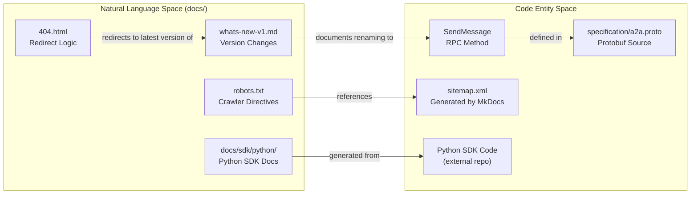

**Sources:** [docs/README.md:1-47](), [docs/whats-new-v1.md:1-74](), [docs/robots.txt:1-39](), [docs/404.html:1-52](), [scripts/build_docs.sh:63-69]()

## Development Infrastructure

The `.devcontainer/` and `scripts/` directories provide the build pipeline, local execution environments, and validation automation needed for protocol development.

### Local Development Environment
The `.devcontainer/` setup ensures a containerized, reproducible toolchain across contributor machines:
- **`devcontainer.json`**: Configures a container running Python 3.12, Go, and Node.js (LTS), along with VS Code extensions such as `ms-python.python`, `pylance`, and `bufbuild.vscode-buf` [.devcontainer/devcontainer.json:4-23]().
- **Pre-installed Tooling**: Installs `protoc` (v28.3), `protoc-gen-jsonschema`, `buf`, and `jq` [.devcontainer/README.md:7-12]().
- **`setup.sh`**: Automates system package installation, protocol buffer compiler downloads, and cloning the `googleapis` definitions into `third_party/googleapis` [.devcontainer/setup.sh:1-50]().

### Build and Utility Scripts
The `scripts/` directory houses workflow automation:
- **`build_docs.sh`**: Acts as the unified documentation build script. It verifies schema freshness between `specification/a2a.proto` and `specification/json/a2a.json`, invokes `scripts/proto_to_json_schema.sh` if needed [scripts/build_docs.sh:16-43](), copies normative spec files into `docs/spec/` [scripts/build_docs.sh:45-61](), builds SDK documentation [scripts/build_docs.sh:62-69](), and executes `mkdocs build` or `mike deploy` [scripts/build_docs.sh:76-83]().
- **`proto_to_json_schema.sh`**: Handles translation of protobuf definitions into JSON Schema [scripts/build_docs.sh:14]().

### Repository Automation & Metadata
- **`.gitattributes`**: Marks `/docs/**` as documentation via linguist overrides and sets `CHANGELOG.md` to use the `union` merge strategy [.gitattributes:1-8]().
- **`.gitignore`**: Excludes ephemeral schema builds (`specification/json/a2a.json`), SDK doc outputs (`docs/sdk/*`), and local virtual environments (`.doc-venv`, `venv/`) from version control [.gitignore:2-25]().

**Title: Dev Environment to Build Pipeline**
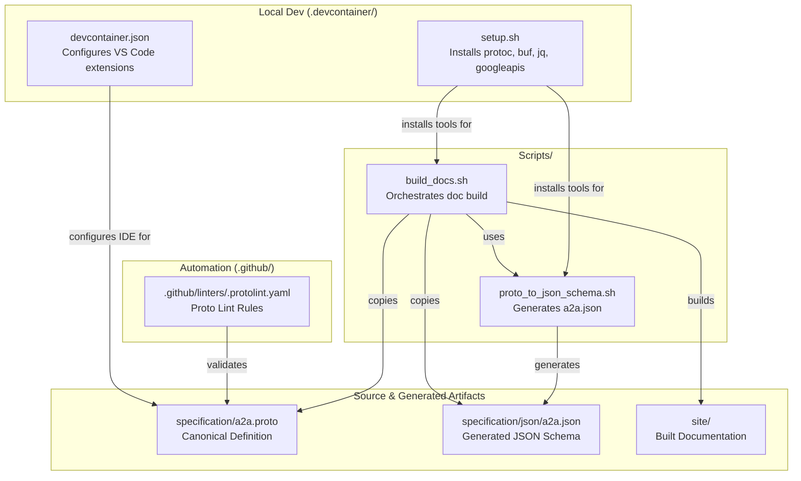

**Sources:** [.devcontainer/devcontainer.json:1-33](), [.devcontainer/README.md:1-83](), [.gitattributes:1-8](), [scripts/build_docs.sh:1-98](), [.gitignore:1-25](), [.devcontainer/setup.sh:1-72]()

---

# Page: Getting Started

# Getting Started

<details>
<summary>Relevant source files</summary>

The following files were used as context for generating this wiki page:

- [.github/PULL_REQUEST_TEMPLATE/become_a_repo_maintainer.md](.github/PULL_REQUEST_TEMPLATE/become_a_repo_maintainer.md)
- [CONTRIBUTING.md](CONTRIBUTING.md)
- [GOVERNANCE.md](GOVERNANCE.md)
- [docs/index.md](docs/index.md)
- [docs/roadmap.md](docs/roadmap.md)
- [docs/sdk/index.md](docs/sdk/index.md)
- [docs/tutorials/index.md](docs/tutorials/index.md)

</details>


This page provides quick-start guidance for three primary personas working with the A2A Protocol: protocol implementers, SDK users, and contributors.

| Persona | Goal | Path |
|---------|------|------|
| **Protocol Implementers** | Understand the specification to build custom A2A implementations | Review specification, examine protobuf definitions |
| **SDK Users** | Build A2A-compliant agents using official SDKs | Install SDK, implement `AgentExecutor`, run server |
| **Contributors** | Improve the protocol, documentation, or ecosystem | Clone repository, review governance, submit PRs |

For conceptual understanding of what A2A is and why it exists, see [What is the A2A Protocol](1.1). For detailed protocol mechanics, see [Protocol Specification](2). For understanding the repository organization, see [Repository Structure](1.2).

Sources: [CONTRIBUTING.md:1-117](), [docs/sdk/index.md:1-14](), [docs/roadmap.md:1-30]()

---

## Prerequisites

Before getting started with A2A, ensure you have the necessary environment setup. While A2A is language-agnostic at the protocol level, the most common starting point is the Python SDK.

| Requirement | Minimum Version | Purpose |
|-------------|----------------|---------|
| **Programming Language Runtime** | Python 3.10+ | To run SDK code and examples [CONTRIBUTING.md:11-11]() |
| **Package Installer** | `uv` / `pip` | Fast Python package installer and resolver [CONTRIBUTING.md:12-12]() |
| **Node.js & npm** | Current LTS | For markdown formatting and documentation tools [CONTRIBUTING.md:13-13]() |
| **Docker** | Any recent version | Required for running local linters and validation [CONTRIBUTING.md:14-14]() |

Sources: [CONTRIBUTING.md:5-15]()

---

## Getting Started Paths by Persona

The A2A ecosystem supports three primary development personas, each with distinct entry points and workflows:

Title: "Development Personas and Entry Points"
```mermaid
graph TB
    subgraph "Path1:ProtocolImplementers"
        ["specification/a2a.proto"] --> ["ProtocolSpecificationDocs"]
        ["ProtocolSpecificationDocs"] --> ["specification/json/a2a.json"]
        ["specification/json/a2a.json"] --> ["ProtocolBindings:gRPC,JSON-RPC,HTTP/REST"]
    end
    
    subgraph "Path2:SDKUsers"
        ["pipInstallA2aSdk"] --> ["DefineAgentCardAndSkill"]
        ["DefineAgentCardAndSkill"] --> ["AgentExecutor"]
        ["AgentExecutor"] --> ["StarletteFastAPIServer"]
    end
    
    subgraph "Path3:Contributors"
        ["gitCloneA2aRepo"] --> ["DevcontainerSetup"]
        ["DevcontainerSetup"] --> ["scripts/build_docs.sh"]
        ["scripts/build_docs.sh"] --> ["SubmitPullRequest"]
    end
```
Sources: [CONTRIBUTING.md:1-117](), [docs/sdk/index.md:1-14](), [docs/roadmap.md:1-30]()

The remainder of this guide focuses primarily on **Path 2 (SDK Users)** and **Path 3 (Contributors)**. Protocol Implementers should proceed directly to [Protocol Specification](2).

Sources: [docs/sdk/index.md:1-14](), [docs/roadmap.md:1-30](), [CONTRIBUTING.md:1-117]()

---

## Running Your First A2A Agent (Python)

The fastest way to experience A2A is through the Python Quickstart, which builds a simple echo server.

### Step 1: Install the SDK
```bash
pip install a2a-sdk
```

### Step 2: Explore Samples
The `a2a-samples` repository contains reference implementations across multiple frameworks:
```bash
git clone https://github.com/a2aproject/a2a-samples.git -b main --depth 1
```

### Step 3: Tutorial Workflow
The standard Python tutorial workflow follows these logical steps:
1. **Setup**: Environment preparation via `venv` or `uv` [CONTRIBUTING.md:22-39]().
2. **Agent Skills & Agent Card**: Defining core capabilities [docs/tutorials/index.md:7-13]().
3. **Agent Executor**: Implementing custom execution logic [docs/tutorials/index.md:7-13]().
4. **Starting the Server**: Exposing JSON-RPC routes via web frameworks [docs/tutorials/index.md:7-13]().

Sources: [CONTRIBUTING.md:22-58](), [docs/tutorials/index.md:1-35]()

---

## Multi-Language SDK Ecosystem

A2A project hosts official SDKs in six languages to ensure broad interoperability across different enterprise stacks.

| Language | Repository | Package Manager Command |
|----------|------------|-------------------------|
| **Python** | [`a2a-python`](https://github.com/a2aproject/a2a-python) | `pip install a2a-sdk` [docs/sdk/index.md:7-7]() |
| **Go** | [`a2a-go`](https://github.com/a2aproject/a2a-go) | `go get github.com/a2aproject/a2a-go` [docs/sdk/index.md:8-8]() |
| **Java** | [`a2a-java`](https://github.com/a2aproject/a2a-java) | Available via Maven [docs/sdk/index.md:9-9]() |
| **JavaScript** | [`a2a-js`](https://github.com/a2aproject/a2a-js) | `npm install @a2a-js/sdk` [docs/sdk/index.md:10-10]() |
| **C#/.NET** | [`a2a-dotnet`](https://github.com/a2aproject/a2a-dotnet) | `dotnet add package A2A` [docs/sdk/index.md:11-11]() |
| **Rust** | [`a2a-rs`](https://github.com/a2aproject/a2a-rs) | `cargo add a2a-lf` [docs/sdk/index.md:12-12]() |

Sources: [docs/sdk/index.md:1-14](), [docs/roadmap.md:24-27]()

---

## Key Code Entities for Building Agents

When implementing an A2A-compliant agent, you interact with specific code abstractions that map the protocol to executable logic.

Title: "Code Entity Relationship Map"
```mermaid
graph TB
    subgraph "DataDefinitions"
        ["AgentCard"]
        ["AgentSkill"]
    end
    
    subgraph "ExecutionLogic"
        ["AgentExecutor"]
    end
    
    subgraph "Infrastructure"
        ["DefaultRequestHandler"]
        ["TaskStore"]
        ["create_jsonrpc_routes"]
    end
    
    ["AgentCard"] --> ["AgentSkill"]
    ["DefaultRequestHandler"] --> ["AgentExecutor"]
    ["DefaultRequestHandler"] --> ["TaskStore"]
    ["create_jsonrpc_routes"] --> ["DefaultRequestHandler"]
```
Sources: [docs/sdk/index.md:1-14](), [docs/tutorials/index.md:1-35]()

### Component Roles

| Component | Purpose |
|-----------|---------|
| `AgentCard` | Declares agent identity, URL, and metadata for discovery [docs/tutorials/index.md:7-13]() |
| `AgentSkill` | Describes specific capabilities and tasks the agent can perform [docs/tutorials/index.md:7-13]() |
| `AgentExecutor` | The interface where custom agent logic and execution reside [docs/tutorials/index.md:7-13]() |
| `DefaultRequestHandler` | Routes incoming A2A RPC calls to appropriate methods on your executor [docs/tutorials/index.md:7-13]() |
| `TaskStore` | Manages the lifecycle of tasks, stateful interactions, and streaming [docs/tutorials/index.md:7-13]() |
| `create_jsonrpc_routes` | Helper function to create server routes for A2A services [docs/tutorials/index.md:7-13]() |

Sources: [docs/sdk/index.md:1-14](), [docs/tutorials/index.md:1-35]()

---

## Roadmap and Validation Tools

As the A2A ecosystem matures, several tools and components have been introduced to help developers ensure compliance and extend functionality:

- **A2A Protocol v1.0**: Represents a major maturation release with enhanced clarity and structural improvements [docs/roadmap.md:7-8]().
- **A2A Inspector**: A community tool for validating agent communication [docs/roadmap.md:22-22]().
- **A2A TCK (Technology Compatibility Kit)**: A suite for verifying protocol compliance across different implementations [docs/roadmap.md:22-22]().
- **A2A Extensions**: A mechanism to support additional protocol features with SDK support [docs/roadmap.md:9-9]().
- **Documentation & Dev Setup**: Automated validation via `scripts/build_docs.sh` and Super Linter [CONTRIBUTING.md:43-68]().

Sources: [docs/roadmap.md:1-30](), [CONTRIBUTING.md:43-77]()

---

# Page: Protocol Specification

# Protocol Specification

<details>
<summary>Relevant source files</summary>

The following files were used as context for generating this wiki page:

- [docs/specification.md](docs/specification.md)
- [docs/topics/multi-tenancy.md](docs/topics/multi-tenancy.md)
- [docs/topics/streaming-and-async.md](docs/topics/streaming-and-async.md)
- [docs/whats-new-v1.md](docs/whats-new-v1.md)
- [specification/.api-linter.yaml](specification/.api-linter.yaml)
- [specification/a2a.proto](specification/a2a.proto)
- [specification/buf.yaml](specification/buf.yaml)

</details>


This document serves as the comprehensive reference for the A2A (Agent2Agent) Protocol's technical design. It covers the architectural layers, core data structures, and the communication patterns that enable independent AI agent systems to discover, collaborate, and manage tasks securely without exposing internal state.

For implementation guidance using SDKs, see [SDK & Implementation Guide](#3). For governance details, see [Community & Governance](#5).

Sources: [docs/specification.md:1-43](), [docs/specification.md:125-133]()

---

## 2.1. Three-Layer Architecture

The A2A Protocol is organized into three distinct layers to ensure that core semantics remain consistent across different transport mechanisms. This design allows the protocol to evolve its data model independently of how messages are physically transmitted.

### Protocol Layering and Code Entity Mapping
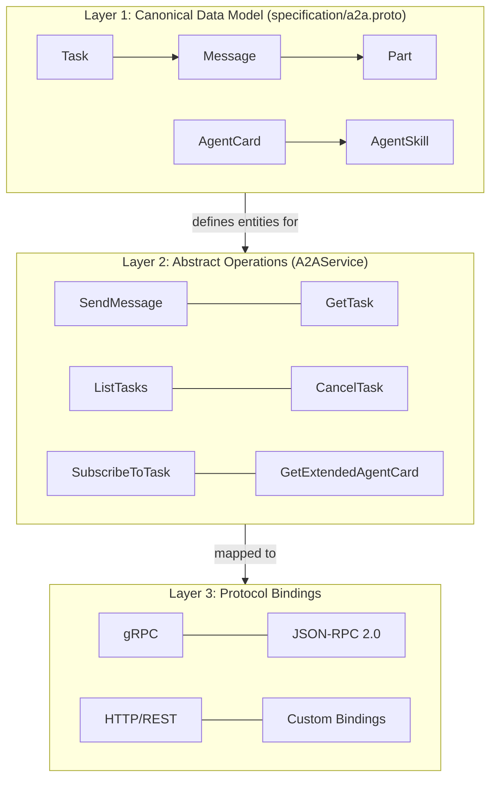

Sources: [docs/specification.md:45-104](), [specification/a2a.proto:1-140]()

*   **Layer 1: Canonical Data Model**: Defines core data structures (`Task`, `Message`, `AgentCard`) using Protocol Buffers in `specification/a2a.proto` [specification/a2a.proto:163-459]().
*   **Layer 2: Abstract Operations**: Describes fundamental behaviors defined in the `A2AService` interface [specification/a2a.proto:19-140]() independently of transport.
*   **Layer 3: Protocol Bindings**: Provides concrete mappings to gRPC, JSON-RPC, and HTTP/REST, including specific endpoint patterns like `/{tenant}/tasks/{id}` [specification/a2a.proto:46-51]().

For details, see [Three-Layer Architecture](#2.1).

Sources: [docs/specification.md:45-104](), [specification/a2a.proto:1-140]()

---

## 2.2. Core Data Types

The protocol revolves around several fundamental objects defined in the `lf.a2a.v1` package inside `specification/a2a.proto`.

| Entity | Description | Code Reference |
| :--- | :--- | :--- |
| **Task** | The core unit of action; tracks state, history, and results. | `message Task` [specification/a2a.proto:167-182]() |
| **Message** | A single turn in a conversation, containing one or more `Part`s. | `message Message` [specification/a2a.proto:252-274]() |
| **Part** | Polymorphic content (text, raw bytes, data, or URL). | `message Part` [specification/a2a.proto:354-386]() |
| **Artifact** | A tangible output produced by a task. | `message Artifact` [specification/a2a.proto:276-287]() |
| **AgentCard** | A manifest describing agent identity, skills, and security. | `message AgentCard` [specification/a2a.proto:388-413]() |

For details, see [Core Data Types](#2.2).

Sources: [specification/a2a.proto:163-459](), [docs/specification.md:131-133]()

---

## 2.3. RPC Operations & Protocol Bindings

The `A2AService` defines the functional interface for the protocol. These operations map across different bindings (gRPC, JSON-RPC, REST) using standard conventions. Multi-tenancy is natively supported via the `tenant` field in requests and URL paths, allowing a single endpoint to serve multiple agents [specification/a2a.proto:21-140]().

| Operation | Purpose | HTTP Mapping |
| :--- | :--- | :--- |
| `SendMessage` | Initiates or continues a task. | `POST /message:send` [specification/a2a.proto:21-30]() |
| `SendStreamingMessage` | Sends a message and returns an SSE/gRPC stream. | `POST /message:stream` [specification/a2a.proto:33-42]() |
| `GetTask` | Retrieves the current state of a specific task. | `GET /tasks/{id}` [specification/a2a.proto:45-53]() |
| `ListTasks` | Queries tasks with filtering and pagination. | `GET /tasks` [specification/a2a.proto:55-62]() |
| `SubscribeToTask` | Subscribes to real-time updates for a task. | `GET /tasks/{id}:subscribe` [specification/a2a.proto:76-83]() |
| `GetExtendedAgentCard` | Fetches detailed metadata after authentication. | `GET /extendedAgentCard` [specification/a2a.proto:122-129]() |

For details, see [RPC Operations & Protocol Bindings](#2.3).

Sources: [specification/a2a.proto:19-140](), [docs/whats-new-v1.md:48-175](), [docs/topics/multi-tenancy.md:73-108]()

---

## 2.4. Agent Discovery via AgentCard

Discovery is performed by fetching the `AgentCard` from a well-known URI: `/.well-known/agent-card.json`. This document declares the agent's `AgentSkill` set, supported `AgentInterface` (URL, protocol, and version), and `SecurityScheme` [specification/a2a.proto:332-459](). Version 1.0 introduced JWS signatures for AgentCard verification to ensure integrity in enterprise environments [docs/whats-new-v1.md:115-130]().

For details, see [Agent Discovery via AgentCard](#2.4).

Sources: [specification/a2a.proto:332-459](), [docs/whats-new-v1.md:115-130]()

---

## 2.5. Task Lifecycle & State Management

Tasks follow a strict state machine defined by the `TaskState` enum. Transitions are managed by the agent, and clients track progress via `TaskStatus` [specification/a2a.proto:184-217](). Terminal states include `COMPLETED`, `FAILED`, `CANCELED`, and `REJECTED`. Interrupted states like `INPUT_REQUIRED` and `AUTH_REQUIRED` pause execution until client action is taken [docs/whats-new-v1.md:109-114]().

### Task State Machine Code Mapping
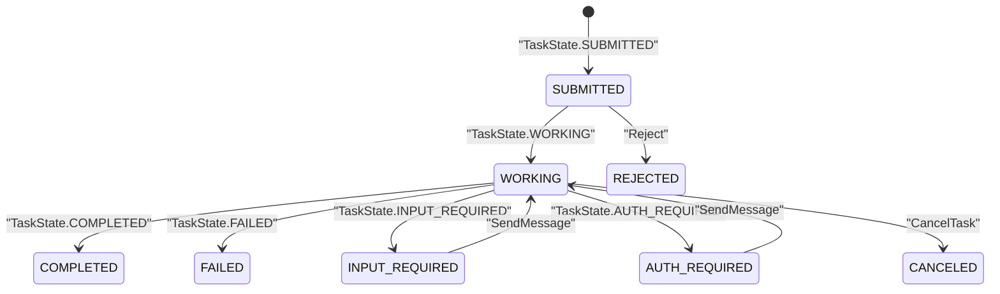

Sources: [specification/a2a.proto:184-217](), [docs/whats-new-v1.md:109-114]()

For details, see [Task Lifecycle & State Management](#2.5).

Sources: [specification/a2a.proto:184-217](), [docs/whats-new-v1.md:31](), [docs/whats-new-v1.md:109-114]()

---

## 2.6. Streaming & Asynchronous Operations

A2A handles long-running tasks through three delivery mechanisms:
1.  **Polling**: Repeatedly calling `GetTask` [specification/a2a.proto:45-53]().
2.  **Streaming**: Real-time events via Server-Sent Events (SSE) using `SendStreamingMessage` or `SubscribeToTask`. These return a `StreamResponse` which can contain a `TaskStatusUpdateEvent` or `TaskArtifactUpdateEvent` [specification/a2a.proto:294-310]().
3.  **Push Notifications**: Webhooks for disconnected scenarios, configured via `CreateTaskPushNotificationConfig`. Payloads use the standard `StreamResponse` format [specification/a2a.proto:89-100]().

For details, see [Streaming & Asynchronous Operations](#2.6).

Sources: [specification/a2a.proto:33-42](), [specification/a2a.proto:76-83](), [specification/a2a.proto:89-139](), [docs/whats-new-v1.md:60-74](), [docs/topics/streaming-and-async.md:1-85]()

---

## 2.7. Extensions System

The protocol can be extended without breaking core compatibility. Extensions are activated by the client using the `A2A-Extensions` header and must be declared in the `AgentCard` capabilities [specification/a2a.proto:403-413](). The `Task`, `Message`, and `Artifact` objects include an `extensions` field to carry supplemental data [specification/a2a.proto:181-182]().

*   **Data-only**: Adds custom fields to existing objects.
*   **Method**: Introduces new RPC operations.
*   **State Machine**: Adds new task states for specialized workflows.

For details, see [Extensions System](#2.7).

Sources: [docs/whats-new-v1.md:29-30](), [specification/a2a.proto:403-413]()

---

## 2.8. Security & Authentication

Security is modeled after OpenAPI 3.2. Agents declare `SecurityScheme`s in their `AgentCard` [specification/a2a.proto:486-512](). 

*   **Supported Schemes**: OAuth 2.0 (Authorization Code with PKCE, Device Code), mTLS, API Keys, OIDC, and HTTP Auth [specification/a2a.proto:486-637]().
*   **Integrity**: JWS and JSON Canonicalization (RFC 8785) are used for signing AgentCards to prevent tampering [docs/whats-new-v1.md:37-38]().
*   **Privacy**: Servers MUST only return tasks and data visible to the authenticated caller [docs/whats-new-v1.md:89-90]().

For details, see [Security & Authentication](#2.8).

Sources: [docs/whats-new-v1.md:36-42](), [specification/a2a.proto:486-637]()

---

## 2.9. Multi-Tenancy & Tenant Routing

The A2A protocol supports multi-tenancy, allowing a single endpoint to serve multiple agents or tenants. This is achieved through several mechanisms:

1.  **URL-Based Routing (Sub-Path)**: Agents advertise distinct URL prefixes in their `AgentCard`'s `supportedInterfaces` [docs/topics/multi-tenancy.md:19-51]().
2.  **Authentication Header-Based Routing**: Gateways use authentication credentials (e.g., bearer tokens, API keys) to route requests to the appropriate agent [docs/topics/multi-tenancy.md:58-72]().
3.  **Body-Based Routing Using the `tenant` Field**: Every A2A request message includes an optional `tenant` field. This opaque string, defined by the server operator, is advertised in the `AgentInterface` and echoed by the client in every request [specification/a2a.proto:26-27](), [docs/topics/multi-tenancy.md:73-108]().

For details, see [Multi-Tenancy & Tenant Routing](#2.9).

Sources: [docs/topics/multi-tenancy.md:1-123](), [docs/whats-new-v1.md:161-169](), [specification/a2a.proto:26-27]()

---

# Page: Three-Layer Architecture

# Three-Layer Architecture

<details>
<summary>Relevant source files</summary>

The following files were used as context for generating this wiki page:

- [docs/specification.md](docs/specification.md)
- [docs/topics/multi-tenancy.md](docs/topics/multi-tenancy.md)
- [docs/topics/streaming-and-async.md](docs/topics/streaming-and-async.md)
- [docs/whats-new-v1.md](docs/whats-new-v1.md)
- [specification/.api-linter.yaml](specification/.api-linter.yaml)
- [specification/a2a.proto](specification/a2a.proto)
- [specification/buf.yaml](specification/buf.yaml)

</details>


## Purpose and Scope

This document explains the A2A Protocol's three-layer architectural design, which separates the canonical data model (Layer 1), abstract operations (Layer 2), and protocol bindings (Layer 3) [docs/specification.md:45-104](). This separation enables protocol neutrality, extensibility, and interoperability across diverse transport mechanisms while maintaining consistent core semantics [docs/specification.md:98-104]().

Sources: [docs/specification.md:45-104]()

---

## Architectural Overview

The A2A Protocol is structured as three distinct layers. Each layer maintains clear boundaries with the others, ensuring that core semantics remain consistent across all transport bindings [docs/specification.md:45-104]().

### Three-Layer Structure and Code Mappings

Title: Three-Layer Architecture with Proto Message Mappings

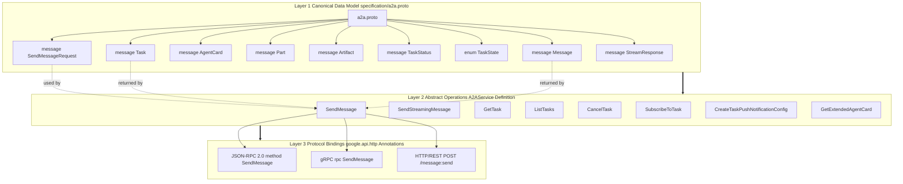

Sources: [docs/specification.md:46-106](), [specification/a2a.proto:19-140]()

### Layer Responsibilities

| Layer | Responsibility | Format | Normative Status |
|-------|---------------|--------|------------------|
| **Layer 1** | Define core data structures and message formats | Protocol Buffers (`a2a.proto`) | Normative [docs/specification.md:107-108]() |
| **Layer 2** | Describe fundamental capabilities and behaviors | Abstract operations (`A2AService`) | Normative [docs/specification.md:94-95]() |
| **Layer 3** | Map operations to specific transport protocols | JSON-RPC, gRPC, HTTP/REST | Normative per binding [docs/specification.md:96-97]() |

Sources: [docs/specification.md:92-119]()

---

## Layer 1: Canonical Data Model

Layer 1 defines the core data structures that all A2A implementations must understand. These are protocol-agnostic definitions expressed as Protocol Buffer messages [docs/specification.md:92-93]().

### The Normative Proto File

The file `specification/a2a.proto` is the single authoritative normative definition of all protocol data objects and request/response messages [docs/specification.md:107-108]().

Title: Canonical Data Model and Code Entity Generation

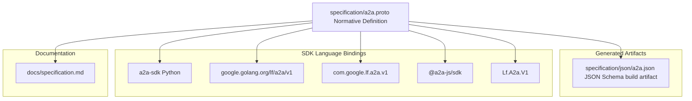

Key principles for the normative proto:
- SDK language bindings **MUST** be regenerated from the proto rather than edited manually [docs/specification.md:107-108]().
- The JSON schema `specification/json/a2a.json` is a non-normative build artifact [docs/specification.md:107-108]().
- Namespace options in `specification/a2a.proto` define the structure for various languages (e.g., `option csharp_namespace = "Lf.A2a.V1"`, `option java_package = "com.google.lf.a2a.v1"`) [specification/a2a.proto:12-16]().

Sources: [docs/specification.md:107-126](), [specification/a2a.proto:1-17]()

### Core Data Objects

Layer 1 defines the fundamental data structures used throughout the protocol.

| Message / Class | Description | Key Fields |
|-----------------|-------------|------------|
| `Task` | Core unit of action for A2A [specification/a2a.proto:163-167]() | `id`, `context_id`, `status`, `artifacts`, `history` [specification/a2a.proto:170-180]() |
| `Message` | Interaction turn [specification/a2a.proto:222-223]() | `role`, `parts`, `message_id`, `task_id` [specification/a2a.proto:225-235]() |
| `AgentCard` | Discovery metadata [specification/a2a.proto:441-442]() | `name`, `description`, `supported_interfaces`, `capabilities` [specification/a2a.proto:444-454]() |
| `Part` | Content container [specification/a2a.proto:274-275]() | `text`, `raw`, `url`, `data` (oneof) [specification/a2a.proto:277-285]() |
| `Artifact` | Output from a task [specification/a2a.proto:347-348]() | `id`, `name`, `parts`, `metadata` [specification/a2a.proto:350-357]() |

Sources: [specification/a2a.proto:163-454]()

---

## Layer 2: Abstract Operations

Layer 2 describes the behaviors that A2A agents must support, independent of transport [docs/specification.md:94-95]().

### Core Operations and Service Methods

Title: Abstract Operations and Code Entities

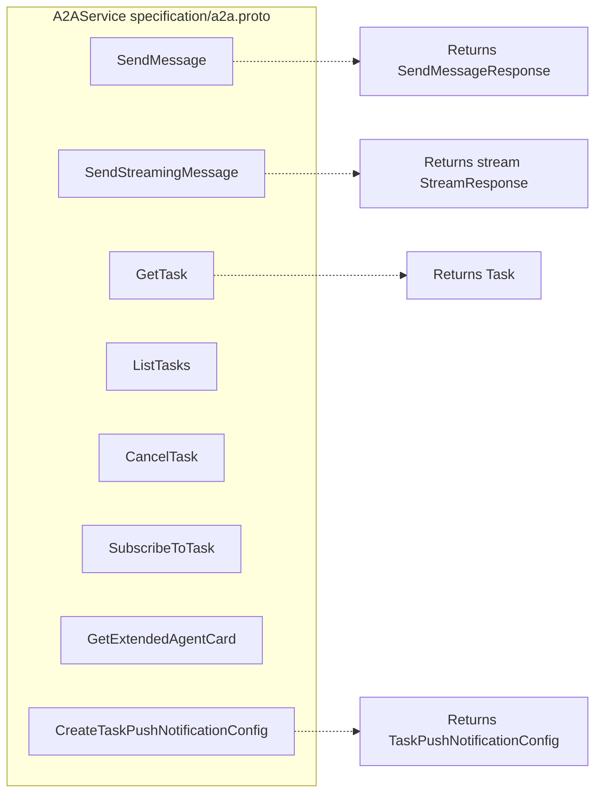

Operation Summary:
- `SendMessage`: Initiates or continues a task [specification/a2a.proto:21-30]().
- `SendStreamingMessage`: Streaming version of `SendMessage` for real-time updates [specification/a2a.proto:33-42]().
- `GetTask`: Retrieves the latest state of a task [specification/a2a.proto:45-53]().
- `ListTasks`: Filters and paginates existing tasks [specification/a2a.proto:55-62]().
- `CancelTask`: Requests cancellation of a task in progress [specification/a2a.proto:64-73]().
- `SubscribeToTask`: Monitors updates for a non-terminal task [specification/a2a.proto:76-83]().
- `GetExtendedAgentCard`: Fetches detailed metadata after authentication [specification/a2a.proto:122-129]().

Sources: [specification/a2a.proto:19-140]()

---

## Layer 3: Protocol Bindings

Layer 3 provides concrete mappings of the abstract operations to specific protocol bindings [docs/specification.md:96-97]().

### Method Mapping Across Bindings

The `specification/a2a.proto` file uses Google API annotations (`google.api.http`) to define the REST/HTTP mapping for each operation [specification/a2a.proto:22-137]().

| Operation | REST Endpoint | gRPC RPC |
|-----------|---------------|----------|
| `SendMessage` | `POST /message:send` [specification/a2a.proto:23]() | `SendMessage` |
| `SendStreamingMessage` | `POST /message:stream` [specification/a2a.proto:35]() | `SendStreamingMessage` |
| `GetTask` | `GET /tasks/{id}` [specification/a2a.proto:47]() | `GetTask` |
| `ListTasks` | `GET /tasks` [specification/a2a.proto:57]() | `ListTasks` |
| `CancelTask` | `POST /tasks/{id}:cancel` [specification/a2a.proto:66]() | `CancelTask` |
| `SubscribeToTask` | `GET /tasks/{id}:subscribe` [specification/a2a.proto:78]() | `SubscribeToTask` |
| `GetExtendedAgentCard` | `GET /extendedAgentCard` [specification/a2a.proto:124]() | `GetExtendedAgentCard` |

### JSON-RPC, HTTP/REST, and Multi-Tenancy Equivalence

The v1.0 release ensures formal specification of all three protocol bindings with equivalence guarantees [docs/whats-new-v1.md:38-39]().
- **JSON Mapping**: The protocol leverages standard ProtoJSON mapping for JSON serialization [docs/whats-new-v1.md:20-21]().
- **Enum Casing**: Enum values use `SCREAMING_SNAKE_CASE` (e.g., `SUBMITTED`, `WORKING`) in JSON for compliance with the ProtoJSON specification [docs/whats-new-v1.md:20-21]().
- **Multi-tenancy**: All bindings support native tenant scoping via the `{tenant}` path parameter in URL paths or the `tenant` field in request bodies [specification/a2a.proto:26, 38, 49, 59, 69, 80](), [docs/topics/multi-tenancy.md:73-82]().
- **Streaming**: Bindings typically use Server-Sent Events (SSE) or protocol-specific stream closure mechanisms for `SendStreamingMessage` and `SubscribeToTask` [docs/topics/streaming-and-async.md:5-17](), [docs/whats-new-v1.md:72-74]().

Sources: [specification/a2a.proto:22-137](), [docs/whats-new-v1.md:20-175](), [docs/topics/multi-tenancy.md:1-104](), [docs/topics/streaming-and-async.md:5-26]()

---

## Benefits of Layered Architecture

1. **Protocol Neutrality**: Core semantics remain consistent whether using gRPC for high performance or JSON-RPC/REST for web compatibility [docs/specification.md:100-104]().
2. **Deterministic Evolution**: Centering `specification/a2a.proto` as the normative source reduces specification drift and ensures consistent versioning [docs/specification.md:123-125](), [docs/whats-new-v1.md:11-16]().
3. **Enterprise Readiness**: Standardized mappings for error codes, authentication, and multi-tenancy are defined once and applied across all bindings [docs/whats-new-v1.md:35-42]().
4. **Opaque Execution**: Agents collaborate based on the shared Layer 1 data model without needing to share internal logic or framework-specific state [docs/specification.md:39]().

Sources: [docs/specification.md:39-125](), [docs/whats-new-v1.md:11-42]()

---

# Page: Core Data Types

# Core Data Types

<details>
<summary>Relevant source files</summary>

The following files were used as context for generating this wiki page:

- [docs/topics/agent-discovery.md](docs/topics/agent-discovery.md)
- [docs/topics/key-concepts.md](docs/topics/key-concepts.md)
- [docs/topics/life-of-a-task.md](docs/topics/life-of-a-task.md)
- [docs/topics/multi-tenancy.md](docs/topics/multi-tenancy.md)
- [docs/whats-new-v1.md](docs/whats-new-v1.md)
- [specification/.api-linter.yaml](specification/.api-linter.yaml)
- [specification/a2a.proto](specification/a2a.proto)
- [specification/buf.yaml](specification/buf.yaml)

</details>


This page documents the fundamental data structures that form the canonical data model of the A2A Protocol. These types are defined normatively in `specification/a2a.proto` [specification/a2a.proto:1-812]() and represent the core building blocks for all A2A operations and interactions.

Sources: [specification/a2a.proto:1-812](), [docs/specification.md:92-97]()

## Overview of Type Relationships

The A2A data model centers around stateful task execution and message exchange between agents. The following diagram illustrates how the core types relate to each other.

**Diagram: A2A Core Entity Relationships**
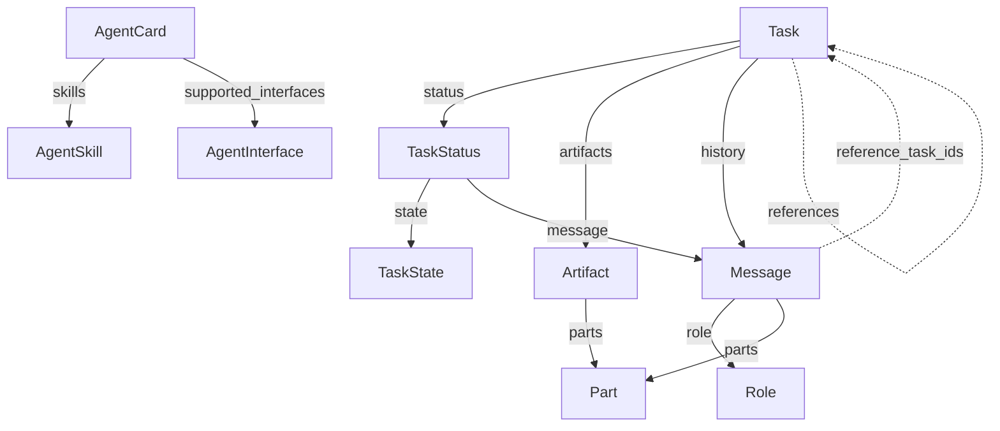

Sources: [specification/a2a.proto:163-393](), [docs/topics/key-concepts.md:26-32]()

## Task

The `Task` message is the fundamental unit of action in the A2A protocol. It represents a stateful execution that progresses through a defined lifecycle and accumulates artifacts as outputs [specification/a2a.proto:163-166]().

**Diagram: Task Message Structure Bridging Code and Natural Language**
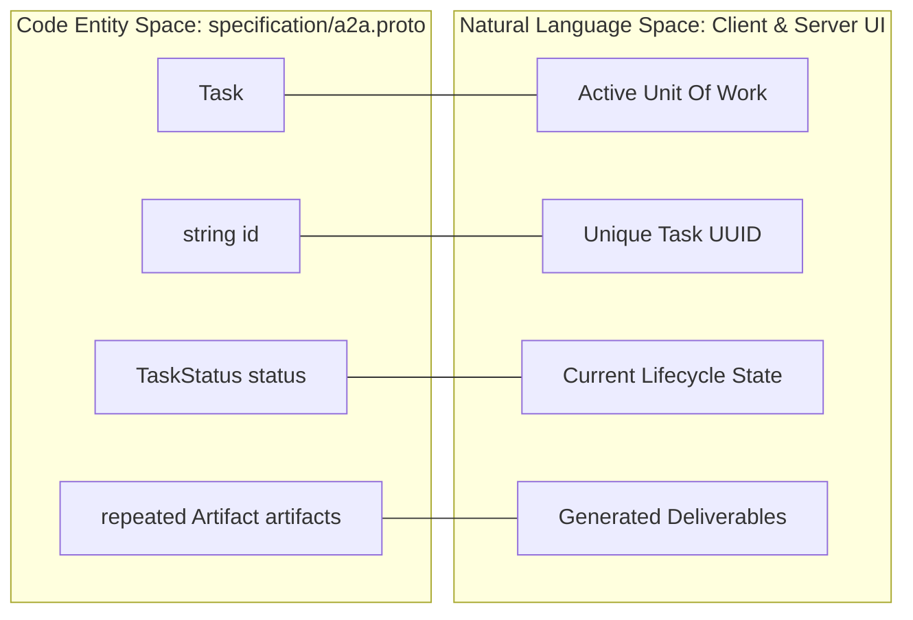

Sources: [specification/a2a.proto:167-184](), [docs/topics/key-concepts.md:29]()

### Task Fields

| Field | Type | Required | Description |
|-------|------|----------|-------------|
| `id` | string | Yes | Unique identifier (UUID) generated by the server for a new task [specification/a2a.proto:170](). |
| `context_id` | string | No | Identifier for the contextual collection of interactions (tasks and messages) [specification/a2a.proto:173](). |
| `status` | `TaskStatus` | Yes | Current status including state and optional message [specification/a2a.proto:175](). |
| `artifacts` | `Artifact[]` | No | Set of output artifacts produced by the task [specification/a2a.proto:177](). |
| `history` | `Message[]` | No | History of message interactions for this task [specification/a2a.proto:180](). |
| `metadata` | `google.protobuf.Struct` | No | Custom structured data stored with the task [specification/a2a.proto:183](). |

Sources: [specification/a2a.proto:163-184](), [docs/topics/key-concepts.md:29](), [docs/topics/life-of-a-task.md:18-20](), [docs/topics/life-of-a-task.md:81-97]()

## TaskStatus and TaskState

The `TaskStatus` message encapsulates the current state of a task, including when that state was recorded and an optional explanatory message [specification/a2a.proto:211-219]().

### TaskStatus Fields

| Field | Type | Required | Description |
|-------|------|----------|-------------|
| `state` | `TaskState` | Yes | Current lifecycle state [specification/a2a.proto:213](). |
| `message` | `Message` | No | Optional message associated with the status [specification/a2a.proto:215](). |
| `timestamp` | `Timestamp` | No | Time when the status was recorded [specification/a2a.proto:217](). |

Sources: [specification/a2a.proto:211-219]()

### TaskState Enum

The `TaskState` enum defines the possible lifecycle states. Enums use `SCREAMING_SNAKE_CASE` for compliance with ProtoJSON specifications [docs/whats-new-v1.md:20]().

| State | Description |
|-------|-------------|
| `TASK_STATE_SUBMITTED` | Task successfully submitted [specification/a2a.proto:191](). |
| `TASK_STATE_WORKING` | Task is actively being processed [specification/a2a.proto:193](). |
| `TASK_STATE_COMPLETED` | Task finished successfully (terminal) [specification/a2a.proto:195](). |
| `TASK_STATE_FAILED` | Task finished with an error (terminal) [specification/a2a.proto:197](). |
| `TASK_STATE_CANCELED` | Task was canceled (terminal) [specification/a2a.proto:199](). |
| `TASK_STATE_INPUT_REQUIRED` | Agent requires user input (interrupted) [specification/a2a.proto:201](). |
| `TASK_STATE_AUTH_REQUIRED` | Authentication required (interrupted) [specification/a2a.proto:203](). |
| `TASK_STATE_REJECTED` | Agent decided not to perform the task (terminal) [specification/a2a.proto:205](). |

Sources: [specification/a2a.proto:186-209](), [docs/whats-new-v1.md:20]()

**Diagram: Task State Machine**
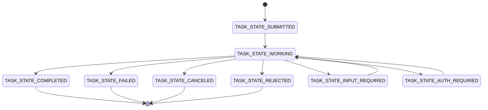

Sources: [specification/a2a.proto:186-219](), [docs/topics/life-of-a-task.md:10-14]()

## Message

The `Message` type represents a single unit of communication between client and server. It is the building block for conversational history and immediate responses [specification/a2a.proto:260-277]().

### Message Fields

| Field | Type | Required | Description |
|-------|------|----------|-------------|
| `message_id` | string | Yes | Unique identifier for the message [specification/a2a.proto:263](). |
| `context_id` | string | No | Context ID of the message [specification/a2a.proto:265](). |
| `task_id` | string | No | Task ID if associated with a task [specification/a2a.proto:267](). |
| `role` | `Role` | Yes | Identifies sender (`ROLE_USER` or `ROLE_AGENT`) [specification/a2a.proto:269](). |
| `parts` | `Part[]` | Yes | Content of the message [specification/a2a.proto:271](). |
| `metadata` | `Struct` | No | Additional metadata [specification/a2a.proto:273](). |
| `reference_task_ids` | `string[]` | No | Task IDs referenced for context [specification/a2a.proto:277](). |

Sources: [specification/a2a.proto:244-277](), [docs/topics/key-concepts.md:30]()

## Part

The `Part` message is the smallest unit of content, allowing A2A to be modality agnostic. It uses a `oneof` field to represent different content types [specification/a2a.proto:222]().

| Field | Type | Required | Description |
|-------|------|----------|-------------|
| `text` | string | OneOf | Plain text content [specification/a2a.proto:223](). |
| `raw` | bytes | OneOf | Inline binary data [specification/a2a.proto:225](). |
| `url` | string | OneOf | Reference to external content [specification/a2a.proto:227](). |
| `data` | `Value` | OneOf | Structured JSON data [specification/a2a.proto:229](). |
| `media_type` | string | No | MIME type (e.g., `"image/png"`) [specification/a2a.proto:233](). |
| `filename` | string | No | Optional filename [specification/a2a.proto:235](). |

Sources: [specification/a2a.proto:221-242](), [docs/topics/key-concepts.md:31](), [docs/topics/key-concepts.md:70-82]()

## Artifact

The `Artifact` message represents a tangible output or a concrete result generated by a remote agent during task processing [specification/a2a.proto:279-293]().

### Artifact Fields

| Field | Type | Required | Description |
|-------|------|----------|-------------|
| `artifact_id` | string | Yes | Unique identifier within the task [specification/a2a.proto:281](). |
| `name` | string | No | Human-readable name [specification/a2a.proto:283](). |
| `description` | string | No | Human-readable description [specification/a2a.proto:285](). |
| `parts` | `Part[]` | Yes | Content of the artifact [specification/a2a.proto:287](). |
| `metadata` | `Struct` | No | Additional metadata [specification/a2a.proto:289](). |

Sources: [specification/a2a.proto:279-293](), [docs/topics/key-concepts.md:32](), [docs/topics/key-concepts.md:83-89]()

## AgentCard

The `AgentCard` is the discovery mechanism for an agent, describing its identity, capabilities, and skills [specification/a2a.proto:352-393]().

### AgentCard Fields

| Field | Type | Required | Description |
|-------|------|----------|-------------|
| `name` | string | Yes | Name of the agent [specification/a2a.proto:358](). |
| `supported_interfaces` | `AgentInterface[]` | Yes | Contact endpoints and protocol bindings [specification/a2a.proto:364](). |
| `capabilities` | `AgentCapabilities` | Yes | Supported features like streaming or push [specification/a2a.proto:371](). |
| `skills` | `AgentSkill[]` | Yes | List of agent abilities and examples [specification/a2a.proto:386](). |

Sources: [specification/a2a.proto:352-393](), [docs/topics/key-concepts.md:28](), [docs/topics/agent-discovery.md:7-15](), [docs/whats-new-v1.md:122-130]()

## Type System Mapping

The following diagram maps Protobuf types to their expected representations in JSON-RPC or REST bindings, bridging the gap between code entities and runtime payloads.

**Diagram: Protobuf to JSON Mapping Bridging Code Entity Space and Natural Language Space**
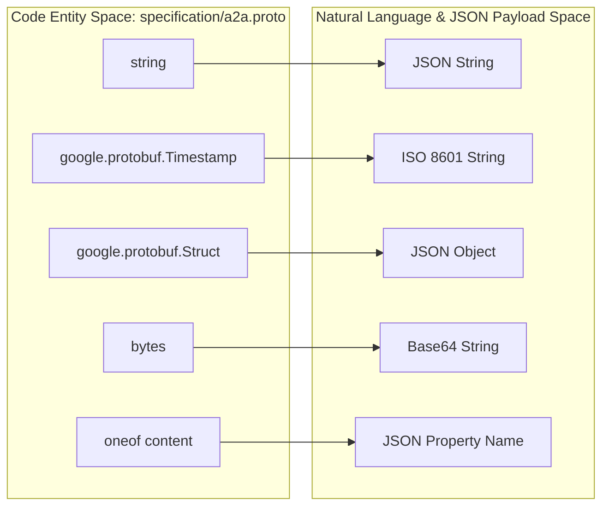

Sources: [docs/whats-new-v1.md:19-24](), [specification/a2a.proto:1-10]()

---

# Page: RPC Operations & Protocol Bindings

# RPC Operations & Protocol Bindings

<details>
<summary>Relevant source files</summary>

The following files were used as context for generating this wiki page:

- [docs/specification.md](docs/specification.md)
- [docs/topics/multi-tenancy.md](docs/topics/multi-tenancy.md)
- [docs/topics/streaming-and-async.md](docs/topics/streaming-and-async.md)
- [docs/whats-new-v1.md](docs/whats-new-v1.md)
- [specification/.api-linter.yaml](specification/.api-linter.yaml)
- [specification/a2a.proto](specification/a2a.proto)
- [specification/buf.yaml](specification/buf.yaml)

</details>


## Purpose and Scope

This document provides a comprehensive reference for all A2A protocol operations and their concrete implementations across supported protocol bindings. It details the core RPC methods that form the operational layer of the A2A protocol and explains how each operation maps to gRPC, JSON-RPC 2.0, and HTTP/REST protocol bindings.

The A2A protocol is designed with a three-layer architecture [docs/specification.md:46-90]() where Layer 1 defines the canonical data model in Protobuf, Layer 2 describes abstract operations, and Layer 3 provides concrete protocol bindings. This ensures that core semantics remain consistent regardless of whether an agent communicates via gRPC, REST, or JSON-RPC [docs/specification.md:98-103]().

Sources: [docs/specification.md:1-103](), [specification/a2a.proto:18-140]()

---

## Overview of A2A Operations

The A2A protocol defines core operations within the `A2AService` [specification/a2a.proto:19-140](). These operations enable discovery, task initiation, lifecycle management, and asynchronous notifications. The v1.0 release standardized these method names to follow `UpperCamelCase` across all bindings [docs/whats-new-v1.md:19-20]().

**Diagram: Natural Language to Code Entity Mapping for A2A Operations**

```mermaid
graph TB
    subgraph "CodeEntitySpace[specification/a2a.proto]"
        direction TB
        AS["service A2AService"]
        SM["rpc SendMessage"]
        SSM["rpc SendStreamingMessage"]
        GT["rpc GetTask"]
        LT["rpc ListTasks"]
        CT["rpc CancelTask"]
        ST["rpc SubscribeToTask"]
        EAC["rpc GetExtendedAgentCard"]
        
        subgraph PushNotificationConfigs
            CPN["rpc CreateTaskPushNotificationConfig"]
            GPN["rpc GetTaskPushNotificationConfig"]
            LPN["rpc ListTaskPushNotificationConfigs"]
            DPN["rpc DeleteTaskPushNotificationConfig"]
        end

        AS --> SM
        AS --> SSM
        AS --> GT
        AS --> LT
        AS --> CT
        AS --> ST
        AS --> EAC
        AS --> CPN
        AS --> GPN
        AS --> LPN
        AS --> DPN
    end
    
    subgraph NaturalLanguageSpace
        NL_DISC["Agent Discovery"]
        NL_MSG["Agent Messaging"]
        NL_TASK["Task Management"]
        NL_WEB["Webhooks & Notifications"]
    end
    
    NL_DISC --- EAC
    NL_MSG --- SM
    NL_MSG --- SSM
    NL_TASK --- GT
    NL_TASK --- LT
    NL_TASK --- CT
    NL_TASK --- ST
    NL_WEB --- CPN
    NL_WEB --- GPN
    NL_WEB --- LPN
    NL_WEB --- DPN
```

Sources: [specification/a2a.proto:19-140](), [docs/specification.md:54-62](), [docs/whats-new-v1.md:48-161]()

---

## Core RPC Operations Reference

### 1. SendMessage
Initiates or continues an interaction. It can return a direct `Message` for stateless turns or a `Task` for long-running work [specification/a2a.proto:21-30]().

*   **Input:** `SendMessageRequest` [specification/a2a.proto:642-652]()
*   **Output:** `SendMessageResponse` [specification/a2a.proto:716-724]()
*   **Behavior:** Controlled by `SendMessageConfiguration` [specification/a2a.proto:143-161](). If `return_immediately` is true, the server returns as soon as the task is created [specification/a2a.proto:160]().

### 2. SendStreamingMessage
The streaming version of `SendMessage` [specification/a2a.proto:33](). It allows for real-time interaction and status updates via a server-to-client stream.

*   **Output:** `stream StreamResponse` [specification/a2a.proto:33]().
*   **Events:** Stream events no longer use a `kind` discriminator; they are identified by the presence of specific fields like `task`, `message`, `status_update`, or `artifact_update` [docs/whats-new-v1.md:70-72]().

### 3. GetTask
Retrieves the current state of a specific `Task` [specification/a2a.proto:45-53]().

*   **Input:** `GetTaskRequest` [specification/a2a.proto:654-664]().
*   **Key Field:** `history_length` allows the caller to limit how many previous messages are returned in the task history [specification/a2a.proto:661-663]().

### 4. ListTasks
Lists tasks matching a filter, supporting cursor-based pagination [specification/a2a.proto:55-62]().

*   **Filters:** Supports filtering by `context_id`, `status` (`TaskState`), and `status_timestamp_after` [specification/a2a.proto:667-691]().
*   **Pagination:** Uses `page_size` and `page_token` for scalable retrieval [specification/a2a.proto:680-683]().

### 5. CancelTask
Requests the cancellation of a task in progress [specification/a2a.proto:64-73]().

### 6. SubscribeToTask
Subscribes to updates for an existing task that is not yet in a terminal state [specification/a2a.proto:76-83](). This replaces the legacy `resubscribe` operation [docs/whats-new-v1.md:141]().

### 7. Push Notification Operations
A set of methods to manage webhooks for task updates:
*   `CreateTaskPushNotificationConfig`: Creates a new configuration [specification/a2a.proto:90-100]().
*   `GetTaskPushNotificationConfig`: Retrieves a specific config [specification/a2a.proto:102-110]().
*   `ListTaskPushNotificationConfigs`: Lists all configs for a task [specification/a2a.proto:112-120]().
*   `DeleteTaskPushNotificationConfig`: Removes a config [specification/a2a.proto:131-139]().

### 8. GetExtendedAgentCard
Fetches detailed agent metadata, typically requiring authentication. This is distinct from the public `/.well-known/agent-card.json` [specification/a2a.proto:122-129]().

Sources: [specification/a2a.proto:19-140](), [docs/whats-new-v1.md:48-161]()

---

## Protocol Bindings & Mappings

The A2A protocol maps abstract operations to concrete transports using `google.api.http` annotations in the Protobuf definition [specification/a2a.proto:22-137]().

**Diagram: Protocol Binding Data Flow from Transport to `A2AService`**

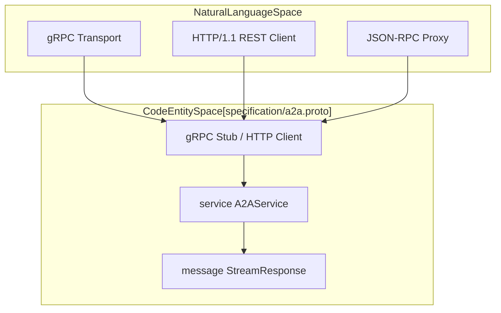

Sources: [specification/a2a.proto:19-140](), [docs/whats-new-v1.md:162-175]()

### HTTP/REST Mapping Table

The following table summarizes the RESTful mapping for core operations. All paths support an optional `{tenant}` prefix for multi-tenancy [specification/a2a.proto:26, 38, 49, 59, 69, 80, 95, 106, 116, 126, 135]().

| Operation | HTTP Verb | Path Pattern | Body |
| :--- | :--- | :--- | :--- |
| `SendMessage` | `POST` | `/message:send` | `*` (Full Request) |
| `SendStreamingMessage` | `POST` | `/message:stream` | `*` (Full Request) |
| `GetTask` | `GET` | `/tasks/{id=*}` | N/A |
| `ListTasks` | `GET` | `/tasks` | N/A |
| `CancelTask` | `POST` | `/tasks/{id=*}:cancel` | `*` |
| `SubscribeToTask` | `GET` | `/tasks/{id=*}:subscribe` | N/A |
| `GetExtendedAgentCard` | `GET` | `/extendedAgentCard` | N/A |

Sources: [specification/a2a.proto:21-139]()

### JSON-RPC 2.0 Binding
JSON-RPC 2.0 bindings follow the method naming convention defined in the abstract operations.
*   **Request:** Uses standard JSON-RPC 2.0 envelope with parameters mapped from the Protobuf message.
*   **Streaming:** Maps `SendStreamingMessage` and `SubscribeToTask` to Server-Sent Events (SSE) where each event is a JSON-serialized `StreamResponse` [docs/whats-new-v1.md:159]().

Sources: [docs/whats-new-v1.md:159]()

### gRPC Binding
The gRPC binding is the native implementation of the `A2AService` [specification/a2a.proto:19](). It uses HTTP/2 server-side streaming for all methods returning `stream StreamResponse` [specification/a2a.proto:33, 76](). Multi-tenancy is supported via the `tenant` field in the request messages [docs/whats-new-v1.md:171]().

Sources: [specification/a2a.proto:19-83](), [docs/whats-new-v1.md:162-175](), [docs/topics/multi-tenancy.md:73-83]()

---

## Multi-Tenancy Routing

A2A supports native multi-tenancy through the `tenant` field present in all request messages [docs/topics/multi-tenancy.md:73-76](). This allows a single endpoint to route traffic to multiple agents.

*   **Discovery:** The `tenant` value is advertised in the `AgentInterface` entry of the Agent Card [docs/topics/multi-tenancy.md:81-85]().
*   **Client Requirement:** Clients **MUST** echo the `tenant` value from the selected `AgentInterface` back in every request [docs/topics/multi-tenancy.md:98-101]().
*   **Binding Mappings:** In HTTP/REST, the `tenant` is typically represented as a path prefix (e.g., `/{tenant}/tasks`) [specification/a2a.proto:49]().

Sources: [docs/topics/multi-tenancy.md:1-103](), [specification/a2a.proto:26-136]()

---

## Custom Protocol Bindings

Implementers may expose A2A operations over transports not covered by standard bindings (e.g., WebSockets, MQTT). 

*   **Declaration:** Custom bindings are listed in the `supportedInterfaces` of an `AgentCard` using a unique URI in the `protocolBinding` field.
*   **Requirements:** Must support all core operations, preserve the Protobuf data model, and maintain consistent behavior with standard bindings.
*   **Governance:** Official custom bindings use the `https://a2a-protocol.org/bindings/` URI prefix.

Sources: [docs/specification.md:1-103]()

---

## Push Notification Configurations

Push notifications allow an agent to notify a client of task updates via webhooks, reducing the need for polling.

**Key Data Structure:** `TaskPushNotificationConfig` [specification/a2a.proto:464-478]()
*   `url`: The webhook destination [specification/a2a.proto:472]().
*   `token`: An optional security token for simple verification [specification/a2a.proto:474]().
*   `authentication`: Full `AuthenticationInfo` for complex security schemes [specification/a2a.proto:476]().

**Workflow:**
1.  **Registration:** Client calls `CreateTaskPushNotificationConfig` with a target `url` [specification/a2a.proto:90]().
2.  **Trigger:** When the `Task` status changes or an artifact is produced, the Agent initiates an HTTP POST to the registered `url`.
3.  **Payload:** The payload of the push notification is a `StreamResponse` object, ensuring consistency with streaming bindings [docs/whats-new-v1.md:159]().

Sources: [specification/a2a.proto:90-120](), [specification/a2a.proto:464-478](), [docs/whats-new-v1.md:146-161]()

---

# Page: Agent Discovery via AgentCard

# Agent Discovery via AgentCard

<details>
<summary>Relevant source files</summary>

The following files were used as context for generating this wiki page:

- [docs/topics/agent-discovery.md](docs/topics/agent-discovery.md)
- [docs/topics/key-concepts.md](docs/topics/key-concepts.md)
- [docs/topics/life-of-a-task.md](docs/topics/life-of-a-task.md)
- [docs/topics/multi-tenancy.md](docs/topics/multi-tenancy.md)
- [docs/whats-new-v1.md](docs/whats-new-v1.md)
- [specification/.api-linter.yaml](specification/.api-linter.yaml)
- [specification/a2a.proto](specification/a2a.proto)
- [specification/buf.yaml](specification/buf.yaml)

</details>


## Purpose and Scope

This page documents the **AgentCard** mechanism for agent discovery in the A2A protocol. It covers the canonical data structure defined in the protocol specification (`specification/a2a.proto`), the standardized well-known URI discovery pattern, capability and skill declarations, interface specifications, and cryptographic signature verification for secure agent discovery.

For broader discussion of discovery strategies (registries, direct configuration) and deployment patterns, see [docs/topics/agent-discovery.md](). For authentication and authorization details referenced in AgentCards, see [docs/whats-new-v1.md](). For the complete data model definitions, see [specification/a2a.proto]().

Sources: [specification/a2a.proto](), [docs/topics/agent-discovery.md]()

## AgentCard Structure Overview

The `AgentCard` is a JSON metadata document that serves as a digital "business card" for an A2A-compliant agent. It provides essential information about the agent's identity, supported interfaces, capabilities, skills, and security requirements [docs/topics/agent-discovery.md:5-15]().

### Core Components

The AgentCard data structure consists of primary component groups that define the agent's profile and technical requirements.

**Diagram: AgentCard Component Architecture to Code Entities**
```mermaid
graph TB
    AgentCard["lf.a2a.v1.AgentCard<br/>(specification/a2a.proto:356-393)"]
    
    Identity["Identity Metadata<br/>name, description, version, provider"]
    Interfaces["supported_interfaces[]<br/>lf.a2a.v1.AgentInterface"]
    Capabilities["capabilities<br/>lf.a2a.v1.AgentCapabilities"]
    Skills["skills[]<br/>lf.a2a.v1.AgentSkill"]
    Security["security_schemes<br/>lf.a2a.v1.SecurityScheme"]
    Signatures["signatures[]<br/>lf.a2a.v1.AgentCardSignature"]
    
    AgentCard --> Identity
    AgentCard --> Interfaces
    AgentCard --> Capabilities
    AgentCard --> Skills
    AgentCard --> Security
    AgentCard --> Signatures
    
    Interfaces --> AgentInterface["AgentInterface<br/>url, protocol_binding,<br/>tenant, protocol_version"]
    Capabilities --> AgentCapabilities["AgentCapabilities<br/>streaming, push_notifications,<br/>extended_agent_card, extensions[]"]
    Skills --> AgentSkill["AgentSkill<br/>id, name, description,<br/>tags, examples, input/output_modes"]
    Signatures --> AgentCardSignature["AgentCardSignature<br/>protected, signature, header"]
```
Sources: [specification/a2a.proto:356-393](), [docs/topics/agent-discovery.md:7-13]()

### Normative Definition

The canonical definition of `AgentCard` is provided in Protocol Buffers [specification/a2a.proto:356-393]():

| Field | Type | Required | Description |
|-------|------|----------|-------------|
| `name` | string | Yes | Human-readable agent name [specification/a2a.proto:358-358]() |
| `description` | string | Yes | Description of agent's purpose [specification/a2a.proto:360-360]() |
| `supported_interfaces` | array of `AgentInterface` | Yes | Ordered list of protocol bindings [specification/a2a.proto:363-363]() |
| `provider` | `AgentProvider` | No | Service provider information [specification/a2a.proto:365-365]() |
| `version` | string | Yes | Agent version (e.g., "1.0.0") [specification/a2a.proto:367-367]() |
| `documentation_url` | string | No | URL to additional documentation [specification/a2a.proto:369-369]() |
| `capabilities` | `AgentCapabilities` | Yes | Supported A2A features [specification/a2a.proto:372-372]() |
| `security_schemes` | map of string to `SecurityScheme` | No | Available authentication methods [specification/a2a.proto:375-375]() |
| `security_requirements` | array of `SecurityRequirement` | No | Required authentication for agent access [specification/a2a.proto:378-378]() |
| `default_input_modes` | array of string | Yes | Supported input MIME types (e.g., "text/plain") [specification/a2a.proto:381-381]() |
| `default_output_modes` | array of string | Yes | Supported output MIME types [specification/a2a.proto:384-384]() |
| `skills` | array of `AgentSkill` | Yes | Agent capabilities and functions [specification/a2a.proto:387-387]() |
| `signatures` | array of `AgentCardSignature` | No | JWS signatures for verification [specification/a2a.proto:392-392]() |

Sources: [specification/a2a.proto:356-393](), [docs/topics/agent-discovery.md:7-13]()

## Well-Known URI Discovery Pattern

The A2A protocol standardizes agent discovery through the **well-known URI** pattern defined in [RFC 8615](https://datatracker.ietf.org/doc/html/rfc8615) [docs/topics/agent-discovery.md:25-26]().

### Discovery Endpoint

Agents make their Agent Card discoverable by hosting it at a standardized path [docs/topics/agent-discovery.md:25-26]():

```
https://{agent-server-domain}/.well-known/agent-card.json
```

Sources: [docs/topics/agent-discovery.md:21-31]()

### Discovery Flow

**Diagram: Agent Discovery Sequence Bridging to A2AService**
```mermaid
sequenceDiagram
    participant Client as "A2A Client"
    participant WellKnown as "/.well-known/agent-card.json"
    participant Service as "lf.a2a.v1.A2AService"
    
    Client->>WellKnown: "GET /.well-known/agent-card.json"
    Note over WellKnown: "Standard discovery endpoint<br/>(RFC 8615)"
    WellKnown-->>Client: "200 OK<br/>Content-Type: application/json<br/>{AgentCard JSON}"
    
    Note over Client: "Parse AgentCard"
    Note over Client: "Validate signatures (optional)"
    Note over Client: "Select protocol binding from<br/>supported_interfaces[]"
    
    Client->>Service: "SendMessage / Request to selected URL<br/>(specification/a2a.proto:21-30)"
    Service-->>Client: "Response per protocol binding"
```
Sources: [docs/topics/agent-discovery.md:21-40](), [specification/a2a.proto:19-30](), [specification/a2a.proto:356-393]()

### HTTP Caching Semantics

Servers hosting Agent Card endpoints should include HTTP caching headers to reduce unnecessary network requests [docs/topics/agent-discovery.md:94-97]():

- **`Cache-Control`**: Includes a `max-age` directive [docs/topics/agent-discovery.md:100-100]().
- **`ETag`**: Derived from the card's `version` field or a content hash for conditional requests [docs/topics/agent-discovery.md:100-101]().

Clients should honor standard HTTP caching semantics and use conditional requests like `If-None-Match` [docs/topics/agent-discovery.md:103-105]().

Sources: [docs/topics/agent-discovery.md:94-108]()

## AgentInterface Declarations

The `supported_interfaces` array declares the protocol bindings and endpoints where the agent can be accessed [specification/a2a.proto:363-363](). This structure supports multi-tenancy through an optional `tenant` field [docs/topics/multi-tenancy.md:81-93]().

| Field | Type | Required | Description |
|-------|------|----------|-------------|
| `url` | string | Yes | HTTPS endpoint for this interface [specification/a2a.proto:340-340]() |
| `protocol_binding` | string | Yes | Protocol binding type (e.g., JSONRPC, GRPC) [specification/a2a.proto:343-343]() |
| `tenant` | string | No | Opaque string for multi-tenant routing [specification/a2a.proto:346-346]() |
| `protocol_version` | string | Yes | A2A protocol version for this interface [specification/a2a.proto:349-349]() |

Sources: [specification/a2a.proto:336-350](), [docs/whats-new-v1.md:129-130](), [docs/topics/multi-tenancy.md:81-93]()

## Capabilities Declaration

The `AgentCapabilities` message declares optional A2A features supported by the agent [specification/a2a.proto:406-415]().

| Field | Type | Required | Description |
|-------|------|----------|-------------|
| `streaming` | boolean | No | Supports `SendStreamingMessage` and `SubscribeToTask` [docs/topics/streaming-and-async.md:11-11]() |
| `push_notifications` | boolean | No | Supports asynchronous push notifications [docs/topics/streaming-and-async.md:49-49]() |
| `extensions` | array of string | No | List of supported protocol extensions [specification/a2a.proto:412-412]() |
| `extended_agent_card` | boolean | No | Supports the `GetExtendedAgentCard` operation [docs/whats-new-v1.md:126-126]() |

Sources: [specification/a2a.proto:406-415](), [docs/topics/streaming-and-async.md:11-49]()

### Capability Validation Logic

The protocol requires agents to declare support for specific features before clients attempt to use them.

**Diagram: Capability Validation Logic**
```mermaid
graph TB
    ClientAttempt["Client Attempts Operation"]
    
    CheckStreaming{"Operation requires<br/>streaming capability?"}
    CheckPush{"Operation requires<br/>push_notifications?"}
    CheckExtended{"Operation is<br/>GetExtendedAgentCard?"}
    
    ValidateStreaming{"capabilities.streaming<br/>== true?"}
    ValidatePush{"capabilities.push_notifications<br/>== true?"}
    ValidateExtended{"capabilities.extended_agent_card<br/>== true?"}
    
    Success["Operation Proceeds"]
    ErrorStreaming["Return UnsupportedOperationError"]
    ErrorPush["Return PushNotificationNotSupportedError"]
    ErrorExtended["Return UnsupportedOperationError"]
    
    ClientAttempt --> CheckStreaming
    CheckStreaming -->|Yes| ValidateStreaming
    CheckStreaming -->|No| CheckPush
    
    ValidateStreaming -->|Yes| Success
    ValidateStreaming -->|No| ErrorStreaming
    
    CheckPush -->|Yes| ValidatePush
    CheckPush -->|No| CheckExtended
    
    ValidatePush -->|Yes| Success
    ValidatePush -->|No| ErrorPush
    
    CheckExtended -->|Yes| ValidateExtended
    CheckExtended -->|No| Success
    
    ValidateExtended -->|Yes| Success
    ValidateExtended -->|No| ErrorExtended
```
Sources: [specification/a2a.proto:406-415](), [docs/topics/streaming-and-async.md:11-49]()

## AgentSkill Definitions

Skills represent the distinct capabilities or functions an agent can perform, helping clients determine suitability for a task [docs/topics/agent-discovery.md:13-13]().

| Field | Type | Required | Description |
|-------|------|----------|-------------|
| `id` | string | Yes | Unique identifier for the skill [specification/a2a.proto:432-432]() |
| `name` | string | Yes | Human-readable skill name [specification/a2a.proto:434-434]() |
| `description` | string | Yes | Detailed description of functionality [specification/a2a.proto:436-436]() |
| `tags` | array of string | Yes | Keywords for discovery [specification/a2a.proto:438-438]() |
| `examples` | array of string | No | Example prompts or scenarios [specification/a2a.proto:440-440]() |
| `input_modes` | array of string | No | Supported input MIME types [specification/a2a.proto:442-442]() |
| `output_modes` | array of string | No | Supported output MIME types [specification/a2a.proto:444-444]() |

Sources: [specification/a2a.proto:430-447](), [docs/topics/agent-discovery.md:13-13]()

## Signature Verification

AgentCards may include signatures to verify authenticity and integrity. This process utilizes standard cryptographic practices (JWS and JSON Canonicalization per RFC 8785) to sign the metadata [docs/whats-new-v1.md:37-37]().

### Signature Verification Process

**Diagram: JWS Verification Flow**
```mermaid
graph TB
    Start["Client receives AgentCard"]
    
    CheckSig{"signatures[]<br/>present?"}
    
    Extract["Extract card without signatures field"]
    Canonicalize["Canonicalize JSON<br/>(RFC 8785)"]
    DecodeProtected["Decode protected header<br/>(base64url → JSON)"]
    ExtractAlg["Extract algorithm (alg)<br/>and key ID (kid)"]
    RetrieveKey["Retrieve public key"]
    VerifySignature["Verify signature using<br/>public key and algorithm"]
    
    Valid{"Signature<br/>valid?"}
    Accept["Accept AgentCard as verified"]
    Reject["Reject AgentCard or proceed unverified"]
    
    Start --> CheckSig
    CheckSig -->|Yes| Extract
    CheckSig -->|No| Accept
    
    Extract --> Canonicalize
    Canonicalize --> DecodeProtected
    DecodeProtected --> ExtractAlg
    ExtractAlg --> RetrieveKey
    RetrieveKey --> VerifySignature
    VerifySignature --> Valid
    
    Valid -->|Yes| Accept
    Valid -->|No| Reject
```
Sources: [specification/a2a.proto:451-461](), [docs/whats-new-v1.md:37-37](), [docs/whats-new-v1.md:127-127]()

## Extended Agent Cards

The `GetExtendedAgentCard` operation allows authenticated clients to retrieve a more detailed version of the AgentCard, potentially containing sensitive skills or metadata [docs/topics/agent-discovery.md:84-85](). Support for this is indicated by the `capabilities.extended_agent_card` flag [docs/whats-new-v1.md:126-126]().

### Extended Card Flow

**Diagram: Extended Discovery Sequence with GetExtendedAgentCard**
```mermaid
sequenceDiagram
    participant Client as "A2A Client"
    participant Public as "/.well-known/agent-card.json"
    participant Auth as "Authentication Service"
    participant Service as "lf.a2a.v1.A2AService.GetExtendedAgentCard"
    
    Client->>Public: "GET /.well-known/agent-card.json"
    Public-->>Client: "Public AgentCard<br/>capabilities.extended_agent_card: true"
    
    Client->>Auth: "Authenticate per security_schemes"
    Auth-->>Client: "Authentication token"
    
    Client->>Service: "GetExtendedAgentCard(GetExtendedAgentCardRequest)"
    Note over Service: "Validate authentication and tenant scope"
    Service-->>Client: "Detailed AgentCard<br/>(additional skills/metadata)"
```
Sources: [docs/topics/agent-discovery.md:84-85](), [specification/a2a.proto:122-129](), [docs/whats-new-v1.md:125-126]()

---

# Page: Task Lifecycle & State Management

# Task Lifecycle & State Management

<details>
<summary>Relevant source files</summary>

The following files were used as context for generating this wiki page:

- [docs/topics/agent-discovery.md](docs/topics/agent-discovery.md)
- [docs/topics/key-concepts.md](docs/topics/key-concepts.md)
- [docs/topics/life-of-a-task.md](docs/topics/life-of-a-task.md)
- [docs/topics/multi-tenancy.md](docs/topics/multi-tenancy.md)
- [docs/whats-new-v1.md](docs/whats-new-v1.md)
- [specification/.api-linter.yaml](specification/.api-linter.yaml)
- [specification/a2a.proto](specification/a2a.proto)
- [specification/buf.yaml](specification/buf.yaml)

</details>


This page documents the state machine, lifecycle rules, and immutability guarantees of the `Task` object in the A2A Protocol as defined in `specification/a2a.proto`. Tasks are the fundamental stateful unit of work that agents use to track long-running operations, manage multi-turn conversations, and coordinate asynchronous processing.

For information about how agents choose between returning `Task` vs. `Message` responses, see [docs/topics/life-of-a-task.md](). For details on how task updates are delivered via streaming or push notifications, see [docs/topics/key-concepts.md](). For the complete `Task` data structure definition, see [specification/a2a.proto]().

---

## Task State Machine

The A2A Protocol defines a deterministic state machine governed by the `TaskState` enum in `specification/a2a.proto`. Tasks begin in `TASK_STATE_SUBMITTED` state and transition through working states via RPC operations exposed by `A2AService` (`specification/a2a.proto`) until reaching either a terminal state or an interrupted state requiring external action.

**Task State Machine Diagram (Natural Language to Code Entity Mapping)**

```mermaid
stateDiagram-v2
    [*] --> TASK_STATE_SUBMITTED: "A2AService.SendMessage / A2AService.SendStreamingMessage"
    
    TASK_STATE_SUBMITTED --> TASK_STATE_WORKING: "Agent execution begins"
    TASK_STATE_SUBMITTED --> TASK_STATE_REJECTED: "Agent refuses task (e.g. invalid skill)"
    
    TASK_STATE_WORKING --> TASK_STATE_INPUT_REQUIRED: "Clarification or input needed"
    TASK_STATE_WORKING --> TASK_STATE_AUTH_REQUIRED: "External auth needed"
    TASK_STATE_WORKING --> TASK_STATE_COMPLETED: "Successful task execution"
    TASK_STATE_WORKING --> TASK_STATE_FAILED: "Internal processing error"
    TASK_STATE_WORKING --> TASK_STATE_CANCELED: "A2AService.CancelTask invoked"
    
    TASK_STATE_INPUT_REQUIRED --> TASK_STATE_WORKING: "Input provided via A2AService.SendMessage"
    TASK_STATE_INPUT_REQUIRED --> TASK_STATE_CANCELED: "A2AService.CancelTask invoked"
    
    TASK_STATE_AUTH_REQUIRED --> TASK_STATE_WORKING: "Authentication completed"
    TASK_STATE_AUTH_REQUIRED --> TASK_STATE_CANCELED: "A2AService.CancelTask invoked"
    
    TASK_STATE_COMPLETED --> [*]
    TASK_STATE_FAILED --> [*]
    TASK_STATE_CANCELED --> [*]
    TASK_STATE_REJECTED --> [*]
```

Sources: [docs/topics/life-of-a-task.md:10-14](), [specification/a2a.proto:19-42](), [specification/a2a.proto:163-181]()

---

## Task States Reference

The `TaskState` enum defines eight distinct states across three categories: active, interrupted, and terminal. In v1.0, these are represented in `SCREAMING_SNAKE_CASE` [docs/whats-new-v1.md:20-20]().

| State | Category | Description | Can Accept Messages? | Can Subscribe? |
|:------|:---------|:------------|:--------------------|:---------------|
| `TASK_STATE_SUBMITTED` | Active | Task created and queued, not yet processed. | Yes | Yes |
| `TASK_STATE_WORKING` | Active | Agent is actively processing the task. | Yes | Yes |
| `TASK_STATE_INPUT_REQUIRED` | Interrupted | Processing paused; waiting for user input. | Yes | No |
| `TASK_STATE_AUTH_REQUIRED` | Interrupted | Processing paused; waiting for authentication. | Yes | No |
| `TASK_STATE_COMPLETED` | Terminal | Task finished successfully. | No | No |
| `TASK_STATE_FAILED` | Terminal | Task failed due to an error. | No | No |
| `TASK_STATE_CANCELED` | Terminal | Task was explicitly canceled. | No | No |
| `TASK_STATE_REJECTED` | Terminal | Agent refused to start the task. | No | No |

**Active States**: Tasks in `SUBMITTED` or `WORKING` state are considered in-flight. Clients can send additional messages to provide context or instructions and can subscribe for real-time updates.

**Interrupted States**: Tasks in `INPUT_REQUIRED` or `AUTH_REQUIRED` have paused. The server typically closes the stream when entering an interrupted state [docs/topics/key-concepts.md:44-50](). Once the client provides the missing information via a follow-up `SendMessage` or `SendStreamingMessage`, the task transitions back to `WORKING` [docs/topics/life-of-a-task.md:110-116]().

**Terminal States**: Once a task reaches `COMPLETED`, `FAILED`, `CANCELED`, or `REJECTED`, it is final. Any attempt to restart it is prohibited by the immutability principle [docs/topics/life-of-a-task.md:79-86]().

Sources: [docs/topics/life-of-a-task.md:9-13](), [docs/topics/key-concepts.md:30-32](), [docs/whats-new-v1.md:20-20](), [specification/a2a.proto:163-181]()

---

## Task Object Structure

The `Task` message object is the core unit of action in the A2A protocol, encapsulating identification, status, artifacts, and history as defined in `specification/a2a.proto`.

**Task Entity Structure Diagram**

```mermaid
classDiagram
    class Task {
        +string id
        +string context_id
        +TaskStatus status
        +Artifact[] artifacts
        +Message[] history
        +Timestamp createdAt
        +Timestamp lastModified
    }
    
    class TaskStatus {
        +TaskState state
        +string message
        +Timestamp timestamp
    }
    
    class TaskState {
        <<enumeration>>
        TASK_STATE_SUBMITTED
        TASK_STATE_WORKING
        TASK_STATE_INPUT_REQUIRED
        TASK_STATE_AUTH_REQUIRED
        TASK_STATE_COMPLETED
        TASK_STATE_FAILED
        TASK_STATE_CANCELED
        TASK_STATE_REJECTED
    }
    
    class Artifact {
        +string artifact_id
        +string name
        +Part[] parts
    }
    
    Task --> TaskStatus : "status"
    TaskStatus --> TaskState : "state"
    Task --> Artifact : "artifacts"
    Task --> Message : "history"
```

**Key Fields:**
- **`id`**: Unique identifier (UUID) generated by the server for a new task [specification/a2a.proto:170-170](), [docs/whats-new-v1.md:31-31]().
- **`context_id`**: Identifier for the contextual collection of interactions (tasks and messages) [specification/a2a.proto:173-173]().
- **`status`**: Current `TaskStatus` containing the `state`, a human-readable `message`, and a `timestamp` [specification/a2a.proto:174-176]().
- **`artifacts`**: Tangible outputs produced during the task execution [specification/a2a.proto:163-166]().
- **`history`**: Sequence of `Message` objects associated with task turns [specification/a2a.proto:163-166]().

Sources: [docs/topics/key-concepts.md:30-33](), [docs/whats-new-v1.md:31-31](), [specification/a2a.proto:163-181]()

---

## State Transition Rules

### Initial State Assignment

When an agent creates a new `Task` via `A2AService.SendMessage`, it must assign an initial state. While `TASK_STATE_SUBMITTED` is the standard starting point, agents may skip directly to `TASK_STATE_WORKING` if processing begins immediately [docs/topics/life-of-a-task.md:41-44]().

### Valid Transitions Flow

```mermaid
graph TD
    SUBMITTED["TASK_STATE_SUBMITTED"]
    WORKING["TASK_STATE_WORKING"]
    INPUT_REQ["TASK_STATE_INPUT_REQUIRED"]
    AUTH_REQ["TASK_STATE_AUTH_REQUIRED"]
    COMPLETED["TASK_STATE_COMPLETED"]
    FAILED["TASK_STATE_FAILED"]
    CANCELED["TASK_STATE_CANCELED"]
    REJECTED["TASK_STATE_REJECTED"]
    
    SUBMITTED -->|"A2AService processing starts"| WORKING
    SUBMITTED -->|"Invalid request"| REJECTED
    
    WORKING -->|"Missing data"| INPUT_REQ
    WORKING -->|"Missing credentials"| AUTH_REQ
    WORKING -->|"Success"| COMPLETED
    WORKING -->|"Error"| FAILED
    WORKING -->|"A2AService.CancelTask"| CANCELED
    
    INPUT_REQ -->|"A2AService.SendMessage(task_id)"| WORKING
    INPUT_REQ -->|"A2AService.CancelTask"| CANCELED
    
    AUTH_REQ -->|"A2AService.SendMessage(task_id)"| WORKING
    AUTH_REQ -->|"A2AService.CancelTask"| CANCELED
```

Sources: [docs/topics/life-of-a-task.md:9-12](), [docs/topics/life-of-a-task.md:77-82](), [specification/a2a.proto:19-73]()

---

## Task Immutability Principle

Tasks in A2A follow a strict immutability principle. Once a task reaches a terminal state, the mapping of inputs to outputs is fixed and the task cannot be restarted [docs/topics/life-of-a-task.md:77-82]().

**Refinement Pattern**: If a client needs to refine the output of a completed task, they must initiate a **new** task within the same `context_id`. The client references the original task ID using reference mechanisms in the message request [docs/topics/life-of-a-task.md:70-75]().

**Refinement Interaction Sequence (Code Entity Bridge)**

```mermaid
sequenceDiagram
    participant A2AClient as Client
    participant A2AService as A2AService (Server)
    
    Note over A2AClient,A2AService: Initial Task Execution (task-1)
    A2AClient->>A2AService: SendMessage(SendMessageRequest)
    A2AService-->>A2AClient: Task(id="task-1", status=COMPLETED, artifacts=[img1])
    
    Note over A2AClient,A2AService: Refinement Task (task-2)
    A2AClient->>A2AService: SendMessage(SendMessageRequest{context_id="ctx-1"})
    A2AService-->>A2AClient: Task(id="task-2", status=COMPLETED, artifacts=[img2])
    
    Note over A2AClient,A2AService: Invalid Modification Attempt on Terminal Task
    A2AClient->>A2AService: SendMessage(SendMessageRequest{task_id="task-1", ...})
    A2AService-->>A2AClient: ErrorResponse("Task is terminal")
```

Sources: [docs/topics/life-of-a-task.md:70-93](), [specification/a2a.proto:21-30]()

---

## Multi-Turn Conversations & Context Management

The A2A Protocol uses two distinct identifiers to manage conversation continuity across turns and tasks:

### Context Identifier (`context_id`)
- Groups multiple tasks and independent messages into a logical session [docs/topics/life-of-a-task.md:16-18]().
- Enables agents to maintain internal conversational state or LLM context across discrete tasks [docs/topics/life-of-a-task.md:27-30]().

### Task Identifier (`task_id`)
- Identifies a specific execution instance [specification/a2a.proto:170-170]().
- Used when a task enters `TASK_STATE_INPUT_REQUIRED` or `TASK_STATE_AUTH_REQUIRED` so the client can route replies to that exact instance [specification/a2a.proto:147-150]().

Sources: [docs/topics/life-of-a-task.md:16-30](), [specification/a2a.proto:170-173]()

---

## State Update Events

Updates are delivered via `StreamResponse` objects in streaming (`A2AService.SendStreamingMessage`, `A2AService.SubscribeToTask`) or push notification workflows [specification/a2a.proto:33-83]().

- **`TaskStatusUpdateEvent`**: Communicates changes in the task's lifecycle state and provides intermediate messages [docs/whats-new-v1.md:70-71]().
- **`TaskArtifactUpdateEvent`**: Delivers new or updated `Artifact` objects in incremental chunks [docs/whats-new-v1.md:70-71]().

Sources: [docs/whats-new-v1.md:70-74](), [specification/a2a.proto:33-83]()

---

## Implementation & Interaction

The `A2AService` interface defines the operations used for task state management:

| RPC Method | Role in State Management |
| :--- | :--- |
| `GetTask` | Retrieves current `Task` state, status, and artifacts [specification/a2a.proto:45-53](). |
| `CancelTask` | Explicitly transitions a task to `TASK_STATE_CANCELED` [specification/a2a.proto:64-73](). |
| `SubscribeToTask` | Opens a stream for real-time state updates on active tasks [specification/a2a.proto:76-83](). |
| `SendMessage` | Resumes interrupted tasks from `INPUT_REQUIRED` or `AUTH_REQUIRED` back to `WORKING` [specification/a2a.proto:21-30](). |
| `ListTasks` | Queries existing tasks with filtering [specification/a2a.proto:55-62](). |

Sources: [docs/whats-new-v1.md:140-144](), [specification/a2a.proto:19-83]()

---

# Page: Streaming & Asynchronous Operations

# Streaming & Asynchronous Operations

<details>
<summary>Relevant source files</summary>

The following files were used as context for generating this wiki page:

- [docs/specification.md](docs/specification.md)
- [docs/topics/streaming-and-async.md](docs/topics/streaming-and-async.md)

</details>


This document covers the three update delivery mechanisms supported by the A2A protocol: polling via request/response (`GetTask`), real-time streaming via Server-Sent Events (`SendStreamingMessage`, `SubscribeToTask`), and asynchronous push notifications via webhooks. These mechanisms enable clients to monitor long-running tasks, receive incremental results efficiently, and handle intermittent connectivity [docs/topics/streaming-and-async.md:1-4]().

Sources: [docs/topics/streaming-and-async.md:1-4]()

## Overview of Update Delivery Mechanisms

The A2A protocol provides three complementary mechanisms for clients to receive task updates, each tailored to specific operational requirements and connection topologies [docs/topics/streaming-and-async.md:1-4]().

### Comparison of Delivery Mechanisms

| Mechanism | Use Case | Connection Type | Capability Required | Latency |
| :--- | :--- | :--- | :--- | :--- |
| **Polling** (`GetTask`) | Simple clients, intermittent connectivity | Request/Response | None | Depends on poll interval |
| **Streaming** (SSE) | Real-time monitoring, progressive results | Long-lived HTTP connection | `capabilities.streaming: true` | Low (immediate) [docs/topics/streaming-and-async.md:11]() |
| **Push Notifications** | Very long tasks, disconnected clients | Server-initiated webhook | `capabilities.pushNotifications: true` | Low (event-driven) [docs/topics/streaming-and-async.md:49]() |

Sources: [docs/topics/streaming-and-async.md:1-58]()

## Polling via `GetTask`

For lightweight clients or network topologies where maintaining a persistent HTTP connection is impractical, polling via the `GetTask` RPC method serves as the fallback mechanism [docs/topics/streaming-and-async.md:43-46](). 

Clients periodically invoke `GetTask` providing the target `taskId` to inspect the current state of execution. While higher in latency compared to streaming or push notifications, polling requires no special server-side connection management infrastructure and operates entirely over standard request/response HTTP/REST, JSON-RPC, or gRPC bindings.

Sources: [docs/topics/streaming-and-async.md:43-46]()

## Streaming with Server-Sent Events (SSE)

Streaming enables real-time delivery of task updates over a persistent connection. A2A supports SSE for JSON-RPC/HTTP bindings and native streaming for gRPC [docs/topics/streaming-and-async.md:5-7](). This approach is ideal when the client can maintain an active HTTP connection with the A2A Server [docs/topics/streaming-and-async.md:7-8]().

### Streaming RPC Operations

The protocol defines specific operations for streaming within the `A2AService` [specification/a2a.proto:19-83]():

*   **`SendStreamingMessage`**: Initiates or continues a task while simultaneously subscribing to updates. The server responds with `Content-Type: text/event-stream` for HTTP bindings [docs/topics/streaming-and-async.md:13-15]().
*   **`SubscribeToTask`**: Allows a client to reconnect to a stream for an existing active task if a connection breaks. It returns an error if the task is already terminal [docs/topics/streaming-and-async.md:25-26]().

Sources: [specification/a2a.proto:19-83](), [docs/topics/streaming-and-async.md:13-26]()

### Stream Response Structure

The server sends events over the SSE stream. Each event's `data` field contains a JSON-RPC 2.0 Response object, typically a `SendStreamingMessageResponse` [docs/topics/streaming-and-async.md:17-18](). The `result` field of the response contains the actual update [docs/topics/streaming-and-async.md:18-19]().

#### Data Flow: Natural Language to Code Entities
The following diagram maps high-level streaming concepts to the specific Protobuf messages defined in the protocol specification [specification/a2a.proto:33-42]().

**Streaming Event Mapping**
```mermaid
graph TB
    subgraph "A2AService"
        SR["StreamResponse"]
        TSUE["TaskStatusUpdateEvent"]
        TAUE["TaskArtifactUpdateEvent"]
        T["Task"]
        M["Message"]
    end

    subgraph "LogicalEventTypes"
        Init["InitialState"] -->|"task"| T
        Direct["ImmediateReply"] -->|"message"| M
        Lifecycle["StateChange"] -->|"statusUpdate"| TSUE
        Data["IncrementalData"] -->|"artifactUpdate"| TAUE
    end

    SR -->|"task"| T
    SR -->|"message"| M
    SR -->|"statusUpdate"| TSUE
    SR -->|"artifactUpdate"| TAUE
```
Sources: [specification/a2a.proto:33-42](), [docs/topics/streaming-and-async.md:17-22]()

### Key Streaming Events

| Event Type | Code Entity | Purpose |
| :--- | :--- | :--- |
| **Task State** | `Task` | Represents the current state of the work [docs/topics/streaming-and-async.md:19](). |
| **Status Update** | `TaskStatusUpdateEvent` | Communicates changes in the task's lifecycle state (e.g., from `working` to `input-required` or `completed`) and provides intermediate messages from the agent [docs/topics/streaming-and-async.md:20](). |
| **Artifact Update** | `TaskArtifactUpdateEvent` | Delivers new or updated `Artifact` objects. This is used to stream large files or data structures in chunks, with fields like `append` and `lastChunk` to help reassemble [docs/topics/streaming-and-async.md:21-22](). |

Sources: [docs/topics/streaming-and-async.md:17-22]()

## Push Notifications (Webhooks)

For tasks lasting minutes, hours, or days, or for clients like mobile apps or serverless functions that cannot maintain persistent connections, A2A uses server-initiated webhooks [docs/topics/streaming-and-async.md:43-48](). This allows the A2A Server to actively notify a client-provided webhook when a significant task update occurs [docs/topics/streaming-and-async.md:46-47]().

### Configuration and Lifecycle

Clients provide a `TaskPushNotificationConfig` either within the initial `SendMessage` or `SendStreamingMessage` request, or separately using the `CreateTaskPushNotificationConfig` RPC method for an existing task [docs/topics/streaming-and-async.md:50-53](). The configuration includes a `url` (the HTTPS webhook URL), an optional `token` (for client-side validation), and optional `authentication` details (for the A2A Server to authenticate to the webhook) [docs/topics/streaming-and-async.md:53-54]().

The A2A Server decides when to send a push notification, typically when a task reaches a significant state change (e.g., terminal state, `input-required`, or `auth-required`) [docs/topics/streaming-and-async.md:54-55](). The notification payload is a `StreamResponse` object, matching the format used in streaming operations [docs/topics/streaming-and-async.md:55-56]().

#### Push Notification Code Mapping
This diagram shows how the notification system is represented in code entities.

**Webhook Configuration and Trigger**
```mermaid
graph LR
    subgraph "ClientConfigurationSpace"
        PNC["TaskPushNotificationConfig"]
        PNC -->|"url"| Webhook["HTTPSWebhookURL"]
        PNC -->|"token"| Secret["VerificationToken"]
        PNC -->|"authentication"| AuthInfo["AuthenticationInfo"]
    end

    subgraph "A2AServiceOperations"
        Create["CreateTaskPushNotificationConfig"]
        Trigger["NotificationTrigger"]
    end

    subgraph "NetworkPayload"
        Payload["StreamResponse"]
    end

    PNC -.-> Create
    Create --> Trigger
    Trigger -->|"POST"| Webhook
    Webhook --- Payload
```
Sources: [docs/topics/streaming-and-async.md:50-56]()

### Security Considerations for Push Notifications

Security is paramount because push notifications involve outbound requests from the A2A Server to external URLs provided by the client [docs/topics/streaming-and-async.md:77-80](). Both the A2A Server (sending the notification) and the client's webhook receiver have critical responsibilities [docs/topics/streaming-and-async.md:80-81]().

*   **Webhook URL Validation**: Servers SHOULD NOT blindly trust and send POST requests to any URL provided by a client. Malicious clients could provide URLs pointing to internal services or unrelated third-party systems, leading to Server-Side Request Forgery (SSRF) attacks or acting as Distributed Denial of Service (DDoS) amplifiers [docs/topics/streaming-and-async.md:81-84]().
*   **Server Authentication**: The A2A Server MUST authenticate to the client's webhook using the scheme defined in the `TaskPushNotificationConfig` [docs/topics/streaming-and-async.md:53-54]().
*   **Client Verification**: The client's webhook service is responsible for receiving the HTTP POST notification, authenticating the incoming notification, validating its relevance, and relaying the notification or its content to the appropriate client application logic or system [docs/topics/streaming-and-async.md:73-75]().

Sources: [docs/topics/streaming-and-async.md:73-86]()

## Implementation Details

### Server Capabilities
An agent must explicitly declare support for streaming and push notifications in its `AgentCard` to inform the client of available interaction modes [docs/topics/streaming-and-async.md:11,49]():
*   `capabilities.streaming: true` [docs/topics/streaming-and-async.md:11]()
*   `capabilities.pushNotifications: true` [docs/topics/streaming-and-async.md:49]()

Sources: [docs/topics/streaming-and-async.md:11,49]()

### Termination Logic
Streams and notification cycles typically terminate when a task reaches a terminal or interrupted state: `COMPLETED`, `FAILED`, `CANCELED`, `REJECTED`, or `INPUT_REQUIRED` [docs/topics/streaming-and-async.md:23-24](). Once a terminal state is reached, the server closes the connection and sends no further updates [docs/topics/streaming-and-async.md:23]().

Sources: [docs/topics/streaming-and-async.md:23-24]()

---

# Page: Extensions System

# Extensions System

<details>
<summary>Relevant source files</summary>

The following files were used as context for generating this wiki page:

- [docs/topics/custom-protocol-bindings.md](docs/topics/custom-protocol-bindings.md)
- [docs/topics/extension-and-binding-governance.md](docs/topics/extension-and-binding-governance.md)
- [docs/topics/extensions.md](docs/topics/extensions.md)

</details>


## Purpose and Scope

The Extensions System in the A2A Protocol provides a standardized mechanism for extending protocol capabilities without fragmenting the core specification [docs/topics/extensions.md:3-16](). It allows for the addition of new data structures, requirements, RPC methods, and state machines [docs/topics/extensions.md:3-13]().

Agents declare their support for specific extensions in their `AgentCard`, and clients can opt in to the behaviors offered by an extension as part of their requests [docs/topics/extensions.md:9-13](). This mechanism fosters innovation and domain-specific optimizations while maintaining a stable core standard [docs/topics/extensions.md:15-16]().

Sources: [docs/topics/extensions.md:3-16]()

---

## Extension Architecture & Activation

The extension architecture uses a declarative model where extensions are identified by a unique URI and defined by their own specifications [docs/topics/extensions.md:12-13]().

### Core Design Principles

- **Preserve Core Integrity**: Extensions layer new capabilities onto the base protocol without modifying fundamental `a2a.proto` definitions [docs/topics/extensions.md:6-7](). They MUST NOT change core data structure definitions (adding/removing fields) or add values to existing Enum types [docs/topics/extensions.md:78-87]().
- **Opt-In Activation**: Behavior is typically triggered via the `A2A-Extensions` header in RPC requests [docs/topics/extensions.md:11-12](). If an agent marks an extension as `required: true`, the client MUST support and activate it, or the agent will reject the request [docs/topics/extensions.md:134-140]().
- **Type Safety via Metadata**: Custom attributes must be placed in the `metadata` map (type `map<string, string>`) present on core data structures [docs/topics/extensions.md:81-84]().

**Natural Language to Code Entity Space: Extension Discovery and Activation Flow**

Title: "Extension Flow Architecture"
```mermaid
graph TB
    subgraph "Natural_Language_Space" ["Natural Language Concept"]
        N1["Agent Capabilities & Discovery"]
        N2["Request Opt-In"]
        N3["Task Metadata Processing"]
    end

    subgraph "Code_Entity_Space" ["Code Entity Space"]
        AC["AgentCard"]
        Caps["AgentCapabilities"]
        Exts["AgentExtension[] extensions"]
        Req["SendMessageRequest"]
        Header["A2A-Extensions Header"]
        T["Task"]
        M["Message"]
        Meta["metadata map<string, string>"]
        
        AC --> Caps
        Caps --> Exts
        Req --> Header
        Exts -.->|"URI Match"| Header
        T --> Meta
        M --> Meta
        Header -->|"Enables logic for"| Meta
    end

    N1 -.-> AC
    N2 -.-> Header
    N3 -.-> Meta
```
Sources: [docs/topics/extensions.md:9-13](), [docs/topics/extensions.md:90-118](), [docs/topics/extensions.md:134-141]()

---

## Extension Types

Extensions are categorized by the scope of the protocol they modify:

| Extension Type | Description | Example Use Case |
| :--- | :--- | :--- |
| **Data-Only** | Exposes structured info in the `AgentCard` without impacting request-response flow [docs/topics/extensions.md:24-25](). | Declaring GDPR compliance status [docs/topics/extensions.md:26](). |
| **Profile** | Overlaying additional structure and state change requirements on core messages [docs/topics/extensions.md:27-31](). | Requiring all messages to use `DataParts` adhering to a specific schema, or adding a substate like `generating-image` [docs/topics/extensions.md:29-34](). |
| **Method (Extended Skills)** | Adding entirely new RPC methods beyond the core set defined by the protocol [docs/topics/extensions.md:35-36](). | A `tasks/search` method to retrieve task history [docs/topics/extensions.md:38-41](). |
| **State Machine** | Adding new states or transitions to the task state machine [docs/topics/extensions.md:42-43](). | Custom task state machine transitions [docs/topics/extensions.md:42-43](). |

Sources: [docs/topics/extensions.md:18-43]()

---

## Technical Implementation & Data Structures

Extensions are integrated into the canonical data model primarily through the `AgentExtension` message and `metadata` maps.

### AgentExtension Structure

| Field | Type | Description |
| :--- | :--- | :--- |
| `uri` | `string` | Unique identifier for the extension (e.g., `https://a2a-protocol.org/extensions/name/v1`) [docs/topics/extensions.md:65-69](). |
| `description` | `string` | Human-readable explanation of the extension [docs/topics/extensions.md:108](). |
| `required` | `bool` | If true, the client MUST support/activate this to use the agent [docs/topics/extensions.md:134-138](). |
| `params` | `google.protobuf.Struct` | Extension-specific configuration parameters [docs/topics/extensions.md:110-115](). |

**Code Entity Space: Extension Data Structures**

Title: "Extension-Related Protobuf and JSON Entities"
```mermaid
classDiagram
    class AgentCard {
        +AgentCapabilities capabilities
        +AgentInterface[] supportedInterfaces
    }
    class AgentCapabilities {
        +AgentExtension[] extensions
        +bool streaming
    }
    class AgentExtension {
        +string uri
        +string description
        +bool required
        +google_protobuf_Struct params
    }
    class Task {
        +string id
        +TaskStatus status
        +map_string_string metadata
    }
    class Message {
        +string id
        +map_string_string metadata
    }
    class AgentInterface {
        +string url
        +string protocolBinding
        +string protocolVersion
    }
    
    AgentCard "1" *-- "1" AgentCapabilities : "contains capabilities"
    AgentCard "1" *-- "many" AgentInterface : "defines interfaces"
    AgentCapabilities "1" *-- "many" AgentExtension : "declares extensions"
    Task "1" *-- "1" map_string_string : "uses metadata"
    Message "1" *-- "1" map_string_string : "uses metadata"
```
Sources: [docs/topics/extensions.md:81-118](), [docs/topics/custom-protocol-bindings.md:17-33](), [docs/topics/extensions.md:93-94]()

---

## Required Extensions and Limitations

When an `AgentCard` declares an extension as `required: true`, it signals that clients must abide by it [docs/topics/extensions.md:134-137](). Agents should not mark data-only extensions as required [docs/topics/extensions.md:138](). If a client fails to activate a required extension, the agent should reject the request [docs/topics/extensions.md:138-140]().

To prevent breaking core type validations, extensions prohibit:
- **Changing Core Data Structures**: Adding or removing required fields in core protocol data structures (use `metadata` instead) [docs/topics/extensions.md:81-84]().
- **Adding Enum Values**: Adding new values to enum types (annotate semantic meaning in `metadata` instead) [docs/topics/extensions.md:85-86]().

Sources: [docs/topics/extensions.md:76-140]()

---

## Extension Tiers and Governance

Extensions and custom protocol bindings hosted within the `a2aproject` organization follow a formal governance framework [docs/topics/extension-and-binding-governance.md:3-6]().

### Tiers and Naming
| Tier | Extensions Prefix (Repo / URI) | Custom Bindings Prefix (Repo / URI) |
| :--- | :--- | :--- |
| **Official** | `ext-{name}` / `https://a2a-protocol.org/extensions/` [docs/topics/extension-and-binding-governance.md:19-21]() | `cpb-{name}` / `https://a2a-protocol.org/bindings/` [docs/topics/extension-and-binding-governance.md:19-21]() |
| **Experimental** | `experimental-ext-{name}` [docs/topics/extension-and-binding-governance.md:20]() | `experimental-cpb-{name}` [docs/topics/extension-and-binding-governance.md:20]() |

### Lifecycle and Promotion
1. **Proposal Phase**: Open an issue in `a2aproject/A2A` with an abstract, motivation, and technical approach [docs/topics/extension-and-binding-governance.md:76-82]().
2. **Maintainer Sponsorship**: Secure a sponsor who creates the `experimental-ext-*` or `experimental-cpb-*` repository under `a2aproject` [docs/topics/extension-and-binding-governance.md:88-92]().
3. **Graduation to Official**: Requires production-quality reference implementation, documentation, and a majority vote from the TSC with at least 50% quorum [docs/topics/extension-and-binding-governance.md:110-125]().

Sources: [docs/topics/extension-and-binding-governance.md:12-125]()

---

## Custom Protocol Bindings

Custom protocol bindings change the *transport layer* itself (e.g., WebSockets for low-latency bidirectional communication or MQTT for IoT), remaining distinct from extensions which modify protocol behavior over an existing transport [docs/topics/custom-protocol-bindings.md:8-13](). They are declared in `supportedInterfaces` using a `protocolBinding` URI [docs/topics/custom-protocol-bindings.md:17-21]().

Sources: [docs/topics/custom-protocol-bindings.md:1-144]()

---

## Example Extensions

| Extension | Description |
| :--- | :--- |
| **Secure Passport Extension** | Adds a trusted, contextual layer for immediate personalization and reduced overhead (v1) [docs/topics/extensions.md:49](). |
| **Timestamp Extension** | Demonstrates augmenting base A2A types by adding timestamps to `metadata` of `Message` and `Artifact` (v1) [docs/topics/extensions.md:50](). |
| **Traceability Extension** | Python implementation and basic usage of the Traceability Extension (v1) [docs/topics/extensions.md:51](). |
| **Agent Gateway Protocol (AGP)** | Introduces Autonomous Squads (ASq) and routes Intent payloads based on capabilities (v1) [docs/topics/extensions.md:52](). |

Sources: [docs/topics/extensions.md:45-53]()

---

# Page: Security & Authentication

# Security & Authentication

<details>
<summary>Relevant source files</summary>

The following files were used as context for generating this wiki page:

- [.github/linters/.markdownlint.json](.github/linters/.markdownlint.json)
- [SECURITY.md](SECURITY.md)
- [docs/topics/a2a-and-mcp.md](docs/topics/a2a-and-mcp.md)
- [docs/topics/enterprise-ready.md](docs/topics/enterprise-ready.md)
- [docs/topics/multi-tenancy.md](docs/topics/multi-tenancy.md)
- [docs/topics/what-is-a2a.md](docs/topics/what-is-a2a.md)
- [docs/whats-new-v1.md](docs/whats-new-v1.md)
- [specification/.api-linter.yaml](specification/.api-linter.yaml)
- [specification/a2a.proto](specification/a2a.proto)
- [specification/buf.yaml](specification/buf.yaml)

</details>


This document details the security architecture, authentication schemes, authorization models, and reporting policies of the A2A Protocol. It covers transport-level security, multi-binding authentication flows (gRPC, JSON-RPC, REST), OAuth 2.0 enhancements (PKCE, Device Code), AgentCard cryptographic signature verification, push notification security, and vulnerability reporting procedures.

## Purpose and Scope

A2A security is built entirely on standard web security frameworks rather than proprietary mechanisms `[docs/topics/enterprise-ready.md:1-139]()`. The protocol mandates HTTPS for transport-level confidentiality and integrity, and delegates authentication to standard HTTP headers and protocols (OAuth 2.0, OpenID Connect, API keys, mTLS, HTTP Auth). Security requirements are declared declaratively via the `AgentCard` data structure using OpenAPI-compatible security scheme definitions `[docs/topics/enterprise-ready.md:39-41]`.

Sources: `[docs/topics/enterprise-ready.md:1-139]()`

## Transport Security & mTLS

```mermaid
graph TB
    subgraph "TransportLayer"
        A2AClient["A2AClient"] -- "HTTPS / TLS 1.2+" --> A2AService["lf.a2a.v1.A2AService"]
    end
    
    subgraph "HandshakeProcess"
        A2AService -. "X.509 Certificate" .-> VerifyCertificate["VerifyCertificate"]
        VerifyCertificate -. "Trusted CA Store" .-> A2AClient
    end
```
**Diagram: TLS Transport Security and mTLS Handshake**

All production A2A communications **MUST** occur over HTTPS using modern TLS versions (TLS 1.2 or higher) with strong cipher suites `[docs/topics/enterprise-ready.md:20-24]()`. Clients **SHOULD** validate server identity against trusted certificate authorities during the handshake `[docs/topics/enterprise-ready.md:25-28]()`. For high-assurance enterprise environments, mutual TLS (`mTLS`) can be enforced where both client and server present X.509 certificates.

Sources: `[docs/topics/enterprise-ready.md:20-28]()`

## Authentication Architecture Across Bindings

```mermaid
sequenceDiagram
    participant Client as "A2AClient"
    participant Card as "AgentCardDiscovery"
    participant Auth as "OAuth2Provider"
    participant Service as "lf.a2a.v1.A2AService"
    
    Client->>Card: "GET /.well-known/agent-card.json"
    Card-->>Client: "AgentCard { securitySchemes, security }"
    
    Note over Client: "Parse security requirements"
    
    Client->>Auth: "Request Token (OAuth2 / PKCE)"
    Auth-->>Client: "AccessToken (JWT)"
    
    alt gRPC Binding
        Client->>Service: "Metadata { authorization: Bearer <token> }"
    else JSON-RPC / HTTP REST Binding
        Client->>Service: "HTTP Header { Authorization: Bearer <token> }"
    end
    
    Service->>Service: "Authenticate Request"
    
    alt Valid Credentials
        Service-->>Client: "Operation Result (200 OK)"
    else Invalid Credentials
        Service-->>Client: "HTTP 401 Unauthorized + WWW-Authenticate"
    end
```
**Diagram: Authentication Flow Across Protocol Bindings**

Authentication in A2A follows a discovery-first architecture `[docs/topics/enterprise-ready.md:30-46]()`. Clients query the `AgentCard` to inspect supported security schemes, acquire tokens out-of-band, and inject credentials into transport-specific headers (`Authorization`, `API-Key`, or gRPC metadata) before invoking `lf.a2a.v1.A2AService` operations `[specification/a2a.proto:19-140]()`.

Sources: `[specification/a2a.proto:19-140]()`, `[docs/topics/enterprise-ready.md:30-46]()`

## Security Scheme Types & Modernized Flows

The A2A Protocol supports five primary authentication mechanisms declared within the `AgentCard` security definitions `[docs/whats-new-v1.md:35-43]()`:

- **API Key**: Token-based authentication transmitted via configurable headers, query parameters, or cookies.
- **HTTP Auth**: Standard HTTP authentication schemes including `Bearer` (JWT), `Basic`, and `Digest`.
- **OAuth 2.0**: Modernized OAuth 2.0 flows `[docs/whats-new-v1.md:40-41]()`. Implicit and Resource Owner Password Credentials flows are deprecated and removed. Supported flows include Authorization Code with **PKCE** (`pkce_required`), Client Credentials, and **Device Code** (RFC 8628) for constrained or headless environments.
- **OpenID Connect**: Discovery URLs for federated identity verification.
- **mTLS**: Client certificate authentication handled at the transport termination layer.

Sources: `[docs/whats-new-v1.md:35-43]()`, `[docs/topics/enterprise-ready.md:30-46]()`

## Agent Card Signature Verification

To prevent man-in-the-middle tampering and agent identity spoofing, A2A supports cryptographic signature verification on `AgentCard` instances `[docs/whats-new-v1.md:35-43]()`.

- **Standard**: Verification utilizes JSON Web Signature (JWS) and JSON Web Keys (JWK).
- **Canonicalization**: Payloads **MUST** be canonicalized strictly in accordance with RFC 8785 (JSON Canonicalization Scheme) prior to signing or validation to ensure deterministic hashing across implementations `[docs/whats-new-v1.md:126-126]()`.

Sources: `[docs/whats-new-v1.md:35-43]`, `[docs/whats-new-v1.md:126-126]()`

## Authorization and Access Control

Authorization is executed post-authentication by the `lf.a2a.v1.A2AService` implementation, enforcing permissions based on the authenticated principal `[docs/topics/enterprise-ready.md:64-72]()`.

- **Skill-Based Access Control**: Scopes declared in the `AgentCard` map directly to method and skill execution permissions (e.g., restricting specific OAuth scopes to individual agent capabilities) `[docs/topics/enterprise-ready.md:74-77]()`.
- **Task Scoping**: Methods like `ListTasks` enforce multi-tenant isolation and tenancy boundaries, returning only tasks visible to the caller `[specification/a2a.proto:55-62]()`.
- **Multi-Tenancy Routing**: Agents support opaque routing keys (`tenant` field) in request messages and interface definitions, permitting reverse proxies to multiplex multiple agent partitions behind a single endpoint `[docs/topics/multi-tenancy.md:73-108]()`.

Sources: `[specification/a2a.proto:55-62]()`, `[docs/topics/enterprise-ready.md:64-77]()`, `[docs/topics/multi-tenancy.md:73-108]()`

## Push Notification & Webhook Security

```mermaid
graph LR
    subgraph "A2AServer"
        StreamResponse["StreamResponse"]
    end
    
    subgraph "TaskPushNotificationConfig"
        url["url"]
        token["token"]
        authentication["authentication"]
    end
    
    StreamResponse --> url
    token --> url
    authentication --> url
    url -- "HTTP POST with Auth Header" --> ClientWebhook["ClientWebhookEndpoint"]
```
**Diagram: Push Notification Security Architecture**

Asynchronous push notifications involve outbound HTTP POST requests from the A2A Server to client-supplied webhook URLs configured via `CreateTaskPushNotificationConfig` `[specification/a2a.proto:90-100]()`.

- **SSRF Protection**: A2A Servers **SHOULD NOT** blindly dispatch webhooks to client-provided URLs without validation, preventing Server-Side Request Forgery (SSRF) and Denial of Service amplifiers.
- **Authentication**: `TaskPushNotificationConfig` allows servers to authenticate against client webhook endpoints using embedded token or authentication metadata.

Sources: `[specification/a2a.proto:90-100]()`, `[docs/topics/enterprise-ready.md:1-139]()`

## Security Vulnerability Reporting Policy

The repository maintains a strict vulnerability disclosure and reporting policy managed through GitHub Security Advisories `[SECURITY.md:1-6]()`.

- **Private Intake**: Security vulnerabilities must not be reported via public GitHub issues. Instead, contributors and users must utilize the private intake flow at [Security Advisories · a2aproject/A2A](https://github.com/a2aproject/A2A/security/advisories) `[SECURITY.md:3-6]()`.
- **Coordination**: The repository maintainers use private advisories for coordination, patch verification, and coordinated disclosure `[SECURITY.md:6-6]()`.

Sources: `[SECURITY.md:1-6]()`

## Implementation Reference

| Code Entity / Construct | Role / Purpose |
|-------------------------|----------------|
| `AgentCard.securitySchemes` | Declares supported authentication mechanisms and OpenAPI-compatible security definitions `[docs/topics/enterprise-ready.md:39-41]()` |
| `lf.a2a.v1.A2AService` | Core protocol service implementation enforcing transport/header authentication `[specification/a2a.proto:19-140]()` |
| `TaskPushNotificationConfig` | Configures webhook target URLs, client validation tokens, and outbound auth headers `[specification/a2a.proto:90-100]()` |
| `AUTH_REQUIRED` | Task state pausing execution pending secondary credential provisioning `[specification/a2a.proto:158-159]()` |
| `GetExtendedAgentCard` | Authenticated RPC method retrieving detailed agent metadata and restricted capabilities `[specification/a2a.proto:121-129]()` |

Sources: `[specification/a2a.proto:19-140]()`, `[SECURITY.md:1-6]()`, `[docs/topics/enterprise-ready.md:39-41]()`

---

# Page: Multi-Tenancy & Tenant Routing

# Multi-Tenancy & Tenant Routing

<details>
<summary>Relevant source files</summary>

The following files were used as context for generating this wiki page:

- [docs/topics/multi-tenancy.md](docs/topics/multi-tenancy.md)
- [docs/whats-new-v1.md](docs/whats-new-v1.md)
- [specification/.api-linter.yaml](specification/.api-linter.yaml)
- [specification/a2a.proto](specification/a2a.proto)
- [specification/buf.yaml](specification/buf.yaml)

</details>


This page explains how the A2A Protocol supports multi-tenancy and agent routing. It details the opaque `tenant` routing key within the `AgentInterface`, how clients are expected to echo this key in their requests, and how reverse proxies can leverage it to route requests to multiple agents operating behind a single endpoint.

Sources: [docs/topics/multi-tenancy.md:1-8]()

## Overview

A common deployment pattern for A2A agents involves placing several agents behind a single host or reverse proxy. This means that from an external perspective, all agents are accessible via the same domain. However, each individual agent needs to be uniquely identified so that incoming requests are correctly delivered to the intended backend agent. The A2A protocol offers flexible mechanisms to achieve this, allowing operators to choose the routing strategy that best suits their infrastructure.

Sources: [docs/topics/multi-tenancy.md:9-15]()

### Routing Mechanisms

The A2A Protocol supports three complementary approaches for multi-agent routing:

1. **URL-Based Routing (Sub-Path):** Each agent is assigned a distinct URL prefix. The `AgentCard` for each agent advertises its specific `url` within its `supportedInterfaces`. Clients automatically use this URL to send requests to the correct path. This is the simplest method and requires no special client awareness beyond reading the `AgentCard`.
2. **Authentication Header-Based Routing:** When multiple agents share the same base URL, a gateway can utilize the authentication credentials present in the request to determine the target agent. Authentication requirements are declared in the `AgentCard`'s `securitySchemes` and `security` fields, making this approach discoverable by clients. Examples include bearer tokens with claims identifying the agent or API keys mapped to specific agents. The gateway inspects the credential and forwards the request without modifying the A2A protocol messages.
3. **Body-Based Routing Using the `tenant` Field:** Every A2A request message includes an optional `tenant` field. This field is an opaque string whose value and semantics are entirely defined by the server operator. A gateway or agent implementation can inspect this field to route the request to the appropriate backend.

Sources: 
[docs/topics/multi-tenancy.md:18-79](),
[specification/a2a.proto:20-140]()

### Combining Approaches

These routing approaches are not mutually exclusive and can be combined. For instance, a deployment might use URL-based routing to differentiate between major product lines, and then use the `tenant` field to distinguish individual customers or sub-agents within each product line. The optimal combination depends on the operator's architectural choices and the capabilities of their gateway infrastructure.

Sources: [docs/topics/multi-tenancy.md:109-115]()

### Discovering Multiple Agents

When multiple agents are deployed behind a shared domain, each agent **SHOULD** publish its own `AgentCard` at an appropriate location. Clients retrieve each agent's card independently and use the information within `supportedInterfaces`—including any `tenant` value—to communicate with the correct agent.

Sources: [docs/topics/multi-tenancy.md:118-123]()

## The Opaque `tenant` Field

The `tenant` field is a crucial component for body-based routing. It is an opaque string, meaning the A2A protocol does not impose any specific format or semantics on its value. Server operators have full discretion to define its meaning, whether it represents agent identifiers, workspace slugs, organization IDs, or any other discriminator.

Sources: [docs/topics/multi-tenancy.md:73-76]()

### Advertising the `tenant` Key

The `tenant` value that a client should use for a particular agent is advertised within the `AgentInterface` entry inside the `supportedInterfaces` array of an `AgentCard`.

```json
{
  "name": "Billing Agent",
  "supportedInterfaces": [
    {
      "url": "https://agents.example.com/a2a",
      "protocolBinding": "HTTP+JSON",
      "protocolVersion": "1.0",
      "tenant": "billing"
    }
  ]
}
```

Sources: [docs/topics/multi-tenancy.md:81-96]()

### Client Requirement for `tenant`

Clients are required to echo the `tenant` value from the selected `AgentInterface` entry back in every request message. If an `AgentInterface` does not specify a `tenant` field, the client **MUST** omit the field from the request. This ensures that the routing information is consistently passed from the client to the server.

Sources: [docs/topics/multi-tenancy.md:98-103]()

### `tenant` Field in Protocol Buffers

In the `specification/a2a.proto` definition, gRPC service methods define explicit `additional_bindings` using `/{tenant}/` path segments to support HTTP REST bindings alongside gRPC calls.

Sources: [specification/a2a.proto:20-140]()

## Tenant Routing Data Flow

Diagram: Tenant Routing Data Flow
```mermaid
sequenceDiagram
    actor Client as "Client"
    participant AgentCardDiscovery as "AgentCardDiscovery"
    participant AgentCard as "AgentCard"
    participant AgentInterface as "AgentInterface"
    participant ClientRequest as "SendMessageRequest"
    participant ReverseProxy as "ReverseProxy"
    participant AgentA as "AgentA"
    participant AgentB as "AgentB"

    Client->>AgentCardDiscovery: "Discover Agent Cards"
    AgentCardDiscovery-->>Client: "Returns Agent Cards"
    Client->>AgentCard: "Parse Agent Card"
    AgentCard->>AgentInterface: "Extract supportedInterfaces"
    AgentInterface-->>Client: "Get tenant value (e.g., billing)"
    Client->>ClientRequest: "Construct Request with tenant field"
    ClientRequest->>ReverseProxy: "Send Request (POST /a2a/message:send)"
    ReverseProxy->>ReverseProxy: "Inspect tenant field in request body"
    alt "Tenant is billing"
        ReverseProxy->>AgentA: "Route to Agent A"
        AgentA-->>ReverseProxy: "Agent A Response"
    else "Tenant is support"
        ReverseProxy->>AgentB: "Route to Agent B"
        AgentB-->>ReverseProxy: "Agent B Response"
    end
    ReverseProxy-->>Client: "Forward Response"
```

Sources: 
[docs/topics/multi-tenancy.md:81-103](),
[specification/a2a.proto:20-140]()

## Code Entity Relationship

Diagram: Multi-Tenancy Code Entities
```mermaid
classDiagram
    direction LR
    class A2AService {
        +rpc SendMessage(SendMessageRequest)
        +rpc SendStreamingMessage(SendMessageRequest)
        +rpc GetTask(GetTaskRequest)
        +rpc ListTasks(ListTasksRequest)
        +rpc CancelTask(CancelTaskRequest)
        +rpc SubscribeToTask(SubscribeToTaskRequest)
        +rpc CreateTaskPushNotificationConfig(TaskPushNotificationConfig)
        +rpc GetTaskPushNotificationConfig(GetTaskPushNotificationConfigRequest)
        +rpc ListTaskPushNotificationConfigs(ListTaskPushNotificationConfigsRequest)
        +rpc GetExtendedAgentCard(GetExtendedAgentCardRequest)
        +rpc DeleteTaskPushNotificationConfig(DeleteTaskPushNotificationConfigRequest)
    }

    class AgentCard {
        +string name
        +AgentInterface[] supportedInterfaces
    }

    class AgentInterface {
        +string url
        +string protocolBinding
        +string protocolVersion
        +optional string tenant
    }

    A2AService --> AgentCard : "references"
    AgentCard "1" --> "*" AgentInterface : "contains"
```

Sources: [specification/a2a.proto:19-140]()

## Evolution of Multi-Tenancy Support

The `tenant` field and native multi-tenancy support were introduced in A2A Protocol v1.0. In v0.3.0, there was no native protocol-level support for multi-tenancy, and tenants were typically handled implicitly via authentication mechanisms or URL paths. The v1.0 update explicitly added the `tenant` field to all request messages and interface specifications.

Sources: [docs/whats-new-v1.md:161-169]()

---

# Page: SDK & Implementation Guide

# SDK & Implementation Guide

<details>
<summary>Relevant source files</summary>

The following files were used as context for generating this wiki page:

- [README.md](README.md)
- [docs/roadmap.md](docs/roadmap.md)
- [docs/sdk/index.md](docs/sdk/index.md)
- [docs/tutorials/index.md](docs/tutorials/index.md)

</details>


This guide provides high-level guidance for building A2A-compliant agents using the official SDKs and integrating with existing frameworks. It covers the SDK ecosystem, core implementation abstractions, and how to bridge the gap between the protocol specification and concrete code entities.

This is a parent page providing a high-level overview. For detailed multi-language documentation, see [Multi-Language SDK Ecosystem](#3.1). For specific Python workflows, see [Python SDK Tutorial](#3.2). For integration patterns with frameworks, see [Framework Integrations](#3.4). For protocol distinctions, see [A2A and MCP: Complementary Protocols](#3.5).

Sources: [docs/sdk/index.md:1-14](), [docs/roadmap.md:26-27]()

## Official SDK Ecosystem

The A2A protocol is supported by six official SDKs maintained under the `a2aproject` organization. These SDKs enable developers to build compliant agents in their preferred language while ensuring interoperability across diverse runtime environments [docs/roadmap.md:26-27]().

| Language | Repository | Installation |
|----------|------------|--------------|
| Python | [`a2a-python`](https://github.com/a2aproject/a2a-python) | `pip install a2a-sdk` [README.md:95]() |
| Go | [`a2a-go`](https://github.com/a2aproject/a2a-go) | `go get github.com/a2aproject/a2a-go` [README.md:96]() |
| JavaScript | [`a2a-js`](https://github.com/a2aproject/a2a-js) | `npm install @a2a-js/sdk` [README.md:97]() |
| Java | [`a2a-java`](https://github.com/a2aproject/a2a-java) | Maven dependency [README.md:98]() |
| C#/.NET | [`a2a-dotnet`](https://github.com/a2aproject/a2a-dotnet) | `dotnet add package A2A` [README.md:99]() |
| Rust | [`a2a-rs`](https://github.com/a2aproject/a2a-rs) | `cargo add a2a-lf` [README.md:100]() |

For details on installation and specific language capabilities, see [Multi-Language SDK Ecosystem](#3.1).

Sources: [docs/sdk/index.md:5-12](), [docs/roadmap.md:26-27](), [README.md:95-100]()

## SDK Architecture: Protocol to Implementation

The following diagram illustrates how the SDKs bridge the protocol specification layers (defined in Protobuf) to concrete code entities and implementation components, mapping natural language specifications to code entities.

Title: "Bridging Protocol to Code Entity Space"
```mermaid
graph TB
    subgraph "ProtocolLayer1:[CanonicalDataModel]"
        PROTO["specification/a2a.proto"]
        DATA_TYPES["Task Message AgentCard Part Artifact TaskStatus"]
    end
    
    subgraph "ProtocolLayer2:[AbstractOperations]"
        RPC_OPS["SendMessage SendStreamingMessage GetTask ListTasks CancelTask SubscribeToTask GetAgentCard"]
    end
    
    subgraph "SDKImplementationLayer:[CodeEntitySpace]"
        TYPE_DEFS["a2a.types module"]
        CLIENT_LIB["A2AClient class"]
        SERVER_LIB["Server Libraries AgentExecutor ABC"]
        UTILS["Utilities InMemoryTaskStore"]
    end
    
    subgraph "DeveloperImplementation"
        CUSTOM_EXECUTOR["Custom AgentExecutor"]
        CUSTOM_AGENT["Custom Agent Logic"]
        AGENT_CARD_DEF["AgentCard definition"]
    end
    
    PROTO --> TYPE_DEFS
    DATA_TYPES --> TYPE_DEFS
    RPC_OPS --> CLIENT_LIB
    RPC_OPS --> SERVER_LIB
    
    TYPE_DEFS --> CLIENT_LIB
    TYPE_DEFS --> SERVER_LIB
    
    SERVER_LIB --> CUSTOM_EXECUTOR
    UTILS --> CUSTOM_EXECUTOR
    
    CUSTOM_EXECUTOR --> CUSTOM_AGENT
    TYPE_DEFS --> AGENT_CARD_DEF
    
    AGENT_CARD_DEF -.-> WELL_KNOWN["/.well-known/agent-card.json"]
```

Sources: [docs/sdk/index.md:1-14](), [docs/tutorials/index.md:7-13]()

## Core Implementation Abstractions

### SDK Component Relationships

The SDKs provide standard abstractions to handle the complexities of the A2A protocol, such as task persistence and event-driven streaming.

Title: "SDK Component Interaction Map"
```mermaid
graph TB
    subgraph "A2AServerRuntime"
        APP["A2AStarletteApplication"]
        HANDLER["DefaultRequestHandler"]
        STORE["TaskStore"]
    end
    
    subgraph "AgentImplementation"
        EXECUTOR["AgentExecutor"]
        SKILLS["AgentSkill"]
        CARD["AgentCard"]
    end
    
    subgraph "ProtocolObjects"
        TASK["Task"]
        MSG["Message"]
    end

    APP --> HANDLER
    HANDLER --> STORE
    HANDLER --> EXECUTOR
    CARD --> APP
    SKILLS --> CARD
    TASK --> HANDLER
    MSG --> TASK
```

### Key Implementation Concepts

| Concept | Description |
|-------|---------|
| `AgentExecutor` | The primary interface developers implement to provide agent logic. It receives requests and produces task updates [docs/tutorials/index.md:7-7](). |
| `AgentCard` | A standardized metadata file detailing capabilities and connection info for discovery. |
| `AgentSkill` | Definitions of specific capabilities an agent can perform, included within the `AgentCard`. |
| `A2AStarletteApplication` | A reference implementation for serving A2A agents using the Starlette/FastAPI ecosystem [docs/tutorials/index.md:7-7](). |
| **Discovery** | The mechanism by which agents find each other via "Agent Cards" typically served at well-known URIs. |

For a step-by-step guide on implementing these in Python, see [Python SDK Tutorial](#3.2).

Sources: [docs/tutorials/index.md:7-13]()

## Framework Integrations

The A2A project prioritizes integration with the existing AI agent ecosystem, allowing developers to "A2A-enable" their existing agents with minimal code changes.

A wide range of frameworks and deployment patterns are supported:
- **LangGraph**: Support for stateful, multi-turn agent graphs.
- **Google ADK**: Simplified agent development using the Agent Development Kit [docs/tutorials/index.md:8-9]().
- **AG2 / AutoGen**: Support for multi-agent systems and collaborative patterns.
- **Pydantic AI**: Integration for type-safe agent communication.
- **BeeAI**: Open framework for building and deploying agents.
- **Semantic Kernel**: Microsoft's framework for integrating LLMs into apps.
- **Cloud Deployment**: Integration with Google Cloud Run for scalable, serverless agent services [docs/tutorials/index.md:9-9]().

For detailed information on these integrations, see [Framework Integrations](#3.4).

Sources: [docs/tutorials/index.md:5-23](), [docs/sdk/index.md:14-14]()

## Relationship to MCP and Other Standards

A2A focuses on **agent-to-agent communication** for high-level collaboration and delegation. It is designed to be complementary to the Model Context Protocol (MCP), which standardizes **agent-to-tool communication**.

Title: "A2A vs MCP Scope"
```mermaid
flowchart LR
    User("User") --> ClientAgent("ClientAgent")
    RemoteAgent("RemoteAgent")
    RemoteTool("RemoteTool")
    
    ClientAgent -- "A2A Protocol" --> RemoteAgent
    ClientAgent -- "MCP Protocol" --> RemoteTool
```

- **A2A**: Used to let specialized agents securely collaborate across different frameworks and organizations.
- **MCP**: Used to equip an individual agent with specific tools like database or repository access [docs/tutorials/index.md:19-19]().

For details, see [A2A and MCP: Complementary Protocols](#3.5).

Sources: [docs/tutorials/index.md:19-19]()

## Getting Started Resources

| Resource | Purpose |
|----------|---------|
| [Python Quickstart](./tutorials/python/1-introduction.md) | Learn to build a simple Python-based "echo" A2A server and client [docs/tutorials/index.md:7-7](). |
| [A2A Samples Repo](https://github.com/a2aproject/a2a-samples) | Canonical examples in Python, Java, and JS [docs/sdk/index.md:14-14](). |
| [A2A TCK](https://github.com/a2aproject/a2a-tck) | Technology Compatibility Kit for validating protocol compliance [docs/roadmap.md:22-22](). |
| [A2A Inspector](https://github.com/a2aproject/a2a-inspector) | Tooling for debugging and inspecting A2A traffic [docs/roadmap.md:22-22](). |
| [Cloud Run Deployment](https://github.com/a2aproject/a2a-samples/tree/main/samples/python/agents/adk_cloud_run) | Guide for deploying agents as serverless services [docs/tutorials/index.md:9-9](). |

Sources: [docs/tutorials/index.md:1-35](), [docs/roadmap.md:22-23](), [docs/sdk/index.md:14-14]()

---

# Page: Multi-Language SDK Ecosystem

# Multi-Language SDK Ecosystem

<details>
<summary>Relevant source files</summary>

The following files were used as context for generating this wiki page:

- [.mkdocs/overrides/partials/header.html](.mkdocs/overrides/partials/header.html)
- [.mkdocs/overrides/partials/sdk_repos.html](.mkdocs/overrides/partials/sdk_repos.html)
- [docs/roadmap.md](docs/roadmap.md)
- [docs/sdk/index.md](docs/sdk/index.md)
- [docs/sdk/python/conf.py](docs/sdk/python/conf.py)
- [docs/sdk/python/index.rst](docs/sdk/python/index.rst)
- [docs/tutorials/index.md](docs/tutorials/index.md)

</details>


## Purpose and Scope

This document provides a technical overview of the six official SDKs that implement the A2A Protocol specification (`a2a-python`, `a2a-go`, `a2a-java`, `a2a-js`, `a2a-dotnet`, and `a2a-rs`). These SDKs serve as the primary interface for developers to build A2A-compliant agents, providing standardized data models, RPC operation handlers, and transport bindings.

The SDKs are designed to ensure interoperability across different programming environments while adhering to the canonical definitions in `specification/a2a.proto`. The ecosystem supports diverse AI agents built on separate frameworks, allowing them to collaborate as autonomous agents rather than raw tools [docs/sdk/index.md:1-12]().

Sources: [docs/sdk/index.md:1-12]()

---

## Official SDK Repositories and Stability

The A2A Project hosts SDKs across six languages. These SDKs are the primary vehicle for implementing key protocol features, including standardized communication and agent discovery via `AgentCard` [docs/sdk/index.md:1-12]().

### SDK Distribution Overview

| Language | Support Status | Repository | Package Manager / Installation |
| :--- | :--- | :--- | :--- |
| **Python** | Stable | [`a2a-python`](https://github.com/a2aproject/a2a-python) | `pip install a2a-sdk` [docs/sdk/python/index.rst:4-8]() |
| **Go** | Stable | [`a2a-go`](https://github.com/a2aproject/a2a-go) | `go get github.com/a2aproject/a2a-go` [docs/sdk/index.md:8]() |
| **Java** | Stable | [`a2a-java`](https://github.com/a2aproject/a2a-java) | Maven [`a2a-java`](https://github.com/a2aproject/a2a-java) [docs/sdk/index.md:9]() |
| **JavaScript** | Stable | [`a2a-js`](https://github.com/a2aproject/a2a-js) | `npm install @a2a-js/sdk` [docs/sdk/index.md:10]() |
| **C#/.NET** | Stable | [`a2a-dotnet`](https://github.com/a2aproject/a2a-dotnet) | `dotnet add package A2A` [docs/sdk/index.md:11]() |
| **Rust** | Stable | [`a2a-rs`](https://github.com/a2aproject/a2a-rs) | `cargo add a2a-lf` [docs/sdk/index.md:12]() |

Sources: [docs/sdk/index.md:1-12](), [docs/sdk/python/index.rst:4-8](), [.mkdocs/overrides/partials/sdk_repos.html:8-35]()

---

## SDK Architecture and Protocol Implementation

The SDK ecosystem bridges the gap between high-level agent intentions and concrete protocol code entities. All SDKs derive their core logic from the protocol specification artifacts and leverage language-specific documentation tools, such as Sphinx with `autodoc`, `autosummary`, and `napoleon` extensions in Python [`docs/sdk/python/conf.py:9-14`]().

### Implementation Data Flow

**Diagram: Specification to Code Entity Mapping**
```mermaid
graph TD
    subgraph "Specification_Space"
        ProtoSpec[""specification/a2a.proto""]
        JsonSchemaArtifact[""specification/json/a2a.json""]
    end

    subgraph "Code_Entity_Space"
        direction TB
        DataModels[""DataModels: Task, Message, AgentCard""]
        RPCHandlers[""RPCHandlers: SendMessage, GetTask, SubscribeToTask""]
        TransportLayer[""TransportLayer: JSON-RPC 2.0, SSE, Webhooks""]
    end

    subgraph "Application_Space"
        AgentExecutor[""AgentExecutor: BusinessLogic""]
        TaskStore[""TaskStore: StatePersistence""]
    end

    ProtoSpec -->|"protoc_generation"| DataModels
    ProtoSpec -->|"defines_service"| RPCHandlers
    DataModels --> AgentExecutor
    RPCHandlers --> AgentExecutor
    AgentExecutor --> TaskStore
```
Sources: [docs/sdk/python/conf.py:9-14]()

### Core Capabilities
Every official SDK implements the following mandatory protocol features:
1. **Data Modeling**: Native language objects corresponding to `Task`, `Message`, `Part`, and `AgentCard`.
2. **Discovery**: Implementation of the well-known `AgentCard` mechanism for detailing capabilities and connection endpoints.
3. **Task Lifecycle**: Management of the `TaskStatus` state machine for tracking long-running operations.
4. **Streaming**: Support for Server-Sent Events (SSE) via `SubscribeToTask` or `SendStreamingMessage`.

Sources: [docs/sdk/index.md:1-14]()

---

## Language-Specific Implementation Details

### Python SDK
The Python SDK is a reference implementation used for quickstart tutorials and complex multi-agent orchestration. It is installed via `pip install a2a-sdk` [docs/sdk/python/index.rst:4-8]() and configured with Sphinx [docs/sdk/python/conf.py:9-14]().

* **Key Integration**: Integrates natively with the **Agent Development Kit (ADK)** for building facts-based or cloud-ready agents [docs/tutorials/index.md:7-13]().
* **Deployment**: Includes patterns for deploying agents to Google Cloud Run [docs/tutorials/index.md:9]().
* **Multi-Agent Collaboration**: Provides templates for orchestrator host agents routing requests among specialized agents [docs/tutorials/index.md:10-11]().

Sources: [docs/sdk/python/conf.py:9-14](), [docs/sdk/python/index.rst:4-8](), [docs/tutorials/index.md:7-13]()

### Java SDK
The Java SDK focuses on enterprise integration and provides samples for tool-calling via MCP (Model Context Protocol) and secure deployments [docs/tutorials/index.md:19-23]().

* **Key Sample**: `Weather Agent` utilizing `weather_mcp` [docs/tutorials/index.md:19]().
* **Key Sample**: `Dice Agent` demonstrating multi-transport capabilities [docs/tutorials/index.md:22]().
* **Security**: Includes samples securing servers with Keycloak using bearer token authentication [docs/tutorials/index.md:23]().

Sources: [docs/tutorials/index.md:19-23]()

### JavaScript/Node.js SDK
Optimized for Node.js environments and web-based agent interactions [docs/tutorials/index.md:27-29]().

* **Key Sample**: `Movie research agent` demonstrating integration with the TMDB API [docs/tutorials/index.md:29]().

Sources: [docs/tutorials/index.md:27-29]()

### .NET SDK
Provides foundational support for C# developers to build A2A clients and servers [docs/tutorials/index.md:31-35]().

* **Key Sample**: `Echo Agent` serving as the baseline reference in `a2a-dotnet` [docs/tutorials/index.md:35]().

Sources: [docs/tutorials/index.md:31-35]()

### Rust SDK
Supports high-performance agent implementations, distributed under the `a2a-lf` crate [docs/sdk/index.md:12]().

Sources: [docs/sdk/index.md:12]()

---

## Bridging Protocol and Code

**Diagram: Framework Integration and Code Entities**
```mermaid
graph LR
    subgraph "A2A_Protocol_Layer"
        AgentCard[""AgentCard""]
        TaskStatus[""TaskStatus""]
        SendMessage[""SendMessage""]
    end

    subgraph "SDK_Entities"
        AgentExecutor[""AgentExecutor""]
        A2AStarletteApplication[""A2AStarletteApplication""]
        A2AClient[""A2AClient""]
        A2AServer[""A2AServer""]
    end

    subgraph "Framework_Integrations"
        LangGraph[""LangGraph""]
        BeeAI[""BeeAI""]
        ADK_Facts[""ADK_Facts""]
        MCP_Server[""MCP_Server""]
    end

    AgentCard --> A2AClient
    TaskStatus --> AgentExecutor
    SendMessage --> A2AServer
    
    A2AClient --> LangGraph
    AgentExecutor --> BeeAI
    AgentExecutor --> ADK_Facts
    A2AServer --> MCP_Server
```
Sources: [docs/sdk/index.md:1-14]()

---

## SDK Feature Support Matrix

| Feature | Python | Java | JS | .NET | Go | Rust |
| :--- | :---: | :---: | :---: | :---: | :---: | :---: |
| **AgentCard Discovery** | ✓ | ✓ | ✓ | ✓ | ✓ | ✓ |
| **SSE Streaming** | ✓ | ✓ | ✓ | ✓ | ✓ | ✓ |
| **MCP Integration** | ✓ | ✓ | - | - | - | - |
| **Multi-Transport** | - | ✓ | - | - | - | ✓ |
| **Security (Bearer/OAuth)** | ✓ | ✓ | ✓ | ✓ | ✓ | ✓ |

Sources: [docs/sdk/index.md:1-12]()

---

## Integration with Agent Frameworks

The SDKs act as integration layers for third-party agent frameworks, allowing developers to maintain compatibility across diverse systems [docs/sdk/index.md:14]().

Supported frameworks and integration patterns include:
* **Agent Development Kit (ADK)**: Used for facts agents and Cloud Run deployments [docs/tutorials/index.md:8-9]().
* **Model Context Protocol (MCP)**: Complementary protocol; Java samples demonstrate building agents that use MCP servers for tool access [docs/tutorials/index.md:19]().
* **Multi-Agent Orchestration**: Host agents routing requests among specialized A2A-compatible agents [docs/tutorials/index.md:10-11]().

Sources: [docs/sdk/index.md:14](), [docs/tutorials/index.md:8-19]()

---

# Page: Python SDK Tutorial

# Python SDK Tutorial

<details>
<summary>Relevant source files</summary>

The following files were used as context for generating this wiki page:

- [docs/tutorials/python/1-introduction.md](docs/tutorials/python/1-introduction.md)
- [docs/tutorials/python/2-setup.md](docs/tutorials/python/2-setup.md)
- [docs/tutorials/python/3-agent-skills-and-card.md](docs/tutorials/python/3-agent-skills-and-card.md)
- [docs/tutorials/python/4-agent-executor.md](docs/tutorials/python/4-agent-executor.md)
- [docs/tutorials/python/5-start-server.md](docs/tutorials/python/5-start-server.md)
- [docs/tutorials/python/6-interact-with-server.md](docs/tutorials/python/6-interact-with-server.md)
- [docs/tutorials/python/7-streaming-and-multiturn.md](docs/tutorials/python/7-streaming-and-multiturn.md)
- [docs/tutorials/python/8-next-steps.md](docs/tutorials/python/8-next-steps.md)

</details>


This tutorial provides a step-by-step guide to building A2A-compliant agents using the official Python SDK. It covers installation, core concepts, and walks through practical examples: a simple HelloWorld agent and an advanced LangGraph-based agent with streaming and multi-turn conversations. [docs/tutorials/python/1-introduction.md:1-16](), [docs/tutorials/python/7-streaming-and-multiturn.md:1-6]()

Sources: [docs/tutorials/python/1-introduction.md:1-16](), [docs/tutorials/python/7-streaming-and-multiturn.md:1-6]()

## Prerequisites and Installation

### System Requirements

The Python SDK requires Python 3.10 or higher. You will also need Git for cloning the sample repository and a code editor like Visual Studio Code. [docs/tutorials/python/2-setup.md:3-9]()

Sources: [docs/tutorials/python/2-setup.md:3-9]()

### Environment Setup

The tutorial examples are located in the `a2a-samples` repository. Clone it first: [docs/tutorials/python/2-setup.md:10-17]()

```bash
git clone https://github.com/a2aproject/a2a-samples.git -b main --depth 1
cd a2a-samples
```

Create and activate a virtual environment: [docs/tutorials/python/2-setup.md:23-39]()

```bash
# Mac/Linux
python -m venv .venv
source .venv/bin/activate

# Windows
python -m venv .venv
.venv\Scripts\activate
```

Install the SDK and dependencies: [docs/tutorials/python/2-setup.md:41-44]()

```bash
pip install -r samples/python/requirements.txt
```

Verify the installation: [docs/tutorials/python/2-setup.md:47-55]()

```bash
python -c "import a2a; print('A2A SDK imported successfully')"
```

Sources: [docs/tutorials/python/2-setup.md:10-55]()

## Core SDK Concepts

### SDK Component Relationships

The following diagram illustrates the core components of the Python SDK and how they map code entities to system architecture:

**SDK Component Relationships**
```mermaid
graph TB
    subgraph A2A_Server_Components
        App["A2AStarletteApplication"]
        Handler["DefaultRequestHandler"]
        Executor["AgentExecutor"]
        Store["InMemoryTaskStore"]
    end
    
    subgraph Protocol_Types
        Card["AgentCard"]
        Skill["AgentSkill"]
        Task["Task"]
        Message["Message"]
    end
    
    subgraph Execution_Context
        ReqCtx["RequestContext"]
        EventQ["EventQueue"]
    end
    
    subgraph Your_Implementation
        YourExecutor["HelloWorldAgentExecutor"]
        YourAgent["HelloWorldAgent"]
    end
    
    App -->|"uses"| Handler
    App -->|"exposes_at_/.well-known/"| Card
    Handler -->|"calls_execute()"| Executor
    Handler -->|"manages_tasks_via"| Store
    
    Executor -->|"receives"| ReqCtx
    Executor -->|"sends_events_to"| EventQ
    
    Card -->|"contains_list_of"| Skill
    EventQ -->|"enqueues"| Message
    EventQ -->|"enqueues"| Task
    
    YourExecutor -.->|"extends"| Executor
    YourExecutor -->|"invokes"| YourAgent
    
    ReqCtx -->|"provides_access_to"| Task
    ReqCtx -->|"provides_access_to"| Message
```

Sources: [docs/tutorials/python/4-agent-executor.md:3-12](), [docs/tutorials/python/5-start-server.md:16-26]()

### AgentCard and AgentSkill

An `AgentCard` is the agent's metadata document, exposed at `/.well-known/agent-card.json`. It describes the agent's identity, capabilities, and skills. An `AgentSkill` defines a specific capability the agent can perform. [docs/tutorials/python/3-agent-skills-and-card.md:1-31]()

Key `AgentCard` attributes:
- `name`, `description`, `version`: Identity information [docs/tutorials/python/3-agent-skills-and-card.md:35-35]()
- `supported_interfaces`: Ordered list of endpoints and protocols where the A2A service can be reached [docs/tutorials/python/3-agent-skills-and-card.md:36-36]()
- `capabilities`: Supported A2A features like `streaming` or `extended_agent_card` [docs/tutorials/python/3-agent-skills-and-card.md:37-37]()
- `skills`: A list of `AgentSkill` objects that the agent offers [docs/tutorials/python/3-agent-skills-and-card.md:39-39]()

Key `AgentSkill` attributes:
- `id`: Unique identifier for the skill [docs/tutorials/python/3-agent-skills-and-card.md:13-13]()
- `name`, `description`: Human-readable information [docs/tutorials/python/3-agent-skills-and-card.md:14-15]()
- `tags`: Keywords for categorization and discovery [docs/tutorials/python/3-agent-skills-and-card.md:16-16]()
- `input_modes`, `output_modes`: Supported Media Types for input and output [docs/tutorials/python/3-agent-skills-and-card.md:18-18]()

Sources: [docs/tutorials/python/3-agent-skills-and-card.md:1-47]()

### AgentExecutor

The `AgentExecutor` class is the core logic of how an A2A agent processes requests. The SDK provides an abstract base class `a2a.server.agent_execution.AgentExecutor` that you implement. [docs/tutorials/python/4-agent-executor.md:3-4]()

The `AgentExecutor` interface defines two primary methods:

| Method | Purpose |
|--------|---------|
| `async def execute(self, context: RequestContext, event_queue: EventQueue)` | Handles incoming requests and generates responses or streams [docs/tutorials/python/4-agent-executor.md:9-9]() |
| `async def cancel(self, context: RequestContext, event_queue: EventQueue)` | Handles requests to cancel an ongoing task [docs/tutorials/python/4-agent-executor.md:10-10]() |

The `RequestContext` provides information about the incoming request (user message, task state). The `EventQueue` is used by the executor to send events back to the client. [docs/tutorials/python/4-agent-executor.md:11-12]()

Sources: [docs/tutorials/python/4-agent-executor.md:1-12]()

### DefaultRequestHandler and TaskStore

The `DefaultRequestHandler` routes incoming A2A RPC calls to your `AgentExecutor` and manages task lifecycle. It requires:
- An `AgentExecutor` implementation [docs/tutorials/python/5-start-server.md:19-21]()
- A `TaskStore` (such as `InMemoryTaskStore`) for managing task state [docs/tutorials/python/5-start-server.md:19-21]()

The `TaskStore` is used to manage the lifecycle of tasks, especially for stateful interactions, streaming, and resubscription. [docs/tutorials/python/5-start-server.md:23-23]()

Sources: [docs/tutorials/python/5-start-server.md:16-26]()

## Building the HelloWorld Agent

The HelloWorld example demonstrates the minimal components needed for an A2A agent. It is located at `samples/python/agents/helloworld/`. [docs/tutorials/python/3-agent-skills-and-card.md:5-5]()

### Request Processing Flow

**HelloWorld Sequence**
```mermaid
sequenceDiagram
    participant Client
    participant App as "A2AStarletteApplication"
    participant Handler as "DefaultRequestHandler"
    participant Executor as "HelloWorldAgentExecutor"
    participant Agent as "HelloWorldAgent"
    
    Client->>App: "HTTP POST /message/send"
    App->>Handler: "route to handler"
    Handler->>Executor: "execute(context, event_queue)"
    Executor->>Agent: "invoke()"
    Agent-->>Executor: "'Hello, World!'"
    Executor->>Executor: "create Message with text"
    Executor->>Handler: "enqueue(message)"
    Handler-->>App: "response"
    App-->>Client: "Message response"
```

Sources: [docs/tutorials/python/4-agent-executor.md:38-55](), [docs/tutorials/python/5-start-server.md:16-28]()

### Step 1: Define Agent Skills and Card

The HelloWorld agent defines a simple skill and card in `samples/python/agents/helloworld/__main__.py`. [docs/tutorials/python/3-agent-skills-and-card.md:21-25]()

The skill definition specifies an `id` of `"hello_world"`, the name `"Returns hello world"`, and supported modes `["text/plain"]`. [docs/tutorials/python/3-agent-skills-and-card.md:24-24]()

The `AgentCard` definition includes the name `"Hello World Agent"`, an endpoint at `http://127.0.0.1:9999/`, and the `hello_world` skill. [docs/tutorials/python/3-agent-skills-and-card.md:44-45]()

Sources: [docs/tutorials/python/3-agent-skills-and-card.md:21-47]()

### Step 2: Implement the Agent Logic

In `samples/python/agents/helloworld/agent_executor.py`, a simple `HelloWorldAgent` class encapsulates the business logic with an `invoke` method that returns "Hello, World!". [docs/tutorials/python/4-agent-executor.md:18-25]()

Sources: [docs/tutorials/python/4-agent-executor.md:18-25]()

### Step 3: Implement the AgentExecutor

The `HelloWorldAgentExecutor` implements the `execute` method: [docs/tutorials/python/4-agent-executor.md:27-30]()

1. **Task Retrieval:** The server retrieves the current task from context or creates a new one and adds it to the `EventQueue`. [docs/tutorials/python/4-agent-executor.md:46-47]()
2. **Status Update:** Enqueues a `TaskStatusUpdateEvent` with state `TASK_STATE_WORKING`. [docs/tutorials/python/4-agent-executor.md:48-48]()
3. **Logic Invocation:** Calls `self.agent.invoke()` to execute the business logic. [docs/tutorials/python/4-agent-executor.md:50-50]()
4. **Artifact Update:** Enqueues a `TaskArtifactUpdateEvent` containing the result text. [docs/tutorials/python/4-agent-executor.md:52-52]()
5. **Completion:** Enqueues a final `TaskStatusUpdateEvent` with state `TASK_STATE_COMPLETED`. [docs/tutorials/python/4-agent-executor.md:54-54]()

Sources: [docs/tutorials/python/4-agent-executor.md:27-56]()

### Step 4: Start the Server

The server setup uses Starlette and Uvicorn. [docs/tutorials/python/5-start-server.md:7-15]()

**Server Construction**
```mermaid
graph TB
    Executor["HelloWorldAgentExecutor"]
    Store["InMemoryTaskStore"]
    Handler["DefaultRequestHandler"]
    App["Starlette_App"]
    Uvicorn["uvicorn.run()"]
    
    Executor -->|"passed_to"| Handler
    Store -->|"passed_to"| Handler
    Handler -->|"delegates_to"| App
    Card["agent_card"] -->|"passed_to"| Handler
    App -->|"run_via"| Uvicorn
```

The server is started with a `DefaultRequestHandler` initialized with the executor, task store, and agent cards. [docs/tutorials/python/5-start-server.md:19-26]() `create_agent_card_routes` and `create_jsonrpc_routes` are used to build Starlette routes, and `uvicorn.run()` serves the app on `127.0.0.1:9999`. [docs/tutorials/python/5-start-server.md:27-36]()

Sources: [docs/tutorials/python/5-start-server.md:7-36]()

### Step 5: Run and Test

Start the server from the `a2a-samples` directory: [docs/tutorials/python/5-start-server.md:38-47]()

```bash
python samples/python/agents/helloworld/__main__.py
```

Use `test_client.py` to interact with it. [docs/tutorials/python/6-interact-with-server.md:1-34]()

Sources: [docs/tutorials/python/5-start-server.md:38-47](), [docs/tutorials/python/6-interact-with-server.md:1-34]()

## Advanced Features: LangGraph Example

The LangGraph example at `samples/python/agents/langgraph/` demonstrates features like streaming, task state management, and multi-turn conversations powered by an LLM (Gemini). [docs/tutorials/python/7-streaming-and-multiturn.md:1-6]()

Sources: [docs/tutorials/python/7-streaming-and-multiturn.md:1-6]()

### LangGraph Agent Architecture

**LangGraph Execution Model**
```mermaid
graph TB
    subgraph CurrencyAgentExecutor_Logic
        Executor["CurrencyAgentExecutor"]
        Execute["execute()"]
        Agent["CurrencyAgent"]
    end
    
    subgraph Event_Types
        StatusEvent["TaskStatusUpdateEvent"]
        ArtifactEvent["TaskArtifactUpdateEvent"]
        TaskObj["Task"]
    end
    
    subgraph Request_Processing
        ReqCtx["RequestContext"]
        EventQ["EventQueue"]
    end
    
    subgraph LangGraph_Components
        Gemini["ChatGoogleGenerativeAI"]
        Tools["get_exchange_rate"]
        ReactAgent["create_react_agent"]
    end
    
    Execute -->|"receives"| ReqCtx
    Execute -->|"sends_to"| EventQ
    Execute -->|"invokes"| Agent
    
    Agent -->|"uses"| Gemini
    Agent -->|"uses"| Tools
    Agent -->|"built_with"| ReactAgent
    
    Execute -->|"enqueues"| StatusEvent
    Execute -->|"enqueues"| ArtifactEvent
    Execute -->|"enqueues"| TaskObj
    
    StatusEvent -.->|"e.g._'Looking_up_rates...'"| EventQ
    StatusEvent -.->|"e.g._state=input_required"| EventQ
    ArtifactEvent -.->|"final_answer"| EventQ
```

Sources: [docs/tutorials/python/7-streaming-and-multiturn.md:50-96]()

### Streaming and Multi-Turn

The `CurrencyAgentExecutor` enqueues different types of events onto the `EventQueue`, including `TaskStatusUpdateEvent` for intermediate updates and `TaskArtifactUpdateEvent` for final answers. [docs/tutorials/python/7-streaming-and-multiturn.md:70-78]()

The agent can ask for clarification by enqueuing a `TaskStatusUpdateEvent` with `status.state = TaskState.input_required`. [docs/tutorials/python/7-streaming-and-multiturn.md:79-82]() The client then sends a second message including the `taskId` and `contextId` from the first turn's response to continue the same task. [docs/tutorials/python/7-streaming-and-multiturn.md:83-87]()

Sources: [docs/tutorials/python/7-streaming-and-multiturn.md:70-87]()

### Testing Agents

The `test_client.py` script demonstrates how to:
1. **Fetch the Agent Card**: Uses `A2ACardResolver` to fetch from `/.well-known/agent-card.json`. [docs/tutorials/python/6-interact-with-server.md:40-46]()
2. **Initialize the Client**: Uses `create_client` with a `ClientConfig`. [docs/tutorials/python/6-interact-with-server.md:54-54]()
3. **Send Messages**: `send_message` returns an async iterator yielding a final `Task` or `Message`. [docs/tutorials/python/6-interact-with-server.md:55-56]() For streaming, the client is initialized with `streaming=True`. [docs/tutorials/python/6-interact-with-server.md:64-65]()

Sources: [docs/tutorials/python/6-interact-with-server.md:5-67]()

## Key Files Reference

| File Path | Purpose |
|-----------|---------|
| `samples/python/agents/helloworld/__main__.py` | Server setup, AgentCard, AgentSkill definitions [docs/tutorials/python/3-agent-skills-and-card.md:21-45]() |
| `samples/python/agents/helloworld/agent_executor.py` | `HelloWorldAgentExecutor` implementation [docs/tutorials/python/4-agent-executor.md:16-17]() |
| `samples/python/agents/langgraph/app/__main__.py` | Advanced server with `DefaultRequestHandler` [docs/tutorials/python/7-streaming-and-multiturn.md:92-92]() |
| `samples/python/agents/langgraph/app/agent.py` | `CurrencyAgent` logic using LangGraph [docs/tutorials/python/7-streaming-and-multiturn.md:93-93]() |
| `samples/python/agents/langgraph/app/agent_executor.py` | `CurrencyAgentExecutor` with event queueing [docs/tutorials/python/7-streaming-and-multiturn.md:94-94]() |
| `samples/python/agents/langgraph/app/test_client.py` | Client demonstrating multi-turn patterns [docs/tutorials/python/7-streaming-and-multiturn.md:95-95]() |

Sources: [docs/tutorials/python/7-streaming-and-multiturn.md:88-96]()

---

# Page: Framework Integrations

# Framework Integrations

<details>
<summary>Relevant source files</summary>

The following files were used as context for generating this wiki page:

- [.github/actions/spelling/allow.txt](.github/actions/spelling/allow.txt)
- [docs/tutorials/python/8-next-steps.md](docs/tutorials/python/8-next-steps.md)
- [mkdocs.yml](mkdocs.yml)

</details>


This page documents how third-party agentic frameworks are integrated as A2A-compliant servers by wrapping their agent logic behind the `AgentExecutor` interface. It covers the general integration pattern, data flows, core components, and surveys specific supported frameworks.

For the Python SDK setup steps that precede framework integration, see [Python SDK Tutorial](3.2). For the broader partner ecosystem, see [Partner Ecosystem & Industry Adoption](5.1).

Sources: [mkdocs.yml:21-63](), [docs/tutorials/python/8-next-steps.md:1-12]()

---

## The Integration Pattern

Every framework integration follows a standard structural contract: the framework's agent runtime is wrapped inside a class implementing the `AgentExecutor` interface. The A2A server infrastructure manages protocol concerns (JSON-RPC dispatch, task lifecycle, streaming transport), while the `AgentExecutor` implementation bridges A2A protocol events with the framework's invocation API.

**Diagram: Framework Agent wrapped behind AgentExecutor**

```mermaid
flowchart TD
    subgraph "A2A Protocol Space"
    [Client] -->|"JSON-RPC over HTTP"| [A2AStarletteApplication]
    [A2AStarletteApplication] --> [DefaultRequestHandler]
    [DefaultRequestHandler] --> [TaskStore]
    [DefaultRequestHandler] --> [AgentExecutor]
    end
    
    subgraph "Code Entity Space"
    [AgentExecutor] --> [FrameworkAgent]
    [AgentExecutor] --> [EventQueue]
    end
    
    [EventQueue] --> [DefaultRequestHandler]

    %% Labels
    [Client]["A2A Client"]
    [A2AStarletteApplication]["A2AStarletteApplication"]
    [DefaultRequestHandler]["DefaultRequestHandler"]
    [TaskStore]["TaskStore"]
    [AgentExecutor]["AgentExecutor (interface)"]
    [FrameworkAgent]["Framework Agent Logic\n(LangGraph / CrewAI / ADK / etc.)"]
    [EventQueue]["EventQueue"]
```

Sources: [docs/tutorials/python/8-next-steps.md:27-30](), [.github/actions/spelling/allow.txt:278]()

The three core responsibilities of any `AgentExecutor` implementation are:

| Responsibility | Description |
|---|---|
| **Translate input** | Convert the incoming A2A `Message` (containing its `Part` list) into the framework's native input format (prompt string, message dictionary, etc.) |
| **Invoke the framework** | Execute the framework's agent synchronously or asynchronously using the translated input |
| **Emit events** | Publish `TaskStatusUpdateEvent` and `TaskArtifactUpdateEvent` objects to the `EventQueue` as the agent generates output |

Sources: [docs/tutorials/python/8-next-steps.md:27-30]()

---

## Frameworks With A2A Integration

The A2A protocol is supported by a variety of industry frameworks and agentic platforms, enabling developers to expose agents built with popular libraries as standard A2A endpoints.

### Supported Frameworks

| Framework / Platform | Integration Context | Source Reference |
|---|---|---|
| **Google ADK** | Primary reference implementation and native support | [.github/actions/spelling/allow.txt:9]() |
| **LangGraph** | Integration for task state management and tool use | [.github/actions/spelling/allow.txt:278](), [docs/tutorials/python/8-next-steps.md:9]() |
| **BeeAI Framework** | IBM Research / BeeAI integration | [.github/actions/spelling/allow.txt:183]() |
| **AG2 (AutoGen)** | Native A2A interface support with multi-agent orchestration | [.github/actions/spelling/allow.txt:25-26](), [.github/actions/spelling/allow.txt:177]() |
| **CrewAI** | Multi-agent delegation and task execution support | [.github/actions/spelling/allow.txt:201](), [docs/tutorials/python/8-next-steps.md:28]() |
| **LlamaIndex** | Official A2A integration support for data-driven agents | [.github/actions/spelling/allow.txt:286]() |
| **Pydantic AI** | Type-safe structured agent integration | [.github/actions/spelling/allow.txt:328]() |
| **Semantic Kernel** | Microsoft Cloud agent integration | [.github/actions/spelling/allow.txt:278]() |
| **MindsDB** | Database-to-agent integration patterns | [.github/actions/spelling/allow.txt:296]() |
| **Marvin** | Task-focused natural language agent integration | [.github/actions/spelling/allow.txt:291]() |

Sources: [.github/actions/spelling/allow.txt:1-397](), [docs/tutorials/python/8-next-steps.md:28-29]()

---

## Core Components Used by Every Integration

**Diagram: Code entities involved in a framework integration**

```mermaid
classDiagram
    class AgentExecutor {
        <<interface>>
        +execute(context: RequestContext, queue: EventQueue)
        +cancel(context: RequestContext, queue: EventQueue)
    }
    class DefaultRequestHandler {
        +on_message(request, context)
    }
    class EventQueue {
        +enqueue_event(event)
    }
    class TaskStore {
        <<interface>>
        +get(task_id)
        +save(task)
    }
    class A2AStarletteApplication {
        +build()
    }
    class AgentCard {
        +name: string
        +description: string
        +skills: list[AgentSkill]
    }
    class FrameworkAdapter {
        <<custom per framework>>
        +execute(context, queue)
    }

    AgentExecutor <|-- FrameworkAdapter
    DefaultRequestHandler --> AgentExecutor
    DefaultRequestHandler --> TaskStore
    A2AStarletteApplication --> DefaultRequestHandler
    A2AStarletteApplication --> TaskStore
    A2AStarletteApplication --> AgentCard
    FrameworkAdapter --> EventQueue : "enqueues events"

    %% Labels
    class AgentExecutor["AgentExecutor"]
    class DefaultRequestHandler["DefaultRequestHandler"]
    class EventQueue["EventQueue"]
    class TaskStore["TaskStore"]
    class A2AStarletteApplication["A2AStarletteApplication"]
    class AgentCard["AgentCard"]
    class FrameworkAdapter["FrameworkAdapter"]
```

Sources: [docs/tutorials/python/8-next-steps.md:27-30]()

---

## Data Flow through the Integration Layer

The `execute` method of an `AgentExecutor` receives two critical parameters connecting the protocol server layer to framework execution logic:

1.  **`context: RequestContext`**: Encapsulates the incoming `Message` object and request metadata.
2.  **`queue: EventQueue`**: The communication channel through which the executor publishes progress updates by calling `queue.enqueue_event(...)`.

**Diagram: Data flow through an AgentExecutor implementation**

```mermaid
sequenceDiagram
    participant Handler as "DefaultRequestHandler"
    participant Executor as "FrameworkAgentExecutor"
    participant Framework as "Framework Agent\n(e.g. LangGraph graph)"
    participant Queue as "EventQueue"

    Handler->>Executor: "execute(context, queue)"
    Executor->>Queue: "enqueue TaskStatusUpdateEvent(WORKING)"
    Executor->>Framework: "invoke(input_from_context)"
    Framework-->>Executor: "streaming chunks or final result"
    loop "for each chunk"
        Executor->>Queue: "enqueue TaskArtifactUpdateEvent"
    end
    Executor->>Queue: "enqueue TaskStatusUpdateEvent(COMPLETED)"
    Queue-->>Handler: "events consumed and forwarded to client"
```

Sources: [docs/tutorials/python/8-next-steps.md:9]()

---

## Framework-Specific Implementation Notes

### Google ADK (Agent Development Kit)
Google ADK serves as a primary reference implementation for A2A integration, supporting robust task handling and seamless cloud deployments [.github/actions/spelling/allow.txt:9]().

### A2A and Model Context Protocol (MCP)
A2A complements MCP by handling agent-to-agent communication, whereas MCP addresses agent-to-tool integration [mkdocs.yml:25](). An agent built within any framework can utilize an MCP server for local tool access while exposing itself externally via A2A to an orchestrator.

### Multi-Agent Orchestration (CrewAI, AG2, LangGraph)
These frameworks specialize in multi-agent workflows. When integrated with A2A, an orchestrator agent can route and manage tasks among multiple specialized A2A-compliant endpoints [docs/tutorials/python/8-next-steps.md:9,28]().

Sources: [mkdocs.yml:21-25](), [docs/tutorials/python/8-next-steps.md:9,28]()

---

## Multi-Framework Composition

Because A2A standardizes communication across all agents, diverse framework agents can be composed into unified multi-agent workflows. An orchestrator agent built in one framework can communicate with specialist agents built in others via standard A2A `SendMessage` requests.

**Diagram: Multi-framework agent workflow over A2A**

```mermaid
flowchart LR
    [User] --> [Orchestrator]
    [Orchestrator] -->|"A2A SendMessage"| [LangGraphAgent]
    [Orchestrator] -->|"A2A SendMessage"| [CrewAIAgent]
    [Orchestrator] -->|"A2A SendMessage"| [CustomAgent]
    [LangGraphAgent] --> [LG]
    [CrewAIAgent] --> [CA]
    [CustomAgent] --> [Py]

    %% Labels
    [User]["User"]
    [Orchestrator]["Orchestrator Agent\n(e.g. ADK Host)"]
    [LangGraphAgent]["A2A Server\n(LangGraph executor)"]
    [CrewAIAgent]["A2A Server\n(CrewAI executor)"]
    [CustomAgent]["A2A Server\n(Custom executor)"]
    [LG]["LangGraph\nCompiledGraph"]
    [CA]["CrewAI\nCrew"]
    [Py]["Custom Python\nLogic"]
```

Sources: [docs/tutorials/python/8-next-steps.md:9,28]()

This interoperability relies upon standard `AgentCard` and `AgentSkill` definitions, allowing agents to advertise capabilities and discover peers independently of their underlying runtime framework.

Sources: [docs/tutorials/python/8-next-steps.md:27-30](), [.github/actions/spelling/allow.txt:1-397]()

---

# Page: A2A and MCP: Complementary Protocols

# A2A and MCP: Complementary Protocols

<details>
<summary>Relevant source files</summary>

The following files were used as context for generating this wiki page:

- [.github/linters/.markdownlint.json](.github/linters/.markdownlint.json)
- [docs/assets/a2a-actors.png](docs/assets/a2a-actors.png)
- [docs/assets/a2a-mcp-readme.png](docs/assets/a2a-mcp-readme.png)
- [docs/assets/a2a-mcp.png](docs/assets/a2a-mcp.png)
- [docs/assets/agentic-stack.png](docs/assets/agentic-stack.png)
- [docs/topics/a2a-and-mcp.md](docs/topics/a2a-and-mcp.md)
- [docs/topics/enterprise-ready.md](docs/topics/enterprise-ready.md)
- [docs/topics/what-is-a2a.md](docs/topics/what-is-a2a.md)

</details>


## Purpose and Scope

This page clarifies the relationship between the **Agent2Agent (A2A) protocol** and the **Model Context Protocol (MCP)**, explaining how they serve complementary and non-overlapping roles in building complete multi-agent systems [docs/topics/what-is-a2a.md:131-142](). A2A governs horizontal communication and negotiation between autonomous agents, whereas MCP governs vertical communication between agents and their local tools, resources, and data sources [docs/topics/a2a-and-mcp.md:8-28]().

Sources: [docs/topics/a2a-and-mcp.md:1-28](), [docs/topics/what-is-a2a.md:131-142]()

---

## Protocol Comparison

| Aspect | A2A (Agent2Agent) | MCP (Model Context Protocol) |
|--------|-------------------|------------------------------|
| **Communication Type** | Agent-to-Agent [docs/topics/what-is-a2a.md:135-136]() | Agent-to-Tool [docs/topics/what-is-a2a.md:136-137]() |
| **Purpose** | Enable independent agents to collaborate as peers [docs/topics/a2a-and-mcp.md:45-52]() | Connect models to data and external resources [docs/topics/a2a-and-mcp.md:31-38]() |
| **Scope** | Opaque interactions, multi-turn dialogues [docs/topics/a2a-and-mcp.md:50-58]() | Structured inputs/outputs for discrete functions [docs/topics/a2a-and-mcp.md:39-44]() |
| **State Management** | Stateful, long-running tasks [docs/topics/what-is-a2a.md:107-109]() | Typically stateless functions [docs/topics/a2a-and-mcp.md:65-68]() |
| **Discovery** | `AgentCard` discovery mechanism [docs/topics/enterprise-ready.md:34-39]() | Tool capability descriptions [docs/topics/a2a-and-mcp.md:39-40]() |

Sources: [docs/topics/a2a-and-mcp.md:31-78](), [docs/topics/what-is-a2a.md:131-142]()

---

## MCP: Agent-to-Tool Communication

The Model Context Protocol (MCP) defines how an AI agent interacts with and utilizes individual tools, APIs, and data sources [docs/topics/a2a-and-mcp.md:31-38](). MCP operations are vertical and designed to deepen a single agent's capabilities [docs/topics/a2a-and-mcp.md:8-15]().

### MCP Data Flow to Code Entities

Title: MCP Client-Server Execution Flow

```mermaid
graph TB
    subgraph NaturalLanguageSpace
        AgentGoal["Agent Diagnostic Reasoning"]
    end

    subgraph CodeEntitySpace
        AgentLogic["AgentLogic.execute()"] --> MCPClient["MCPClient"]
        MCPClient -->|"scan_vehicle_for_error_codes()"| MCPServer["MCPServer"]
        MCPServer --> ExternalResource["DiagnosticDatabase"]
    end

    AgentGoal --> AgentLogic
```

Sources: [docs/topics/a2a-and-mcp.md:31-44](), [docs/topics/a2a-and-mcp.md:110-122]()

---

## A2A: Agent-to-Agent Communication

The Agent2Agent (A2A) protocol enables independent, heterogeneous agents to discover each other, negotiate, exchange conversational context, and manage shared tasks as peers [docs/topics/a2a-and-mcp.md:45-58]().

### A2A Request Handling to Code Entities

Title: A2A Request Routing and Execution Flow

```mermaid
graph LR
    subgraph NaturalLanguageSpace
        UserPrompt["Complex Task Delegation"]
    end

    subgraph CodeEntitySpace
        A2AClient["A2AClient"] -->|"SendMessage()"| A2AServer["A2AServer"]
        A2AServer --> AgentSkill["AgentSkill"]
        AgentSkill --> AgentLogic["AgentExecutor"]
    end

    UserPrompt --> A2AClient
```

Sources: [docs/topics/a2a-and-mcp.md:45-58](), [docs/topics/what-is-a2a.md:96-108]()

---

## Complementary Architecture

In a complete multi-agent system, A2A and MCP operate orthogonally:
- **Horizontal Reach (A2A)**: Connects agents across organizational or framework boundaries [docs/topics/a2a-and-mcp.md:16-21]().
- **Vertical Depth (MCP)**: Empowers each agent internally with specialized tools and resources [docs/topics/a2a-and-mcp.md:12-15]().

Title: Complete Agentic Stack Architecture

```mermaid
graph TB
    subgraph A2ACollaborationSpace
        Orchestrator["OrchestratorAgent"] -- "SendMessage" --> RemoteAgent["SpecializedAgent"]
    end

    subgraph MCPToolSpace
        RemoteAgent -- "MCPClient" --> MCPServer["MCPServer"]
        MCPServer -- "DatabaseCall" --> ToolResource["DiagnosticTool"]
    end
```

Sources: [docs/topics/a2a-and-mcp.md:79-90](), [docs/topics/enterprise-ready.md:1-139]()

---

## Practical Use Case: The Auto Repair Shop

Consider an auto repair shop staffed by autonomous AI agents [docs/topics/a2a-and-mcp.md:92-98]():

1. **Customer Interaction (A2A)**: A customer communicates with the `ShopManager` agent using A2A [docs/topics/a2a-and-mcp.md:100-104]().
2. **Diagnostic Conversation (A2A)**: The `ShopManager` coordinates with the `MechanicAgent` via A2A message exchanges [docs/topics/a2a-and-mcp.md:105-109]().
3. **Internal Tool Usage (MCP)**: The `MechanicAgent` invokes tools via MCP, such as `scan_vehicle_for_error_codes(vehicle_id='XYZ123')` or `get_repair_procedure(error_code='P0300')` [docs/topics/a2a-and-mcp.md:110-122]().
4. **Supplier Interaction (A2A)**: The `MechanicAgent` queries external parts suppliers using A2A [docs/topics/a2a-and-mcp.md:123-131]().

Sources: [docs/topics/a2a-and-mcp.md:92-139]()

---

## Representing A2A Agents as MCP Resources

An A2A Server (remote agent) can expose certain skills as MCP-compatible resources when interactions are well-defined, stateless, and tool-like [docs/topics/a2a-and-mcp.md:140-143](). This bridge allows MCP-based tool architectures to discover and invoke A2A capabilities transparently [docs/topics/a2a-and-mcp.md:140-143]().

Sources: [docs/topics/a2a-and-mcp.md:140-143]()

---

# Page: Development Infrastructure

# Development Infrastructure

<details>
<summary>Relevant source files</summary>

The following files were used as context for generating this wiki page:

- [.github/workflows/docs.yml](.github/workflows/docs.yml)
- [.github/workflows/linter.yaml](.github/workflows/linter.yaml)
- [.ruff.toml](.ruff.toml)

</details>


This document provides a high-level overview of the development infrastructure maintained in the A2A Protocol repository. It covers how the repository ensures code quality, generates and deploys documentation, and automates cross-repository coordination. This infrastructure includes CI/CD pipelines, linters, build tools, and deployment workflows that together maintain the health, accuracy, and usability of the protocol specification and related artifacts.

For detailed information on the individual infrastructure areas, the following child pages provide in-depth explanations: 

- [Documentation Build System](#4.1) — covers the `docs.yml` workflow, MkDocs configuration, SDK documentation generation with Sphinx, consolidation of `llms-full.txt`, GitHub Pages deployment, and reproducible local builds via devcontainer. For details, see [.github/workflows/docs.yml:1-37](), [requirements-docs.txt:1-10]().
- [Schema Generation Pipeline](#4.2) — details the generation of JSON schema (`a2a.json`) from protobuf (`a2a.proto`) using `protoc` plugins, buf CLI, and JSON bundling via `jq`. For details, see [.github/workflows/docs.yml:83-104]().
- [Code Quality & CI Checks](#4.3) — explains the layered validation with Super Linter, API Linter for protobuf, extensive spell checking, link validation, commit message checks, and developer workflows. For details, see [.github/workflows/linter.yaml:1-63](), [.ruff.toml:1-125]().
- [Cross-Repository Automation](#4.4) — describes review routing via `CODEOWNERS`, automated notifications to downstream SDK repositories, issue tracking metrics, stale issue management, Dependabot, and release management automation. For details, see [.github/workflows/dispatch-a2a-update.yml:1-27]().
- [Documentation Versioning & Deployment](#4.5) — documents the use of `mike` for documentation versioning, alias strategies (e.g., `dev`, `latest`), deployment triggers, and management of root website files and redirects. For details, see [.github/workflows/docs.yml:112-148]().

---

## Infrastructure Architecture

The development infrastructure consists of integrated systems operating across source control, build and validation, CI workflows, artifact generation, and deployment. These systems synchronize to automate quality assurance while delivering accurate, versioned documentation and specification artifacts.

### System Integration Map

```mermaid
graph TB
    subgraph "Source Control"
        MAIN["main"]
        PR["PullRequests"]
        RELEASE["ReleaseTags"]
    end

    subgraph "Build System"
        MKDOCS["mkdocsBuild"]
        SCRIPTS["scripts/build_docs.sh"]
        PROTOC["protocPlugins"]
        BUF["bufCli"]
    end

    subgraph "Quality Assurance"
        SUPERLINTER["SuperLinter"]
        APILINTER["ApiLinter"]
        RUFF["RuffLinter"]
    end

    subgraph "CI/CD Workflows"
        DOCS_WF[".github/workflows/docs.yml"]
        LINTER_WF[".github/workflows/linter.yaml"]
    end

    subgraph "Deployment"
        MIKE["mikeVersioning"]
        GHPAGES["ghPagesBranch"]
        WEBSITE["a2aWebsite"]
    end

    PR --> LINTER_WF
    PR --> DOCS_WF

    MAIN --> DOCS_WF

    RELEASE --> DOCS_WF

    DOCS_WF --> SCRIPTS
    DOCS_WF --> MKDOCS
    SCRIPTS --> PROTOC
    SCRIPTS --> BUF

    LINTER_WF --> SUPERLINTER
    LINTER_WF --> APILINTER

    MKDOCS --> MIKE
    MIKE --> GHPAGES
    GHPAGES --> WEBSITE
```

This map illustrates relationships among repository triggers (pull requests, main branch pushes, releases), CI workflows, build tools, linters, and deployment targets.

Sources: [.github/workflows/docs.yml:1-148](), [.github/workflows/linter.yaml:1-63]()

---

## Build and Deployment Pipeline

A key automation pillar is the documentation build and deployment pipeline implemented in the `docs.yml` GitHub Actions workflow [.github/workflows/docs.yml:1-148](). It compiles source files, protobuf definitions, and SDK docs into a live website hosted on GitHub Pages, supporting multiple versions.

### Pipeline Execution Flow

```mermaid
graph TB
    subgraph "Trigger Events"
        PR_EVENT["PullRequest"]
        MAIN_EVENT["PushMain"]
        RELEASE_EVENT["ReleasePublished"]
    end

    subgraph "Setup Phase"
        CHECKOUT["checkoutCode"]
        PYTHON_SETUP["setupPython"]
        GO_SETUP["setupGo"]
        UV_SETUP["setupUv"]
        DEPS["installDeps"]
    end

    subgraph "Build Tools"
        PROTOC_INSTALL["installProtoc"]
        JSONSCHEMA_INSTALL["installJsonSchema"]
        BUF_INSTALL["setupBuf"]
    end

    subgraph "Artifact Generation"
        BUILD_DOCS["runBuildDocs"]
        BUILD_LLMS["runBuildLlms"]
        LLMS_FULL["generateLlmsFull"]
    end

    subgraph "Documentation Build"
        MKDOCS_BUILD["mkdocsBuild"]
    end

    subgraph "Deployment Strategies"
        PR_CHECK["validationOnly"]
        DEV_DEPLOY["deployDevLatest"]
        RELEASE_DEPLOY["deployRelease"]
        DEPLOY_ROOT["deployRootFiles"]
    end

    PR_EVENT --> CHECKOUT
    MAIN_EVENT --> CHECKOUT
    RELEASE_EVENT --> CHECKOUT

    CHECKOUT --> PYTHON_SETUP
    PYTHON_SETUP --> GO_SETUP
    GO_SETUP --> UV_SETUP
    UV_SETUP --> DEPS

    DEPS --> PROTOC_INSTALL
    PROTOC_INSTALL --> JSONSCHEMA_INSTALL
    JSONSCHEMA_INSTALL --> BUF_INSTALL

    BUF_INSTALL --> BUILD_DOCS
    BUILD_DOCS --> BUILD_LLMS
    BUILD_LLMS --> LLMS_FULL

    LLMS_FULL --> MKDOCS_BUILD

    MKDOCS_BUILD --> PR_CHECK
    MKDOCS_BUILD --> DEV_DEPLOY
    MKDOCS_BUILD --> RELEASE_DEPLOY

    DEV_DEPLOY --> DEPLOY_ROOT
    RELEASE_DEPLOY --> DEPLOY_ROOT
```

The workflow runs on defined triggers and sets up an environment with Python 3.13 [.github/workflows/docs.yml:59-63](), Go 1.25 [.github/workflows/docs.yml:78-82](), and `uv` package manager [.github/workflows/docs.yml:64-68](). It installs documentation dependencies [requirements-docs.txt:1-10](), then installs tooling for protobuf compilation and JSON schema generation [.github/workflows/docs.yml:83-104](). Next, build scripts generate artifacts including `llms-full.txt` [.github/workflows/docs.yml:102-107](). Finally, MkDocs compiles the site content.

Sources: [.github/workflows/docs.yml:39-148](), [requirements-docs.txt:1-10]()

### Deployment Strategies

| Trigger Event                  | Deployment Action                                         | Versioning Command                            | Aliases Updated                      |
|-------------------------------|-----------------------------------------------------------|----------------------------------------------|-------------------------------------|
| Pull Request (`pull_request`)  | Build MkDocs site as validation only                      | `mkdocs build`                               | None (validation, no deploy)        |
| Push to `main` branch          | Deploy development version with `dev` and `latest` aliases | `mike deploy --push --update-aliases dev latest`<br/>`mike set-default --push latest` | `dev`, `latest`                    |
| Release Publish event          | Deploy specific release version and set as `latest`       | `mike deploy --push --update-aliases $TAG latest`<br/>`mike set-default --push latest` | Release tag (e.g., `v1.0.0`), `latest` |

Each deployment stage finishes by deploying root files such as `404.html` and `robots.txt` via `scripts/deploy_root_files.sh` with repository and token parameters, ensuring site completeness [.github/workflows/docs.yml:121-148]().

Sources: [.github/workflows/docs.yml:108-148]()

---

## Quality Assurance & CI Checks

Multiple validation layers establish code and specification quality:

- **GitHub Super Linter:** Comprehensive linting of the codebase with environment variables configured in `.github/super-linter.env` [.github/workflows/linter.yaml:22-30]().
- **API Linter:** Specialized linter validating the protobuf definitions in `specification/a2a.proto` against Google’s API style guide, using the `api-linter` tool [.github/workflows/linter.yaml:31-63]().
- **Ruff:** Python-specific linting configured by `.ruff.toml` enforces style rules aligned with the Google Python Style Guide [.ruff.toml:1-125]().
- **Buf CLI:** Manages protobuf linting, dependency updates, and code generation [.github/workflows/docs.yml:72-77]().

Sources: [.github/workflows/linter.yaml:1-63](), [.ruff.toml:1-125](), [.github/workflows/docs.yml:72-77]()

---

## Configuration Files Reference

| File                            | Purpose                                                                                               |
|--------------------------------|-----------------------------------------------------------------------------------------------------|
| `requirements-docs.txt`         | Python dependencies for documentation tooling including MkDocs, Sphinx, Mike, and proto-schema-parser. [requirements-docs.txt:1-10]() |
| `.github/workflows/docs.yml`   | Main GitHub Actions workflow controlling docs build, artifact generation, and deployment. [.github/workflows/docs.yml:1-148]() |
| `.github/workflows/linter.yaml`| CI workflow for codebase linting with Super Linter and API Linter. [.github/workflows/linter.yaml:1-63]() |
| `.ruff.toml`                   | Configuration for the Ruff linter enforcing Python style guidelines per Google style. [.ruff.toml:1-125]() |

Sources: [.github/workflows/docs.yml:1-148](), [.github/workflows/linter.yaml:1-63](), [requirements-docs.txt:1-10](), [.ruff.toml:1-125]()

---

This high-level overview describes how the A2A repository uses modern CI/CD pipelines and tooling to ensure consistent code quality, generate and publish synchronized protocol documentation, and coordinate changes across partner repositories. For a deeper dive, refer to the child pages dedicated to each infrastructure component.

---

# Page: Documentation Build System

# Documentation Build System

<details>
<summary>Relevant source files</summary>

The following files were used as context for generating this wiki page:

- [.devcontainer/README.md](.devcontainer/README.md)
- [.devcontainer/devcontainer.json](.devcontainer/devcontainer.json)
- [.devcontainer/setup.sh](.devcontainer/setup.sh)
- [.gitattributes](.gitattributes)
- [.github/actions/spelling/allow.txt](.github/actions/spelling/allow.txt)
- [.github/actions/spelling/expect.txt](.github/actions/spelling/expect.txt)
- [.github/linters/.protolint.yaml](.github/linters/.protolint.yaml)
- [.mkdocs/macros.py](.mkdocs/macros.py)
- [.mkdocs/overrides/main.html](.mkdocs/overrides/main.html)
- [docs/javascripts/hero-tagline-carousel.js](docs/javascripts/hero-tagline-carousel.js)
- [docs/llms.txt](docs/llms.txt)
- [docs/stylesheets/custom.css](docs/stylesheets/custom.css)
- [mkdocs.yml](mkdocs.yml)
- [scripts/build_llms_full.sh](scripts/build_llms_full.sh)
- [scripts/build_sdk_docs.sh](scripts/build_sdk_docs.sh)
- [scripts/deploy_root_files.sh](scripts/deploy_root_files.sh)
- [scripts/format.sh](scripts/format.sh)
- [scripts/sort_spelling.sh](scripts/sort_spelling.sh)

</details>


The A2A Protocol documentation build system is a multi-stage automated pipeline designed to integrate normative protocol specifications, source code API references, and conceptual user guides into a unified, versioned documentation site hosted at `a2a-protocol.org`.

## Overview

The documentation system leverages MkDocs with the Material theme as its primary site generator, utilizing `mike` for multi-version documentation management. It dynamically processes Markdown documentation, compiles Python SDK API references via Sphinx, extracts protocol definitions using custom macros, and aggregates content into an LLM-optimized consumption file.

The core components of the build architecture include:
- **MkDocs Material**: Primary static site renderer configured via `mkdocs.yml` [mkdocs.yml:1-82]().
- **mike**: Version management utility handling `dev`, `latest`, and release-tagged documentation branches [mkdocs.yml:127-128]().
- **Sphinx (`sphinx-build`)**: Generates Python SDK documentation from package docstrings [scripts/build_sdk_docs.sh:44-49]().
- **MkDocs Macros**: A custom Python implementation in `.mkdocs/macros.py` that parses `specification/a2a.proto` to generate live specification tables [,.mkdocs/macros.py:1-63]().

Sources: [mkdocs.yml:1-129](), [.mkdocs/macros.py:1-63](), [scripts/build_sdk_docs.sh:41-49]()

## Build System Architecture

The documentation pipeline adopts a hybrid build strategy where `mkdocs build` orchestrates the final site generation, driven by supporting execution scripts that prepare protocol schemas, SDK references, and consolidated artifacts.

```mermaid
graph TB
    subgraph "SourceFiles [Code Entity Space]"
        PROTO["specification/a2a.proto"]
        DOCS_MD["docs/**/*.md"]
        MKDOCS_YML["mkdocs.yml"]
        SDK_SRC["a2a-sdk (Python Package)"]
        MACROS[".mkdocs/macros.py"]
    end
    
    subgraph "BuildCommands [Execution Space]"
        BUILD_DOCS_SH["scripts/build_docs.sh"]
        BUILD_SDK_SH["scripts/build_sdk_docs.sh"]
        BUILD_LLMS_SH["scripts/build_llms_full.sh"]
        MKDOCS_CMD["mkdocs build"]
        MIKE_DEPLOY["mike deploy"]
    end
    
    subgraph "Outputs [Artifact Space]"
        A2A_JSON["specification/json/a2a.json"]
        SDK_HTML["docs/sdk/python/api/"]
        LLMS_FULL_TXT["docs/llms-full.txt"]
        SITE_DIR["site/ (GitHub Pages)"]
    end
    
    PROTO --> BUILD_DOCS_SH
    BUILD_DOCS_SH --> A2A_JSON
    
    SDK_SRC --> BUILD_SDK_SH
    BUILD_SDK_SH --> SDK_HTML
    
    PROTO --> MACROS
    MACROS --> MKDOCS_CMD
    
    DOCS_MD --> BUILD_LLMS_SH
    SDK_HTML --> BUILD_LLMS_SH
    BUILD_LLMS_SH --> LLMS_FULL_TXT
    
    MKDOCS_YML --> MKDOCS_CMD
    DOCS_MD --> MKDOCS_CMD
    SDK_HTML --> MKDOCS_CMD
    MKDOCS_CMD --> SITE_DIR
    
    MIKE_DEPLOY --> SITE_DIR
```
*Figure 1: Documentation Build System Architecture mapping source entities and scripts to generated outputs.*

Sources: [scripts/build_sdk_docs.sh:51-58](), [scripts/build_llms_full.sh:16-22](), [.mkdocs/macros.py:51-64](), [mkdocs.yml:1-205]()

## MkDocs Configuration and Theme Overrides

The `mkdocs.yml` file configures the entire site layout, navigation menus, Markdown extensions, and third-party plugins [mkdocs.yml:1-191]().

### Configuration Parameters
- **Metadata**: Defines `site_name` ("A2A Protocol"), `site_url`, and `site_description` [mkdocs.yml:2-6]().
- **Navigation (`nav`)**: Explicitly controls the site hierarchy, pointing to conceptual guides, extension governance, specifications, and tutorials [mkdocs.yml:21-63]().
- **Theme Settings**: Utilizes the `material` theme with custom font families ("Google Sans" for text, "Roboto Mono" for code) and an indigo palette scheme [mkdocs.yml:81-108]().
- **Markdown Extensions**: Enables advanced processing via `pymdownx.superfences` (for Mermaid diagrams), `pymdownx.snippets`, `pymdownx.tabbed`, and `attr_list` [mkdocs.yml:131-162]().
- **Plugins**: Integrates the `blog` plugin, `search`, `redirects` (mapping deprecated paths to current locations), and `macros` [mkdocs.yml:164-191]().

### Theme Overrides & Custom Macros
- **Announcement Banner**: `.mkdocs/overrides/main.html` extends the base Material theme to insert custom banner notifications [.mkdocs/overrides/main.html:1-15]().
- **Specification Macros**: `.mkdocs/macros.py` defines functions such as `proto_to_table`, `proto_enum_to_table`, and `proto_service_to_table` which parse `specification/a2a.proto` at build time into Markdown tables [.mkdocs/macros.py:61-187]().

Sources: [mkdocs.yml:1-191](), [.mkdocs/overrides/main.html:1-15](), [.mkdocs/macros.py:61-187]()

## SDK Documentation Generation

Python SDK documentation is built via `scripts/build_sdk_docs.sh`, which extracts API references from docstrings [scripts/build_sdk_docs.sh:1-68]().

### Execution Flow
1. **Virtual Environment**: Creates and activates an isolated environment using `uv` [scripts/build_sdk_docs.sh:14-18]().
2. **Dependency Installation**: Installs requirements from `requirements-docs.txt` and the `a2a-sdk` package from PyPI [scripts/build_sdk_docs.sh:20-26]().
3. **API Discovery (`sphinx-apidoc`)**: Scans the installed package path to generate `.rst` source files under `docs/sdk/python` [scripts/build_sdk_docs.sh:31-39]().
4. **Documentation Compilation (`sphinx-build`)**: Compiles target files into both HTML and plain text formats [scripts/build_sdk_docs.sh:41-49]().
5. **Integration**: Moves compiled HTML output to `docs/sdk/python/api/` for inclusion in the MkDocs site [scripts/build_sdk_docs.sh:51-58]().

Sources: [scripts/build_sdk_docs.sh:1-68]()

## LLM Consolidation (`llms-full.txt`)

To support AI agent workflows and large language model consumption, `scripts/build_llms_full.sh` consolidates documentation and specifications into a single file [scripts/build_llms_full.sh:1-118]().

```mermaid
graph LR
    subgraph "Inputs [Code Entity Space]"
        L_SUMM["docs/llms.txt"]
        SDK_TXT["docs/sdk/python/_build/text/*.txt"]
        PROTO_F["specification/a2a.proto"]
        MD_DOCS["docs/**/*.md"]
    end

    subgraph "Processor [Execution Space]"
        B_LLM["scripts/build_llms_full.sh"]
    end

    subgraph "Output [Artifact Space]"
        LLMS_FULL["docs/llms-full.txt"]
    end

    L_SUMM --> B_LLM
    SDK_TXT --> B_LLM
    PROTO_F --> B_LLM
    MD_DOCS --> B_LLM
    B_LLM --> LLMS_FULL
```
*Figure 2: LLM Consolidation Pipeline aggregating markdown files, SDK text documentation, and protocol definitions.*

### Consolidation Steps
- Prepends `docs/llms.txt` as a high-level project summary [scripts/build_llms_full.sh:34-44]().
- Recursively gathers all Markdown and reStructuredText documentation from `docs/` (excluding temporary build paths) [scripts/build_llms_full.sh:72-79]().
- Appends Sphinx-generated text documentation and the normative `specification/a2a.proto` file [scripts/build_llms_full.sh:81-91]().
- Wraps individual file contents inside XML-style `<file path="...">` tags [scripts/build_llms_full.sh:47-61]().

Sources: [scripts/build_llms_full.sh:1-118](), [docs/llms.txt:1-21]()

## Deployment and Versioning

Documentation deployment is managed via GitHub Actions and versioning tools.

- **mike Version Management**: Maintains multiple versions on the `gh-pages` branch, providing an alias structure (`dev`, `latest`, and release tags like `v1.0.0`) [mkdocs.yml:127-128]()
- **Root File Deployment**: `scripts/deploy_root_files.sh` handles publishing root-level static files (`404.html`, `robots.txt`, `llms-full.txt`, and redirect directories) directly to the root of the `gh-pages` branch [scripts/deploy_root_files.sh:16-20](), [scripts/deploy_root_files.sh:58-69]().

Sources: [scripts/deploy_root_files.sh:1-88](), [mkdocs.yml:127-128]()

## Reproducible Local Builds

Local builds are standardized through the repository devcontainer configuration `.devcontainer/devcontainer.json`, ensuring developers work within an environment containing Python 3.13, Go 1.25, `uv`, `protoc`, and `buf` CLI tools matching the CI verification workflows.

Sources: [.devcontainer/devcontainer.json:1-33]()

---

# Page: Schema Generation Pipeline

# Schema Generation Pipeline

<details>
<summary>Relevant source files</summary>

The following files were used as context for generating this wiki page:

- [.gitignore](.gitignore)
- [docs/sdk/python.md](docs/sdk/python.md)
- [scripts/build_docs.sh](scripts/build_docs.sh)
- [scripts/clean_schema_names.py](scripts/clean_schema_names.py)
- [scripts/proto_to_json_schema.sh](scripts/proto_to_json_schema.sh)
- [specification/buf.gen.yaml](specification/buf.gen.yaml)
- [specification/json/README.md](specification/json/README.md)

</details>


This page covers the automated pipeline that converts `specification/a2a.proto` into a non-normative JSON Schema artifact (`a2a.json`). It describes the tools involved, the step-by-step transformation, why the artifact is excluded from version control, and how to reproduce it locally.

For the documentation build system that *uses* this artifact (MkDocs, macros, mike), see [4.1 Documentation Build System](). For the proto specification itself and its normative status, see [6.1 Specification Artifacts]().

---

## Overview

The A2A protocol's canonical type definitions live in `specification/a2a.proto` [specification/json/README.md:3](). To make these definitions consumable by JSON-oriented tooling, a **non-normative JSON Schema 2020-12 bundle** is generated as a build artifact [specification/json/README.md:1-10](). This artifact is intentionally not committed to source control; it is regenerated on demand during documentation builds to ensure it never goes out of sync with the source of truth [specification/json/README.md:3-10]().

| Property | Value |
|---|---|
| Source | `specification/a2a.proto` [specification/json/README.md:3]() |
| Output | `specification/json/a2a.json` (intermediate) [specification/json/README.md:9]() |
| Published path | `docs/spec/a2a.json` (site only) [scripts/build_docs.sh:12]() |
| Schema dialect | JSON Schema 2020-12 bundle [specification/json/README.md:8]() |
| Normative status | **Non-normative** — `a2a.proto` is the source of truth [specification/json/README.md:3]() |
| Committed to git | No — explicitly excluded via `.gitignore` [specification/json/README.md:9-10]() |

Sources: [specification/json/README.md:1-10](), [scripts/build_docs.sh:12](), [.gitignore:9-10]()

---

## Pipeline Architecture

The pipeline is orchestrated by build scripts that ensure the JSON representation remains synchronized with the Protobuf source. The generation is integrated into the documentation workflow, triggered by changes to the protocol definition [specification/json/README.md:12-14]().

**Schema Generation Pipeline — Files and Tools**
```mermaid
flowchart TD
    A["specification/a2a.proto"] --> B["scripts/build_docs.sh\n(Orchestrator)"]
    B --> C["scripts/proto_to_json_schema.sh"]
    C --> D["Step 0: grep\n(strip protolint/8-lt- markers\ninto TEMP_DIR/a2a.proto)"]
    D --> E["Step 1: protoc\n+ protoc-gen-jsonschema plugin\n(--jsonschema_out=TEMP_DIR\n--jsonschema_opt=target=json-bundle)"]
    E --> F["Step 2: jq\n(bundle *.bundle.json -> unfiltered_a2a.json)"]
    F --> G["Step 3: scripts/clean_schema_names.py\n(Post-process names and refs)"]
    G --> H["specification/json/a2a.json"]
    H --> I["cp to docs/spec/a2a.json\n(MkDocs site publishing)"]
```
Sources: [scripts/proto_to_json_schema.sh:71-126](), [specification/json/README.md:5-15]()

---

## Tool Dependencies

The pipeline requires several external tools. The `scripts/proto_to_json_schema.sh` script validates these before proceeding via the `check_command` helper [scripts/proto_to_json_schema.sh:17-27]().

| Tool | Role | Source |
|---|---|---|
| `protoc` | Protocol Buffer compiler | [protobuf.dev](https://protobuf.dev) |
| `protoc-gen-jsonschema` | `protoc` plugin that emits JSON Schema | `github.com/bufbuild/protoschema-plugins` — **must be the bufbuild implementation** [scripts/proto_to_json_schema.sh:32-40]() |
| `jq` | JSON processor used for bundling | `jqlang/jq` — used to reduce individual schemas into a bundle [scripts/proto_to_json_schema.sh:108-118]() |
| `buf` | CLI for managing proto dependencies | `buf.build` — used for setup and dependency management [specification/buf.gen.yaml:1-4]() |
| `python3` | Post-processing engine | Used to execute `clean_schema_names.py` [scripts/proto_to_json_schema.sh:122]() |

The pipeline also requires `google/api/annotations.proto` from the `googleapis` repository to be available on the include path [scripts/proto_to_json_schema.sh:56-69](). This is resolved via the `GOOGLEAPIS_DIR` environment variable, local `third_party` directories, or system include paths [scripts/proto_to_json_schema.sh:48-54]().

Sources: [scripts/proto_to_json_schema.sh:17-69](), [specification/json/README.md:41-70](), [specification/buf.gen.yaml:1-4]()

---

## Step-by-Step Transformation

**Detailed Script Execution Flow**
```mermaid
sequenceDiagram
    participant B as "scripts/build_docs.sh"
    participant S as "scripts/proto_to_json_schema.sh"
    participant G as "grep"
    participant P as "protoc + protoc-gen-jsonschema"
    participant J as "jq"
    participant C as "scripts/clean_schema_names.py"

    B->>S: "Execute conversion script"
    S->>S: "Verify protoc, jq, and bufbuild plugin"
    S->>G: "Step 0: Clean proto (strip snippet markers/linter hints)"
    G-->>S: "Cleaned a2a.proto in TEMP_DIR"
    S->>P: "Step 1: protoc --jsonschema_opt=target=json-bundle"
    P-->>S: "*.bundle.json files"
    S->>J: "Step 2: Bundle files into unfiltered_a2a.json"
    J-->>S: "Raw bundle with long namespaces"
    S->>C: "Step 3: clean_schema_names.py"
    C-->>S: "Cleaned specification/json/a2a.json"
```
Sources: [scripts/proto_to_json_schema.sh:71-126](), [specification/json/README.md:5-9]()

### Step 0: Pre-processing
The script uses `grep` to strip documentation-only snippet markers (`// --8<--`) and `protolint` instructions from the `.proto` file before generation [scripts/proto_to_json_schema.sh:71-80](). This ensures the resulting JSON schema is clean and free of documentation-specific metadata.

### Step 1: protoc Invocation
The script runs the compiler with the `protoc-gen-jsonschema` plugin. The `target=json-bundle` option is used to generate individual schema bundles for the messages [scripts/proto_to_json_schema.sh:88-91](). The plugin is verified to be the `bufbuild` version, which outputs a version string starting with `v` (e.g., `v0.5.2`) [scripts/proto_to_json_schema.sh:32-40]().

### Step 2: jq Bundling
The individual `.bundle.json` files are merged into a single `unfiltered_a2a.json` file using a `jq` reduction [scripts/proto_to_json_schema.sh:108-118](). This step consolidates all `$defs` from the generated files into one object and sets the top-level schema metadata [scripts/proto_to_json_schema.sh:110-117]().

### Step 3: Name Cleaning
The raw bundle contains fully-qualified Protobuf names (e.g., `lf.a2a.v1.Task`). The `scripts/clean_schema_names.py` script performs three critical tasks:
1.  **Namespace Stripping**: It removes prefixes like `lf.a2a.v1.` and `google.protobuf.` from definition names via the `clean_name` function [scripts/clean_schema_names.py:5-15]().
2.  **Reference Updating**: The `replace_refs` function recursively updates all `$ref` strings within the schema to match the new shortened names [scripts/clean_schema_names.py:17-36]().
3.  **Draft 2020-12 Compliance**: It strips `$schema` keywords from child definitions in `new_defs` to comply with modern JSON Schema standards [scripts/clean_schema_names.py:58-61]().

Sources: [scripts/proto_to_json_schema.sh:71-126](), [scripts/clean_schema_names.py:5-65]()

---

## Source Control Exclusion

Generated artifacts are excluded from git to prevent stale files from entering the repository and to maintain the "build artifact" status of the JSON schema [specification/json/README.md:3-4](). The `.gitignore` file explicitly lists `specification/json/a2a.json` and `specification/json/*.json` to ensure these files are never committed [.gitignore:9-10]().

Only the source (`specification/a2a.proto`), the generation scripts, and the `specification/json/README.md` documentation file are committed [specification/json/README.md:10]().

Sources: [specification/json/README.md:1-18](), [.gitignore:9-10]()

---

## Local Build Prerequisites Summary

To build the `a2a.json` artifact locally, the following environment setup is required as documented in the artifact's README [specification/json/README.md:20-22]():

| Prerequisite | macOS | Linux (Debian/Ubuntu) | Windows (PowerShell) |
|---|---|---|---|
| `protoc` | `brew install protobuf` [specification/json/README.md:45]() | `apt-get install protobuf-compiler` [specification/json/README.md:51]() | `winget install Google.Protobuf` [specification/json/README.md:113]() |
| `go` | `brew install go` [specification/json/README.md:45]() | `apt-get install golang` [specification/json/README.md:51]() | `winget install GoLang.Go` [specification/json/README.md:123]() |
| `jq` | `brew install jq` [specification/json/README.md:45]() | `apt-get install jq` [specification/json/README.md:51]() | `winget install jqlang.jq` [specification/json/README.md:144]() |
| `googleapis` | `git clone ...` [specification/json/README.md:65]() | `git clone ...` [specification/json/README.md:65]() | `git clone ...` [specification/json/README.md:154]() |

After installing prerequisites, the build is triggered via `./scripts/build_docs.sh` (Unix) or `.\scripts\build_docs.ps1` (Windows) [specification/json/README.md:89-179](). The `scripts/build_docs.sh` script checks if regeneration is needed by comparing modification times of `a2a.proto` and `a2a.json` [scripts/build_docs.sh:16-29]().

Sources: [specification/json/README.md:25-183](), [scripts/build_docs.sh:16-29]()

---

# Page: Code Quality & CI Checks

# Code Quality & CI Checks

<details>
<summary>Relevant source files</summary>

The following files were used as context for generating this wiki page:

- [.github/linters/.eslintrc.js](.github/linters/.eslintrc.js)
- [.github/linters/.jscpd.json](.github/linters/.jscpd.json)
- [.github/linters/.stylelintrc.json](.github/linters/.stylelintrc.json)
- [.github/super-linter.env](.github/super-linter.env)
- [.github/workflows/docs.yml](.github/workflows/docs.yml)
- [.github/workflows/links.yaml](.github/workflows/links.yaml)
- [.github/workflows/linter.yaml](.github/workflows/linter.yaml)
- [.github/workflows/sort-spelling-allowlist.yml](.github/workflows/sort-spelling-allowlist.yml)
- [.github/workflows/spelling.yaml](.github/workflows/spelling.yaml)
- [.prettierrc](.prettierrc)
- [.ruff.toml](.ruff.toml)
- [docs/partners.md](docs/partners.md)
- [lychee.toml](lychee.toml)
- [scripts/lint.sh](scripts/lint.sh)

</details>


This page documents the multi-layered validation system in the `a2aproject/A2A` repository. The system ensures that the protocol specification, documentation, and supporting scripts maintain high standards through automated linting, API compliance checks, spell checking, and link validation.

For information on the documentation build pipeline, see [4.1](). For the schema generation process, see [4.2](). For cross-repository automation, see [4.4]().

---

## Workflow Architecture

The repository employs several GitHub Actions workflows to enforce quality gates on every pull request and through scheduled scans.

| Workflow File | Purpose | Key Tools |
| :--- | :--- | :--- |
| `.github/workflows/linter.yaml` | General code linting & Protobuf validation | Super Linter, API Linter, `buf` |
| `.github/workflows/spelling.yaml` | Multi-dictionary spell checking | `check-spelling` |
| `.github/workflows/links.yaml` | Validates internal and external links | `lychee` |
| `.github/workflows/conventional-commits.yml` | Validates PR titles against Conventional Commits | `amannn/action-semantic-pull-request` |
| `.github/workflows/sort-spelling-allowlist.yml` | Auto-sorts and commits `allow.txt` | `bash scripts/sort_spelling.sh` |

### Trigger Logic

Title: CI Workflow Triggering Logic
```mermaid
graph TD
    subgraph "Events"
        PR_Open_Sync_Reopen["Pull Request (opened, synchronize, reopened)"]
        PR_Any["Pull Request (any type)"]
        PR_Paths["Pull Request (specific paths)"]
        Sched["Schedule / Dispatch"]
    end

    subgraph "Workflows"
        Linter_WF[".github/workflows/linter.yaml"]
        Spelling_WF[".github/workflows/spelling.yaml"]
        Link_WF[".github/workflows/links.yaml"]
        ConventionalCommits_WF[".github/workflows/conventional-commits.yml"]
        SortSpelling_WF[".github/workflows/sort-spelling-allowlist.yml"]
    end

    PR_Any --> Linter_WF
    PR_Open_Sync_Reopen --> Spelling_WF
    PR_Paths --> Link_WF
    Sched --> Link_WF
    PR_Open_Sync_Reopen --> ConventionalCommits_WF
    PR_Paths --> SortSpelling_WF
```

Sources: [.github/workflows/linter.yaml:3-5](), [.github/workflows/spelling.yaml:3-10](), [.github/workflows/links.yaml:3-9](), [.github/workflows/sort-spelling-allowlist.yml:3-10]()

---

## Super Linter Integration

The primary linting engine is the **Super Linter** (slim version), which orchestrates multiple language-specific linters [.github/workflows/linter.yaml:27-30](). Its behavior is controlled via `.github/super-linter.env` [.github/workflows/linter.yaml:22-24]().

### Enabled Linters & Configurations

The following linters are active within the Super Linter environment:

*   **Python**: Validated by `RUFF`. The configuration in `.ruff.toml` follows the Google Python Style Guide, enforcing 80-column lines and 4-space indents [.ruff.toml:8-9](). It selects rules including `E` (pycodestyle), `F` (Pyflakes), `I` (isort), and `D` (pydocstyle) [.ruff.toml:35-39]().
*   **Protobuf**: Validated by `PROTOLINT` [.github/super-linter.env:14]().
*   **Markdown**: Validated by `MARKDOWNLINT` [.github/super-linter.env:13]().
*   **TypeScript/JS**: Validated by `TYPESCRIPT_ES` [.github/super-linter.env:18]().
*   **Security**: `GITLEAKS` is enabled to prevent secret exposure [.github/super-linter.env:10]().
*   **Duplication**: Detected by `JSCPD`, configured via `.github/linters/.jscpd.json` with a duplication threshold of 3% [.github/linters/.jscpd.json:11]().
*   **General Formatting**: `Prettier` configuration in `.prettierrc` defines 2-space tabs for general files and 4-space tabs for Markdown [.prettierrc:1-15]().

### Local Development Workflow
Developers can mirror the CI environment locally using `scripts/lint.sh`. This script executes the same Super Linter Docker image used in GitHub Actions, mounting the local repository root to `/tmp/lint` [.scripts/lint.sh:15-25]().

Sources: [.github/workflows/linter.yaml:22-30](), [.github/linters/.jscpd.json:1-13](), [.ruff.toml:1-58](), [.prettierrc:1-16](), [.github/super-linter.env:1-22](), [.scripts/lint.sh:1-25]()

---

## Protobuf & API Validation

The `api-linter` job in `linter.yaml` provides deep inspection of the protocol definition [.github/workflows/linter.yaml:31-63]().

### API Linter (Google AIP Compliance)
The system uses `api-linter` (v1.67.6) to ensure the protocol adheres to Google API Improvement Proposals (AIPs) [.github/workflows/linter.yaml:53-58]().
*   **Dependencies**: The workflow uses `buf export` to fetch `googleapis` protos into `.googleapis/`, ensuring the linter can resolve standard Google types [.github/workflows/linter.yaml:47-52]().
*   **Execution**: It runs against `specification/a2a.proto` with `--set-exit-status` to fail the CI build if linting errors are found [.github/workflows/linter.yaml:60-63]().

### Structural Validation (buf)
The `buf` CLI is used to manage dependencies and perform structural checks. It updates dependencies (via `buf dep update`) before the linting phase [.github/workflows/linter.yaml:41-50]().

Sources: [.github/workflows/linter.yaml:31-63]()

---

## Link Validation (Lychee)

The `links.yaml` workflow uses `lychee` to ensure all documentation links remain valid [.github/workflows/links.yaml:1-55]().

*   **Configuration**: The `lychee.toml` file specifies `max_concurrency`, `timeout`, accepted HTTP status codes, and a comprehensive list of `exclude` patterns for URLs and paths that should not be checked [.lychee.toml:1-97](). This includes local development URLs, well-known endpoints, self-referential documentation URLs, and sites that frequently timeout or block GitHub Actions IPs (e.g., `w3.org`, `medium.com`, `x.com`, `linkedin.com`, `youtube.com`) [.lychee.toml:14-69](). Specific documentation files like `docs/partners.md` are excluded from path checks due to their dynamic nature or external link volume [.lychee.toml:81]().
*   **Pull Requests**: Lychee runs only on changed files (detected via `tj-actions/changed-files`) to provide fast feedback [.github/workflows/links.yaml:21-58]().
*   **Scheduled Scans**: A full repository scan runs daily at 06:00 UTC [.github/workflows/links.yaml:6-7](). This involves a full documentation build via `scripts/build_docs.sh` before checking the generated `site` directory [.github/workflows/links.yaml:112-123]().
*   **Reporting**: On scheduled failures, the workflow automatically creates or updates a GitHub Issue titled "Link Checker Report" [.github/workflows/links.yaml:128-135](). It also automatically closes the issue if a subsequent daily check passes [.github/workflows/links.yaml:137-152]().

Sources: [.github/workflows/links.yaml:1-152](), [.lychee.toml:1-119]()

---

## Spell Checking System

A2A utilizes a sophisticated spell-checking system that combines standard dictionaries with 40+ specialized technical dictionaries [.github/workflows/spelling.yaml:41-76]().

### Multi-Dictionary Support
The `spelling` job loads dictionaries via `cspell` for various technologies, including:
*   **Cloud & Infrastructure**: `aws`, `k8s`, `terraform` [.github/workflows/spelling.yaml:43,61,75]().
*   **Languages**: `python`, `golang`, `java`, `typescript`, `bash`, `sql`, `node` [.github/workflows/spelling.yaml:44,57,60,64,67,73,76]().
*   **AI/ML Terms**: `data-science-models`, `data-science-tools`, `data-science` [.github/workflows/spelling.yaml:47-49]().
*   **Custom Allow List**: Project-specific terms are maintained in `.github/actions/spelling/allow.txt`. This `allow.txt` file is automatically sorted and committed by the `sort-spelling-allowlist.yml` workflow to maintain consistency [.github/workflows/sort-spelling-allowlist.yml:1-54]().

Sources: [.github/workflows/spelling.yaml:1-79](), [.github/workflows/sort-spelling-allowlist.yml:1-54]()

---

## Conventional Commit Checks

The `conventional-commits.yml` workflow enforces a structured commit message format for Pull Request titles, aligning with the Conventional Commits specification. This ensures clarity in the commit history and facilitates automated changelog generation.

*   **Conditional Validation**: The workflow uses `dorny/paths-filter` to apply different validation rules based on the changed files.
    *   If `docs/specification.md` is modified (and `specification/a2a.proto` is not), the PR title must start with `docs(spec):`.
    *   If `specification/a2a.proto` is modified, the PR title must start with `feat:`, `fix:`, `chore:`, or `refactor:` and explicitly disallow the `spec` scope.
    *   For all other changes (e.g., CI, scripts, general documentation), a broader set of types is allowed, also disallowing the `spec` scope.
*   **Tooling**: The `amannn/action-semantic-pull-request` action is used to perform the validation, checking the PR title against the defined types and scopes.
*   **Guidance**: The Pull Request template explicitly reminds contributors to follow these rules, linking to `CONTRIBUTING.md` for details.

Sources: []()

---

## Data Flow: Code to Validation

This diagram illustrates how code entities and configuration files feed into the validation engines.

Title: Validation Data Flow
```mermaid
flowchart TD
    subgraph "Source Artifacts"
        A2A_Proto["specification/a2a.proto"]
        Python_Src["**/*.py"]
        Docs_MD["**/*.md"]
        PR_Title["Pull Request Title"]
    end

    subgraph "Validation Engines"
        APILint["api-linter"]
        SuperLinter["GitHub Super Linter (slim-v8)"]
        CheckSpelling["check-spelling action"]
        Lychee["lychee-action"]
        ConventionalCommits["action-semantic-pull-request"]
    end

    subgraph "Configs"
        SuperLinter_Env[".github/super-linter.env"]
        JSCPD_Cfg[".github/linters/.jscpd.json"]
        Ruff_Cfg[".ruff.toml"]
        Spell_Allow[".github/actions/spelling/allow.txt"]
        Lychee_Cfg["lychee.toml"]
        ConventionalCommits_Cfg[".github/workflows/conventional-commits.yml"]
    end

    A2A_Proto --> APILint
    A2A_Proto --> SuperLinter
    
    Python_Src --> SuperLinter
    SuperLinter_Env --> SuperLinter
    JSCPD_Cfg --> SuperLinter
    Ruff_Cfg --> SuperLinter
    
    Docs_MD --> CheckSpelling
    Spell_Allow --> CheckSpelling
    Docs_MD --> Lychee
    Lychee_Cfg --> Lychee

    PR_Title --> ConventionalCommits
    ConventionalCommits_Cfg --> ConventionalCommits
```

Sources: [.github/workflows/linter.yaml:63](), [.github/workflows/spelling.yaml:28-35](), [.github/workflows/links.yaml:55](), [.github/linters/.jscpd.json:1-13](), [.ruff.toml:1-58](), [.lychee.toml:1-119]()

## Code Entity to Validator Mapping

The following diagram bridges the natural language concepts of "Code Quality" to the specific configuration entities and scripts used in the codebase.

Title: Code Entity to Validator Mapping
```mermaid
classDiagram
    class "SuperLinterEnv" {
        VALIDATE_PYTHON_RUFF: true
        VALIDATE_PROTOBUF: true
        VALIDATE_JSCPD: true
        .github/super-linter.env
    }
    class "WorkflowDefinitions" {
        .github/workflows/linter.yaml
        .github/workflows/spelling.yaml
        .github/workflows/links.yaml
        .github/workflows/conventional-commits.yml
        .github/workflows/sort-spelling-allowlist.yml
    }
    class "LocalScripts" {
        scripts/lint.sh
        scripts/build_docs.sh
        scripts/sort_spelling.sh
    }
    class "SpellingConfig" {
        .github/actions/spelling/allow.txt
    }
    class "FormattingTools" {
        .prettierrc
        .ruff.toml
    }
    class "LinkCheckerConfig" {
        lychee.toml
    }
    class "ConventionalCommitConfig" {
        .github/workflows/conventional-commits.yml
    }

    WorkflowDefinitions --> "SuperLinterEnv" : "loads variables"
    WorkflowDefinitions --> "SpellingConfig" : "uses dictionaries"
    FormattingTools --> "FormattingTools" : "references rules"
    WorkflowDefinitions --> "LinkCheckerConfig" : "uses configuration"
    WorkflowDefinitions --> "ConventionalCommitConfig" : "defines rules"
```

Sources: [.github/workflows/linter.yaml:22-24](), [.github/workflows/spelling.yaml:31-41](), [.prettierrc:1-16](), [.ruff.toml:1-58](), [.lychee.toml:1-119]()

---

# Page: Cross-Repository Automation

# Cross-Repository Automation

<details>
<summary>Relevant source files</summary>

The following files were used as context for generating this wiki page:

- [.github/CODEOWNERS](.github/CODEOWNERS)
- [.github/ISSUE_TEMPLATE/bug-report.yml](.github/ISSUE_TEMPLATE/bug-report.yml)
- [.github/ISSUE_TEMPLATE/feature-request.yml](.github/ISSUE_TEMPLATE/feature-request.yml)
- [.github/actions/spelling/advice.md](.github/actions/spelling/advice.md)
- [.github/actions/spelling/excludes.txt](.github/actions/spelling/excludes.txt)
- [.github/actions/spelling/line_forbidden.patterns](.github/actions/spelling/line_forbidden.patterns)
- [.github/dependabot.yml](.github/dependabot.yml)
- [.github/workflows/check-linked-issues.yml](.github/workflows/check-linked-issues.yml)
- [.github/workflows/dispatch-a2a-update.yml](.github/workflows/dispatch-a2a-update.yml)
- [.github/workflows/issue-metrics.yml](.github/workflows/issue-metrics.yml)
- [.github/workflows/release-please.yml](.github/workflows/release-please.yml)
- [.github/workflows/stale.yaml](.github/workflows/stale.yaml)
- [CHANGELOG.md](CHANGELOG.md)

</details>


This page documents the automated systems that maintain code quality, route code reviews, synchronize changes across repositories, manage community health, and automate releases. These systems ensure that specification changes propagate to downstream SDKs, pull requests receive appropriate reviews, and the project maintains a consistent release cadence.

For information about code quality checks (linters, spell checking), see [Code Quality & CI Checks](#4.3). For documentation deployment automation, see [Documentation Build System](#4.1) and [Documentation Versioning & Deployment](#4.5).

Sources: [.github/CODEOWNERS:1-19](), [.github/workflows/dispatch-a2a-update.yml:1-27]()

---

## CODEOWNERS Review Routing

The `CODEOWNERS` system automatically assigns reviewers to pull requests based on file paths. This ensures that changes to critical components, such as the protocol specification or governance documents, receive review from the appropriate leadership.

### Review Assignments

In the A2A repository, the Technical Steering Committee (TSC) maintains oversight over all functional areas.

| Team | Scope | File Paths |
|------|-------|------------|
| `@a2aproject/a2a-tsc` | Global Fallback | `*` [[.github/CODEOWNERS:8]]() |
| `@a2aproject/a2a-tsc` | Core Specification | `specification/`, `docs/specification.md` [[.github/CODEOWNERS:12-13]]() |
| `@a2aproject/a2a-tsc` | ADRs | `adrs/` [[.github/CODEOWNERS:11]]() |
| `@a2aproject/a2a-tsc` | Governance & License | `GOVERNANCE.md`, `.gitvote.yml`, `LICENSE` [[.github/CODEOWNERS:16-18]]() |
| `@a2aproject/a2a-tsc` | Project Configs | `.github/CODEOWNERS` [[.github/CODEOWNERS:19]]() |
| `@a2aproject/tech-writing` | Fallback | `*` [[.github/CODEOWNERS:8]]() |
| `@a2aproject/google-a2a-eng` | Fallback | `*` [[.github/CODEOWNERS:8]]() |
| `@a2aproject/a2a-project-maintainers` | Fallback & Spec | `*`, `specification/`, `adrs/` [[.github/CODEOWNERS:8,11-12]]() |

Sources: [.github/CODEOWNERS:1-19]()

### Review Routing Flow

The following diagram bridges the natural language concepts of review ownership to the code entities defined in `.github/CODEOWNERS`.

Title: "CODEOWNERS Review Assignment Logic"
```mermaid
flowchart TD
    PR["Pull Request Created"]
    
    subgraph PathMatchers [".github/CODEOWNERS Path Matchers"]
        SpecPath["specification/**<br/>docs/specification.md"]
        GovPath["GOVERNANCE.md<br/>.gitvote.yml<br/>LICENSE"]
        ADRPath["adrs/**"]
        GlobalPath["* (Fallback)"]
    end
    
    TSCRouting["@a2aproject/a2a-tsc<br/>(TSC Reviewers Assigned)"]
    TechWriting["@a2aproject/tech-writing"]
    GoogleEng["@a2aproject/google-a2a-eng"]
    Maintainers["@a2aproject/a2a-project-maintainers"]
    
    PR --> SpecPath
    PR --> GovPath
    PR --> ADRPath
    PR --> GlobalPath
    
    SpecPath --> TSCRouting
    SpecPath --> Maintainers
    GovPath --> TSCRouting
    ADRPath --> TSCRouting
    ADRPath --> Maintainers
    GlobalPath --> TSCRouting
    GlobalPath --> TechWriting
    GlobalPath --> GoogleEng
    GlobalPath --> Maintainers
```

Sources: [.github/CODEOWNERS:1-19]()

---

## Repository Dispatch System

When specification changes are pushed to the `main` branch, the `dispatch-a2a-update.yml` workflow automatically notifies downstream SDK repositories. This event-driven architecture ensures SDK implementations can detect and respond to protocol updates immediately.

### Dispatch Workflow

Title: "Cross-Repository Specification Update Dispatch"
```mermaid
sequenceDiagram
    participant Dev as "Developer"
    participant MainRepo as "a2aproject/A2A<br/>(main branch)"
    participant Workflow as ".github/workflows/dispatch-a2a-update.yml"
    participant PythonRepo as "a2aproject/a2a-python"
    
    Dev->>MainRepo: "Push to main"
    
    MainRepo->>MainRepo: "Check changed paths"
    
    alt "specification/** changed"
        MainRepo->>Workflow: "Trigger on push"
        
        Workflow->>Workflow: "Verify repository_owner<br/>== 'a2aproject'"
        
        Workflow->>PythonRepo: "repository_dispatch event"
        
        Note over Workflow,PythonRepo: "event-type: a2a_json_update"
        Note over Workflow,PythonRepo: "client-payload: ref, sha, message"
        
        PythonRepo->>PythonRepo: "Trigger SDK update logic"
    else "No specification/ changes"
        MainRepo->>MainRepo: "No dispatch"
    end
```

Sources: [.github/workflows/dispatch-a2a-update.yml:1-27]()

### Trigger Conditions and Payload

The workflow activates when:
1. **Event**: Push to `main` branch [[.github/workflows/dispatch-a2a-update.yml:3-6]]().
2. **Path Filter**: Changes occur within `specification/**/*` [[.github/workflows/dispatch-a2a-update.yml:7-8]]().
3. **Repository Check**: `github.repository_owner == 'a2aproject'` (prevents forks from triggering downstream updates) [[.github/workflows/dispatch-a2a-update.yml:13]]().

The `repository_dispatch` event targets `a2aproject/a2a-python` using a GitHub Personal Access Token (`A2A_BOT_PAT`) with the event type `a2a_json_update` [[.github/workflows/dispatch-a2a-update.yml:17-21]](). It includes a `client-payload` containing the Git `ref`, `sha`, and a commit message [[.github/workflows/dispatch-a2a-update.yml:22-27]]().

Sources: [.github/workflows/dispatch-a2a-update.yml:1-27]()

---

## Release Automation

The project uses `release-please` to automate the generation of `CHANGELOG.md` and the creation of GitHub releases based on Conventional Commits.

### Release Please Workflow

The `release-please.yml` workflow runs on every push to the `main` branch [[.github/workflows/release-please.yml:1-4]](). It uses the `googleapis/release-please-action@v5` with the `release-type: simple` configuration [[.github/workflows/release-please.yml:18-21]]().

1. **Pull Request Creation**: When changes are merged to `main`, the action creates or updates a "Release PR" that aggregates changes into a `CHANGELOG.md` and increments the version [[.github/workflows/release-please.yml:1-22]]().
2. **Release Execution**: Once the Release PR is merged, the action automatically creates a GitHub Release and tags the commit [[.github/workflows/release-please.yml:1-22]]().

Sources: [.github/workflows/release-please.yml:1-21]()

---

## Issue and PR Management

### Monthly Issue Metrics
The `issue-metrics.yml` workflow generates reports on project health. It runs on a schedule (1st of every month at 02:03 UTC) or via manual workflow dispatch [[.github/workflows/issue-metrics.yml:1-5]]().

1. **Date Calculation**: It calculates the range for the previous month using bash [[.github/workflows/issue-metrics.yml:18-29]]().
2. **Search Query**: It queries issues in `a2aproject/A2A` that were created in that range and not closed as "not planned" [[.github/workflows/issue-metrics.yml:31-35]]().
3. **Issue Creation**: It uses `peter-evans/create-issue-from-file@v6` to post the metrics report as a new issue titled "Monthly issue metrics report" [[.github/workflows/issue-metrics.yml:37-43]]().

Sources: [.github/workflows/issue-metrics.yml:1-42]()

### Stale Issue Management
The `stale.yaml` workflow automatically marks and closes issues and pull requests that have been inactive for a specified period [[.github/workflows/stale.yaml:1-7]]().

- **Schedule**: Runs daily at 22:30 UTC [[.github/workflows/stale.yaml:9-11]]().
- **Issue Stale/Close**: Issues are marked stale after 14 days of inactivity with the `status:stale` label and closed after an additional 13 days (total 27 days) [[.github/workflows/stale.yaml:27-32]](). Issues with `status:awaiting response` or `status:more data needed` are targeted [[.github/workflows/stale.yaml:30]]().
- **PR Stale/Close**: Pull requests follow the same 14-day stale and 13-day close schedule [[.github/workflows/stale.yaml:37-45]]().
- **Exemptions**: Issues and PRs with the `override-stale` label are exempt from this process [[.github/workflows/stale.yaml:47-49]]().

Sources: [.github/workflows/stale.yaml:1-49]()

### Linked Issue Enforcement
The `check-linked-issues.yml` workflow ensures that every pull request (excluding releases, dependabot, and release-please branches) is associated with a tracking issue using `nearform-actions/github-action-check-linked-issues@v1` [[.github/workflows/check-linked-issues.yml:1-20]](). The PR template also prompts contributors to link an issue using standard keywords.

Sources: [.github/workflows/check-linked-issues.yml:1-23]()

---

## Dependency Management with Dependabot

Dependabot is configured to automatically check for and update dependencies across different package ecosystems. This helps keep the project secure and up-to-date with the latest versions of its dependencies.

### Dependabot Configuration

The `.github/dependabot.yml` file defines the update schedules and target directories for various ecosystems:

- **npm**: Checks for updates in the `/types` directory monthly [[.github/dependabot.yml:3-10]]().
- **GitHub Actions**: Checks for updates to GitHub Actions used in workflows monthly [[.github/dependabot.yml:11-18]]().
- **pip**: Checks for Python package updates in the root directory monthly [[.github/dependabot.yml:19-26]]().

All updates are grouped to reduce PR noise.

Sources: [.github/dependabot.yml:1-26]()

### Dependabot Workflow

Title: "Dependabot Dependency Update Flow"
```mermaid
graph TD
    A[".github/dependabot.yml"] --> B{Package Ecosystem};
    B -- "npm" --> C[Directory: /types];
    B -- "github-actions" --> D[Directory: /];
    B -- "pip" --> E[Directory: /];

    C --> F[Schedule: Monthly];
    D --> F;
    E --> F;

    F --> G[Dependabot Scans for Updates];
    G --> H{New Versions Found?};
    H -- "Yes" --> I[Create Pull Request(s)];
    H -- "No" --> J[No Action];

    I --> K[Grouped PRs for Review];
```

Sources: [.github/dependabot.yml:1-26]()

---

## Summary of Cross-Repo Components

The following diagram bridges the automation concepts to the specific YAML workflow entities and configuration files that implement them.

Title: "Mapping Automation Concepts to Code Entities"
```mermaid
graph LR
    subgraph AutomationDomain ["Automation Domain"]
        Review["Review Routing"]
        Sync["SDK Sync"]
        Release["Release Management"]
        Metrics["Project Metrics"]
        Stale["Stale Issue Management"]
        Dependabot["Dependency Updates"]
        Linking["Issue Linking"]
    end

    subgraph CodeEntitySpace ["Code Entity Space"]
        CO[".github/CODEOWNERS"]
        D["dispatch-a2a-update.yml"]
        RP["release-please.yml"]
        IM["issue-metrics.yml"]
        ST["stale.yaml"]
        DB[".github/dependabot.yml"]
        LI["check-linked-issues.yml"]
    end

    Review --> CO
    Sync --> D
    Release --> RP
    Metrics --> IM
    Stale --> ST
    Dependabot --> DB
    Linking --> LI
```

| Component | Code Entity | Purpose |
|-----------|-------------|---------|
| **Review Routing** | `.github/CODEOWNERS` | Routes PRs to TSC members based on file paths [[.github/CODEOWNERS:1-20]](). |
| **SDK Sync** | `dispatch-a2a-update.yml` | Notifies `a2aproject/a2a-python` of spec changes [[.github/workflows/dispatch-a2a-update.yml:1-28]](). |
| **Release Management** | `release-please.yml` | Automates versioning and CHANGELOG updates [[.github/workflows/release-please.yml:1-22]](). |
| **Metrics** | `issue-metrics.yml` | Generates monthly project health reports [[.github/workflows/issue-metrics.yml:1-43]](). |
| **Stale Issue Management** | `stale.yaml` | Automatically marks and closes inactive issues and PRs [[.github/workflows/stale.yaml:1-50]](). |
| **Dependency Updates** | `.github/dependabot.yml` | Manages automated dependency updates across ecosystems [[.github/dependabot.yml:1-27]](). |
| **Issue Linking** | `check-linked-issues.yml` | Ensures PRs are tied to tracked work [[.github/workflows/check-linked-issues.yml:1-24]](). |

Sources: [.github/CODEOWNERS:1-19](), [.github/workflows/dispatch-a2a-update.yml:1-27](), [.github/workflows/release-please.yml:1-21](), [.github/workflows/issue-metrics.yml:1-42](), [.github/workflows/stale.yaml:1-49](), [.github/dependabot.yml:1-26](), [.github/workflows/check-linked-issues.yml:1-23]()

---

# Page: Documentation Versioning & Deployment

# Documentation Versioning & Deployment

<details>
<summary>Relevant source files</summary>

The following files were used as context for generating this wiki page:

- [.mkdocs/macros.py](.mkdocs/macros.py)
- [docs/404.html](docs/404.html)
- [docs/README.md](docs/README.md)
- [docs/robots.txt](docs/robots.txt)
- [docs/root-redirects/bindings/index.html](docs/root-redirects/bindings/index.html)
- [docs/root-redirects/extensions/index.html](docs/root-redirects/extensions/index.html)
- [requirements-docs.txt](requirements-docs.txt)
- [scripts/deploy_root_files.sh](scripts/deploy_root_files.sh)

</details>


This page documents how the A2A Protocol documentation repository manages versioning, continuous integration, and deployments to GitHub Pages. It covers the `mike` versioning engine, the alias strategy for `dev` and `latest` releases, GitHub Actions event triggers in `.github/workflows/docs.yml`, root file deployment via `scripts/deploy_root_files.sh`, client-side redirect logic in `docs/404.html`, and root redirects for topics like extensions and protocol bindings.

---

## 1. Versioning Model & Mike Configuration

The documentation site uses [mike](https://github.com/jimporter/mike) to publish multiple named versions of the site concurrently to the `gh-pages` branch. Each documentation version is isolated within its own directory path (e.g., `/dev/`, `/latest/`, `/v1.0.0/`).

The `mike` package is specified in the documentation dependencies [requirements-docs.txt:4]() and invoked directly within the GitHub Actions workflow `[.github/workflows/docs.yml:115]()`:

| Alias / Version | Trigger / Event | Description |
|---|---|---|
| `dev` | Every push to `main` branch | Tracks unreleased documentation and staging updates `[.github/workflows/docs.yml:115-115]()`. |
| `latest` | Push to `main`, release publication, or manual dispatch | Points to the stable reference version of the specification `[.github/workflows/docs.yml:115-145]()`. |
| `vX.Y.Z` | GitHub `release` event (`published`) | Immutable documentation snapshot corresponding to a tagged release `[.github/workflows/docs.yml:127-129]()`. |

Sources: `[.github/workflows/docs.yml:112-148]()`, `[requirements-docs.txt:4]()`

---

## 2. GitHub Actions Deployment Workflow

The end-to-end documentation build and deployment pipeline is orchestrated by `.github/workflows/docs.yml`. It guards against unauthorized deployments by enforcing a repository check: `if: github.repository == 'a2aproject/A2A'` `[.github/workflows/docs.yml:45-45]()`.

### Workflow Event Triggers

*   **`push`**: Triggers on pushes to `main` affecting workflow configurations, documentation source files (`docs/**`), `mkdocs.yml`, or `specification/a2a.proto` `[.github/workflows/docs.yml:4-15]()`.
*   **`pull_request`**: Validates the MkDocs build without pushing updates to `gh-pages` `[.github/workflows/docs.yml:16-27]()`.
*   **`release`**: Triggers when a GitHub release is published (`published`), deploying the exact release tag `[.github/workflows/docs.yml:28-30]()`.
*   **`workflow_dispatch`**: Allows manual trigger deployment specifying an input version string `[.github/workflows/docs.yml:31-37]()`.

### Deployment Pipeline Data Flow

The following diagram bridges the workflow system to its internal code entities and scripts:

Title: Documentation Deployment Pipeline
```mermaid
flowchart TD
    subgraph GitHubActions ["GitHub Actions Workflow [.github/workflows/docs.yml]"]
        A["Event Trigger (Push/Release/Manual)"] --> B{"Event Type?"}
        B -->|"pull_request"| C["mkdocs build (Validation Only)"]
        B -->|"push: main"| D["mike deploy --push --update-aliases dev latest"]
        B -->|"release: published"| E["mike deploy --push --update-aliases $MIKE_VERSION latest"]
        B -->|"workflow_dispatch"| F["mike deploy --push --update-aliases $version latest"]
    end

    subgraph VersionCommands ["Mike Operations"]
        D --> G["mike set-default --push latest"]
        E --> G
        F --> G
    end

    subgraph RootScript ["Root Script Execution"]
        G --> H["bash scripts/deploy_root_files.sh"]
    end

    subgraph Branch ["Target gh-pages Branch"]
        H --> I["Update Root Assets (404.html, robots.txt, llms-full.txt)"]
    end
```

Sources: `[.github/workflows/docs.yml:1-148]()`

---

## 3. Root Files and Redirect Directories Deployment

Because `mike` manages version subdirectories on `gh-pages`, site-wide files (such as the custom 404 handler, crawler rules, and LLM text files) and root redirects must be explicitly synced to the repository root. This is performed by `scripts/deploy_root_files.sh`.

### Managed Root Artifacts

The deployment script copies specific files and directories from the `docs/` source directory to the root of the `gh-pages` branch:

| Asset Type | Source Path | Target Location on `gh-pages` | Purpose |
|---|---|---|---|
| File | `docs/404.html` | `/404.html` | Client-side version redirection and loop detection `[docs/404.html:1-52]()`. |
| File | `docs/robots.txt` | `/robots.txt` | Search engine and AI crawler rules `[docs/robots.txt:1-39]()`. |
| File | `docs/llms.txt` | `/llms.txt` | High-level summary for LLM ingestion `[scripts/deploy_root_files.sh:16-16]()`. |
| File | `docs/llms-full.txt` | `/llms-full.txt` | Consolidated full text documentation `[scripts/deploy_root_files.sh:16-16]()`. |
| Directory | `docs/root-redirects/extensions` | `/extensions/` | Redirects legacy root extension links to `/latest/topics/extensions/` `[docs/root-redirects/extensions/index.html:1-12]()`. |
| Directory | `docs/root-redirects/bindings` | `/bindings/` | Redirects legacy root binding links to `/latest/topics/custom-protocol-bindings/` `[docs/root-redirects/bindings/index.html:1-12]()`. |

### Execution Mechanism

The script clones a shallow copy of the `gh-pages` branch using a provided `GITHUB_TOKEN`, copies the tracked assets, strips the `root-redirects/` prefix to place folders at the root level, commits modifications if changes are detected, and pushes them back `[scripts/deploy_root_files.sh:37-82]()`.

Sources: `[scripts/deploy_root_files.sh:1-88]()`, `[docs/root-redirects/extensions/index.html:1-12]()`, `[docs/root-redirects/bindings/index.html:1-12]()`

---

## 4. Client-Side 404 Redirect Strategy & Loop Prevention

When users hit missing paths on the documentation domain, `docs/404.html` executes a client-side JavaScript routine to recover valid URLs rather than failing immediately.

### Redirection Logic

1.  **Loop Detection**: Checks `sessionStorage.getItem('redirected')`. If a redirect was already attempted for the current session, it halts to prevent infinite browser redirection loops `[docs/404.html:13-19]()`.
2.  **Sphinx API Mapping**: Intercepts old Python SDK paths (`/sdk/python/`) and re-routes them to the Sphinx API entrypoint `https://a2a-protocol.org/latest/sdk/python/api` `[docs/404.html:21-23]()`.
3.  **Unversioned Path Rewriting**: If a path does not contain a version slug or assets directory, it inserts the `latest` version slug immediately after the base path (`/A2A/specification.md` $\rightarrow$ `/A2A/latest/specification.md`) `[docs/404.html:26-38]()`.

### Redirect Decision Flow

Title: 404 Redirect Decision Flow
```mermaid
flowchart TD
    A["Browser Request Results in 404"] --> B{"sessionStorage\n'redirected' flag set?"}
    B -->|"Yes"| C["Stop Redirect\n(Prevent Loop)"]
    B -->|"No"| D{"Path matches\n'/sdk/python/'?"}
    D -->|"Yes"| E["Replace Location with\n'/latest/sdk/python/api'"]
    D -->|"No"| F{"Path contains\n'/assets/' or '/stylesheets/'?"}
    F -->|"Yes"| G["Bypass Redirect\n(Load Default 404)"]
    F -->|"No"| H{"Path is versioned\n(dev, latest, vX.Y.Z)?"}
    H -->|"Yes"| I["Redirect to\nSite Homepage"]
    H -->|"No"| J["Set sessionStorage flag\nInject '/latest/' into path\nExecute window.location.replace"]
```

Sources: `[docs/404.html:1-52]()`

---

## 5. LLM Crawlers & Content Optimization

To assist generative AI tooling and agent framework developers, the repository provides pre-compiled documentation models at the site root (`llms.txt`, `llms-full.txt`) `[scripts/deploy_root_files.sh:16-16]()`.

The crawler configuration in `docs/robots.txt` explicitly allows access to all paths for major LLM agents and web crawlers (including GPTBot, ClaudeBot, PerplexityBot, and Google-Extended) while pointing automated systems to the versioned sitemap `[docs/robots.txt:1-39]()`.

Sources: `[docs/robots.txt:1-39]()`, `[scripts/deploy_root_files.sh:1-88]()`

---

# Page: Community & Governance

# Community & Governance

<details>
<summary>Relevant source files</summary>

The following files were used as context for generating this wiki page:

- [.github/PULL_REQUEST_TEMPLATE/become_a_repo_maintainer.md](.github/PULL_REQUEST_TEMPLATE/become_a_repo_maintainer.md)
- [CONTRIBUTING.md](CONTRIBUTING.md)
- [GOVERNANCE.md](GOVERNANCE.md)
- [docs/community.md](docs/community.md)

</details>


**Purpose**: This document describes the organizational structure, governance model, and community processes that maintain the A2A Protocol as an open-source project. It covers the Technical Steering Committee (TSC) composition, decision-making procedures, code review workflows, partner ecosystem, and community engagement channels.

**Scope**: This page provides a high-level overview of governance and community structures. For detailed information, see the child pages:
- [Partner Ecosystem & Industry Adoption](#5.1) — Detail the 170+ partners across enterprise, tech platforms, framework providers, and infrastructure vendors as listed in `docs/partners.md`.
- [Governance Structure & TSC](#5.2) — Explain the Technical Steering Committee composition, decision-making processes (consensus/voting with quorum), meeting structure, and the gitvote-based async voting mechanism [GOVERNANCE.md:3-76]().
- [Contributing to A2A](#5.3) — Guide contributors through the workflow: becoming a Contributor, promotion to Maintainer via TSC vote, using GitHub as source of truth, issue/PR templates, and the Code of Conduct [CONTRIBUTING.md:1-117](), [.github/PULL_REQUEST_TEMPLATE/become_a_repo_maintainer.md:1-28]().
- [Community Resources & Support](#5.4) — List community channels (Discord, GitHub Discussions, courses), sample repositories, blog posts, social media presence, and the protocol roadmap [docs/community.md:1-128]().

---

## Community Structure Overview

The A2A project follows a hierarchical community model that balances corporate stewardship with open-source participation. The structure progresses from general community members through contributors to maintainers, with strategic oversight provided by the Technical Steering Committee.

### Community Roles

The project defines three primary community roles in its charter:

| Role | Definition | Responsibilities | How to Attain |
|------|------------|------------------|---------------|
| **Contributors** | Anyone in the technical community that contributes code, documentation, or other technical artifacts | Submit PRs, file issues, participate in discussions | Open to anyone who abides by the terms of this Charter [GOVERNANCE.md:43-49]() |
| **Maintainers** | Contributors who have earned the ability to modify ("commit") source code, documentation or other technical artifacts in a project's repository | Review and merge PRs, manage releases, triage issues | A Contributor may become a Maintainer by a vote of the TSC [GOVERNANCE.md:45-47]() |
| **TSC Members** | Voting members representing founding organizations | Strategic direction, technical oversight, approve maintainers | Appointed by founding companies [GOVERNANCE.md:33-35]() |

Sources: [GOVERNANCE.md:41-49]()

### Community Progression Flow

```mermaid
graph TB
    subgraph "Community_Member_Journey"
        MEMBER["CommunityMember"] --> CONTRIB["Contributor"]
        CONTRIB --> MAINT["Maintainer"]
        MAINT -.-> TSC["TSC Member"]
    end
    
    subgraph "Activities"
        WATCH["Watch Repository"]
        DISCUSS["Participate in Discussions"]
        ISSUE["File Issues"]
        PR["Submit Pull Requests"]
        DOC["Contribute Documentation"]
        CODE["Contribute Code"]
        REVIEW["Review Pull Requests"]
        MERGE["Merge Code"]
        RELEASE["Manage Releases"]
        VOTE["Vote on Decisions"]
    end
    
    MEMBER -->|participates| WATCH
    MEMBER -->|participates| DISCUSS
    MEMBER -->|files| ISSUE
    
    CONTRIB -->|submits| PR
    CONTRIB -->|contributes| DOC
    CONTRIB -->|contributes| CODE
    
    MAINT -->|performs| REVIEW
    MAINT -->|has_privilege_to| MERGE
    MAINT -->|performs| RELEASE
    
    TSC -->|performs| VOTE
```

**Diagram: Community Member Progression**

This progression model ensures quality control while maintaining openness. Any community member can become a Contributor by submitting acceptable contributions, but Maintainer status requires a formal request and TSC approval [GOVERNANCE.md:45-47](), [.github/PULL_REQUEST_TEMPLATE/become_a_repo_maintainer.md:9-13]().

Sources: [GOVERNANCE.md:41-49](), [.github/PULL_REQUEST_TEMPLATE/become_a_repo_maintainer.md:1-28]()

---

## Technical Steering Committee Composition

The TSC comprises eight seats, each held by a representative from a founding company. This multi-company leadership prevents single-vendor control and ensures diverse perspectives in protocol evolution.

### TSC Member Table

The current TSC composition is defined in [GOVERNANCE.md:3-14]():

| Company | Representative | GitHub Handle | Title |
|---------|---------------|---------------|--------|
| **Google** | Todd Segal | [@ToddSegal](https://github.com/ToddSegal) | Distinguished Engineer |
| **Microsoft** | Darrel Miller | [@darrelmiller](https://github.com/darrelmiller) | Partner API Architect |
| **Cisco** | Luca Muscariello | [@muscariello](https://github.com/muscariello) | Distinguished Engineer |
| **Amazon Web Services** | Abhimanyu Siwach | [@siwachabhi](https://github.com/siwachabhi) | Senior Software Engineer |
| **Salesforce** | Stephen Petschulat | [@spetschulatSFDC](https://github.com/spetschulatSFDC) | Principal Architect |
| **ServiceNow** | Sugandh Rakha | [@sugandhrakha](https://github.com/sugandhrakha) | Head of Product (MCP & A2A) |
| **SAP** | Sivakumar N. | [@SivaNSAP](https://github.com/SivaNSAP) | Vice President |
| **IBM** | Stefano Maestri | [@maeste](https://github.com/maeste) | Principal Software Engineer |

Sources: [GOVERNANCE.md:5-14]()

### TSC Responsibilities & Voting

The TSC has broad oversight authority as defined in [GOVERNANCE.md:55-64]():

1. **Technical Direction**: Coordinating the technical direction of the Project [GOVERNANCE.md:56-56]().
2. **Project Approval**: Approving project or system proposals (including, but not limited to, incubation, deprecation, and changes to a subproject's scope) [GOVERNANCE.md:57-57]().
3. **Maintainer Promotion**: Setting requirements for the promotion of Contributors to Maintainer status, as applicable [GOVERNANCE.md:52-52]().
4. **Community Norms**: Establishing community norms, workflows, issuing releases, and security issue reporting policies [GOVERNANCE.md:61-61]().

**Voting Procedures**:
- **Consensus**: The Project aims to operate as a consensus-based community [GOVERNANCE.md:68-68]().
- **Quorum**: Requires at least fifty percent of all voting members of the TSC to be present for meetings [GOVERNANCE.md:70-70]().
- **Decisions**: Decisions by vote at a meeting require a majority vote of those in attendance, provided quorum is met. Decisions made by electronic vote without a meeting require a majority vote of all voting members of the TSC [GOVERNANCE.md:70-72]().

Sources: [GOVERNANCE.md:50-64](), [GOVERNANCE.md:66-72]()

---

## Communication Channels and Decision-Making

The A2A project employs a multi-channel communication strategy that distinguishes between ephemeral discussions and authoritative decisions.

### Communication Channel Architecture

```mermaid
graph TD
    subgraph "Community_Communication_Platforms"
        DISCORD_SERVER["DiscordServer(discord.gg/a2aprotocol)"]
        GITHUB_ISSUES_DISCUSSIONS["GitHubIssues(a2aproject/A2A)"]
        TSC_MEETINGS["TSCMeetings(zoom-lfx.platform.linuxfoundation.org)"]
        TSC_AGENDAS["TSCAgendas(GoogleDocs)"]
    end
    
    subgraph "Communication_Types"
        INFORMAL_CHAT["Informal Chat & Q&A"]
        FORMAL_PROPOSALS["Formal Proposals & Bug Reports"]
        GOVERNANCE_DECISIONS["Governance Decisions & Technical Oversight"]
    end
    
    INFORMAL_CHAT -->|occurs_on| DISCORD_SERVER
    FORMAL_PROPOSALS -->|documented_in| GITHUB_ISSUES_DISCUSSIONS
    GOVERNANCE_DECISIONS -->|conducted_via| TSC_MEETINGS
    GOVERNANCE_DECISIONS -->|agenda_tracked_in| TSC_AGENDAS
    
    DISCORD_SERVER -.->|escalate_to| GITHUB_ISSUES_DISCUSSIONS
```

**Diagram: Communication Platform Mapping**

### Communication Guidelines

The governance document establishes clear principles [GOVERNANCE.md:78-82]():

1. **Discord for Chat**: Used for chat conversations. Discussion is encouraged, but chat is considered ephemeral [GOVERNANCE.md:80-80]().
2. **GitHub as Source of Truth**: Significant decisions regarding feature proposals or architecture must be held in GitHub [GOVERNANCE.md:82-82]().
3. **TSC Meetings**: Held on the Linux Foundation's meeting platform; recordings and agendas are public [GOVERNANCE.md:74-76]().

Sources: [GOVERNANCE.md:74-82](), [docs/community.md:5-7]()

---

## Partner Ecosystem & Integrations

The A2A Protocol is supported by a robust ecosystem of enterprise partners and framework integrations.

### Integrated Frameworks
Several major agentic frameworks have built-in A2A integration [docs/community.md:55-71]():
- **Microsoft Semantic Kernel**: Asha Sharma, Head of AI Platform Product at Microsoft, announced on LinkedIn that "Semantic Kernel now speaks A2A," enabling instant, secure interoperability [docs/community.md:48-48]().
- **LangGraph, AG2, BeeAI, CrewAI, Pydantic AI**: Native support for agent-to-agent delegation and communication [docs/community.md:61-69]().

### Community SDKs
Beyond official SDKs, the community maintains implementations in various languages [docs/community.md:73-106]():
- **Rust**: `a2a-rust` ([tomtom215/a2a-rust](https://github.com/tomtom215/a2a-rust)) and `a2a-rs` ([EmilLindfors/a2a-rs](https://github.com/EmilLindfors/a2a-rs)) [docs/community.md:77-87]().
- **Swift**: `A2AClient` ([tolgaki/a2a-client-swift](https://github.com/tolgaki/a2a-client-swift)) [docs/community.md:89-93]().
- **Elixir**: `a2a` ([actioncard/a2a-elixir](https://github.com/actioncard/a2a-elixir)) native OTP implementation [docs/community.md:95-99]().
- **C++**: `a2a-cpp` ([MisterVVP/a2a-cpp](https://github.com/MisterVVP/a2a-cpp)) with TCK conformance [docs/community.md:101-105]().

Sources: [docs/community.md:44-105]()

---

## Repository Maintenance & Quality

The A2A project implements extensive automation to maintain repository health and ensure professional standards.

### Automated Repository Health
- **Linting & Formatting**: Use of `Super Linter` via `scripts/lint.sh` for code quality and `markdownlint` via `scripts/format.sh` for documentation consistency [CONTRIBUTING.md:62-76]().
- **Build System**: A dedicated script `./scripts/build_docs.sh` regenerates JSON schemas from protocol definitions and builds SDK docs [CONTRIBUTING.md:43-48]().
- **Code Ownership**: Precise review routing via `CODEOWNERS` ensures the TSC and maintainers review critical specification and governance changes.

### Code Ownership Structure

```mermaid
graph TD
    subgraph "Code_Entity_Space"
        PROTO_SPEC["specification/a2a.proto"]
        GOVERNANCE_DOC["GOVERNANCE.md"]
        CONTRIBUTING_DOC["CONTRIBUTING.md"]
        MAINTAINERS_TEMPLATE[".github/PULL_REQUEST_TEMPLATE/become_a_repo_maintainer.md"]
    end

    subgraph "Review_Groups"
        A2A_TSC["a2aproject/a2a-tsc"]
        A2A_MAINTAINERS["a2aproject/a2a-project-maintainers"]
    end

    PROTO_SPEC -->|owned_by| A2A_TSC
    GOVERNANCE_DOC -->|owned_by| A2A_TSC
    CONTRIBUTING_DOC -->|owned_by| A2A_MAINTAINERS
    MAINTAINERS_TEMPLATE -->|owned_by| A2A_MAINTAINERS
```

**Diagram: Code Ownership and Review Authority**

Sources: [GOVERNANCE.md:30-31](), [CONTRIBUTING.md:41-78](), [.github/PULL_REQUEST_TEMPLATE/become_a_repo_maintainer.md:1-28]()

---

## Summary

The A2A Protocol's community and governance structure balances corporate stewardship with open participation. The multi-company TSC ensures strategic neutrality, while automated workflows and clear conduct standards maintain repository health.

For details on specific governance topics, see:
- [Partner Ecosystem & Industry Adoption](#5.1)
- [Governance Structure & TSC](#5.2)
- [Contributing to A2A](#5.3)
- [Community Resources & Support](#5.4)

---

# Page: Partner Ecosystem & Industry Adoption

# Partner Ecosystem & Industry Adoption

<details>
<summary>Relevant source files</summary>

The following files were used as context for generating this wiki page:

- [docs/partners.md](docs/partners.md)
- [lychee.toml](lychee.toml)

</details>


## Purpose and Scope

This document catalogs the A2A Protocol's partner ecosystem and provides evidence of industry adoption. It details the 170+ partner organizations across enterprise technology, cloud platforms, framework providers, and infrastructure vendors as listed in `docs/partners.md`, categorizes them by industry segment, documents framework integrations, and describes mechanisms for joining the partner program [docs/partners.md:1-152](). The A2A Protocol serves as a canonical specification and reference implementation for agent-to-agent communication, enabling diverse AI agents to discover, communicate, and collaborate across heterogeneous technology stacks [docs/partners.md:3-6]().

For information about the governance structure and Technical Steering Committee composition, see **5.2 Governance Structure & TSC**. For details on community engagement channels and contribution processes, see **5.3 Contributing to A2A** and **5.4 Community Resources & Support**.

---

## Partner Ecosystem Overview

The A2A Protocol has achieved significant industry adoption with over 170 partner organizations committed to building, codifying, and adopting A2A as the standard protocol for AI agents to communicate and collaborate effectively [docs/partners.md:1-7](). These partnerships span technology companies, consulting firms, AI/ML platforms, and enterprise software vendors. The ecosystem is supported by a Technical Steering Committee (TSC) representing major technology leaders, including AWS, Cisco, IBM Research, Microsoft, Salesforce, SAP, and ServiceNow [docs/partners.md:31, 45, 84, 108, 138, 139, 141]().

### Partner Commitment Model

Partners contribute to the A2A ecosystem through various technical and community activities:

| Activity | Description | Code / Specification Mapping |
|----------|-------------|----------------------------|
| **Protocol Adoption** | Implementing A2A in existing products and services [docs/partners.md:3-6]() | `specification/a2a.proto` |
| **Framework Integration** | Building native A2A support into agent frameworks like LangChain, LlamaIndex, and AG2 [docs/partners.md:13, 98, 101]() | `specification/json/a2a.json` |
| **Multi-Protocol Bindings** | Deploying agents across JSON+HTTP, gRPC, and JSON-RPC for heterogeneous environment support | Protocol Bindings |
| **Evangelism & Documentation** | Publishing blog posts, tutorials, and case studies to drive standardization [docs/partners.md:3-6]() | `docs/partners.md` |

**Sources:** [docs/partners.md:1-152]()

---

## Partner Directory

### Complete Partner List

The A2A project maintains an official partner directory listing organizations that have publicly committed to the protocol. Each partner entry includes optional links to announcement blog posts or integration documentation [docs/partners.md:3-6]().

**Partner Onboarding and Validation Workflow**
```mermaid
graph TB
    subgraph "PartnerOnboardingFlow"
        A["PartnerSubmission"] --> B["docs/partners.md"]
        B --> C["lychee.toml"]
    end
    
    subgraph "ValidationPipeline"
        C --> D["lycheeLinkChecker"]
        D --> E["specification/a2a.proto"]
    end
    
    subgraph "ProtocolIntegration"
        E --> F["specification/json/a2a.json"]
    end
```

The partner directory is maintained in [docs/partners.md:8-152]() and follows an alphabetical structure. To prevent CI failures from external links in partner announcements, the file `docs/partners.md` is explicitly excluded from the `lychee` link checker via `exclude_path` rules [lychee.toml:81]().

**Sources:** [docs/partners.md:1-152](), [lychee.toml:1-118]()

---

## Partner Categories

### Tech Giants & Cloud Providers

Major technology companies providing cloud infrastructure, AI platforms, and developer tools.

| Partner | A2A Announcement |
|---------|------------------|
| **AWS** | [Website](https://aws.amazon.com/) [docs/partners.md:31]() |
| **Microsoft** | [Empowering Multi-Agent Apps](https://www.microsoft.com/en-us/microsoft-cloud/blog/2025/05/07/empowering-multi-agent-apps-with-the-open-agent2agent-a2a-protocol/) [docs/partners.md:108]() |
| **IBM Research** | [ACP Joins Forces with A2A](https://lfaidata.foundation/communityblog/2025/08/29/acp-joins-forces-with-a2a-under-the-linux-foundations-lf-ai-data/) [docs/partners.md:84]() |
| **Cisco** | [Website](https://www.cisco.com/) [docs/partners.md:45]() |
| **AliCloud** | [Website](http://www.alibabacloud.com) [docs/partners.md:20]() |
| **Red Hat** | [Website](https://www.redhat.com) [docs/partners.md:134]() |

**Cloud Integration Mapping**
```mermaid
graph LR
    subgraph "CloudInfrastructure"
        A["CloudInfrastructure"] --> B["AgentHostingPlatforms"]
    end
    
    subgraph "A2ASpecification"
        C["specification/a2a.proto"] --> D["specification/json/a2a.json"]
    end
    
    subgraph "PartnerImplementation"
        B --> E["ManagedA2AServices"]
        D --> E
    end
```

**Sources:** [docs/partners.md:20-134]()

### Consulting & System Integrators

Professional services firms implementing A2A solutions for enterprise clients to solve interoperability challenges.

| Partner | A2A Announcement |
|---------|------------------|
| **Accenture** | [Website](https://www.accenture.com) [docs/partners.md:10]() |
| **Deloitte** | [Expanding Alliances](https://www.prnewswire.com/news-releases/deloitte-expands-alliances-with-google-cloud-and-servicenow-to-accelerate-agentic-ai-adoption-in-the-enterprise-302423941.html) [docs/partners.md:61]() |
| **KPMG** | [AgentSpace Adoption](https://kpmg.com/us/en/media/news/kpmg-google-cloud-alliance-expansion-agentspace-adoption.html) [docs/partners.md:95]() |
| **PWC** | [Website](https://www.pwc.com) [docs/partners.md:130]() |
| **BCG** | [Website](https://www.bcg.com) [docs/partners.md:33]() |
| **McKinsey** | [Website](https://www.mckinsey.com) [docs/partners.md:110]() |

**Sources:** [docs/partners.md:10-110]()

### AI/ML Platforms & Frameworks

Companies and projects providing AI infrastructure and orchestration.

#### Framework Integrations

| Framework | Partner Context |
|-----------|--------------------------|
| **LangChain** | Native integration provider [docs/partners.md:98]() |
| **LlamaIndex** | Data framework for agents [docs/partners.md:101]() |
| **AG2** | Multi-agent conversation framework [docs/partners.md:13]() |
| **MindsDB** | [A2A Support Blog](https://mindsdb.com/blog/mindsdb-now-supports-the-agent2agent-(a2a)-protocol) [docs/partners.md:109]() |

**Framework Integration Architecture**
```mermaid
graph TB
    subgraph "FrameworkLayer"
        A["AgentFramework"] --> B["A2AProtocolInterface"]
    end
    
    subgraph "SchemaLayer"
        C["specification/a2a.proto"] --> D["specification/json/a2a.json"]
    end
    
    subgraph "SDKLayer"
        B --> E["OfficialSDKs"]
        D --> E
    end
```

**Sources:** [docs/partners.md:13-109]()

#### AI Infrastructure & Data Partners

| Partner | Specialization |
|---------|---------------|
| **MongoDB** | Document database and vector search [docs/partners.md:111]() |
| **Neo4j** | Graph database for agentic RAG [docs/partners.md:113]() |
| **DataStax** | Real-time AI data [docs/partners.md:58]() |
| **Elastic** | Search and analytics [docs/partners.md:66]() |
| **Arize** | [Embracing A2A Protocol](https://arize.com/blog/arize-ai-and-future-of-agent-interoperability-embracing-googles-a2a-protocol/) [docs/partners.md:24]() |

**Sources:** [docs/partners.md:24-113]()

### Enterprise Software Vendors

Companies providing business applications with embedded agent capabilities that interoperate via A2A.

| Partner | Domain |
|---------|--------|
| **Salesforce** | CRM and business applications [docs/partners.md:138]() |
| **SAP** | [Enterprise AI Open Collaboration](https://news.sap.com/2025/04/sap-google-cloud-enterprise-ai-open-agent-collaboration-model-choice-multimodal-intelligence/) [docs/partners.md:139]() |
| **ServiceNow** | IT service management [docs/partners.md:141]() |
| **Atlassian** | Team collaboration and workflow [docs/partners.md:27]() |
| **Adobe** | Creative Cloud and document services [docs/partners.md:12]() |
| **Autodesk** | Design and engineering software [docs/partners.md:29]() |

**Sources:** [docs/partners.md:12-141]()

---

## Industry Adoption Indicators

### Public Announcements and Blog Posts
Partner adoption is evidenced through public announcements and community highlights:

| Partner | Announcement Topic |
|---------|-------------|
| **Auth0** | [A2A and Identity](https://auth0.com/blog/auth0-google-a2a/) [docs/partners.md:28]() |
| **Poppulo** | [Future of Workplace Communication](https://www.poppulo.com/blog/poppulo-google-a2a-the-future-of-workplace-communication) [docs/partners.md:127]() |
| **Articul8** | [Unleashing the Next Frontier](https://www.articul8.ai/blog/unleashing-the-next-frontier-of-enterprise-ai-introducing-model-mesh-dock-and-inter-lock-and-our-a2-a-partnership-with-google) [docs/partners.md:25]() |
| **Supertab** | [Enabling AI Agents](https://www.supertab.co/post/supertab-connect-partners-with-google-cloud-to-enable-ai-agents) [docs/partners.md:149]() |

**Sources:** [docs/partners.md:25-149]()

---

## Geographic Distribution

Representative partners by region:

- **North America:** Microsoft, AWS, Salesforce, ServiceNow, Adobe, Intuit, Oracle [docs/partners.md:12-141]().
- **Europe:** SAP, Siemens AG, Deutsche Telekom, MasOrange, Magyar Telekom, Almawave.it [docs/partners.md:21-152]().
- **Asia-Pacific:** Kakao, Cafe 24, LG CNS, SoftBank Corp, AliCloud, NTT DATA [docs/partners.md:20-142]().
- **Middle East:** AI71 (UAE) [docs/partners.md:16]().

**Sources:** [docs/partners.md:12-152]()

---

## Joining the Partner Program

Organizations wishing to be listed in the partner directory [docs/partners.md:1-152]() should follow the community contribution guidelines:

1.  **Protocol Compliance:** Implement A2A by following the canonical `specification/a2a.proto` or using official SDKs.
2.  **Submission:** Open an issue or Pull Request to add the company name, website URL, and an optional link to an A2A announcement to `docs/partners.md` [docs/partners.md:3-6]().
3.  **Link Validation:** Ensure URLs are reachable. Note that certain patterns are excluded from CI checks via `lychee.toml` configuration to avoid false positives from rate-limiting sites [lychee.toml:35-81]().

**Sources:** [docs/partners.md:1-6](), [lychee.toml:35-81]()

---

# Page: Governance Structure & TSC

# Governance Structure & TSC

<details>
<summary>Relevant source files</summary>

The following files were used as context for generating this wiki page:

- [.github/PULL_REQUEST_TEMPLATE/PULL_REQUEST_TEMPLATE.md](.github/PULL_REQUEST_TEMPLATE/PULL_REQUEST_TEMPLATE.md)
- [.github/PULL_REQUEST_TEMPLATE/become_a_repo_maintainer.md](.github/PULL_REQUEST_TEMPLATE/become_a_repo_maintainer.md)
- [.github/workflows/conventional-commits.yml](.github/workflows/conventional-commits.yml)
- [.gitvote.yml](.gitvote.yml)
- [CONTRIBUTING.md](CONTRIBUTING.md)
- [GOVERNANCE.md](GOVERNANCE.md)
- [MAINTAINERS.md](MAINTAINERS.md)

</details>


This page describes the formal governance model for the Agent2Agent (A2A) project, including the Technical Steering Committee (TSC) composition, contributor roles, voting procedures, meeting cadence, and how decisions are recorded and enforced through repository code and configuration artifacts.

---

## Project Foundation

The A2A project is governed under the Linux Foundation. The canonical governance document is `GOVERNANCE.md`, which defines the mission and scope of the project.

**Project mission (from [GOVERNANCE.md:18-25]()):**
> The mission of the Project is to help AI agents across different ecosystems communicate with each other.

This mission is pursued through three primary components:
1. The Agent2Agent Protocol (the "Protocol") [[GOVERNANCE.md:20]()].
2. An SDK for designing implementations of the Protocol and related software components [[GOVERNANCE.md:22]()].
3. Documentation and other artifacts related to the Project [[GOVERNANCE.md:24]()].

Sources: [GOVERNANCE.md:1-26]()

---

## TSC Composition

The TSC has **eight seats**, each held by one company. During the "Startup Phase," each organization listed in the governance file has the right to appoint one employee as a voting member [[GOVERNANCE.md:33]()]. The TSC will determine a "Steady State" composition within 18 months of project inception [[GOVERNANCE.md:37]()].

| Company | Representative | Title | GitHub |
|:--- |:--- |:--- |:--- |
| **Google** | Todd Segal | Distinguished Engineer | [@ToddSegal](https://github.com/ToddSegal) |
| **Microsoft** | Darrel Miller | Partner API Architect | [@darrelmiller](https://github.com/darrelmiller) |
| **Cisco** | Luca Muscariello | Distinguished Engineer | [@muscariello](https://github.com/muscariello) |
| **Amazon Web Services** | Abhimanyu Siwach | Senior Software Engineer | [@siwachabhi](https://github.com/siwachabhi) |
| **Salesforce** | Stephen Petschulat | Principal Architect | [@spetschulatSFDC](https://github.com/spetschulatSFDC) |
| **ServiceNow** | Sugandh Rakha | Head of Product (MCP & A2A) | [@sugandhrakha](https://github.com/sugandhrakha) |
| **SAP** | Sivakumar N. | Vice President | [@SivaNSAP](https://github.com/SivaNSAP) |
| **IBM** | Stefano Maestri | Principal Software Engineer | [@maeste](https://github.com/maeste) |

Sources: [GOVERNANCE.md:3-14](), [GOVERNANCE.md:31-39]()

---

## Contributor Roles & Promotion

The project defines primary roles for community participation (`Contributor`, `Maintainer`, and `TSC Voting Member`). The TSC has the authority to adjust these roles or create new ones as needed [[GOVERNANCE.md:53]()]. Promotion to Maintainer status requires a formal TSC vote and submission via `.github/PULL_REQUEST_TEMPLATE/become_a_repo_maintainer.md` [[GOVERNANCE.md:47](), [.github/PULL_REQUEST_TEMPLATE/become_a_repo_maintainer.md:9-11]()].

**Diagram: Role Hierarchy and Code Entity Mapping**

```mermaid
graph TD
    subgraph "NaturalLanguageSpace"
        Contributor["Contributor\nGOVERNANCE.md:43"]
        Maintainer["Maintainer\nGOVERNANCE.md:45"]
        TSCMember["TSC Member\nGOVERNANCE.md:31"]
    end

    subgraph "CodeEntitySpace"
        CONTRIBUTING_MD["CONTRIBUTING.md\n(Development Setup & Workflow)"]
        GOVERNANCE_MD["GOVERNANCE.md\n(Composition & Charter)"]
        MAINTAINER_TMPL[".github/PULL_REQUEST_TEMPLATE/become_a_repo_maintainer.md\n(Maintainer Request Form)"]
        MAINTAINERS_MD["MAINTAINERS.md\n(Repository Maintainers List)"]
        CODEOWNERS[".github/CODEOWNERS\n(Review Routing)"]
    end

    Contributor -->|"Follows process in"| CONTRIBUTING_MD
    CONTRIBUTING_MD -->|"Defines path to"| MAINTAINER_TMPL
    MAINTAINER_TMPL -->|"Requires vote documented in"| GOVERNANCE_MD
    GOVERNANCE_MD -->|"TSC votes to add to"| MAINTAINERS_MD
    Maintainer -->|"Listed in"| MAINTAINERS_MD
    Maintainer -->|"Grants commit rights in"| CODEOWNERS
    TSCMember -->|"Maintains exclusive control via"| CODEOWNERS
```

Sources: [GOVERNANCE.md:31-53](), [CONTRIBUTING.md:89-112](), [.github/PULL_REQUEST_TEMPLATE/become_a_repo_maintainer.md:1-28](), [MAINTAINERS.md:1-100]()

---

## Decision-Making & Voting

While the project aims for consensus, formal votes may be called to move the project forward [[GOVERNANCE.md:68]()].

### Voting Thresholds
*   **Quorum:** At least 50% of all voting members must be present for a meeting to make decisions [[GOVERNANCE.md:70]()].
*   **Meeting Vote:** Requires a majority vote of those in attendance (if quorum is met) [[GOVERNANCE.md:70]()].
*   **Electronic Vote:** Requires a majority vote of **all** voting members of the TSC [[GOVERNANCE.md:70]()].
*   **Inactivity:** Members who have not attended a meeting within the last six weeks (tracked via LFX) are deemed inactive and excluded from quorum counts [[GOVERNANCE.md:72]()].

### Async Voting via GitVote
The project utilizes `GitVote` for asynchronous voting on GitHub Pull Requests and Issues. The configuration is defined in `.gitvote.yml` and restricts voting to the `a2a-tsc` team [[.gitvote.yml:34]()].

**Diagram: GitVote Configuration and Automation Data Flow**

```mermaid
flowchart LR
    subgraph "NaturalLanguageSpace"
        AsyncVote["Async PR/Issue Voting"]
    end

    subgraph "CodeEntitySpace"
        GVConfig[".gitvote.yml"]
        AllowedVoters["allowed_voters:\n  teams: a2a-tsc\n.gitvote.yml:34"]
        Threshold["pass_threshold: 51\n.gitvote.yml:30"]
        Duration["duration: 52w\n.gitvote.yml:29"]
        AutoClose["close_on_passing: true\n.gitvote.yml:36"]
    end

    AsyncVote -->|"Evaluated against"| GVConfig
    GVConfig --> AllowedVoters
    GVConfig --> Threshold
    GVConfig --> Duration
    GVConfig --> AutoClose
```

Sources: [GOVERNANCE.md:66-73](), [.gitvote.yml:1-39]()

---

## Technical Oversight & Responsibilities

The TSC maintains exclusive ownership over core architectural and governance files as enforced by `.github/CODEOWNERS`. The TSC is responsible for coordinating technical direction, approving project proposals, and organizing subprojects [[GOVERNANCE.md:56-58](), [.github/CODEOWNERS:15-19]()].

**Key Responsibilities of the TSC:**
*   Coordinating technical direction and seeking consensus [[GOVERNANCE.md:56, 63]()].
*   Approving project or system proposals (incubation, deprecation) [[GOVERNANCE.md:57]()].
*   Appointing Maintainers via vote [[GOVERNANCE.md:47]()].
*   Establishing community norms, release policies, and security reporting [[GOVERNANCE.md:61]()].
*   Coordinating marketing and communications [[GOVERNANCE.md:64]()].

Sources: [GOVERNANCE.md:30, 55-64]()

---

## TSC Meetings & Communications

*   **Meeting Platform:** Held on the Linux Foundation's Zoom-LFX platform [[GOVERNANCE.md:75]()].
*   **Agenda:** Maintained in a [public Google Doc](https://docs.google.com/document/d/1Dx6qYfCjSChHKRMwLJcvtDjq6igYTAKFW9Vg1IMPCUk/view) [[GOVERNANCE.md:76]()].
*   **Chat:** Discord is used for community conversations and informal discussion [[CONTRIBUTING.md:115]()].
*   **Public Access:** Meetings are intended to be open to the public and can be conducted electronically [[GOVERNANCE.md:39]()].

Sources: [GOVERNANCE.md:39, 74-81](), [CONTRIBUTING.md:113-117]()

---

# Page: Contributing to A2A

# Contributing to A2A

<details>
<summary>Relevant source files</summary>

The following files were used as context for generating this wiki page:

- [.github/CODEOWNERS](.github/CODEOWNERS)
- [.github/ISSUE_TEMPLATE/bug-report.yml](.github/ISSUE_TEMPLATE/bug-report.yml)
- [.github/ISSUE_TEMPLATE/feature-request.yml](.github/ISSUE_TEMPLATE/feature-request.yml)
- [.github/PULL_REQUEST_TEMPLATE/become_a_repo_maintainer.md](.github/PULL_REQUEST_TEMPLATE/become_a_repo_maintainer.md)
- [.github/conventional-commit-lint.yaml](.github/conventional-commit-lint.yaml)
- [.github/workflows/dispatch-a2a-update.yml](.github/workflows/dispatch-a2a-update.yml)
- [CODE_OF_CONDUCT.md](CODE_OF_CONDUCT.md)
- [CONTRIBUTING.md](CONTRIBUTING.md)
- [GOVERNANCE.md](GOVERNANCE.md)

</details>


This page guides contributors through the complete workflow of participating in the A2A project, covering the contributor lifecycle, promotion to Maintainer via Technical Steering Committee (TSC) votes, code review workflows using GitHub as the canonical source of truth, automated validation pipelines, issue and PR templates, and adherence to project governance and Code of Conduct policies.

---

## Contributor Roles and Responsibilities

The A2A project establishes distinct participant roles to maintain protocol integrity and code quality. Governance oversight is managed by the TSC [GOVERNANCE.md:28-31]().

### Contributors
**Contributors** comprise anyone in the community contributing code, documentation, or technical artifacts [GOVERNANCE.md:43-44](). Participation is open to all individuals who abide by project standards and charter terms [GOVERNANCE.md:49](). Primary contribution vectors include:
- **Protocol Specification**: Modifying canonical definitions in `specification/a2a.proto` [CONTRIBUTING.md:84-85]().
- **SDK Ecosystem**: Contributing to language-specific repositories (`a2a-python`, `a2a-go`, `a2a-js`, `a2a-java`, `a2a-dotnet`, `a2a-rs`) (Note: The provided `MAINTAINERS.md` does not contain this information, but it is a common pattern for SDKs).
- **Documentation**: Updating guides and architectural references built with MkDocs [CONTRIBUTING.md:18-19]().

### Maintainers
**Maintainers** are contributors granted write access ("commit" permissions) to repository artifacts [GOVERNANCE.md:45]().

**Promotion Path**:
1. **Prerequisites**: Candidates must have at least one merged Pull Request, review `CONTRIBUTING.md`, enable 2FA on GitHub, and join the A2A Discord [.github/PULL_REQUEST_TEMPLATE/become_a_repo_maintainer.md:23-28]().
2. **Request Submission**: Submit a PR utilizing the `.github/PULL_REQUEST_TEMPLATE/become_a_repo_maintainer.md` template to append user credentials and company affiliation to `MAINTAINERS.md` [.github/PULL_REQUEST_TEMPLATE/become_a_repo_maintainer.md:9-21](). (Note: `MAINTAINERS.md` was not provided, but the template implies its existence).
3. **TSC Approval**: Promotion requires formal approval via a majority vote of the TSC [GOVERNANCE.md:47]().

**Diagram 1: Contributor to Maintainer Promotion Path (`GOVERNANCE.md`, `MAINTAINERS.md`)**

```mermaid
stateDiagram-v2
    state "CommunityMember" as CommunityMember
    state "Contributor" as Contributor
    state "MaintainerCandidate" as MaintainerCandidate
    state "TSCVoteProcess" as TSCVoteProcess
    state "Maintainer" as Maintainer

    CommunityMember --> Contributor : "First_Merged_PR"
    
    subgraph Contributor
        direction LR
        ForkRepo["Fork_Repository"] --> SubmitPR["Submit_Pull_Request"]
        SubmitPR --> ReviewCycle["Review_Cycle"]
        ReviewCycle --> Merged["Merged_PR"]
    end
    
    Contributor --> MaintainerCandidate : "Submit_PR_for_Maintainer_Status\n(.github/PULL_REQUEST_TEMPLATE/become_a_repo_maintainer.md)"
    MaintainerCandidate --> TSCVoteProcess : "TSC_Review_and_Vote (GOVERNANCE.md:47)"
    TSCVoteProcess --> Maintainer : "Majority_Approval"
    
    subgraph Maintainer
        direction LR
        DirectCommit["Direct_Commit_Access"]
        ApprovePRs["Approve_Pull_Requests"]
        RepositoryAccess["Update_MAINTAINERS.md"]
    end
```
Sources: [GOVERNANCE.md:41-53](), [.github/PULL_REQUEST_TEMPLATE/become_a_repo_maintainer.md:1-28](), [CONTRIBUTING.md:93-105]()

---

## Contribution Workflow

### 1. GitHub as Source of Truth
GitHub serves as the canonical platform for code management and technical decision tracking [CONTRIBUTING.md:91-97](). All modifications, including those by core project members, require review via Pull Requests [CONTRIBUTING.md:93-94]().

### 2. Pull Request Lifecycle
Contributors must adhere to the standard development process [CONTRIBUTING.md:98-111]():
1. **Fork and Sync**: Fork the repository and sync local branches with `main` [CONTRIBUTING.md:102-103]().
2. **Environment Setup**: Initialize a virtual environment via `uv venv .doc-venv` and install dependencies [CONTRIBUTING.md:22-39]().
3. **Feature Implementation**: Implement changes on a dedicated branch using conventional commit conventions [CONTRIBUTING.md:78-85]().
4. **Validation**: Run `./scripts/lint.sh` and `./scripts/format.sh` to pass local validation [CONTRIBUTING.md:67](), [CONTRIBUTING.md:75]().
5. **PR Submission**: Open a PR. The project uses various templates, but a general one would be implied for most changes. The `become_a_repo_maintainer.md` template is specific for maintainer requests [.github/PULL_REQUEST_TEMPLATE/become_a_repo_maintainer.md:1-9]().

**Diagram 2: Contribution and CI Validation Pipeline (`conventional-commit-lint.yaml`, `dispatch-a2a-update.yml`)**

```mermaid
sequenceDiagram
    participant C as "Contributor"
    participant G as "GitHub_Fork"
    participant A as "A2A_Official_Repo"
    participant CCL as "Conventional_Commit_Lint\n(.github/conventional-commit-lint.yaml)"
    participant SL as "Super_Linter\n(scripts/lint.sh)"
    participant DADU as "Dispatch_A2A_Update\n(.github/workflows/dispatch-a2a-update.yml)"
    participant M as "Maintainers\n(@a2aproject/a2a-tsc,\n@a2aproject/a2a-project-maintainers)"

    C->>G: "git push feature-branch"
    C->>A: "Open Pull Request"
    A->>CCL: "Validate PR Title/Commit Message"
    CCL-->>A: "Status: Pass/Fail"
    alt "Conventional Commit Failure"
        A-->>C: "Request Fixes"
    else "Conventional Commit Success"
        A->>SL: "Trigger CI (./scripts/lint.sh)"
        SL-->>A: "Status: Pass/Fail"
        alt "Linter Failure"
            A-->>C: "Request Fixes (CONTRIBUTING.md:109)"
        else "Linter Success"
            A->>M: "Review Assignment (CODEOWNERS)"
            M-->>A: "Approval & Merge"
            A->>DADU: "Trigger if specification/ changes"
            DADU->>A: "Dispatch to a2a-python"
        end
    end
```
Sources: [CONTRIBUTING.md:60-111](), [.github/conventional-commit-lint.yaml:1-2](), [.github/CODEOWNERS:8-19](), [.github/workflows/dispatch-a2a-update.yml:1-27]()

---

## Technical Standards and Automated Checks

### Validation and Linter System
The repository employs strict automated validation rules enforced by GitHub Actions and local script wrappers:
* **Super Linter**: Executes code quality checks across multiple languages via Docker [CONTRIBUTING.md:62-68]().
* **Markdown Formatting**: Managed via `markdownlint` and formatting scripts [CONTRIBUTING.md:72-75]().
* **Semantic Pull Requests**: Validated by `conventional-commit-lint` based on `.github/conventional-commit-lint.yaml` [CONTRIBUTING.md:78-85](), [.github/conventional-commit-lint.yaml:1-2]().

| File Modification Target | Required PR Title Prefix | Enforcement Rule |
| :--- | :--- | :--- |
| `specification/a2a.proto` | `feat:`, `fix:`, `chore:`, `refactor:` | Reserved for protocol definition changes [CONTRIBUTING.md:84-85]() |
| `docs/specification.md` | `docs(spec):` | Specific scope for core specification documentation [CONTRIBUTING.md:81-82]() |
| Other `docs/` files / general | `docs:`, `chore:`, `ci:`, etc. | General documentation or other changes [CONTRIBUTING.md:83]() |

### Documentation Build Pipeline
Documentation rendering and JSON schema generation are automated through build scripts [CONTRIBUTING.md:44-48](). Developers can test documentation locally using `mkdocs serve` [CONTRIBUTING.md:50-54]().
- **Build Script**: `./scripts/build_docs.sh` regenerates schema components and compiles MkDocs targets [CONTRIBUTING.md:44-48]().

Sources: [CONTRIBUTING.md:41-88](), [.github/conventional-commit-lint.yaml:1-2]()

---

## Security and Governance Policies

### Security Vulnerability Reporting
Security issues should be reported in accordance with project guidelines via GitHub Security Advisories or private disclosure channels. Changes affecting specifications require TSC oversight [GOVERNANCE.md:55-64]().

### Code of Conduct and Issue Templates
All participants must abide by the project's [Code of Conduct](CODE_OF_CONDUCT.md) [CODE_OF_CONDUCT.md:1-90](). Bug reports (`.github/ISSUE_TEMPLATE/bug-report.yml`) and feature requests (`.github/ISSUE_TEMPLATE/feature-request.yml`) require explicit agreement to the Code of Conduct [CODE_OF_CONDUCT.md:1-90](), [.github/ISSUE_TEMPLATE/bug-report.yml:26-33](), [.github/ISSUE_TEMPLATE/feature-request.yml:34-41]().
* **Conflict Resolution**: Unresolved disputes or Code of Conduct violations must be reported to the Project Stewards at `a2a-coc@googlegroups.com` [CODE_OF_CONDUCT.md:72]().
* **Enforcement**: Maintainers hold the responsibility and authority to edit, reject, or remove contributions and revoke access for behavior violating project standards [CODE_OF_CONDUCT.md:34-44]().

Sources: [CODE_OF_CONDUCT.md:1-90](), [.github/ISSUE_TEMPLATE/bug-report.yml:1-33](), [.github/ISSUE_TEMPLATE/feature-request.yml:1-41]()

---

# Page: Community Resources & Support

# Community Resources & Support

<details>
<summary>Relevant source files</summary>

The following files were used as context for generating this wiki page:

- [docs/blog/index.md](docs/blog/index.md)
- [docs/blog/posts/a2a-joins-aaif.md](docs/blog/posts/a2a-joins-aaif.md)
- [docs/blog/posts/announcing-1.0.md](docs/blog/posts/announcing-1.0.md)
- [docs/community.md](docs/community.md)
- [docs/roadmap.md](docs/roadmap.md)
- [docs/sdk/index.md](docs/sdk/index.md)
- [docs/tutorials/index.md](docs/tutorials/index.md)

</details>


This document provides technical details about the support channels, community engagement mechanisms, learning resources, and integration ecosystem available to developers working with the A2A Protocol. It serves as an exhaustive reference for navigating official communication forums, utilizing multi-language tutorials, leveraging the broader partner ecosystem, and tracking the technical roadmap governed by the Technical Steering Committee (TSC).

## Official Support Channels

The A2A project maintains several primary channels for community communication, each suited to a different type of interaction. These channels are the primary touchpoints for the Technical Steering Committee (TSC) and the broader contributor base.

### GitHub & Community Hub
GitHub serves as the central hub for asynchronous technical communication, specification management, and project tracking.
- **Discord**: Join the [A2A Discord server](https://discord.gg/a2aprotocol) to chat with contributors, ask questions, and stay connected with the community [docs/community.md:7]().
- **Discussions**: Recommended for architectural questions, design conversations, and general protocol clarification.
- **Issues**: Used for tracking bug reports, feature requests, and community SDK submissions [docs/community.md:73-105]().
- **Community Spotlight**: Highlights featured contributions such as the Python Quickstart (PR#202), LlamaIndex sample implementation (PR#179), and Autogen sample server (PR#232) [docs/community.md:38-42]().

### Educational Resources & Announcements
- **A2A Protocol Documentation**: The canonical site for comprehensive protocol documentation hosted at `a2a-protocol.org` [docs/blog/posts/announcing-1.0.md:53-54]().
- **Recent News & Blog Posts**: The community maintains an active blog covering deep-dive technical topics such as the Agent Payments Protocol (AP2), A2A Extensions, and task-versus-message semantics [docs/community.md:9-17]().
- **A2A v1.0 Launch**: The release of v1.0 represents a significant maturation of the protocol with enhanced clarity, stronger specifications, and important structural improvements [docs/roadmap.md:7-8]().

Sources: [docs/community.md:1-105](), [docs/roadmap.md:1-30](), [docs/blog/posts/announcing-1.0.md:1-62]()

## Learning Resources & Tutorials

The A2A project provides a structured set of tutorials across multiple languages and frameworks to facilitate developer onboarding and enterprise integration.

### Multi-Language Tutorial Index
The project categorizes tutorials by language and difficulty to guide developers from basic implementations to complex multi-agent systems.

| Language | Tutorial | Description | Difficulty |
|:---------|:---------|:------------|:-----------|
| **Python** | [A2A Python Quickstart](./python/1-introduction.md) | Learn to build a simple Python-based "echo" A2A server and client [docs/tutorials/index.md:7](). | Easy |
| | [ADK facts](https://github.com/a2aproject/a2a-samples/tree/main/samples/python/agents/adk_facts) | Build and test a simple Personal Assistant agent using the Agent Development Kit (ADK) that can provide interesting facts [docs/tutorials/index.md:8](). | Easy |
| | [ADK agent on Cloud Run](https://github.com/a2aproject/a2a-samples/tree/main/samples/python/agents/adk_cloud_run) | Deploy, manage, and observe an ADK-based agent as a scalable, serverless service on Google Cloud Run [docs/tutorials/index.md:9](). | Easy |
| | [Multi-agent collaboration using A2A](https://github.com/a2aproject/a2a-samples/tree/main/demo) | Learn how to set up an orchestrator (host agent) that routes and manages requests among several specialized A2A-compatible agents [docs/tutorials/index.md:10](). | Easy |
| | [Airbnb and weather multi-agent](https://github.com/a2aproject/a2a-samples/tree/main/samples/python/agents/airbnb_planner_multiagent) | Build a complex multi-agent system where agents collaborate using A2A to plan a trip, finding both Airbnb accommodations and weather information [docs/tutorials/index.md:11](). | Medium |
| | [A2A Client-Server example using remote ADK agent](https://goo.gle/adk-a2a) | Learn how a local A2A client agent discovers and consumes the capabilities of a separate, remote ADK-based agent (for example, a prime number checker) [docs/tutorials/index.md:12](). | Easy |
| | [Colab Notebook](https://github.com/a2aproject/a2a-samples/blob/main/notebooks/multi_agents_eval_with_cloud_run_deployment.ipynb) | Use Colab Notebook to deploy A2A agents to Cloud Run from your browser, and then evaluate their performance with Vertex AI [docs/tutorials/index.md:13](). | Easy |
| **Java** | [Weather Agent](https://github.com/a2aproject/a2a-samples/tree/main/samples/java/agents/weather_mcp) | Build a weather information agent using an MCP server [docs/tutorials/index.md:19](). | Easy |
| | [Content Writer Agent](https://github.com/a2aproject/a2a-samples/tree/main/samples/java/agents/content_writer) | Build a content writer agent that generates engaging pieces of content from outlines [docs/tutorials/index.md:20](). | Easy |
| | [Content Editor Agent](https://github.com/a2aproject/a2a-samples/tree/main/samples/java/agents/content_editor) | Build a content editor agent that proof-reads and polishes content [docs/tutorials/index.md:21](). | Easy |
| | [Dice Agent (Multi-Transport)](https://github.com/a2aproject/a2a-samples/tree/main/samples/java/agents/dice_agent_multi_transport) | Build a multi-transport agent that rolls dice and checks for prime numbers [docs/tutorials/index.md:22](). | Medium |
| | [Magic 8 Ball Agent (Security)](https://github.com/a2aproject/a2a-samples/tree/main/samples/java/agents/magic_8_ball_security) | Build a Magic 8 Ball agent to learn how to secure A2A servers with Keycloak using bearer token authentication and configure an A2A client to obtain and pass the required token [docs/tutorials/index.md:23](). | Medium |
| **JavaScript** | [Movie research agent using JavaScript](https://github.com/a2aproject/a2a-samples/tree/main/samples/js) | Build an A2A agent with Node.js that uses the TMDB (The Movie Database) API to handle movie searches and queries [docs/tutorials/index.md:29](). | Easy |
| **C#/.NET** | [All .NET samples](https://github.com/a2aproject/a2a-dotnet/tree/main/samples) | Repository of foundational samples showing how to build A2A clients and servers, including an Echo Agent, using the C#/.NET SDK [docs/tutorials/index.md:35](). | Easy |

Sources: [docs/tutorials/index.md:3-35]()

### Technical Learning Path
The documentation structure bridges high-level conceptual spaces with low-level protocol code entities and validation tooling.

**Diagram: Learning Path from Specification to Code Entities**

```mermaid
graph TD
    subgraph "Natural_Language_Space"
        Spec["A2A Specification Hub"] --> A2AProto["specification/a2a.proto"]
        Docs["Protocol Documentation"] --> A2AWebsite["a2a-protocol.org"]
        Blog["A2A Blog"] --> BlogDir["docs/blog/"]
    end

    subgraph "Code_Entity_Space_SDKs"
        PythonSDK["a2a-python\nGitHub:a2aproject/a2a-python"]
        GoSDK["a2a-go\nGitHub:a2aproject/a2a-go"]
        JsSDK["a2a-js\nGitHub:a2aproject/a2a-js"]
        JavaSDK["a2a-java\nGitHub:a2aproject/a2a-java"]
        DotNetSDK["a2a-dotnet\nGitHub:a2aproject/a2a-dotnet"]
        RustSDK["a2a-rs\nGitHub:a2aproject/a2a-rs"]
    end

    subgraph "Deployment_&_Validation"
        SamplesRepo["a2a-samples\nRepository"]
        A2AInspector["A2A_Inspector\ngithub.com/a2aproject/a2a-inspector"]
        A2ATCK["A2A_TCK\ngithub.com/a2aproject/a2a-tck"]
    end

    A2AProto --> PythonSDK
    A2AWebsite --> PythonSDK
    PythonSDK --> SamplesRepo
    GoSDK --> SamplesRepo
    SamplesRepo --> A2AInspector
    SamplesRepo --> A2ATCK
```

Sources: [docs/sdk/index.md:5-14](), [docs/roadmap.md:22](), [docs/tutorials/index.md:3-35](), [docs/community.md:1-105]()

## Integration Ecosystem

The A2A protocol is supported by a broad range of official SDKs, community-maintained implementations, and framework integrations.

### Official SDKs
The A2A project hosts SDKs in six languages to ensure broad platform compatibility:
- **Python**: `a2a-python` [docs/sdk/index.md:7]()
- **Go**: `a2a-go` [docs/sdk/index.md:8]()
- **Java**: `a2a-java` [docs/sdk/index.md:9]()
- **JavaScript**: `a2a-js` [docs/sdk/index.md:10]()
- **C#/.NET**: `a2a-dotnet` [docs/sdk/index.md:11]()
- **Rust**: `a2a-rs` [docs/sdk/index.md:12]()

### Community SDKs
In addition to official SDKs, the community has developed robust implementations for other environments:
- **Rust (v1.0.0)**: `a2a-rust` by `tomtom215` (Full SDK with JSON-RPC, REST, WebSocket, and gRPC transports) [docs/community.md:77-81]().
- **Rust (v0.3.0)**: `a2a-rs` by `EmilLindfors` (Modular workspace with AP2 extension support) [docs/community.md:83-87]().
- **Swift**: `A2AClient` by `tolgaki` (Swift Package Manager, iOS 15+, macOS 12+) [docs/community.md:89-93]().
- **Elixir**: `a2a` by `actioncard` (OTP-native with Agent behaviour and TaskStore) [docs/community.md:95-99]().
- **C++**: `a2a-cpp` by `MisterVVP` (C++20 SDK with TCK conformance and vcpkg support) [docs/community.md:101-105]().

### Framework Integrations
The protocol is integrated into major agentic frameworks:
- **Agent Development Kit (ADK)**: [google.github.io/adk-docs/a2a/](https://google.github.io/adk-docs/a2a/) [docs/community.md:59]()
- **Agno**: [docs.agno.com/agent-os/interfaces/a2a/introduction](https://docs.agno.com/agent-os/interfaces/a2a/introduction) [docs/community.md:60]()
- **AG2**: [docs.ag2.ai/latest/docs/user-guide/a2a/](https://docs.ag2.ai/latest/docs/user-guide/a2a/) [docs/community.md:61]()
- **BeeAI Framework**: [framework.beeai.dev/integrations/a2a](https://framework.beeai.dev/integrations/a2a) [docs/community.md:62]()
- **CrewAI**: [docs.crewai.com/en/learn/a2a-agent-delegation](https://docs.crewai.com/en/learn/a2a-agent-delegation) [docs/community.md:63]()
- **Hector**: [github.com/kadirpekel/hector](https://github.com/kadirpekel/hector) [docs/community.md:64]()
- **LangGraph**: [docs.langchain.com/langsmith/server-a2a](https://docs.langchain.com/langsmith/server-a2a) [docs/community.md:65]()
- **LiteLLM**: [docs.litellm.ai/docs/a2a](https://docs.litellm.ai/docs/a2a) [docs/community.md:66]()
- **Microsoft Agent Framework**: [learn.microsoft.com/en-us/agent-framework/user-guide/agents/agent-types/a2a-agent](https://learn.microsoft.com/en-us/agent-framework/user-guide/agents/agent-types/a2a-agent) [docs/community.md:67]()
- **Noorle**: [noorle.com/docs/reference/a2a/overview](https://noorle.com/docs/reference/a2a/overview) [docs/community.md:68]()
- **Pydantic AI**: [pydantic.dev/docs/ai/overview/](https://pydantic.dev/docs/ai/overview/) [docs/community.md:69]()
- **Slide (Tyler)**: [slide.mintlify.app/guides/a2a-integration](https://slide.mintlify.app/guides/a2a-integration) [docs/community.md:70]()
- **Strands Agents**: [strandsagents.com/docs/user-guide/concepts/multi-agent/agent-to-agent/](https://strandsagents.com/docs/user-guide/concepts/multi-agent/agent-to-agent/) [docs/community.md:71]()

### A2A and MCP Synergy
A2A and the **Model Context Protocol (MCP)** are complementary. A2A acts as the horizontal orchestration layer for peer-to-peer collaboration, while MCP serves as the vertical integration layer connecting individual agents to tools [docs/blog/posts/a2a-joins-aaif.md:12-14]().

**Diagram: A2A vs MCP Code Responsibility**

```mermaid
graph LR
    subgraph "Agent_A_Host"
        A2AEndpoint["A2A_Protocol_Endpoint\nSendMessage/GetTask"]
        AgentLogic["Agent_Logic\nBeeAI/LangGraph"]
        MCPClient["MCP_Client\nTool_Access"]
    end

    subgraph "External_Resources"
        MCPServers["MCP_Servers\nSQLite, Brave_Search"]
        AgentB["Agent_B\nA2A_Client"]
    end

    AgentB -- "A2A Protocol\nLayer 3 Binding" --> A2AEndpoint
    A2AEndpoint --> AgentLogic
    AgentLogic --> MCPClient
    MCPClient -- "MCP Protocol\nJSON-RPC" --> MCPServers
```

Sources: [docs/sdk/index.md:5-12](), [docs/community.md:47-105](), [docs/blog/posts/a2a-joins-aaif.md:10-15]()

## Protocol Roadmap & Evolution

The A2A roadmap is managed by the Technical Steering Committee (TSC) and focuses on specification maturation and ecosystem expansion.

### Near-term Initiatives
The release of A2A v1.0 marks a significant maturation with enhanced clarity and structural improvements [docs/roadmap.md:7]().
- **Extension Support**: Continued support for **A2A extensions** with SDK integration [docs/roadmap.md:9]().
- **Governance**: A2A has joined the **Agentic AI Foundation (AAIF)** as a Growth Stage project under the Linux Foundation to ensure neutral, multi-vendor governance [docs/blog/posts/a2a-joins-aaif.md:10, 22-24]().
- **New Protocols**: Introduction of the **Agent Payments Protocol (AP2)** for handling financial transactions between agents [docs/community.md:13]().

### Validation Infrastructure
To ensure ecosystem compatibility, the community provides specialized tooling:
- **A2A Inspector**: Tooling for traffic inspection and debugging [docs/roadmap.md:22]().
- **A2A TCK (Technology Compatibility Kit)**: Formal validation suite for protocol compliance [docs/roadmap.md:22]().

### Community Best Practices
As deployments accelerate across supply chains, financial services, and enterprise mobile platforms, the community focuses on collecting and sharing success stories and architectural patterns [docs/roadmap.md:30](), [docs/blog/posts/a2a-joins-aaif.md:18]().

Sources: [docs/roadmap.md:1-30](), [docs/community.md:9-17](), [docs/blog/posts/a2a-joins-aaif.md:8-26]()

---

# Page: Technical Reference

# Technical Reference

<details>
<summary>Relevant source files</summary>

The following files were used as context for generating this wiki page:

- [docs/topics/multi-tenancy.md](docs/topics/multi-tenancy.md)
- [docs/whats-new-v1.md](docs/whats-new-v1.md)
- [specification/.api-linter.yaml](specification/.api-linter.yaml)
- [specification/a2a.proto](specification/a2a.proto)
- [specification/buf.yaml](specification/buf.yaml)

</details>


This page provides quick-reference documentation for the A2A Protocol's specification artifacts, configuration files, architectural decisions, and version history. It serves as a technical index for developers implementing or extending the protocol.

For protocol semantics and API operations, see [Protocol Specification](#2). For SDK implementation guidance, see [SDK & Implementation Guide](#3). For build system details, see [Development Infrastructure](#4).

---

## Specification Artifacts

The A2A Protocol maintains a three-artifact specification system with a single canonical source of truth and multiple generated artifacts for different consumption contexts. The `specification/a2a.proto` file is the single authoritative normative definition.

### Artifact Generation Pipeline

The following diagram bridges the **Natural Language Space** (Layers of the protocol) to the **Code Entity Space** (Protobuf files and generated artifacts).

```mermaid
graph TB
    subgraph "NaturalLanguageSpace" ["Natural Language Space (Conceptual)"]
        direction TB
        "L1"["Layer 1: Canonical Data Model"]
        "L2"["Layer 2: Abstract Operations"]
        "L3"["Layer 3: Protocol Bindings"]
    end

    subgraph "CodeEntitySpace" ["Code Entity Space (Implementation)"]
        direction TB
        "A2A_PROTO"["specification/a2a.proto<br/>(Normative Source)"]
        "A2A_JSON"["specification/json/a2a.json<br/>(JSON Schema)"]
        
        subgraph "ProtobufEntities" ["Protobuf Entities"]
            "MSG_TASK"["message Task"]
            "MSG_MSG"["message SendMessageConfiguration"]
            "SVC_A2A"["service A2AService"]
        end
    end
    
    "L1" -.-> "MSG_TASK"
    "L1" -.-> "MSG_MSG"
    "L2" -.-> "SVC_A2A"
    
    "A2A_PROTO" -- "protoc / buf" --> "A2A_JSON"
    "A2A_PROTO" -- "defines" --> "ProtobufEntities"
```

**Sources:** [specification/a2a.proto:19-174](), [docs/whats-new-v1.md:9-16]()

### Artifact Registry

| Artifact | Type | Format | Purpose | Generation |
|----------|------|--------|---------|------------|
| `specification/a2a.proto` | Canonical | Protocol Buffers 3 | Authoritative normative definition of all protocol data objects and RPC messages. | Hand-authored [specification/a2a.proto:2-3]() |
| `specification/json/a2a.json` | Generated | JSON Schema | Non-normative build artifact for convenience to tooling and the website. | Generated via `protoc-gen-jsonschema` |
| `docs/definitions.md` | Rendered | Markdown | Human-readable documentation of the protocol types and services. | Rendered via documentation pipeline |

For details, see [Specification Artifacts](#6.1).

**Sources:** [specification/a2a.proto:1-174](), [docs/whats-new-v1.md:9-11]()

---

## Configuration Files Reference

The repository uses multiple configuration files to enforce code quality, protocol compliance, and consistent documentation rendering.

### Protocol & API Validation

- **`buf.yaml`**: Configures the `buf` CLI for linting using `STANDARD` and `COMMENTS` rulesets, and breaking change detection at the `FILE` level [specification/buf.yaml:5-20]().
- **`.api-linter.yaml`**: Configures Google's `api-linter` with specific rule overrides to ensure Protocol Buffer quality, including disabling specific requirements for method signatures and resource annotations to maintain backward compatibility [specification/.api-linter.yaml:4-58]().
- **`.ruff.toml`**: Configures the Ruff linter for Python SDK and script quality.

### Documentation & Tooling

- **`mkdocs.yml`**: The primary configuration for the documentation site, defining the navigation structure and theme.
- **`.devcontainer/devcontainer.json`**: Defines the standardized development environment for contributors.
- **`.vscode/settings.json`**: Standardizes editor behavior for contributors.

For details, see [Configuration Files Reference](#6.2).

**Sources:** [specification/buf.yaml:1-20](), [specification/.api-linter.yaml:1-58](), [specification/a2a.proto:85-88]()

---

## Protocol Version History

The A2A Protocol has evolved from initial drafts to the mature v1.0.0 release and subsequent bug-fix releases, focusing on standardization and enterprise readiness [docs/whats-new-v1.md:1-15](), [CHANGELOG.md:3-10]().

### Evolution Timeline

```mermaid
timeline
    title "A2A Protocol Evolution"
    "v0.1.0 - v0.2.6" : "Initial Discovery and Task Lifecycle"
                    : "gRPC + REST bindings introduced"
    "v0.3.0" : "Security Hardening"
           : "Initial release theme"
    "v1.0.0 - v1.0.1" : "Major Refactor & Stability"
           : "SCREAMING_SNAKE_CASE Enums"
           : "Standardized Task Lifecycle"
           : "OAuth 2.0 PKCE & Device Code"
           : "Multi-Tenancy Support"
```

**Key Changes in v1.0.0+:**
- **Breaking Changes**: Standardized JSON serialization via ProtoJSON and renamed operations for clarity (e.g., `message/send` → `SendMessage`) [docs/whats-new-v1.md:48-57]().
- **Enum Format**: Aligned with ADR-001 using `SCREAMING_SNAKE_CASE` for all enum values in JSON representations [docs/whats-new-v1.md:19-21]().
- **Multi-Tenancy**: Native `tenant` support added to all request messages and `AgentInterface` to specify routing [docs/whats-new-v1.md:169-171](). Clients must echo the `tenant` value in requests [docs/topics/multi-tenancy.md:98-103]().
- **ID Simplification**: Removed complex compound IDs (e.g., `tasks/{id}`) in favor of simple UUIDs [docs/whats-new-v1.md:31-31]().

For details, see [Protocol Version History](#6.3).

**Sources:** [docs/whats-new-v1.md:1-175](), [CHANGELOG.md:1-11](), [specification/a2a.proto:26-28](), [docs/topics/multi-tenancy.md:73-103]()

---

## Architectural Decision Records (ADR)

ADRs capture the "why" behind significant technical choices. They follow a standardized template and are overseen by the Technical Steering Committee (TSC).

### Key Decisions

- **ADR-001: ProtoJSON Serialization**: The TSC decided to use the ProtoJSON specification as the normative approach for JSON serialization. This ensures consistent behavior across HTTP/REST and JSON-RPC bindings but introduced breaking changes to enum casing (switching to `SCREAMING_SNAKE_CASE`).

### Bridge: Decision to Implementation

The following diagram bridges the **Architectural Decisions** to the concrete **Code Entities** affected in the Protobuf specification.

```mermaid
graph LR
    subgraph "DecisionSpace" ["Architectural Decisions"]
        "ADR_001"["ADR-001: ProtoJSON"]
    end

    subgraph "CodeEntitySpace" ["Code Entity Space"]
        "ENUM_VAL"["SCREAMING_SNAKE_CASE Enums"]
        "RPC_DEF"["rpc SendMessage(SendMessageRequest)<br/>returns (SendMessageResponse)"]
    end

    "ADR_001" -- "Enforces naming on" --> "ENUM_VAL"
    "ADR_001" -- "Defines JSON Mapping for" --> "RPC_DEF"
```

For details, see [Architectural Decision Records](#6.4).

**Sources:** [specification/a2a.proto:19-174](), [docs/whats-new-v1.md:19-21]()

---

# Page: Specification Artifacts

# Specification Artifacts

<details>
<summary>Relevant source files</summary>

The following files were used as context for generating this wiki page:

- [docs/definitions.md](docs/definitions.md)
- [docs/topics/multi-tenancy.md](docs/topics/multi-tenancy.md)
- [docs/whats-new-v1.md](docs/whats-new-v1.md)
- [specification/.api-linter.yaml](specification/.api-linter.yaml)
- [specification/a2a.proto](specification/a2a.proto)
- [specification/buf.lock](specification/buf.lock)
- [specification/buf.yaml](specification/buf.yaml)

</details>


This page documents the canonical A2A Protocol specification files and their generated artifacts, including their relationships, build dependencies, and normative status. The repository follows a "Source of Truth" pattern where all technical definitions originate from a single Protocol Buffer file.

---

## Artifact Architecture & Pipeline

The A2A Protocol maintains a strict hierarchy where a single canonical Protocol Buffer definition (`specification/a2a.proto`) serves as the source of truth, from which language-specific bindings, JSON schemas, and rendered documentation are generated.

Title: "A2A Specification Artifact Flow"
```mermaid
graph TB
    subgraph "Source_of_Truth"
        Proto["specification/a2a.proto"]
    end
    
    subgraph "Generated_Artifacts_Non-Normative"
        JSON["specification/json/a2a.json"]
        Docs["docs/definitions.md"]
    end
    
    subgraph "Build_Tools"
        BuildDocs["scripts/build_docs.sh"]
        ProtoToJson["scripts/proto_to_json_schema.sh"]
        Protoc["protoc"]
        ProtocGenJS["protoc-gen-jsonschema"]
        JQ["jq"]
        Buf["buf CLI"]
        CleanSchema["scripts/clean_schema_names.py"]
    end
    
    Proto -->|"included in"| Docs
    BuildDocs -->|"invokes"| ProtoToJson
    ProtoToJson -->|"runs"| Protoc
    Protoc -->|"uses"| ProtocGenJS
    ProtocGenJS -->|"generates"| JSON
    JSON -->|"processed by"| CleanSchema
    JQ -->|"bundles"| JSON
    Proto -->|"validated by"| Buf
```

Sources: [specification/a2a.proto:1-17](), [scripts/proto_to_json_schema.sh:1-40]()

---

## Canonical Source of Truth (`specification/a2a.proto`)

The Protocol Buffer definition at [specification/a2a.proto:1-17]() is the single authoritative normative definition of all protocol data objects and request/response messages. The v1.0 release elevated this file to be the universal source of truth across gRPC, JSON-RPC, and REST bindings [docs/whats-new-v1.md:9-11]().

The file defines the `A2AService` interface containing RPC methods like `SendMessage`, `GetTask`, `ListTasks`, `CancelTask`, and `SubscribeToTask`, along with core data models like `Task`, `Message`, and `SendMessageConfiguration` [specification/a2a.proto:19-174](). Multi-tenancy routing is natively supported via the `tenant` field present in request messages [docs/whats-new-v1.md:168-169](), [docs/topics/multi-tenancy.md:73-83]().

Title: "Protocol Service and Data Model Mapping"
```mermaid
graph LR
    subgraph "Natural_Language_Concepts"
        NC1["Agent Communication"]
        NC2["Task State Retrieval"]
        NC3["Multi-Tenant Routing"]
    end

    subgraph "Code_Entity_Space"
        Svc["A2AService"]
        SM["SendMessageRequest"]
        GT["GetTaskRequest"]
        Tsk["Task"]
        Ten["tenant field"]
    end

    NC1 --> Svc
    Svc --> SM
    NC2 --> GT
    GT --> Tsk
    NC3 --> Ten
```

Sources: [specification/a2a.proto:19-53](), [specification/a2a.proto:167-174](), [docs/topics/multi-tenancy.md:73-83]()

---

## Generated JSON Schema Artifact (`specification/json/a2a.json`)

The JSON Schema file `specification/json/a2a.json` is a non-normative, ephemeral build artifact derived from the canonical proto definition. It is generated during builds and is intentionally excluded from version control.

### Generation and Post-Processing Pipeline

The generation is orchestrated by `scripts/proto_to_json_schema.sh`, which performs the following steps:
1. **Dependency Checks:** Verifies the presence of `protoc`, `jq`, and the `protoc-gen-jsonschema` plugin from `github.com/bufbuild/protoschema-plugins` [scripts/proto_to_json_schema.sh:25-40]().
2. **Comment Pre-processing:** Strips internal linting directives and build tags from `specification/a2a.proto` [scripts/proto_to_json_schema.sh:71-80]().
3. **Schema Compilation:** Invokes `protoc` with `--jsonschema_out` to target a JSON schema bundle [scripts/proto_to_json_schema.sh:86-94]().
4. **Bundling:** Uses `jq` to aggregate schemas into a single Draft 2020-12 bundle [scripts/proto_to_json_schema.sh:106-118](), [docs/definitions.md:20-20]().
5. **Name Refinement:** Executes `scripts/clean_schema_names.py` to strip namespace prefixes (`lf.a2a.v1.` and `google.protobuf.`) and update internal `$ref` pointers [scripts/clean_schema_names.py:5-36]().

Sources: [scripts/proto_to_json_schema.sh:1-126](), [docs/definitions.md:18-31]()

---

## Rendered Protocol Definition (`docs/definitions.md`)

The file `docs/definitions.md` acts as the rendered protocol definition page within the documentation site [docs/definitions.md:1-2](). It uses MkDocs snippet syntax (`--8<--`) to embed both the normative `a2a.proto` source and the generated `a2a.json` schema directly into tabbed interface views [docs/definitions.md:3-31]().

Sources: [docs/definitions.md:1-31]()

---

## Build Dependencies and Configuration

Maintaining consistency across specification artifacts relies on several configuration files and environment prerequisites:
- **`specification/buf.yaml`:** Defines Buf registry dependencies (such as `buf.build/googleapis/googleapis`) and enables standard linting rules [specification/buf.yaml:1-10]().
- **`specification/.api-linter.yaml`:** Configures API linter rule exemptions for AIP compliance [specification/.api-linter.yaml:1-22]().
- **`GOOGLEAPIS_DIR`:** An environment variable pointing to the `googleapis` package required by `protoc` to resolve Google API annotations (`google/api/annotations.proto`) [scripts/proto_to_json_schema.sh:15-16]().

Sources: [specification/buf.yaml:1-20](), [specification/.api-linter.yaml:1-22](), [scripts/proto_to_json_schema.sh:15-69]()

---

# Page: Configuration Files Reference

# Configuration Files Reference

<details>
<summary>Relevant source files</summary>

The following files were used as context for generating this wiki page:

- [.devcontainer/README.md](.devcontainer/README.md)
- [.devcontainer/devcontainer.json](.devcontainer/devcontainer.json)
- [.devcontainer/setup.sh](.devcontainer/setup.sh)
- [.editorconfig](.editorconfig)
- [.gemini/config.yaml](.gemini/config.yaml)
- [.gitattributes](.gitattributes)
- [.github/linters/.protolint.yaml](.github/linters/.protolint.yaml)
- [.github/workflows/docs.yml](.github/workflows/docs.yml)
- [.github/workflows/linter.yaml](.github/workflows/linter.yaml)
- [.ruff.toml](.ruff.toml)
- [.vscode/settings.json](.vscode/settings.json)

</details>


This page documents the key configuration files that control the A2A repository's development environment, build system, documentation generation, and code quality checks. These files define the standards for Python linting, Protocol Buffer validation, editor hygiene, and the automated CI/CD pipelines.

**Related pages:**
- For protocol specification artifacts (`a2a.proto`, `a2a.json`), see [Specification Artifacts](6.1)
- For the documentation build system and deployment pipeline, see [Documentation Build System](4.1)
- For CI/CD workflows that consume these configurations, see [Code Quality & CI Checks](4.3)

---

## Configuration Files Ecosystem

The following diagram illustrates how configuration files bridge the "Natural Language Space" (documentation and developer intent) to the "Code Entity Space" (linters, compilers, and CI runners).

### Configuration Data Flow
```mermaid
graph TD
    subgraph "NaturalLanguageSpace" ["Natural Language & Intent"]
        STYLE["Google Python Style Guide"]
        AIP["Google API Improvement Proposals"]
        DOC_PLAN["Documentation Navigation & Theme"]
        CODE_FORMAT["Consistent Code Formatting"]
        LINK_VALIDATION["Valid External Links"]
    end

    subgraph "BridgeSpace" ["Configuration Files (The Bridge)"]
        RUFF_CFG[".ruff.toml"]
        API_LINT_CFG[".api-linter.yaml"]
        MKDOCS_CFG["mkdocs.yml"]
        DEVCONTAINER_JSON[".devcontainer/devcontainer.json"]
        SUPER_LINTER_ENV[".github/super-linter.env"]
        EDITORCONFIG[".editorconfig"]
        LYCHEE_CFG["lychee.toml"]
        BUF_CFG["buf.yaml"]
    end

    subgraph "CodeEntitySpace" ["Code Entity Space (Execution)"]
        RUFF_EXE["ruff linter/formatter"]
        API_LINT_EXE["api-linter binary"]
        MKDOCS_EXE["mkdocs static generator"]
        DEV_ENV["VS Code / DevContainer"]
        LINTER_ACTION["GitHub Super Linter"]
        EDITOR_INTEGRATION["Editor Integration"]
        LYCHEE_EXE["lychee link checker"]
        BUF_EXE["buf CLI"]
    end

    STYLE --> RUFF_CFG
    AIP --> API_LINT_CFG
    DOC_PLAN --> MKDOCS_CFG
    CODE_FORMAT --> EDITORCONFIG
    LINK_VALIDATION --> LYCHEE_CFG

    RUFF_CFG --> RUFF_EXE
    API_LINT_CFG --> API_LINT_EXE
    MKDOCS_CFG --> MKDOCS_EXE
    DEVCONTAINER_JSON --> DEV_ENV
    SUPER_LINTER_ENV --> LINTER_ACTION
    RUFF_CFG --> DEV_ENV
    EDITORCONFIG --> EDITOR_INTEGRATION
    LYCHEE_EXE --> LYCHEE_EXE
    BUF_CFG --> BUF_EXE
```
Sources: [.ruff.toml:1-125](), [.devcontainer/devcontainer.json:1-33](), [.github/super-linter.env:1-22](), [.github/workflows/linter.yaml:22-30](), [.editorconfig:1-12](), [lychee.toml:1-10](), [buf.yaml:1-10]()

---

## Protocol Linting and Validation

The repository employs specialized linters to ensure the `a2a.proto` specification adheres to industry standards.

### API Linter (.api-linter.yaml)
The `api-linter` tool is executed via the `api-linter` job in the CI workflow `[.github/workflows/linter.yaml:31-63]()`.
- **Execution**: The workflow downloads `api-linter` v1.67.6 and runs it against `specification/a2a.proto` using configuration rules `[.github/workflows/linter.yaml:53-63]()`.
- **Protobuf Dependencies**: It utilizes `buf` to export `googleapis` definitions to a `.googleapis` directory, which is passed as a `--proto-path` to the linter `[.github/workflows/linter.yaml:47-63]()`.

### Super Linter Configuration (.github/super-linter.env)
This file provides environment variables to the `super-linter/super-linter/slim` action `[.github/workflows/linter.yaml:22-30]()`.
- **Validation Controls**: Specifically enables `VALIDATE_PROTOBUF`, `VALIDATE_PYTHON_RUFF`, `VALIDATE_YAML`, and `VALIDATE_MARKDOWN` `[.github/super-linter.env:13-19]()`.
- **Linter Mapping**: Maps specific config files to linters, such as `PROTOBUF_CONFIG_FILE=.protolint.yaml` and `MARKDOWN_CONFIG_FILE=.markdownlint.json` `[.github/super-linter.env:21-22]()`.
- **Exclusions**: Uses `FILTER_REGEX_EXCLUDE` to skip linting for metadata files like `CHANGELOG.md` and `GOVERNANCE.md` `[.github/super-linter.env:3]()`.

### Buf Configuration (buf.yaml)
The `buf.yaml` file configures the `buf` CLI tool for Protocol Buffer linting and management.
- **Version**: Specifies `version: "v1"` for the configuration format `[buf.yaml:1]()`.
- **Breaking Change Detection**: Configures `buf` to check for breaking changes against the `main` branch of the `a2aproject/A2A` repository `[buf.yaml:5-7]()`. This ensures backward compatibility of the `a2a.proto` schema.
- **Linting Rules**: Applies a set of linting rules defined by `DEFAULT` and `COMMENTS` categories `[buf.yaml:8-10]()`.

Sources: [.github/workflows/linter.yaml:31-63](), [.github/super-linter.env:1-22](), [buf.yaml:1-10]()

---

## Python Linting and Formatting (.ruff.toml)

The `.ruff.toml` file configures [Ruff](https://docs.astral.sh/ruff/), a high-performance Python linter and formatter. The repository strictly follows the **Google Python Style Guide** `[.ruff.toml:5-6]()`.

### Core Standards
- **Line Length**: Limited to 80 columns per Google Style Guide §3.2 `[.ruff.toml:8]()`.
- **Indentation**: 4 spaces `[.ruff.toml:9]()`.
- **Target Version**: Python 3.12 `[.ruff.toml:11]()`.

### Rule Selection
The configuration selects a comprehensive set of rules, including:
- `E`, `W`: pycodestyle errors and warnings (PEP 8) `[.ruff.toml:35-36]()`.
- `I`: isort for import sorting (Google Style §3.1.2) `[.ruff.toml:38]()`.
- `D`: pydocstyle for Google-style docstrings `[.ruff.toml:39, 98]()`.
- `ANN`: flake8-annotations for type hint enforcement `[.ruff.toml:42, 100-103]()`.
- `PL`: Pylint rules ported to Ruff `[.ruff.toml:50]()`.
- `B`: flake8-bugbear for potential logic errors `[.ruff.toml:44]()`.
- `T20`: flake8-print to discourage print statements in favor of logging `[.ruff.toml:47]()`.

### Formatting and VS Code Integration
The formatter uses single quotes for strings and spaces for indentation `[.ruff.toml:124-125]()`. In VS Code, the `charliermarsh.ruff` extension is set as the default formatter for Python files `[.vscode/settings.json:4]()`, with `editor.formatOnSave` enabled and `source.organizeImports` triggered on save `[.vscode/settings.json:5-8]()`.

Sources: [.ruff.toml:1-125](), [.vscode/settings.json:1-19]()

---

## Development Environment Configuration

The repository provides a standardized development environment using VS Code Dev Containers and shared settings.

### DevContainer Configuration (.devcontainer/devcontainer.json & setup.sh)
The devcontainer configuration defines a reproducible environment based on `ubuntu` `[.devcontainer/devcontainer.json:3]()`.
- **Setup Script**: Executes `[.devcontainer/setup.sh:1-72]()`, which installs `protoc` (v28.3), `protoc-gen-jsonschema`, `buf`, and `googleapis` dependencies `[.devcontainer/setup.sh:17-49]()`.
- **Features**: Includes Python 3.12, Go (latest), and Node.js (LTS) `[.devcontainer/devcontainer.json:4-14]()`.
- **Extensions**: Automatically installs `ms-python.python`, `ms-python.vscode-pylance`, `bufbuild.vscode-buf`, and `streetsidesoftware.code-spell-checker` `[.devcontainer/devcontainer.json:18-23]()`.

### VS Code Settings (.vscode/settings.json)
Standardizes the local editor experience:
- **Formatting**: Enables `editor.formatOnSave` globally `[.vscode/settings.json:2]()`.
- **Python**: Configures `ruff` as the default formatter and sets the import strategy to `fromEnvironment` `[.vscode/settings.json:4, 10]()`.
- **Markdown**: Uses `.github/linters/.markdownlint.json` for linting rules `[.vscode/settings.json:11]()`.
- **File Hygiene**: Automatically trims trailing whitespace and inserts final newlines `[.vscode/settings.json:16-17]()`.

### EditorConfig (.editorconfig)
The `.editorconfig` file helps maintain consistent coding styles across different editors and IDEs.
- **Root**: `root = true` indicates this is the top-level `.editorconfig` file `[.editorconfig:2]()`.
- **General Settings**: Applies `end_of_line = lf`, `charset = utf-8`, `trim_trailing_whitespace = true`, and `insert_final_newline = true` to all files `[.editorconfig:5-8]()`.
- **Shell Scripts**: Specifically sets `indent_style = space` and `indent_size = 2` for `.sh` files `[.editorconfig:10-12]()`.

Sources: [.devcontainer/devcontainer.json:1-33](), [.devcontainer/setup.sh:1-72](), [.vscode/settings.json:1-19](), [.editorconfig:1-12]()

---

## Documentation Configuration (mkdocs.yml)

The `mkdocs.yml` file defines the structure, theme, and plugins for the A2A documentation site.

### Site Metadata and Theme
- **Site Info**: Defines the name as "A2A Protocol" and the URL as `https://a2a-protocol.org/` `[mkdocs.yml:2-3]()`.
- **Theme**: Uses the `material` theme with `Google Sans` for text and `Roboto Mono` for code `[mkdocs.yml:81-86]()`.
- **Versioning**: Integrated with `mike` for version management `[mkdocs.yml:127-128]()`.

### Navigation and Extensions
- **Navigation**: Defines the hierarchical structure for "Documentation", "Extensions", "Specification", and "Resources" `[mkdocs.yml:21-62]()`.
- **Markdown Extensions**: Enables `admonition`, `pymdownx.details`, `pymdownx.superfences` (with Mermaid support), and `toc` with permalinks `[mkdocs.yml:131-161]()`.
- **Plugins**: Includes `search`, `macros`, and a comprehensive `redirects` map to handle legacy paths like `announcing-1.0.md` `[mkdocs.yml:164-173]()`.

### Link Checker (lychee.toml)
The `lychee.toml` file configures the `lychee` link checker to validate URLs within the documentation.
- **Concurrency & Timeout**: Sets max concurrency to 6 and timeout to 30 seconds `[lychee.toml:5-8]()`.
- **Excluded URLs**: Specifies patterns for URLs to ignore, such as `localhost`, `127.0.0.1`, and external sites that block CI requests `[lychee.toml:14-69]()`.
- **Excluded File Patterns**: Excludes `CHANGELOG.md`, `.mkdocs`, and build directories from link checking `[lychee.toml:74-97]()`.

Sources: [mkdocs.yml:1-194](), [lychee.toml:1-118]()

---

## Configuration Mapping to Development Tools

The following diagram maps specific configuration files to the tools and processes used during development, linking human intent and project standards to executable code entity workflows.

### Development Tooling Flow
```mermaid
graph LR
    subgraph "ConfigFiles" ["Config Files"]
        RUFF_FILE[".ruff.toml"]
        MKDOCS_FILE["mkdocs.yml"]
        SETUP_SH[".devcontainer/setup.sh"]
        VSCODE_JSON[".vscode/settings.json"]
        LINTER_ENV[".github/super-linter.env"]
        EDITORCONFIG_FILE[".editorconfig"]
        LYCHEE_FILE["lychee.toml"]
        BUF_FILE["buf.yaml"]
        API_LINTER_FILE[".api-linter.yaml"]
    end

    subgraph "ToolsArtifacts" ["Tools & Artifacts"]
        RUFF_TOOL["Ruff (Lint/Format)"]
        MKDOCS_TOOL["MkDocs (Build)"]
        SUPER_LINTER["Super Linter Action"]
        SETUP_EXE["DevContainer Setup"]
        VSCODE_EXE["VS Code IDE"]
        EDITOR_INTEGRATION["Editor Integration"]
        LYCHEE_EXE["Lychee Link Checker"]
        BUF_EXE["Buf CLI"]
        API_LINTER_EXE["API Linter"]
    end

    RUFF_FILE --> RUFF_TOOL
    MKDOCS_FILE --> MKDOCS_TOOL
    LINTER_ENV --> SUPER_LINTER
    SETUP_SH --> SETUP_EXE
    VSCODE_JSON --> VSCODE_EXE
    EDITORCONFIG_FILE --> EDITOR_INTEGRATION
    LYCHEE_FILE --> LYCHEE_EXE
    BUF_FILE --> BUF_EXE
    API_LINTER_FILE --> API_LINTER_EXE

    RUFF_TOOL --> VSCODE_EXE
    SETUP_EXE --> VSCODE_EXE
    EDITOR_INTEGRATION --> VSCODE_EXE
    SUPER_LINTER --> API_LINTER_EXE
    SUPER_LINTER --> RUFF_TOOL
```
Sources: [.ruff.toml:1-125](), [.vscode/settings.json:1-19](), [mkdocs.yml:1-194](), [.github/super-linter.env:1-22](), [.devcontainer/setup.sh:1-72](), [.editorconfig:1-12](), [lychee.toml:1-118](), [buf.yaml:1-10](), [.github/workflows/linter.yaml:31-63]()

---

# Page: Protocol Version History

# Protocol Version History

<details>
<summary>Relevant source files</summary>

The following files were used as context for generating this wiki page:

- [.git-blame-ignore-revs](.git-blame-ignore-revs)
- [.github/actions/spelling/advice.md](.github/actions/spelling/advice.md)
- [.github/actions/spelling/excludes.txt](.github/actions/spelling/excludes.txt)
- [.github/actions/spelling/line_forbidden.patterns](.github/actions/spelling/line_forbidden.patterns)
- [.github/workflows/stale.yaml](.github/workflows/stale.yaml)
- [CHANGELOG.md](CHANGELOG.md)
- [docs/topics/multi-tenancy.md](docs/topics/multi-tenancy.md)
- [docs/whats-new-v1.md](docs/whats-new-v1.md)
- [specification/.api-linter.yaml](specification/.api-linter.yaml)
- [specification/a2a.proto](specification/a2a.proto)
- [specification/buf.yaml](specification/buf.yaml)

</details>


This page documents the evolution of the A2A Protocol from v0.2.1 through the production-ready v1.0.1 release. It tracks the transformation of the protocol from an early-stage specification into a stable, enterprise-ready standard governed by a Technical Steering Committee (TSC) representing eight major technology companies: Google, Microsoft, Cisco, AWS, Salesforce, ServiceNow, SAP, and IBM [docs/whats-new-v1.md:7-16]().

The canonical source of version information is maintained in [CHANGELOG.md:1-59]().

Sources: [CHANGELOG.md:1-59](), [docs/whats-new-v1.md:7-16]()

## Version Management System

The A2A project utilizes a multi-layered versioning strategy where `specification/a2a.proto` serves as the universal, normative source of truth [docs/whats-new-v1.md:11-12](). Versioning is managed through the `package` definition and explicit fields within the discovery mechanism [CHANGELOG.md:20](), [docs/whats-new-v1.md:32-33]().

### Version Information Flow

The following diagram illustrates how versioning information propagates from the core specification to downstream artifacts and documentation.

**Title: Protocol Version Propagation**
```mermaid
graph TB
    subgraph Normative_Sources
        A["CHANGELOG.md"] --> B["v1.0.0_Release_Tag"]
        C["a2a.proto"] -- "package_lf.a2a.v1" --> D["Generated_Code"]
    end

    subgraph Automation_And_CI
        E["dispatch-a2a-update.yml"] -- "repository_dispatch" --> F["SDK_Repositories"]
        G["docs.yml"] -- "mike_deploy" --> H["Versioned_Docs"]
    end

    subgraph Code_Entities
        I["A2AService"] -- "RPC_Methods" --> J["A2A-Version_Header"]
        K["AgentCard"] -- "supportedInterfaces" --> L["AgentInterface"]
        M["AgentInterface"] -- "protocolVersion" --> N["v1.0.0_String"]
    end

    B --> E
    B --> G
    C --> I
    C --> K
```

Sources: [CHANGELOG.md:3-11](), [CHANGELOG.md:20](), [docs/whats-new-v1.md:128-129](), [specification/a2a.proto:3-3]()

## Release Timeline

The protocol evolved through rapid iterations in the v0.2.x and v0.3.x series before stabilizing at v1.0.0 to meet enterprise requirements for trust and scale [docs/whats-new-v1.md:7-16]().

```mermaid
timeline
    title "A2A Protocol Release History"
    section v0.2.x Early
        v0.2.1 : Extended cards support : Reference task IDs
        v0.2.2 : gRPC and REST bindings : Extensions support
    section v0.2.x Late
        v0.2.4 : Multiple transport announcement
        v0.2.5 : Protocol version required : Multiple push configs
    section v1.0.x
        v1.0.0 : Production-ready : Part unification : Enum format : OAuth 2.0 modernization : Multi-tenancy
        v1.0.1 : TaskStatus fixes : application/a2a+json preference
```

Sources: [CHANGELOG.md:1-59](), [docs/whats-new-v1.md:1-42]()

## Version Details

### Version 1.0.1 (2026-05-26)

**Status:** Current Maintenance Release

*   **HTTP Binding:** The specification now explicitly prefers `application/a2a+json` for communication in the HTTP binding [CHANGELOG.md:8]().
*   **Specification Refinements:** Addressed `TaskStatus` values in the specification and integrated recent transcoding-related error changes [CHANGELOG.md:9-10]().

Sources: [CHANGELOG.md:3-11]()

### Version 1.0.0 (2026-03-12)

**Status:** Production-Ready Stable Release

Version 1.0.0 represents a significant maturation of the protocol, focusing on standardization, type safety, and enterprise features like multi-tenancy and signed discovery [docs/whats-new-v1.md:1-42]().

#### Breaking Changes

*   **Part Type Unification:** `TextPart`, `FilePart`, and `DataPart` were flattened into a single `Part` message to simplify implementation and reduce complexity [CHANGELOG.md:58]().
*   **Enum Formatting:** Enum values were aligned with the ADR-001 ProtoJSON specification for consistent serialization (e.g., `SCREAMING_SNAKE_CASE`), ensuring uniform behavior across bindings [CHANGELOG.md:23](), [docs/whats-new-v1.md:20]().
*   **Package Naming:** Added the `lf.` (Linux Foundation) prefix to the protocol package: `package lf.a2a.v1` [CHANGELOG.md:20](), [specification/a2a.proto:3-3]().
*   **AgentCard Restructuring:**
    *   `protocolVersion` moved from `AgentCard` to individual `AgentInterface` objects to support version negotiation [docs/whats-new-v1.md:127-129]().
    *   `supportsAuthenticatedExtendedCard` renamed to `supportsExtendedAgentCard` [CHANGELOG.md:30]().
    *   `extendedAgentCard` field moved to `AgentCapabilities` [CHANGELOG.md:25]().
*   **OAuth 2.0 Modernization:** Removed insecure implicit and password flows; added native support for `DeviceCodeOAuthFlow` and PKCE to align with current security best practices [CHANGELOG.md:27](), [docs/whats-new-v1.md:40-41]().
*   **ID Simplification:** Switched to non-complex IDs in request messages, moving away from URI-style IDs like `tasks/{id}` to improve interoperability [CHANGELOG.md:21](), [docs/whats-new-v1.md:31]().
*   **Binding Cleanup:** Removed `v1` prefixes from A2A URL HTTP bindings to simplify the URL structure [CHANGELOG.md:31](), [CHANGELOG.md:40]().
*   **Push Notification Config:** Combined `TaskPushNotificationConfig` and `PushNotificationConfig` into a unified structure [CHANGELOG.md:17]().
*   **Spelling Standardization:** Standardized spelling of "canceled" to use American spelling throughout the specification and code [CHANGELOG.md:22]().

#### New Capabilities

*   **ListTasks Method:** Added native support for `ListTasks` with filtering, cursor-based pagination, and `last_updated_after` field support [CHANGELOG.md:26](), [CHANGELOG.md:36](), [specification/a2a.proto:55-62]().
*   **Multi-Tenancy:** Natively supported through an additional `tenant` field on request messages and `AgentInterface`, allowing single endpoints to host multiple agents securely [CHANGELOG.md:38](), [docs/whats-new-v1.md:167-173](), [docs/topics/multi-tenancy.md:73-82]().
*   **Signed Agent Cards:** Introduced cryptographic verification of agent identity and metadata using JWS and JSON Canonicalization (RFC 8785) [docs/whats-new-v1.md:37-38]().
*   **Backward Compatibility:** Explicit provision for SDKs to maintain compatibility across protocol versions during the migration period [CHANGELOG.md:39]().

Sources: [CHANGELOG.md:12-59](), [docs/whats-new-v1.md:1-185](), [specification/a2a.proto:3-140](), [docs/topics/multi-tenancy.md:1-104]()

---

### Version 0.3.0 (2025-07-30)

**Status:** Deprecated

#### Key Changes
*   **mTLS Support:** Added mutual TLS as a security scheme option for high-trust environments [docs/whats-new-v1.md:39]().
*   **Version Negotiation:** AgentCard evolved to allow agents to advertise support for both v0.3 and v1.0 simultaneously [docs/whats-new-v1.md:127-129]().

Sources: [CHANGELOG.md:12](), [docs/whats-new-v1.md:39](), [docs/whats-new-v1.md:127-129]()

---

### Version 0.2.x Series (2025-05-27 to 2025-06-30)

**Status:** Legacy

*   **v0.2.5:** Made `protocolVersion` a required field in the Agent Card and introduced support for multiple push notification configurations.
*   **v0.2.4:** Added the ability for agents to announce support for multiple transports (gRPC, JSON-RPC, REST).
*   **v0.2.2:** Major protocol expansion adding gRPC service definitions and HTTP/REST mappings.
*   **v0.2.1:** Earliest documented release; introduced initial conversation continuity mechanisms and basic `AgentCard` support.

Sources: [CHANGELOG.md:1-59]()

## Protocol Evolution Patterns

The transition to v1.0.0 represents a structural shift from informal naming concepts to strict type definitions and gRPC service definitions in code entities.

**Title: Natural Language to Code Entity Mapping (Types and Serialization)**
```mermaid
graph LR
    subgraph v0.3.0_Natural_Language_Space
        N1["TextPart"] --> N2["kebab-case"] --> N3["ImplicitOAuthFlow"]
    end

    subgraph v1.0.0_Code_Entity_Space
        C1["Part"] --> C2["SCREAMING_SNAKE_CASE"] --> C3["DeviceCodeOAuthFlow"]
    end

    N1 -.-> C1
    N2 -.-> C2
    N3 -.-> C3
```

Sources: [CHANGELOG.md:14-27](), [CHANGELOG.md:58](), [docs/whats-new-v1.md:17-23]()

**Title: Operation and Discovery Mapping (Natural Language to Code Entity)**
```mermaid
graph LR
    subgraph v0.3.0_Operations_Space
        O1["message/send"] --> O2["tasks/get"] --> O3["agent/getAuthenticatedExtendedCard"]
    end

    subgraph v1.0.0_Service_Class_Space
        S1["SendMessage"] --> S2["GetTask"] --> S3["GetExtendedAgentCard"]
    end

    O1 -.-> S1
    O2 -.-> S2
    O3 -.-> S3
```

Sources: [CHANGELOG.md:25](), [CHANGELOG.md:30](), [docs/whats-new-v1.md:48-125](), [specification/a2a.proto:21-45]()

## Breaking Changes Summary Table

| Change Category | v0.3.0 (Deprecated) | v1.0.0 (Normative) | Change Reference |
| :--- | :--- | :--- | :--- |
| **Package Name** | `a2a` | `lf.a2a.v1` | [CHANGELOG.md:20]() |
| **Enum Values** | `kebab-case` | `SCREAMING_SNAKE_CASE` | [docs/whats-new-v1.md:20]() |
| **Message Parts** | `TextPart`, `FilePart` | Unified `Part` | [CHANGELOG.md:58]() |
| **Auth Flows** | Implicit, Password | Device Code, PKCE | [docs/whats-new-v1.md:40-41]() |
| **Agent Card** | Root `protocolVersion` | `AgentInterface.protocolVersion` | [docs/whats-new-v1.md:127-129]() |
| **HTTP Paths** | `/v1/tasks` | `/tasks` (no v1 prefix) | [CHANGELOG.md:31]() |
| **Spelling** | "cancelled" | "canceled" (American) | [CHANGELOG.md:22]() |
| **ID Format** | `tasks/{id}` | Simple UUID | [docs/whats-new-v1.md:31]() |

Sources: [CHANGELOG.md:12-59](), [docs/whats-new-v1.md:1-185](), [specification/a2a.proto:1-174]()

---

# Page: Architectural Decision Records

# Architectural Decision Records

<details>
<summary>Relevant source files</summary>

The following files were used as context for generating this wiki page:

- [adrs/adr-001-protojson-serialization.md](adrs/adr-001-protojson-serialization.md)
- [adrs/adr-template.md](adrs/adr-template.md)

</details>


This page documents the formal process for making architectural decisions within the A2A Protocol project and maintains a record of the decisions that shape the protocol's evolution.

## The ADR Process

Architectural Decision Records (ADRs) are used to capture significant design choices, the context in which they were made, and their long-term consequences. This process ensures that the Technical Steering Committee (TSC) and the broader community have a shared understanding of the protocol's architectural foundation [adrs/adr-template.md:1-113]().

### Governance and Decision Making
The A2A project is governed by a Technical Steering Committee (TSC) consisting of voting members from partner organizations. The TSC is responsible for technical oversight, including approving system proposals and coordinating technical direction. Approved ADRs serve as the authoritative guidance for protocol implementers and SDK developers [adrs/adr-001-protojson-serialization.md:32-34]().

### ADR Template Structure
All ADRs follow a standardized format defined in `adrs/adr-template.md` to ensure consistency and clarity:

| Section | Description |
| :--- | :--- |
| **Status** | Current state: `Proposed`, `Accepted`, `Deprecated`, or `Superseded` [adrs/adr-template.md:3-3](). |
| **Date** | The date the decision was recorded in YYYY-MM-DD format [adrs/adr-template.md:5-5](). |
| **Decision Makers** | List of individuals or bodies (e.g., TSC) involved [adrs/adr-template.md:7-7](). |
| **Context** | The problem statement and motivating factors for the change [adrs/adr-template.md:11-13](). |
| **Decision Drivers** | Key requirements such as performance, maintainability, or cost [adrs/adr-template.md:15-21](). |
| **Considered Options** | The alternative approaches evaluated during the process [adrs/adr-template.md:22-27](). |
| **Decision Outcome** | The chosen option and the rationale for its selection [adrs/adr-template.md:28-32](). |
| **Consequences** | Documented Positive, Negative, and Neutral impacts [adrs/adr-template.md:34-49](). |

Sources: [adrs/adr-template.md:1-113](), [adrs/adr-001-protojson-serialization.md:1-73]()

---

## ADR-001: ProtoJSON Serialization

**Status:** Accepted
**Date:** 2025-11-18
**Decision Makers:** Technical Steering Committee (TSC) [adrs/adr-001-protojson-serialization.md:3-7]()

### Context
The A2A specification defines its canonical data model using Protocol Buffers (`specification/a2a.proto`). However, the protocol must support JSON serialization for HTTP/REST-based communication and JSON-RPC payloads [adrs/adr-001-protojson-serialization.md:11-13](). A normative approach was required to ensure that JSON payloads remain consistent across different implementations to prevent interoperability issues [adrs/adr-001-protojson-serialization.md:15-16]().

### Decision
The TSC decided to leverage the **ProtoJSON specification** (the canonical JSON encoding for Protocol Buffers) as the normative approach for serializing JSON based on the proto definition referenced by the specification [adrs/adr-001-protojson-serialization.md:32-34]().

### Key Implementation Impacts

#### 1. Enum Casing
A significant breaking change introduced by this ADR is the requirement for `SCREAMING_SNAKE_CASE` for enum values in JSON payloads to comply with ProtoJSON standards [adrs/adr-001-protojson-serialization.md:52-52](). Developers should note that this may be perceived as non-idiomatic for standard JSON, but it is necessary for Protobuf ecosystem alignment [adrs/adr-001-protojson-serialization.md:55-55]().

#### 2. Field Naming and Keywords
Certain field names in the protocol were adjusted to avoid conflicts with proto keywords (e.g., the `message` field) while maintaining compatibility with ProtoJSON mapping rules [adrs/adr-001-protojson-serialization.md:58-58]().

#### 3. Data Type Handling
The decision removes the need to define custom rules for complex types like dates and numbers in the A2A specification, deferring instead to the standard ProtoJSON mappings [adrs/adr-001-protojson-serialization.md:48-48]().

### ADR-001 Logic Flow
The following diagram illustrates how the ADR-001 decision bridges the gap between the Protobuf definition and the multi-binding JSON output.

**Title: ADR-001 Serialization Pipeline**
```mermaid
graph TD
    subgraph "Natural-Language-Space-Decision"
        ADR001["ADR-001_ProtoJSON_Selection"]
        TSC["TSC_Technical_Steering_Committee"]
        TSC --> ADR001
    end

    subgraph "Code-Entity-Space-Implementation"
        A2AProto["specification/a2a.proto"]
        
        subgraph "Protocol-Bindings"
            GRPCBinary["gRPC_Binary_Wire"]
            HTTPRESTJSON["HTTP_REST_JSON_Payload"]
            JSONRPCJSON["JSON-RPC_JSON_Payload"]
        end

        A2AProto -->|Binary_Serialization| GRPCBinary
        A2AProto -->|ProtoJSON_Mapping| HTTPRESTJSON
        A2AProto -->|ProtoJSON_Mapping| JSONRPCJSON
    end

    ADR001 -.->|Governs_Serialization| HTTPRESTJSON
    ADR001 -.->|Governs_Serialization| JSONRPCJSON
```
Sources: [adrs/adr-001-protojson-serialization.md:30-58](), [adrs/adr-001-protojson-serialization.md:67-67]()

---

## Architectural Impact on Protocol Evolution

The ADR process directly influences the protocol specification and its versioning. Major changes documented in ADRs are reflected in the protocol structure and enforced via the implementation of the `specification/a2a.proto` schema. Updates to the `specification/` directory trigger downstream notifications to SDK repositories via the `dispatch-a2a-update.yml` workflow.

### Relationship Between ADRs and Specification
The following diagram maps governance decisions to specific code entities and protocol operations defined in the A2A service.

**Title: Decision to Code Entity Mapping**
```mermaid
graph LR
    subgraph "Governance-Decision"
        StandardizeEnumCasing["Standardize_Enum_Casing"]
        ProtoJSONADR001["ProtoJSON_ADR-001"]
        RequiredUnspecifiedEnums["Required_Unspecified_Enums"]
    end

    subgraph "A2AService-Operations"
        SendMessage["SendMessage"]
        GetTask["GetTask"]
        ListTasks["ListTasks"]
    end

    subgraph "Data-Structures"
        TaskStatusEnum["TaskStatus_Enum"]
        Part["Part"]
        MessageFieldRenaming["Message_Field_Renaming"]
    end

    StandardizeEnumCasing --> TaskStatusEnum
    ProtoJSONADR001 --> TaskStatusEnum
    ProtoJSONADR001 --> SendMessage
    ProtoJSONADR001 --> Part
    RequiredUnspecifiedEnums --> TaskStatusEnum
    ProtoJSONADR001 --> MessageFieldRenaming
    ProtoJSONADR001 --> ListTasks
    ProtoJSONADR001 --> GetTask
```
Sources: [adrs/adr-001-protojson-serialization.md:30-38](), [adrs/adr-001-protojson-serialization.md:52-52](), [adrs/adr-001-protojson-serialization.md:57-58]()

## References
* **ADR Template:** [adrs/adr-template.md:1-113]()
* **ADR-001:** [adrs/adr-001-protojson-serialization.md:1-73]()
* **ProtoJSON Specification:** [https://protobuf.dev/programming-guides/json/](https://protobuf.dev/programming-guides/json/) [adrs/adr-001-protojson-serialization.md:67-67]()

---

# Page: Glossary

# Glossary

<details>
<summary>Relevant source files</summary>

The following files were used as context for generating this wiki page:

- [docs/specification.md](docs/specification.md)
- [docs/topics/agent-discovery.md](docs/topics/agent-discovery.md)
- [docs/topics/key-concepts.md](docs/topics/key-concepts.md)
- [docs/topics/life-of-a-task.md](docs/topics/life-of-a-task.md)
- [docs/topics/multi-tenancy.md](docs/topics/multi-tenancy.md)
- [docs/topics/streaming-and-async.md](docs/topics/streaming-and-async.md)
- [docs/whats-new-v1.md](docs/whats-new-v1.md)
- [specification/.api-linter.yaml](specification/.api-linter.yaml)
- [specification/a2a.proto](specification/a2a.proto)
- [specification/buf.yaml](specification/buf.yaml)

</details>


This page defines the core terminology, technical jargon, and domain-specific concepts used within the Agent2Agent (A2A) Protocol codebase. It serves as a reference for onboarding engineers to bridge the gap between high-level agentic concepts and their concrete implementation in the protocol buffers and SDKs.

## 1. Core Data Entities

The A2A Protocol is built upon a Layer 1 Canonical Data Model defined in `specification/a2a.proto`. These entities represent the fundamental objects exchanged between agents.

| Term | Definition | Code Pointer |
| :--- | :--- | :--- |
| **Task** | The core unit of action and stateful work. It has a current status, results stored in artifacts, and multi-turn history. | [specification/a2a.proto:167-174]() |
| **Message** | A single turn of communication between a client and an agent, containing content and a role ("user" or "agent"). | [specification/a2a.proto:218-233]() |
| **Part** | The fundamental content container used within Messages and Artifacts. A Part holds text, raw bytes, a URL, or structured data via a `oneof` field. | [specification/a2a.proto:241-260]() |
| **Artifact** | A tangible output or concrete result generated by an agent during a task (e.g., a document or image). | [specification/a2a.proto:209-216]() |
| **AgentCard** | A discovery document describing an agent's identity, capabilities, and security requirements. | [specification/a2a.proto:340-366]() |
| **AgentSkill** | A specific capability or function declared within an `AgentCard` that an agent can perform, including descriptions and examples. | [specification/a2a.proto:368-379]() |
| **Extension** | A mechanism for layering new data, RPC methods, or state machine behaviors onto the base protocol. | [docs/specification.md:45-90]() |

Sources: [specification/a2a.proto:167-379](), [docs/specification.md:45-90]()

## 2. Task Lifecycle & States

Tasks transition through a formal state machine defined by the `TaskState` enum [specification/a2a.proto:187-207](). Understanding these states is critical for implementing agent logic and managing asynchronous workflows.

### Task State Machine Diagram
The following diagram maps the `TaskState` enum values to the logical flow of execution, distinguishing between active, interrupted, and terminal states.

```mermaid
stateDiagram-v2
    [*] --> SUBMITTED: "SendMessage / SendStreamingMessage"
    SUBMITTED --> WORKING: "Agent starts execution"
    
    state Interrupted {
        WORKING --> INPUT_REQUIRED: "Agent needs user info"
        WORKING --> AUTH_REQUIRED: "Agent needs credentials"
        INPUT_REQUIRED --> WORKING: "Client sends Message with taskId"
        AUTH_REQUIRED --> WORKING: "Client provides auth"
    }

    state Terminal {
        WORKING --> COMPLETED: "Success"
        WORKING --> FAILED: "Error encountered"
        WORKING --> CANCELED: "CancelTask called"
        WORKING --> REJECTED: "Agent refuses work"
    }

    COMPLETED --> [*]
    FAILED --> [*]
    CANCELED --> [*]
    REJECTED --> [*]

    note right of Terminal: "Immutable - No further updates"
    note right of Interrupted: "Requires client action"
```
Sources: [specification/a2a.proto:187-207]()

### State Definitions
*   **Interrupted States**: `INPUT_REQUIRED` and `AUTH_REQUIRED`. These states pause the task and require a client response to move back to `WORKING` [docs/topics/life-of-a-task.md:9-12]().
*   **Terminal States**: `COMPLETED`, `FAILED`, `CANCELED`, and `REJECTED`. Once a task reaches these states, it is **Immutable** and cannot be restarted. Any follow-up work requires a new Task ID within the same context [docs/topics/life-of-a-task.md:77-93]().

Sources: [specification/a2a.proto:187-207](), [docs/topics/life-of-a-task.md:9-12](), [docs/topics/life-of-a-task.md:77-93]()

## 3. Communication Concepts

### Context vs. Task
A common point of confusion is the relationship between `context_id` and `id` (Task ID).

*   **`context_id`**: A server-generated identifier that logically groups multiple `Task` and `Message` objects, providing continuity across a series of interactions [specification/a2a.proto:171-173]().
*   **`id` (Task ID)**: A unique identifier (typically a UUID) for a specific unit of work. One `context_id` can contain many Task IDs, enabling parallel or sequential sub-tasks [specification/a2a.proto:168-170](), [docs/whats-new-v1.md:31]().

### Delivery Mechanisms
A2A supports three primary ways to receive updates, depending on the client's connection stability:

1.  **Polling**: Repeatedly calling the `GetTask` RPC method to check the current state [specification/a2a.proto:45-53]().
2.  **Streaming**: Using `SendStreamingMessage` or `SubscribeToTask` via Server-Sent Events (SSE) for real-time updates [specification/a2a.proto:33-42](), [specification/a2a.proto:76-83]().
3.  **Push Notifications**: Configuring a webhook via `CreateTaskPushNotificationConfig` so the server can notify the client when a state change occurs [specification/a2a.proto:89-100]().

Sources: [specification/a2a.proto:33-100](), [specification/a2a.proto:168-173](), [docs/topics/streaming-and-async.md:5-55]()

## 4. System Architecture Mapping

This diagram bridges natural language space and code entity space by associating high-level protocol operations and client interactions with the exact RPC methods and data structures defined in `specification/a2a.proto`.

```mermaid
graph TD
    subgraph "NaturalLanguageSpace"
        UserRequest["User Request or Goal"] --> ClientAgent["Client Agent"]
    end

    subgraph "CodeEntitySpace"
        ClientAgent -->|"rpc SendMessage(SendMessageRequest)"| SendMessage["A2AService.SendMessage"]
        ClientAgent -->|"rpc GetTask(GetTaskRequest)"| GetTask["A2AService.GetTask"]
        ClientAgent -->|"rpc ListTasks(ListTasksRequest)"| ListTasks["A2AService.ListTasks"]

        SendMessage -->|"returns"| TaskObj["Task struct [specification/a2a.proto:167]"]
        TaskObj -->|"has field"| HistoryList["repeated Message history [specification/a2a.proto:173]"]
        TaskObj -->|"has field"| ArtifactList["repeated Artifact artifacts [specification/a2a.proto:174]"]
        TaskObj -->|"has field"| StatusField["TaskStatus status [specification/a2a.proto:175]"]
    end

    subgraph "DiscoverySpace"
        AgentCardFile[".well-known/agent-card.json"] -->|"defines"| AgentCardStruct["AgentCard [specification/a2a.proto:340]"]
        AgentCardStruct -->|"has skills"| SkillsList["repeated AgentSkill skills [specification/a2a.proto:349]"]
        AgentCardStruct -->|"has capabilities"| CapabilitiesStruct["Capabilities capabilities [specification/a2a.proto:350]"]
    end
```
Sources: [specification/a2a.proto:19-140](), [specification/a2a.proto:167-175](), [specification/a2a.proto:340-350]()

### Multi-Tenant Routing Code Mapping

Another critical bridge between conceptual routing and code entities involves tenant-scoped requests.

```mermaid
graph LR
    subgraph "ClientNamespace"
        ClientReq["HTTP Request with /{tenant} path or field"]
    end

    subgraph "ProtocolBindingSpace"
        ClientReq -->|"mapped to"| ProtoBinding["A2AService HTTP/gRPC Bindings [specification/a2a.proto:22-40]"]
        ProtoBinding -->|"extracts"| TenantField["string tenant field [specification/a2a.proto:170]"]
    end

    subgraph "ProxyExecutionSpace"
        TenantField -->|"reverse-proxy route"| BackendAgent["Backend Agent Instance"]
    end
```
Sources: [specification/a2a.proto:22-40](), [specification/a2a.proto:170](), [docs/topics/multi-tenancy.md:73-107]()

## 5. Technical Abbreviations

| Abbreviation | Full Term | Context |
| :--- | :--- | :--- |
| **ADK** | Agent Development Kit | Framework for building agents that often serve as A2A servers [docs/topics/key-concepts.md:101](). |
| **SSE** | Server-Sent Events | The underlying transport for `SendStreamingMessage` and `SubscribeToTask` [docs/topics/streaming-and-async.md:5-55](). |
| **TSC** | Technical Steering Committee | The governing body responsible for technical oversight of the project [docs/specification.md:125](). |
| **ADR** | Architectural Decision Record | Documents capturing important design decisions (e.g., ADR-001 for ProtoJSON) [docs/whats-new-v1.md:23](). |
| **MCP** | Model Context Protocol | A complementary protocol for agent-to-tool communication [docs/whats-new-v1.0.md:43](). |
| **L1/L2/L3** | Layer 1, 2, 3 | The three-layer architecture: Canonical Data Model (L1), Abstract Operations (L2), and Protocol Bindings (L3) [docs/specification.md:45-97](). |
| **JWS** | JSON Web Signature | Used for Agent Card signature verification [docs/whats-new-v1.md:37](). |
| **PKCE** | Proof Key for Code Exchange | Security enhancement for OAuth 2.0 Authorization Code flows [docs/whats-new-v1.md:41](). |
| **ProtoJSON** | Protocol Buffer JSON Mapping | A standard for mapping Protocol Buffer messages to JSON, used for A2A's JSON-RPC and HTTP/REST bindings [docs/whats-new-v1.md:20](). |
| **Buf** | Buf CLI | A tool for managing and linting Protocol Buffer definitions, used in the A2A project for schema generation and validation [specification/buf.yaml:1-20](). |
| **API Linter** | API Linter | A tool for enforcing API design guidelines on Protocol Buffer definitions, configured via `specification/.api-linter.yaml` [specification/.api-linter.yaml:1-58](). |

Sources: [docs/specification.md:45-97](), [docs/whats-new-v1.md:1-43](), [docs/topics/streaming-and-async.md:5-55](), [specification/buf.yaml:1-20](), [specification/.api-linter.yaml:1-58](), [docs/topics/key-concepts.md:101]()