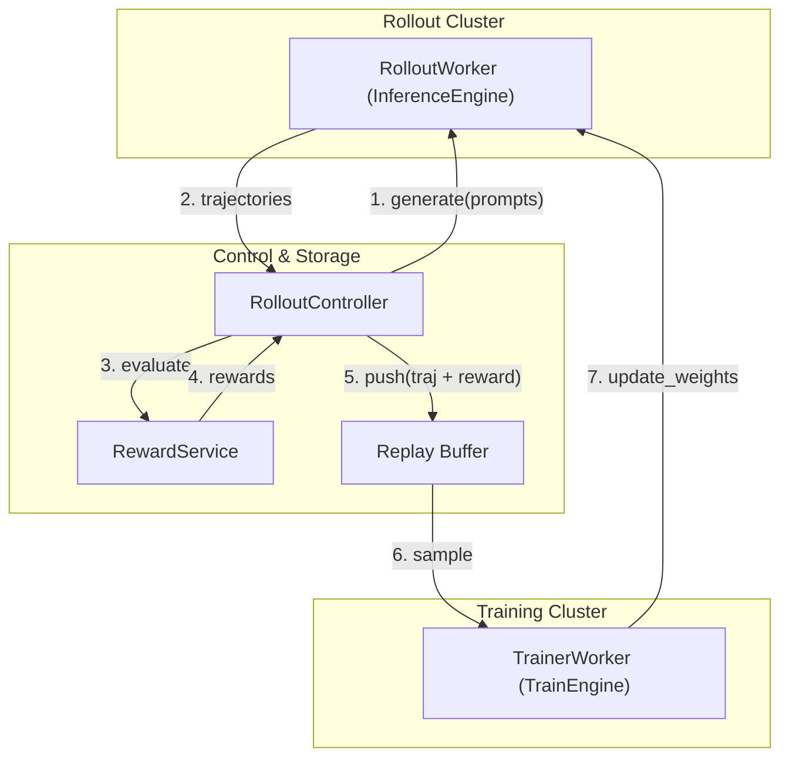
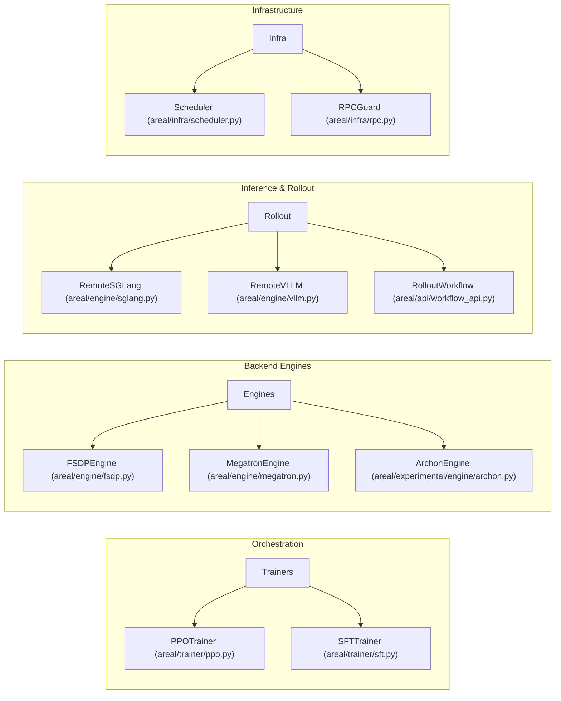

<!-- source: DeepWiki mcp.deepwiki.com · repo areal-project/AReaL · page 1 AReaL Overview · fetched 2026-10-21 -->

# AReaL Overview

Relevant source files

The following files were used as context for generating this wiki page:

- [.github/ISSUE_TEMPLATE/config.yml](.github/ISSUE_TEMPLATE/config.yml)
- [.github/workflows/pre-commit.yml](.github/workflows/pre-commit.yml)
- [AGENTS.md](AGENTS.md)
- [CLAUDE.md](CLAUDE.md)
- [CONTRIBUTING.md](CONTRIBUTING.md)
- [README.md](README.md)
- [ROADMAP.md](ROADMAP.md)
- [areal/api/alloc_mode.py](areal/api/alloc_mode.py)
- [assets/community/README.md](assets/community/README.md)
- [assets/figures/1.5b_time_n1n4n16.png](assets/figures/1.5b_time_n1n4n16.png)
- [assets/figures/7b_zero_eval_acc.png](assets/figures/7b_zero_eval_acc.png)
- [assets/figures/7b_zero_training_curve.png](assets/figures/7b_zero_training_curve.png)
- [assets/figures/algo_ablation.png](assets/figures/algo_ablation.png)
- [assets/figures/arch.png](assets/figures/arch.png)
- [assets/figures/areal_lite_layers.png](assets/figures/areal_lite_layers.png)
- [assets/figures/async_scaling_vs_verl.png](assets/figures/async_scaling_vs_verl.png)
- [assets/figures/async_timeline.png](assets/figures/async_timeline.png)
- [blog/AReaL_v0_2.md](blog/AReaL_v0_2.md)
- [blog/AReaL_v0_3.md](blog/AReaL_v0_3.md)
- [docs/en/version_history.md](docs/en/version_history.md)
- [docs/zh/version_history.md](docs/zh/version_history.md)
- [examples/countdown/README.md](examples/countdown/README.md)
- [examples/tau2/README.md](examples/tau2/README.md)

**AReaL** is a large-scale reinforcement learning (RL) infrastructure designed to bridge foundation model training with modern agent-based applications. Developed by researchers from Tsinghua IIIS and the AReaL Team at Ant Group, it provides a highly efficient, fully asynchronous RL training paradigm [README.md:15-21]().

AReaL's mission is to make building AI agents accessible and cost-effective by providing a system that scales from local development to 1000+ GPU clusters while maintaining industry-leading throughput [README.md:23-36]().

## Core Design Philosophy: Asynchronous RL

The central innovation of AReaL is its **fully asynchronous architecture**, which decouples generation (inference) from model updates (training). This design addresses two critical bottlenecks in traditional synchronous RL systems:

1.  **Device Underutilization**: In synchronous systems, the generation step must wait for the longest sequence in a batch to finish. AReaL allows rollout workers to generate trajectories continuously [blog/AReaL_v0_3.md:49-51]().
2.  **Scalability Limits**: Traditional systems often distribute generation across all devices, pushing decoding into a memory-IO-bound regime. AReaL decouples these into separate GPU clusters to maintain hardware efficiency at scale [blog/AReaL_v0_3.md:68-75]().

### System Component Relationship

The following diagram illustrates how the core components interact within the asynchronous execution model.

**AReaL Asynchronous Data Flow**

Sources: [blog/AReaL_v0_3.md:82-116](), [areal/api/cli_args.py:49-86]()

## Key Capabilities

*   **Agentic RL Support**: Modular design for multi-turn interactions, tool-integrated reasoning (TIR), and complex environment simulations like `Tau2-Bench` [examples/tau2/README.md:5-15]().
*   **Diverse Training Engines**: Native support for `FSDPEngine`, `MegatronEngine`, and the experimental `ArchonEngine` which supports 5D parallelism [AGENTS.md:7](), [areal/api/alloc_mode.py:33-60]().
*   **Memory Optimization**: Features like sequence packing (eliminating padding), per-layer optimizer streaming, and CPU offloading to maximize GPU utilization [blog/AReaL_v0_2.md:71-75]().
*   **Cross-Platform Hardware**: Stable support for both NVIDIA GPUs (CUDA) and Ascend NPUs [README.md:82-87](), [AGENTS.md:11]().

## System Entity Map

This diagram maps the high-level system concepts to the specific code entities and directory structures that implement them.

**Code Entity Mapping**

Sources: [AGENTS.md:61-76](), [CLAUDE.md:12-24](), [areal/api/alloc_mode.py:16-21]()

## Subsystem Navigation

AReaL is organized into several major subsystems that work in concert:

| Subsystem | Responsibility | Key Classes/Files |
| :--- | :--- | :--- |
| **Configuration** | Centralized experiment and resource config | `areal/api/cli_args.py`, `areal/api/alloc_mode.py` |
| **Infrastructure** | Distributed worker lifecycle and RPC | `areal/infra/scheduler.py`, `areal/infra/rpc.py` |
| **Training Engines** | Model sharding and weight updates | `FSDPEngine`, `MegatronEngine`, `ArchonEngine` |
| **Inference Engines** | High-throughput trajectory generation | `RemoteSGLang`, `RemoteVLLM` |
| **Rollout Workflows** | Logic for environment interaction | `RLVRWorkflow`, `MultiTurnWorkflow` |
| **Data & Rewards** | Dataset loading and reward computation | `areal/dataset/`, `areal/reward/` |

## Child Pages

For more detailed information on specific aspects of AReaL, please refer to the following child pages:

*   **[Getting Started & Installation](#1.1)**: Detailed setup instructions for local, Docker, and cloud environments, including NPU support.
*   **[Roadmap & Version History](#1.2)**: A look at the project's evolution and future development plans.

Sources: [README.md:120-131](), [ROADMAP.md:1-10](), [AGENTS.md:58-76]()

---

