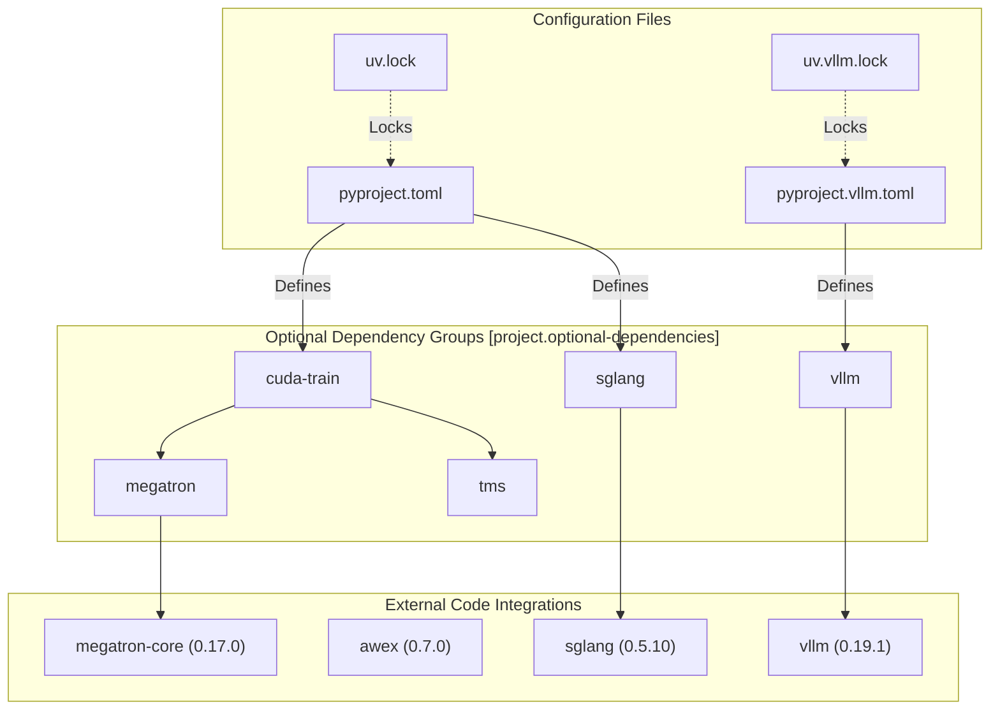
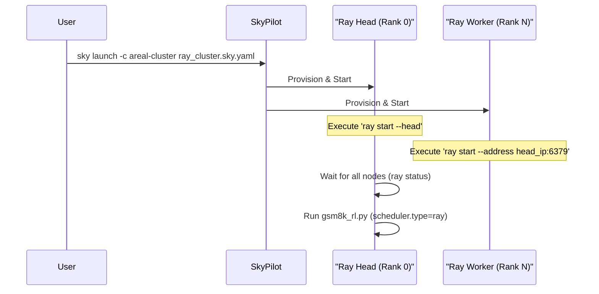

<!-- source: DeepWiki mcp.deepwiki.com · repo areal-project/AReaL · page 1.1 Getting Started & Installation · fetched 2026-10-21 -->

# Getting Started & Installation

<details>
<summary>Relevant source files</summary>

The following files were used as context for generating this wiki page:

- [.github/workflows/tag-release-image.yml](.github/workflows/tag-release-image.yml)
- [Dockerfile](Dockerfile)
- [areal/tools/check_pyproject_consistency.py](areal/tools/check_pyproject_consistency.py)
- [docs/en/tutorial/installation.md](docs/en/tutorial/installation.md)
- [docs/en/tutorial/installation_npu.md](docs/en/tutorial/installation_npu.md)
- [docs/en/tutorial/quickstart.md](docs/en/tutorial/quickstart.md)
- [docs/zh/tutorial/installation.md](docs/zh/tutorial/installation.md)
- [docs/zh/tutorial/installation_npu.md](docs/zh/tutorial/installation_npu.md)
- [docs/zh/tutorial/quickstart.md](docs/zh/tutorial/quickstart.md)
- [examples/skypilot/README.md](examples/skypilot/README.md)
- [examples/skypilot/ray_cluster.sky.yaml](examples/skypilot/ray_cluster.sky.yaml)
- [examples/skypilot/single_node.sky.yaml](examples/skypilot/single_node.sky.yaml)
- [pyproject.toml](pyproject.toml)
- [pyproject.vllm.toml](pyproject.vllm.toml)
- [scripts/uv_lock.sh](scripts/uv_lock.sh)
- [uv.lock](uv.lock)
- [uv.vllm.lock](uv.vllm.lock)

</details>


This page provides a comprehensive guide to setting up the AReaL environment. AReaL is designed for large-scale asynchronous reinforcement learning and requires specific hardware and software configurations to achieve optimal performance.

## Prerequisites

### Hardware Requirements
AReaL is optimized for high-performance compute clusters. The following configuration is extensively tested for large-scale training [docs/en/tutorial/installation.md:7-16]():

| Component | Requirement |
| :--- | :--- |
| **GPU** | 8x NVIDIA H800/A100 per node |
| **CPU** | 64 cores per node |
| **Memory** | 1TB RAM per node |
| **Network** | NVSwitch + RoCE 3.2 Tbps |
| **Storage** | 1TB local (single-node) / 10TB shared NAS (distributed) |

### Software Requirements
| Component | Version |
| :--- | :--- |
| **OS** | Ubuntu 22.04 / CentOS 7 [docs/en/tutorial/installation.md:21]() |
| **NVIDIA Driver** | 550.127.08+ [docs/en/tutorial/installation.md:22]() |
| **CUDA** | 12.8 [docs/en/tutorial/installation.md:23]() |
| **Python** | 3.11 or 3.12 [pyproject.toml:10]() |
| **Docker** | 27.5.1 [docs/en/tutorial/installation.md:25]() |

**Sources:** [docs/en/tutorial/installation.md:7-31](), [pyproject.toml:10-41]()

---

## Installation Options

### 1. Docker-Based Installation (Recommended)
Docker is the preferred method as it encapsulates complex C++ extensions (FlashAttention, Apex, TransformerEngine) and ensures binary compatibility with specific PyTorch versions.

AReaL provides two primary image variants based on the desired inference backend [Dockerfile:1-7]():
*   **SGLang Variant**: `ghcr.io/areal-project/areal-runtime:v1.0.4-sglang` (Default)
*   **vLLM Variant**: `ghcr.io/areal-project/areal-runtime:v1.0.4-vllm`

**Deployment Workflow:**
```bash
# Pull and run the container
docker pull ghcr.io/areal-project/areal-runtime:v1.0.4-sglang
docker run -it --privileged --gpus all --network host \
   --shm-size 700g -v /path/to/shared_storage:/storage \
   ghcr.io/areal-project/areal-runtime:v1.0.4-sglang

# Inside the container, install the local AReaL package
git clone https://github.com/areal-project/AReaL /storage/AReaL
cd /storage/AReaL
uv pip install -e . --no-deps
```

**Sources:** [docs/en/tutorial/installation.md:39-58](), [Dockerfile:1-15]()

### 2. Local Installation (uv-based)
AReaL uses `uv` for lightning-fast dependency management and environment isolation.

#### Standard Setup (SGLang)
```bash
git clone https://github.com/areal-project/AReaL
cd AReaL
# Install with CUDA training extras
uv sync --extra cuda
source .venv/bin/activate
```

#### vLLM Setup
Because SGLang and vLLM require incompatible versions of `torch` and `torchao`, you must swap the configuration files [pyproject.vllm.toml:1-15]():
```bash
cp pyproject.vllm.toml pyproject.toml
cp uv.vllm.lock uv.lock
uv sync --extra cuda
```

**Sources:** [docs/en/tutorial/installation.md:60-124](), [pyproject.vllm.toml:1-15](), [scripts/uv_lock.sh:1-10]()

---

## Dependency Mapping & Build System

AReaL utilizes `uv` to resolve complex dependency trees involving distributed computing and ML kernels.

### Dependency Graph to Code Entities
The following diagram maps high-level system requirements to the specific code-defined dependency groups and configuration files.

**Dependency Architecture**

**Sources:** [pyproject.toml:141-182](), [pyproject.vllm.toml:158-193](), [uv.lock:21-37](), [uv.vllm.lock:21-33]()

---

## Cloud Deployment with SkyPilot

AReaL supports seamless cloud deployment using [SkyPilot](https://github.com/skypilot-org/skypilot). This allows users to launch distributed experiments on GCP, AWS, or K8S with a single command.

### Multi-Node Ray Cluster
SkyPilot can provision a cluster and automatically initialize a Ray environment for AReaL [examples/skypilot/ray_cluster.sky.yaml:17-45]().

**Deployment Logic Flow**


**Sources:** [examples/skypilot/README.md:68-152](), [examples/skypilot/ray_cluster.sky.yaml:1-48]()

---

## NPU Support & Specialized Hardware

While AReaL is primarily optimized for NVIDIA CUDA, it includes experimental support for Huawei NPU (Ascend) devices.

### NPU Configuration
NPU support requires the `cann` (Compute Architecture for Neural Networks) toolkit and specialized versions of PyTorch (Torch-NPU).
*   **Documentation**: Detailed NPU setup is available in [docs/en/tutorial/installation_npu.md]().
*   **Key Differences**: Instead of `flash-attn`, NPUs use the `npu_fusion_attention` implementation provided by the CANN runtime.

**Sources:** [docs/en/tutorial/installation_npu.md](), [pyproject.toml:45-46]()

---

## Advanced: Manual Extension Compilation

For non-Docker environments requiring maximum performance (e.g., FP8 training), several C++ extensions must be compiled manually after `uv sync`.

| Extension | Purpose | Command |
| :--- | :--- | :--- |
| **Apex** | Pipelined H2D/D2H, Fused Kernels | `NVCC_APPEND_FLAGS="--threads 4" APEX_PARALLEL_BUILD=8 uv pip install git+https://github.com/NVIDIA/apex.git` |
| **TransformerEngine** | FP8 Training Support | `uv pip install git+https://github.com/NVIDIA/TransformerEngine.git@stable` |
| **DeepEP** | MoE Communication Library | `TORCH_CUDA_ARCH_LIST="9.0" uv pip install git+https://github.com/deepseek-ai/DeepEP` |

**Sources:** [Dockerfile:83-112](), [docs/zh/tutorial/installation.md:179-190]()

---

