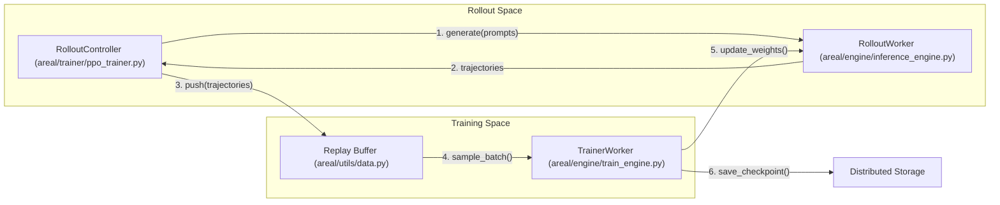
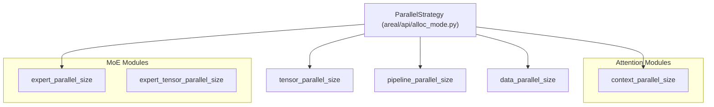

<!-- source: DeepWiki mcp.deepwiki.com · repo areal-project/AReaL · page 1.2 Roadmap & Version History · fetched 2026-10-21 -->

# Roadmap & Version History

Relevant source files

The following files were used as context for generating this wiki page:

- [.github/ISSUE_TEMPLATE/config.yml](.github/ISSUE_TEMPLATE/config.yml)
- [.github/workflows/pre-commit.yml](.github/workflows/pre-commit.yml)
- [AGENTS.md](AGENTS.md)
- [CLAUDE.md](CLAUDE.md)
- [CONTRIBUTING.md](CONTRIBUTING.md)
- [README.md](README.md)
- [ROADMAP.md](ROADMAP.md)
- [areal/api/alloc_mode.py](areal/api/alloc_mode.py)
- [blog/AReaL_v0_2.md](blog/AReaL_v0_2.md)
- [blog/AReaL_v0_3.md](blog/AReaL_v0_3.md)
- [docs/en/_toc.yml](docs/en/_toc.yml)
- [docs/en/reference/tree_training.md](docs/en/reference/tree_training.md)
- [docs/en/tutorial/archon.md](docs/en/tutorial/archon.md)
- [docs/en/tutorial/megatron.md](docs/en/tutorial/megatron.md)
- [docs/en/version_history.md](docs/en/version_history.md)
- [docs/zh/_toc.yml](docs/zh/_toc.yml)
- [docs/zh/reference/tree_training.md](docs/zh/reference/tree_training.md)
- [docs/zh/tutorial/archon.md](docs/zh/tutorial/archon.md)
- [docs/zh/tutorial/megatron.md](docs/zh/tutorial/megatron.md)
- [docs/zh/version_history.md](docs/zh/version_history.md)
- [examples/countdown/README.md](examples/countdown/README.md)
- [examples/tau2/README.md](examples/tau2/README.md)

This page provides a technical summary of AReaL's evolution, its milestone releases, and the architectural roadmap for the future. AReaL is built on a **fully asynchronous RL training paradigm** [README.md:19-21](), designed to maximize hardware utilization by decoupling generation and training [blog/AReaL_v0_3.md:79-83]().

## Version History

AReaL follows a quarterly major release cycle and bi-weekly minor releases [ROADMAP.md:189-191]().

### v0.1: Initial Release (Feb 2025)
The foundational release focused on reproducible results for 1.5B and 7B Large Reasoning Models (LRMs) [README.md:114-117]().
*   **Key Features**: Initial asynchronous infrastructure, basic PPO/GRPO support, and math reasoning datasets.

### v0.2: "Boba" Release (Mar 2025)
Significant performance optimizations and state-of-the-art (SOTA) model weights [README.md:109-113]().
*   **SGLang Integration**: Replaced vLLM 0.6.3 with SGLang v0.4.0 as the generation backend, utilizing **Radix Attention** for 1.5x throughput gains [blog/AReaL_v0_2.md:13-15, 60-64]().
*   **Variable-Length Packing**: Implemented 1D sequence packing to eliminate padding waste in variable-length LRM outputs [blog/AReaL_v0_2.md:69-75]().
*   **GDRDMA Support**: Optimized NCCL with GPU-Direct RDMA for 1K-GPU scaling [blog/AReaL_v0_2.md:77-83]().

### v0.3: "Boba²" Release (Jun 2025)
A major architectural milestone introducing fully asynchronous system-algorithm co-design [README.md:102-107]().
*   **2.77x Speedup**: Achieved by decoupling generation and training across separate GPU clusters [blog/AReaL_v0_3.md:9-12, 79-83]().
*   **Interruptible Rollout**: Introduction of `update_weights` requests that can interrupt ongoing generations, allowing for in-flight parameter updates [blog/AReaL_v0_3.md:91-99]().
*   **Multi-Turn Agentic RL**: Experimental support for agentic workflows, such as tool-use and reasoning loops [blog/AReaL_v0_3.md:13-14]().

### AReaL-lite (Jul 2025)
A lightweight, algorithm-first version with 80% fewer lines of code, maintaining core asynchronous functionality [README.md:93-100]().

### Recent Milestones (Late 2025 - Early 2026)
*   **Ascend NPU Support**: Stable training support for Huawei Ascend hardware via the `ascend` branch [README.md:82-87]().
*   **Archon Engine**: A new PyTorch-native backend supporting 5D parallelism (DP/TP/PP/CP/EP) [ROADMAP.md:77, areal/api/alloc_mode.py:32-60]().
*   **AReaL-SEA**: A self-evolving data synthesis engine for large-scale MoE models [README.md:68-74]().

---

## Architectural Evolution

The core shift in AReaL's history was moving from synchronous batched generation to a decoupled, asynchronous microservice architecture.

### Asynchronous System Components
The system transitioned to four core components to solve the inference-underutilization problem [blog/AReaL_v0_3.md:47-52, 82-88]().

| Component | Role in v0.3 Architecture |
| :--- | :--- |
| `RolloutWorker` | Handles `generate` and `update_weights` requests; supports KV-cache flushing [blog/AReaL_v0_3.md:91-99](). |
| `RewardService` | Independent service for verifiable reward computation (e.g., unit tests) [blog/AReaL_v0_3.md:101-103](). |
| `TrainerWorker` | Continuously samples from replay buffer and performs PPO updates [blog/AReaL_v0_3.md:105-108](). |
| `RolloutController` | Orchestrates data flow between rollout, reward, and trainer components [blog/AReaL_v0_3.md:110-116](). |

### Data Flow and Code Entity Mapping

The following diagram bridges the high-level asynchronous logic with specific code entities used in the implementation.

**Diagram: Asynchronous Training Data Flow**

*Sources: [blog/AReaL_v0_3.md:85-117](), [areal/api/cli_args.py:49-53]()*

---

## 2026 Q1 Roadmap

The current development focus (due April 30, 2026) centers on the **Archon backend** and **Agentic RL** scalability [ROADMAP.md:10-12]().

### Backend Enhancements
*   **Zero-Bubble Pipeline Parallelism (ZBPP)**: Implementation of ZBPP and ZBPP-V for the Archon backend [ROADMAP.md:25]().
*   **FP8 Training**: Native FP8 support for the Archon engine to match Megatron-Core capabilities [ROADMAP.md:26]().
*   **LoRA Support**: Bringing Low-Rank Adaptation to the Archon backend [ROADMAP.md:34]().
*   **Weight Sync Optimization**: Utilizing `awex` as a high-performance weight synchronization engine for colocation modes [ROADMAP.md:35]().

### Usability & Infrastructure
*   **Module Refactoring**: Flattening the import structure of `areal` modules for better developer experience [ROADMAP.md:45]().
*   **Online RL Proxy**: Supporting RL training via a proxy server for black-box agent applications [ROADMAP.md:33, README.md:31-34]().
*   **Elastic Updates**: Acceleration of weight updates to minimize interruption overhead during asynchronous rollout [ROADMAP.md:38]().

### Feature Comparison by Backend

AReaL supports multiple training backends, each with a different roadmap status.

| Feature | FSDP2 Engine | Megatron Engine | Archon Engine |
| :--- | :--- | :--- | :--- |
| **Status** | Stable | Stable | Experimental/Active |
| **Parallelism** | DP, TP, CP (Ulysses) | DP, TP, PP, CP, EP | DP, TP, PP, CP, EP, ETP |
| **FP8 Support** | No | Yes | **Planned (Q1)** |
| **LoRA Support** | Yes | Yes | **Planned (Q1)** |
| **Tree Training** | Yes | Yes | Yes |

*Sources: [areal/api/alloc_mode.py:32-60](), [ROADMAP.md:21-40](), [blog/AReaL_v0_2.md:131-132]()*

---

## 5D Parallelism Strategy

The roadmap for the **Archon** engine includes a unified 5D parallelism strategy defined in `ParallelStrategy` [areal/api/alloc_mode.py:33-60]().

**Diagram: Parallelism Dimension Mapping**

*Sources: [areal/api/alloc_mode.py:62-91]()*

This strategy allows AReaL to scale from single-node setups to 1000+ GPU clusters by configuring the `ParallelStrategy` dataclass within the `TrainEngineConfig` [areal/api/alloc_mode.py:152-160]().

---

