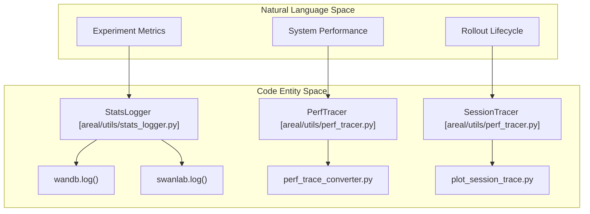
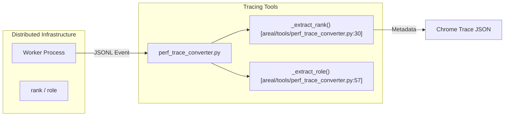

<!-- source: DeepWiki mcp.deepwiki.com · repo areal-project/AReaL · page 10 Observability & Tooling · fetched 2026-10-21 -->

# Observability & Tooling

Relevant source files

The following files were used as context for generating this wiki page:

- [areal/engine/megatron_utils/megatron_lora.py](areal/engine/megatron_utils/megatron_lora.py)
- [areal/engine/vllm_ext/vllm_worker_extension.py](areal/engine/vllm_ext/vllm_worker_extension.py)
- [areal/tools/perf_trace_converter.py](areal/tools/perf_trace_converter.py)
- [areal/tools/plot_session_trace.py](areal/tools/plot_session_trace.py)
- [areal/utils/perf_tracer.py](areal/utils/perf_tracer.py)
- [areal/utils/stats_logger.py](areal/utils/stats_logger.py)
- [docs/en/reference/lora.md](docs/en/reference/lora.md)
- [docs/zh/reference/lora.md](docs/zh/reference/lora.md)
- [examples/math/gsm8k_grpo_megatron_lora_moe.yaml](examples/math/gsm8k_grpo_megatron_lora_moe.yaml)

AReaL provides a robust observability stack designed for distributed asynchronous reinforcement learning. This system covers high-level experiment metrics, granular performance profiling, and specialized session tracing for rollout workflows. The tooling is built to handle the complexity of multi-process environments where trainers, rollout workers, and reward services operate concurrently.

## Metrics & Stats Logging

The `StatsLogger` is the primary interface for recording experiment progress and model performance. It serves as a unified wrapper for multiple backends, ensuring that metrics are consistent across different logging platforms.

*   **Supported Backends**: Integrates with Weights & Biases (WandB), SwanLab, TrackIO, TensorBoard, and standard console output [areal/utils/stats_logger.py:41-113]().
*   **Commit Lifecycle**: Metrics are aggregated and "committed" at specific intervals (steps/epochs). The system automatically handles rank-0 filtering to prevent redundant logging in distributed setups [areal/utils/stats_logger.py:135-160]().
*   **Metadata Tracking**: Automatically logs environment details, including git commit IDs, branch names, and full experiment configurations [areal/utils/stats_logger.py:55-73]().

For details on configuration and the `StatsTracker` aggregation system, see **[Metrics & Stats Logging (#10.1)]**.

**Sources:**
- `StatsLogger` class definition: [areal/utils/stats_logger.py:23-33]()
- Backend initialization logic: [areal/utils/stats_logger.py:41-113]()
- Metric commit process: [areal/utils/stats_logger.py:135-160]()

## Performance Tracing

The `PerfTracer` system provides deep visibility into the execution timeline of AReaL's distributed components. It allows developers to identify bottlenecks in computation, communication, or I/O.

*   **Trace Categories**: Events are classified into standard categories such as `COMPUTE`, `COMM` (communication), `IO`, `SYNC`, and `SCHEDULER` [areal/utils/perf_tracer.py:62-94]().
*   **Instrumentation**: Developers can use `@trace_perf` decorators or `trace_scope` context managers to instrument code without manual timestamping [areal/utils/perf_tracer.py:121-139]().
*   **Visualization**: Traces are saved in JSONL format and can be converted to Chrome Tracing (Perfetto) format using the `perf_trace_converter` tool [areal/tools/perf_trace_converter.py:121-130]().

For details on using the profiler and interpreting timelines, see **[Performance Tracing (#10.2)]**.

**Sources:**
- `PerfTraceCategory` enum: [areal/utils/perf_tracer.py:62-94]()
- `perf_trace_converter` utility: [areal/tools/perf_trace_converter.py:1-27]()

## Session & Rollout Tracing

Specific to RL workflows, AReaL includes a "Session Tracer" that tracks the lifecycle of individual rollout episodes. This is critical for debugging staleness and understanding the latency distribution of generation vs. reward calculation.

*   **Lifecycle Tracking**: Records timestamps for submission, generation start/end, and reward finalization [areal/tools/plot_session_trace.py:20-29]().
*   **Visualization**: The `plot_session_trace.py` tool generates interactive Plotly Gantt charts and histograms to visualize rollout throughput and "idle" periods where workers are waiting for tasks [areal/tools/plot_session_trace.py:37-60]().

**Sources:**
- Session column definitions: [areal/tools/plot_session_trace.py:20-29]()
- Visualization styles: [areal/tools/plot_session_trace.py:31-42]()

## Observability Architecture

The following diagram illustrates how the observability components bridge the high-level "Natural Language Space" (concepts like "Training Progress") to the "Code Entity Space" (specific classes and files).

### Observability Data Flow

**Sources:** [areal/utils/stats_logger.py:23](), [areal/utils/perf_tracer.py:117](), [areal/tools/perf_trace_converter.py:1](), [areal/tools/plot_session_trace.py:1]()

### Distributed Tracing Context
This diagram shows how tracing metadata (like `rank` and `role`) is propagated from the distributed infrastructure into the observability tools.

**Sources:** [areal/tools/perf_trace_converter.py:30-67]()

---

