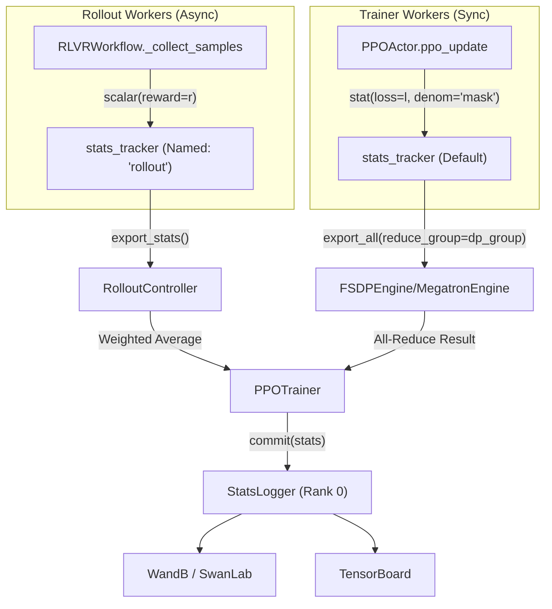

<!-- source: DeepWiki mcp.deepwiki.com · repo areal-project/AReaL · page 10.1 Metrics & Stats Logging · fetched 2026-10-21 -->

# Metrics & Stats Logging

<details>
<summary>Relevant source files</summary>

The following files were used as context for generating this wiki page:

- [areal/engine/megatron_utils/megatron_lora.py](areal/engine/megatron_utils/megatron_lora.py)
- [areal/engine/vllm_ext/vllm_worker_extension.py](areal/engine/vllm_ext/vllm_worker_extension.py)
- [areal/utils/dataloader.py](areal/utils/dataloader.py)
- [areal/utils/evaluator.py](areal/utils/evaluator.py)
- [areal/utils/lock.py](areal/utils/lock.py)
- [areal/utils/printing.py](areal/utils/printing.py)
- [areal/utils/save_load.py](areal/utils/save_load.py)
- [areal/utils/stats_logger.py](areal/utils/stats_logger.py)
- [areal/utils/stats_tracker.py](areal/utils/stats_tracker.py)
- [areal/utils/timeutil.py](areal/utils/timeutil.py)
- [docs/en/reference/lora.md](docs/en/reference/lora.md)
- [docs/en/reference/metrics_tracking.md](docs/en/reference/metrics_tracking.md)
- [docs/zh/reference/lora.md](docs/zh/reference/lora.md)
- [docs/zh/reference/metrics_tracking.md](docs/zh/reference/metrics_tracking.md)
- [examples/math/gsm8k_grpo_megatron_lora_moe.yaml](examples/math/gsm8k_grpo_megatron_lora_moe.yaml)

</details>


The AReaL observability system provides a unified framework for collecting, aggregating, and reporting performance metrics and training statistics across distributed processes. It is designed to handle the distinct requirements of asynchronous rollout generation and synchronous distributed training.

## StatsLogger System

The `StatsLogger` class serves as the centralized interface for exporting metrics to external experiment tracking backends [areal/utils/stats_logger.py:23-24](). It manages the lifecycle of logging sessions, including initialization, credential management, and periodic data "commits."

### Supported Backends
The system supports multiple backends simultaneously, configured via `StatsLoggerConfig` [areal/utils/stats_logger.py:15-16]():
*   **Weights & Biases (WandB):** Primary backend for experiment tracking and visualization [areal/utils/stats_logger.py:48-78]().
*   **SwanLab:** Alternative cloud-based tracking backend [areal/utils/stats_logger.py:80-95]().
*   **TrackIO:** Internal or specialized tracking service [areal/utils/stats_logger.py:100-107]().
*   **TensorBoard:** Local logging via `SummaryWriter` [areal/utils/stats_logger.py:110-112]().

### Commit Lifecycle
Logging is restricted to Rank 0 in distributed environments to prevent duplicate entries [areal/utils/stats_logger.py:38-39](). The `commit` method is called at the end of training steps to push aggregated data [areal/utils/stats_logger.py:135-137]().

1.  **Filtering:** Internal counter keys (ending in `__count`) used for averaging are stripped before export [areal/utils/stats_logger.py:147-148]().
2.  **Console Output:** Statistics are formatted into tables using `tabulate_stats` and printed to system logs [areal/utils/stats_logger.py:161-162]().
3.  **Backend Dispatch:** The data is forwarded to all enabled backends with the current `global_step` [areal/utils/stats_logger.py:152-158]().

### Log Path Conventions
Log files and local metadata are stored using a structured directory hierarchy to ensure experiment isolation:
`{fileroot}/logs/{user}/{experiment_name}/{trial_name}` [areal/utils/stats_logger.py:179-181]().

**Sources:** [areal/utils/stats_logger.py:1-182](), [docs/en/reference/metrics_tracking.md:237-250]()

---

## StatsTracker: In-Process Aggregation

The `DistributedStatsTracker` (aliased as `stats_tracker`) is the core engine for collecting raw data points within a process. It supports two primary logging paradigms [docs/en/reference/metrics_tracking.md:27-28]().

### 1. Streaming Metrics (Rollout)
Used by rollout workers where tasks complete asynchronously. Each worker logs individual scalars (e.g., rewards) as they are generated [docs/en/reference/metrics_tracking.md:29-38]().
*   **Mechanism:** `stats_tracker.scalar(**kwargs)` [areal/utils/stats_tracker.py:109-114]().
*   **Aggregation:** Data is accumulated locally as a list of values. Weighted averages are computed during the `export_stats` call by the `RolloutController` [docs/en/reference/metrics_tracking.md:65-85]().

### 2. Batch Metrics (Training)
Used by training engines where data is processed in synchronized batches across Data Parallel (DP) ranks [docs/en/reference/metrics_tracking.md:88-99]().
*   **Mechanism:** `stats_tracker.stat(denominator, **kwargs)` [areal/utils/stats_tracker.py:116-121]().
*   **Denominators:** Users define boolean masks (e.g., `loss_mask`) using `stats_tracker.denominator()` to provide the basis for weighted reductions [areal/utils/stats_tracker.py:96-107]().
*   **Reduction Types:** Supports `AVG_MIN_MAX` (default), `AVG`, `SUM`, `MIN`, and `MAX` [areal/utils/stats_tracker.py:19-25]().

### Hierarchical Scoping
Metrics can be organized into namespaces using the `scope` context manager or decorator [areal/utils/stats_tracker.py:42-57](). This prepends the scope name to the metric keys (e.g., `ppo_actor/update/loss`) [docs/en/reference/metrics_tracking.md:170-178]().

### Data Flow Diagram: Collection to Export
The following diagram illustrates how metrics move from different worker types to the final logging backend.

| Entity in Diagram | Code Entity |
| :--- | :--- |
| `RolloutWorker` | `areal.workflow.rlvr.RLVRWorkflow` |
| `TrainerWorker` | `areal.trainer.ppo.actor.PPOActor` |
| `StatsTracker` | `areal.utils.stats_tracker.DistributedStatsTracker` |
| `StatsLogger` | `areal.utils.stats_logger.StatsLogger` |

**Metric Data Flow**


**Sources:** [areal/utils/stats_tracker.py:1-200](), [docs/en/reference/metrics_tracking.md:1-235]()

---

## Evaluator Interface

The `Evaluator` class manages the frequency and execution of evaluation tasks during the training loop [areal/utils/evaluator.py:10-11]().

### Frequency Control
It utilizes `EpochStepTimeFreqCtl` to determine if an evaluation should trigger based on [areal/utils/evaluator.py:14-19]():
*   **Epoch Frequency:** `freq_epochs`
*   **Step Frequency:** `freq_steps`
*   **Time Frequency:** `freq_secs` (seconds)
*   **Pre-train Eval:** `eval_before_train` (executes at step 0) [areal/utils/evaluator.py:18]().

### Execution
The `evaluate` method takes an `evaluate_fn` callback. It checks the frequency conditions and, if met, executes the evaluation logic [areal/utils/evaluator.py:27-38](). During evaluation, the `stats_tracker` typically switches to a specific evaluation scope (e.g., `eval-rollout`) to isolate validation metrics from training metrics [docs/en/reference/metrics_tracking.md:190-203]().

**Sources:** [areal/utils/evaluator.py:1-39](), [areal/utils/timeutil.py:144-182]()

---

## Performance Timing

The system includes a specialized utility for measuring execution latency called `record_timing` [areal/utils/stats_tracker.py:85]().

*   **Implementation:** A context manager that records the `perf_counter` delta [areal/utils/stats_tracker.py:86-94]().
*   **Namespace:** All timing metrics are automatically prefixed with the `timeperf/` scope [areal/utils/stats_tracker.py:92]().
*   **Example:**
    ```python
    with stats_tracker.record_timing("forward_pass"):
        output = model(input)
    # Results in metric: timeperf/forward_pass
    ```

**Sources:** [areal/utils/stats_tracker.py:85-95](), [docs/en/reference/metrics_tracking.md:180-188]()

---

## Distributed Synchronization Entities

The logging system relies on several low-level utilities to maintain consistency across the cluster.

### FrequencyControl
A thread-safe utility used to track intervals between events [areal/utils/timeutil.py:17-52](). In distributed settings, it uses `dist.all_reduce` with `ReduceOp.MAX` to synchronize time-based triggers across processes, ensuring all ranks trigger evaluation or logging simultaneously [areal/utils/timeutil.py:118-125]().

### DistributedLock
A lock implementation using the `torch.distributed` store [areal/utils/lock.py:10-15](). It is used to prevent race conditions when multiple processes attempt to access shared resources (like local log files or checkpoint directories) [areal/utils/lock.py:28-51]().

**Sources:** [areal/utils/timeutil.py:17-143](), [areal/utils/lock.py:1-103]()

---

