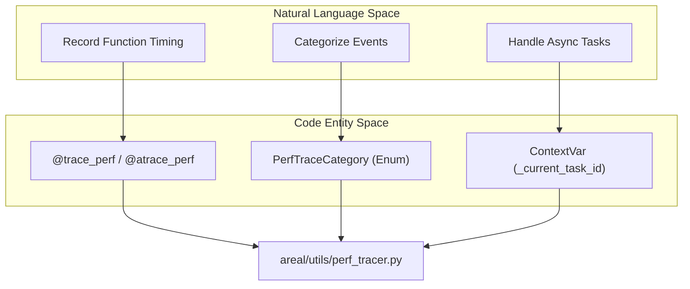
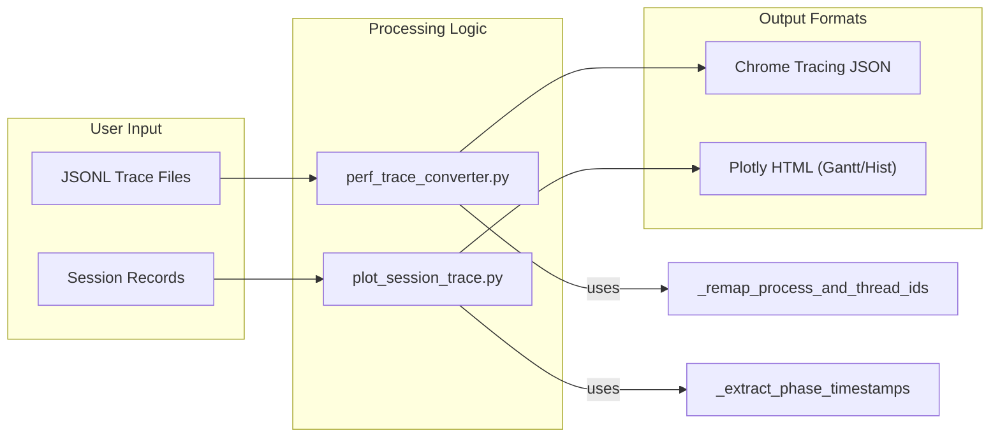

<!-- source: DeepWiki mcp.deepwiki.com · repo areal-project/AReaL · page 10.2 Performance Tracing · fetched 2026-10-21 -->

# Performance Tracing

Relevant source files

The following files were used as context for generating this wiki page:

- [areal/experimental/openai/proxy/proxy_rollout_server.py](areal/experimental/openai/proxy/proxy_rollout_server.py)
- [areal/experimental/openai/proxy/workflow.py](areal/experimental/openai/proxy/workflow.py)
- [areal/infra/utils/http.py](areal/infra/utils/http.py)
- [areal/tools/perf_trace_converter.py](areal/tools/perf_trace_converter.py)
- [areal/tools/plot_session_trace.py](areal/tools/plot_session_trace.py)
- [areal/utils/logging.py](areal/utils/logging.py)
- [areal/utils/perf_tracer.py](areal/utils/perf_tracer.py)
- [tests/experimental/openai/test_streaming_chat_completions.py](tests/experimental/openai/test_streaming_chat_completions.py)

The `PerfTracer` system provides a distributed, session-aware instrumentation framework for AReaL. It is designed to capture high-resolution timing data across asynchronous RL components (Rollout Workers, Trainers, and Reward Services) and organize them into meaningful execution timelines. The system supports both low-level performance profiling (compute/comm/IO) and high-level session tracking for agentic workflows.

## Core System Architecture

The tracing infrastructure is built around a centralized `PerfTracer` utility that manages trace event collection, serialization, and persistence. It utilizes Python `ContextVar` and `threading.local` to maintain state across asynchronous tasks and threads.

### Trace Categories
Events are classified using `PerfTraceCategory` to facilitate filtering in visualization tools [areal/utils/perf_tracer.py:62-93]():
*   `COMPUTE`: CPU/GPU computation (forward/backward passes).
*   `COMM`: Distributed communication (all-reduce, broadcast).
*   `IO`: Disk operations (checkpointing, data loading).
*   `SYNC`: Synchronization barriers and locks.
*   `SCHEDULER`: Task scheduling and queue management.
*   `INSTR`: Instrumentation and profiling overhead.

### Data Flow and Lifecycle
1.  **Instrumentation**: Code is instrumented using `trace_scope` (context manager) or `@trace_perf` (decorator) [areal/utils/perf_tracer.py:614-686]().
2.  **Buffering**: Events are buffered in memory to minimize I/O overhead. The buffer size and flush intervals are configurable via `PerfTracerConfig` [areal/api/cli_args.py:25]().
3.  **Serialization**: Events are serialized to JSONL format using `orjson` for high performance [areal/utils/perf_tracer.py:22]().
4.  **Persistence**: Traces are written to rank-qualified files (e.g., `traces-r0.jsonl`) within the experiment directory [areal/utils/perf_tracer.py:142-144]().
5.  **Conversion**: The `perf_trace_converter` tool merges per-rank JSONL files into a single Chrome Tracing compatible JSON file [areal/tools/perf_trace_converter.py:121-127]().

### NL to Code Entity Mapping: Instrumentation
This diagram maps logical tracing concepts to the specific code entities used to implement them.

| Concept | Code Entity | File |
| :--- | :--- | :--- |
| **Trace Decorator** | `@trace_perf` | [areal/utils/perf_tracer.py:651]() |
| **Async Decorator** | `@atrace_perf` | [areal/utils/perf_tracer.py:672]() |
| **Context Manager** | `trace_scope` | [areal/utils/perf_tracer.py:614]() |
| **Async Context** | `atrace_scope` | [areal/utils/perf_tracer.py:633]() |
| **Global State** | `_THREAD_LOCAL` | [areal/utils/perf_tracer.py:59]() |

Sources: [areal/utils/perf_tracer.py:31-93](), [areal/utils/perf_tracer.py:651-672]()

## Session-Level Tracing

For complex agentic or multi-turn workflows, `PerfTracer` provides "Session Tracing." This tracks the end-to-end lifecycle of a single request (session) as it moves through different phases like generation, tool calling, and reward calculation.

### Session Lifecycle Management
*   **`session_context`**: An async context manager that initializes a new `session_id` and tracks the total duration of an episode [areal/utils/perf_tracer.py:726-764]().
*   **`trace_session`**: A decorator used to mark specific phases within a session (e.g., `_run_agent` in `OpenAIProxyWorkflow`) [areal/experimental/openai/proxy/workflow.py:121]().
*   **`SessionRecord`**: A dataclass that aggregates all metadata, timestamps, and phase-specific durations for a session [areal/utils/perf_tracer.py:355-400]().

### Data Persistence
Session traces are stored in `sessions.jsonl`. Each record contains:
*   `session_id` and `task_id`.
*   `submit_ts` and `finalized_ts`.
*   A `phases` dictionary mapping phase names to lists of `start_ts` and `end_ts` [areal/utils/perf_tracer.py:383-390]().

Sources: [areal/utils/perf_tracer.py:355-400](), [areal/experimental/openai/proxy/workflow.py:163-183]()

## Visualization Tools

AReaL provides two primary tools for analyzing performance data: `perf_trace_converter` and `plot_session_trace`.

### perf_trace_converter
This tool processes low-level performance traces. It performs PID/TID remapping to ensure that distributed ranks appear as distinct "processes" in visualization tools like `chrome://tracing` or Perfetto [areal/tools/perf_trace_converter.py:121-132]().

*   **Rank Extraction**: It identifies the rank from event arguments to organize the timeline [areal/tools/perf_trace_converter.py:30-54]().
*   **Metadata Generation**: It injects `process_name` and `thread_name` metadata events to label the UI [areal/tools/perf_trace_converter.py:216-235]().

### plot_session_trace
This tool generates interactive Plotly visualizations for high-level session data [areal/tools/plot_session_trace.py:16-18]().

*   **Timeline View**: Displays a Gantt-like chart of sessions, showing `generate`, `reward`, and `toolcall` phases [areal/tools/plot_session_trace.py:30-42]().
*   **Statistics**: Computes histograms for total duration and phase-specific latencies [areal/tools/plot_session_trace.py:55-60]().
*   **Status Mapping**: Colors segments based on session outcome (e.g., `accepted`, `rejected`, `failed`) [areal/tools/plot_session_trace.py:31-36]().

### NL to Code Entity Mapping: Visualization

Sources: [areal/tools/perf_trace_converter.py:121-132](), [areal/tools/plot_session_trace.py:196-215]()

## Implementation Details

### Performance Trace Decorator Implementation
The `@trace_perf` decorator captures the start time, executes the function, and records the event upon completion. It automatically handles `rank` and `role` propagation from the tracer's global state [areal/utils/perf_tracer.py:651-670]().

### Context Propagation
The system uses `ContextVar` to ensure that `task_id` and `session_id` are preserved across `await` points in asynchronous workflows, such as the `OpenAIProxyWorkflow` [areal/utils/perf_tracer.py:31-34]().

| Variable | Role |
| :--- | :--- |
| `_current_task_id` | Tracks the specific RL task being executed. |
| `_current_session_id` | Tracks the unique ID of an inference/agent session. |
| `_profiler_active` | Prevents recursive profiling overhead. |

Sources: [areal/utils/perf_tracer.py:31-40](), [areal/utils/perf_tracer.py:651-686]()

---

