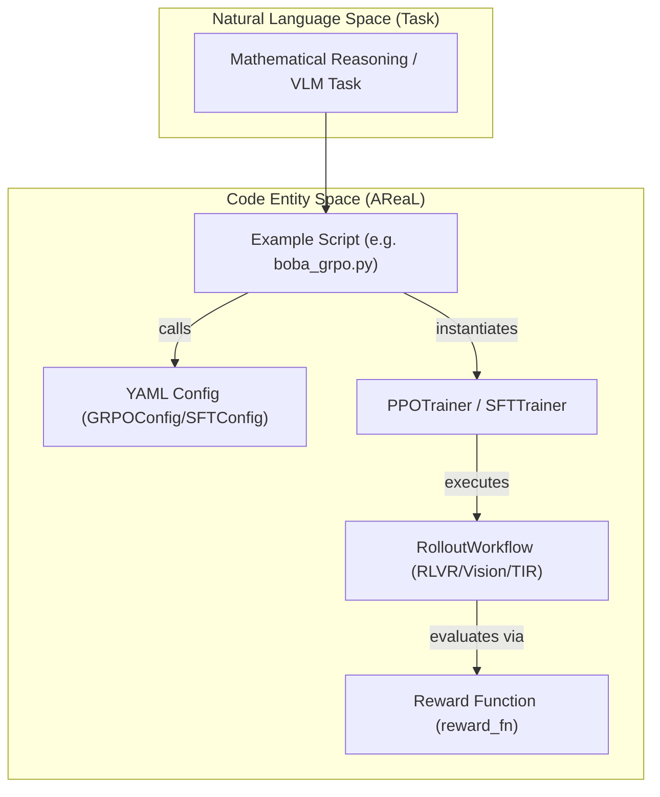
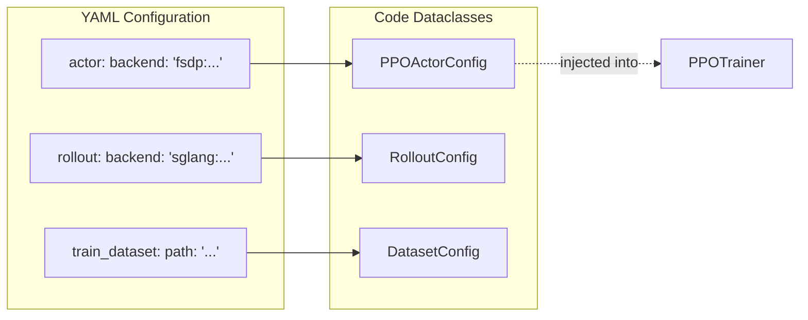

<!-- source: DeepWiki mcp.deepwiki.com · repo areal-project/AReaL · page 11 Examples & Use Cases · fetched 2026-10-21 -->

# Examples & Use Cases

Relevant source files

The following files were used as context for generating this wiki page:

- [examples/countdown/train.py](examples/countdown/train.py)
- [examples/countdown/train_config.yaml](examples/countdown/train_config.yaml)
- [examples/math/boba_grpo.py](examples/math/boba_grpo.py)
- [examples/math/gsm8k_grpo.yaml](examples/math/gsm8k_grpo.yaml)
- [examples/math/gsm8k_rloo.yaml](examples/math/gsm8k_rloo.yaml)
- [examples/math/gsm8k_sft.py](examples/math/gsm8k_sft.py)
- [examples/math/gsm8k_sft.yaml](examples/math/gsm8k_sft.yaml)
- [examples/tir/tir_math_config.yaml](examples/tir/tir_math_config.yaml)
- [examples/tir/train_tir.py](examples/tir/train_tir.py)
- [examples/vlm/clevr_count_70k_grpo.py](examples/vlm/clevr_count_70k_grpo.py)
- [examples/vlm/clevr_count_70k_grpo.yaml](examples/vlm/clevr_count_70k_grpo.yaml)
- [examples/vlm/clevr_count_70k_sft.py](examples/vlm/clevr_count_70k_sft.py)
- [examples/vlm/clevr_count_70k_sft.yaml](examples/vlm/clevr_count_70k_sft.yaml)

This page provides a high-level overview of the example training scripts and use cases bundled with AReaL. These examples demonstrate how to configure and execute Reinforcement Learning (RL) and Supervised Fine-Tuning (SFT) workflows across diverse domains, including mathematical reasoning, computer vision, and agentic tool-use.

The examples serve as templates for defining `RolloutWorkflow` logic, custom `reward_fn` implementations, and YAML-based experiment configurations.

## Core Example Components

The AReaL example suite bridges the gap between high-level task definitions and the underlying distributed infrastructure.

### Example Execution Flow
The following diagram illustrates how an example script (e.g., `examples/math/boba_grpo.py`) interacts with the core system entities to initiate training.

**Example-to-Code Mapping**

**Sources:** [examples/math/boba_grpo.py:63-87](), [examples/vlm/clevr_count_70k_grpo.py:32-70]()

### Workflow and Trainer Association
Each use case typically involves a specific combination of a `Trainer` class and a `RolloutWorkflow` implementation.

| Use Case | Trainer Class | Workflow Class | Example Script |
| :--- | :--- | :--- | :--- |
| **Math (GRPO)** | `PPOTrainer` | `RLVRWorkflow` | [examples/math/boba_grpo.py:78-84]() |
| **Vision (GRPO)** | `PPOTrainer` | `VisionRLVRWorkflow` | [examples/vlm/clevr_count_70k_grpo.py:60-66]() |
| **Agentic (TIR)** | `PPOTrainer` | `TIRWorkflow` | [examples/tir/train_tir.py:55-58]() |
| **SFT** | `SFTTrainer` | N/A (Engine Internal) | [examples/math/gsm8k_sft.py:25-28]() |

---

## Math & Reasoning Examples

AReaL provides extensive support for reasoning tasks using verifiable rewards. These examples focus on algorithms like **GRPO** (Group Relative Policy Optimization) and **RLOO** (Reinforce Leave-One-Out) to train models on datasets such as GSM8K and NuminaMath.

*   **Verifiable Rewards:** Uses `get_math_verify_worker` to programmatically check mathematical correctness.
*   **Thinking Templates:** Supports "Chain of Thought" via `enable_thinking` flags in the chat template.
*   **Custom Reward Logic:** Demonstrates how to wrap verification logic into a `reward_fn` that the `PPOTrainer` can consume.

For details on running these scripts and configuring reward workers, see [Math & Reasoning Examples](#11.1).

**Sources:** [examples/math/boba_grpo.py:45-60](), [examples/math/gsm8k_grpo.yaml:1-83](), [examples/math/gsm8k_rloo.yaml:71-78]()

---

## Vision & VLM Examples

The Vision-Language Model (VLM) examples demonstrate AReaL's ability to handle multi-modal inputs, such as images and text, within an RL loop. 

*   **CLEVR-Count-70K:** A task requiring models to count objects in images, trained using `VisionRLVRWorkflow`.
*   **Processor Integration:** Uses `load_hf_processor_and_tokenizer` to handle image feature extraction alongside text tokenization.
*   **Multi-modal Rollout:** Configures `sglang` with `enable_multimodal: true` to serve VLM inference during the rollout phase.

For details on VLM sequence packing and image-based reward functions, see [Vision & VLM Examples](#11.2).

**Sources:** [examples/vlm/clevr_count_70k_grpo.py:34-41](), [examples/vlm/clevr_count_70k_grpo.yaml:107-116]()

---

## Agentic RL Examples

Agentic RL examples cover scenarios where the model interacts with external environments or tools over multiple turns.

*   **Tool-Integrated Reasoning (TIR):** Models can call tools like a `calculator` or `python` interpreter to solve complex problems.
*   **Multi-Turn Logic:** The `TIRWorkflow` manages the loop of generation, tool execution, and observation feedback.
*   **Scaffolding:** Examples show how to define `max_turns` and `tool_timeout` within the `TIRGRPOConfig`.

For details on agentic workflows and tool-use orchestration, see [Agentic RL Examples](#11.3).

**Sources:** [examples/tir/train_tir.py:44-50](), [examples/tir/tir_math_config.yaml:122-128]()

---

## Configuration Patterns

All examples share a common configuration pattern using YAML files that map to `GRPOConfig` or `SFTConfig` dataclasses.

**Configuration Entity Mapping**

**Sources:** [examples/math/gsm8k_grpo.yaml:42-83](), [examples/countdown/train_config.yaml:21-33]()

### Key Configuration Keys
*   **`backend`**: Specifies the training or inference engine (e.g., `fsdp:d4p1t1` for FSDP2 with 4 GPUs).
*   **`mb_spec`**: Defines `max_tokens_per_mb` and sequence packing algorithms like `ffd`.
*   **`gconfig`**: Sets generation hyperparameters like `n_samples` (crucial for group-based algorithms like GRPO).

**Sources:** [examples/math/gsm8k_grpo.yaml:35-40](), [examples/math/gsm8k_grpo.yaml:51-53]()

---

