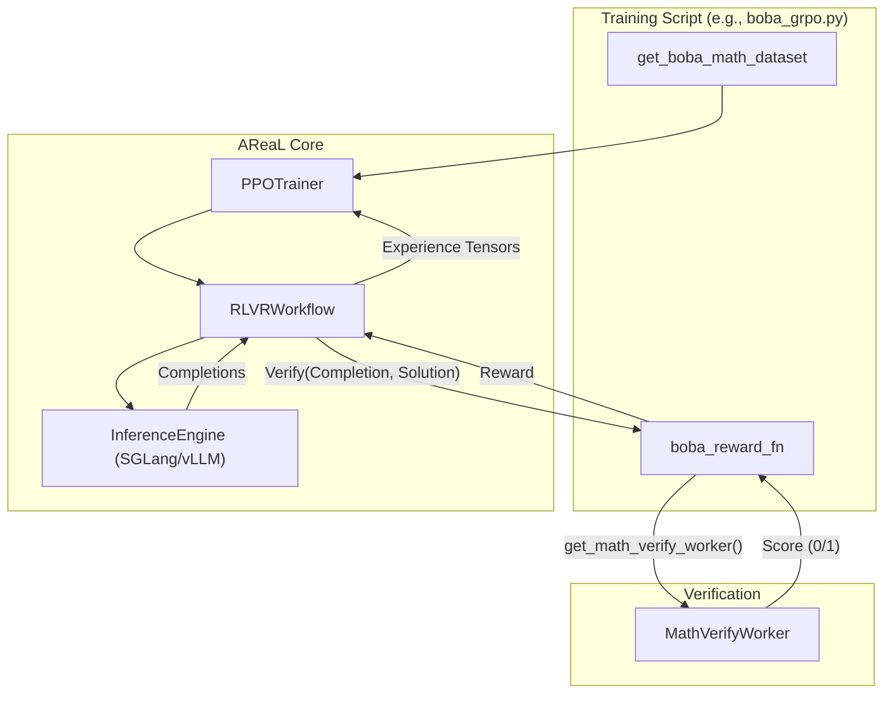
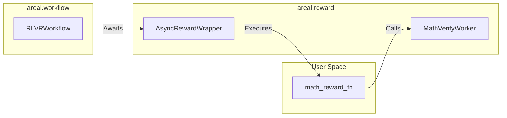

<!-- source: DeepWiki mcp.deepwiki.com · repo areal-project/AReaL · page 11.1 Math & Reasoning Examples · fetched 2026-10-21 -->

# Math & Reasoning Examples

<details>
<summary>Relevant source files</summary>

The following files were used as context for generating this wiki page:

- [examples/camel/config.yaml](examples/camel/config.yaml)
- [examples/camel/train.py](examples/camel/train.py)
- [examples/countdown/train.py](examples/countdown/train.py)
- [examples/countdown/train_config.yaml](examples/countdown/train_config.yaml)
- [examples/math/boba_grpo.py](examples/math/boba_grpo.py)
- [examples/math/boba_grpo.yaml](examples/math/boba_grpo.yaml)
- [examples/math/gsm8k_eval.py](examples/math/gsm8k_eval.py)
- [examples/math/gsm8k_grpo.yaml](examples/math/gsm8k_grpo.yaml)
- [examples/math/gsm8k_grpo_megatron.yaml](examples/math/gsm8k_grpo_megatron.yaml)
- [examples/math/gsm8k_m2po.yaml](examples/math/gsm8k_m2po.yaml)
- [examples/math/gsm8k_ppo.yaml](examples/math/gsm8k_ppo.yaml)
- [examples/math/gsm8k_ppo_megatron.yaml](examples/math/gsm8k_ppo_megatron.yaml)
- [examples/math/gsm8k_reinforce.yaml](examples/math/gsm8k_reinforce.yaml)
- [examples/math/gsm8k_reinforce_baseline.yaml](examples/math/gsm8k_reinforce_baseline.yaml)
- [examples/math/gsm8k_rloo.yaml](examples/math/gsm8k_rloo.yaml)
- [examples/math/gsm8k_sft.py](examples/math/gsm8k_sft.py)
- [examples/math/gsm8k_sft.yaml](examples/math/gsm8k_sft.yaml)
- [examples/skypilot/gsm8k_grpo_ray.yaml](examples/skypilot/gsm8k_grpo_ray.yaml)
- [examples/tir/tir_math_config.yaml](examples/tir/tir_math_config.yaml)
- [examples/tir/train_tir.py](examples/tir/train_tir.py)
- [examples/vlm/clevr_count_70k_grpo.py](examples/vlm/clevr_count_70k_grpo.py)
- [examples/vlm/clevr_count_70k_grpo.yaml](examples/vlm/clevr_count_70k_grpo.yaml)
- [examples/vlm/clevr_count_70k_sft.py](examples/vlm/clevr_count_70k_sft.py)
- [examples/vlm/clevr_count_70k_sft.yaml](examples/vlm/clevr_count_70k_sft.yaml)
- [notebook/math_reflection_en.ipynb](notebook/math_reflection_en.ipynb)
- [notebook/math_reflection_zh.ipynb](notebook/math_reflection_zh.ipynb)
- [notebook/search_agent_zh.ipynb](notebook/search_agent_zh.ipynb)

</details>


This page provides a technical guide to running math and reasoning reinforcement learning (RL) tasks within the AReaL framework. It covers the implementation of verifiable rewards, training scripts for standard benchmarks like GSM8K and NuminaMath (BOBA), and advanced reasoning tasks including Countdown and Tool-Integrated Reasoning (TIR).

## Overview of Reasoning Workflows

Reasoning tasks in AReaL typically leverage the **RLVR (Reinforcement Learning from Verifiable Rewards)** workflow. This approach relies on rule-based or symbolic verification (e.g., mathematical equivalence, code execution) rather than a neural reward model.

### Core Components for Reasoning
*   **Trainer**: Usually `PPOTrainer` [areal/trainer/ppo_trainer.py:54-82](), which orchestrates the Actor, Reference, and optional Critic models.
*   **Workflow**: `RLVRWorkflow` [areal/workflow/rlvr.py:1-20]() handles the generation of trajectories and computation of rewards.
*   **Reward Function**: A verifiable function that compares the model's completion against a ground-truth solution.

### Data Flow for Math RL
The following diagram illustrates the interaction between the training script, the AReaL trainer, and the verifiable reward system.

**Math RL Data Flow**

Sources: [examples/math/boba_grpo.py:35-87](), [examples/math/boba_grpo.py:45-60]()

## Benchmark Examples

### GSM8K (GRPO/PPO)
GSM8K is the standard benchmark for mathematical reasoning. AReaL supports multiple RL algorithms on this dataset, configured via YAML.

*   **GRPO Config**: [examples/math/gsm8k_grpo.yaml:1-184]() uses group-based relative advantage estimation. It sets `reward_norm.mean_level: group` [examples/math/gsm8k_grpo.yaml:76]() and `group_size` equal to the number of samples per prompt [examples/math/gsm8k_grpo.yaml:78]().
*   **PPO Config**: [examples/math/gsm8k_ppo.yaml:1-196]() includes a separate `critic` section [examples/math/gsm8k_ppo.yaml:86-103]() for value function estimation.

### NuminaMath (BOBA)
The BOBA example demonstrates training on the NuminaMath dataset using GRPO. It includes custom logic for handling "thinking" tokens.

*   **Thinking Process**: The `get_input_ids_fn` [examples/math/boba_grpo.py:11-28]() manages the insertion of `<think>` tokens to encourage chain-of-thought reasoning.
*   **Multi-Solution Verification**: The `boba_reward_fn` [examples/math/boba_grpo.py:45-60]() iterates through multiple possible solutions, returning a 1.0 score if any solution is verified by the `MathVerifyWorker`.

Sources: [examples/math/boba_grpo.py:11-87](), [examples/math/gsm8k_grpo.yaml:1-184]()

## Specialized Reasoning Tasks

### Countdown Task
The Countdown task requires the model to reach a target number using a set of provided integers and basic arithmetic operators.

*   **Workflow Implementation**: Unlike standard math, Countdown uses a custom `CountDownWorkflow` [examples/countdown/train.py:20-67]().
*   **Episode Logic**: The `arun_episode` method [examples/countdown/train.py:33-67]() decodes the model output and calls `compute_score` [examples/countdown/train.py:50-53]() to validate the arithmetic expression.

### Tool-Integrated Reasoning (TIR)
TIR involves the model using external tools (like a Python interpreter) to solve complex math problems.

*   **TIR Workflow**: Uses `TIRWorkflow` [examples/tir/train_tir.py:58]().
*   **Reward Scaling**: Reward functions for TIR often include small bonuses for successful tool calls in addition to the final answer correctness [examples/tir/train_tir.py:15-23]().

Sources: [examples/countdown/train.py:20-101](), [examples/tir/train_tir.py:15-62]()

## Implementation Detail: Reward Verification

AReaL provides a centralized `MathVerifyWorker` to ensure consistent evaluation across different math formats (LaTeX, plain text, etc.).

| Function | File Path | Role |
| :--- | :--- | :--- |
| `get_math_verify_worker` | [areal/reward/__init__.py]() | Singleton factory for the verification worker. |
| `worker.verify(pred, gold)` | [examples/math/boba_grpo.py:52]() | Compares model prediction against gold solution. |
| `AsyncRewardWrapper` | [areal/api/io_struct.py]() | Wraps synchronous reward functions for use in async workflows. |

**Code Entity Mapping: Reward System**

Sources: [examples/math/boba_grpo.py:45-60](), [examples/camel/train.py:45-65]()

## Running the Examples

### 1. SFT (Supervised Fine-Tuning)
Before RL, models are often fine-tuned on reasoning traces.
```bash
python3 examples/math/gsm8k_sft.py --config examples/math/gsm8k_sft.yaml
```
Sources: [examples/math/gsm8k_sft.py:9-32]()

### 2. RL (GRPO/PPO)
Run the RL training script with the corresponding YAML configuration.
```bash
python3 examples/math/boba_grpo.py --config examples/math/boba_grpo.yaml
```
Sources: [examples/math/boba_grpo.py:63-91]()

### 3. Agentic RL (CAMEL/TIR)
For agentic workflows, the `RolloutWorkflow` manages multi-turn interactions.
```bash
python3 examples/camel/train.py --config examples/camel/config.yaml
```
Sources: [examples/camel/train.py:106-135]()

---

