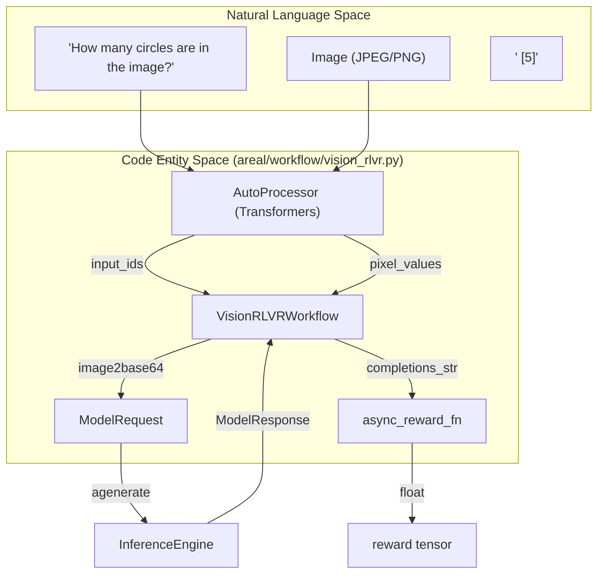
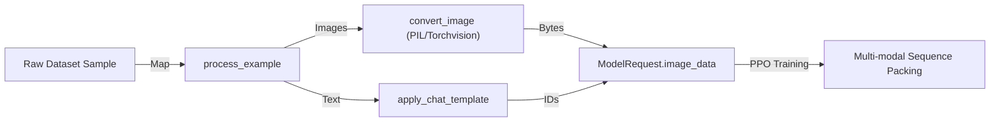
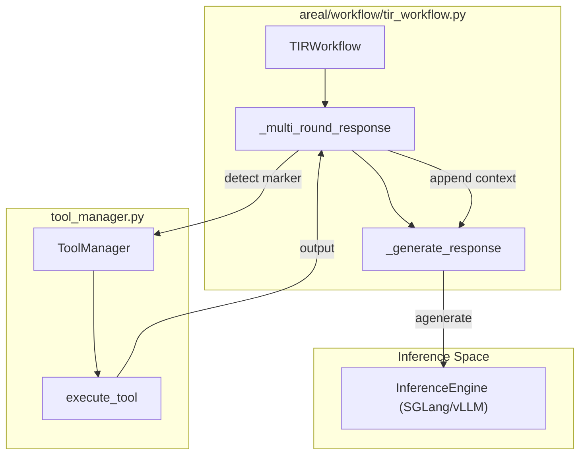

<!-- source: DeepWiki mcp.deepwiki.com · repo areal-project/AReaL · page 11.2 Vision & VLM Examples · fetched 2026-10-21 -->

# Vision & VLM Examples

Relevant source files

The following files were used as context for generating this wiki page:

- [areal/dataset/clevr_count_70k.py](areal/dataset/clevr_count_70k.py)
- [areal/dataset/geometry3k.py](areal/dataset/geometry3k.py)
- [areal/dataset/gsm8k.py](areal/dataset/gsm8k.py)
- [areal/dataset/torl_data.py](areal/dataset/torl_data.py)
- [areal/dataset/virl39k.py](areal/dataset/virl39k.py)
- [areal/experimental/inference_service/data_proxy/tokenizer_proxy.py](areal/experimental/inference_service/data_proxy/tokenizer_proxy.py)
- [areal/utils/hf_utils.py](areal/utils/hf_utils.py)
- [areal/workflow/multi_turn.py](areal/workflow/multi_turn.py)
- [areal/workflow/rlvr.py](areal/workflow/rlvr.py)
- [areal/workflow/vision_rlvr.py](areal/workflow/vision_rlvr.py)
- [examples/scaffolding/search_scaffolding.py](examples/scaffolding/search_scaffolding.py)
- [examples/scaffolding/tests/test_worker.py](examples/scaffolding/tests/test_worker.py)
- [examples/scaffolding/workflow.py](examples/scaffolding/workflow.py)
- [examples/tir/README_zh.md](examples/tir/README_zh.md)
- [examples/tir/figures/task_reward.png](examples/tir/figures/task_reward.png)
- [examples/tir/figures/tool_call_count.png](examples/tir/figures/tool_call_count.png)
- [examples/tir/prompts.py](examples/tir/prompts.py)
- [examples/tir/tests/data/sample_math.jsonl](examples/tir/tests/data/sample_math.jsonl)
- [examples/tir/tir_workflow.py](examples/tir/tir_workflow.py)
- [examples/vlm_npu/README.md](examples/vlm_npu/README.md)
- [examples/vlm_npu/geometry3k_grpo.py](examples/vlm_npu/geometry3k_grpo.py)
- [examples/vlm_npu/qwen2_5_vl_3b_geometry3k_grpo.sh](examples/vlm_npu/qwen2_5_vl_3b_geometry3k_grpo.sh)
- [examples/vlm_npu/qwen2_5_vl_3b_geometry3k_grpo.yaml](examples/vlm_npu/qwen2_5_vl_3b_geometry3k_grpo.yaml)
- [examples/vlm_npu/qwen2_5_vl_3b_virl39k_grpo_multinode.sh](examples/vlm_npu/qwen2_5_vl_3b_virl39k_grpo_multinode.sh)
- [examples/vlm_npu/qwen3_vl_2b_geometry3k_grpo.sh](examples/vlm_npu/qwen3_vl_2b_geometry3k_grpo.sh)
- [examples/vlm_npu/qwen3_vl_2b_geometry3k_grpo.yaml](examples/vlm_npu/qwen3_vl_2b_geometry3k_grpo.yaml)
- [examples/vlm_npu/virl39k_grpo.py](examples/vlm_npu/virl39k_grpo.py)

AReaL supports Reinforcement Learning from Verifiable Rewards (RLVR) for Vision-Language Models (VLMs). This includes specialized data pipelines for multi-modal sequence packing, support for NPU (Ascend) acceleration, and integrated workflows for benchmarks like CLEVR-Count-70K, Geometry3K, and VIRL39K.

## Vision RLVR Workflow

The `VisionRLVRWorkflow` extends the standard RLVR (Reinforcement Learning from Verifiable Rewards) logic to handle multi-modal inputs. It manages the synchronization between text tokens and vision features (pixel values) across distributed inference and training stages [areal/workflow/vision_rlvr.py:26-43]().

### Data Flow and Execution

The workflow orchestrates the following lifecycle for a multi-modal episode:
1.  **Preprocessing**: Uses `AutoProcessor` to convert raw images and chat messages into `input_ids`, `pixel_values`, and `mm_token_type_ids` [areal/workflow/vision_rlvr.py:111-121]().
2.  **Generation**: Sends a `ModelRequest` containing base64-encoded images to the `InferenceEngine` [areal/workflow/vision_rlvr.py:122-138]().
3.  **Reward Computation**: Decodes the model response and applies the verifiable reward function [areal/workflow/vision_rlvr.py:64-73]().
4.  **Tensor Preparation**: Packs the multi-modal features into a dictionary of tensors, including `multi_modal_input` (containing `pixel_values` and `image_grid_thw`) for the training engine [areal/workflow/vision_rlvr.py:148-167]().

### Natural Language to Code Entity Space: Vision Workflow

The following diagram maps the logical multi-modal RL components to their specific code implementations.

**Multi-modal Interaction Mapping**

Sources: `[areal/workflow/vision_rlvr.py:26-167]()`, `[areal/utils/image.py:15-15]()`.

---

## Multi-Modal Datasets

AReaL provides built-in support for several vision-reasoning datasets. These implementations handle the conversion of HuggingFace dataset formats into the multi-modal tensors required by the training engines.

| Dataset | Key Characteristics | Implementation |
| :--- | :--- | :--- |
| **Geometry3K** | Geometric problem solving with images. Uses center cropping (512x512) and instruction following templates. | `[areal/dataset/geometry3k.py:44-187]()` |
| **CLEVR-Count-70K** | Object counting in synthetic scenes. Resizes images to fit 336x336 pixels. | `[areal/dataset/clevr_count_70k.py:38-150]()` |
| **ViRL39K** | Large-scale vision-reasoning. Used for multi-node NPU benchmarking. | `[areal/dataset/virl39k.py:1-20]()` |

### Multi-modal Sequence Packing

To maximize throughput, AReaL implements multi-modal sequence packing. In `VisionRLVRWorkflow`, the `mm_token_type_ids` are generated to distinguish between vision tokens and text tokens, ensuring that the training engine can correctly apply vision encoders [areal/workflow/vision_rlvr.py:119-121]().

**Data Processing Flow**

Sources: `[areal/dataset/geometry3k.py:61-80]()`, `[areal/dataset/clevr_count_70k.py:63-90]()`.

---

## Training VLMs on NPU (Ascend)

AReaL is optimized for training vision-language models on Ascend NPU hardware. This includes support for models like Qwen2.5-VL and Qwen3-VL.

### Performance Benchmarks
On Ascend NPU hardware (16x NPU per node), AReaL demonstrates significant efficiency gains over synchronous frameworks like `verl` for large-scale GRPO training [examples/vlm_npu/README.md:43-54]().

| Metric | AReaL (Asynchronous) | verl (Synchronous) |
| :--- | :--- | :--- |
| **Epochs/Time** | 2 Epochs in 4.3 hrs | 1 Epoch in 6.8 hrs |
| **Avg Accuracy (OOD)** | 27.0 (at Epoch 3) | 26.5 (at Epoch 1) |
| **Hardware** | 3 Nodes (48 NPUs) | 3 Nodes (48 NPUs) |

Sources: `[examples/vlm_npu/README.md:99-112]()`.

### Configuration Examples
Training scripts and YAML configurations are provided for various VLM scales:
*   **Qwen2.5-VL-3B**: `examples/vlm_npu/qwen2_5_vl_3b_geometry3k_grpo.sh` [examples/vlm_npu/README.md:18-21]()
*   **Qwen3-VL-2B**: `examples/vlm_npu/qwen3_vl_2b_geometry3k_grpo.sh` [examples/vlm_npu/README.md:30-33]()
*   **Multi-node ViRL39K**: `examples/vlm_npu/qwen2_5_vl_3b_virl39k_grpo_multinode.sh` [examples/vlm_npu/README.md:24-27]()

---

## Tool-Integrated Reasoning (TIR) for Vision

The TIR workflow (`TIRWorkflow`) allows models to use tools (e.g., Python, calculators) during vision-reasoning tasks. This is particularly useful for complex geometric or mathematical problems where the model may need to perform calculations based on visual data [examples/tir/tir_workflow.py:47-57]().

### TIR Execution Loop
1.  **System Prompting**: Injects tool descriptions into the conversation [examples/tir/tir_workflow.py:116-123]().
2.  **Multi-round Response**: The `_multi_round_response` method detects tool start/end markers (e.g., `<tool_call>`) in the model output [examples/tir/tir_workflow.py:147-204]().
3.  **Tool Execution**: The `ToolManager` executes the requested code in a sandbox and returns the result to the model as a `<tool_response>` [examples/tir/tir_workflow.py:72-83]().

**TIR System Entity Space**

Sources: `[examples/tir/tir_workflow.py:147-204]()`, `[examples/tir/tir_workflow.py:72-89]()`.

---

## Key Implementation Classes

| Class | File | Responsibility |
| :--- | :--- | :--- |
| `VisionRLVRWorkflow` | `areal/workflow/vision_rlvr.py` | Orchestrates multi-modal inference, reward, and training tensor preparation. |
| `RLVRWorkflow` | `areal/workflow/rlvr.py` | Base class for single-turn reward learning workflows. |
| `TIRWorkflow` | `examples/tir/tir_workflow.py` | Implements multi-turn tool-calling loops for reasoning. |
| `ToolManager` | `examples/tir/tool_manager.py` | Manages tool execution environments and sandboxes. |

Sources: `[areal/workflow/vision_rlvr.py:26-26]()`, `[areal/workflow/rlvr.py:49-49]()`, `[examples/tir/tir_workflow.py:47-47]()`.

---

