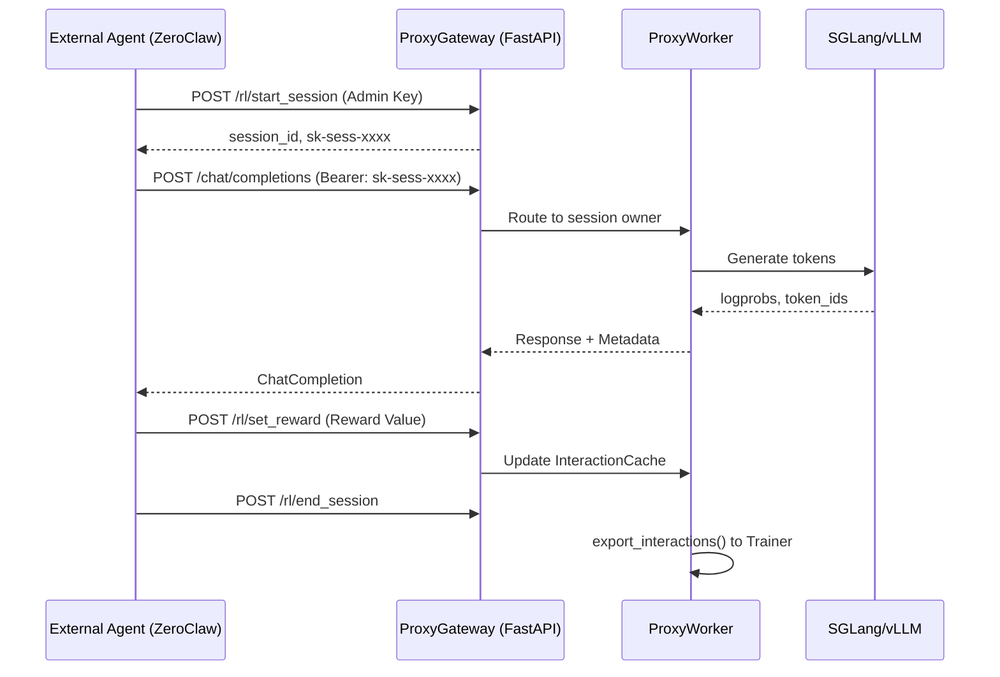

<!-- source: DeepWiki mcp.deepwiki.com · repo areal-project/AReaL · page 11.3 Agentic RL Examples · fetched 2026-10-21 -->

# Agentic RL Examples

Relevant source files

The following files were used as context for generating this wiki page:

- [areal/experimental/openai/__init__.py](areal/experimental/openai/__init__.py)
- [areal/experimental/openai/cache.py](areal/experimental/openai/cache.py)
- [areal/experimental/openai/client.py](areal/experimental/openai/client.py)
- [areal/experimental/openai/proxy/server.py](areal/experimental/openai/proxy/server.py)
- [areal/experimental/openai/tool_call_parser.py](areal/experimental/openai/tool_call_parser.py)
- [areal/experimental/openai/types.py](areal/experimental/openai/types.py)
- [areal/experimental/workflow/multi_turn_v2.py](areal/experimental/workflow/multi_turn_v2.py)
- [docs/en/tutorial/agentic_rl.md](docs/en/tutorial/agentic_rl.md)
- [docs/en/tutorial/online_proxy.md](docs/en/tutorial/online_proxy.md)
- [docs/zh/tutorial/online_proxy.md](docs/zh/tutorial/online_proxy.md)
- [examples/agent_workflow/README.md](examples/agent_workflow/README.md)
- [examples/agent_workflow/config.yaml](examples/agent_workflow/config.yaml)
- [examples/agent_workflow/config_claude.yaml](examples/agent_workflow/config_claude.yaml)
- [examples/agent_workflow/configs.py](examples/agent_workflow/configs.py)
- [examples/agent_workflow/train.py](examples/agent_workflow/train.py)
- [examples/countdown/reward_score.py](examples/countdown/reward_score.py)
- [examples/docs/debug/cmp_rollout.py](examples/docs/debug/cmp_rollout.py)
- [examples/experimental/inference_service/README.md](examples/experimental/inference_service/README.md)
- [examples/openclaw/README.md](examples/openclaw/README.md)
- [examples/openclaw/config.yaml](examples/openclaw/config.yaml)
- [examples/tau2/config_1.7b_airline.yaml](examples/tau2/config_1.7b_airline.yaml)
- [examples/tau2/config_235b_moe_airline.yaml](examples/tau2/config_235b_moe_airline.yaml)
- [examples/tau2/config_30b_moe_airline.yaml](examples/tau2/config_30b_moe_airline.yaml)
- [examples/tau2/config_8b_airline.yaml](examples/tau2/config_8b_airline.yaml)
- [examples/tau2/reward_moe.png](examples/tau2/reward_moe.png)
- [examples/terminal_bench/README.md](examples/terminal_bench/README.md)
- [examples/terminal_bench/__init__.py](examples/terminal_bench/__init__.py)
- [examples/terminal_bench/agent/__init__.py](examples/terminal_bench/agent/__init__.py)
- [examples/terminal_bench/agent/camel_terminal_agent.py](examples/terminal_bench/agent/camel_terminal_agent.py)
- [examples/terminal_bench/agent/chat_agent_trace.py](examples/terminal_bench/agent/chat_agent_trace.py)
- [examples/terminal_bench/agent/prompts.py](examples/terminal_bench/agent/prompts.py)
- [examples/terminal_bench/agent_rl_config.py](examples/terminal_bench/agent_rl_config.py)
- [examples/terminal_bench/config_tb_sglang.yaml](examples/terminal_bench/config_tb_sglang.yaml)
- [examples/terminal_bench/config_tb_vllm_npu.yaml](examples/terminal_bench/config_tb_vllm_npu.yaml)
- [examples/terminal_bench/pyproject.toml](examples/terminal_bench/pyproject.toml)
- [examples/terminal_bench/reward.png](examples/terminal_bench/reward.png)
- [examples/tir/README.md](examples/tir/README.md)
- [examples/tir/tests/test_tir.py](examples/tir/tests/test_tir.py)
- [examples/tir/tool_manager.py](examples/tir/tool_manager.py)
- [examples/tir/tools/__init__.py](examples/tir/tools/__init__.py)
- [examples/tir/tools/base.py](examples/tir/tools/base.py)
- [examples/tir/tools/calculator_tool.py](examples/tir/tools/calculator_tool.py)
- [examples/tir/tools/python_tool.py](examples/tir/tools/python_tool.py)
- [tests/test_examples.py](tests/test_examples.py)

AReaL provides end-to-end support for training agentic models through multi-turn interactions, tool use, and external environment feedback. This page covers the implementation details of agentic RL workflows, including Tool-Integrated Reasoning (TIR), the experimental OpenAI-compatible proxy for external agents (e.g., ZeroClaw), and specialized benchmarks like TerminalBench.

## Architecture of Agentic RL

Agentic RL in AReaL differs from standard RLVR by introducing stateful sessions and multi-turn interaction loops. The system supports three execution modes for agents: `inline` (in-process), `subproc` (subprocess pool), and `online` (external HTTP interaction) [docs/en/tutorial/online_proxy.md:15-20]().

### OpenAI-Compatible Client (`ArealOpenAI`)
To facilitate agentic workflows, AReaL provides `ArealOpenAI`, a wrapper around the OpenAI SDK that intercepts calls to track token-level data (log-probabilities and IDs) required for RL training [areal/experimental/openai/client.py:66-77]().

### Interaction Tracking
Interactions are stored in an `InteractionCache`, which manages parent-child relationships between turns using a longest-prefix rule to identify which messages belong to which trajectory [areal/experimental/openai/cache.py:13-34, 146-162]().

**Entity Mapping: Agentic Space to Code Entities**

| Agentic Concept | Code Entity | File Path |
| :--- | :--- | :--- |
| Interaction Session | `SessionData` | [areal/experimental/openai/proxy/server.py:66]() |
| Trajectory Cache | `InteractionCache` | [areal/experimental/openai/cache.py:13]() |
| RL Client | `ArealOpenAI` | [areal/experimental/openai/client.py:12]() |
| Interaction Record | `InteractionWithTokenLogpReward` | [areal/experimental/openai/types.py:36]() |
| Tool Parser | `process_tool_calls` | [areal/experimental/openai/tool_call_parser.py:57]() |

Sources: [areal/experimental/openai/client.py:12-77](), [areal/experimental/openai/cache.py:13-162](), [areal/experimental/openai/types.py:36-60](), [docs/en/tutorial/online_proxy.md:15-20]().

---

## Tool-Integrated Reasoning (TIR)

TIR examples demonstrate how models can be trained to use Python executors or calculators to solve complex reasoning tasks.

### Python Tool Implementation
The `PythonExecutor` (adapted from Qwen-Agent) allows models to execute code blocks. It extracts code from markdown triple backticks or `<python>` tags and executes it in a separate process pool to prevent the main training process from hanging [examples/tir/tools/python_tool.py:26-65, 168-175]().

### Multi-Turn Workflow
The `MultiTurnWorkflow` manages the loop of generation, tool execution, and reflection. If a model's answer is incorrect or unparsable, the workflow appends a reflection message and retries until `max_turns` is reached [areal/experimental/workflow/multi_turn_v2.py:17-52]().

**TIR Data Flow**
1. **Rollout**: `arun_episode` starts.
2. **Generation**: `ArealOpenAI.chat.completions.create` generates a response [areal/experimental/workflow/multi_turn_v2.py:54-62]().
3. **Parsing**: `process_tool_calls` identifies tool calls based on the configured `tool_call_parser` (e.g., `qwen3_xml`) [areal/experimental/openai/tool_call_parser.py:61-72]().
4. **Execution**: The selected tool (e.g., `PythonExecutor`) runs the code [examples/tir/tools/python_tool.py:95-112]().
5. **Reward**: `AsyncRewardWrapper` computes the final scalar reward, which is then discounted based on the number of turns taken [areal/experimental/workflow/multi_turn_v2.py:66-88]().

Sources: [examples/tir/tools/python_tool.py:26-175](), [areal/experimental/workflow/multi_turn_v2.py:17-96](), [areal/experimental/openai/tool_call_parser.py:61-72]().

---

## Online Agentic RL (ZeroClaw / OpenClaw)

The `online` mode allows external agent runtimes (like ZeroClaw) to connect to AReaL via a Proxy Gateway. This is used when the agent logic is too complex to run inside the rollout worker or requires a specific environment [examples/openclaw/README.md:3-6, 195-205]().

### Proxy Architecture
The architecture consists of a `ProxyGateway` that routes requests to `ProxyWorkers` colocated with inference engines [docs/en/tutorial/online_proxy.md:29-63]().

**Online Interaction Diagram**

Sources: [docs/en/tutorial/online_proxy.md:29-63](), [areal/experimental/openai/proxy/server.py:179-206](), [examples/openclaw/README.md:195-205]().

### Session Management
*   **Authentication**: Uses a two-tier system: an `admin_api_key` for session management and a `session_api_key` (prefixed with `sk-sess-`) for actual model interactions [docs/en/tutorial/online_proxy.md:203-212]().
*   **Reward Discounting**: Rewards are propagated backward through the interaction chain using `apply_reward_discount` in the `InteractionCache` [areal/experimental/openai/cache.py:55-84]().

---

## Specialized Agent Benchmarks

### TerminalBench
TerminalBench examples focus on agents operating in a CLI environment. The `CamelTerminalAgent` uses specialized prompts and trace tracking to solve tasks involving terminal commands [examples/terminal_bench/agent/camel_terminal_agent.py](). It integrates with the `online` mode to collect trajectories for RL tuning.

### Tau2 Customer Service
The Tau2 examples (e.g., `config_8b_airline.yaml`) demonstrate high-throughput agentic RL for customer service scenarios. These configurations typically use:
*   **Backends**: `sglang` for inference and `fsdp` for training [examples/tau2/config_8b_airline.yaml]().
*   **Reasoning**: Configured with `reasoning_parser: qwen3` to handle complex multi-turn logic [examples/openclaw/config.yaml:37]().

### Search Scaffolding
AReaL supports "search scaffolding" where the model is trained to explore multiple reasoning paths. This is implemented via `GroupedRolloutWorkflow`, which manages multiple `n_samples` per prompt and aggregates rewards across branches [areal/experimental/workflow/multi_turn_v2.py:27-30]().

Sources: [examples/terminal_bench/agent/camel_terminal_agent.py](), [examples/openclaw/config.yaml:21-41](), [areal/experimental/workflow/multi_turn_v2.py:17-30]().

---

