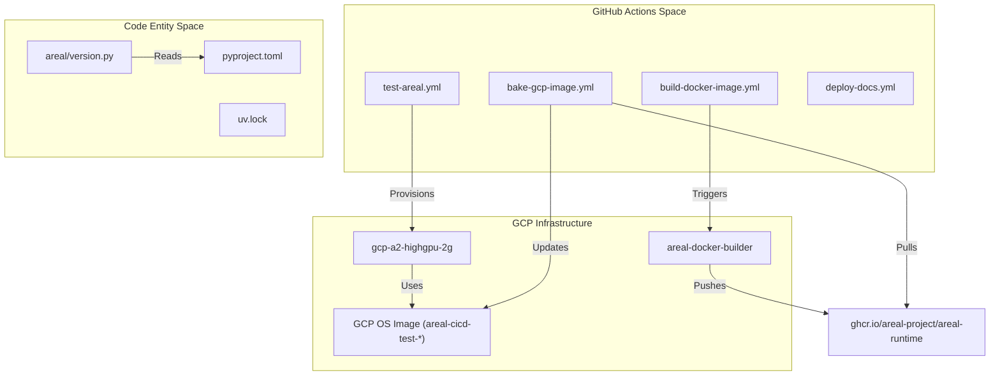
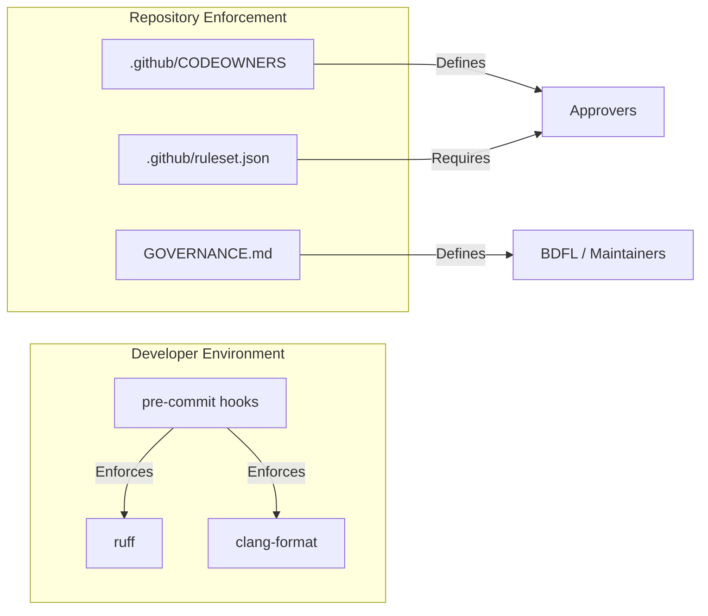

<!-- source: DeepWiki mcp.deepwiki.com · repo areal-project/AReaL · page 12 CI/CD & Development · fetched 2026-10-21 -->

# CI/CD & Development

Relevant source files

The following files were used as context for generating this wiki page:

- [.github/CODEOWNERS](.github/CODEOWNERS)
- [.github/PULL_REQUEST_TEMPLATE.md](.github/PULL_REQUEST_TEMPLATE.md)
- [.github/ruleset.json](.github/ruleset.json)
- [.github/workflows/bake-gcp-image.yml](.github/workflows/bake-gcp-image.yml)
- [.github/workflows/build-docker-image.yml](.github/workflows/build-docker-image.yml)
- [.github/workflows/deploy-docs.yml](.github/workflows/deploy-docs.yml)
- [.github/workflows/install-test.yml](.github/workflows/install-test.yml)
- [.github/workflows/runner-heartbeat.yml](.github/workflows/runner-heartbeat.yml)
- [.github/workflows/stale-issues.yml](.github/workflows/stale-issues.yml)
- [.github/workflows/test-areal.yml](.github/workflows/test-areal.yml)
- [.pre-commit-config.yaml](.pre-commit-config.yaml)
- [CODE_OF_CONDUCT.md](CODE_OF_CONDUCT.md)
- [GOVERNANCE.md](GOVERNANCE.md)
- [areal/tools/format_codeowners.py](areal/tools/format_codeowners.py)
- [areal/version.py](areal/version.py)
- [examples/countdown/countdown.py](examples/countdown/countdown.py)

This section provides an overview of the infrastructure and protocols that support AReaL's development lifecycle. It covers the automated pipelines for testing and deployment, as well as the governance and contribution standards for the project.

## Infrastructure Overview

AReaL utilizes a sophisticated CI/CD stack primarily hosted on GitHub Actions, integrated with Google Cloud Platform (GCP) for high-performance GPU testing. The development environment is standardized using `uv` for dependency management and Docker for runtime consistency.

### System Infrastructure Mapping
The following diagram illustrates how the CI/CD components interact with the cloud environment and the repository structure.

**Diagram: CI/CD System Architecture**

**Sources:** [.github/workflows/test-areal.yml:40-44](), [.github/workflows/build-docker-image.yml:18-29](), [.github/workflows/bake-gcp-image.yml:37-40](), [areal/version.py:9-15]()

---

## CI/CD Pipelines

AReaL's automation ensures that every change is validated across multiple dimensions: installation, unit testing on GPUs, and documentation integrity.

*   **Docker & Image Baking**: To minimize test latency, AReaL uses an "image baking" strategy where Docker images (variants for `sglang` and `vllm`) are pre-pulled into a custom GCP OS image [.github/workflows/bake-gcp-image.yml:108-113]().
*   **Ephemeral GPU Runners**: Pull requests labeled `safe-to-test` trigger the provisioning of ephemeral GCP A100/H100 instances that join the GitHub Actions runner pool temporarily [.github/workflows/test-areal.yml:62-66]().
*   **Installation Validation**: Tests verify that the package can be installed via `uv sync` on Linux and macOS, and that core modules like `TrainController` and `RolloutController` are importable [.github/workflows/install-test.yml:29-73]().
*   **Documentation**: The Jupyter Book documentation is automatically built and deployed to GitHub Pages upon pushes to the `main` branch [.github/workflows/deploy-docs.yml:4-5]().

For deep technical details on pipeline triggers and GCP integration, see **[CI/CD Pipelines](#12.1)**.

---

## Contributing & Governance

The project maintains high code quality through strict linting, formatting, and a structured governance model.

### Development Workflow Mapping
The following diagram maps the contribution process to the specific tools and files that enforce project standards.

**Diagram: Contribution Flow & Enforcement**

**Sources:** [.pre-commit-config.yaml:5-58](), [GOVERNANCE.md:13-44](), [.github/CODEOWNERS:1-4]()

### Standards and Rules
*   **Pre-commit Hooks**: Mandatory checks for Python (`ruff`), C++/CUDA (`clang-format`), and Markdown (`mdformat`) [.pre-commit-config.yaml:6-58]().
*   **Commit Messages**: The project enforces Conventional Commits (e.g., `feat:`, `fix:`, `perf:`) [.pre-commit-config.yaml:125-144]().
*   **Governance**: AReaL follows a BDFL (Benevolent Dictator For Life) model led by Wei Fu, with a team of Maintainers from various organizations (Ant Group, Huawei, ByteDance, etc.) [GOVERNANCE.md:20-38]().
*   **Code Ownership**: Specific subsystems (e.g., `/areal/engine/`, `/areal/models/`) have designated owners whose approval is required for merges [.github/CODEOWNERS:6-15]().

For detailed contribution guidelines and the full Code of Conduct, see **[Contributing & Governance](#12.2)**.

---
**Sources:** [.github/workflows/test-areal.yml](), [.github/workflows/build-docker-image.yml](), [.github/workflows/install-test.yml](), [.pre-commit-config.yaml](), [GOVERNANCE.md](), [areal/version.py](), [.github/CODEOWNERS]()

---

