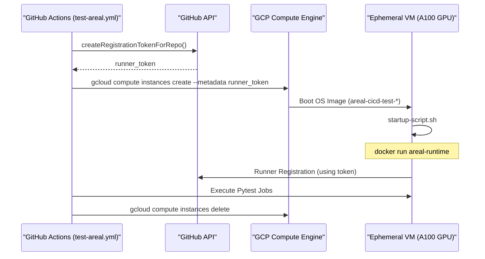
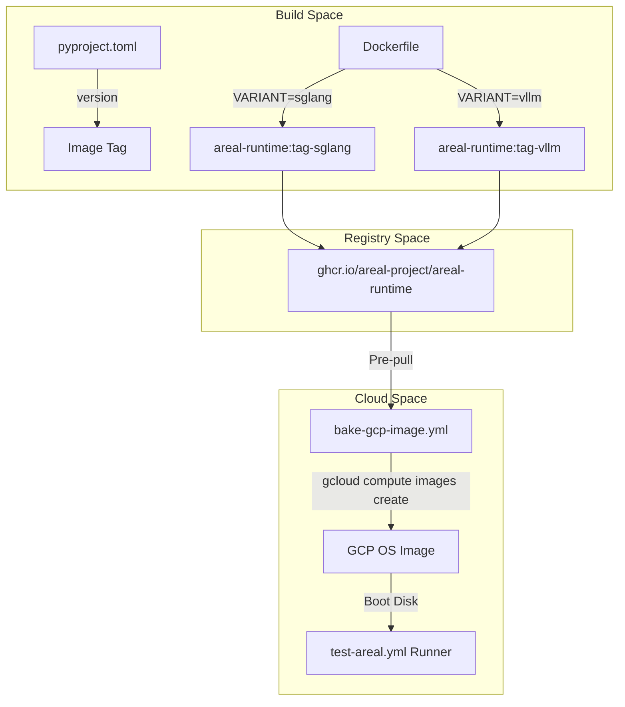

<!-- source: DeepWiki mcp.deepwiki.com · repo areal-project/AReaL · page 12.1 CI/CD Pipelines · fetched 2026-10-21 -->

# CI/CD Pipelines

Relevant source files

The following files were used as context for generating this wiki page:

- [.github/PULL_REQUEST_TEMPLATE.md](.github/PULL_REQUEST_TEMPLATE.md)
- [.github/workflows/bake-gcp-image.yml](.github/workflows/bake-gcp-image.yml)
- [.github/workflows/build-docker-image.yml](.github/workflows/build-docker-image.yml)
- [.github/workflows/deploy-docs.yml](.github/workflows/deploy-docs.yml)
- [.github/workflows/install-test.yml](.github/workflows/install-test.yml)
- [.github/workflows/nightly.yml](.github/workflows/nightly.yml)
- [.github/workflows/runner-heartbeat.yml](.github/workflows/runner-heartbeat.yml)
- [.github/workflows/stale-issues.yml](.github/workflows/stale-issues.yml)
- [.github/workflows/tag-release-image.yml](.github/workflows/tag-release-image.yml)
- [.github/workflows/test-areal.yml](.github/workflows/test-areal.yml)
- [Dockerfile](Dockerfile)
- [areal/tools/check_pyproject_consistency.py](areal/tools/check_pyproject_consistency.py)
- [areal/version.py](areal/version.py)
- [docs/en/tutorial/installation.md](docs/en/tutorial/installation.md)
- [docs/zh/tutorial/installation.md](docs/zh/tutorial/installation.md)
- [examples/countdown/countdown.py](examples/countdown/countdown.py)
- [examples/skypilot/README.md](examples/skypilot/README.md)
- [examples/skypilot/ray_cluster.sky.yaml](examples/skypilot/ray_cluster.sky.yaml)
- [examples/skypilot/single_node.sky.yaml](examples/skypilot/single_node.sky.yaml)
- [pyproject.toml](pyproject.toml)
- [pyproject.vllm.toml](pyproject.vllm.toml)
- [scripts/uv_lock.sh](scripts/uv_lock.sh)
- [uv.lock](uv.lock)
- [uv.vllm.lock](uv.vllm.lock)

The AReaL project utilizes GitHub Actions to manage a sophisticated CI/CD infrastructure designed for high-performance distributed RL. This includes ephemeral GPU runner provisioning on Google Cloud Platform (GCP), automated Docker image construction for multiple inference backends, and nightly validation of training workflows.

## GCP Ephemeral Runner Provisioning

To support hardware-accelerated testing without maintaining permanent infrastructure, AReaL uses a "provision-on-demand" strategy for GCP instances.

### Lifecycle of a Test Runner
The workflow `test-areal.yml` orchestrates the creation of GCP instances that register as self-hosted GitHub runners, execute tests, and then terminate.

1.  **Trigger**: Triggered by `workflow_dispatch`, `workflow_call`, or a `safe-to-test` label on pull requests [.github/workflows/test-areal.yml:3-35]().
2.  **Authentication**: Uses `google-github-actions/auth` with a service account key [.github/workflows/test-areal.yml:84-87]().
3.  **Token Generation**: Dynamically fetches a registration token via the GitHub API to allow the instance to join the runner pool [.github/workflows/test-areal.yml:92-117]().
4.  **Instance Creation**: Provisions `a2-highgpu-2g` instances (NVIDIA A100 GPUs) using `gcloud compute instances create` [.github/workflows/test-areal.yml:195-230]().
5.  **Startup & Containerization**: The instance executes a startup script that launches the `areal-runtime` Docker container with NVIDIA runtime support and starts the GitHub runner agent inside that container [.github/workflows/test-areal.yml:123-188]().
6.  **Cleanup**: The `cleanup-runner` job ensures the GCP instance is deleted regardless of test success or failure [.github/workflows/test-areal.yml:310-335]().

### Runner Provisioning Logic
The following diagram illustrates the interaction between GitHub Actions and the GCP Compute Engine API.

**GCP Runner Provisioning Flow**

Sources: [.github/workflows/test-areal.yml:62-230](), [.github/workflows/test-areal.yml:310-335]()

## Docker Image Build & Promotion

AReaL maintains two primary Docker image variants to support different inference backends: `sglang` and `vllm`. These are managed through `Dockerfile` and several workflows.

### Image Variants
The build process uses the `VARIANT` build argument to select the appropriate dependency stack [.Dockerfile:14-15]().
*   **sglang variant**: Pins `torch==2.9.1` [.Dockerfile:62-64]().
*   **vllm variant**: Pins `torch==2.10.0` [.Dockerfile:62-64]().

### Promotion Pipeline
*   **Build & Push**: The `tag-release-image.yml` workflow automates the creation of release images. It uses a dedicated `areal-docker-builder` instance [.github/workflows/tag-release-image.yml:26-33]().
*   **Version Sourcing**: The image tag is derived from the `version` field in `pyproject.toml` [.github/workflows/tag-release-image.yml:136-137]().
*   **Registry**: Images are pushed to GitHub Container Registry (`ghcr.io/areal-project/areal-runtime`) [.github/workflows/tag-release-image.yml:23]().

### Image Baking
To reduce CI startup latency, the `bake-gcp-image.yml` workflow "bakes" a new GCP OS image. It pre-pulls the latest `areal-runtime` Docker images onto a VM's disk and then saves that disk as a new GCP image [.github/workflows/bake-gcp-image.yml:108-113](). This prevents large image downloads during every CI run.

**Image Construction & Baking Data Flow**

Sources: [.github/workflows/tag-release-image.yml:133-182](), [.github/workflows/bake-gcp-image.yml:69-132](), [.Dockerfile:1-15]()

## Dependency & Consistency Management

AReaL uses `uv` for lightning-fast dependency resolution and maintains separate lock files for the incompatible `sglang` and `vllm` environments.

| File | Purpose | Key Dependencies |
| :--- | :--- | :--- |
| `pyproject.toml` | Default configuration (SGLang) | `sglang`, `torch==2.9.1` |
| `pyproject.vllm.toml` | vLLM variant configuration | `vllm`, `torch==2.10.0` |
| `uv.lock` | Frozen SGLang dependencies | See `[manifest]` in `uv.lock` |
| `uv.vllm.lock` | Frozen vLLM dependencies | See `[manifest]` in `uv.vllm.lock` |

Consistency between these files is enforced via `areal/tools/check_pyproject_consistency.py`.

Sources: [pyproject.toml:148-154](), [pyproject.vllm.toml:161-166](), [uv.lock:21-37](), [uv.vllm.lock:21-33]()

## Automated Testing & Validation

The system runs several tiers of automated checks:

1.  **Install Validation**: `install-test.yml` verifies that the package can be installed via `pip` and `uv` across different platforms (Linux, macOS) [pyproject.toml:220-228]().
2.  **Unit & Integration Tests**: `test-areal.yml` executes the `pytest` suite on the GCP runners, covering core components like `RTensor` and `Scheduler` [.github/workflows/test-areal.yml:256-300]().
3.  **Nightly Workflows**: `nightly.yml` runs more intensive training benchmarks (e.g., GRPO on GSM8K) to detect performance regressions.
4.  **Documentation Deployment**: `deploy-docs.yml` builds the Sphinx/Jupyter-Book documentation and deploys it to GitHub Pages [.github/workflows/deploy-docs.yml]().

## Versioning System

The project's versioning is centralized in `areal/version.py`. The `VersionInfo` class provides metadata about the current build, including the git commit hash and "dirty" status if there are uncommitted changes.

*   **`_get_package_version()`**: Retrieves the version from installed metadata [.areal/version.py:9-15]().
*   **`_populate_version_info()`**: Uses `subprocess` to call `git rev-parse` and `git branch` to enrich version data [.areal/version.py:60-88]().

Sources: [areal/version.py:18-58](), [areal/version.py:91-97]()

---

