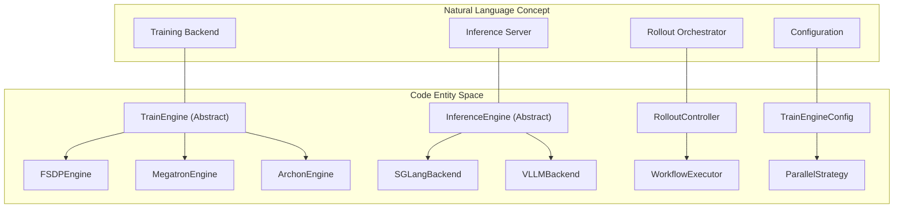
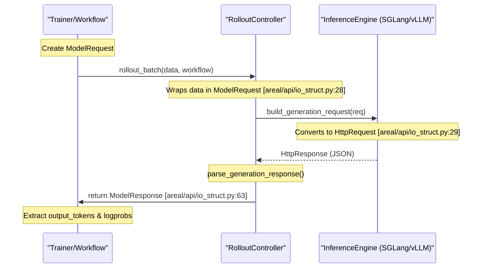

<!-- source: DeepWiki mcp.deepwiki.com · repo areal-project/AReaL · page 13 Glossary · fetched 2026-10-21 -->

# Glossary

Relevant source files

The following files were used as context for generating this wiki page:

- [.github/ISSUE_TEMPLATE/config.yml](.github/ISSUE_TEMPLATE/config.yml)
- [.github/workflows/pre-commit.yml](.github/workflows/pre-commit.yml)
- [AGENTS.md](AGENTS.md)
- [CLAUDE.md](CLAUDE.md)
- [CONTRIBUTING.md](CONTRIBUTING.md)
- [README.md](README.md)
- [ROADMAP.md](ROADMAP.md)
- [areal/api/alloc_mode.py](areal/api/alloc_mode.py)
- [areal/api/cli_args.py](areal/api/cli_args.py)
- [areal/api/engine_api.py](areal/api/engine_api.py)
- [areal/api/io_struct.py](areal/api/io_struct.py)
- [areal/api/scheduler_api.py](areal/api/scheduler_api.py)
- [areal/api/workflow_api.py](areal/api/workflow_api.py)
- [areal/engine/fsdp_engine.py](areal/engine/fsdp_engine.py)
- [areal/engine/fsdp_utils/__init__.py](areal/engine/fsdp_utils/__init__.py)
- [areal/engine/fsdp_utils/optimizer.py](areal/engine/fsdp_utils/optimizer.py)
- [areal/engine/megatron_engine.py](areal/engine/megatron_engine.py)
- [areal/engine/sglang_remote.py](areal/engine/sglang_remote.py)
- [areal/engine/vllm_remote.py](areal/engine/vllm_remote.py)
- [areal/experimental/engine/archon_engine.py](areal/experimental/engine/archon_engine.py)
- [areal/experimental/inference_service/controller/workflow.py](areal/experimental/inference_service/controller/workflow.py)
- [areal/experimental/inference_service/data_proxy/app.py](areal/experimental/inference_service/data_proxy/app.py)
- [areal/experimental/inference_service/gateway/app.py](areal/experimental/inference_service/gateway/app.py)
- [areal/experimental/inference_service/gateway/streaming.py](areal/experimental/inference_service/gateway/streaming.py)
- [areal/experimental/inference_service/router/app.py](areal/experimental/inference_service/router/app.py)
- [areal/experimental/inference_service/router/state.py](areal/experimental/inference_service/router/state.py)
- [areal/experimental/models/archon/activation_checkpoint.py](areal/experimental/models/archon/activation_checkpoint.py)
- [areal/experimental/models/archon/compile.py](areal/experimental/models/archon/compile.py)
- [areal/experimental/models/archon/model_spec.py](areal/experimental/models/archon/model_spec.py)
- [areal/experimental/models/archon/moe/args.py](areal/experimental/models/archon/moe/args.py)
- [areal/experimental/models/archon/moe/moe.py](areal/experimental/models/archon/moe/moe.py)
- [areal/experimental/models/archon/moe_weight_converter.py](areal/experimental/models/archon/moe_weight_converter.py)
- [areal/experimental/models/archon/parallel_dims.py](areal/experimental/models/archon/parallel_dims.py)
- [areal/experimental/models/archon/qwen2/infra/parallelize.py](areal/experimental/models/archon/qwen2/infra/parallelize.py)
- [areal/experimental/models/archon/qwen2/model/model.py](areal/experimental/models/archon/qwen2/model/model.py)
- [areal/experimental/models/archon/qwen3/infra/parallelize.py](areal/experimental/models/archon/qwen3/infra/parallelize.py)
- [areal/experimental/models/archon/qwen3/model/model.py](areal/experimental/models/archon/qwen3/model/model.py)
- [areal/infra/controller/train_controller.py](areal/infra/controller/train_controller.py)
- [areal/infra/rpc/rpc_server.py](areal/infra/rpc/rpc_server.py)
- [areal/infra/rpc/rtensor.py](areal/infra/rpc/rtensor.py)
- [areal/infra/scheduler/local.py](areal/infra/scheduler/local.py)
- [areal/infra/scheduler/ray.py](areal/infra/scheduler/ray.py)
- [areal/infra/scheduler/slurm.py](areal/infra/scheduler/slurm.py)
- [areal/models/tree_attn/constants.py](areal/models/tree_attn/constants.py)
- [areal/models/tree_attn/functional.py](areal/models/tree_attn/functional.py)
- [areal/models/tree_attn/module.py](areal/models/tree_attn/module.py)
- [areal/models/tree_attn/module_fsdp.py](areal/models/tree_attn/module_fsdp.py)
- [areal/models/tree_attn/module_megatron.py](areal/models/tree_attn/module_megatron.py)
- [areal/models/tree_attn/tree.py](areal/models/tree_attn/tree.py)
- [areal/models/tree_attn/triton_kernel.py](areal/models/tree_attn/triton_kernel.py)
- [areal/trainer/dpo_trainer.py](areal/trainer/dpo_trainer.py)
- [areal/trainer/rl_trainer.py](areal/trainer/rl_trainer.py)
- [areal/trainer/rw_trainer.py](areal/trainer/rw_trainer.py)
- [areal/trainer/sft_trainer.py](areal/trainer/sft_trainer.py)
- [areal/utils/data.py](areal/utils/data.py)
- [areal/utils/recover.py](areal/utils/recover.py)
- [areal/utils/saver.py](areal/utils/saver.py)
- [blog/AReaL_v0_2.md](blog/AReaL_v0_2.md)
- [blog/AReaL_v0_3.md](blog/AReaL_v0_3.md)
- [docs/en/best_practices/handling_oom.md](docs/en/best_practices/handling_oom.md)
- [docs/en/cli_reference.md](docs/en/cli_reference.md)
- [docs/en/version_history.md](docs/en/version_history.md)
- [docs/zh/best_practices/handling_oom.md](docs/zh/best_practices/handling_oom.md)
- [docs/zh/cli_reference.md](docs/zh/cli_reference.md)
- [docs/zh/version_history.md](docs/zh/version_history.md)
- [examples/countdown/README.md](examples/countdown/README.md)
- [examples/math/gsm8k_grpo_lora.yaml](examples/math/gsm8k_grpo_lora.yaml)
- [examples/tau2/README.md](examples/tau2/README.md)
- [tests/experimental/archon/torchrun/run_ep_tests.py](tests/experimental/archon/torchrun/run_ep_tests.py)
- [tests/experimental/inference_service/test_gateway.py](tests/experimental/inference_service/test_gateway.py)
- [tests/experimental/inference_service/test_router.py](tests/experimental/inference_service/test_router.py)
- [tests/test_local_scheduler.py](tests/test_local_scheduler.py)
- [tests/test_per_layer_optim_step.py](tests/test_per_layer_optim_step.py)
- [tests/test_rollout_controller.py](tests/test_rollout_controller.py)
- [tests/test_rtensor.py](tests/test_rtensor.py)
- [tests/test_train_controller.py](tests/test_train_controller.py)

This page provides definitions for codebase-specific terms, abbreviations, and domain concepts used throughout the AReaL system. It serves as a technical reference for understanding the relationship between high-level RL concepts and their specific implementations in the code.

## Core System Terms

### Asynchronous RL
The primary execution paradigm of AReaL where Rollout Workers and Training Workers operate in parallel without blocking each other. This is managed by the `RolloutController` which tracks model versions and handles weight synchronization.
*   **Implementation**: `RolloutController` in `areal/infra/dist_rollout.py` (v1) and `RolloutControllerV2` (v2).
*   **Key Logic**: Uses `max_head_offpolicyness` to control the version gap between rollout data and current training weights.

### Weight Synchronization (WeightSync)
The process of pushing updated model parameters from the `TrainEngine` to the `InferenceEngine`. AReaL supports three modes:
1.  **Disk**: Weights are saved to a shared filesystem and loaded by the inference server [areal/api/io_struct.py:184-185]().
2.  **XCCL (NCCL/XCCL)**: Direct GPU-to-GPU transfer using collective communication [areal/api/io_struct.py:184-190]().
3.  **AWEX**: An optimized asynchronous weight exchange protocol.

### RTensor (Remote Tensor)
A lightweight handle for tensors that reside in remote process memory. It allows passing data between distributed components (e.g., from an Inference Worker to a Trainer) without immediate serialization, only fetching data when needed.
*   **Implementation**: `areal/infra/rpc/rtensor.py`.

### Sequence Packing
A technique to eliminate padding waste in Transformer training by concatenating multiple variable-length sequences into a single 1D buffer.
*   **Key Components**: `cu_seqlens` (cumulative sequence lengths) and `indices` [areal/utils/data.py:183-195]().
*   **Algorithms**: `ffd` (First Fit Decreasing) and `kk` (Karmarkar-Karp) [areal/api/cli_args.py:126-138]().

---

## Code Entity Mapping

The following diagram bridges the gap between natural language system components and their specific class implementations.

**System to Code Mapping: Training & Rollout Infrastructure**

**Sources**: [areal/api/engine_api.py:32-219](), [areal/engine/fsdp_engine.py:219-221](), [areal/engine/megatron_engine.py:168-170](), [areal/engine/sglang_remote.py:40-41](), [areal/engine/vllm_remote.py:41-42]().

---

## Domain Concepts & Definitions

### Micro-Batch Specification (`MicroBatchSpec`)
Defines how a global batch is partitioned for distributed execution.
*   `n_mbs`: Number of micro-batches [areal/api/cli_args.py:102-107]().
*   `max_tokens_per_mb`: A dynamic threshold to prevent OOM by limiting token counts per forward pass [areal/api/cli_args.py:114-119]().
*   `packing_algorithm`: Strategy for grouping sequences (e.g., `ffd` or `kk`) [areal/api/cli_args.py:126-138]().

### Tree Attention (Tree Training)
An optimization for RL training where multiple completions share the same prompt prefix. Instead of re-computing the prompt for every sample, AReaL constructs a Trie and uses a specialized attention mask to compute log-probabilities in a single pass.
*   **Implementation**: `TrieNode` [areal/models/tree_attn/tree.py]() and `build_tree_attn_kwargs` [areal/models/tree_attn/module.py:103-106]().
*   **Functions**: `_gather_packed_tree_logprobs` [areal/models/tree_attn/functional.py:98-99]().

### Parallel Strategy Allocation
The DSL used to define GPU sharding.
*   **Format**: `fsdp:d4t2` where `d` stands for Data Parallel and `t` for Tensor/Context Parallel [areal/api/cli_args.py:102-104]().
*   **Class**: `ParallelStrategy` [areal/api/alloc_mode.py:52]().

---

## Data Flow: Model Request to Response

The following diagram traces the data structure transformations during a remote inference call.

**Data Structure Lifecycle**

**Sources**: [areal/api/io_struct.py:28-130](), [areal/api/engine_api.py:197-229](), [areal/engine/sglang_remote.py:43-127]().

---

## Table of Abbreviations

| Abbreviation | Full Term | Context in AReaL |
| :--- | :--- | :--- |
| **FSDP** | Fully Sharded Data Parallel | PyTorch-native sharding backend used in `FSDPEngine`. |
| **MCore** | Megatron-Core | NVIDIA's library for large-scale training used in `MegatronEngine`. |
| **PP** | Pipeline Parallelism | Splitting model layers across multiple GPU stages. |
| **TP** | Tensor Parallelism | Splitting individual layers (e.g., Attention/MLP) across GPUs. |
| **CP** | Context Parallelism | Splitting the sequence dimension across GPUs. |
| **RLVR** | RL from Verifiable Rewards | Training paradigm using ground-truth verifiers (e.g., math/code). |
| **TIR** | Tool-Integrated Reasoning | RL workflows involving external tool calls (e.g., Python). |
| **TMS** | Torch Memory Saver | External utility for CPU offloading of activations/optimizer states. |

**Sources**: [areal/api/cli_args.py](), [areal/engine/fsdp_engine.py](), [areal/engine/megatron_engine.py](), [areal/experimental/engine/archon_engine.py]().