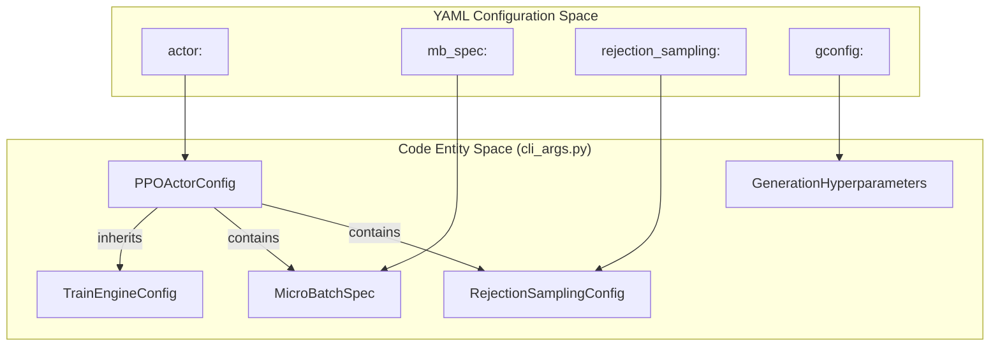
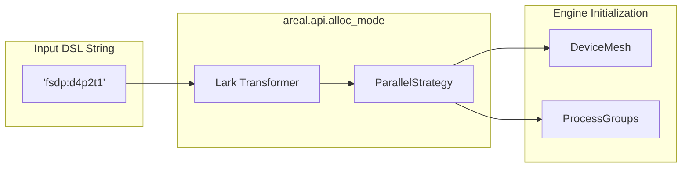

<!-- source: DeepWiki mcp.deepwiki.com · repo areal-project/AReaL · page 2.1 Configuration System (cli_args) · fetched 2026-10-21 -->

# Configuration System (cli_args)

Relevant source files

The following files were used as context for generating this wiki page:

- [.github/ISSUE_TEMPLATE/config.yml](.github/ISSUE_TEMPLATE/config.yml)
- [areal/api/alloc_mode.py](areal/api/alloc_mode.py)
- [areal/api/cli_args.py](areal/api/cli_args.py)
- [areal/engine/fsdp_engine.py](areal/engine/fsdp_engine.py)
- [areal/engine/megatron_engine.py](areal/engine/megatron_engine.py)
- [areal/experimental/engine/archon_engine.py](areal/experimental/engine/archon_engine.py)
- [blog/AReaL_v0_3.md](blog/AReaL_v0_3.md)
- [docs/en/cli_reference.md](docs/en/cli_reference.md)
- [docs/en/version_history.md](docs/en/version_history.md)
- [docs/generate_cli_docs.py](docs/generate_cli_docs.py)
- [docs/zh/cli_reference.md](docs/zh/cli_reference.md)
- [docs/zh/version_history.md](docs/zh/version_history.md)
- [examples/countdown/README.md](examples/countdown/README.md)
- [examples/countdown/train_config.yaml](examples/countdown/train_config.yaml)
- [examples/math/gsm8k_grpo.yaml](examples/math/gsm8k_grpo.yaml)
- [examples/math/gsm8k_rloo.yaml](examples/math/gsm8k_rloo.yaml)
- [examples/math/gsm8k_sft.yaml](examples/math/gsm8k_sft.yaml)
- [examples/tau2/README.md](examples/tau2/README.md)
- [examples/tir/tir_math_config.yaml](examples/tir/tir_math_config.yaml)
- [examples/vlm/clevr_count_70k_grpo.yaml](examples/vlm/clevr_count_70k_grpo.yaml)
- [examples/vlm/clevr_count_70k_sft.yaml](examples/vlm/clevr_count_70k_sft.yaml)
- [tests/test_trackio_backend.py](tests/test_trackio_backend.py)

AReaL utilizes a centralized configuration system built on Python `dataclasses` and `OmegaConf` (Hydra). This system provides a strongly-typed interface for defining RL experiments, training engines, and distributed resource allocation. Configurations can be defined in YAML files and overridden via the command line.

## Core Configuration Structure

The configuration system is anchored in `areal/api/cli_args.py`. It transforms raw YAML dictionaries into structured objects, ensuring type safety and validation at initialization.

### Configuration Mapping Flow
1.  **YAML Input**: User provides an experiment YAML (e.g., `examples/math/gsm8k_grpo.yaml`).
2.  **Hydra Compose**: `cli_args.py` uses `hydra_compose` to merge YAML files and CLI overrides [[areal/api/cli_args.py:14-17]]().
3.  **Dataclass Instantiation**: The resulting `DictConfig` is used to populate root configuration classes like `PPOConfig`, `GRPOConfig`, or `SFTConfig` [[areal/api/cli_args.py:1008-1030]]().
4.  **Engine Dispatch**: Configuration objects are passed to training engines (e.g., `FSDPEngine`, `MegatronEngine`) which use them to initialize model sharding and optimizers [[areal/engine/fsdp_engine.py:220-223]](), [[areal/engine/megatron_engine.py:169-173]]().

### System Entity Mapping
The following diagram bridges the YAML configuration keys to the internal Python dataclasses.

**Configuration Entity Map**

Sources: [[areal/api/cli_args.py:99-139]](), [[areal/api/cli_args.py:163-228]](), [[areal/api/cli_args.py:465-492]](), [[areal/api/cli_args.py:643-730]]().

---

## Key Dataclasses

### TrainEngineConfig
The base configuration for any training backend. It specifies the model path, data types, and core engine settings.
*   **`path`**: HF model path or local directory [[areal/api/cli_args.py:469]]().
*   **`dtype`**: Computation precision (e.g., `bfloat16`, `float32`) [[areal/api/cli_args.py:476]]().
*   **`backend`**: The engine to use (e.g., `fsdp`, `megatron`, `archon`) [[areal/api/cli_args.py:467]]().

### PPOActorConfig
Extends `TrainEngineConfig` with RL-specific parameters for the Policy model.
*   **`kl_ctl`**: Coefficient for KL divergence penalty [[areal/api/cli_args.py:683]]().
*   **`eps_clip`**: PPO clipping parameter [[areal/api/cli_args.py:676]]().
*   **`recompute_logprob`**: Enables recomputing log probabilities during the update to save memory [[areal/api/cli_args.py:700]]().

### MicroBatchSpec
Controls how training batches are partitioned to fit into GPU memory.
*   **`max_tokens_per_mb`**: Limits the number of tokens in a single forward/backward pass [[areal/api/cli_args.py:114]]().
*   **`packing_algorithm`**: Selection between `ffd` (First Fit Decreasing) and `kk` (Karmarkar-Karp) for balancing sequence lengths across ranks [[areal/api/cli_args.py:126-138]]().

### RejectionSamplingConfig
Used in algorithms like GRPO or PPO with rejection to filter trajectories.
*   **`metric`**: The metric used for filtering (e.g., `reward`, `ratio`) [[areal/api/cli_args.py:440]]().
*   **`upper` / `lower`**: Bounds for the acceptance threshold [[areal/api/cli_args.py:444-447]]().

Sources: [[areal/api/cli_args.py:99-139]](), [[areal/api/cli_args.py:433-462]](), [[areal/api/cli_args.py:465-515]](), [[areal/api/cli_args.py:643-730]]().

---

## Allocation DSL (The 'backend' String)

AReaL uses a Domain Specific Language (DSL) within the `backend` field to define parallelism strategies. This allows users to specify complex distributed setups in a single string (e.g., `fsdp:d4t2`).

### Syntax Components
The string follows the pattern `engine:strategy`.

| Symbol | Parallelism Dimension | Description |
| :--- | :--- | :--- |
| `d` | Data Parallel (DP) | Number of model replicas. |
| `t` | Tensor Parallel (TP) | Number of shards for individual tensors. |
| `p` | Pipeline Parallel (PP) | Number of stages across layers. |
| `c` | Context Parallel (CP) | Sequence length sharding for long-context. |
| `e` | Expert Parallel (EP) | Sharding of MoE experts. |

### DSL Parsing and Logic
The `ParallelStrategy` class in `areal/api/alloc_mode.py` parses these strings into integer dimensions used to initialize `DeviceMesh` and `ProcessGroup` [[areal/api/alloc_mode.py:33-60]]().

**Allocation Strategy Flow**

Sources: [[areal/api/alloc_mode.py:33-161]](), [[areal/engine/fsdp_engine.py:87]](), [[areal/engine/megatron_engine.py:91]]().

---

## Implementation Details

### Validation Logic
Dataclasses implement `__post_init__` to perform runtime validation. For example, `NormConfig` ensures that `group_size` is positive if group-level normalization is selected [[areal/api/cli_args.py:79-96]](). `MicroBatchSpec` validates that the chosen `packing_algorithm` exists in the `PACKING_ALGORITHMS` registry [[areal/api/cli_args.py:140-146]]().

### Tree Training Support
The configuration includes `enable_tree_training`, which triggers the construction of `TrieNode` structures and specialized attention kernels to share prefix computations across multiple samples in a group [[areal/api/cli_args.py:488]](), [[areal/engine/fsdp_engine.py:103-107]]().

Sources: [[areal/api/cli_args.py:79-96]](), [[areal/api/cli_args.py:140-146]](), [[areal/api/cli_args.py:488]](), [[areal/engine/fsdp_engine.py:103-107]]().

---

