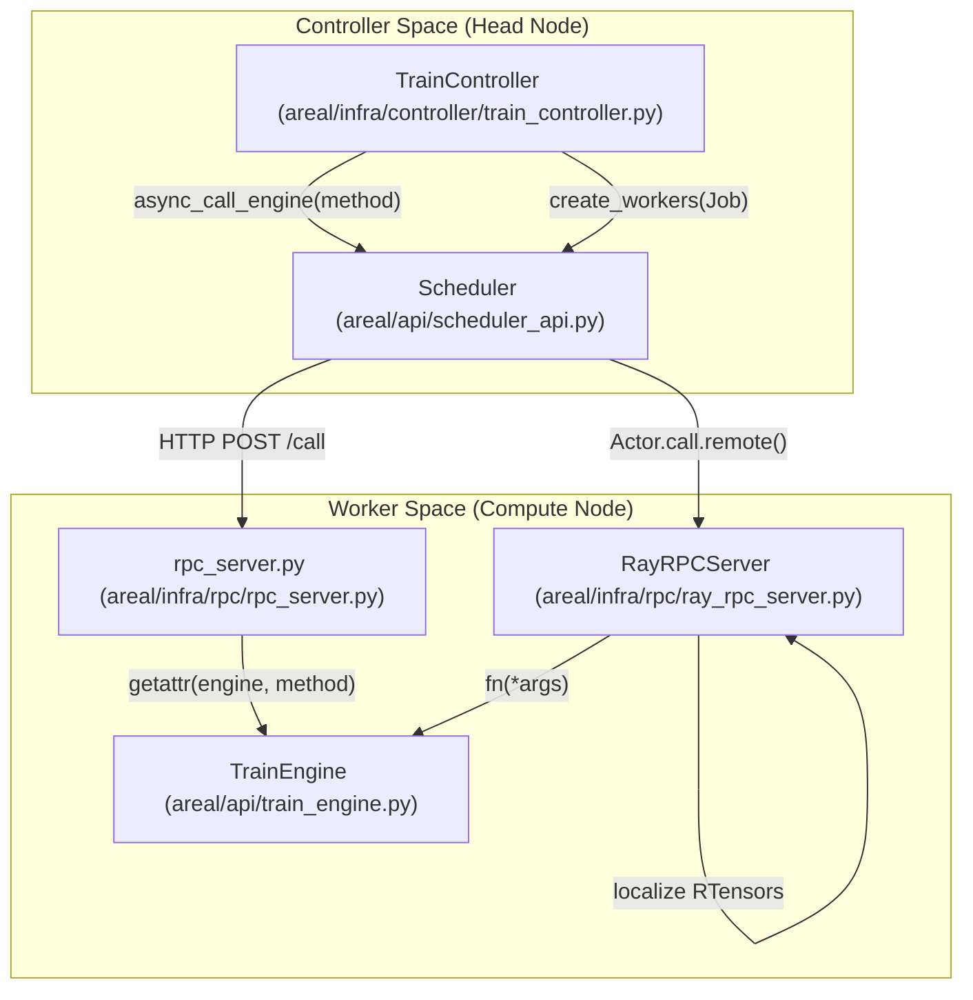
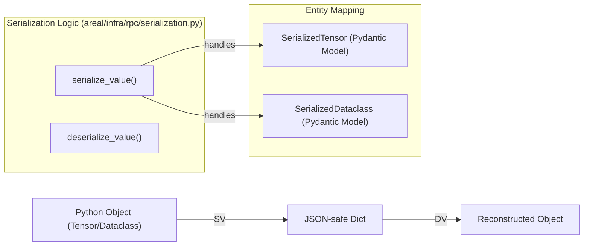

<!-- source: DeepWiki mcp.deepwiki.com · repo areal-project/AReaL · page 2.2 Distributed Infrastructure (Scheduler & RPC) · fetched 2026-10-21 -->

# Distributed Infrastructure (Scheduler & RPC)

Relevant source files

The following files were used as context for generating this wiki page:

- [areal/api/scheduler_api.py](areal/api/scheduler_api.py)
- [areal/infra/__init__.py](areal/infra/__init__.py)
- [areal/infra/launcher/__init__.py](areal/infra/launcher/__init__.py)
- [areal/infra/launcher/local.py](areal/infra/launcher/local.py)
- [areal/infra/launcher/ray.py](areal/infra/launcher/ray.py)
- [areal/infra/launcher/slurm.py](areal/infra/launcher/slurm.py)
- [areal/infra/launcher/vllm_server.py](areal/infra/launcher/vllm_server.py)
- [areal/infra/rpc/ray_rpc_server.py](areal/infra/rpc/ray_rpc_server.py)
- [areal/infra/rpc/rpc_server.py](areal/infra/rpc/rpc_server.py)
- [areal/infra/rpc/serialization.py](areal/infra/rpc/serialization.py)
- [areal/infra/scheduler/local.py](areal/infra/scheduler/local.py)
- [areal/infra/scheduler/ray.py](areal/infra/scheduler/ray.py)
- [areal/infra/scheduler/slurm.py](areal/infra/scheduler/slurm.py)
- [areal/infra/utils/ray.py](areal/infra/utils/ray.py)
- [areal/utils/network.py](areal/utils/network.py)
- [tests/test_local_scheduler.py](tests/test_local_scheduler.py)
- [tests/test_rollout_controller.py](tests/test_rollout_controller.py)
- [tests/test_serialization.py](tests/test_serialization.py)
- [tests/test_train_controller.py](tests/test_train_controller.py)

AReaL utilizes a modular distributed infrastructure to manage worker lifecycles, resource allocation, and remote procedure calls (RPC). This system abstracts the underlying cluster manager (Local, Ray, or Slurm) through a unified `Scheduler` interface, allowing the same RL training code to run seamlessly across different environments.

## Scheduler Abstraction

The `Scheduler` class [areal/api/scheduler_api.py:43-49]() is an abstract base class that defines how AReaL interacts with compute resources. It manages `Worker` objects, which represent individual processes with associated IP addresses and ports [areal/api/scheduler_api.py:14-33]().

### Key Scheduler Implementations

| Implementation | Class | Description |
| :--- | :--- | :--- |
| **Local** | `LocalScheduler` | Spawns subprocesses on a single machine using `subprocess.Popen` [areal/infra/scheduler/local.py:92-98](). |
| **Ray** | `RayScheduler` | Orchestrates `RayRPCServer` actors across a Ray cluster [areal/infra/scheduler/ray.py:58-76](). |
| **Slurm** | `SlurmScheduler` | Submits `sbatch` jobs or runs `srun` commands for multi-node HPC environments [areal/infra/scheduler/slurm.py:72-90](). |

### Worker Lifecycle and Management
Schedulers handle the following lifecycle stages:
1.  **Creation**: `create_workers(job)` starts the physical processes based on a `Job` spec [areal/api/scheduler_api.py:57-82]().
2.  **Discovery**: `get_workers(role)` blocks until workers are ready and returns their network metadata [areal/api/scheduler_api.py:84-112]().
3.  **Engine Instantiation**: `create_engine` dynamically imports and initializes a `TrainEngine` or `InferenceEngine` on the remote worker [areal/api/scheduler_api.py:181-210]().
4.  **Cleanup**: `delete_workers` ensures graceful termination of process trees [areal/api/scheduler_api.py:114-142]().

**Sources:** [areal/api/scheduler_api.py:43-210](), [areal/infra/scheduler/local.py:92-183](), [areal/infra/scheduler/ray.py:58-80](), [areal/infra/scheduler/slurm.py:72-159]()

---

## RPC Infrastructure

AReaL uses a two-tier RPC system: a **Guard Server** (Flask/Werkzeug-based) for Local/Slurm and **Ray Actors** for Ray-based deployments.

### RPC Guard Server
The `SyncRPCServer` [areal/infra/rpc/rpc_server.py:33-66]() is the standard entry point for non-Ray workers. It composes several Blueprints:
*   **Engine Blueprint**: Handles `create_engine` and `call` routes to invoke methods on initialized engines [areal/infra/rpc/rpc_server.py:27-27]().
*   **Data Blueprint**: Manages state and data transfer hooks [areal/infra/rpc/rpc_server.py:26-26]().

### Ray RPC Server
The `RayRPCServer` [areal/infra/rpc/ray_rpc_server.py:23-35]() performs the same role as the Guard Server but within the Ray ecosystem. It manages multiple named engines for colocation and handles `RTensor` localization before calling engine methods [areal/infra/rpc/ray_rpc_server.py:141-156]().

### Code-to-Entity Mapping: RPC Flow
The following diagram illustrates how high-level controller calls translate to low-level RPC server executions.

**Sources:** [areal/infra/rpc/rpc_server.py:33-62](), [areal/infra/rpc/ray_rpc_server.py:23-156](), [areal/infra/controller/train_controller.py:76-98]()

---

## Resource & Port Management

Distributed training requires precise coordination of network ports for NCCL, HTTP RPC, and data services.

### Port Allocation Strategy
Schedulers use `find_free_ports` [areal/utils/network.py:114-176]() to identify available ports in the range (10000, 32767) [areal/utils/network.py:138-138]().
*   **Worker Ports**: Used for the RPC Guard server communication.
*   **Engine Ports**: Reserved for backend-specific communication (e.g., NCCL `MASTER_PORT`).

### Colocation and Forking
AReaL supports **Colocation** where multiple engines (e.g., an Actor and a Critic) share the same physical worker process to save memory and reduce communication overhead.
*   **Forking**: `fork_workers` [areal/api/scheduler_api.py:145-180]() allows creating new roles (like a proxy) on the same nodes as existing workers.
*   **Ray Placement Groups**: `RayScheduler` uses `PlacementGroup` [areal/infra/scheduler/ray.py:179-185]() to ensure workers are physically colocated on the same node when required by the `SchedulingStrategy` [areal/api/scheduler_api.py:40-40]().

**Sources:** [areal/utils/network.py:114-176](), [areal/api/scheduler_api.py:14-40](), [areal/infra/scheduler/ray.py:170-190]()

---

## Serialization (RTensor & Dataclasses)

To move complex Python objects across the network, AReaL provides a robust serialization layer in `areal.infra.rpc.serialization`.

### Supported Types
| Type | Serialization Mechanism |
| :--- | :--- |
| **PyTorch Tensor** | Converted to Base64 with metadata (shape, dtype) [areal/infra/rpc/serialization.py:69-111](). |
| **NumPy Array** | Base64 encoding of contiguous buffers [areal/infra/rpc/serialization.py:198-209](). |
| **Dataclass** | Recursively serialized into dictionaries preserving class paths [areal/infra/rpc/serialization.py:25-26](). |
| **PIL Image** | Serialized for VLM rollout tasks [areal/infra/rpc/serialization.py:221-228](). |

### Serialization Architecture

**Sources:** [areal/infra/rpc/serialization.py:49-228](), [tests/test_serialization.py:25-179]()

---

## Name Resolution

Distributed components find each other using the `name_resolve` utility [areal/utils/name_resolve.py]().
*   **NFS Backend**: Writes JSON files to a shared filesystem (e.g., `/tmp/areal/name_resolve`) to store worker IPs and ports [areal/infra/scheduler/local.py:130-134]().
*   **Etcd Backend**: (Optional) Uses `etcd3` for high-availability name resolution in large clusters [areal/infra/scheduler/slurm.py:112-116]().

When a `LocalScheduler` or `SlurmScheduler` initializes, it clears the `trial_root` to ensure stale worker addresses from previous runs are removed [areal/infra/scheduler/local.py:147-151](), [areal/infra/scheduler/slurm.py:129-133]().

**Sources:** [areal/infra/scheduler/local.py:130-151](), [areal/infra/scheduler/slurm.py:112-133]()

---

