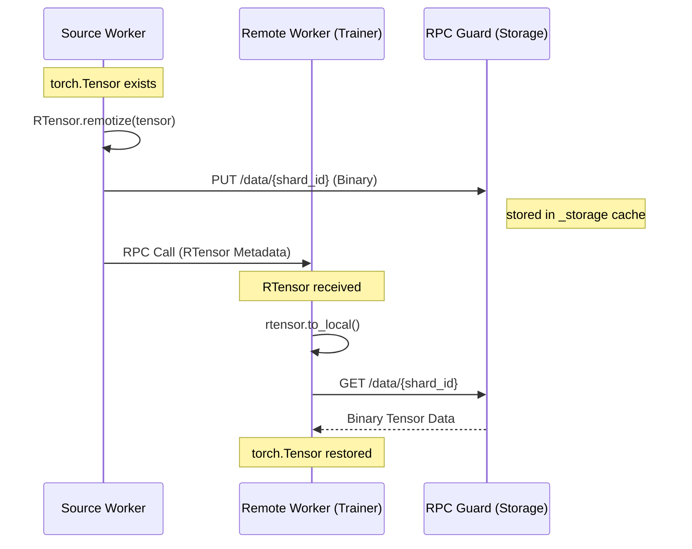
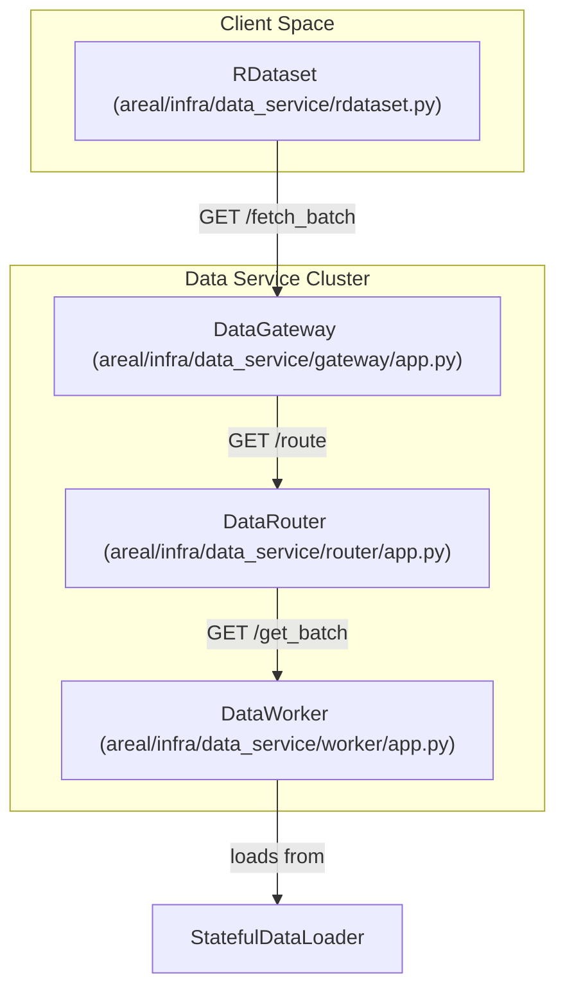
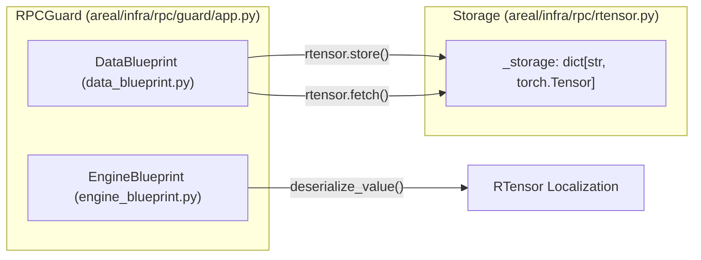

<!-- source: DeepWiki mcp.deepwiki.com · repo areal-project/AReaL · page 2.3 RTensor & Data Service · fetched 2026-10-21 -->

# RTensor & Data Service

<details>
<summary>Relevant source files</summary>

The following files were used as context for generating this wiki page:

- [areal/infra/controller/train_controller.py](areal/infra/controller/train_controller.py)
- [areal/infra/data_service/controller/config.py](areal/infra/data_service/controller/config.py)
- [areal/infra/data_service/controller/controller.py](areal/infra/data_service/controller/controller.py)
- [areal/infra/data_service/gateway/app.py](areal/infra/data_service/gateway/app.py)
- [areal/infra/data_service/rdataset.py](areal/infra/data_service/rdataset.py)
- [areal/infra/data_service/router/app.py](areal/infra/data_service/router/app.py)
- [areal/infra/data_service/types.py](areal/infra/data_service/types.py)
- [areal/infra/data_service/worker/__main__.py](areal/infra/data_service/worker/__main__.py)
- [areal/infra/data_service/worker/app.py](areal/infra/data_service/worker/app.py)
- [areal/infra/data_service/worker/config.py](areal/infra/data_service/worker/config.py)
- [areal/infra/rpc/guard/data_blueprint.py](areal/infra/rpc/guard/data_blueprint.py)
- [areal/infra/rpc/guard/engine_blueprint.py](areal/infra/rpc/guard/engine_blueprint.py)
- [areal/infra/rpc/rtensor.py](areal/infra/rpc/rtensor.py)
- [areal/trainer/dpo_trainer.py](areal/trainer/dpo_trainer.py)
- [areal/trainer/rl_trainer.py](areal/trainer/rl_trainer.py)
- [areal/trainer/rw_trainer.py](areal/trainer/rw_trainer.py)
- [areal/trainer/sft_trainer.py](areal/trainer/sft_trainer.py)
- [tests/experimental/inference_service/test_data_proxy_rtensor.py](tests/experimental/inference_service/test_data_proxy_rtensor.py)
- [tests/infra/data_service/test_worker.py](tests/infra/data_service/test_worker.py)
- [tests/infra/rpc/__init__.py](tests/infra/rpc/__init__.py)
- [tests/infra/rpc/test_engine_validation.py](tests/infra/rpc/test_engine_validation.py)
- [tests/test_inference_engines.py](tests/test_inference_engines.py)
- [tests/test_rtensor.py](tests/test_rtensor.py)
- [tests/test_train_engine.py](tests/test_train_engine.py)

</details>


The **Data Service** is AReaL's distributed infrastructure for moving tensors and dataset samples across heterogeneous process groups. It centers around the **RTensor (Remote Tensor)** abstraction, which allows processes to exchange metadata about tensors without immediately transferring the underlying data, and a tiered microservice architecture for scalable data loading.

## RTensor: Remote Tensor Abstraction

An `RTensor` is a handle to a tensor stored on a remote node. It contains the tensor's metadata (shape, dtype) and a `TensorShardInfo` object that points to its physical location [areal/infra/rpc/rtensor.py:70-82]().

### Core Components
*   **RTensor**: The user-facing class that mimics `torch.Tensor` properties but delegates data retrieval to a backend [areal/infra/rpc/rtensor.py:321-325]().
*   **RTensorBackend**: A protocol defining `fetch`, `store`, and `delete` operations [areal/infra/rpc/rtensor.py:25-67]().
*   **HttpRTensorBackend**: The default implementation using asynchronous HTTP calls to move tensors between nodes [areal/infra/rpc/rtensor.py:88-92]().

### Data Flow: Remotize and Localize
Tensors are moved through a "Remotize-Localize" roundtrip:
1.  **Remotize**: A local tensor is stored in a local memory cache (the `RTensorStorage`), and an `RTensor` handle is created with the local node's address [areal/infra/rpc/rtensor.py:461-482]().
2.  **Transmission**: The `RTensor` handle (a small JSON-serializable object) is sent via RPC to a remote worker.
3.  **Localize**: The remote worker calls `to_local()`, which triggers the `RTensorBackend` to fetch the actual bytes via HTTP from the source node [areal/infra/rpc/rtensor.py:414-428]().

**RTensor Lifecycle Diagram**

Sources: `[areal/infra/rpc/rtensor.py:414-482]()`, `[areal/infra/rpc/guard/data_blueprint.py:58-105]()`

---

## Distributed Data Service

The Data Service provides a scalable alternative to local `DataLoader` instances, especially useful when the trainer and the data source (e.g., Rollout Workers) are on different clusters or when the dataset is too large for a single node.

### Architecture
The service consists of four main components orchestrated by the `DataController` [areal/infra/data_service/controller/controller.py:35-40]():

| Component | Role | Code Entity |
| :--- | :--- | :--- |
| **Controller** | Orchestrates lifecycle; forks workers and routers. | `DataController` |
| **Gateway** | Entry point for clients; provides unified API. | `DataGateway` |
| **Router** | Routes requests to specific DataWorkers based on dataset ID. | `DataRouter` |
| **Worker** | Manages actual `torch.utils.data.DataLoader` instances. | `DataWorker` |

### System Mapping: Code Entities to Roles
The following diagram maps the logical data flow to specific classes and API routes.


Sources: `[areal/infra/data_service/controller/controller.py:197-230]()`, `[areal/infra/data_service/rdataset.py:31-50]()`

---

## RDataset Interface

`RDataset` is a proxy class that implements the standard dataset interface but fetches samples from the distributed Data Service instead of local disk [areal/infra/data_service/rdataset.py:31-40]().

### Connection and Loading
When a trainer (e.g., `PPOTrainer` or `SFTTrainer`) detects an `RDataset`, it initializes a `DataController` to launch the backend services [areal/trainer/sft_trainer.py:82-97](). The `RDataset` then "connects" to the gateway.

```python
# Example of RDataset usage in Trainer
if isinstance(train_dataset, RDataset):
    controller = DataController(ds_cfg, self.scheduler)
    controller.initialize(role="data", num_dataset_workers=ds_cfg.num_workers)
    
    train_dataset.connect(
        controller,
        dataset_id="experiment_train",
        tokenizer_or_processor_path=config.tokenizer_path
    )
```
Sources: `[areal/trainer/sft_trainer.py:82-97]()`, `[areal/infra/data_service/rdataset.py:82-105]()`

### Pipelined Initialization
The `DataController` uses a tiered forking strategy to ensure the service is ready before training starts:
1.  **RPC Guards**: Launched via the `Scheduler` [areal/infra/data_service/controller/controller.py:170-181]().
2.  **Workers & Router**: Forked as sub-processes on the Guards [areal/infra/data_service/controller/controller.py:197-216]().
3.  **Gateway**: Forked last once workers are healthy [areal/infra/data_service/controller/controller.py:218-230]().

---

## Data Transfer Implementation (RPC Guard)

The `RPC Guard` is the underlying host for these services. It provides two critical Flask Blueprints for tensor movement:

### Data Blueprint (`/data/*`)
Handles the physical storage of tensors in memory.
*   `PUT /data/<shard_id>`: Serializes and stores a tensor [areal/infra/rpc/guard/data_blueprint.py:58-71]().
*   `GET /data/<shard_id>`: Retrieves a tensor [areal/infra/rpc/guard/data_blueprint.py:78-100]().
*   `POST /data/batch`: Retrieves multiple shards in one roundtrip to minimize latency [areal/infra/rpc/guard/data_blueprint.py:107-130]().

### Engine Blueprint (`/call`)
Used to invoke methods on remote engines (like `train_batch` or `generate`). It handles the deserialization of `RTensor` arguments automatically before the engine sees them [areal/infra/rpc/guard/engine_blueprint.py:63-68]().

**Entity Association Diagram**

Sources: `[areal/infra/rpc/guard/data_blueprint.py:68-84]()`, `[areal/infra/rpc/guard/engine_blueprint.py:136-143]()`

---
**Sources:**
*   `areal/infra/rpc/rtensor.py`
*   `areal/infra/data_service/controller/controller.py`
*   `areal/infra/data_service/rdataset.py`
*   `areal/infra/rpc/guard/data_blueprint.py`
*   `areal/infra/rpc/guard/engine_blueprint.py`
*   `areal/trainer/sft_trainer.py`
*   `areal/trainer/rl_trainer.py`

---

