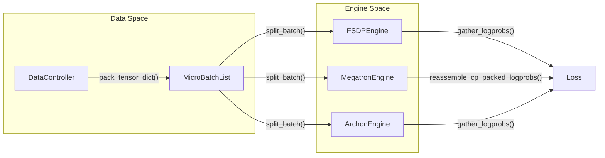

<!-- source: DeepWiki mcp.deepwiki.com · repo areal-project/AReaL · page 3 Training Engines · fetched 2026-10-21 -->

# Training Engines

<details>
<summary>Relevant source files</summary>

The following files were used as context for generating this wiki page:

- [.github/workflows/pre-commit.yml](.github/workflows/pre-commit.yml)
- [AGENTS.md](AGENTS.md)
- [CLAUDE.md](CLAUDE.md)
- [CONTRIBUTING.md](CONTRIBUTING.md)
- [README.md](README.md)
- [ROADMAP.md](ROADMAP.md)
- [areal/api/cli_args.py](areal/api/cli_args.py)
- [areal/engine/fsdp_engine.py](areal/engine/fsdp_engine.py)
- [areal/engine/megatron_engine.py](areal/engine/megatron_engine.py)
- [areal/experimental/engine/archon_engine.py](areal/experimental/engine/archon_engine.py)
- [blog/AReaL_v0_2.md](blog/AReaL_v0_2.md)
- [docs/en/cli_reference.md](docs/en/cli_reference.md)
- [docs/zh/cli_reference.md](docs/zh/cli_reference.md)

</details>


AReaL supports multiple training backends designed to scale reinforcement learning for large-scale reasoning and agentic models. All training backends implement the `TrainEngine` interface [areal/api/contracts.py](), providing a unified contract for model initialization, forward/backward passes, optimizer steps, and weight synchronization.

The system selects a training engine based on the `backend` field in the `TrainEngineConfig` [areal/api/cli_args.py:220-221]().

## TrainEngine Interface

The `TrainEngine` abstract base class [areal/api/contracts.py]() defines the lifecycle and capabilities required for any training backend in AReaL. Key responsibilities include:

*   **Parallelism Setup**: Initializing process groups and device meshes (e.g., DP, TP, PP, CP).
*   **Model Management**: Loading weights from HuggingFace or distributed checkpoints and applying sharding strategies.
*   **Execution**: Handling micro-batching, gradient accumulation, and loss computation.
*   **Weight Sync**: Synchronizing weights with remote inference engines (e.g., SGLang, vLLM) for asynchronous RL.

### Engine Relationship Diagram

The following diagram illustrates how the different engine implementations relate to the core system and the `TrainEngine` interface.

**Training Engine Hierarchy**
```mermaid
graph TD
    subgraph "Interface Layer"
        TE["TrainEngine (Abstract Base Class)"]
    end

    subgraph "Implementation Layer"
        FSDP["FSDPEngine"]
        MC["MegatronEngine"]
        ARCH["ArchonEngine"]
    end

    subgraph "Core Components"
        DRC["DistRolloutCoordinator"]
        DCP["DCPState / MegatronCheckpointManager"]
        TMS["torch_memory_saver (TMS)"]
    end

    TE <|-- FSDP
    TE <|-- MC
    TE <|-- ARCH

    FSDP -.-> DRC
    FSDP -.-> TMS
    MC -.-> DRC
    ARCH -.-> DRC
    
    FSDP -.-> DCP
    MC -.-> DCP
```
Sources: [areal/api/contracts.py](), [areal/engine/fsdp_engine.py:219](), [areal/engine/megatron_engine.py:168](), [areal/experimental/engine/archon_engine.py:147]()

## Available Engines

### FSDP2 Engine
The `FSDPEngine` is the primary backend for standard Transformer models. It leverages PyTorch's **FSDP2 (Fully Sharded Data Parallel)** for memory-efficient sharding and supports **Ulysses sequence parallelism** for long-context training. It is tightly integrated with AReaL's custom memory optimizations like per-layer optimizer streaming.

For details, see [FSDP2 Engine](#3.1).

### Megatron-Core Engine
The `MegatronEngine` provides a backend based on NVIDIA's **Megatron-Core (MCore)**. It is designed for massive scale, supporting 3D parallelism (Tensor, Pipeline, and Data Parallelism). It includes specialized logic for bridging HuggingFace weights to MCore structures and supports FP8 training for increased throughput.

For details, see [Megatron-Core Engine](#3.2).

### Archon Engine (Experimental)
The `ArchonEngine` is AReaL's native, torch-native training backend. It is designed for high-performance **MoE (Mixture-of-Experts)** training and implements a 5D parallelism strategy (DP/TP/CP/EP/ETP). It uses a specialized `ModelSpec` to define architectures and supports advanced pipeline schedules like Zero-Bubble.

For details, see [Archon Engine (Experimental)](#3.3).

## Data Flow and Packing

All engines utilize AReaL's sequence packing to eliminate padding waste. Data is moved from the `DataController` to the engines as `MicroBatchList` objects [areal/utils/data.py](), which are then processed according to the engine's specific parallelism strategy.

**Engine Data Interaction**

Sources: [areal/utils/data.py](), [areal/engine/fsdp_engine.py:118-128](), [areal/engine/megatron_engine.py:108-119](), [areal/engine/megatron_utils/packed_context_parallel.py:78]()

## Memory Management

AReaL training engines are optimized for memory efficiency through several techniques:
*   **Per-Layer Optimizer**: Pipelining optimizer updates with the backward pass to reduce peak memory [areal/engine/fsdp_utils/optimizer.py:86]().
*   **CPU Offload**: Using `CPUOffloadPolicy` and `torch_memory_saver` (TMS) to offload model states and gradients [areal/engine/fsdp_engine.py:32, 132]().
*   **Activation Checkpointing**: Recomputing activations during the backward pass to save memory at the cost of compute [areal/experimental/models/archon/activation_checkpoint.py:77]().

Sources: [areal/api/cli_args.py:41-78](), [areal/engine/fsdp_engine.py:219-250](), [areal/engine/megatron_engine.py:168-200](), [areal/experimental/engine/archon_engine.py:147-200]()

---

