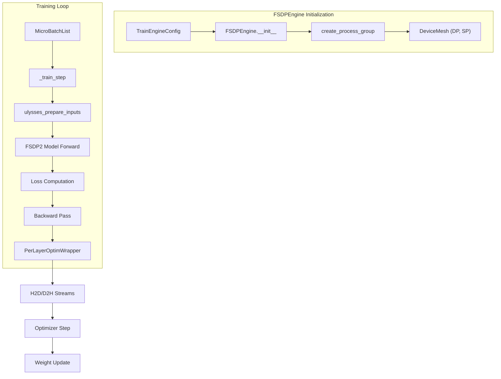
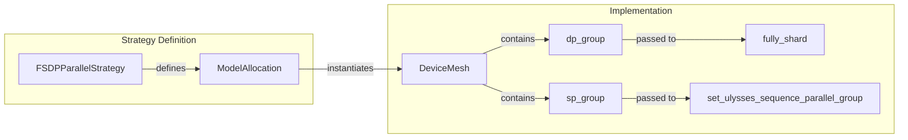

<!-- source: DeepWiki mcp.deepwiki.com · repo areal-project/AReaL · page 3.1 FSDP2 Engine · fetched 2026-10-21 -->

# FSDP2 Engine

Relevant source files

The following files were used as context for generating this wiki page:

- [areal/api/cli_args.py](areal/api/cli_args.py)
- [areal/engine/fsdp_engine.py](areal/engine/fsdp_engine.py)
- [areal/engine/fsdp_utils/__init__.py](areal/engine/fsdp_utils/__init__.py)
- [areal/engine/fsdp_utils/attn_impl.py](areal/engine/fsdp_utils/attn_impl.py)
- [areal/engine/fsdp_utils/grad.py](areal/engine/fsdp_utils/grad.py)
- [areal/engine/fsdp_utils/optimizer.py](areal/engine/fsdp_utils/optimizer.py)
- [areal/engine/megatron_engine.py](areal/engine/megatron_engine.py)
- [areal/experimental/engine/archon_engine.py](areal/experimental/engine/archon_engine.py)
- [areal/experimental/models/archon/moe_weight_converter.py](areal/experimental/models/archon/moe_weight_converter.py)
- [areal/models/transformers/qwen3_vl.py](areal/models/transformers/qwen3_vl.py)
- [areal/models/transformers/ulyssess_patch.py](areal/models/transformers/ulyssess_patch.py)
- [areal/tools/profile_archon.py](areal/tools/profile_archon.py)
- [areal/tools/profile_engines.py](areal/tools/profile_engines.py)
- [areal/tools/profile_fsdp.py](areal/tools/profile_fsdp.py)
- [areal/utils/data.py](areal/utils/data.py)
- [areal/utils/recover.py](areal/utils/recover.py)
- [areal/utils/saver.py](areal/utils/saver.py)
- [docs/en/best_practices/handling_oom.md](docs/en/best_practices/handling_oom.md)
- [docs/en/cli_reference.md](docs/en/cli_reference.md)
- [docs/zh/best_practices/handling_oom.md](docs/zh/best_practices/handling_oom.md)
- [docs/zh/cli_reference.md](docs/zh/cli_reference.md)
- [tests/experimental/archon/torchrun/run_ep_tests.py](tests/experimental/archon/torchrun/run_ep_tests.py)
- [tests/test_fsdp_grad.py](tests/test_fsdp_grad.py)
- [tests/test_per_layer_optim_step.py](tests/test_per_layer_optim_step.py)

The `FSDPEngine` is a high-performance training backend built on PyTorch's **FSDP2** (`fully_shard` API) [areal/engine/fsdp_utils/__init__.py:25-29](). It is designed for large-scale RL training, supporting advanced memory optimizations like per-layer optimizer streaming, CPU offloading, and Ulysses sequence parallelism.

## Architecture Overview

`FSDPEngine` implements the `TrainEngine` interface [areal/engine/fsdp_engine.py:219-220](). It manages the lifecycle of the model, optimizer, and distributed state. The engine is responsible for sharding the model across a `DeviceMesh`, handling sequence packing, and executing the forward/backward pipeline.

### Component Interaction Diagram
This diagram illustrates how the `FSDPEngine` coordinates internal components during a training iteration.

Title: FSDPEngine Internal Data Flow

Sources: [areal/engine/fsdp_engine.py:220-240](), [areal/engine/fsdp_engine.py:1015-1050](), [areal/engine/fsdp_utils/optimizer.py:19-40]()

## Parallelism & DeviceMesh

`FSDPEngine` uses a 2D `DeviceMesh` to combine Data Parallelism (FSDP) and Sequence Parallelism (Ulysses) [areal/engine/fsdp_engine.py:440-455]().

*   **FSDP2 Sharding**: Parameters, gradients, and optimizer states are sharded across the `dp` (data parallel) mesh dimension using `fully_shard` [areal/engine/fsdp_utils/__init__.py:62-106]().
*   **Ulysses Sequence Parallelism**: For long-context training, the `sp` (sequence parallel) dimension enables splitting sequences across GPUs. The engine patches HuggingFace models via `apply_monkey_patch` to insert Ulysses `AllToAll` collectives [areal/models/transformers/ulyssess_patch.py:149-154]().

### Parallel Strategy Entity Mapping
Title: Parallel Strategy Code Entities

Sources: [areal/engine/fsdp_engine.py:440-470](), [areal/models/fsdp/ulysses.py:91-95](), [areal/engine/fsdp_utils/__init__.py:100-105]()

## Memory Optimizations

### Per-Layer Optimizer & CPU Offload
To minimize GPU memory footprint, `FSDPEngine` supports the `PerLayerOptimWrapper` [areal/engine/fsdp_utils/optimizer.py:19-20](). 
1.  **Optimizer Streaming**: Optimizer states are kept on CPU. During the backward pass, as each layer's gradients are produced, they are streamed to CPU (D2H), updated, and streamed back to GPU (H2D) [areal/engine/fsdp_utils/optimizer.py:81-85]().
2.  **AnyPrecisionAdamW**: A specialized optimizer that allows momentum and variance to be stored in `bfloat16` with Kahan summation to maintain `float32` precision updates [areal/engine/fsdp_utils/optimizer.py:44-55]().

### Activation Checkpointing
The engine supports granular activation checkpointing through `wrap_policy` [areal/engine/fsdp_utils/__init__.py:62-83](). This recomputes forward activations during the backward pass to save memory at the cost of computation.

## Tree Training Support

For RL algorithms like GRPO that share common prompt prefixes across multiple samples, `FSDPEngine` supports **Tree Attention**.
*   **Trie Construction**: Samples are organized into a `TrieNode` structure [areal/engine/fsdp_engine.py:107-110]().
*   **Tree Attention Kernels**: The engine uses specialized Triton kernels to compute attention on the tree structure, avoiding redundant computation of shared prefixes [areal/models/tree_attn/functional.py:98-102]().
*   **FSDP Patching**: `patch_fsdp_for_tree_training` is used to ensure FSDP correctly handles the non-standard batch dimensions used in tree training [areal/models/tree_attn/module.py:103-106]().

## Key Functions & Classes

| Entity | Description |
| :--- | :--- |
| `FSDPEngine` | Main entry point; manages model sharding and training loop [areal/engine/fsdp_engine.py:219](). |
| `apply_fsdp2` | Applies `fully_shard` to transformer layers based on `wrap_policy` [areal/engine/fsdp_utils/__init__.py:62](). |
| `ulysses_prepare_inputs` | Handles sequence slicing and padding for Ulysses parallelism [areal/models/fsdp/ulysses.py:94](). |
| `AnyPrecisionAdamW` | Memory-efficient AdamW implementation with Kahan summation [areal/engine/fsdp_utils/optimizer.py:44](). |
| `DCPState` | Manages Distributed Checkpoint (DCP) loading and saving [areal/engine/fsdp_utils/checkpoint.py:84](). |

## Checkpointing and Recovery

`FSDPEngine` utilizes `torch.distributed.checkpoint` (DCP) for efficient, parallelized saving of sharded model states [areal/engine/fsdp_engine.py:19]().
*   **Saving**: `get_model_state_dict` extracts the sharded state, which is then saved via `dcp.save` [areal/engine/fsdp_engine.py:27-30]().
*   **Recovery**: The `RecoverHandler` uses `RecoverInfo` to locate the latest DCP checkpoint and restore the `TrainEngine` state, including optimizer steps and dataloader positions [areal/utils/recover.py:151-160]().

Sources: [areal/engine/fsdp_engine.py:1130-1160](), [areal/utils/recover.py:41-51](), [areal/utils/saver.py:23-33]()

---

